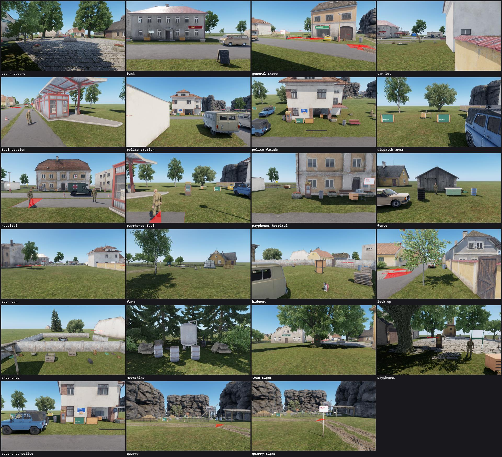
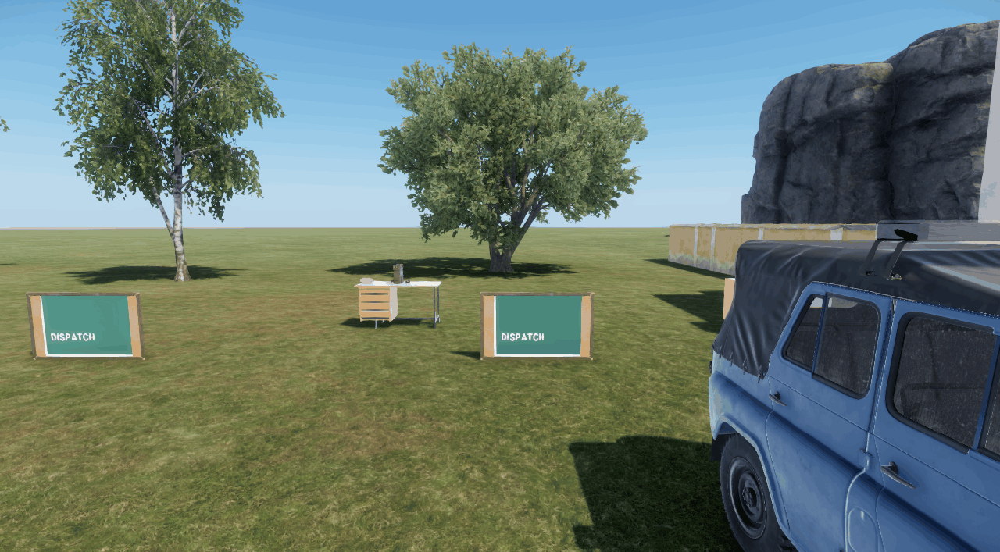
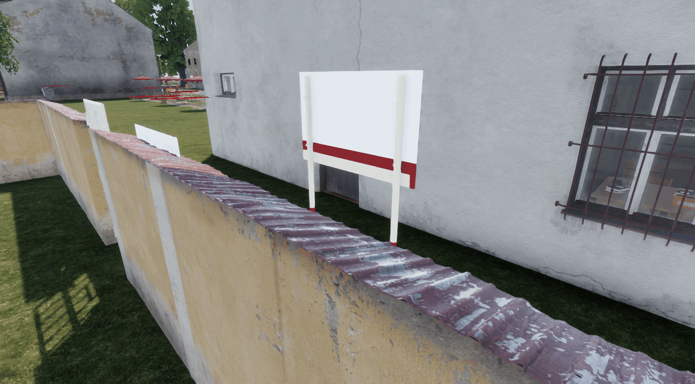
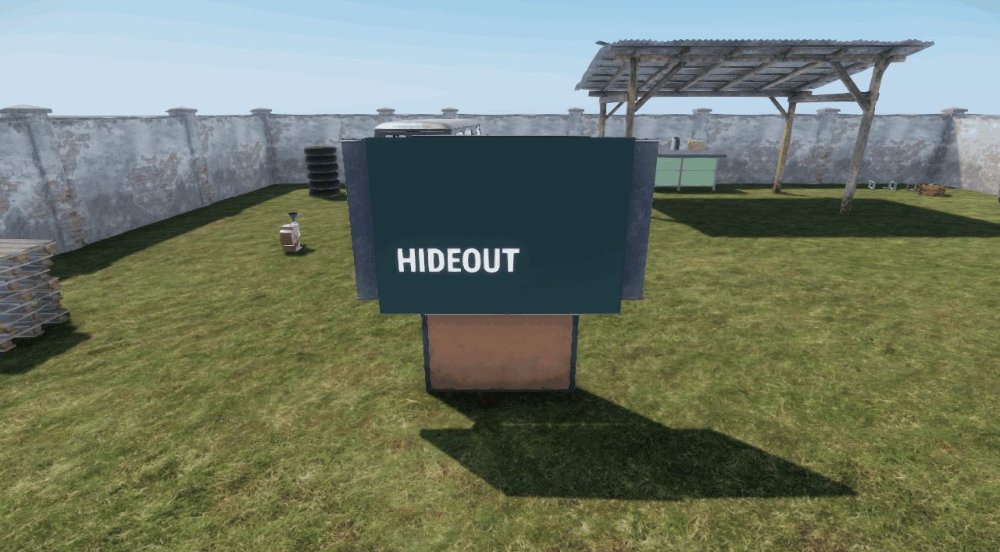
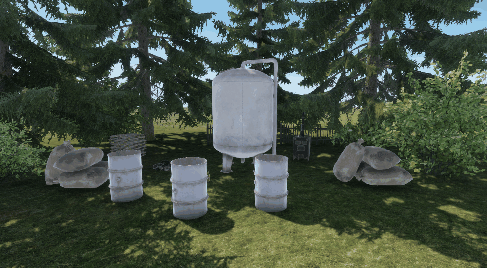
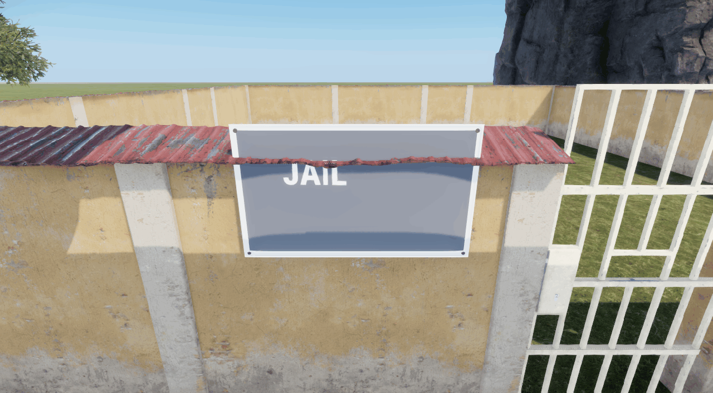
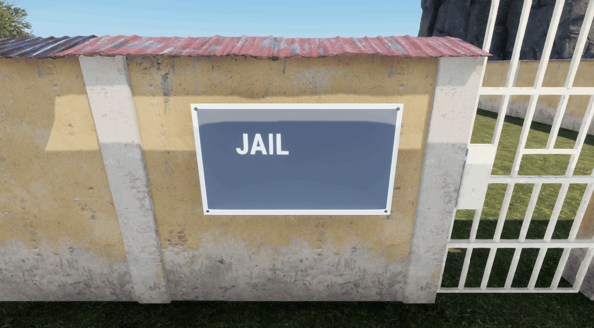
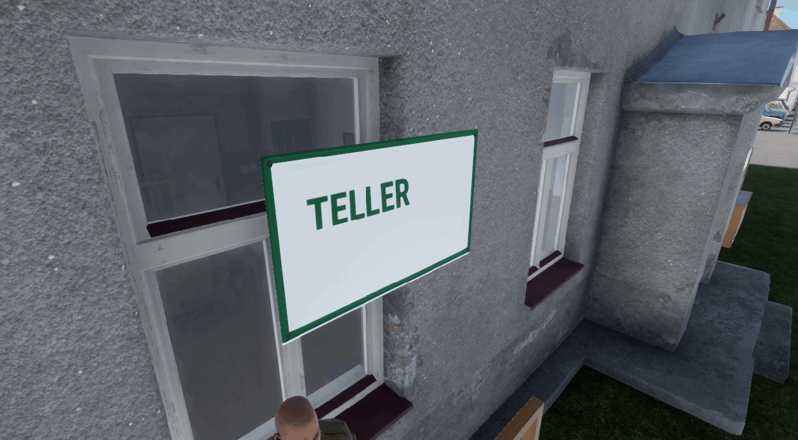
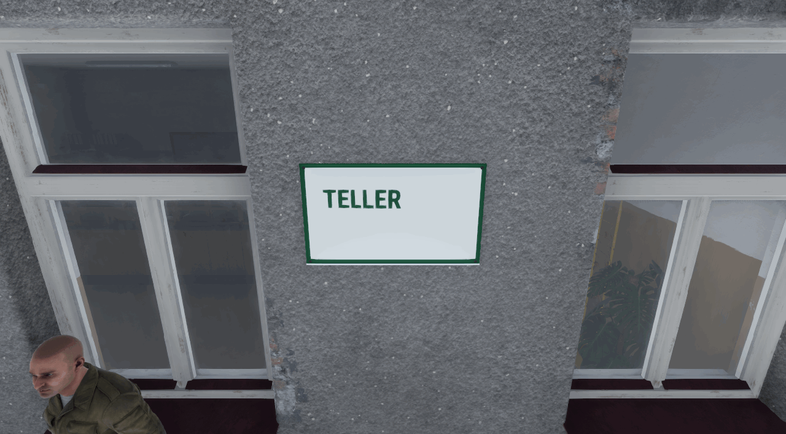

# Agent quality: why features came out janky, and what changed

2026-11-13. The maintainer's goal: "Right now it's pretty janky, but ideally the AI instructions
and harness make it so they are better and we can build new features instantly." This is the
audit behind the feature scaffold, the visual gate and the style guide that landed with it.

Short version: the tooling to see jank already existed (`tools\cli look`, 25 s an area, no
session). Nothing made an agent use it, nothing said what right looks like, and nothing stopped a
PR that had not been looked at. Every feature also started from a blank page. The changes make
looking the default, write the standard down, and generate the skeleton.

## 1. What looks janky (a `look all` on 2026-11-13)

`tools\cli look all`: 349 shots of 23 areas in 225 s, 0 flags raised. The flags catch broken
renders; everything below was found by reading the sheets.

| # | What | Where | Picture |
|---|---|---|---|
| 1 | **Indoor furniture standing on lawns.** Desks with a radio and a phone, lockers, a safe, boards, in the open with nothing around them. Reads as a test bench, not a place | dispatch area, police station, hospital front, hideout |  |
| 2 | **Boards on the grass.** The wanted board and three dispatch boards stand on the ground leaning on nothing or in front of a wall; a board belongs on a wall | police facade, dispatch area, hospital | [police sheet](agent-quality/police-facade-sheet.jpg), [dispatch sheet](agent-quality/dispatch-area-sheet.jpg) |
| 3 | **Interactables that are a lone small prop.** A green crate in a field is the crime trader, a meat grinder is the hideout machine, a brick in the grass is the breach charge | hideout, chop shop | [hideout sheet](agent-quality/hideout-sheet.jpg) |
| 4 | **Debug things in the street.** 18 entities named `*_Debug` or from a `/Debug/` prefab folder in village layers; the playtest "jail me" board shows a blank face behind the jail wall | jail, bank, the chain sites |  |
| 5 | **Signs that clip or cover.** The JAIL plate was cut through by the wall's roof cap; the TELLER plate hung across a window | jail, bank | fixed here, section 5 |
| 6 | **A sign that names a secret.** A teal `HIDEOUT` board on a box at the hideout, `BACK ROOM` beside it | hideout |  |
| 7 | **Placeholder-looking materials.** The moonshine still and its barrels render plain white | moonshine site |  |
| 8 | **Everyone in the same fatigues.** The clerk, the traders, the teller, the medics and the bystanders all wear one olive uniform | every area with an NPC | [store sheet](agent-quality/general-store-sheet.jpg), [hospital sheet](agent-quality/hospital-sheet.jpg) |
| 9 | **Scattered props.** Single crates and baskets two to five metres apart across a yard | hideout, chop shop | [hideout sheet](agent-quality/hideout-sheet.jpg) |
| 10 | **Sign styles drift.** Blue enamel plate, red and green fascias and chalk boards read as one town; the teal box board and the white post boards do not | hideout, market, jail | sheets above |

What looks right today, and is now the reference in `docs/style-guide.md`: the enamel `POLICE
STATION` plate and the `BANK` and `GENERAL STORE` fascias, the chalk A-boards, the cork wanted
board with paper posters, and the paper sheets of the UI kit (form R-89, the sign card, the ATM).

From the committed pictures: the robbery scene before #740 (a drill, a bell jar and a sack on the
lawn beside the bank, `website/public/docs-images/robbery-scene/before-trailer-vault.jpg`) is the
same pattern as rows 1, 3 and 9. It was fixed only after the maintainer saw it in a trailer.

## 2. How features get built, and where it slips

Read: `AGENTS.md`, `docs/agent-budget.md`, every skill and agent file, `docs/worktrees.md`,
`agent-box/README.md`, the visual and placement docs, the asset pipeline, and 16 PRs end to end
(#882 to #889, #892, #893, #896, #857, #740 to #743).

**What the 16 PRs show**

| Fact | Count |
|---|---|
| PRs whose body embeds a picture | 6 of 16: 3 of the 12 feature PRs (#892, #893, #896) and 3 of the 4 placement clean-ups. The other 10 name image paths or show nothing |
| Feature PRs with a before and after pair | 0 of 12 |
| PRs opened by a maintainer quote ("mess", "janky", "half way off the desk") | 3 (#740, #742, #743): found by a human looking, after merge |
| Feature PRs where the self-review (`interrogate`) found a real defect | 5 of the 7 that ran it (#882, #883, #884, #886, #857) |
| PRs that merged a known visible gap | 6 (#892 titled "WIP", #893 cuffs invisible in the hand, #885 placeholder model, #887 voice unverified, #896, #886) |
| PRs that merged `main` at least once before shipping | 14 of 16 |
| Red-proof asserted without a pasted failure line | 2 (#885, #743) |
| File kinds a feature PR re-creates by hand | 9: script, `Feature.md`, config class and `.conf`, string rows, tests, proof verb, `features.md` row, `playtest.md` line, `ResetStatics` call |

**Files most feature PRs touch** (of the 16): `docs/features.md` 16, the test registry 15,
`docs/debug-log-triage.md` 13, the string table 10, `LF_StaticReset.c` 7, `LF_AgentHarness.c` 6,
`core-pack-inventory.md` 6, `agent-box/harness.mjs` 5. In the last ten days `tools/cli.mjs` took
66 commits and `LF_AgentHarness.c` 63. The docs, string table and registry already have merge
drivers; the rest did not.

**Effort per feature, from the pool log** (`node tools/feature/effort.mjs <slug>`; the span is the
first pool run to the last, so it excludes design and the coding before the first test):

| Worktree (PR) | Test runs | Failed | Sessions | Session min | Queue min | Span min |
|---|---|---|---|---|---|---|
| board-stolen (#888) | 5 | 1 | 2 | 3.7 | 0.2 | 12 |
| board-portraits (#886) | 7 | 1 | 2 | 5.9 | 0.4 | 16 |
| phone-call-core (#882) | 6 | 1 | 2 | 8.8 | 1.0 | 21 |
| phone-callbacks (#883) | 7 | 1 | 2 | 9.2 | 0.2 | 20 |
| m3-org-rights (#857) | 13 | 6 | 0 | 0 | 0.7 | 15 |
| asset-deployable-spikes (#892) | 17 | 4 | 3 | 6.5 | 6.6 | 32 |
| asset-gadget-cuffs (#893) | 14 | 3 | 5 | 17.7 | 6.9 | 42 |
| spike-npc-dialogue (#896) | 9 | 1 | 2 | 9.8 | 3.1 | 44 |
| phone-voice (#887) | 11 | 2 | 8 | 24.6 | 7.4 | 128 |
| board-feed (#884) | 11 | 2 | 6 | 10.1 | 12.8 | 134 |

Median: 10 test runs, 2 sessions, 9 session-minutes, 26 minutes from first run to last. The
long tail (#884, #887) is sessions: each extra session is a queue wait plus a boot.

## 3. Root causes

1. **Nobody had to look.** `look` was documented as available, not required. `wt ship` checked
   tests and placement numbers and never the PR body. The audit passes "on a surface" when it is
   the wrong surface, and `look` raises no flag for a desk in a field. So the first reader of the
   scene was the maintainer, after merge.
2. **No written standard for "looks right".** `agent-area-polish.md` covers fixing placement in
   existing areas. Nothing said where a board, a desk or a secret belongs, which sign type does
   which job, or that a debug fixture has no place in the street. Each agent decided alone, and
   the answer was usually "next to where I was testing".
3. **Every feature started from a blank page.** Nine file kinds written by hand per feature, in
   whatever shape the agent remembered: a `Feature.md` with only a heading, red-proofs asserted
   rather than observed, a missed `ResetStatics`, a proof verb with no shots. That is time spent
   on boilerplate instead of on the look, and a new inconsistency each time.
4. **Review happened, but its findings had no home.** `interrogate` finds real defects (5 of 7).
   Its report lived in a subagent's reply; nothing carried it to the PR and nothing stopped a
   ship with a finding open. "Reviewer reports got lost" is this.
5. **Shared lists and one machine.** 14 of 16 PRs merged `main` before shipping. Features append
   to the same handful of lists, and every extra session waits in the pool queue.

## 4. What changed

| Cause | Change | Where |
|---|---|---|
| 1 | `wt ship` checks the PR body before the gate: a body file for any `addons/` change, a `## Manual testing` section, an embedded picture when the diff touches a layer, prefab, asset, layout, sheet script or sign config (a path in backticks does not count; `No screenshots: <reason>` waives it in the open), and every embedded repo picture must be committed | `tools/lib/pr-quality.mjs`, `tools/cli.mjs` |
| 1 | `tools\cli evidence <issue> before\|after <area>` keeps a `look` picture at 1280 px and under 500 KB in `website/public/docs-images/<issue>/` and prints the markdown; `evidence <issue> table` prints the before and after table. A pair costs two `look` runs, about 50 s, and no session | `tools/commands/evidence.mjs` |
| 1, 2 | The `polish` skill: the loop (look, place, look, fix, keep the pair) and a checklist walked against the pictures: place, thing, sign, sheet, item, scene | `.claude/skills/polish/SKILL.md` |
| 2 | The style guide, written from what looks right today: where each kind of thing goes, which sign for which job and what paint, how a sheet is built and worded, items, people, pictures | `docs/style-guide.md` |
| 2 | `validate-player-props`: a new `*Debug*` entity or `/Debug/` prefab in a village layer fails. Today's 18 are a baseline that can only shrink | `tools/validation/validate-player-props.mjs` |
| 2 | `validate-ui-kit`: a new `.layout` outside the UI kit fails unless it is listed as a non-screen exception with a reason, and an exception must use the theme fonts. The kit itself already existed (`LF_UIScreen`, `LF_UITheme`); this stops the next hand-drawn menu | `tools/validation/validate-ui-kit.mjs` |
| 3 | `tools\cli feature new <Area> <Name> --kind logic\|world\|ui\|item --issue N`: the script skeleton with one logging path and `ResetStatics`, the action or the UI kit sheet, a green LOGIC test and a failing WORLD test with `PENDING` red-proof slots that `validate-tests` refuses, the session proof module, string rows (then `regen-localization`, `regen-tests`), the `Feature.md` section, the `features.md` and `playtest.md` lines, the `ResetStatics` call, the PR body and an ordered checklist. `feature check` lists the `TODO(scaffold)` markers left; ship refuses a body that still has one | `tools/feature/new.mjs` |
| 3 | The feature playbook is now a fixed order: design, scaffold, look, place, build, test, look, review, ship, each with its check | `.claude/skills/life-mode/playbooks/feature.md` |
| 4 | Review findings go in `tmp/review-<slug>.md` as tick boxes. Ship refuses an open finding, or a ticked one with no `fixed:` or `dismissed:` reason, and appends the file to the PR under `## Review findings`. The playbook says when a review is due: replication, an RPC, persistence, money, inventory, GUIDs | `.claude/skills/interrogate/SKILL.md`, `tools/lib/pr-quality.mjs` |
| 5 | A new CLI command is one file in `tools/commands/`, discovered by the dispatcher; `feature` and `evidence` are the first two and touched no list | `tools/cli.mjs` |
| 5 | `LF_StaticReset.c`, `core-pack-inventory.md` and `decisions.md` use the line-merge driver that keeps both sides' appended lines (tested on two branches each adding a reset call: both kept, no conflict) | `.gitattributes` |
| all | `AGENTS.md` gains golden rule 11 (what a player sees is looked at before it ships), a five-line "Building a feature" section and two command rows. The PR template gains In-world first, Screenshots and Review | `AGENTS.md`, `.github/PULL_REQUEST_TEMPLATE.md` |
| measure | `node tools/feature/effort.mjs <slug>` prints the table in section 2 for any worktree | `tools/feature/effort.mjs` |

No safety rule was loosened. `feature new` and `evidence` refuse the main checkout; nothing here
touches the worktree, `safe-rm`, persistence or `Documents\My Games` rules.

**Proof of the checks** (`tools/validation/agent-quality-selftest.mjs`, in `tools\cli validate`).
Observed red, 2026-11-13: with the picture rule disabled it printed `a layer change with no
picture was accepted`; with the scaffold appending string rows after the table's closing braces it
printed `the string table no longer ends with its closing braces`. Restored, green.

## 5. Two spots fixed with the new loop

`look` before, `tools\cli place against ... --move`, `look` after, `evidence`: about four minutes
for both, no session.

| Before | After |
|---|---|
|  |  |
|  |  |

- `Sign_Jail`: `place against BrickWall_01_4m@236,226 --move Sign_Jail --near 234.9,228 --hang 0.9`.
- `Sign_Atm`: `place against MunicipalOffice_E_01 --move Sign_Atm --near 177.7,259.3 --hang 2.0 --scale 0.7`.
  The first two tries (above the window) were refused by the tool: rays stopped before the face.

## 6. Measured: one feature built with the scaffold

The proof feature is #481, the in-game credits, built as a notice a player reads in the town.
Its numbers against the table in section 2 are in section 8, added by the PR that ships it.

## 7. What remains

Ordered by how much jank or time each would remove.

1. **Rows 1 to 3 of the jank list are still in the town.** The dispatch desk and boards, the
   police boards and the hideout props need a home: an awning or a room, boards hung with
   `place against --hang`. Each is an area PR under `docs/agent-area-polish.md`, now with the
   style guide as its reference. Proofs that hard-code a board position (`BOARD_AT` in the
   wanted-poster proofs) move with it.
2. **The 18 baselined debug entities** (`tools/validation/player-props-baseline.json`): rename
   and dress the ones players use, move the rest to the annex.
3. **NPC clothing.** One civilian loadout set per role. Needs asset work, not placement.
4. **The white still and barrels**: a material fix on the moonshine props.
5. **Three central lists still take a line per feature**: the verb chain in `LF_AgentHarness.c`
   (63 commits in ten days), `RegisterPersistencePayloads` (ordered and positional, so it stays
   a list by design) and the installs in `LF_GameModeRoleplay.c`. The harness chain should become
   per-feature handler classes discovered like the test registry. `LF_StaticReset.ResetAll`
   could be generated from every `static void ResetStatics()`, but 14 of the 79 classes that have
   one are not called today, so that needs a pass over each before it is switched.
6. **GitHub ignores merge drivers** (#722), so a PR can still show `CONFLICTING` on files the
   drivers resolve locally; `prs heal` covers it.
7. **UI pictures still need a session.** `look` cannot capture a sheet. A client started with
   `-world` and no server (listed as untried in `docs/visual-testing.md`) would give UI shots in
   about the time of a `look`.
8. **The scaffold does not write a config class.** A new tunable still follows
   `tools/config/schema.mjs` by hand (attribute, handled-keys list, schema and inventory regen).
   Worth adding once two more features show the common shape.
9. **A size table per prefab** would turn "a 1.4 m sack" from a judgment into a number
   (`docs/visual-testing.md` already notes it).
10. **Nothing judges taste.** The checklist makes an agent look and tick; a second agent reading
    only the pictures (the area-polish reviewer) is the next step for anything headed to a
    trailer.
