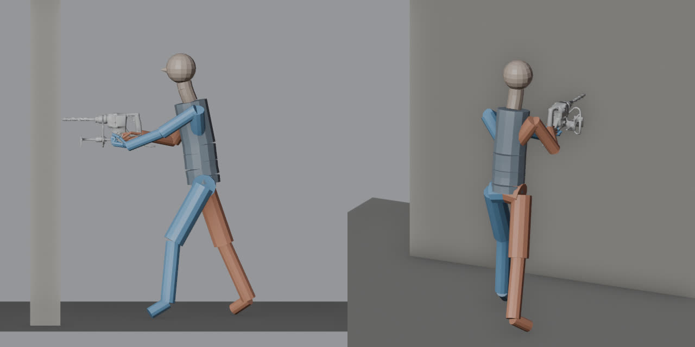
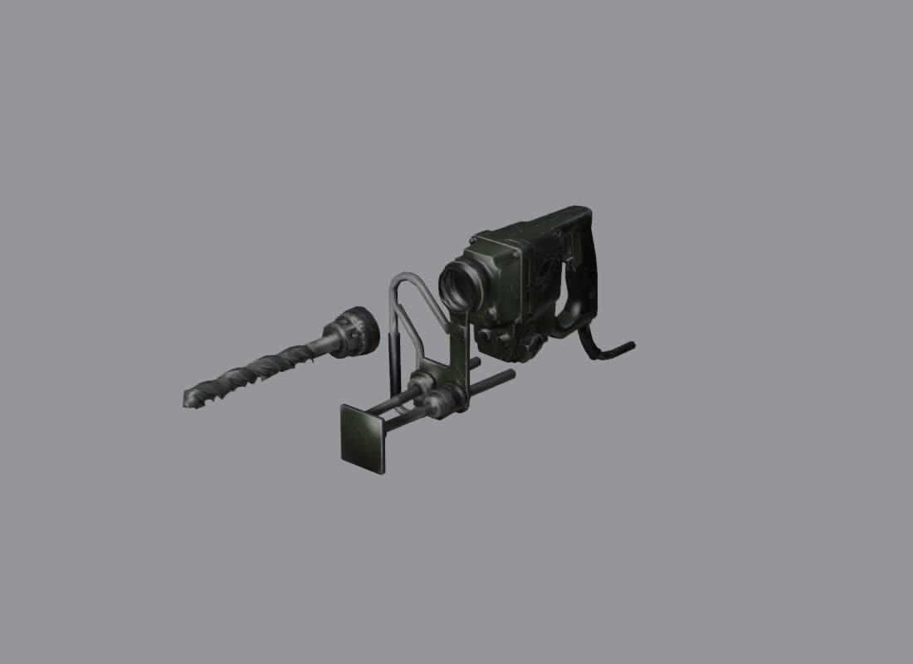
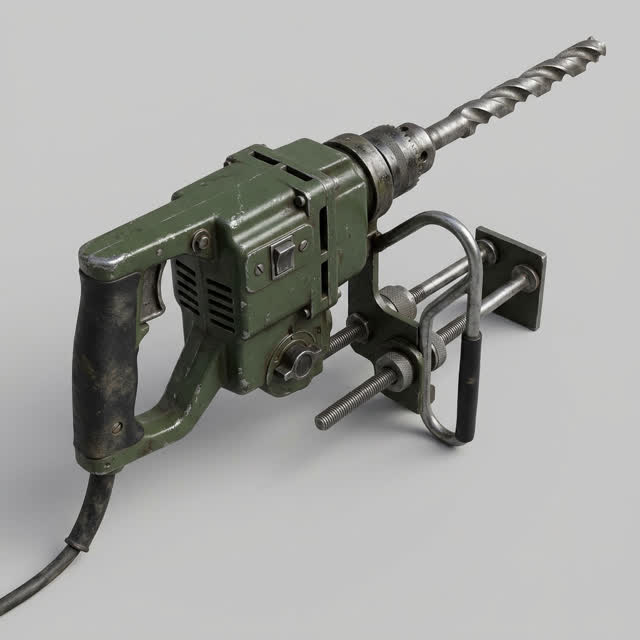
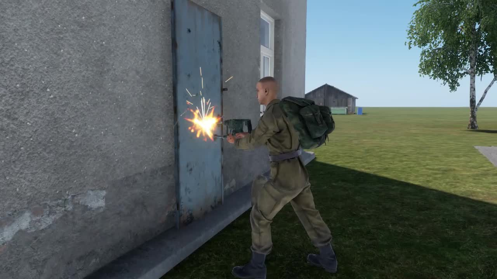
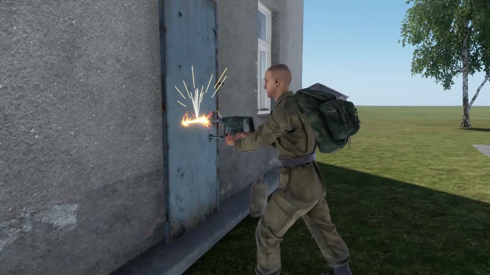

# Asset animation spike: a drilling scene from a spec

Spike of 2026-11-13 and 14 for the animation epic (#340), on top of the asset pipeline (#339).
Question: can the pipeline take an asset to a scene that moves, with the mechanical steps in
`tools\cli asset` and the judgement steps in a playbook? The maintainer's example was "a drilling
animation where the character pushes the drill into the wall, with the front spinning and sparks
coming off, with sound".

Short answers:

- **It works end to end.** A robber who drills the bank vault braces against the wall with both
  hands on a drill held at chest height; the chuck and bit spin, sparks fly from the bit where it
  meets the door, and a motor and a grinding loop play from the drill. It all stops when the work
  ends. A second client sees and hears it, and a client that joins while a drill runs shows it
  running. Proven on a dedicated server with two clients, filmed with sound.
- **The character animation is custom, and no rig or animator was needed.** A `.txa` (the
  animation source Workbench compiles) is plain text holding one parent-relative rotation per bone
  per frame. The pipeline solves poses on the vanilla skeleton itself and writes the `.txa`;
  Workbench compiles it headless. The 2026-11-10 research listed "no character rig in Blender" as
  the first blocker for custom clips. It is gone for this kind of clip.
- **It is a pose script, not motion capture.** Right for a braced working pose, a hold, a reach.
  Not right for anything with real weight transfer.
- **The stage is generic.** The drill is three blocks of JSON. A hinged vault door is one bone with
  `"motion": "hinge"`.

## What was built

| Piece | Where |
|---|---|
| The stage: `tools\cli asset anim <slug> [--fix]`, last stage of `asset run` | `tools/assets/pipeline/anim.mjs`, `asset.mjs` |
| Moving parts: a bone per part, sockets, the part split off and skinned, a review render of the part moved | `anim.mjs` `withAnim`, `blender/clean.py` |
| Pose solver and `.txa` writer on the vanilla skeleton (arm and leg IK, hand orientation, finger curl) | `pose.mjs`, `skeletons/character.json` |
| Pose preview: stick figure, floor, wall and props, three views per key frame | `blender/pose_preview.py` |
| Character workspace generator (in, loop, out as a custom loiter) | `anim.mjs` `workspaceFiles` |
| The vfx hook: a looping sparks effect as text | `vfx.mjs` |
| Runtime: replicated on/off and pose, bones turned per frame, effects and sound loops per client | `Feature/AssetAnim/LF_AssetAnimComponent.c`, `LF_AssetAnim.c` |
| The drill scene in the vault robbery | `Feature/Crime/LF_DrillScene.c`, `LF_Bank.c`, `LF_WorkAnim.c` |
| Offline selftest (ten red-proofs), part of `validate` | `tools/validation/asset-anim-selftest.mjs` |
| Test, harness verbs, session proof | `LF_Test_AssetAnim`, `LF_AssetAnimHarness.c` (`animhold`, `animoff`, `animseen`), `agent-box/proofs/drill-scene-proof.mjs` |
| Playbook | `docs/asset-pipeline/animation.md` |

## The four questions

### 1. The item's own animation: script rotation

A bone of the item's model, turned by script every frame on each client
(`Animation.SetBone(entity, bone, angles, translation, scale)`), driven by one replicated bool.

| Route | Verdict |
|---|---|
| Script rotation of a skinned bone | **Used.** Works on a plain `GenericEntity` item with no animation component. The mod already did this for NPC mouths (`LF_DialogueVoice`). Angles are pitch, yaw, roll about the bone's own axes; the clean stage gives bones an identity rest rotation, so those are the model's axes. Measured in a session: the chuck's x axis sweeps in the model's xy plane and its z component stays 0, a clean spin about the bit |
| Procedural animation (`ProcAnimComponent`, `.pap`, signals) | Not used. The lookup found the component's API but no vanilla prefab or `.pap` to copy from (rotors and wheels are not built that way in the files read), so it would have been guessed |
| An animation graph on the item with a looping `.anm` | Not used. It needs a graph, an instance and a compiled clip per item to do what five lines of script do, and nothing would drive it for a late joiner without script anyway |

The frame event is on only while something moves. A hinge or a slide uses the same component: it
eases to its end while the asset is active and back when it is not.

### 2. The character animation: a generated clip on the existing loiter route

- **Route into the character:** the same as the CPR (#512) and the work poses (#513): a small
  workspace attached to the player graph as a custom loiter (`StartLoitering(CUSTOM)` on the
  owner, which the base game replicates and saves for late joiners). `PlayPostGraphAnimation` is
  closed for players (no `CharacterAnimGraphComponent`). The stage writes the five workspace files.
- **Vanilla clip or custom:** #513 shipped the vanilla demolition loop, bent over the ground with
  empty hands. It does not read as drilling a wall. No vanilla clip holds a tool at chest height,
  so this is custom.
- **How the clip is made:** `clips/push_loop.json` says where the hands, feet and hips are at two
  key frames. `pose.mjs` solves the joints and writes `Drill_push_loop.txa`; Workbench compiles
  the `.anm` through the same headless plugin the model import uses. The solver's forward
  kinematics were checked against the one `.txa` the repo already had
  (`p_2h_carry_logsmall.txa`): its frame 0 equals the skeleton's rest rotations to six decimals,
  and its untouched prop bones land on their rest positions.
- **A scripted IK hold** was the third option. Not needed: the clip puts the hands in a fixed place
  in the character's own space and the drill is held at that place.

The pose as the stage previews it, and the moving part pulled out of the model in the clean
stage's review:




### 3. The effect: an authored `.ptc` on a socket

A `.ptc` is text and needs no build. The stage writes `Particles/LF/Drill_fx_bit.ptc` from five
numbers in the spec (rate, speed, lifetime, streak width, spread), using vanilla spark materials;
the emitter layout follows the vanilla `electrical_short_small_loop.ptc`. The component spawns it
on the `fx_bit` socket of the drill (`ParticleEffectEntitySpawnParams.Parent` and `PivotID`) on
each client and deletes it on stop. Vanilla has electrical shorts and bullet impacts but no
grinding effect; the helicopter rotor's metal collision effect is the nearest and is far too big.

### 4. The sound: two loops from the sound stage

`tools\cli asset sound drill`: a motor loop and a grinding loop, two takes each, one picked from
the spectrogram (even density, a clean loop seam; the rejected grinding take had a hole of
silence). The component starts both on the drill on each client and retries every two seconds
when the listener was out of range or had only just joined.

## Tied into the vault robbery

`LF_Bank.Rob` already laid the drill beside the robber and started `LF_WorkAnim` for six seconds.
Now, when the work animation starts, `LF_DrillScene.Begin` holds that same drill in front of the
robber (level, at the hands the clip uses) and switches it on; `LF_WorkAnim.End` calls
`LF_DrillScene.End` on every exit (finished, the robber went down, left reach, disconnected,
timed out), which switches it off and lays it back where it was, so the evidence flow is
unchanged. The cash van box uses the same path. The server owns all of it; no client request was
added.

The drill itself replaced the scaled vanilla bench drill: Meshy image-to-3D from the concept the
maintainer picked (#1, pistol grip, green), 0.62 m, 6,000 triangles.



## Proof

`session.mjs drill-scene-proof --audio` on `up --clients 1 --profile full --sound`, passed
2026-11-14:

| Check | Result |
|---|---|
| Client 1 has the server hold a running drill; client 2 **joins late** | Client 2 shows it held at chest height, running, 1 effect and 2 sound loops live, the chuck's axis different between two looks |
| Client 1 drills the vault, client 2 watches | Both show the drill held, running, sparks and both loops live, the chuck turning |
| The work ends | Both show it off, released, on the ground, no effect or sound left; the server logged the scene starting and ending with "work finished" |
| Sound | The clip's audio track is client 2's own game sound: mean -23.3 dB, peak -6.5 dB |

Two frames of the clip (client 2's camera):




Also green: `LF_Test_AssetAnim` (red-proofed), the work, vault and drill-size tests, and
`asset-anim-selftest`.

Two bugs the session found that no test would have:

- **The client that dropped the drill showed it on the ground.** The engine puts an item that has
  just left an inventory down and wakes its physics after the pose arrived. The component now
  re-asserts the pose while it is held.
- **A late joiner heard nothing.** Its listener was not ready when the state arrived. Hence the
  retry.

## Quality verdict

**Good enough to ship as the vault drill scene. The pose is readable and the drill is the right
object; the hands are approximate.**

| Aspect | Verdict |
|---|---|
| The drill model | Right object, right period, textured. The trailing cable ends in the air |
| Reads as drilling a wall from ten metres | Yes: braced stance, tool at chest height on the door, sparks |
| Hands | The right hand is at the pistol grip, the left under the housing. Close up, fingers do not wrap the handle exactly |
| Motion | A 1.3 s lean of a few centimetres. Calm; a real drill would shake the arms |
| Spin | A blur at 1440 degrees a second, as a motor should be |
| Sparks | Read well against the door; they fan upwards, not back along the bit |
| Sound | Judged from spectrograms and levels only. **A person has to listen** |
| Transitions | In and out are 0.5 s blends from a standing pose; the feet slide into the stance |

## Cost

- **Meshy:** 30 credits for the image-to-3D (balance 465 to 435). The concept sheet (40) was paid
  earlier in the concept batch.
- **ElevenLabs:** 4 generations; the account counter moved from 6,167 to 6,327 of 40,000, so 160
  credits.
- **Machine time:** generate 90 s, clean 5 s, import 18 s, three clips compiled in about 60 s, a
  test loop of 10 s, a proof session of about 4 minutes.
- **Agent time:** most of a night, nearly all of it building the stage. With the stage in place a
  second asset is a spec block, one or two clip files and a film.

## Blockers and limits

1. **A pose script is not an animator.** Anything with steps, falls or swings still needs one, or
   a vanilla clip.
2. **Nothing checks that hands close on a handle.** The preview is a stick figure; only a film
   shows the fingers.
3. **The asset is held in the world, not in the hand.** A custom loiter holsters what the character
   holds, so the drill is posed where the clip's hands are. It cannot follow a character that
   moves. A moving hold is the money bag's route (a carry graph on the `Gadget` binding).
4. **In and out clips start from a made-up standing pose**, not from the player's real pose, so
   the first frames blend through it.
5. **Sparks have no direction.** The effect is not oriented by the socket's rotation; it opens
   upwards.
6. **Pool pressure.** A second client could not join in two of five sessions (no free RAM while
   other agents ran sessions), and the test pool refused to start at 3.8 GB of free disk until the
   merged worktrees were pruned.
7. **Licence gate (#664)** applies to the generated drill model and the two sound loops as to the
   other generated assets.

## Applying it to the vault door hinge

The vault door asset is one model with a door leaf that swings. In its spec:

```json
"anim": {
  "bones":   [{ "name": "leaf", "motion": "hinge", "axis": "y", "angle": 95, "seconds": 2.5,
                "pivot": [-0.45, 0, 0], "box": [-0.47, 0, -0.06, 0.47, 2.0, 0.06] }],
  "sockets": [{ "name": "fx_hinge", "pos": [-0.45, 1.0, 0] }],
  "sounds":  [{ "event": "SOUND_LF_VAULT_DOOR_LP", "project": "{GUID}...acp" }]
}
```

1. Clean stage: the leaf becomes its own bone at the hinge line; check `review/part_leaf.png`
   (the door drawn swung open, the frame left behind).
2. `asset anim vault-door --fix` writes the component into the door prefab.
3. Feature code calls `LF_AssetAnimComponent.SetActive(true)` when the vault opens and `false`
   when it is repaired. The leaf eases open in 2.5 s on every client; a late joiner gets the open
   state and plays the swing once on arrival.
4. Two things to add for a door, both small: a **collider that moves with the leaf** (today the
   collider is one box for the whole model, so an open door would still block; either a second
   prefab state or a collider per bone in the clean stage), and **snap on join** (a late joiner
   should see the door already open, not swinging).
5. A one-shot creak is better than a loop for a door: the component plays loops only, so add a
   one-shot event on the change of state.

## Breakdown to generalise it

| # | Piece | Notes |
|---|---|---|
| 1 | **Hold, place, throw (the money bag)** | `hold.profile` (the vanilla jerrycan carry on the `Gadget` binding, grip socket at its handle), `actions.place` and `actions.throw` with the vanilla one-hand clips. The spec side is validated; the runtime is next |
| 2 | **Hinge extras for the vault door** | Collider per bone, snap on join, one-shot sounds |
| 3 | **Start a clip from the player's pose** | Read the standing pose from a vanilla idle `.anm` instead of a made-up one |
| 4 | **Oriented effects** | Give the socket a rotation and pass it to the effect |
| 5 | **A skinned preview** | Skin the vanilla test character to the solved pose in Blender, so fingers and shoulders show before the film |
| 6 | **More templates in the vfx hook** | Smoke, dust, a welding arc |
| 7 | **`asset verify`** | One command that films an asset's proof and writes the contact sheet |

## Manual testing left

In the PR. In short: drill the vault and the cash van box with a second player watching, listen to
the two loops, look at the hands close up, cancel by walking a downed robber out of it, and bag the
drill afterwards.
