# Asset pipeline spike: a roadmap item to a usable Reforger asset

Spike of 2026-11-12 and 13 for the asset pipeline epic (#339) and the weapon pipeline epic
(#341). Question: can an agent take a roadmap item ("police taser") to an asset a player can pick
up, hold and use, with command-line tools for the mechanical steps and a playbook for the
judgement steps?

Short answers:

- **The pipeline works end to end.** `tools\cli asset` took a prompt to a textured, skinned
  weapon model with LODs, a collider and the vanilla pistol's skeleton and sockets, imported it
  through a hidden Workbench with no click, and scaffolded prefabs that load and fire as a
  one-shot pistol. About two minutes of machine time and 45 Meshy credits.
- **The stun works.** A hit from the taser puts a player down for 8 seconds through `LF_Downed`,
  costs no health, cannot be given up from, and ends by itself. Proven on a dedicated server with
  two clients.
- **The model is a placeholder, not a taser.** Text-to-3D produced a stubby pistol twice. The
  second has a yellow two-port panel, on the side of the grip instead of the front. It is the
  right size, textured, and sits in the hand, but a player would call it a small pistol, and the
  fingers lie across the grip instead of closing around it.
- **What decides quality is the generation, and that is the step the tooling cannot fix.**
  Everything after it is deterministic and cheap to rerun.

The use case stayed the taser; the road-spikes fallback was not needed.

## What was built

| Piece | Where |
|---|---|
| One entry point, five resumable stages | `tools/assets/pipeline/asset.mjs` (`tools\cli asset new\|run\|status\|doctor\|selftest`) |
| Meshy client: preview and refine, credit ledger, 300-credit cap, key never logged | `meshy.mjs` |
| Headless Blender clean-up | `blender/clean.py` |
| Checks on the clean report and on the compiled model | `checks.mjs`, `xob.mjs` (a reader for the `.xob` head: bounds, materials, bones, sockets) |
| `.meta` writer with fresh GUIDs, `.emat`, hidden Workbench rebuild | `meta.mjs`, `import.mjs`, `wb/LF_AssetImportPlugin.c` |
| Prefab scaffold for a pistol-skeleton weapon | `prefab.mjs` |
| Kind profiles (`weapon` proven; `gadget`, `deployable` written, not run) | `kinds.mjs` |
| Offline selftest, part of `validate` | `tools/validation/asset-pipeline-selftest.mjs` |
| Playbook and review checklist | `docs/asset-pipeline/` |
| The stun and the taser | `Feature/Police/LF_Stun.c`, `Prefabs/Weapons/Handguns/Taser/`, test `police/stun`, `session.mjs taser-proof` |

## The run, stage by stage

| Stage | Result | Machine time |
|---|---|---|
| concept | Spec checked; 15 credits estimated on the lite model, 30 on `latest` | under 1 s |
| generate, attempt 1 (`meshy-6-lite`) | A modern compact pistol. Rejected: wrong object, wrong decade | about 2 min, 15 credits |
| generate, attempt 2 (`latest`, prompt rewritten) | A boxy pocket pistol with a yellow port panel on the grip. Accepted as a placeholder | 85 s, 30 credits |
| clean | 16,699 source triangles to LODs of 8,000, 4,000 and 1,600; 0.170 x 0.140 x 0.035 m; 1024 px `_BCR` and `_NMO`; convex collider of 18 faces; six bones, four sockets; the trigger split off and skinned to `w_trigger` | 4 s |
| import | `.xob`, two `.edds`, `.emat`, all `.meta` files; the read-back found every bone, socket, the material and the collider | 17 to 24 s |
| prefab | Weapon, magazine, projectile, magazine config, ammunition list entry | under 1 s |

Attempt 1 and attempt 2 as Meshy returned them:

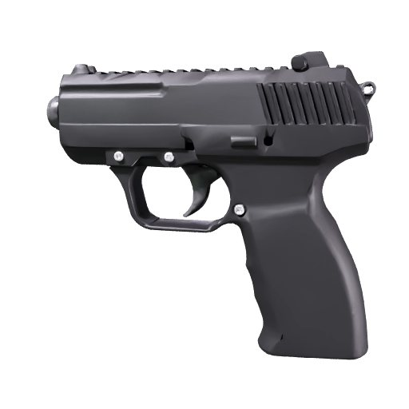
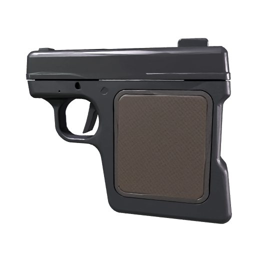

After the clean stage: the socket review (red muzzle, blue eye, the yellow frame is the vanilla
M9's bounds), LOD0 from the side, and the lowest LOD.

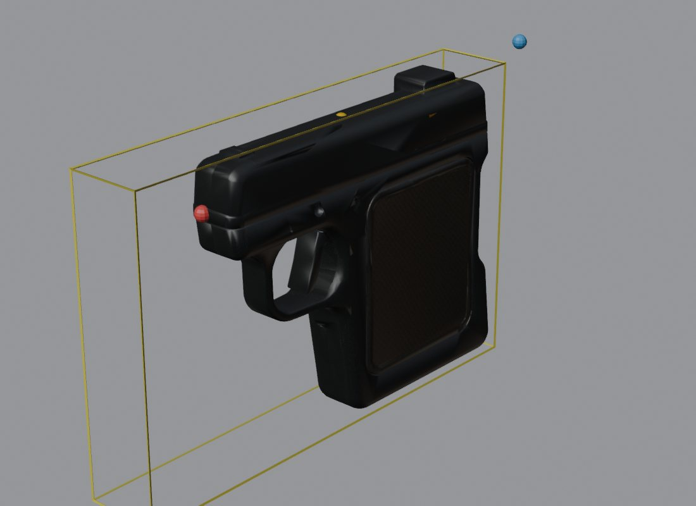
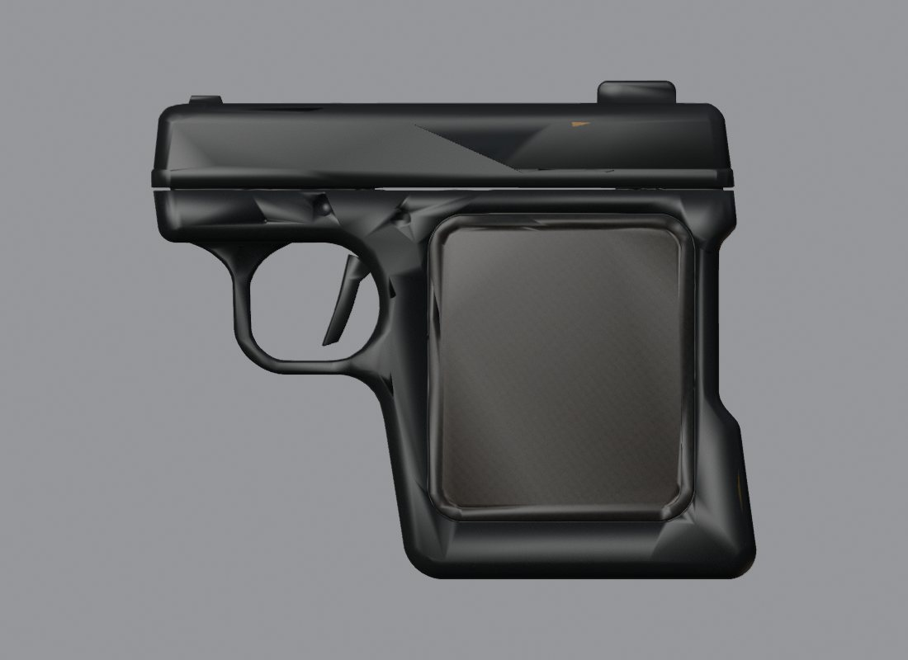
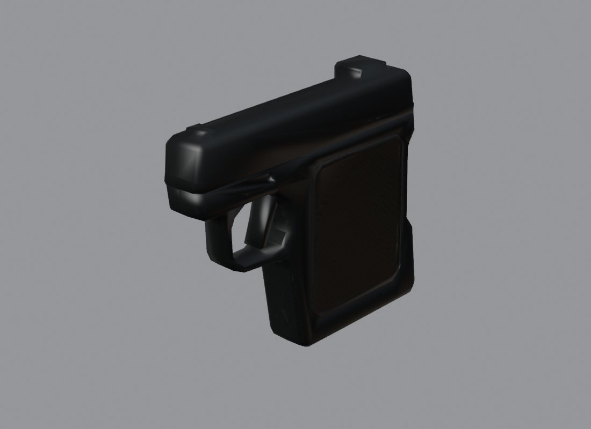

## Credits and time

- **Credits:** 45 for the taser (15 + 30). The account went from 1,100 to 1,055, read from
  `GET /openapi/v1/balance` after the run. The cap of about 300 per asset was never near.
- **Machine time per asset:** about 2 minutes for one attempt through to prefabs, plus 25 s for a
  `look` and about 3 minutes for a two-client session.
- **Agent time:** the first asset took about 50 minutes from the first spec to a passing
  two-client proof, most of it building the tool. With the tool in place the mechanical part is
  minutes; the time goes into the prompt, the reviews and the feature code.

## Verification

`tools\cli look` at the police desk (no session), the model in the world with real textures:

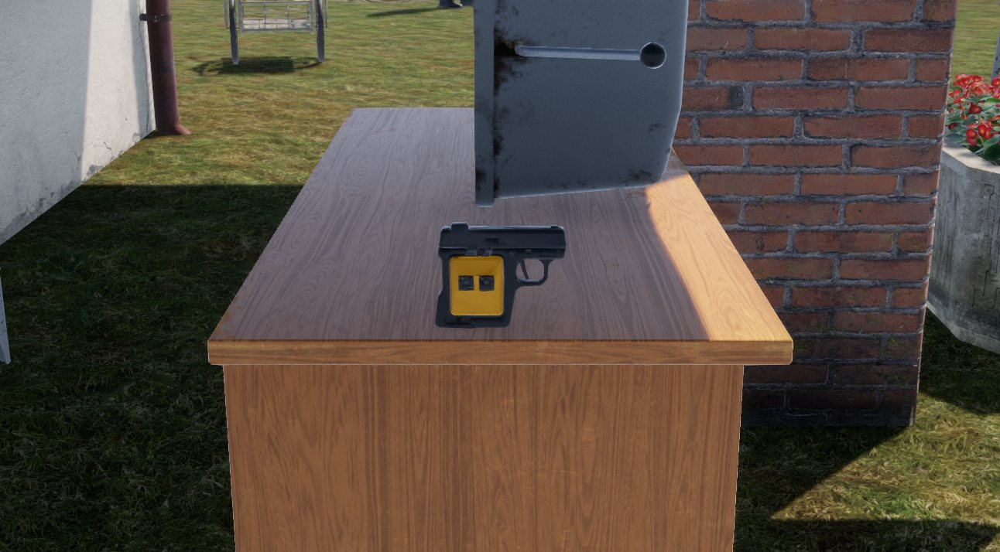

Inventory pictures, rendered by the engine from the prefabs, beside the vanilla M9. The taser's
picture is right. The cartridge shows the vanilla magazine, because the scaffold inherits it:

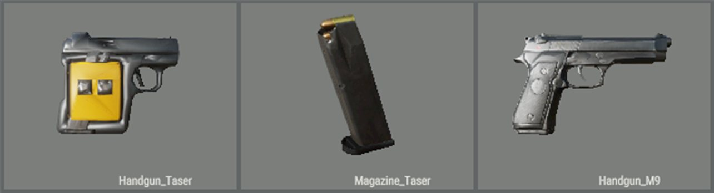

Two clients on a dedicated server, `--profile full`, `session.mjs taser-proof`: client 1 takes the
taser off the desk and draws it, hits client 2, both clients see client 2 downed and
`INCAPACITATED`, the give-up is refused, and after 8 seconds both see client 2 up again (state
`hp=1` throughout). Every check passed in three sessions; the third ended early on the capture
crash described under "Blockers and limits".

The taser in client 1's hand, from behind, and the same hand enlarged:

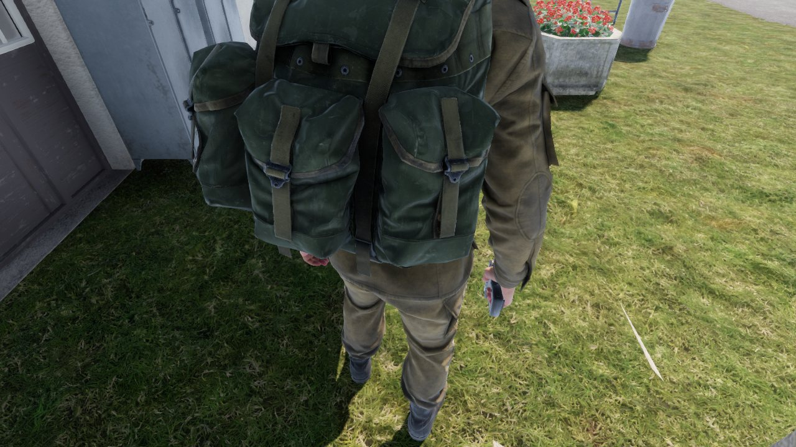
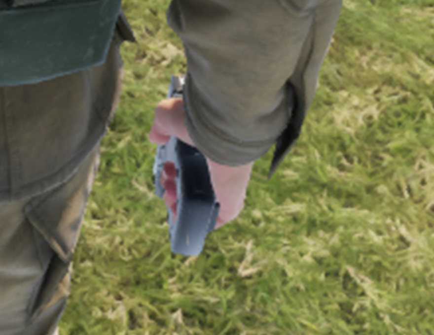

Client 2's own view while stunned, lying on the ground, with the toast and the shooter in frame,
and the taser from that picture enlarged:

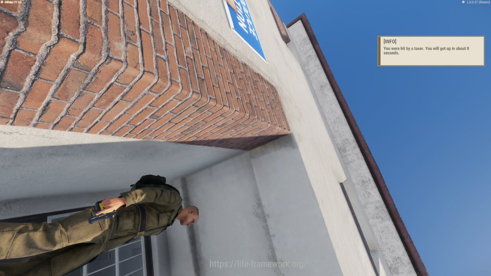
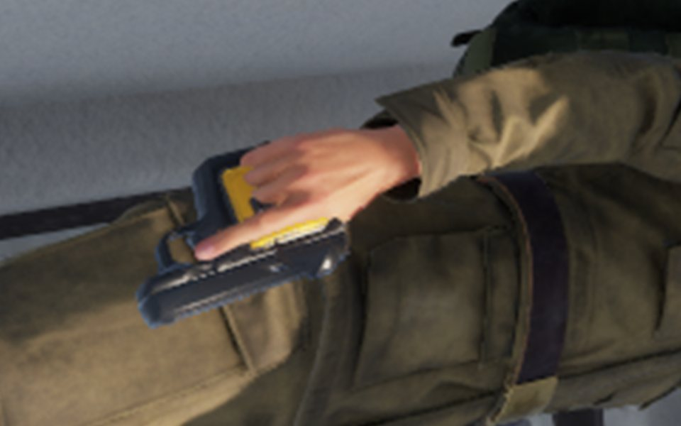

Client 2 back on their feet:

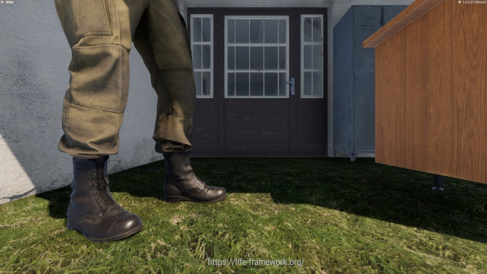

Also green: `tools\cli validate`, `audit placement --strict` for the desk placement, the test
`police/stun` (red-proofed), and the pipeline selftest (nine red-proofs).

## Quality verdict

**Placeholder. Good enough to play-test the stun, not good enough to ship as the taser.**

| Aspect | Verdict |
|---|---|
| Scale and placement in the hand | Right. The weapon sits in the right hand where a pistol does |
| Textures in the game | Right. Real PBR maps, no white mesh, reads well at desk distance |
| Silhouette | Wrong object. A player sees a small pistol |
| The identifying feature | Half there: the yellow two-port panel exists, on the grip's side, not the front |
| Period | Acceptable; nothing modern on it |
| Grip | The grip is a block about half the weapon's length deep. The vanilla hand pose cannot close around it, so the fingers lie over the yellow panel |
| Mesh | Decimation from 16.7k to 8k left faceted shading on the flat sides, visible up close |
| Moving parts | The trigger is its own skinned part. There is no slide or hammer to move, which is right for a taser |
| Sound and effects | Still the M9's shot, flash and reload |

## What worked

- **Writing the `.meta` first.** Registering a new `.fbx` from a headless Workbench opens a modal
  dialog and hangs. A `.meta` that already exists makes the file a registered resource, so the
  plugin only rebuilds it. This removes the one manual click the earlier research found.
- **Fitting the mesh to the vanilla skeleton.** The M9's bones and sockets are copied at their
  rest positions and the mesh is scaled and moved onto the M9's grip. The vanilla pistol graph
  then drives the weapon with no new animation. The prefab is a small delta on `Handgun_M9_base`.
- **Reading the compiled `.xob` back.** The import stage proves the bones, sockets, material and
  collider are really in the file. The comments in `meta.mjs` and `clean.py` record the two
  failures it was written against: a skinned export with no bones or sockets until the `.meta`
  set `ExportSkinning` and `ExportSceneHierarchy`, and a collider Workbench dropped as degenerate.
- **Caching per stage.** No stage was paid for twice, including across the hand-over between the
  two agents that did this spike.
- **Riding `LF_Downed` for the stun.** One flag and one replication path; the stun adds a marker,
  a token for the timed wake, and three refusals (give-up, disconnect death, bleed-out).

## What needed judgement or a human

| Step | Who | Why |
|---|---|---|
| The prompt | Agent, with the playbook | The generator returns the nearest common object. Two attempts were not enough for a 1980s taser |
| Accepting a generation | Agent reads two thumbnails | A script cannot tell a taser from a pistol |
| Orientation, sockets, LOD silhouette | Agent reads six renders | The numbers passed while the yellow panel was on the wrong part |
| Hand fit | Agent, from a second client's capture | Only the game shows it |
| Firing a dart at a player, aiming, reloading | **Human** | The harness cannot aim or pull a trigger; the proof enters at the damage handler |
| Whether generated art may ship | **Human** | The licence gate (#664) is open. The model in this PR is a Meshy output on the maintainer's paid plan; its prompt and date are in the spec and the asset inventory |
| Whether this model is acceptable in play-tests | **Human** | Taste |

## Blockers and limits

1. **Shape fidelity of text-to-3D for uncommon objects.** This is the real limit. Colour words
   do not build geometry, and positions in the prompt were ignored. Options, in order of cost: a
   third prompt that drops the word "pistol" and describes a box with a handle; image-to-3D from
   a reference drawing (not tried; check the Meshy docs first); a Blender script for hard-surface
   objects this simple, as the keys were made (`tools/assets/keys/build.py`).
2. **Licence gate #664** before any generated model reaches a Workshop build.
3. **Grip shape.** A weapon on a vanilla skeleton needs a grip the vanilla hand closes around.
   The generation review now asks for it; nothing checks it by number.
4. **No fired-shot proof.** The harness has no aim or trigger verb.
5. **The M9's sound, flash and magazine mesh** come with the inherited prefab.
6. **Workbench flakiness.** About one model import in eight (noted in `import.mjs`) collided with Workbench's own
   reimport and produced a model with no material; the stage retries once. Only one source is
   rebuilt per Workbench run, so an import is three short runs.
7. **Capture limits found on the way.** A `capture world` looks level from eye height, so it
   misses a lowered hand or a body on the ground. The free camera fixes that, and a second free
   capture crashed the capturing client (`ENGINE (F): Crashed`, no script error). The proof takes
   one, last.
8. **Only the weapon kind has a prefab scaffold.**

## Breakdown to generalise it

Each row is one issue-sized piece. The first three make handcuffs and road spikes possible.

| # | Piece | Notes |
|---|---|---|
| 1 | **`gadget` kind end to end, with handcuffs** (done 2026-11-13, #664: `prefab-gadget.mjs`, one 30-credit generation; the chain survived at 3,000 triangles) | Prefab scaffold on `Item_Base.et` (inventory attributes, preview attributes, hand-held pose), `UBX_` collider, an `LF_Test` that loads it. Handcuffs are two rings and a chain: thin geometry that text-to-3D fuses and decimation eats. Generate at a higher polycount, keep 3,000 triangles, and check the chain in `lod_last.png`; fall back to a Blender script if two attempts fuse the links |
| 2 | **`deployable` kind end to end, with road spikes** | Ground fit and a box collider exist in the profile. Needs a scaffold on a prop base, placement through `tools\cli place ground`, and a strip that is 3 m by 0.3 m with dozens of spikes inside 4,000 triangles: model one segment and repeat it in the clean stage. The tyre damage, deploy and pick-up actions are feature work beside the asset |
| 3 | **`asset verify <slug>` stage** | Run `look` at the placed asset and the `previews` sheet, write one contact sheet into `tmp/assets/<slug>/verify/`, and print the checklist lines that still need a session |
| 4 | **A second source for the generate stage** | Image-to-3D from a reference picture, and "bring your own GLB" (the clean stage already takes any `raw/model.glb`). Record the source in the spec |
| 5 | **Provenance ledger and the licence gate (#664)** | Per asset: prompt, tool, model, date, plan, licence, in a tracked file. The spec holds the first four today |
| 6 | **A better taser** | New prompt per the playbook, at most two attempts (60 credits), or a Blender script. Own cartridge model as a `gadget` |
| 7 | **Taser polish** | Its own shot sound and effect in place of the M9's, no muzzle flash, issue from the armory and the duty kit, pack classification of the police item |
| 8 | **Harness `fire` verb** | Aim at a player and pull the trigger, so a dart's real path is proven without a human; and a `held` capture that frames another player's hands |
| 9 | **More weapon kinds** | A melee kind and a long-gun kind are each a reference skeleton read with `xob.mjs` plus a fit rule; #341 lists melee first |
| 10 | **Grip-fit check** | Measure the grip's depth and thickness in the clean stage against the reference and warn before import |

## Manual testing left

In the PR. In short: pick the taser up, aim, fire at a second player inside and outside 10
metres, confirm one shot per cartridge and that a pistol magazine does not fit, and watch the
stunned player get up after 8 seconds.
