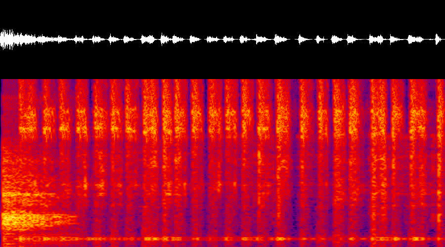
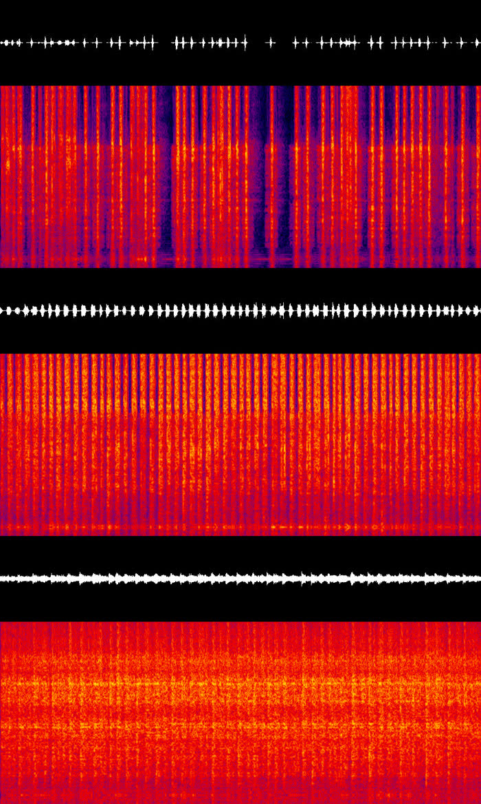
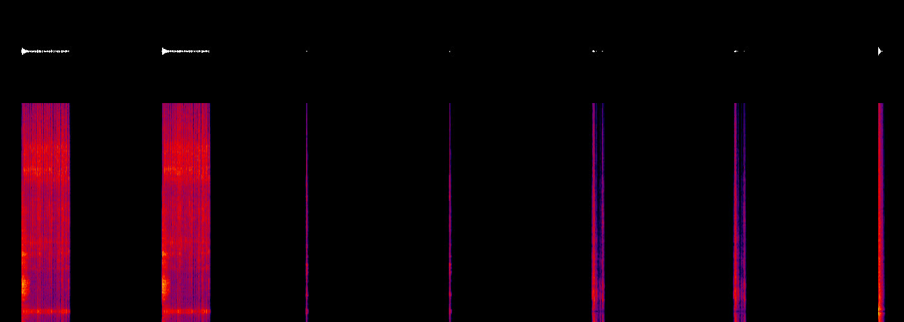
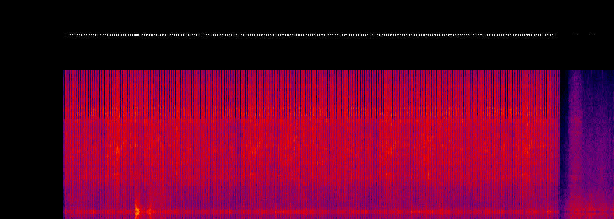

# Asset sound spike: generated sound effects for a pipeline asset

Spike of 2026-11-13 for the asset pipeline epic (#339), the weapon pipeline epic (#341) and the
generated-asset licence gate (#664). Question: can the asset pipeline give an item its own sound
effects, generated, in the engine's format, wired the way vanilla weapons are, with no audio
editor and no human in the loop until the listening test? The use case is the police taser, which
until now fired, clicked and reloaded with the vanilla M9's sounds.

Short answers:

- **It works end to end.** `tools\cli asset sound taser` generated 19 takes, processed them, and
  wrote 8 samples and 3 sound projects into the addon. The taser plays its own shot, dry fire and
  cartridge sounds through the vanilla weapon sound component, and a stunned player buzzes for
  every client nearby. Nothing was opened in Workbench.
- **The engine needs less than expected.** A plain 48 kHz mono 16-bit `.wav` beside a `.meta`, and
  a text `.acp`. No import step, no compiled format.
- **The generator makes one event per call.** "A pop, then a second of crackle" came back as
  crackle only, five times. The pop is its own generation, laid over the start by the tool.
- **An agent cannot judge a sound.** It can read a spectrogram well enough to reject the wrong
  takes (tonal, late, uneven), and it can prove the engine plays the right file at a sane level.
  Whether the taser sounds like a taser is the maintainer's call: the files are listed below.
- **Cost: 3,997 credits for 19 generations**, about 210 each, read from the account. That is 10%
  of a Starter month, about $0.60. The docs' per-second rate would have said 808.

## What was built

| Piece | Where |
|---|---|
| The sound stage: generate, process, wire, status, settle | `tools/assets/pipeline/sound.mjs` (`tools\cli asset sound <slug>`); one dispatch line in `asset.mjs` |
| The work order and credit record per asset | `tools/assets/<slug>/sounds.json` |
| Offline selftest, part of `validate`, ten red-proofs | `tools/validation/asset-sound-selftest.mjs` |
| Playbook: sound list per kind, prompts, the spectrogram review, wiring, proof | `docs/asset-pipeline/sounds.md` |
| The taser's sounds | `addons/LifeFramework/Sounds/Weapons/Handguns/Taser/` (3 `.acp`, 8 `.wav`), `Handgun_Taser.et` |
| The stun buzz: replicated stun flag, client-side loop | `Feature/Police/LF_StunBuzz.c`, `Feature/Medic/LF_Downed.c` |
| Harness verb `sound [EVENT]`, proof `taser-sound-proof`, test `police/taser_sound` | `Feature/AgentHarness/LF_AgentHarness_Sound.c`, `agent-box/proofs/taser-sound-proof.mjs`, `Tests/LF_Test_TaserSound.c` |

The shared pipeline code changed by two lines (the `sound` subcommand and its usage line). The
model stages and their selftest are untouched.

## What the engine wants, and how it was found

Nothing here was guessed. The game's `.pak` files were read with the MCP server's pak reader.

- **Samples.** `Weapons_Handguns_M9_MagOut_01.wav`, `PM_Shot_Dry_01.wav` and `Weapons_9mm_FP_04.wav`
  are RIFF PCM, 16 bit, mono, 48 kHz, shipped as `.wav`. Their `.meta` is a `WAVResourceClass` on
  `Configs/System/ResourceTypes/<platform>/Sound.conf`. Peaks sit between -3 and -8 dBFS.
- **Projects.** The M9's `WeaponSoundComponent` lists six `.acp` files. `..._M9_Handling.acp` is
  1,151 lines of text: per event a Sound node (the event name), a Shader, and a Bank of samples,
  with shared amplitude, frequency and spatiality nodes, the final mix and three reverb sends.
  `..._M9_Shot.acp` is 3,656 lines and 121 samples of distance layers and tails for a gunshot.
- **Events.** `SOUND_SHOT` (named in a base config the shot's Sound node inherits), `SOUND_DRY`,
  `SOUND_RELOAD_MAG_REMOVE`, `SOUND_RELOAD_MAG_INSERT`, and the slide's `SOUND_RELOAD_BOLT_PULL`,
  `SOUND_RELOAD_BOLT_RELEASE`, `SOUND_RELOAD_MAG_PUSH`.
- **Mixer inputs.** Node ids in `Sounds/FinalMix.afm`: `WPN_Handling` 6151, `WPN_Shots` 7175,
  `SFX` 79879.

So the tool writes the handling project's graph for every project, the taser's shot included: a
taser is not a gunshot and needs no tails. The distance curve is a vanilla amplitude config
(`voice70`, 70 m, for the shot).

## The run

| Step | Result |
|---|---|
| Sound list | Five sounds from the weapon kind's list plus the stun loop: shot, dry fire, cartridge out, cartridge in, stun buzz. No draw sound: the shared vanilla pick-up and equip project stays |
| generate, first run | 15 takes, 3 per sound, as raw 48 kHz PCM (stereo, which the tool reads from the size) |
| Review | Dry fire, cartridge in, cartridge out and the buzz each had a usable take. The shot did not: no take put a pop before the crackle |
| generate, second prompt | 2 more shot takes, "one loud sharp bang at the very start, then...". Still no pop |
| generate, the pop alone | 2 takes of "a single sharp small bang of a toy cap gun". Take 2 laid over the crackle's start, the crackle 40 ms behind |
| process | 8 samples, 0.06 to 2.21 s, all peaking at -3.0 dBFS, 414 kB together |
| wire | `..._Taser_Shot.acp` (`SOUND_SHOT`), `..._Taser_Handling.acp` (`SOUND_DRY` with 3 samples, `SOUND_RELOAD_MAG_REMOVE`, `SOUND_RELOAD_MAG_INSERT` with 2), `..._Taser_Stun.acp` (`SOUND_LF_STUN_LP`, an endless loop) |

19 of the cap of 20 generations. The picks and the reason for each are in
`tools/assets/taser/sounds.json`.

The shot as it ships: the pop in the first 100 ms, then 23 ticks in a second.

The three buzz takes. The middle one shipped: an even train of ticks. The first has gaps that
would repeat every loop, the third is a hiss with no ticks.

## The stun buzz

Feasible, and done. The stun flag was server-only. It is now an `RplProp` on the character with a
callback; `LF_StunBuzz.Sync` starts a looped audio source on the body when the flag sets and ends
it when the flag clears. The server decides, every client in range hears it from the body, and a
host hears it too. The loop has a 30 s cap in case a flag never clears.

Limits: a client further than about 60 m when the stun starts gets no buzz by walking closer (one
attempt, at the start), and a client that joins during a stun was not tested.

## Proof

- `tools\cli validate`: `asset-sound-selftest` passes. It proves the request, the key never
  reaching an error, the generation cap, the record and resume, the trim, level, fades and loop
  seam, the WAV header, the project text, and that every committed sample and project is what the
  tool writes today.
- `tools\cli test --only LF_Test_TaserSound`: the three projects load, the prefab lists the taser's
  two and none of the M9's, the stun flag follows the stun. Red-proofed by putting the M9 handling
  project back.
- `session.mjs taser-sound-proof`, two clients, `--profile full --sound`: PASS. On the taser,
  `SOUND_SHOT`, `SOUND_DRY`, `SOUND_RELOAD_MAG_REMOVE` and `SOUND_RELOAD_MAG_INSERT` are known and
  each started a voice; `SOUND_RELOAD_BOLT_PULL`, which only the M9's handling project has, is not
  known. After the hit both clients logged `stun buzz started` and, 8 s later, `stun buzz stopped:
  the stun ended`.
- A recording of what the client's process played, in a second one-client session. Left to right:
  the taser's shot through the weapon's sound component, the same event played directly, two dry
  clicks, two cartridge inserts, and the vanilla melee hit for scale. The shot is the loudest thing
  (peak -11 dBFS, the vanilla melee hit the same), lasts 1.2 s, and shows the sample's pop, ticks
  and bands. The vanilla equip sound peaked at -20, the cartridge insert at -17, the dry click at -25.

The buzz as client 1 played it in the two-client proof: 8.2 s of even ticks, then the stunned
player getting up.

What the proof does not cover: a fired dart and a real reload. The harness cannot pull a trigger,
so the events were played by name on the held weapon. That the animation fires those names is
vanilla behaviour the taser inherits.

One trap, recorded so the next agent does not chase it: in the first proof the weapon sounds came
out 30 dB down and dull while the buzz was fine. The client had just respawned from the death
screen (the per-proof reset), and the engine muffles a character for some seconds after. The
second session, with no respawn, gave the levels above.

## Cost

| | |
|---|---|
| Generations | 19 (15, then 2, then 2), 20.2 s of audio asked for |
| Credits | The account's counter went from 0 to 3,997, read through `GET /v1/user/subscription`. About 210 per generation |
| Money | Starter is 40,000 credits a month: 10% of a month, about $0.60 at $6 |
| What the docs say | 40 credits per second with a set duration (808 for this run), or about 200 per generation. The second is what short sounds pay |
| The counter lags | It read 142 right after the first 15 takes, 162 and 192 minutes later, 3,997 at the end. `asset sound <slug> --settle` reads it again; report that number |
| Machine time | Seconds per generation (not timed); process and wire under 10 s together |

If another agent generated on the same account in that hour, part of the 3,997 is theirs. The
pipeline has no way to tell.

## Quality verdict

**Usable as a first pass, pending ears.** Each row is what the pictures and the recording show,
not what it sounds like.

| Sound | Verdict |
|---|---|
| Shot | A pop and a second of dry, even ticking at about 22 per second. The crackle take carries a faint steady tone near 800 Hz and a band near 11 kHz; if that is audible it will read as electronic, and the fix is another take or a notch filter |
| Dry fire | Three clean single clicks, 60 to 80 ms. The safest of the set |
| Cartridge out | One take: a click, then a light scrape. Quiet after the click |
| Cartridge in | Two takes: a push with a click, and a single firm click |
| Stun buzz | An even 18 ticks per second, 2.2 s loop, no pattern to notice. Close to the shot's crackle but not the same recording |
| Period | Nothing synthetic was picked; the two takes with swept tones were rejected on their spectrograms |
| Levels | The shot matches the vanilla melee hit; handling sits near the vanilla equip sound. `volume_db` in `sounds.json` is one number per sound if a play-test says otherwise |
| Missing | No draw or holster sound of its own, no distance layers, no indoor tail beyond the mix's reverb sends. Right for a taser, thin for a firearm |

## Licence

Generated on the maintainer's Starter plan, a paid plan: commercial use is allowed, and the sounds
may ship in the public mod as part of it. They may not be published as stand-alone audio files.
No attribution duty was found; the project credits the tool anyway. Exact terms and what could not
be confirmed: `docs/decisions.md` (2026-11-13) and `docs/credits.md`.

## Extending it

**Handcuffs** (`gadget`): `tools\cli asset sound cuffs --init` gives one `SOUND_LF_USE`. Replace it
with what cuffing does: `SOUND_LF_CUFF_ON` (a ratchet, about 0.8 s), `SOUND_LF_CUFF_OFF` (a key
turn and a release), both `bus: sfx`, `range: reload60`. Metal ratchets are a common sound, so
expect usable takes at once. Play them from the cuff action on the server's say-so with a
one-shot audio source on the cuffed player, as `LF_StunBuzz.Start` does without the loop. About 6
generations.

**Road spikes** (`deployable`): `SOUND_LF_DEPLOY` (a metal strip thrown out and unrolling on
tarmac, 1.5 s), `SOUND_LF_PICKUP` (metal dragged and folded), and `SOUND_LF_SPIKE_HIT` (a tyre
bursting, `range: far170`: it should carry). The burst plays on the vehicle when the server pops
the tyre; check first whether the vanilla wheel already has a puncture sound, and use it if so.
About 8 generations.

Pieces that would make the next asset cheaper:

| # | Piece | Notes |
|---|---|---|
| 1 | Write the `Filenames` override from `wire` | It is the one hand edit for a weapon. `prefab.mjs` owns the prefab text today |
| 2 | A shared `LF_ItemSound.Play(entity, project, event)` | The three lines every script-played sound repeats, with the out-of-range and missing-project log |
| 3 | A firearm shot | The handling graph is wrong for a gun: copy the vanilla shot project and swap only the close layers |
| 4 | A harness `fire` and `reload` verb | So the animation's own events are proven, not the names (also #8 of the model spike) |
| 5 | Retry the buzz when a listener comes into range | A tick on the client while the flag is set, as `LF_SiteAlarmComponent` does |
| 6 | A notch or high-pass option in `process` | For a take that is right but carries a generator tone |
| 7 | Loudness by LUFS for long sounds | Peak normalising is right for clicks; a loop or an ambience wants a loudness target |

## Manual testing left

In the PR. In short: fire the taser at a second player, pull the trigger on the spent cartridge,
reload, and listen to the stunned player from both sides and from a distance.
