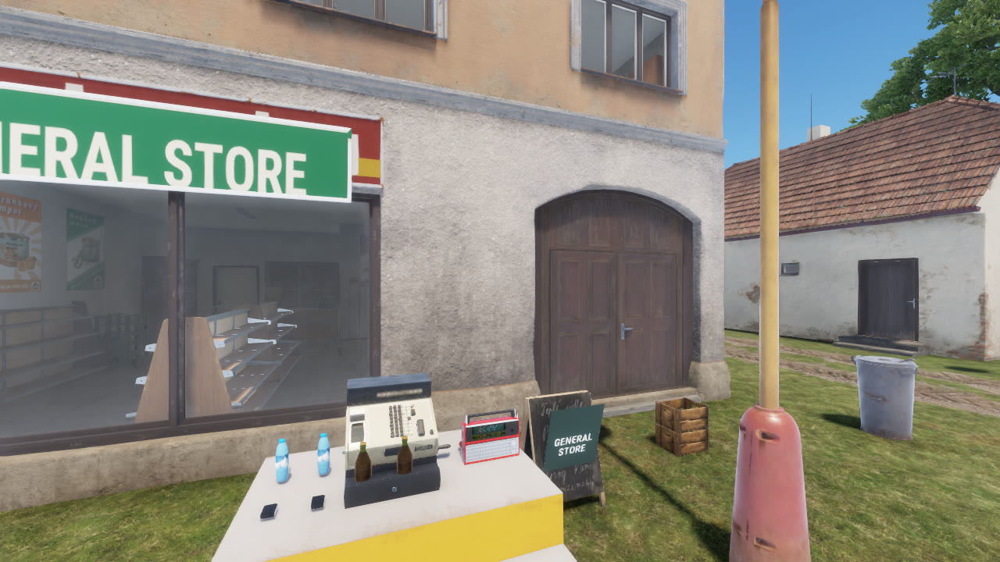
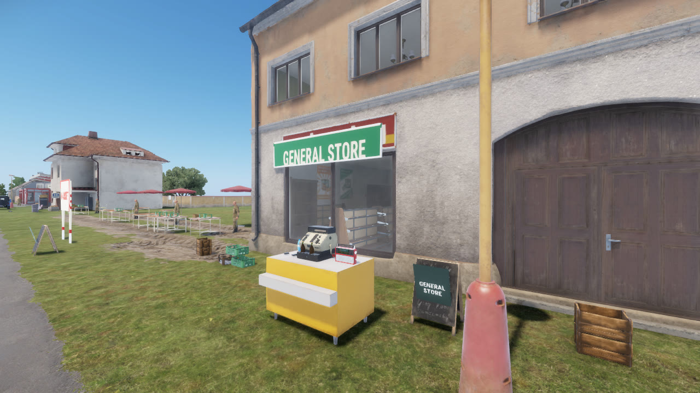
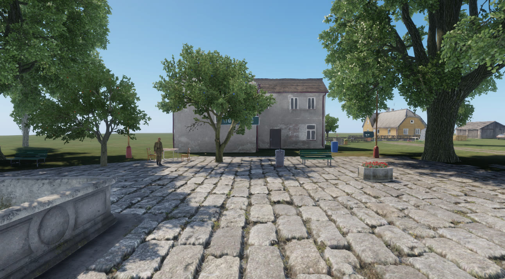

# Atmosphere: music and background sound in the town

A radio plays on the general store's counter, the furnace roars, hens cluck at the farm. This is
how that works, which places have it, which do not yet, and what it cost. Spiked and built on
2026-11-13.

## What a player gets

| # | Place | What you hear | When | Carrier |
|---|---|---|---|---|
| 1 | General store | An original late-80s radio pop instrumental from a small radio on the counter | Until someone switches the radio off ("Switch off" / "Switch on" on the radio) | `Shop_GeneralStore_Radio` (`Prefabs/Atmosphere/LF_Radio_Store.et`) |
| 2 | Pub | An original village dance-band polka from inside the building, muffled from the street | 10:00 to 02:00 | The pub building in `Village_Buildings.layer` |
| 3 | Furnace (quarry and the crime furnace) | A steady coal-fire roar | Always | `Prefabs/Processor/Furnace.et` |
| 4 | Sawmill | The saw running | For 12 s after each log is cut | `Prefabs/Processor/Sawmill.et` |
| 5 | Quarry | Picks on rock, stones falling, wind | 06:00 to 20:00 | `MiningArea_Debug` in `MiningChain.layer` |
| 6 | Farm | Hens | 05:00 to 21:00, one voice for all plots | `Prefabs/Vegetation/Crops/FarmPlot_Cabbage.et` |
| 7 | Moonshine still | Bubbling, steam, a drip | While a batch is in the still and not ready | `Prefabs/Chains/LF_ChainStill.et` |
| 8 | Police duty desk | Radio static with garbled chatter, a typewriter | Always | `Prefabs/Police/LF_PoliceDutyDesk.et` |
| 9 | Chop shop | A compressor cycling, a ratchet, tools | Always | `Prefabs/Crime/LF_ChopBench.et` |
| 10 | Spawn square | The fountain, a far murmur of people, pigeons | 06:00 to 22:00 | The fountain in `Village_Dressing.layer` |
| 11 | Bank | A quiet murmur at the east counter; a clock tick with a till drawer at the west counter | Always | `Bank_Counter_East`, `Bank_Counter_West` in `ATM.layer` |
| 12 | Hospital | Equipment hum at the beds; a quiet ward at the duty desk | Always | `Prefabs/Medic/LF_HospitalBed.et` (group, one voice for three beds), `Prefabs/Medic/LF_MedicDutyDesk.et` |
| 13 | Payphones | A faint line hum | While the receiver is up (the line is BUSY: dialling, ringing out or talking) | `Prefabs/Comms/LF_Payphone.et`, `LF_AmbientConditionPhoneLine` |
| 14 | Fuel station | A pump motor and the gurgle of fuel | For 4 s after each fuelling step | `Fuel_PumpHum` (`Prefabs/Atmosphere/LF_FuelPumpHum.et`), pulsed by `LF_AmbientFuelPump` |
| 15 | Cash van | A diesel engine idling | Always: the route teleports the van between stops, so it is only ever stopped | `Roadmap_Cash_Van_Box` in `Street_CashVan.layer` (the box stands at the van's door and follows it) |
| 2b | Pub terrace | The pub music from a radio on a table beside the door, unmuffled | 10:00 to 02:00, or until switched off; then the building plays | `Pub_Terrace_Radio` (`Prefabs/Atmosphere/LF_Radio_Pub.et`) in `Village_Dressing.layer` |

Hours are local solar time (noon is the sun at its highest), the same clock the film scenes use.

The store radio sits on the counter beside the till:




The pub has no radio prop. Nobody can enter the building yet, so the music comes from inside it
and there is nothing to switch. A radio or cassette player on the bar is the step to take when the
pub becomes a room.



## The survey

Every area of `agent-box/areas.json` was read from `tools\cli look all`, the layers and
`docs/features.md`. One fact shaped the list: the playtest town's shops are counters in front of
their buildings, not rooms. So "quieter outside the door" is distance for nine of the ten, and
real occlusion only for the pub, whose sound comes from inside the building.

Ranked by how much a new player notices, and how cheap the spot was:

| Rank | Spot | State | Why here |
|---|---|---|---|
| 1 | General store radio | done | The first shop a player visits; music is the strongest signal that the town is alive |
| 2 | Furnace | done | Loud machine at the end of the first job chain |
| 3 | Spawn square | done | Every player starts here; it was silent |
| 4 | Pub | done | Next to the square; music through a wall sells a building nobody can use yet |
| 5 | Quarry | done | A work site with nothing moving in it |
| 6 | Sawmill | done | Beside the quarry; a machine that should react to use |
| 7 | Farm | done | Open field, quiet without animals |
| 8 | Chop shop | done | A hidden yard should be heard before it is seen |
| 9 | Police duty desk | done | Where officers stand around between calls |
| 10 | Moonshine still | done | The only machine with a real "working" state |
| 11 | Bank | done | A clock, a stamp, low voices; add when the bank is a room |
| 12 | Hospital | done | Equipment hum at the duty desk; needs a sound that is not grim |
| 13 | Payphones | done | A line hum is in reach only at 1 m; the ring is already there (`LF_PhoneLine`) |
| 14 | Fuel station | done | A second radio, a pump motor while fuelling |
| 15 | Cash van | done | An engine idling while it is parked at a stop (`LF_CashVanRoute` has no engine state; the stop itself is the state) |
| 16 | Market stand, car lot | later | A third music track or a crowd bed; low value until the market has stalls |
| 17 | Hideout, lock-up, jail, fence | later | Quiet is right for these; a cassette player in the hideout is the one worth doing |

## How it is built

Vanilla was read first (`Structures_DieselGenerator_01.acp`, `Props_TapeRecorder_01.acp`,
`SCR_SoundManagerModule`, `SCR_AudioSource`, `Props_Occlusion.sig`, the `RadioSmall_01` prefabs and
the Radio Everon broadcast manager), from the game files. What vanilla does for a looping prop:
a sound project with one looped bank, a distance curve, and a frequency node driven by an occlusion
signal that compares the source's `Interior` and `RoomSize` with the listener's `GInterior` and
`GRoomSize`. `SCR_SoundManagerModule` measures the interior at the source when it starts a voice.
We use exactly that graph and that module.

```
LF_AmbientEmitterComponent      on the prop or the area entity: project, radius, stop margin,
  (every machine that renders)   priority, group, hours, condition
LF_Atmosphere                   one tick every 500 ms: distance of each emitter to the listener
                                 (AudioSystem.GetDistance), then LF_AtmosphereMix
LF_AtmosphereMix                pure: in range, allowed, one per group, at most the cap, best first
LF_AmbientCondition             when it may sound: Switch (below), ChainWorking (the still's percent)
LF_AmbientSwitchComponent       the only replicated state: one bool. SetOn (the radio action),
  (server writes)                Pulse (LF_ProcessAction after a cut log)
```

- **Client side.** A dedicated server registers no emitter and runs no tick. The server replicates
  one bool per switchable prop; the still's condition reads the percent the station already
  replicates. A late joiner gets both with the entity.
- **Radius and falloff.** The curve is in the project: `inner_m` (full level) to `outer_m`
  (silent), `1/r`. The component's `m_fRadius` is where a machine starts the voice, just inside
  `outer_m`; `atmosphere-selftest` fails a radius outside the range. A playing voice stops 3 m
  further out than it starts.
- **The cap.** At most `LF_Atmosphere.s_iMaxVoices` (6) voices; higher `m_iPriority` first (music 2,
  machines 1, beds 0), then nearer. Emitters with the same `m_sGroup` share one voice, the nearest
  (three farm plots are one henhouse).
- **Failing safe.** No project, a condition without its component, or a project the engine starts
  no voice for within 4 s: one `LF_Debug.Error`, that emitter stays silent. An emitter in range
  that gets no voice for 5 s says so once (sound off on that machine, or a radius past the range).
- **The radio** is the vanilla small radio's mesh on the plain prop base. The vanilla prefab is not
  used: it carries the Radio Everon broadcast component and its own switch.
- **Not persisted.** A radio switched off is on again after a restart.

To add a sound to a prop, add `LF_AmbientEmitterComponent` to its prefab with a project from
`Sounds/Atmosphere/`. For the sound of an area, add the component to an entity that is already
there in the layer (the fountain, the pub) or place `Prefabs/Atmosphere/LF_AmbientEmitter.et` in
Workbench. A radio is `tools\cli place on <surface> Prefabs/Atmosphere/LF_Radio_Store.et`.

## The audio

Generated with ElevenLabs (Starter plan): the two tracks with the Music API (`music_v1`,
instrumental forced), the eight loops with text-to-sound-effects with `loop` on. Prompts describe
a style and never name an artist, a song or a label; they are in
`tools/assets/atmosphere/ambience.json` with every generation.

`tools\cli asset ambience` (`tools/assets/pipeline/ambience.mjs`) has three steps: `generate`,
`process`, `wire`. It reuses the dialogue stage's HTTP client (`elevenlabs.mjs`) and the sound
stage's sample maths, WAV writer and `.meta` text (`sound.mjs`).

- Processing: ffmpeg (from `tools/film/.bin`) decodes to mono; the loop point is an equal-power
  crossfade (2.5 s for music, 0.4 s for loops); peak at -3 dBFS. The radio tracks are band-limited
  to 180 to 5200 Hz, lightly compressed and stored at 24 kHz, like a small speaker (vanilla's own
  broadcast samples are 16 kHz mono). Sparse beds (farm, quarry, square, police desk) have their
  level evened out so one loud call does not leave the rest inaudible.
- Format: RIFF PCM 16-bit mono, the format of vanilla's positioned samples, with a
  `WAVResourceClass` `.meta`.
- An agent cannot listen. Each take is judged from its waveform and spectrogram
  (`tmp/assets/atmosphere/review/`) and from numbers: length, level, and the step across the loop
  point against the steps inside the take. **Listen to them before a public build**; the picks'
  `reason` fields name the two weakest (police desk, quarry).

Files to listen to (about 25 MB in the repo):

| Sound | File under `addons/LifeFramework/Sounds/Atmosphere/Samples/` | Length | Range | Volume |
|---|---|---|---|---|
| Store radio | `Atmosphere_StoreRadio_LP.wav` | 59.6 s | 2 to 24 m | -8 dB |
| Pub | `Atmosphere_PubRadio_LP.wav` | 64.9 s | 3 to 34 m | -7 dB |
| Furnace | `Atmosphere_Furnace_LP.wav` | 19.6 s | 2 to 36 m | -9 dB |
| Sawmill | `Atmosphere_Sawmill_LP.wav` | 14.6 s | 2 to 45 m | -8 dB |
| Quarry | `Atmosphere_Quarry_LP.wav` | 21.0 s | 8 to 55 m | -9 dB |
| Farm | `Atmosphere_Farm_LP.wav` | 20.6 s | 8 to 45 m | -10 dB |
| Still | `Atmosphere_Still_LP.wav` | 14.6 s | 1.5 to 18 m | -11 dB |
| Police desk | `Atmosphere_PoliceDesk_LP.wav` | 21.6 s | 1.5 to 14 m | -13 dB |
| Chop shop | `Atmosphere_ChopShop_LP.wav` | 19.6 s | 2 to 30 m | -11 dB |
| Square | `Atmosphere_Square_LP.wav` | 21.6 s | 6 to 36 m | -12 dB |
| Bank murmur | `Atmosphere_BankMurmur_LP.wav` | 15.9 s | 2 to 16 m | -14 dB |
| Bank till and clock | `Atmosphere_BankTill_LP.wav` | 15.7 s | 1.5 to 12 m | -13 dB |
| Hospital equipment | `Atmosphere_HospitalEquipment_LP.wav` | 19.6 s | 1.5 to 14 m | -14 dB |
| Hospital ward | `Atmosphere_HospitalWard_LP.wav` | 19.6 s | 2 to 16 m | -15 dB |
| Payphone line | `Atmosphere_PayphoneLine_LP.wav` | 7.6 s | 0.5 to 6 m | -18 dB |
| Fuel pump | `Atmosphere_FuelPump_LP.wav` | 11.6 s | 1.5 to 14 m | -12 dB |
| Cash van idle | `Atmosphere_VanIdle_LP.wav` | 14.6 s | 2 to 24 m | -11 dB |

To change a level or a range, edit `volume_db`, `inner_m` or `outer_m` in `ambience.json` and run
`tools\cli asset ambience --only wire` (free). To replace a take, edit the prompt and run
`tools\cli asset ambience --again <id>` (paid), then set `pick` and `reason`.

## Credits spent

| | Seconds | Credits |
|---|---|---|
| Music, 2 tracks | 140 | 1750 |
| Loops, 8 first takes | 158 | 1580 |
| Farm, second take | 22 | 220 |
| Second batch: 7 loops, first takes | 108 | 1150 |
| Hospital equipment, two retakes (the first two were near silence) | 40 | 400 |
| Hospital ward and bank till, one retake each | 40 | 400 |
| **Total** | 508 | **5500** of the 12,000 budgeted |

The second batch (#897) cost 1950 credits; the account read 4217 used before and 6167 after (other agents share it).

Account balance: 667 used before the first call, 4217 after the last (40,000 a month, shared with
the sound and dialogue stages). Measured rates on Starter: 12.5 credits per second of music, 10
per second of a loop; the price list says 15 and 40. The counter lags a call by up to a minute,
so the tool reads the balance once before and once after a run and gives each take its share by
these rates (`runs` and `generations` in `ambience.json`).

## Licence

ElevenLabs Music Terms (read 2026-11-13, last updated 2026-10-09), Starter column: commercial
use permitted "except film, TV, radio, and Studio Games"; no attribution required; streaming
distribution prohibited; a "Music Library" (a collection of output offered to third parties to
use in their own content) prohibited. A "Studio Game" is a monetised game that is not an "Indie
Game" (under $500,000 revenue). Life Framework is a free mod, so the two tracks are inside the
terms as part of the mod.

Two things for the maintainer to decide, recorded in `docs/decisions.md`:

1. The repository is MIT. The two music files are not ours to relicense; `docs/credits.md` says
   they are not under the MIT licence and may not be taken out of the mod and reused.
2. A trailer that uses these tracks as its soundtrack and goes on a streaming service is a
   different use from a game mod. Game footage with the radio audible in the world is the mod's
   own output; a music bed is not covered on Starter.

## Proof

- `LF_Test_AtmosphereMix` (LOGIC): start and stop distance, the margin, conditions, groups, the
  cap by priority and distance, hours across midnight, the still's condition. Two red-proofs.
- `LF_Test_AmbientSwitch` (WORLD, server): the radio starts on and switches, the sawmill starts
  off and a pulse turns it on. One red-proof.
- `tools/validation/atmosphere-selftest.mjs` (in `tools\cli validate`): the spec, every wired
  project against what the tool writes, every sample's format and loop point, every emitter's
  radius against its project's range.
- `node agent-box/session.mjs atmosphere-proof` on `session up --profile full --sound`: one client
  walks the spots. Evidence is the client's own log (`start`, then `voice up` once the engine's
  handle for the loop is valid and playing, then `stop` with the reason) and a recording of what
  the client process played, measured over the last 2.5 s of each step. Run twice on 2026-11-13,
  the second time after merging the sound and dialogue stages from `main`: PASS both times. The
  numbers are the second run.

| Step | Client log | Level the client played |
|---|---|---|
| Car lot, nothing in range | no voice | silence (-91 dB) |
| At the store radio (1.3 m) | start, voice up | mean -29.6 dB |
| Radio switched off | stop (condition) | mean -68 dB (the first run read silence) |
| Radio switched on | start, voice up | mean -29.6 dB |
| Back at the car lot (47 m) | stop (out of range) | silence |
| At the furnace | furnace and quarry start, voices up; sawmill silent | mean -23.2 dB |
| At the empty still | no voice | silence |
| Police duty desk | start, voice up | mean -39.4 dB (-49.1 in the first run: the loop is sparse) |
| Chop shop | chop shop and the crime furnace 34 m away | mean -27.6 dB |
| Farm plot 2 | one of three plots starts | mean -36.9 dB (-29.2 in the first run) |
| Pub sign | pub and square start | mean -33.7 dB |
| Clock to 23:00 | square and farm stop (hours); pub plays on | mean -32.6 dB |

### Second batch (#897)

`node agent-box/session.mjs atmosphere-town-proof` on `session up --profile full --sound --clients 2` (client 2 on the police roster so a payphone call can ring; the payphone is BUSY only when someone can be rung): PASS on 2026-11-13. From client 1's own log:

| Step | Client log |
|---|---|
| Bank west counter | till and clock start (1.2 m), murmur at the east counter (8.9 m), voices up |
| Hospital beds | one bed voice for the three beds (the group), the ward at the duty desk; walking away swaps the bed (`voice cap or group`) |
| Payphone, receiver down | no start |
| Dial from the payphone | `start Roadmap_Hospital_Payphone`, `voice up` |
| Hang up | `stop Roadmap_Hospital_Payphone (condition)` |
| Cash van stop | `start Roadmap_Cash_Van_Box` (the box carries the idle), `voice up` |
| Fuel pumps, nothing fuelling | no start |
| Pub terrace radio | the radio starts, the building does not (group) |
| Radio switched off | radio stops (condition), the building starts, `voice up` |
| Radio switched on | the building stops (`voice cap or group`), the radio starts |

The process-loopback levels of that run are not evidence: with two clients up the capture of client 1 read silence at most steps (-91 dB), so only the log lines count. A first emitter put on the van entity itself never registered on the client (no start, no error, nothing in the log); the cash box beside it carries the sound now.

Not driven: a real fuelling step (needs a vehicle and the vanilla refuel action; the server half is `LF_Test_AmbientFuelPump`, and the hook is a modded `SCR_FuelSupportStationComponent.OnExecutedServer`, which compiled and loaded), and the van being driven off.

Not proven by an agent: how any of it sounds, the pub's occlusion by ear, a second player hearing
the radio switch (the bool is a plain `RplProp`; the proof's own client is a network client of a
dedicated server and followed it), and the sawmill after a real cut log (the pulse is tested on
the server only).

## Cost at run time

- 18 emitters exist in the playtest town (prefabs with an emitter are placed more than once). The
  tick is one distance read and a few comparisons per emitter, twice a second.
- Voices: the most at once in the walk was 4 (cap 6). Two 24 kHz mono streams and up to four
  48 kHz mono loops.
- Frame time on the proof client (full profile, capped at 30 fps): mean 33.33 ms at the quiet car
  lot and 33.33 ms at the quarry with two voices; p99 35.89 and 34.35 ms. The cap hides anything
  faster than 33 ms, so this shows no frame was pushed over budget, not the cost itself. An
  uncapped measurement (`session up --levers uncapped`, harness `perf`) is the next step if the
  number matters.

## Next

1. Listen, then retake or re-level what sounds wrong. This is the real gate.
2. The remaining survey spots (market stand, car lot, hideout cassette). Bank, hospital, payphones, fuel station and cash van are done. Known weak takes: the hospital equipment loop has no beep (the model returned hum), the ward is sparse, the pump hum is judged from its spectrogram only.
3. A second and third radio track, so two radios in earshot do not play the same tune, and a
   cassette player for the hideout.
4. Persist the radio switch if players care.
5. Vanilla's Radio Everon system (`RadioBroadcastManager` with our own broadcast project) would
   make every vanilla radio prop on the map play our music in sync. Not tried: the manager is
   engine code with track and DJ timing tables, and this spike needed per-prop control.
6. Classify for M3: the emitter, mix, switch and tool are core; the tracks, the ten sound
   projects and the placements are the Everon pack's (`docs/architecture/core-pack-inventory.md`).
