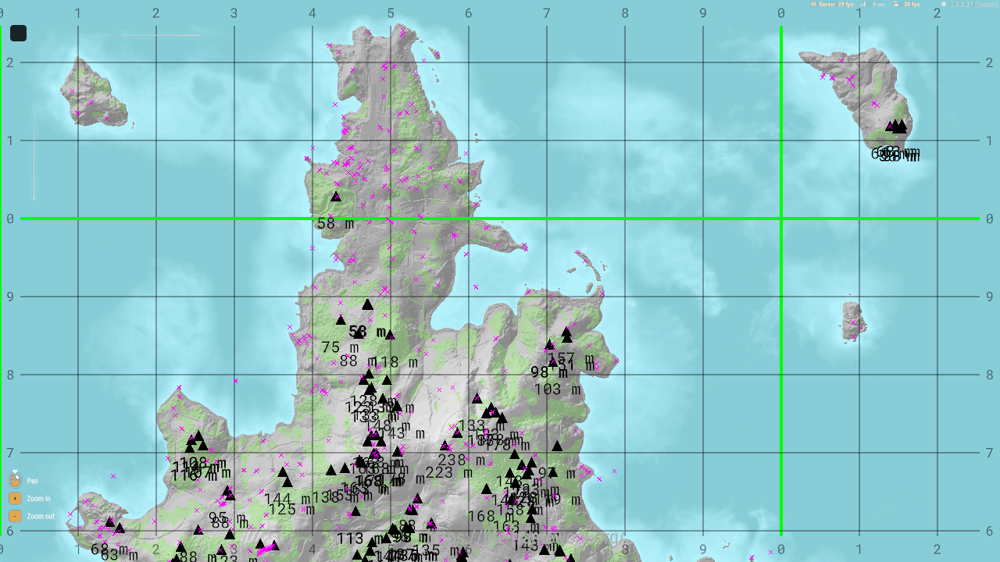

# The Everon map: places, areas, marks and discovery

Design spike, 2026-11-17, for the maintainer to review. It plans a modded in-game map for the real Everon
world: point-of-interest icons, areas on the risk gradient, waypoints and shared marks, a map that fills
in as you play, filters, a legend and search. Nothing is built yet. The slice cards in section 8 are
listed, not created; they are cut once the questions in section 9 are answered.

Read with the world bible ([`docs/everon/world-bible.md`](../everon/world-bible.md)) and the Everon
world plan (`docs/architecture/everon-world.md`, PR #2199). Decisions D1 to D8 there apply here; D2
(grounded, light RPG, no visible zone levels) and D3 (unlocks work both ways) shape most of this page.

**Supersedes one recommendation.** The world plan's Q7 and the bible's Q7 recommend "a physical map
board, and no map UI". The maintainer has since asked for a full in-game map. This page keeps the board
(it gets the same data, section 6) and adds the map you hold in your hands.

## 0. What the base game gives us (researched, build 26266485)

All of this is read from the installed paks (`tools\cli api grep`, `call game_read`), not from memory.

### What a player sees today

The welcome gift (`LF_WelcomeGift_Everon1989.conf`) hands out the vanilla folded paper map
(`{13772C903CB5E4F7}PaperMap_01_folded.et`), and the gun store sells it. Holding it on vanilla Everon
in our game mode (`session up --mission everon --profile full`, harness `hold PaperMap_01_folded`)
opens this:



The map opens but is **unconfigured**: no town names, no roads, no buildings, magenta default crosses
for every descriptor, hill heights piled on top of each other, and the green debug axes. The cause is
in the game mode, not the map. `GameMode_Roleplay.et` does not inherit vanilla `GameMode_Base.et`, so
it lacks the two components vanilla puts there (`GameMode_Base.et` lines 102 and 104):

- `SCR_MapConfigComponent`: names the config the map gadget opens with (`m_sGadgetMapConfigPath`,
  default `{1B8AC767E06A0ACD}Configs/Map/MapFullscreen.conf`). `SCR_MapMenuUI.OnMenuOpen` returns early
  without it, so the map entity falls back to its bare defaults.
- `SCR_MapMarkerManagerComponent`: the marker manager. Without it no marker of any kind shows.

The player controller (`PlayerControllerRoleplayMP.et`, from vanilla `DefaultPlayerControllerMP.et`)
already carries `SCR_MapMarkerSyncComponent`, the client-to-server half of player markers.

**Fixing that is card M1 and the first thing to build.** Every other card stands on it.

### The map entity and its plug-in points

| Piece | What it is | Where |
|---|---|---|
| `SCR_MapEntity : MapEntity` | One per world. `OpenMap(MapConfiguration)`, `WorldToScreen`, `ScreenToWorld`, `ZoomPanSmooth`, `GetMapVisibleFrame`, `GetMapWidget()` (a `CanvasWidget`). Static invokers: `GetOnMapOpen/Close`, `GetOnMapPan/PanEnd`, `GetOnMapZoom/ZoomEnd`, `GetOnSelection`, `GetOnHoverItem` | `scripts/Game/Map/SCR_MapEntity.c` |
| `SCR_MapConfig` (`.conf`) | Per mode (fullscreen, spawn screen, editor): layer config (zoom bands), map props, descriptor visibility, and the list of **UI components and modules** the map runs | `Configs/Map/MapFullscreen.conf` |
| `SCR_MapUIBaseComponent` | The extension point. `OnMapOpen`, `OnMapClose`, `Init`, `Update(timeSlice)`, `SetActive`. A config lists them; vanilla ships about 20 (markers, drawing, ruler, compass, watch, journal, task list, Conflict UI) | `scripts/Game/Map/ComponentsUI/` |
| `SCR_MapModuleBase` | Non-UI modules (cursor, selection) | `scripts/Game/Map/Modules/` |
| `SCR_MapUIElementContainer` | The pattern for widget icons on the map: Conflict bases and spawn points are widgets in a container, moved with `WorldToScreen` on pan and zoom | `ComponentsUI/SCR_MapUIElementContainer.c:215` |
| `MapItem`, `MapDescriptorComponent`, `MapDescriptorProps` | Native map items drawn by the engine (towns, hills, vanilla `C_`/`S_` location labels). `MapEntity.CreateCustomMapItem()` makes one from script; props take an image def, icon and text size with zoom limits, group type | `scripts/Game/generated/Map/` |
| `MapLayer` | A zoom band. `GetPropsFor(faction, type)`, `SetAll(...)` sets colours and scales for a descriptor type per layer | generated |
| `CanvasWidget` commands | `PolygonDrawCommand` (filled polygon, optional texture), `LineDrawCommand`, `ImageDrawCommand`, `TextDrawCommand` | `scripts/Core/proto/EnWidgets.c:74-128` |
| `SCR_MapDrawingUI` | Player pencil lines on the map, local | in `MapFullscreen.conf` |
| `SCR_MapCompassUI`, `SCR_MapRulerUI`, `SCR_MapWatchUI` | Map tools: compass, ruler, watch | in `MapFullscreen.conf` |
| `SCR_CompassComponent` | The compass gadget item | `Components/Gadgets/` |

There is no vanilla GPS, minimap or "you are here" dot. The map shows no self position.

### Markers: what vanilla syncs, to whom, and for how long

`SCR_MapMarkerManagerComponent` (game mode) keeps two kinds:

| Kind | How it travels | Who receives it | Late joiner | Restart |
|---|---|---|---|---|
| **Static** (`SCR_MapMarkerBase`, a plain Managed object with its own snapshot codec) | Local: never leaves the client. Networked: client `RPC_AskAddStaticMarker` on the player controller's `SCR_MapMarkerSyncComponent`, server assigns an id and **broadcasts** `RPC_DoAddStaticMarker` (`RplRcver.Broadcast`) | **Every client.** Faction flags only hide it on the client after it arrives (`OnAddSynchedMarker`, line 537) | `RplSave`/`RplLoad` on the manager writes every networked static marker (about 40 bytes plus the text each) into every join | Not saved |
| **Dynamic** (`SCR_MapMarkerEntity`, a spawned replicated entity) | Replicated entity that follows a target | Per player by **streaming rules**: `RplComponent.EnableStreamingConNode(identity, …)` per connection (line 335), today keyed by faction | Streams in like any entity | Not saved |

Player-placed networked markers: a limit of 10 per player (`m_iPlacedMarkerLimit`, the oldest goes),
only the owner may delete, text goes through the platform profanity filter. Marker types are a fixed
enum (`SCR_EMapMarkerType`); placed markers pick an icon and colour from `SCR_MapMarkerEntryPlaced`
lists (imageset plus quad name), which a config can replace.

What this means for us:

- **Vanilla networked markers are public.** Everyone on Everon is one civilian faction, so a police or
  gang mark sent the vanilla way reaches every client, and a modified client can read it. Shared marks
  go through our own owner RPCs (section 3), never the vanilla broadcast.
- **Local static markers are a free renderer.** We can insert marks the server sent us as *local*
  vanilla markers and get vanilla's drawing, hover and zoom behaviour for nothing.
- **Nothing persists.** Personal marks, org marks and discovery need our own payloads.

### What our core already has

- `LF_Places` (`Core/LF_Places.c`) registers every `LF_PlaceComponent` in `OnPostInit` **on every
  machine**, server and client alike, because layer entities load on both. A client can list every
  live place by kind with no network traffic. #2208 (W2) makes a place of a dark state not register,
  so it drops off the map by itself.
- `LF_Zones` (`Feature/Moderation/LF_Zones.c`) registers each `LF_ZoneComponent` area (circle, box or
  polyline corridor; rule SAFE, LAWLESS or NORMAL) on every machine too. `LF_LawlessHud` already reads
  it on the client.
- `LF_NamedPlaces.Nearest(pos)` names the nearest vanilla map location (the `C_`/`S_` labels).
- `LF_Waypoint` (`Feature/TownBoard/LF_Waypoint.c`, #1801): a client-only personal mark with a HUD
  marker and the distance, cleared on arrival. Nothing on the wire.
- `LF_UITheme` / UI kit: the paper, ink and brass theme every sheet uses (`docs/architecture/ui-theme.md`).

## 1. Points of interest

### Where the data comes from

A POI is **a live `LF_Places` entry whose kind has a row in the POI table**. Nothing else feeds it.

```
LF_PlaceComponent (kind, id) ──> LF_Places (every machine) ──> LF_MapPois (client) ──> LF_MapPlacesUI
                                                 ^                    ^
                                     #2208 live states       LF_MapPoiConfig rows (core default + pack overlay)
```

- `Configs/Map/LF_MapPois.conf`, class `LF_MapPoiConfig`, one `LF_MapPoiKind` row per place kind:
  `m_sKind` (the `LF_Places` kind, e.g. `Bank`, `Hospital`, `PoliceStation`), `m_sCategory` (`civic`,
  `shop`, `work`, `law`, `health`, `travel`, `story`, `underworld`), `m_sIcon` (imageset quad),
  `m_sLabel` (a `#` key, "Bank"), `m_fMinZoom` (hide below this zoom), `m_eVisibility`
  (`PUBLIC`, `DISCOVER`, `HIDDEN`, `ROLE`), `m_sRole` (for `ROLE`: `police`, `medic`).
- The pack overlays it (`LF_ConfigOverlay`, as zones and catalogues do): the 1989 icon quads, its
  labels and its hidden kinds. Core ships neutral rows and placeholder icons.
- **The label** is the kind's label plus the place's town: "Bank, Saint-Philippe", from
  `LF_NamedPlaces.Nearest`. A pack may name one place by id (`m_aNamed`: id to `#` key) for a story
  place ("Vince's barn" is never named; "The Hostinec").
- **One icon per place, not per prop.** A town slot registers several kinds (the bank counter, the
  vault, the ATM). The POI table lists only the *front* kind of a system (`Bank`, not `BankVault`).
  Kinds without a row never show, so a vault, a cash van stop or a dispatch source stays off the map.
- **The town pipeline feeds it for free.** A slot's template names the kinds its kit registers. When
  `town fit` lands the slot's layer, the place registers, and the POI appears on the next map open.
  No coordinate is typed anywhere; core holds none (golden rule 9).

### Icons: the 1989 style

The map is a 1989 state tourist and road map, printed in a few inks, not a game HUD:

- **Pictograms in ink**, one colour each from a short palette: black for civic and shops, red for
  police, clinic and danger, blue for water and travel (taxi rank, harbour), green for work in the
  country (farm, orchard, quarry), brown for industry. No glow, no drop shadow, no white outline halo.
- **Shapes from period maps**: a cross in a square for the clinic, a star for the police station, a
  coin for the bank, a fuel pump, a telephone handset for payphones, a crossed hammer and pick for the
  quarry, a fish for the fish counter, a small flag for story places.
- **Stamped, not drawn**: a 1-2 px rough edge (the texture is in the icon), slight mis-registration on
  the red ink, as cheap offset print had.
- **Built from UI kit parts**: the legend, the hover card and the search box are UI kit sheets on the
  `paper` theme. The map's own icons are an imageset (`LF_MapIcons.imageset`) made through the asset
  pipeline (`ui-image`), core placeholders in `LifeFramework/UI/Imagesets/`, the 1989 set in the pack.
- **Personal marks are pencil**: a graphite cross, circle, arrow and a scrawled note; shared marks are
  a coloured pin (police blue, org colour, taxi yellow) so you can tell "I wrote this" from "I was told".

### Rendering

`LF_MapPlacesUI : SCR_MapUIBaseComponent`, listed in our map config. It follows the vanilla
`SCR_MapUIElementContainer` pattern: one small widget per POI in a frame container over the map,
placed with `SCR_MapEntity.WorldToScreen` on `OnMapPan` and `OnMapZoom`, culled to
`GetMapVisibleFrame`.

- **Declutter by zoom.** Below a town's zoom band a town shows one cluster stamp (the town's mark and a
  count). Each kind has a `m_fMinZoom`. Labels show on hover or at the closest zoom only.
- **Hover card**: a small UI kit paper card with the label, the opening note ("Opens 08:00") when the
  system offers one, and "Set waypoint".
- **The native route** (engine `MapItem`s via `CreateCustomMapItem`) would draw cheaper, but its icons
  come from the map's descriptor imageset and its text props are thin. Probe it in card M4 against 300
  POIs; take it only if the widget path costs more than 1 ms a frame with the map open.

### Visibility

| `m_eVisibility` | Shows when | Examples |
|---|---|---|
| `PUBLIC` | The place is live | Town hall, bank, police station, clinic, fuel station, taxi rank |
| `DISCOVER` | The player has heard of it or visited it (section 4) | Shops, the pub, job sites, the quarry, coves |
| `ROLE` | The player holds the role now (on duty, whitelisted) | Police armoury, hospital staff entrance |
| `HIDDEN` | Never as a public POI. Only as a personal "heard of" mark after the player met it | The fence, the chop shop, the hideout machines |

Recommended: the fence is `HIDDEN`. After a player meets Vince (the fence's first sale, or a contact
tells them), it becomes a **personal** pencil mark in their own discovery set, never shared by the
server to anyone else (Q5).

## 2. Areas

### Kinds

| Area | Band (bible "risk gradient") | Fill | Outline | Label |
|---|---|---|---|---|
| Town | Policed (default) | None | Thin black dashed, the commune line | Vanilla town name (already on the map) |
| Safe zone | Safe | Pale green wash, 15 % | Solid green | "Safe zone" at the closest zoom |
| Lawless | Lawless | Red diagonal hatch, 25 % | Heavy red dash | "No police" stamp in red |
| Gated (police yard, hospital back, the prison) | n/a | Grey crosshatch | Solid black | "Restricted" |
| Event (a fair, a roadblock, a heist cordon) | Temporary | Amber wash | Amber dash | The event's title, with the time left |
| Countryside | Countryside | None. It is everything that is not a town | | |

The policed band needs no fill: a town line and the police star say it. No band carries a number or
a level (D2).

### Where the data lives

- **Safe and lawless areas are already data**: `LF_ZoneComponent` on a layer entity. The map reads
  `LF_Zones` on the client and draws each area by its rule. No new data, and the HUD cue and the map
  can never disagree.
- **Town lines, gated and other map-only areas**: a new `LF_MapAreaComponent` (core) on an entity in
  the place's layer: `m_eStyle` (town, gated, custom), `m_sLabel`, and a **polygon** (`m_aPoints`,
  local x and z), or a circle. The arrival slot owns the town line, in `Place_<place>.layer`
  (everon-world.md 3.4). Core holds no coordinate.
- **Event areas** are runtime: the event system knows its centre and radius. The server sends them as
  a shared mark with the audience "everyone" (section 3) and an expiry.
- A gated area is a picture, not a rule: the gate itself stays the system's job (licences, whitelist,
  doors).

### Rendering

`LF_MapAreasUI : SCR_MapUIBaseComponent` owns a `CanvasWidget` under the POI layer.

- Each area becomes screen vertices on `OnMapZoomEnd` and `OnMapPanEnd` (not per frame during a drag:
  the canvas is offset during a pan and re-tessellated at its end).
- Fill: `PolygonDrawCommand` with `m_iColor` at low alpha; the hatch is the command's `m_pTexture`
  (a hatch `.edds` in the theme). Circles become 32-gon polygons, box zones 4 points, polyline corridors
  a buffered outline.
- Outline: `LineDrawCommand` segments; a dash is every other segment.
- Labels: one text widget at the polygon's centroid, shown at the closer zoom bands only.
- The palette comes from the theme (`LF_UITheme` gains `map-*` tokens), so a modern pack restyles it.

## 3. Waypoints and marks

### Personal waypoint

- **One waypoint, as today.** `LF_Waypoint` stays the single personal target. The map adds:
  right-click (gamepad: the select button) on the map or "Set waypoint" on a hover card calls
  `LF_Waypoint.Mark("map", label, pos)`. The town board card and the map share it: a board waypoint
  shows on the map, and a map waypoint shows the existing HUD marker.
- **Drawn as** a pencil circle with a cross, and a faint straight bearing line from the player while
  the map is open *only if* the player can know where they are (Q2).
- **Route display**: none generated. A 1989 driver reads the map. The vanilla pencil (`SCR_MapDrawingUI`)
  lets a player draw their own route. A road-following route is a later item ("road atlas", Q8).

### Personal marks

- Vanilla's placed-marker dialog stays, switched to **local only**. `m_iPlacedMarkerLimit` is a plain
  protected field, not an attribute, so a prefab cannot set it: a `modded class SCR_MapMarkerSyncComponent`
  refuses `RPC_AskAddStaticMarker` on the server (logged), and a modded `SCR_MapMarkersUI` places every
  marker local.
- Icons and colours come from our `LF_MapMarkerConfig.conf` (pencil set, section 1).
- **Saved per character**, up to 20 (Q11). On spawn the server sends them back by owner RPC and the
  client inserts them as local vanilla markers.

### Shared marks

One server-side table, `LF_MapShares`, and one owner RPC channel, `LF_MapShareComponent` on the player
controller. Every shared mark is a row:

| Field | Type | Note |
|---|---|---|
| `key` | string | The owning system's stable key: `dispatch:<callId>`, `org:<orgId>:<n>`, `taxi:<fareId>`, `event:<eventId>` |
| `audience` | enum and id | `PLAYER <id>`, `ROLE police/medic` (on duty), `ORG <orgId>`, `EVERYONE` |
| `pos` | two int16 (metres) | Everon is 12.8 km; metres fit |
| `icon`, `colour` | u8 each | Indexes into the shared-mark config |
| `text` | string, at most 32 chars | Localization key or a short player text (org marks go through the profanity filter) |
| `expires` | world time, or 0 | Dispatch and taxi marks expire; org marks do not |

- **Who receives it.** The server resolves the audience and sends `RpcDo_MapShareAdd(row)` with
  `RplRcver.Owner` on each recipient's controller. Nobody outside the audience gets a byte. Removal is
  `RpcDo_MapShareRemove(key)`.
- **Membership changes.** Going on duty, joining an org or taking a fare sends that player the rows of
  the audiences they now belong to. Going off duty or leaving removes them on the client.
- **Late joiners and respawns.** On `OnPlayerSpawned` (not on connect: the controller's map component
  must exist) the server sends the full set for that player's audiences. A cap of 64 rows per send.
- **On the client** each row becomes a local vanilla static marker (`InsertStaticMarker(marker,
  isLocal: true)`), with `m_bCanBeRemovedByOwner` false so a player cannot delete police marks.
- **The client never sends a shared mark directly.** An org officer adds an org mark through
  `RpcAsk_OrgMark(pos, icon, text)`; the server checks the org rank right, the cap and the rate limit.

| Mark | Audience | Created by | Expires | Saved across restart |
|---|---|---|---|---|
| Police dispatch call | `ROLE police` (the call's service) | A call is raised (`LF_ServiceCalls`); turns "taken" on `LF_OnServiceCallTaken` | Call closed or 10 min | No |
| Medic call | `ROLE medic` | Same | Same | No |
| Org mark | `ORG <id>` | An officer with the right | Never; cap 20 per org | Yes (payload `orgmarks`) |
| Taxi fare destination | `PLAYER <driver>`, and the passenger | The fare is accepted | Fare ends | No |
| Job destination (delivery drop) | `PLAYER <id>` | The job hands out a route stop | Stop done | No: the job re-issues it |
| Event area or story place | `EVERYONE` | An event starts (`LF_EventPlace`) | Event ends | No: events restart |

**How much is stored.** Late joiners get only their audiences' rows, about 50 bytes each. Across
restarts only personal marks (20 per character, about 1 KB) and org marks (20 per org) are saved.
At 128 characters that is under 200 KB in the save. Dispatch, taxi, job and event marks are rebuilt
by their systems after a restart, or are gone with the call.

## 4. Discovery

Two layers, as D3 says.

**Server-wide: live states.** A place of a state that is not live does not register in `LF_Places`
(#2208), so it never reaches the map. When a chapter ships, its places appear for everyone. Nothing
about this is saved by the map: it is the header's `m_aLF_LiveStates`.

**Per player: what you know.** Three states per place id:

| State | Map shows | Reached by |
|---|---|---|
| Unknown | Nothing (paper stays blank; no "?" fog) | The default for `DISCOVER` kinds |
| Heard of | A faded icon with a pencil "?" and "heard of" on hover | The town board card, the clerk, an NPC line, a quest step, a job offer, a contact (the fence) |
| Visited | The full ink icon | Standing within the place's radius (20 m, a kind may set more) |

`PUBLIC` kinds start visited-equivalent. The arrival square's civic places become "heard of" at the
end of the arrival chain, when the clerk marks them on your map (Q3). A "Tourist map of Everon" item
(pack, sold at the kiosk) marks every live `DISCOVER` place as heard of, for players who want the
whole island at once.

**How a visit is recorded.**

1. The client knows every place (it has `LF_Places`). Every 2 s, while not in a vehicle faster than
   60 km/h, it checks the places of a `DISCOVER` kind within 50 m of the player against its known set.
2. A new one sends `RpcAsk_Discover(placeId)` once.
3. The server checks the place is live, the player's character is within the radius plus 10 m slack,
   and a rate limit (5 a minute). It records the visit and replies `RpcDo_Discovered(placeId)`.
4. Other sources (board, clerk, quests) call `LF_MapKnown.Hear(playerId, placeId)` on the server.

The client never decides alone, so a modified client cannot fill its map from the server's save.

**What is persisted.** Payload `mapknown` (a version bump, appended to `RegisterPersistencePayloads`):
rows of character record key, place id, state (heard or visited). Keyed by character, so a character
wipe resets it. A row for a place that is not live or no longer exists is kept and reapplied when it
comes back. Size: about 100 places x 128 characters, under 300 KB at the full island, and most players
know far fewer. The org's knowledge is not shared (Q12).

**On join** the server sends the player's known set in one owner RPC (an array of ids plus a bit per
id, about 2 KB at the full island), then increments.

## 5. Filters, legend, search, and what replaces GPS

- **The map needs the paper map.** Vanilla already ties the map to the gadget item; keep it (Q1). The
  general store sells it, not only the gun store. Lose it, buy another.
- **Legend and filters**: a UI kit paper sheet on the left edge of the map (the map key, as printed
  maps have). One line per category with its icon and a tick box; a line each for areas, my marks and
  shared marks. Ticks are a per-viewer preference kept in the client's profile, never sent.
- **Search**: a field at the top of the legend. It matches the names of places the player knows and
  the vanilla town names, lists up to 8, and on pick pans and zooms the map there (`ZoomPanSmooth`)
  and flashes the icon. Unknown places are never found by search.
- **Grid**: vanilla's grid stays (1989 maps had a grid). Dispatch calls read "grid 045-107" as well as
  the nearest place name.
- **No GPS, no minimap, no self dot on the paper map.** A 1989 player finds themselves with the
  compass (vanilla `SCR_CompassComponent`, sold at the general store), road signs, and the map tools
  vanilla already ships (`SCR_MapCompassUI`, ruler, watch). Public **map boards** (the town board's
  sibling) show a "you are here" sticker.
- **The HUD waypoint stays** (#1801): one marker over the target with the distance. It is the only
  "GPS-like" aid, and it shows only what the player chose (Q9).

## 6. Integration

| System | Hook | Card |
|---|---|---|
| **Town pipeline** (everon-world.md 3) | A template slot lists its kinds; `town check` fails a slot whose front kind has no POI row (or no explicit `none`). Fitting a slot is all it takes to put it on the map | M17 |
| **Live states** (#2208) | Dark places do not register, so the map has no rule of its own | none |
| **Town board** (#1801) | Reading a card marks its place "heard of"; "Set waypoint" is the same `LF_Waypoint` the map uses; the board's cards and the map read the same place ids | M13 |
| **Map board** (world plan Q7) | A board on the square draws the same POI and area data for everyone, with "you are here" | later, after M4 |
| **Dispatch** (`LF_ServiceCalls`, `docs/features/dispatch-board.md`) | A raised call is a shared mark for its service's on-duty players; taken marks turn solid; closed or expired calls remove it. The dispatch board's "Not done: the place marked on the taker's paper map" closes here | M10 |
| **Jobs** (delivery, parcel, fuel) | A route stop is a `PLAYER` shared mark and the waypoint; the job, not the map, owns it | M11 |
| **Taxi** (D8) | The accepted fare's destination goes to the driver and the passenger | M11 |
| **Organisations** | Org marks with a rank right, saved; the hideout is a `ROLE`-like org POI for members | M12 |
| **Story events** (`LF_EventPlace`, the walkers) | An event's area and its place show to everyone while it runs | M15 |
| **Zones and the lawless HUD** | Same `LF_Zones` data; the map and the HUD cue always agree | M6 |
| **Quests and the clerk** | `LF_MapKnown.Hear` from a quest step or a dialogue line | M13 |

## 7. Performance

| Cost | 16 players | 128 players | Why it is bounded |
|---|---|---|---|
| POIs and areas on the wire | 0 | 0 | Static places and zones are in every client's world; the map reads them locally |
| Discovery | one 40-byte RPC per new visit | same per player | Client-initiated, server checks one distance, rate-limited |
| Shared marks | a few owner RPCs a minute | about 30 police and 10 medics on duty: tens of owner RPCs a minute | Owner RPCs to the audience only, never broadcast. No per-frame updates: a mark moves only when a dispatch is updated |
| Join | about 2 KB (known set) + 64 rows at most | same per joiner | Per audience, sent on spawn |
| Server work | a lookup per discovery and per membership change | same | No world queries; `LF_Places` is a map by kind and id, never a scan of Everon's 117,000 entities |
| Client frame, map closed | 0 | 0 | Map UI components are only active while the map is open |
| Client frame, map open | about 300 widgets at the full island, culled to the frame | same | Positions update on pan and zoom events; area polygons re-tessellate on pan end and zoom end only. Card M18 sets the budget: under 1 ms a frame with 400 POIs and 40 areas |
| Client discovery check | every 2 s, the places within 50 m | same | `LF_Places.FindAll` per `DISCOVER` kind, distance-filtered; a few dozen comparisons |
| Save | under 200 KB marks, under 300 KB discovery | | Positional payloads, version-bumped |

The thing to avoid is vanilla's networked static marker path for anything shared: it broadcasts every
mark to every client and writes all of them into every join.

## 8. Slice cards (not created)

Parent: a new epic "The Everon map" under M5, beside the world epic #2201. Created with `tools\cli slice
new` once section 9 is answered. Every card owns its files outright; shared append-only files
(localization, `docs/features/*.md`, the test registry, persistence registration) are excepted as the
card rules allow. New code lives in `Feature/Map/` (core) unless a card says otherwise.

In build order. Cards on one line of the "parallel" column can run at once.

| Key | Card | Type, tier, model | Depends on | Parallel with |
|---|---|---|---|---|
| M0 | Map harness: a `map open|close|pan x z zoom` harness verb and a `map-shots` proof that photographs the open map | tooling, T2, sonnet | none | M2, M3, M5 |
| M1 | Map plumbing: the game mode gets `SCR_MapConfigComponent` and `SCR_MapMarkerManagerComponent`; our `LF_MapFullscreen.conf` inherits vanilla's minus the Conflict, task-list and military pieces | system, T2, sonnet | M0 | M2, M3, M5 |
| M2 | POI data: `LF_MapPoiConfig`, `LF_MapPois` (reads `LF_Places`, applies visibility), core conf, pack overlay stub | system, T2, sonnet | none | M0, M3, M5 |
| M3 | Icon set: core placeholder and the 1989 pack imageset (pictograms, pencil marks, pins, hatch textures) | visual, T1, sonnet | none | M0, M2, M5 |
| M4 | POI layer: `LF_MapPlacesUI`, clusters by zoom, hover card, Set waypoint; native `MapItem` probe | capability, T2, sonnet | M1, M2, M3 | M6, M7 |
| M5 | Area data: `LF_MapAreaComponent` (polygon or circle, style), `LF_MapAreas` merging it with `LF_Zones` | system, T2, sonnet | none | M0, M2, M3 |
| M6 | Area layer: `LF_MapAreasUI` canvas fills, hatches, dashed outlines, labels; theme `map-*` tokens | capability, T2, sonnet | M1, M3, M5 | M4, M7 |
| M7 | Waypoint on the map: right-click to set, board waypoint drawn, the pencil-circle mark | capability, T2, sonnet | M1 | M4, M6 |
| M8 | Personal marks saved: networked placing off (modded sync component), pencil icon list, payload `mapmarks`, restore on spawn | system, T2, opus (persistence) | M1, M3 | M9 |
| M9 | Share core: `LF_MapShares`, `LF_MapShareComponent` owner RPCs, audiences, membership changes, spawn resend, expiry | system, T2, opus (replication) | M1 | M8 |
| M10 | Dispatch marks: calls become police and medic shared marks, taken and closed states | capability, T2, sonnet | M9 | M11, M12 |
| M11 | Taxi fare and job stop marks | capability, T2, sonnet | M9, M7 | M10, M12 |
| M12 | Org marks: rank right, cap 20, payload `orgmarks` | capability, T2, opus (persistence) | M9 | M10, M11 |
| M13 | Discovery core: `LF_MapKnown`, `RpcAsk_Discover` with the server check, payload `mapknown`, join sync, `Hear` for board, clerk and quests | system, T2, opus (persistence, replication) | M2 | M8 to M12 |
| M14 | Discovery on the map: unknown hidden, heard of faded, visited full; the clerk's arrival marks; the tourist map item (pack) | capability, T2, sonnet | M4, M13 | M15 |
| M15 | Event areas and story places as `EVERYONE` shares with a timer | capability, T2, sonnet | M6, M9 | M14 |
| M16 | Legend, filters and search sheet (UI kit) | capability, T2, sonnet | M4, M6 | M14, M15 |
| M17 | Town pipeline hook: template slots name their POI kind, `town check` fails a slot with none | tooling, T0, sonnet | M2, #2202 | anything after M2 |
| M18 | Map performance gate: a PERF test with 400 POIs, 40 areas and 128 synthetic share recipients | tooling, T2, sonnet | M4, M6, M9 | M16 |
| M19 | Saint-Philippe on the map: the square's town line, safe zone, the POI overlay rows and labels; `look` and `map-shots` pictures | town, T1, sonnet | M14, M16, P2 (the arrival slot, everon-world.md) | none |

### The cards

Each is at most 45 min and 60 calls. `owns` lists the files; `acceptance` is written first and seen red.

**M0. Map harness.** owns: `Feature/Map/LF_MapHarness.c` (a `modded class LF_AgentHarnessVerbs`),
`agent-box/proofs/map-shots.mjs`. acceptance: proof `map-shots` on `--mission everon --profile full`
writes three PNGs (the island, Saint-Philippe, the square). machines: full-profile. Notes: the spike
found that the harness `input` verb refuses `GadgetMap` on both the node and the game side, and that
`hold PaperMap_01_folded` does open the map; the verb holds the map, then pans with
`SCR_MapEntity.ZoomPanSmooth`. Depends on: none.

**M1. Map plumbing.** owns: `Prefabs/MP/Modes/Roleplay/GameMode_Roleplay.et`,
`Configs/Map/LF_MapFullscreen.conf` (+ meta), `Configs/Map/LF_MapMarkerConfig.conf` (+ meta),
`Tests/LF_Test_MapConfig.c`. acceptance: test
`LF_Test_MapConfig` (WORLD: the game mode has both components and the gadget config resolves to ours);
proof `map-shots` shows town names and roads. Notes: check the inherited component GUIDs against
`GameMode_Base.et`; never a second component of the same class. Depends on: M0.

**M2. POI data.** owns: `Feature/Map/LF_MapPoi*.c`, `Configs/Map/LF_MapPois.conf` (+ meta),
`LF_Everon1989/Configs/Map/LF_MapPois_Everon1989.conf` (+ meta), `Tests/LF_Test_MapPois.c`.
acceptance: test `LF_Test_MapPois` (LOGIC: fixture places of three kinds; one public, one discover,
one hidden; the visible list for a fresh player, a player who heard of one, and a police player).
Depends on: none.

**M3. Icon set.** owns: `UI/Imagesets/LF_MapIcons*`, `LF_Everon1989/UI/Imagesets/LF_MapIcons*`,
`UI/Textures/Map/*`. acceptance: fixture `UI/Imagesets/LF_MapIcons.imageset` lists every quad the
POI conf names (`validate-ui-kit` gains the check). machines: a Workbench pool machine (`ui-image`).
Depends on: none.

**M4. POI layer.** owns: `Feature/Map/LF_MapPlacesUI.c`, `UI/Layouts/Map/LF_MapPoi*.layout` (+ meta),
`Tests/LF_Test_MapPlacesLayout.c`. acceptance: test `LF_Test_MapPlacesLayout` (LOGIC: cluster and
min-zoom rules for given zoom levels); proof `map-shots` with the square's fixture places. Notes:
measure the native `MapItem` route against widgets; record the numbers in this doc. Depends on: M1, M2, M3.

**M5. Area data.** owns: `Feature/Map/LF_MapArea*.c`, `Tests/LF_Test_MapAreas.c`. acceptance: test
`LF_Test_MapAreas` (LOGIC: a polygon, a circle and a box zone become outline vertex lists; safe and
lawless zones get their style from the rule). Depends on: none.

**M6. Area layer.** owns: `Feature/Map/LF_MapAreasUI.c`, `Configs/UI/LF_UITheme.conf` map tokens (one
row block), `Tests/LF_Test_MapAreasDraw.c`. acceptance: test `LF_Test_MapAreasDraw` (LOGIC: the canvas
commands for a fixture area at two zooms); proof `map-shots` over the grid's safe and lawless cells.
Depends on: M1, M3, M5.

**M7. Waypoint on the map.** owns: `Feature/Map/LF_MapWaypointUI.c`, `Tests/LF_Test_MapWaypoint.c`.
acceptance: test `LF_Test_MapWaypoint` (LOGIC: a map click marks `LF_Waypoint` with id `map`; a board
mark is drawn; a second click moves it). Depends on: M1.

**M8. Personal marks saved.** owns: `Feature/Map/LF_MapMarks*.c` (the modded `SCR_MapMarkerSyncComponent`
and `SCR_MapMarkersUI` included), `Tests/LF_Test_MapMarksPersist.c`. risk: persistence. acceptance: test
`LF_Test_MapMarksPersist` (PERSISTENCE: 3 marks round trip, the 21st is refused, a networked add is
refused, a reload is idempotent); `wt e2e` once. Depends on: M1, M3.

**M9. Share core.** owns: `Feature/Map/LF_MapShare*.c`, `Tests/LF_Test_MapShares.c`. risk: replication.
acceptance: test `LF_Test_MapShares` (LOGIC: audience resolution for player, role, org and everyone;
membership change adds and removes; expiry); manual two-player check in the PR (a non-police client
never receives a dispatch mark; a late joiner on duty gets it). Also owns
`Prefabs/Characters/Core/PlayerControllerRoleplayMP.et` (adds `LF_MapShareComponent`). Depends on: M1.

**M10. Dispatch marks.** owns: `Feature/Comms/LF_ServiceCallMapMarks.c`, `Tests/LF_Test_DispatchMapMarks.c`.
acceptance: test `LF_Test_DispatchMapMarks` (raise, take, close a call; the police audience row appears,
turns taken, goes). Depends on: M9.

**M11. Taxi fare and job stop marks.** owns: `Feature/Jobs/LF_JobMapMarks.c`,
`Tests/LF_Test_JobMapMarks.c`. acceptance: test `LF_Test_JobMapMarks` (a fare and a delivery stop give
their player a row and a waypoint; done clears both). Depends on: M9, M7.

**M12. Org marks.** owns: `Feature/Organizations/LF_OrgMapMarks.c`, `Tests/LF_Test_OrgMapMarks.c`.
risk: persistence. acceptance: test `LF_Test_OrgMapMarks` (PERSISTENCE: an officer adds 2 marks, a
member without the right is refused, round trip, cap 20). Depends on: M9.

**M13. Discovery core.** owns: `Feature/Map/LF_MapKnown*.c`, `Tests/LF_Test_MapKnown.c`,
`Tests/LF_Test_MapKnownPersist.c`. risk: persistence, replication. acceptance: tests `LF_Test_MapKnown`
(LOGIC: a visit out of range is refused, rate limit, hear then visit) and `LF_Test_MapKnownPersist`
(PERSISTENCE: round trip, a dark place's row survives). Depends on: M2.

**M14. Discovery on the map.** owns: `Feature/Map/LF_MapPlacesKnown.c` (a modded `LF_MapPlacesUI` hook),
`Feature/TownBoard/LF_TownBoardMapKnown.c`, `LF_Everon1989/Prefabs/Items/LF_TouristMap.et` (+ meta),
`Tests/LF_Test_MapPlacesKnown.c`. acceptance: test `LF_Test_MapPlacesKnown` (the three states render
as hidden, faded, full; a board card read marks heard of). Depends on: M4, M13.

**M15. Event areas.** owns: `Feature/Events/LF_EventMapShare.c`, `Tests/LF_Test_EventMapShare.c`.
acceptance: test `LF_Test_EventMapShare` (an event start adds an `EVERYONE` row with its area; its end
removes it). Depends on: M6, M9.

**M16. Legend, filters, search.** owns: `Feature/Map/LF_MapLegendUI.c`, `UI/Layouts/Map/LF_MapLegend.layout`
(+ meta), `Tests/LF_Test_MapSearch.c`. acceptance: test `LF_Test_MapSearch` (only known places match;
a category filter hides its POIs); proof `map-shots` with the legend open. machines: full-profile.
Depends on: M4, M6.

**M17. Town pipeline hook.** owns: `tools/town/lib/poi-check.mjs`, `tools/town/poi-check.selftest.mjs`.
acceptance: the selftest (a slot whose front kind has no POI row fails `town check`). Depends on: M2,
#2202.

**M18. Map performance gate.** owns: `Tests/LF_Test_PerfMap.c`. acceptance: test `LF_Test_PerfMap`
(PERF: POI and area layout for 400 POIs and 40 areas under 1 ms; share fan-out to 128 synthetic players
under 2 ms). Depends on: M4, M6, M9.

**M19. Saint-Philippe on the map.** type: town; runs in a `town-draft-saint-philippe-square-map`
worktree. owns: the town line and map areas entity in `Place_saint-philippe-square.layer` (with the
arrival slot's agent's agreement, or after it merges), the Saint-Philippe rows of the pack POI overlay.
acceptance: proof `map-shots` on the island header shows the square's POIs and the town line; `town check
saint-philippe-square` green. Depends on: M14, M16, P2.

## 9. Questions for the maintainer

1. **Does the map need the paper map item?** Recommend yes, as vanilla does. It is in the welcome gift.
   Sell it at the general store too, not only the gun store, and keep it cheap.
2. **"You are here" on the paper map?** Recommend no. The compass, the road signs and the public map
   boards (with a "you are here" sticker) do that job in 1989. If you want it, it can come from an item
   later (a "road atlas" for cars).
3. **What does a new player know?** Recommend: town names, roads and the public civic places (town hall,
   bank, police, clinic, fuel, taxi) from the start; the clerk marks the square's shops as "heard of" at
   the end of the arrival chain; everything else fills in by visiting or being told.
4. **The "heard of" state.** Recommend three states (unknown, heard of, visited), with heard-of places a
   faded pencil "?". It gives the town board, the clerk and NPCs something to hand out, which is the
   Division feel without fog of war.
5. **The fence and other underworld places.** Recommend never public. A player who has met the fence
   gets a private pencil mark; it is never shared by the server, and an org can share it by hand as an
   org mark (their choice, their risk).
6. **Lawless ground on the map.** Recommend always shown, red hatched, to everyone, as soon as its state
   is live. The bible's rule is that a player always knows which band they are in; a hidden lawless zone
   breaks it.
7. **Vanilla shared player markers.** Recommend off. Personal marks are local and saved; sharing goes
   through orgs, police and taxi only. Public markers on an RP server are spam and a cheat channel.
8. **Route display.** Recommend no generated route in this epic. The waypoint, the HUD marker and the
   pencil are enough for 1989. A road-following route can come later with an item.
9. **The HUD waypoint marker (#1801).** Recommend keeping it as the only GPS-like aid, shown only for
   the target the player chose, with no compass bar or minimap.
10. **Dispatch marks: who sees what?** Recommend per service: police calls to police on duty, medic calls
    to medics on duty. Off-duty officers see nothing.
11. **Personal and org mark caps, and the 24 h world reset.** Recommend 20 personal marks per character
    and 20 per org, both kept across the world reset (they are the player's knowledge, not world state).
    Dispatch, taxi, job and event marks do not survive a restart.
12. **Does discovery belong to the character or the org?** Recommend the character only. Org members
    share places by hand with org marks.
13. **Map board and paper map together.** Recommend both: the board on the square (world plan Q7) draws
    the same data for everyone and gets "you are here"; the paper map is the player's own copy that
    fills in.
14. **Epic placement.** Recommend a new epic "The Everon map" under M5, with M0 to M7 before the state 0
    cutover (players should not see today's unconfigured map on the island), and M8 onwards through M5
    and M6.

## Research notes

- `tools\cli api class SCR_MapMarkerManagerComponent` (and `SCR_MapMarkerBase`, `SCR_MapEntity`)
  answer "not found in installed scripts"; `api grep "class SCR_Map..."` finds them and
  `call game_read` reads them. `api class` finds engine classes (`MapEntity`, `MapItem`, `MapLayer`)
  fine. Worth a tooling issue.
- The spike session (one client, full profile, CoreOnEveron on lf-testbox) took 70 s to be ready and
  was closed straight after the shots. The probe edit to the harness action list was reverted; nothing
  in `addons/` changed.
