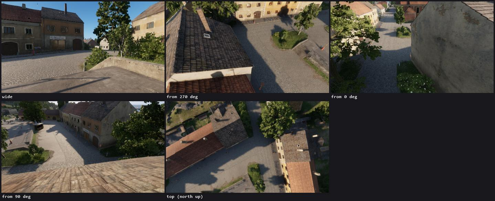

# The Everon world: places, pipeline, setup

Planning doc, 2026-11-16. It turns the world bible
([`docs/everon/world-bible.md`](../everon/world-bible.md), the public vision) into an execution plan:
the places the flagship uses on vanilla Everon, which systems live where, the **town pipeline** that
fits places out in parallel, and the world setup and its measured cost. Every question is answered
(D1 to D20 below), and the cards are on GitHub under the epic named in section 8.

Spoilers stay in `docs/everon/world-bible-internal.md`. This page is safe to publish.

## Decided (maintainer, 2026-11-16)

| # | Decision |
|---|---|
| D1 | The playtest town (`LF_Everon1989/Worlds/Everon1989Town`, a SubScene of DebugWorld) stays the playtest and test world. The real island is set up in the pack and becomes the flagship's world later |
| D2 | Grounded, light RPG. No visible zone levels |
| D3 | Unlocks work both ways: places come online server-wide per chapter, and access inside a place can be gated per player |
| D4 | The world bible is a public website page ("World of Everon"). Spoilers stay internal |
| D5 | **First location: Saint-Philippe, square first.** The town hall, hostel, café, bank, police, clinic and shops around the square open first. The dock and the outer districts open in M6. Morton is the fallback if scouting shows the square lacks buildings |
| D6 | **Reputation:** a small system in M6, per faction (town, police, underworld), that feeds the per-player gates |
| D7 | **Fishing:** a fishing chapter in M6 |
| D8 | **Travel:** taxis and cars for now. Revisit when a second town opens |
| D9 | **Buildings: mix** (was Q2, Q3). Convert a vanilla town house where one fits (hostel, town hall, police). Only where nothing fits, place a purpose-built building on a free plot near the square. The in-engine dump later found a vanilla municipal office and police villa in town, so only the hostel and the clinic need a converted house |
| D10 | **Mappings: the lead approves** each place's building mapping (was Q6). The maintainer reviews only the fitted `town-draft` PRs with pictures |
| D11 | **No lawless zones yet** (was Q9). The whole island stays policed until the gang chapter in M7. The quarry and the military sites are ordinary policed ground until then |
| D12 | **Reputation is jobs-first** (was Q10). In M6 each faction's standing mainly unlocks better jobs and better pay |
| D13 | **Pack world: reuse `MainWorld`** (lead, was Q1). Delete the apple-farm layer and retire `EveronLifeGameMode.conf` |
| D14 | **Live states on the header** (lead, was Q4): `m_aLF_LiveStates` on the flagship header, with dark place layers for places whose state has not shipped |
| D15 | **Fitted buildings are indestructible** through the place layer (lead, was Q5) |
| D16 | **The map** (lead, was Q7): superseded by a fully modded in-game map with waypoints, areas, POI icons and system markers, specified in [`everon-map.md`](everon-map.md) (its own spike). The cheap physical board on the square stays as well |
| D17 | **Flagship box RAM** (lead, was Q8): before the cutover, check the 0grind plan's RAM with the host tools. The playtest-town header stays the flagship until state 0 is ready |
| D18 | **Dirt track** (lead, was Q11): scout a closer site in state 1. Black Lake stays a later course |
| D19 | **The bus** (lead, was Q12): reviewed when the state-2 cards are cut |
| D20 | **Milestone** (planner): the epic and its cards go in M5 Settling in, because state 0 ships with M5's chapters |

## 1. The island's places

Positions come from vanilla `worlds/Eden/Eden.ent`, decoded from its map descriptors (`C_`, `S_`, `G_`,
`L_` ... entities, x and z in metres, north is +z). The roles are the bible's; it owns them, and this
page only adds where each place sits in the build order (section 3, "Phased map states").

**Towns** (`C_Location*`):

| Place | x, z | Role (bible) | Map state |
|---|---|---|---|
| **Saint-Philippe** | 4503, 10772 | The hub and capital; first location (D5). North-west coast, harbour quay at 4390, 11100. Within 400 m: 62 houses with interiors, 6 shop-houses, 2 pubs, a municipal office, a police villa, a fire station, a church | 0 (square), 1 (outskirts), 2 (dock, districts) |
| Meaux | 4520, 9468 | Nearest town south, 1.3 km. Has a vanilla police villa, a church, a post office and two pubs | 1 (road out), 2 |
| Tyrone | 4928, 9093 | Village on the road south | 2 |
| Gravette | 4121, 7796 | West-coast village | 4 |
| Montignac | 4773, 7095 | The work town (warehouses, collective farm, state factory). Island centre | 2 |
| Provins | 5486, 6087 | Central village, has a fuel station | 2 to 4 |
| Entre-Deux | 5767, 7036 | Hill village | 4 |
| Chotain | 7086, 6012 | Inland town, has an office building | 3 to 4 |
| Figari | 5251, 5338 | Village with a food shop-house | 4 |
| Laruns | 7558, 5541 | Inland village | 4 |
| Levie | 7464, 4739 | Inland town, has an office building | 3 to 4 |
| Morton | 5135, 4012 | Small south harbour town (Morton Bay, harbour at 4957, 3876). Fallback first location | 2 to 3 |
| Le Moule, Villeneuve | 2616, 5379 / 2839, 6340 | West villages | 4 |
| Lamentin | 1280, 5941 | West-coast town: municipal office, drug-store shop-house, fuel station; harbour 1024, 6043 | 3 to 4 |
| Saint-Pierre | 9689, 1558 | South-east harbour town (harbour 9925, 1525) | 3 |
| Durras, Vernon, Regina | 8827, 2746 / 9243, 2077 / 7205, 2324 | South-east hill towns. Vernon has the island's only green mountain hotel (9933, 2602) | 3 to 4 |
| Erquy | 10919, 11706 | Far north-east | 4 |

**Sites** (`G_`) and landmarks: the Saint-Philippe industrial zone (5043, 10868), its factory (4537, 10561),
landfill (5330, 10904) and airport (4901, 11787); military sites 4937, 11922 and 5355, 10543 (both near
the hub), 7447, 6705, 7632, 8141, 3902, 8451 and 7505, 4283; the quarry (8840, 4015); sawmills (3069, 5195
and 7272, 2541); farms (3032, 5497 / 4961, 9994 / 5134, 7044 / 6622, 5892); the power plant (5834, 9786);
harbours 2 to 6 (above); Montfort Castle (9315, 1145); Black Lake (9482, 3048), the dirt-track candidate.
The full list of 171 named places, with types, is what `tools\cli scout list` prints.

**What this means for the order.** Saint-Philippe's neighbours are an airport and two military sites
within 1.5 km. With no lawless zones before M7 (D11) they are plain policed ground until then; when the gang
chapter makes some of them lawless, the airport goes last, because it is the closest to new players at the
hub. Meaux, 1.3 km south, is the obvious first "second place".

## 2. Systems and story beats by place

### State 0: the Saint-Philippe square

The square is about 120 m across, at 4450, 10780. The building list comes from the catalog agent's
in-engine dump of vanilla Everon (CoreOnEveron, 1.44 M entities; `ws/everon-catalog`,
`docs/everon/catalog-buildings.md` when it lands). Within 400 m of the town centre there are 62 houses
with interiors, 15 without, 6 shop-houses, 2 pubs, 2 municipal buildings, a police villa, a fire station,
2 churches and 4 chapels, 2 fuel stations, 25 industrial buildings and 50 quay pieces. "Interior" is the
dump's provisional heuristic (door children and a raised floor); the scout dossier (card P1) confirms
each one.

| Building (vanilla prefab) | x, z | Notes |
|---|---|---|
| `MunicipalOffice_E_01` | 4419, 10648 | **Municipal office** with counter glass, office benches and files, south of the square |
| `Villa_E_2I01_Police` | 4553, 10748 | **Police villa**, east of the square |
| `Office_E_01` | 4369, 10656 | Office building beside the municipal office |
| `MunicipalOffice_E_01_school` | 4592, 10818 | School, north-east |
| `FireStation_E_01` | 4572, 10674 | Fire station, south-east |
| `Church_01_red` | 4448, 10734 | Church, just south of the square |
| `PubVillage_E_2L01_V8_ProgresBar` | 4455, 10700 | Pub with a wall sign, near the municipal office |
| `PubVillage_E_2L01_V1` | 4469, 10902 | "Hostinec" pub with a beer garden, 120 m north, on the way to the quay |
| `ShopHouse_E_2I01t_clothesstore` | 4441, 10789 | Clothes shop on the square |
| `ShopHouse_E_2I01t_householdwares` | 4515, 10746 | Household-wares shop, east of the square |
| `ShopHouse_E_2I01t_drugstore` | 4431, 10842 / 4553, 10774 | Two drugstores, north and east |
| `House_Town_E_2I01/_2I02/_2I03` | around the square (4398, 10768; 4428, 10782; 4475, 10780; 4476, 10765; 4480, 10751; 4503, 10745; 4444, 10671 ...) | Town houses with interiors, the conversion stock (D9) |
| `NewspaperBooth_E_01` | 4437, 10691 / 4425, 10754 | Kiosks |
| `FuelStation_E_01_building` | 4617, 10659 | Fuel station on the south-east road in |
| `Workshop_01_Garage`, `Workshop_01_Main` | 4401, 10970; 4391, 10630; 4546, 10670 ... | Workshops and garages (car lot, chop shop and fence candidates) |
| `FactoryHall_E_01`, `GuardHouse_01` | 4566, 10503 / 4572, 10534 | Factory hall south of town. The legacy `MainWorld` spawn (4472, 10535) is beside it |
| `HarborCrane_01`, `PierConcrete_01_*` | 4399, 11122 | The quay, from 4000, 10990 to 4390, 11220 |
| `HouseAddon_Garage_E_01`, `HouseAddon_Workshop_E_01` | 4866, 11029 | A garage and workshop yard at the east edge |

**Proposed homes, state 0** (each one confirmed against the dossier at mapping time):

| Slot | System | Proposed building | Status |
|---|---|---|---|
| `arrival` | Spawn, clerk, Form R-89, licence desk | `MunicipalOffice_E_01` (4419, 10648) | Strong fit: the vanilla town hall, with a counter |
| `hostel` | First night (#1758) | A town house on the square (D9), not `MountainHotel_01_green` | The green mountain hotel is in Vernon (9933, 2602), 8 km away. It keeps the coast's hotel role later |
| `cafe` | Café owner, radio, chess (state 1) | `PubVillage_E_2L01_V8_ProgresBar` (4455, 10700), or a shop-house on the square | Good fit: a pub near the town hall |
| `bank` | Bank, vault, ATM | `Office_E_01` (4369, 10656), beside the town hall | Good fit; the scout checks the interior for a vault room |
| `police` | Police station, desk, cells, armoury | `Villa_E_2I01_Police` (4553, 10748) | Strong fit: the vanilla police villa |
| `clinic` | Hospital and medic | A town house near the square (D9) | Converted town house |
| `general-store` | General store | `ShopHouse_E_2I01t_householdwares` (4515, 10746) | Strong fit |
| `clothing` | Clothing counter | `ShopHouse_E_2I01t_clothesstore` (4441, 10789) | Strong fit: the vanilla building is a clothes store |
| `gun-counter` | Gun counter (permit-gated) | `ShopHouse_E_2I01t_drugstore` (4553, 10774), beside the police villa | Good fit; the second drugstore (4431, 10842) stays the drug store |
| `fuel` | Fuel job, robbery till | `FuelStation_E_01_building` (4617, 10659) | Strong fit |
| `fence` | Vince's barn | The garage and workshop yard on the east edge (4866, 11029) | Scout picks |
| `board` | Town board and the physical map board (D16) | A wall on the square | Kit only |
| `taxi` | Taxi rank and depot (D8) | Kerb on the square | Kit only |
| `parcel` | Parcel job depot | Kiosk or a shop near the square | Scout picks |

**Story beats, state 0.** The arrival route is the south road into town at dawn, from the factory-hall
junction (the legacy spawn) past the fuel station to the square. That gives a walk of about 400 m
along the vanilla road for The relocated's walkers (#2174's walk already works on CoreOnEveron). The
square, the hostel and the café host the rest. The quay is in sight but dark until state 2: there is
no interactable there, and no NPC.




### Later states

The bible's systems map (`world-bible.md` "Systems map") holds the system-to-place table, so this page does
not repeat it. In build terms:

| State | Ships with | Places (bake units) | New system slots |
|---|---|---|---|
| 0 | M5: Arrival, The relocated, Armed and dressed | `saint-philippe-square` | The table above |
| 1 | M5: Evenings in the village, On patrol | `saint-philippe-outskirts` (pub or hall, range), the road to Meaux with lay-bys (`road-sp-meaux`), the dirt track (a closer site found by scouting, D18), the quarry or an orchard as an ordinary policed work site (D11) | `pub`, `hall`, `range`, `track`, `layby` (route, not a building), `quarry` |
| 2 | M6 Making a living | `saint-philippe-dock`, `saint-philippe-districts`, `meaux`, `montignac`, an orchard village, a scrapyard | `dock`, `fish-counter` (D7), `factory`, `market`, `supermarket`, `scrapyard`, `taxi` stands per town (D8) |
| 3 | M7 Power and turf | The first lawless ground, chosen with the gang chapter (D11; military sites, the airport last), coves, the prison, turf villages, Saint-Pierre, Morton | `lawless`, `cove`, `prison`, `turf-point` |
| 4 | M8 Roots | Every remaining village | `house`, `farm-plot`, `garage` |

## 3. The town pipeline

One place goes through five steps. Each step has one command, one output file and one owner, so many
places run at once without touching each other's files.

```
scout ──> map (approve) ──> fit (one agent per slot) ──> check ──> draft PR (maintainer)
dossier    mapping.json      Place_<place>_<slot>.layer   town check   pictures
```

### 3.1 Survey: `tools\cli scout <place>`

Built by its own agent (`ws/scout-tool`); it is step one of this pipeline. One `look` run on
CoreOnEveron takes the overview pictures and dumps every entity, road and height near the place. Node
measures each building (`tools\cli measure`) and finds its footprint, entrances, interior and floor
height, plus the roads, junctions, free plots and slope. `look --interior` (#2194) shoots the first rooms.
The output is `docs/everon/places/<slug>/dossier.json` (schema 1), `dossier.md` and `img/`. The dossier
supplies every coordinate the later steps use. No step types a coordinate.

### 3.2 Mapping: templates, then a per-place mapping file

- **Template** (`tools/town/templates/<kind>.json`, kinds `town`, `village`, `harbour`, `site`): the
  slots of a place kind. Each slot has an id, `required` or optional, the kit it takes, what the
  building needs (interior, ground floor, area, street frontage, distance from the square) and the
  `LF_Places` kinds the core system looks for once it is fitted. Each slot also names its `poi`, the
  front kind that has a row in the map's POI table (`LF_MapPois.conf` plus pack overlays), or `none`;
  `town map --check` fails a slot with neither (`tools/town/lib/poi-check.mjs`, everon-map.md). Templates
  are tooling: they hold no coordinates and no place names.
- **Mapping** (`docs/everon/places/<slug>/mapping.json`, next to its dossier): slot id, then a building id
  from the dossier, a free plot from the dossier with a purpose-built building prefab (`plot:<id>` plus
  `prefab`, only where no vanilla building fits, D9), or `none` with a reason. `tools\cli town map <slug>`
  proposes one by scoring the dossier's buildings against the slot needs. The lead approves it (D10): a
  reviewed PR that holds only that file. Nothing is placed before it merges.
  Building types are one vocabulary: the catalog's and scout's (`tools/scout/types.mjs`), which the templates'
  `needs.types` use too; `TYPE_ALIASES` there resolves the older names (`municipal-office`, `house-town`, `shop-*`,
  `fuel-station`) and `TYPE_REFINEMENTS` picks a kind of shop by its prefab stem. The template is `--template`, else the
  one the place's mapping names (`mapping.template`, so a village the gazetteer calls `other` still checks as a village),
  else the dossier's (`scout --template town|village`), else `town`.
- **Core stays map-independent.** The mapping is tooling data. What reaches the game is the fitted
  layer: entities with `LF_PlaceComponent` and the feature components that register in `LF_Places`. The
  core never reads the mapping.

### 3.3 Fit-out: kits

- **A kit** (`tools/town/kits/<kit>.json`) is a reusable composition for one system. It lists prefabs with
  a role (`counter`, `till`, `npc`, `board`, `dressing`) and a placement verb from the place tool (`on
  <floor>`, `against <wall>`, `on <prop>`), relative to anchors the dossier gives (the entrance, the
  floor centre, the longest inner wall). It holds no world coordinates, so one kit fits any building
  that meets the slot's needs.
- **The first kits are extracted from what already works.** `tools\cli town kit extract <layer> <group>`
  reads a playtest-town building (the general store, police front desk, bank counter and vault, clinic,
  clothing counter, gun counter, café) or a grid cell (fence, ATM, fuel till, parcel depot) and writes
  the kit. The relative geometry is kept; the absolute positions are dropped.
- **Placed buildings (D9).** Where the mapping names a free plot, `town fit` first places the
  purpose-built building with `place ground` on the plot, then fits its kit like any other building.
- **Indestructible (D15).** A placed building (D9) is written into the slot layer with its destruction
  off. A vanilla building stands in the terrain, so no layer can override it: `town fit` puts
  `LF_FittedBuildingComponent` on the slot's place marker inside the building, and on the server the
  core turns that building's damage handling off (`docs/features/core.md` "LF_FittedBuildings"). The
  claim says `destruction.mode: "hooked"`; a slot with no place marker stays `needs-hook`.
- **Apply:** `tools\cli town fit <place> <slot>` resolves the building from the mapping and its anchors
  from the dossier. It runs each kit row through `place on|against|ground` (the same bound reads, surface
  probes, checks and audit), writes `MainWorld_Layers/Place_<place>_<slot>.layer`, adds the slot's
  `LF_PlaceComponent` (kind and id from the template, id `<place>.<slot>`), runs `audit placement` on the
  new layer and takes `look --interior` and exterior pictures for the PR.
- **Seat on the host** (`tools/town/seat.mjs`). The island's vanilla host can differ from the playtest copy a kit
  came from, so offsets alone floated, sank and clipped rows (audits on #2369, #2378, #2394). A host that shows the
  kit's own building model takes the kit at its origin and yaw (never turned to an entrance), and a kit's offsets are not
  lifted by the dossier floor a second time. Then each row is corrected from the host's `.xob` colliders, offline: a
  floor row onto the host top under it, a wall-mounted row (`on: "wall"`, a `wall` tag or a hung kind) along its
  facing onto the nearest wall plane, a row cutting a wall pushed out by up to 0.3 m. A row still cutting the shell
  refuses the fit (`--allow-clip` writes it); a row hung on a socket of the source building is left out with a warning,
  and a row standing in a prop the host carries itself (a vanilla furniture set a layer cannot remove) is flagged.
  `town fit <place> <slot> --check` prints the per-row corrections against the layer on disk and writes nothing.

### 3.4 Parallelism

- **One layer per slot.** `Place_<place>_<slot>.layer` is the unit of work and the unit of review. The
  place's shared layer, `Place_<place>.layer` (spawn, safe zone, signs, the board), belongs to the slot
  `arrival`. Two agents never write one file.
- **Claims** carry over from the grid: `tools/town/claims/<place>-<slot>.json` (slug, building id, layer,
  date). `town fit` refuses a claim that `origin/main` or an open PR already holds; it reads open-PR claims
  the same way `grid place` does since #2021. A separate validator, `validate-island-zones` (#2206), guards the `island` zone, the
  `MainWorld_Layers/Place_*` files: only a `town-draft-<place>-<slot>` branch may change one, and only its own. Each layer's
  entities must stand inside its claimed building's footprint (plus a margin set per slot: 2 m for a building,
  12 m for a street slot, `taxi` 8 m, `board` 10 m, or the template slot's own `margin`), and no two claims may name one
  building (a street slot marked `shared` may stand on a building another slot holds).
- **Who writes.** Only a worktree named `town-draft-<place>-<slot>` writes an island layer. Its PR is a
  draft with before and after pictures and goes to the maintainer (bible step 4). The playtest town's
  guard and the maintainer's own worktree are unchanged.
- **Scale.** One agent per slot inside a place, and places run side by side. The pool is the limit: each
  `look` needs a Workbench on lf-testbox or lf-cloud, about 1.5 to 2 minutes for an Everon look (below),
  and `look serve` amortises the start.

| Existing tool | Carries over as |
|---|---|
| `grid place` (cells, claims, yards) | `town fit` (buildings, claims, kits). Same claim file shape, same `origin/main` and open-PR checks |
| Open-PR claims (#2021) | Read for town claims too, with the same 60 s `gh` cache |
| Sibling-worktree claims | An uncommitted claim file in another local worktree counts as taken, read from `git worktree list --porcelain` with no network |
| `place on/against/ground/arrange` | Unchanged; the kit rows call it |
| `audit placement --strict` | Run with `--world MainWorld` on the new layer; island layers get the town bar |
| `look`, `look --interior` (#2194) | `look place:<place>/<slot> [--interior auto]`: pictures per slot on MainWorld, viewpoint from the dossier (#2347) |
| `scout` | Step 1 |

### 3.5 Validation: `tools\cli town check <place>` and `town ready <state>`

Towns are checked by audit and pictures, never by layout tests. Tests stay on GridWorld and the playtest
town (`world-zones.md` "Tests do not read the town").

- **Static** (node; `town check <place>` per place, and the claim and footprint half in `validate` as
  `validate-island-zones`): every required slot of the template is mapped; per slot, a fitted slot (one with a
  layer or a claim) has both and they agree with the mapping; every layer registers the kinds the slot promises, which `town check` reads
  from the `.layer` text (a kind no system lists in `m_aPlaces` of `LF_SystemCatalog.conf` is a warning); the kits' prefabs resolve.
  It also counts each slot's layer against the building budget of its size (the `perf building` counts) and the
  per-place limits within 60 m (24 lights, 12 shadow casters, 1,500 added entities; `performance.md`), and warns on a claim
  whose `destruction.mode` is `needs-hook` until the indestructible hook lands. The map POI-kind slot check (M17, #2245,
  `tools/town/lib/poi-check.mjs`) fails a template slot that names no front `poi` kind with a row in `LF_MapPois.conf` (or `none`).
- **Per slot, not per place.** Slots are fitted one draft at a time, so `validate` and a plain `town check` pass a
  place with only some slots fitted: a mapped slot with neither layer nor claim is "not fitted yet", a note. A claim
  without its layer, or a layer without its claim, fails everywhere. Place **completeness** (every mapped slot fitted)
  is demanded only by `town check <place> --complete` and `town ready <state>` (#2347).
- **In-world** (one Workbench run): `audit placement --strict` over the place's layers, plus pictures.
- **Reachable** (one session on MainWorld): a harness verb walks a character from the place spawn to each
  slot's entrance on the `GM_Eden.nmn` navmesh. It fails on a slot with no path, or with a path over
  3 times the straight-line distance.
- **Phase readiness** (`town ready <state>`): every place of the state passes `town check`, every system
  that the state's chapters list is present (the boot log has no `[LFDebug:<System>] no <Kind> placed on this map: off` line, which `LF_Systems.CheckPlaces` logs for a system with no place), the arrival
  route works end to end on the flagship header, and no live slot points at a dark place.

### 3.6 Phased map states and the bake order

A state is a set of places brought online through the pipeline. **Each state must be playable and coherent
on its own**:

- **Readiness rule.** A state ships only when `town ready <state>` passes and the chapter playtest is
  done. A half-built state is never public: places of the next state may be fitted, but they stay
  `dark` until their state ships.
- **Dark places.** A place being fitted, or waiting for its state, has no spawn, no interactable, no NPC
  and no signage. It is plain vanilla Everon, so the island looks lived-in but closed, never half-built.
  One switch per state, `m_aLF_LiveStates` on the flagship header (D14), turns on its places' layers; until
  then the layers carry the place component in a disabled state.
- **Bake order** follows the states: 0 (the square), 1 (outskirts, the road to Meaux, the track), 2 (the
  dock, the districts, Meaux, Montignac, orchards, the scrapyard), 3, then 4. Within a state the order is
  the critical path: the arrival slot first (it owns the spawn), then the slots the state's chapters need,
  then dressing.

## 4. World setup and performance

### The pack world

`LF_Everon1989/Worlds/MainWorld` already exists. It is a SubScene of vanilla `worlds/Eden/Eden.ent` (batch 1,
#1185). It has a game mode, a spawn at 4472, 10535 and one legacy layer, `Area_StPhillipe_AppleFarm` (an
EveronLife-era apple trader). Its old header, `Missions/EveronLifeGameMode.conf` ("Life Framework
Pre-Alpha", 256 slots), is hidden from Scenarios. Decided (D13):

Steps 1 to 3 landed in #2204 (W1): the apple-farm layer and `EveronLifeGameMode.conf` are deleted, `Gamemode.layer`
holds the `SCR_AIWorld_Eden` with `GM_Eden.nmn`, `LF_EveronIsland.conf` exists and `session up --mission island`
boots it. The old spawn (4472, 10535) stays until the `arrival` slot owns one.

1. Keep `MainWorld` (no new GUID), delete the legacy apple-farm layer and retire `EveronLifeGameMode.conf`.
2. Copy CoreOnEveron's game layer into it: the `SCR_AIWorld_Eden` with the soldier `NavmeshWorldComponent`
   listing `{AD5F99CD7C59D5E0}worlds/GameMaster/Navmeshes/GM_Eden.nmn` (PR #2195, the fix that made
   walkers walk).
3. Add a hidden header `Missions/LF_EveronIsland.conf` that inherits `LF_Everon1989.conf` (one overlay
   list, the same flags) and sets `World` to MainWorld, as `LF_Everon1989_Test.conf` already does for
   GridWorld. `session --mission island` and `look --world island` boot it.
4. When state 0 is ready, `LF_Everon1989.conf`'s `World` switches to MainWorld. That one-line change is
   the flagship cutover.
5. `LF_PlaytestTown.conf`, `Everon1989Town`, DebugWorld and every test path stay as they are (D1).

### Measured cost (2026-11-16)

| | Playtest town | Vanilla Everon (CoreOnEveron) |
|---|---|---|
| Server `Game::LoadEntities` | 0.6 to 1.7 s (this PC) | 16.5 s (lf-testbox, about 2x slower): preload 3.8 s, terrain 3.0 s, spawn 3.0 s |
| Server process start to world ready | not measured | about 21 s on lf-testbox |
| `session up` to a joined client (lowspec) | not measured | 55 s |
| Server private memory, 1 client | about 600 MB (pool reserve) | 2.5 GB |
| Client private memory (lowspec) | about 850 MB (pool reserve) | 2.9 GB |
| Workbench `look`, world and play | 5 to 15 s | 36 to 43 s |

**The alpha box (0grind, 16 slots).** Vanilla Conflict and Game Master run on Everon on rented hosts of this
class every day, so the island itself is not the risk. The 2.5 GB is for an empty server; budget 4 to 6 GB
with 16 players and AI walkers, and check the 0grind plan's RAM with the host tools before the cutover (D17). Boot time is not a player-facing
problem.

**Risks:**

- **Pool RAM.** lf-testbox has 15.6 GB, and an island session takes about 5.4 GB with one client. Two
  island sessions do not fit beside a test lane. Island sessions need their own pool reserve
  (`sessionReserve.island`), and `town fit` should use Workbench `look`, not sessions.
- **Script cost at island scale.** No core system queries the whole world today (checked:
  `QueryEntities*` calls are radius-bounded). A new system must stay radius-bounded; Everon has about
  117,000 entities against the town's few thousand.
- **Vanilla destruction.** Eden runs `SCR_MPDestructionManager`, so buildings and fences can break, and the
  break replicates. A fitted building that is destroyed loses its kit's floor. Mark fitted buildings
  indestructible through the place layer (D15).
- **Vanilla doors and interiors.** Fitted interiors depend on vanilla door slots. The dossier records the
  doors; `look --interior` shows what a player sees.
- **Military ground next to the hub** (the airport and two military sites). Policed like the rest of the
  island until M7 (D11); the gang chapter decides which become lawless, the airport last.

## 5. What moves and what is reused

| Item | Work |
|---|---|
| Core systems (bank, police, shops, jobs, fence, events) | None: they find places by `LF_Places` and switch off with one line when a place is missing (#1047) |
| Playtest-town buildings and grid cells | Read-only sources for kit extraction; nothing moves |
| Town layers | None are moved. Island layers are new, one per slot |
| Spawn | One spawn point in `Place_saint-philippe-square_arrival.layer`; the legacy spawn goes with the apple-farm layer |
| Place names and signs | Pack strings already exist for the playtest town; island place names and road signs go in the pack table (`validate-core-place-names`) |
| Systems that assume the small town | Racing courses (`LF_RaceCourses_Everon1989.conf` has playtest-town points), the dispatch board's named places, the town board and the event walk route need island data files. They are listed per state in the cards |
| Tests | Stay on GridWorld and the playtest town; no test reads the island |

## 6. The website page

The "World of Everon" page already renders from `docs/everon/world-bible.md` (#2198). One card makes it
grow per chapter:

- A `## Live now` section generated from the pack's live-state list (the header's `m_aLF_LiveStates`,
  D14): each live state's places with their public dossier picture and one line each, so the page shows
  what a player can visit today.
- Each chapter's release note adds its places to that list; the bible's text stays the vision.
- A check (`validate-public-bible`) fails the build when the website content names
  `world-bible-internal.md`, or when the public page or a dossier picture caption contains a term from
  the internal file's spoiler list.

## 7. Open questions

None. The questions this plan raised are answered as D9 to D20 above. New questions go in the epic, not
here.

## 8. The epic and its cards

Epic **#2201**, "Everon island: town pipeline and Saint-Philippe state 0", in M5 Settling in (D20). The
cards were created with `tools\cli slice new 2201`. Each card is file-disjoint and at most 45 minutes, and
`tools\cli slice list 2201 --ready` is the dispatch queue.

| Key | Card | Type | Depends on |
|---|---|---|---|
| T1 | #2202 Place templates and the `town map` proposer | tooling | none |
| T2 | #2203 Kit extract and the first 8 kits | tooling | none |
| W1 | #2204 MainWorld cleanup, AI world and navmesh, hidden `LF_EveronIsland.conf` | data | none |
| W2 | #2208 Live map states on the header, dark place layers | system | none |
| T3 | #2205 `town fit` | tooling | #2202, #2203, #2204 |
| T4 | #2206 Island claims guard and `town check` | tooling | #2205 |
| T5 | #2207 Reachability proof and `town ready` | tooling | #2205, #2204 |
| P1 | #2209 Saint-Philippe square: dossier and mapping (the lead approves) | data | #2202 |
| M1 | #2210 Meaux: dossier and mapping, the parallel proof | data | #2202 |
| X1 | #2211 World of Everon "Live now" and the spoiler check | docs | #2208 |
| X2 | #2212 Flagship cutover (`hold` until state 0 is ready and the box RAM is checked) | data | #2204, #2208, #2207 |

**Town-draft cards.** When P1's mapping merges, the lead cuts one `town-draft` card per slot (label
`town-draft`, worktree `town-draft-saint-philippe-square-<slot>`, `arrival` first), then a state-0 readiness
card, under #2201. Meaux's slot cards follow M1 the same way.

**Why Meaux is the second place.** It is next in the bake order, its police villa, church and pubs test the
`village` template, and its road to the hub is state 1's patrol route.
