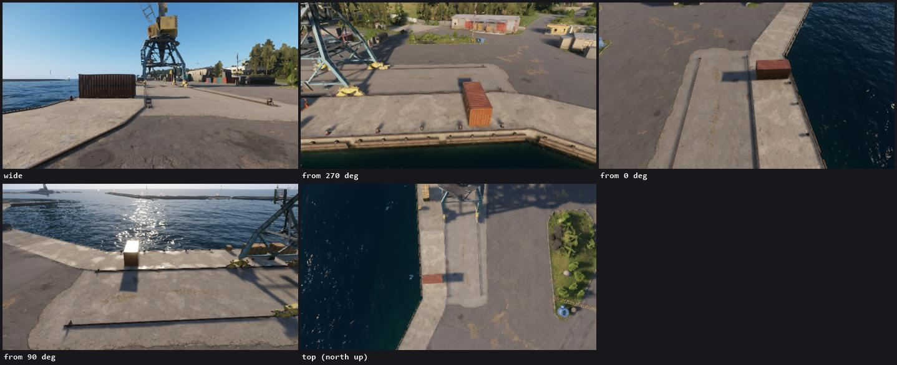
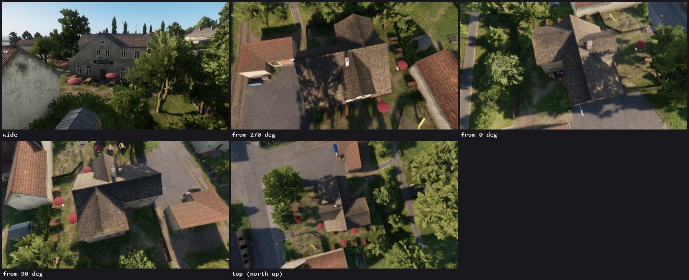
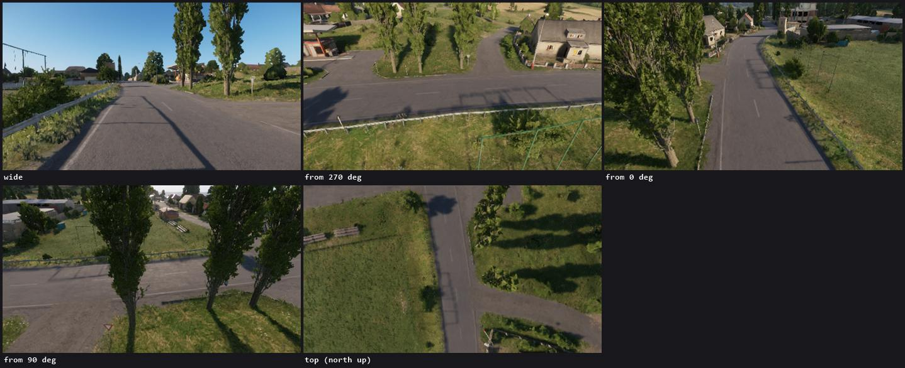

# The Everon world: places, pipeline, setup

Planning doc for the maintainer to review, 2026-11-16. It turns the world bible
([`docs/everon/world-bible.md`](../everon/world-bible.md), the public vision) into an execution plan:
the places the flagship uses on vanilla Everon, which systems live where, the **town pipeline** that
fits places out in parallel, the world setup and its measured cost, and the decisions still open.
No build cards exist yet. They are cut once the open questions in the last section are answered. The
draft list at the end shows their shape.

Spoilers stay in `docs/everon/world-bible-internal.md`. This page is safe to publish.

## Decided (maintainer, 2026-11-16)

| # | Decision |
|---|---|
| D1 | The playtest town (`LF_Everon1989/Worlds/Everon1989Town`, a SubScene of DebugWorld) stays the playtest and test world. The real island is set up in the pack and becomes the flagship's world later |
| D2 | Grounded, light RPG. No visible zone levels |
| D3 | Unlocks work both ways: places come online server-wide per chapter, and access inside a place can be gated per player |
| D4 | The world bible is a public website page ("World of Everon"). Spoilers stay internal |
| D5 | **First location: Saint-Philippe, square first.** The town hall, hostel, café, bank, police, clinic and shops around the square open first. The dock and the outer districts open in M6. Morton is the fallback if scouting shows the square lacks buildings |
| D6 | **Reputation:** a small system in M6, per faction (town, police, underworld), that feeds the per-player gates |
| D7 | **Fishing:** a fishing chapter in M6 |
| D8 | **Travel:** taxis and cars for now. Revisit when a second town opens |

## 1. The island's places

Positions come from vanilla `worlds/Eden/Eden.ent`, decoded from its map descriptors (`C_`, `S_`, `G_`,
`L_` ... entities, x and z in metres, north is +z). The roles are the bible's; it owns them, and this
page only adds where each place sits in the build order (section 3, "Phased map states").

**Towns** (`C_Location*`):

| Place | x, z | Role (bible) | Map state |
|---|---|---|---|
| **Saint-Philippe** | 4503, 10772 | The hub and capital; first location (D5). North-west coast, harbour quay at 4390, 11100 | 0 (square), 1 (outskirts), 2 (dock, districts) |
| Meaux | 4520, 9468 | Nearest town south, 1.3 km. Has a vanilla police villa, a church, a post office and two pubs | 1 (road out), 2 |
| Tyrone | 4928, 9093 | Village on the road south | 2 |
| Gravette | 4121, 7796 | West-coast village | 4 |
| Montignac | 4773, 7095 | The work town (warehouses, collective farm, state factory). Island centre | 2 |
| Provins | 5486, 6087 | Central village, has a fuel station | 2 to 4 |
| Entre-Deux | 5767, 7036 | Hill village | 4 |
| Chotain | 7086, 6012 | Inland town, has an office building | 3 to 4 |
| Figari | 5251, 5338 | Village with a food shop-house | 4 |
| Laruns | 7558, 5541 | Inland village | 4 |
| Levie | 7464, 4739 | Inland town, has an office building | 3 to 4 |
| Morton | 5135, 4012 | Small south harbour town (Morton Bay, harbour at 4957, 3876). Fallback first location | 2 to 3 |
| Le Moule, Villeneuve | 2616, 5379 / 2839, 6340 | West villages | 4 |
| Lamentin | 1280, 5941 | West-coast town: municipal office, drug-store shop-house, fuel station; harbour 1024, 6043 | 3 to 4 |
| Saint-Pierre | 9689, 1558 | South-east harbour town (harbour 9925, 1525) | 3 |
| Durras, Vernon, Regina | 8827, 2746 / 9243, 2077 / 7205, 2324 | South-east hill towns. Vernon has the island's only green mountain hotel (9933, 2602) | 3 to 4 |
| Erquy | 10919, 11706 | Far north-east | 4 |

**Sites** (`G_`) and landmarks: the Saint-Philippe industrial zone (5043, 10868), its factory (4537, 10561),
landfill (5330, 10904) and airport (4901, 11787); military sites 4937, 11922 and 5355, 10543 (both near
the hub), 7447, 6705, 7632, 8141, 3902, 8451 and 7505, 4283; the quarry (8840, 4015); sawmills (3069, 5195
and 7272, 2541); farms (3032, 5497 / 4961, 9994 / 5134, 7044 / 6622, 5892); the power plant (5834, 9786);
harbours 2 to 6 (above); Montfort Castle (9315, 1145); Black Lake (9482, 3048), the dirt-track candidate.
The full list of 171 named places, with types, is what `tools\cli scout list` prints.

**What this means for the order.** Saint-Philippe's neighbours are an airport and two military sites
within 1.5 km. That is lawless ground at state 3, so it opens late: a new player at the hub must not drive
into it by mistake (bible "risk gradient"). Meaux, 1.3 km south, is the obvious first "second place". It
already has the island's police villa.

## 2. Systems and story beats by place

### State 0: the Saint-Philippe square

The square is about 120 m across, at 4450, 10780. These are the vanilla buildings that a decode of
`Eden.ent` names within 500 m. About 950 entities in that radius, among them most of the town
houses, use leaf prefabs the decode cannot name; the scout dossier (card P1) replaces this table with a
complete one.

| Building (vanilla prefab) | x, z | Notes |
|---|---|---|
| `ShopHouse_E_2I01t_clothesstore` | 4441, 10789 | On the square, ground-floor shop with interior |
| `House_Town_E_2I01_orange` | 4475, 10781 | Town house on the square, two storeys, interior |
| `House_Town_E_2I02_yellow` | 4412, 10773 | Town house on the square, interior |
| `House_Village_E_1L01_Furniture` | 4392, 10733 | Furnished village house, west of the square |
| `NewspaperBooth_E_01_redwhite` | 4437, 10691 | Kiosk on the south approach |
| `PubVillage_E_2L01_V1` | 4469, 10902 | "Hostinec" pub with a beer garden, 120 m north, on the way to the quay |
| `FuelStation_E_01_building` | 4617, 10659 | Fuel station on the south-east road in |
| `FactoryHall_E_01`, `GuardHouse_01` | 4566, 10503 / 4572, 10534 | Factory hall south of town. The legacy `MainWorld` spawn (4472, 10535) is beside it |
| `Workshop_01_Main`, `Workshop_02_grey` | 4257, 10693 | Workshop yard, west, by the water |
| `Warehouse_01_Workshop` | 4654, 11151 | Dock warehouse |
| `HarborCrane_01`, `PierConcrete_01_*` | 4399, 11122 | The quay: about 40 concrete pier segments from 4000, 10990 to 4390, 11220 |
| `Chapel_01_yellow` | 4308, 10447 | Chapel, south-west edge |
| `House_Prefab_2I01_v1/_v2` | 4268, 10587 / 4297, 10587 | Prefab houses, south-west |
| `HouseAddon_Garage_E_01`, `HouseAddon_Workshop_E_01` | 4866, 11029 | A garage and workshop at the east edge (fence barn candidate) |

**Proposed homes, state 0** (each one confirmed against the dossier at mapping time):

| Slot | System | Proposed building | Status |
|---|---|---|---|
| `arrival` | Spawn, clerk, Form R-89, licence desk | The largest town house on the square (town hall role) | Scout picks; no vanilla municipal office in Saint-Philippe |
| `hostel` | First night (#1758) | A town house on the square, not `MountainHotel_01_green` | **The green mountain hotel is in Vernon (9933, 2602), 8 km away. There is none in Saint-Philippe (question Q2)** |
| `cafe` | Café owner, radio, chess (state 1) | A ground-floor shop-house on the square | Scout picks |
| `bank` | Bank, vault, ATM | A solid town house on the square | Scout picks |
| `police` | Police station, desk, cells, armoury | A town house on the square | No vanilla police villa in town (nearest: Meaux) |
| `clinic` | Hospital and medic | A town house near the square | Scout picks |
| `general-store` | General store | `ShopHouse` or a ground-floor shop | Scout picks |
| `clothing` | Clothing counter | `ShopHouse_E_2I01t_clothesstore` (4441, 10789) | Strong fit: the vanilla building is a clothes store |
| `gun-counter` | Gun counter (permit-gated) | A shop-house near the police | Scout picks |
| `fuel` | Fuel job, robbery till | `FuelStation_E_01_building` (4617, 10659) | Strong fit |
| `fence` | Vince's barn | A barn or the garage yard on the edge (4866, 11029) | Scout picks |
| `board` | Town board, map board (Q7) | A wall on the square | Kit only |
| `taxi` | Taxi rank and depot (D8) | Kerb on the square | Kit only |
| `parcel` | Parcel job depot | Kiosk or a shop near the square | Scout picks |

**Story beats, state 0.** The arrival route is the south road into town at dawn, from the factory-hall
junction (the legacy spawn) past the fuel station to the square. That gives a walk of about 400 m
along the vanilla road for The relocated's walkers (#2174's walk already works on CoreOnEveron). The
square, the hostel and the café host the rest. The quay is in sight but dark until state 2: there is
no interactable there, and no NPC.








### Later states

The bible's systems map (`world-bible.md` "Systems map") holds the system-to-place table, so this page does
not repeat it. In build terms:

| State | Ships with | Places (bake units) | New system slots |
|---|---|---|---|
| 0 | M5: Arrival, The relocated, Armed and dressed | `saint-philippe-square` | The table above |
| 1 | M5: Evenings in the village, On patrol | `saint-philippe-outskirts` (pub or hall, range), the road to Meaux with lay-bys (`road-sp-meaux`), the dirt track (Black Lake, or a closer site found by scouting), the quarry or an orchard | `pub`, `hall`, `range`, `track`, `layby` (route, not a building), `quarry` |
| 2 | M6 Making a living | `saint-philippe-dock`, `saint-philippe-districts`, `meaux`, `montignac`, an orchard village, a scrapyard | `dock`, `fish-counter` (D7), `factory`, `market`, `supermarket`, `scrapyard`, `taxi` stands per town (D8) |
| 3 | M7 Power and turf | Lawless military sites (the airport last), coves, the prison, turf villages, Saint-Pierre, Morton | `lawless`, `cove`, `prison`, `turf-point` |
| 4 | M8 Roots | Every remaining village | `house`, `farm-plot`, `garage` |

## 3. The town pipeline

One place goes through five steps. Each step has one command, one output file and one owner, so many
places run at once without touching each other's files.

```
scout ──> map (approve) ──> fit (one agent per slot) ──> check ──> draft PR (maintainer)
dossier    mapping.json      Place_<place>_<slot>.layer   town check   pictures
```

### 3.1 Survey: `tools\cli scout <place>`

Built by its own agent (`ws/scout-tool`); it is step one of this pipeline. One `look` run on
CoreOnEveron takes the overview pictures and dumps every entity, road and height near the place. Node
measures each building (`tools\cli measure`) and finds its footprint, entrances, interior and floor
height, plus the roads, junctions, free plots and slope. `look --interior` (#2194) shoots the first rooms.
The output is `docs/everon/places/<slug>/dossier.json` (schema 1), `dossier.md` and `img/`. The dossier
supplies every coordinate the later steps use. No step types a coordinate.

### 3.2 Mapping: templates, then a per-place mapping file

- **Template** (`tools/town/templates/<kind>.json`, kinds `town`, `village`, `harbour`, `site`): the
  slots of a place kind. Each slot has an id, `required` or optional, the kit it takes, what the
  building needs (interior, ground floor, area, street frontage, distance from the square) and the
  `LF_Places` kinds the core system looks for once it is fitted. Templates are tooling: they hold no
  coordinates and no place names.
- **Mapping** (`docs/everon/places/<slug>/mapping.json`, next to its dossier): slot id, then a building id
  from the dossier, or `none` with a reason. `tools\cli town map <slug>` proposes one by scoring the
  dossier's buildings against the slot needs. A human or the lead edits it, and approval is a reviewed
  PR that holds only that file (label `town-mapping`). Nothing is placed before it merges.
- **Core stays map-independent.** The mapping is tooling data. What reaches the game is the fitted
  layer: entities with `LF_PlaceComponent` and the feature components that register in `LF_Places`. The
  core never reads the mapping.

### 3.3 Fit-out: kits

- **A kit** (`tools/town/kits/<kit>.json`) is a reusable composition for one system. It lists prefabs with
  a role (`counter`, `till`, `npc`, `board`, `dressing`) and a placement verb from the place tool (`on
  <floor>`, `against <wall>`, `on <prop>`), relative to anchors the dossier gives (the entrance, the
  floor centre, the longest inner wall). It holds no world coordinates, so one kit fits any building
  that meets the slot's needs.
- **The first kits are extracted from what already works.** `tools\cli town kit extract <layer> <group>`
  reads a playtest-town building (the general store, police front desk, bank counter and vault, clinic,
  clothing counter, gun counter, café) or a grid cell (fence, ATM, fuel till, parcel depot) and writes
  the kit. The relative geometry is kept; the absolute positions are dropped.
- **Apply:** `tools\cli town fit <place> <slot>` resolves the building from the mapping and its anchors
  from the dossier. It runs each kit row through `place on|against|ground` (the same bound reads, surface
  probes, checks and audit), writes `MainWorld_Layers/Place_<place>_<slot>.layer`, adds the slot's
  `LF_PlaceComponent` (kind and id from the template, id `<place>.<slot>`), runs `audit placement` on the
  new layer and takes `look --interior` and exterior pictures for the PR.

### 3.4 Parallelism

- **One layer per slot.** `Place_<place>_<slot>.layer` is the unit of work and the unit of review. The
  place's shared layer, `Place_<place>.layer` (spawn, safe zone, signs, the board), belongs to the slot
  `arrival`. Two agents never write one file.
- **Claims** carry over from the grid: `tools/town/claims/<place>-<slot>.json` (slug, building id, layer,
  date). `town fit` refuses a claim that `origin/main` or an open PR already holds; it reads open-PR claims
  the same way `grid place` does since #2021. `validate-world-zones` gains an `island` zone, the
  `MainWorld_Layers/Place_*` files. Each layer's entities must stand inside its claimed building's
  footprint (plus a margin set per slot, such as a kerb for `taxi`), and no two claims may name one
  building.
- **Who writes.** Only a worktree named `town-draft-<place>-<slot>` writes an island layer. Its PR is a
  draft with before and after pictures and goes to the maintainer (bible step 4). The playtest town's
  guard and the maintainer's own worktree are unchanged.
- **Scale.** One agent per slot inside a place, and places run side by side. The pool is the limit: each
  `look` needs a Workbench on lf-testbox or lf-cloud, about 1.5 to 2 minutes for an Everon look (below),
  and `look serve` amortises the start.

| Existing tool | Carries over as |
|---|---|
| `grid place` (cells, claims, yards) | `town fit` (buildings, claims, kits). Same claim file shape, same `origin/main` and open-PR checks |
| Open-PR claims (#2021) | Read for town claims too, with the same 60 s `gh` cache |
| `place on/against/ground/arrange` | Unchanged; the kit rows call it |
| `audit placement --strict` | Run with `--world MainWorld` on the new layer; island layers get the town bar |
| `look`, `look --interior` (#2194) | Pictures per slot and per place, on MainWorld |
| `scout` | Step 1 |

### 3.5 Validation: `tools\cli town check <place>` and `town ready <state>`

Towns are checked by audit and pictures, never by layout tests. Tests stay on GridWorld and the playtest
town (`world-zones.md` "Tests do not read the town").

- **Static** (node, part of `validate`): every required slot of the template is mapped; every mapped slot
  has its layer and claim; every layer registers the kinds the slot promises, which `town check` reads
  from the `.layer` text against `m_aPlaces` in `LF_SystemCatalog.conf`; the kits' prefabs resolve.
- **In-world** (one Workbench run): `audit placement --strict` over the place's layers, plus pictures.
- **Reachable** (one session on MainWorld): a harness verb walks a character from the place spawn to each
  slot's entrance on the `GM_Eden.nmn` navmesh. It fails on a slot with no path, or with a path over
  3 times the straight-line distance.
- **Phase readiness** (`town ready <state>`): every place of the state passes `town check`, every system
  that the state's chapters list is present (the boot log has no "switches off" line for it), the arrival
  route works end to end on the flagship header, and no live slot points at a dark place.

### 3.6 Phased map states and the bake order

A state is a set of places brought online through the pipeline. **Each state must be playable and coherent
on its own**:

- **Readiness rule.** A state ships only when `town ready <state>` passes and the chapter playtest is
  done. A half-built state is never public: places of the next state may be fitted, but they stay
  `dark` until their state ships.
- **Dark places.** A place being fitted, or waiting for its state, has no spawn, no interactable, no NPC
  and no signage. It is plain vanilla Everon, so the island looks lived-in but closed, never half-built.
  One switch per state, `m_aLF_LiveStates` on the flagship header (Q4), turns on its places' layers; until
  then the layers carry the place component in a disabled state.
- **Bake order** follows the states: 0 (the square), 1 (outskirts, the road to Meaux, the track), 2 (the
  dock, the districts, Meaux, Montignac, orchards, the scrapyard), 3, then 4. Within a state the order is
  the critical path: the arrival slot first (it owns the spawn), then the slots the state's chapters need,
  then dressing.

## 4. World setup and performance

### The pack world

`LF_Everon1989/Worlds/MainWorld` already exists. It is a SubScene of vanilla `worlds/Eden/Eden.ent` (batch 1,
#1185). It has a game mode, a spawn at 4472, 10535 and one legacy layer, `Area_StPhillipe_AppleFarm` (an
EveronLife-era apple trader). Its old header, `Missions/EveronLifeGameMode.conf` ("Life Framework
Pre-Alpha", 256 slots), is hidden from Scenarios. Proposal (Q1):

1. Keep `MainWorld` (no new GUID), delete the legacy apple-farm layer and retire `EveronLifeGameMode.conf`.
2. Copy CoreOnEveron's game layer into it: the `SCR_AIWorld_Eden` with the soldier `NavmeshWorldComponent`
   listing `{AD5F99CD7C59D5E0}worlds/GameMaster/Navmeshes/GM_Eden.nmn` (PR #2195, the fix that made
   walkers walk).
3. Add a hidden header `Missions/LF_EveronIsland.conf` that inherits `LF_Everon1989.conf` (one overlay
   list, the same flags) and sets `World` to MainWorld, as `LF_Everon1989_Test.conf` already does for
   GridWorld. `session --mission island` and `look --world island` boot it.
4. When state 0 is ready, `LF_Everon1989.conf`'s `World` switches to MainWorld. That one-line change is
   the flagship cutover.
5. `LF_PlaytestTown.conf`, `Everon1989Town`, DebugWorld and every test path stay as they are (D1).

### Measured cost (2026-11-16)

| | Playtest town | Vanilla Everon (CoreOnEveron) |
|---|---|---|
| Server `Game::LoadEntities` | 0.6 to 1.7 s (this PC) | 16.5 s (lf-testbox, about 2x slower): preload 3.8 s, terrain 3.0 s, spawn 3.0 s |
| Server process start to world ready | not measured | about 21 s on lf-testbox |
| `session up` to a joined client (lowspec) | not measured | 55 s |
| Server private memory, 1 client | about 600 MB (pool reserve) | 2.5 GB |
| Client private memory (lowspec) | about 850 MB (pool reserve) | 2.9 GB |
| Workbench `look`, world and play | 5 to 15 s | 36 to 43 s |

**The alpha box (0grind, 16 slots).** Vanilla Conflict and Game Master run on Everon on rented hosts of this
class every day, so the island itself is not the risk. The 2.5 GB is for an empty server; budget 4 to 6 GB
with 16 players and AI walkers, and check the 0grind plan's RAM (Q8). Boot time is not a player-facing
problem.

**Risks:**

- **Pool RAM.** lf-testbox has 15.6 GB, and an island session takes about 5.4 GB with one client. Two
  island sessions do not fit beside a test lane. Island sessions need their own pool reserve
  (`sessionReserve.island`), and `town fit` should use Workbench `look`, not sessions.
- **Script cost at island scale.** No core system queries the whole world today (checked:
  `QueryEntities*` calls are radius-bounded). A new system must stay radius-bounded; Everon has about
  117,000 entities against the town's few thousand.
- **Vanilla destruction.** Eden runs `SCR_MPDestructionManager`, so buildings and fences can break, and the
  break replicates. A fitted building that is destroyed loses its kit's floor. Mark fitted buildings
  indestructible through the place layer, or accept it and restore at the 24 h wipe (Q5).
- **Vanilla doors and interiors.** Fitted interiors depend on vanilla door slots. The dossier records the
  doors; `look --interior` shows what a player sees.
- **Lawless ground next to the hub** (the airport and two military sites). Lawless rules stay off until
  state 3, and the safe zone and police cover the square.

## 5. What moves and what is reused

| Item | Work |
|---|---|
| Core systems (bank, police, shops, jobs, fence, events) | None: they find places by `LF_Places` and switch off with one line when a place is missing (#1047) |
| Playtest-town buildings and grid cells | Read-only sources for kit extraction; nothing moves |
| Town layers | None are moved. Island layers are new, one per slot |
| Spawn | One spawn point in `Place_saint-philippe-square_arrival.layer`; the legacy spawn goes with the apple-farm layer |
| Place names and signs | Pack strings already exist for the playtest town; island place names and road signs go in the pack table (`validate-core-place-names`) |
| Systems that assume the small town | Racing courses (`LF_RaceCourses_Everon1989.conf` has playtest-town points), the dispatch board's named places, the town board and the event walk route need island data files. They are listed per state in the cards |
| Tests | Stay on GridWorld and the playtest town; no test reads the island |

## 6. The website page

The "World of Everon" page already renders from `docs/everon/world-bible.md` (#2198). One card makes it
grow per chapter:

- A `## Live now` section generated from the pack's live-state list (the header's `m_aLF_LiveStates`,
  Q4): each live state's places with their public dossier picture and one line each, so the page shows
  what a player can visit today.
- Each chapter's release note adds its places to that list; the bible's text stays the vision.
- A check (`validate-public-bible`) fails the build when the website content names
  `world-bible-internal.md`, or when the public page or a dossier picture caption contains a term from
  the internal file's spoiler list.

## 7. Open questions

Numbered for the maintainer; each has a recommendation. Q1 to Q8 come from this plan, Q9 to Q12 from the
bible's open list.

1. **Which pack world?** Recommend reusing `MainWorld` (already an Eden SubScene, no new GUID), deleting
   the legacy apple-farm layer and retiring `EveronLifeGameMode.conf`.
2. **The hostel.** Saint-Philippe has no mountain hotel; the only green one is in Vernon, 8 km away.
   Recommend a town house on the square fitted as a hostel (dormitory kit), and keeping the Vernon hotel
   for the coast's hotel role in state 3.
3. **The town hall.** Saint-Philippe has no municipal office building (Lamentin has the island's one).
   Recommend the largest town house on the square as the town hall (clerk and licence desk), with a sign.
4. **How places go live.** Recommend a list of live states on the flagship header (`m_aLF_LiveStates`) that
   turns on each state's place layers. A place of a future state can then be fitted and reviewed on
   `main` while players still see plain vanilla Everon there.
5. **Destruction of fitted buildings.** Recommend making fitted buildings indestructible through the place
   layer. The alternative is to restore them at the 24 h wipe.
6. **Who approves a mapping?** Recommend the lead approves each mapping PR and the maintainer reviews only
   the fitted draft PRs with pictures. The other way round costs the maintainer one more review per place.
7. **The map board.** Recommend a physical board on the square that marks live places from pack data (the
   bible's Q7), and no map UI.
8. **Flagship box RAM.** The island takes 2.5 GB with nobody on it. Recommend checking the 0grind plan has at
   least 8 GB before the cutover, and keeping the playtest-town header as the flagship until state 0 is ready.
9. **Lawless ground.** Which sites, and when? Recommend the quarry in state 1 and the military sites in
   state 3, the airport last because it is closest to the hub (bible Q6).
10. **Reputation's first users (D6).** Recommend shop terms (town), the police desk's checks (police) and
    the fence's stock (underworld) as the first three gates, so each faction has one visible use.
11. **The dirt track.** Black Lake is 8 km from the hub. Recommend scouting a closer site in state 1 and
    keeping Black Lake for a later course.
12. **The second-town review for travel (D8).** Recommend reviewing the bus (#1793) when the state 2 cards
    are cut, measured with the scout's drive times.

## 8. Draft card order (not created)

Cut and created with `tools\cli slice new` once Q1 to Q8 are answered. Pipeline tooling comes first, then
Saint-Philippe's square as its first user, then a second place to prove parallel runs.

| Key | Card | Type | Depends |
|---|---|---|---|
| T1 | Place templates (`town`, `village`) and the `town map` proposer that scores dossier buildings | tooling | scout |
| T2 | `town kit extract`: the first 8 kits from the playtest town and the grid | tooling | none |
| T3 | `town fit`: mapping, kit and place tool in, a slot layer, claim, audit and pictures out | tooling | T1, T2 |
| T4 | Island claims in `validate-world-zones` (one building per claim, open-PR claims) and `town check` static | tooling | T3 |
| T5 | The reachability harness verb and `town ready` | tooling | T3 |
| W1 | MainWorld cleanup, AI world and navmesh, `LF_EveronIsland.conf`, `session --mission island` | world | Q1 |
| W2 | Live states on the header, dark place layers | system | Q4 |
| P1 | Scout Saint-Philippe and the square mapping (approval PR) | town | scout, T1 |
| P2 to P14 | One `town-draft-saint-philippe-square-<slot>` card per state-0 slot, `arrival` first | town | P1, T3, W1 |
| P15 | State-0 readiness: `town ready 0`, the arrival route, a playtest | town | P2 to P14, T5 |
| M1 | Second place in parallel: Meaux (state 1), scouted and mapped by a second agent while P2 to P14 run | town | T3 |
| X1 | Website "Live now" section and `validate-public-bible` | docs | W2 |
| X2 | Flagship cutover: `LF_Everon1989.conf` World to MainWorld | world | P15, Q8 |

Meaux is the parallel-proof pick: it is the next place in the bake order, it has a vanilla police villa
and a church that test a different template fit, and its road to the hub is state 1's patrol route.
