# The grid, cell by cell

Every claimed cell of GridWorld (`tools/grid/cells/<slug>.json`), pictured from the side players approach (`tools\cli look grid:<slug>`).
Generated by `node tools/grid/cell-index.mjs`; do not edit by hand. A new cell: `look grid:<slug>`, then `tools\cli evidence 1802 after grid-<slug>`, then rerun the generator.
The grid passes `audit placement --grid --strict` (on the ground, reachable); `wt gate` and `ci` run it when a GridWorld layer or a prefab changes, and the main guard runs it after every merge.

46 cells.

## apple-chain

Cell c7r4, 2 x 1 cells; layer `Grid_apple_chain.layer`.

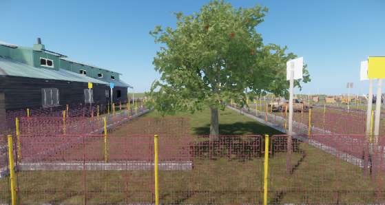

## atm

Cell c10r4; layer `Grid_atm.layer`.

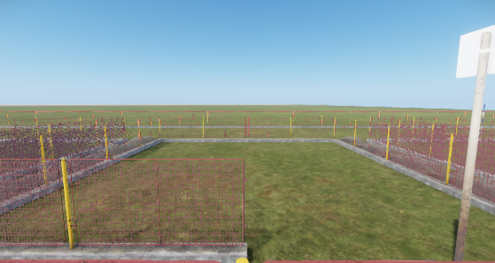

## bank-heist

Cell c7r0, 2 x 1 cells; layer `Grid_bank_heist.layer`.

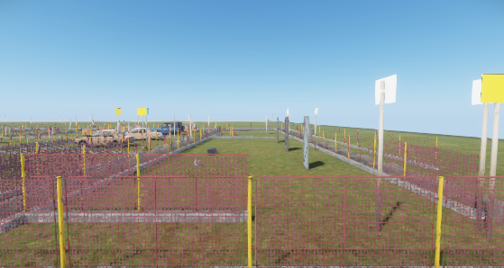

## cash-van

Cell c9r1, 2 x 1 cells; layer `Grid_cash_van.layer`.

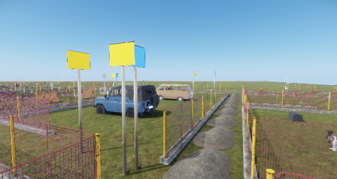

## chain-barrels

Cell c6r1; layer `Grid_chain_barrels.layer`.

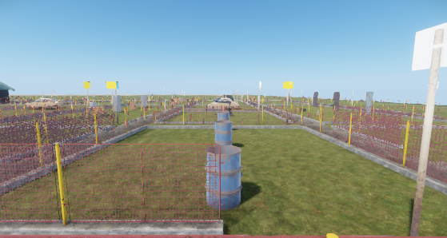

## chess-table

Cell c0r0; layer `Grid_chess_table.layer`.

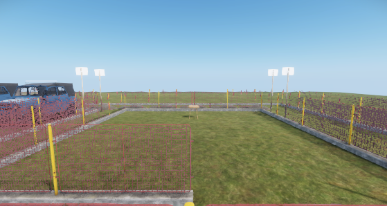

## chopshop

Cell c7r1; layer `Grid_chopshop.layer`.

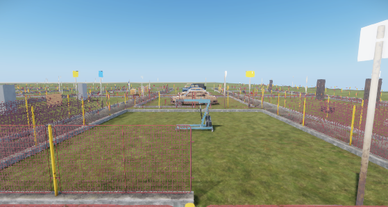

## community-hall

Cell c2r2; layer `Grid_community_hall.layer`.

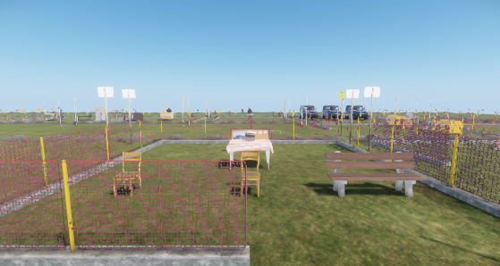

## convoy

Cell c10r2; layer `Grid_convoy.layer`.

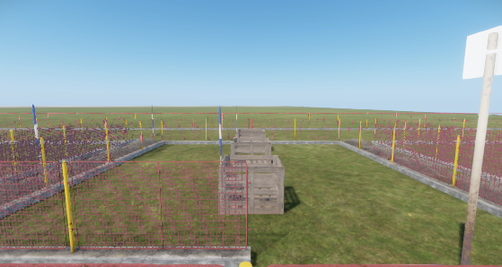

## crimes

Cell c4r0; layer `Grid_crimes.layer`.

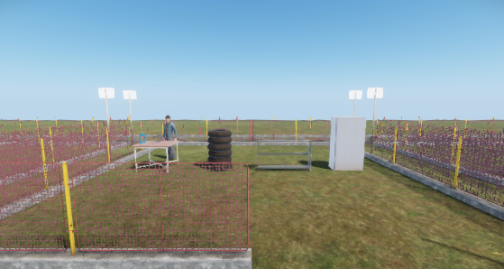

## dispatch

Cell c9r2; layer `Grid_dispatch.layer`.

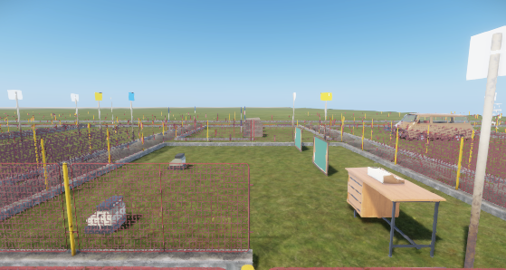

## event-scene

Cell c1r2; layer `Grid_event_scene.layer`.

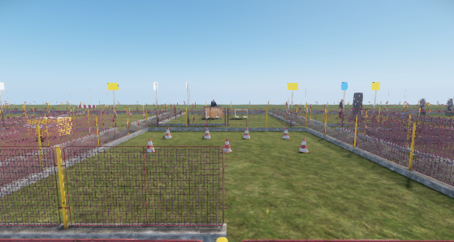

## everon-outlets

Cell c1r5; layer `Grid_everon_outlets.layer`.

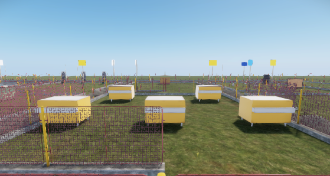

## fence-shop-2

Cell c1r4; layer `Grid_fence_shop_2.layer`.

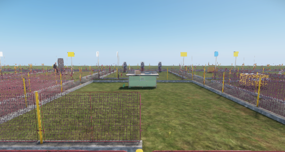

## first-night-room

Cell c7r5, 3 x 2 cells; layer `Grid_first_night_room.layer`.

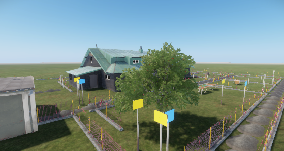

Inside:

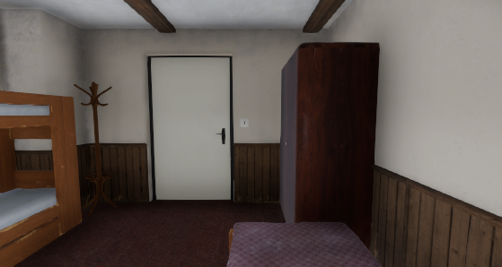

## first-night

Cell c6r0; layer `Grid_first_night.layer`.

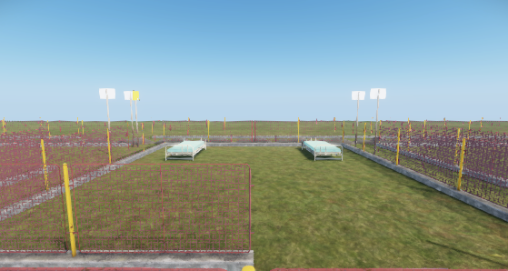

## frame

Cell lattice; layer `Grid_frame.layer`.

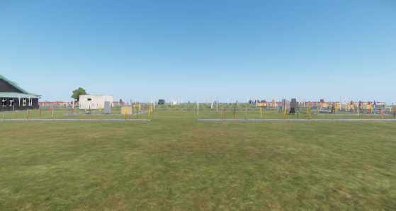

## furnace

Cell c10r5; layer `Grid_furnace.layer`.

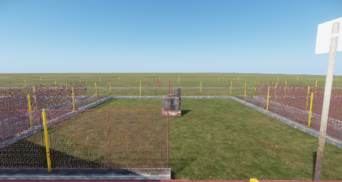

## gun-counter

Cell c10r6; layer `Grid_gun_counter.layer`.

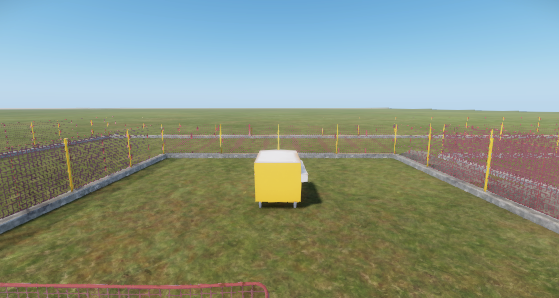

## hideout

Cell c9r0; layer `Grid_hideout.layer`.

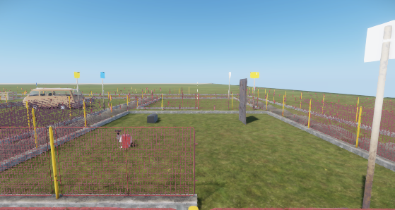

## hospital

Cell c5r1, 1 x 2 cells; layer `Grid_hospital.layer`.

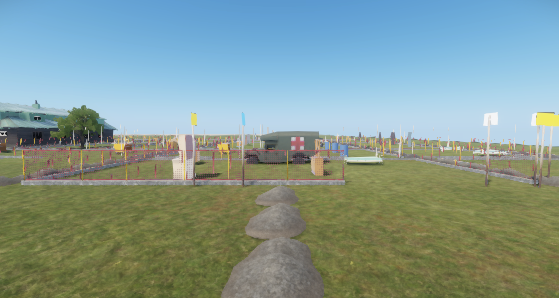

## houses-keys

Cell c0r3; layer `Grid_houses_keys.layer`.

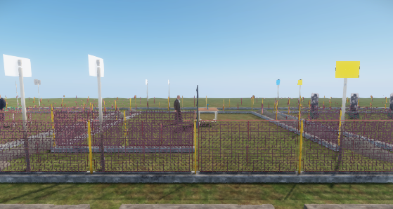

## impound

Cell c6r2; layer `Grid_impound.layer`.

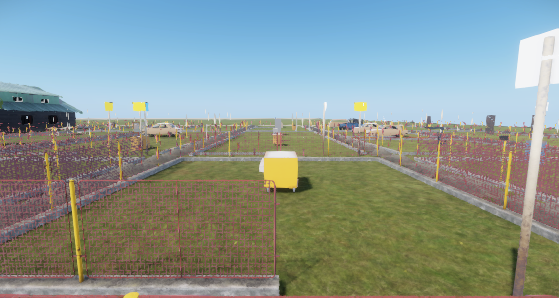

## jail

Cell c10r0; layer `Grid_jail.layer`.

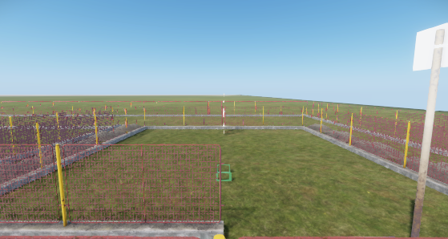

## job-depot

Cell c7r3, 2 x 1 cells; layer `Grid_job_depot.layer`.

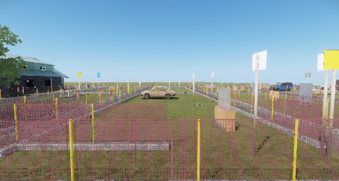

## jobs

Cell c0r2; layer `Grid_jobs.layer`.

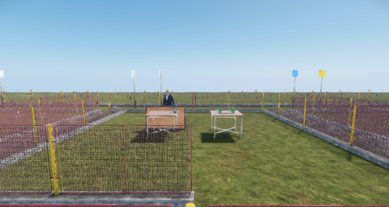

## licence-desk

Cell c0r5; layer `Grid_licence_desk.layer`.

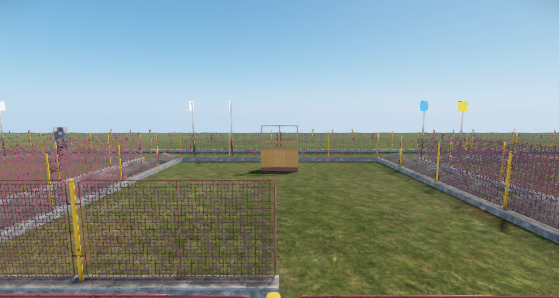

## lockpick-cars

Cell c8r1; layer `Grid_lockpick_cars.layer`.

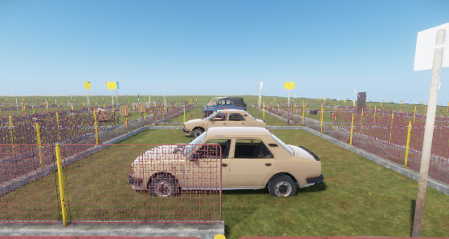

## npcs

Cell c2r6; layer `Grid_npcs.layer`.

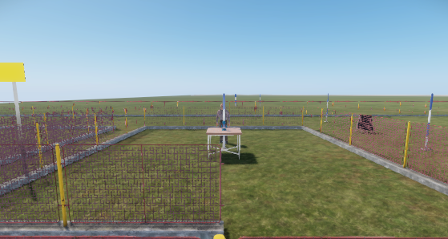

## org-desk

Cell c9r4; layer `Grid_org_desk.layer`.

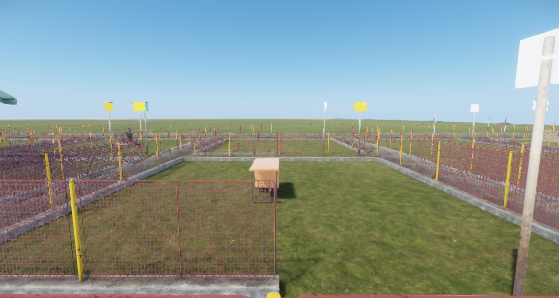

## orgs-vehicles

Cell c2r4; layer `Grid_orgs_vehicles.layer`.

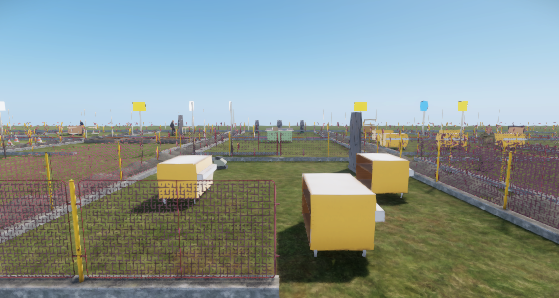

## police-desk

Cell c7r2, 2 x 1 cells; layer `Grid_police_desk.layer`.

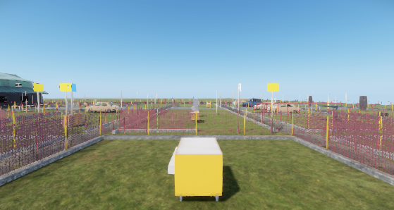

## police

Cell c1r6; layer `Grid_police.layer`.

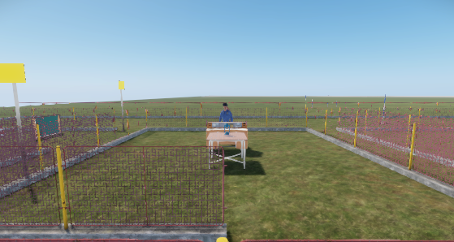

## pr-features

Cell c1r0; layer `Grid_pr_features.layer`.

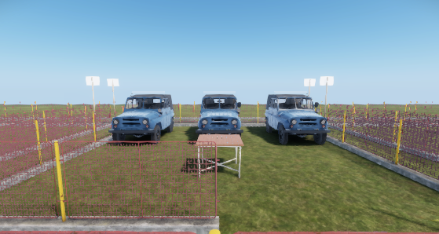

## race-track

Cell c0r6; layer `Grid_race_track.layer`.

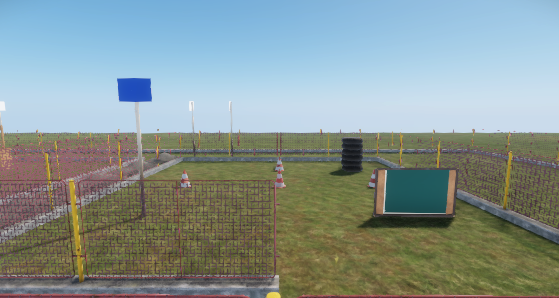

## retheme-proof

Cell c1r1; layer `Grid_retheme_proof.layer`.

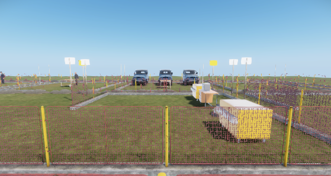

## roadblock

Cell c0r1; layer `Grid_roadblock.layer`.

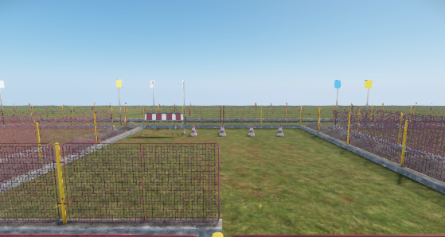

## shooting-range

Cell c0r4; layer `Grid_shooting_range.layer`.

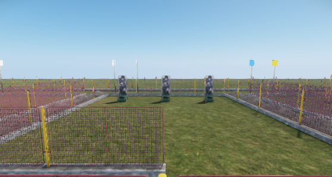

## shops-till

Cell c3r0; layer `Grid_shops_till.layer`.

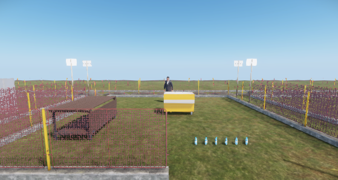

## signs-board-quests

Cell c2r5; layer `Grid_signs_board_quests.layer`.

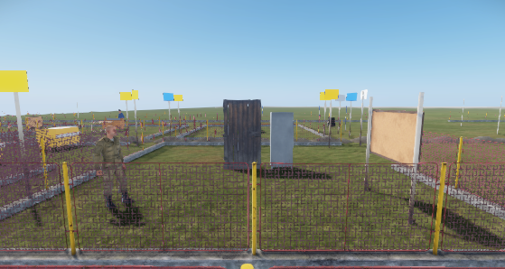

## test-fixtures

Cell c1r3; layer `Grid_test_fixtures.layer`.

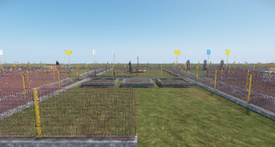

## vehicle-lot

Cell c6r3, 1 x 2 cells; layer `Grid_vehicle_lot.layer`.

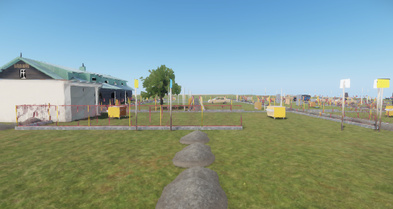

## wanted-posters

Cell c5r6; layer `Grid_wanted_posters.layer`.

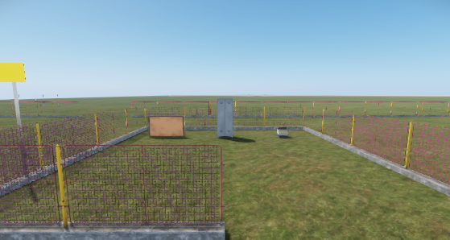

## whitelist-chat

Cell c2r0; layer `Grid_whitelist_chat.layer`.

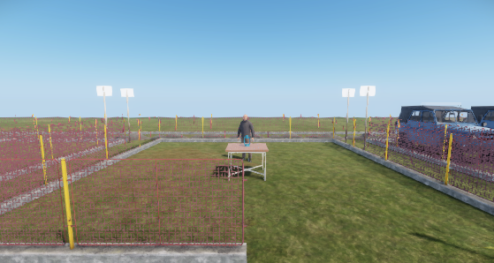

## zone-signs

Cell c9r3, 2 x 1 cells; layer `Grid_zone_signs.layer`.

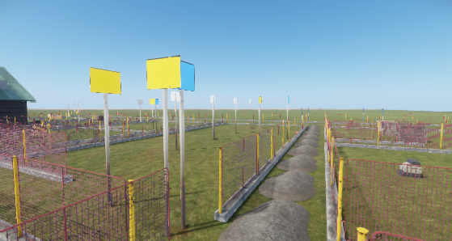

## zones-spawn

Cell c5r0; layer `Grid_zones_spawn.layer`.

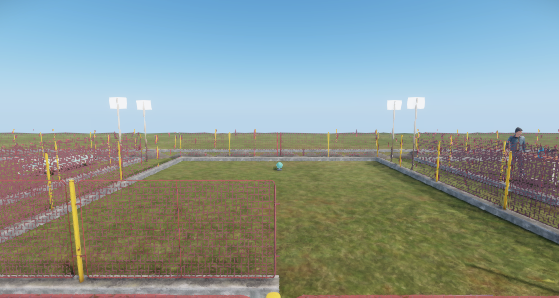
