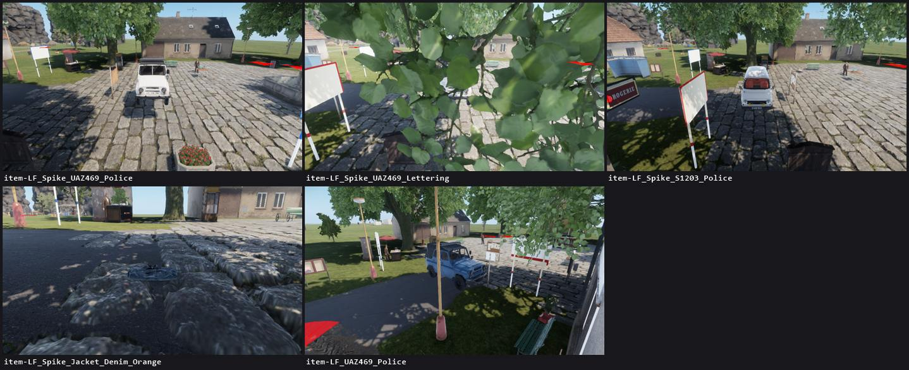
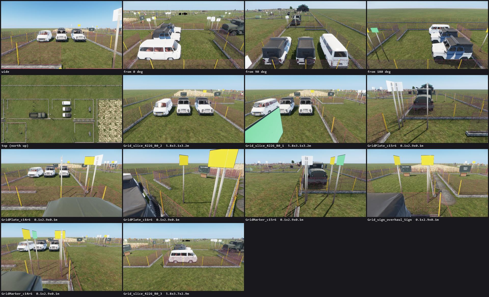

# Livery spike (#4226)

Question: can we fully repaint a vanilla vehicle body, tint a vanilla work garment, and put
lettering on top, and does each render (not white)? Slice WO-L1 of the 0.3.0 plan, decision N30.

**Verdict: go.** Full repaints work and need no new texture and no new model, so there is no
bake trap. Liveries ship as material files in 0.3.0. Custom lettering needs one mask texture per
livery and is the only part not yet proven (see "Open").

## Method

Vanilla vehicle bodies and garments use `MatPBRMulti` materials: up to four paint layers
(`Color_1`..`Color_4`, each with a tiling detail texture) placed by a mask texture (`MaskMap`, on UV
set 2), plus mud and dirt layers. The vanilla colour variants (`UAZ469_Body_CIV_BLUE`, `_RED`,
`S1203_body_beige`, ...) are only these numbers. So a livery is:

1. **A body material** that inherits the vanilla variant and overrides the layer colours:

   ```
   MatPBRMulti : "{D1F1DD9AE3DC919D}Assets/Vehicles/Wheeled/UAZ469/Data/UAZ469_Body_CIV_BLUE.emat" {
    Color_2 0.012 0.03 0.09 1
    Color_1 0.62 0.62 0.6 1
   }
   ```

   Inheriting keeps the mud, dirt, scratches and the dark bumper layer, so the repaint looks like
   paint on a used vehicle and not a flat colour.
2. **The prefab** points the vanilla mesh slot at it. Both the UAZ469 and the S1203 have the
   `MeshObject` component GUID `{51DAA09FEFBFC0E7}`; the slot names are `UAZ469_Body` (assign
   GUID `{64F09BE9246E252A}`) and `S1203_body` (`{64DA70D3831058D9}`):

   ```
   MeshObject "{51DAA09FEFBFC0E7}" {
    Materials {
     MaterialAssignClass "{64F09BE9246E252A}" {
      SourceMaterial "UAZ469_Body"
      AssignedMaterial "{GUID}Assets/.../LF_UAZ469_Police.emat"
     }
    }
   }
   ```

3. **Lettering and stripes** are the mask: the layer-2 colour goes where `MaskMap` says. Swapping the
   UAZ's mask for the vanilla PTS mask under police colours gave a two-tone white and navy body
   (picture below). A livery with our own words is our own `MaskMap` texture in the vehicle's UV-2
   layout; the colours stay in the material, so one mask serves every colour scheme.
4. **A tinted garment** is a material that inherits the garment's vanilla material and sets
   `Color_1` (it multiplies the garment texture). The prefab lists it in
   `BaseLoadoutClothComponent.WornMaterialsOverride`, as the vanilla `Jacket_Denim_01_brownShirt`
   does. The ground (item) model keeps its own `_item` material and needs a second override.

## File layout for the `livery build` step (WO-L2)

| What | Where |
|---|---|
| Livery material | `addons/LF_Everon1989/Assets/Liveries/<Vehicle>/LF_<Vehicle>_<Livery>.emat` (pack: colours are what this server is) |
| Livery mask, when it has lettering | `.../Liveries/<Vehicle>/LF_<Vehicle>_<Livery>_MASK.edds`, source PNG in `assets-source/liveries/` |
| Vehicle prefab | the existing service prefab (`LF_UAZ469_Police.et`, ...) gains the `MeshObject` override |
| Garment tint | `.../Liveries/Clothing/LF_<Garment>_<Tint>.emat` plus a prefab inheriting the vanilla garment |
| Generator | `tools/livery/` writes materials and metas from one table (colour, base variant, mask) |

`tools/livery/spike/build.mjs` is the working prototype: it writes four spike materials and prefabs
with fixed `4226...` GUIDs and `--clean` removes them. `tools/livery/spike/dump.mjs <path>` prints any
vanilla `.emat` or `.et` from the game paks (`game_read` refuses `.emat`).

## Credit row format

A colour-only livery derives no texture and needs no row. A livery mask derived from a vanilla mask,
or a tinted garment, gets one row in `docs/credits.md` under a new `## Liveries` heading:

```
| LF_UAZ469_Police_MASK | Derived from Bohemia Interactive `UAZ469_Body_PTS_GLOBAL_MASK.edds` (Arma Public License, base-game asset) | Police lettering and stripe mask for the UAZ469 | `addons/LF_Everon1989/Assets/Liveries/UAZ469/` |
```

Columns: asset, source and license, what it is for, where it lives.

## Results

| Test | Result |
|---|---|
| UAZ469 police repaint (white, navy layer 2) in `look item` and in the grid | Renders. Detail layers intact; not the white placeholder |
| UAZ469 with the vanilla PTS mask (overlay test) | Renders a two-tone white and navy body: the mask carries the overlay |
| S1203 police repaint | Renders white. **Failed part:** turning on `Enabled_2` shows the S1203 base mask as a red-pink speckle on the sides; the S1203 needs `Enabled_2 0` or its own mask |
| Denim jacket tinted work orange | The worn material is set; `look item` shows only the ground model, which keeps the vanilla blue `_item` material. Worn proof needs a session |
| Moving vehicle in a full-profile session | Not done in the timebox (split card) |





## Open (split into follow-up cards)

- Import our own `MaskMap` with lettering (PNG to `.edds` through the asset pipeline's Workbench
  import) and confirm the words read on the body. This is the first step of WO-L2.
- Full-profile session pictures: the repainted UAZ469 and S1203 while driving, and the tinted jacket
  worn by a character.
- An item-model tint for garments (`_item` material override).

The fallback (vanilla colour variants plus light bars, repaints in 0.3.1) is not needed.
