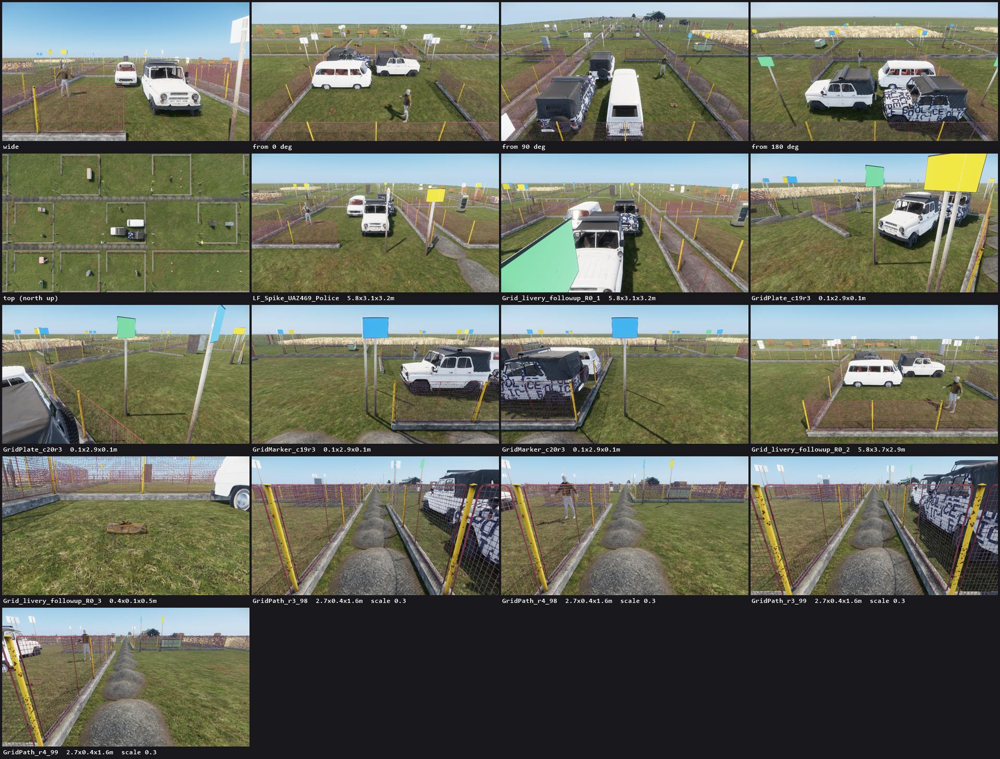
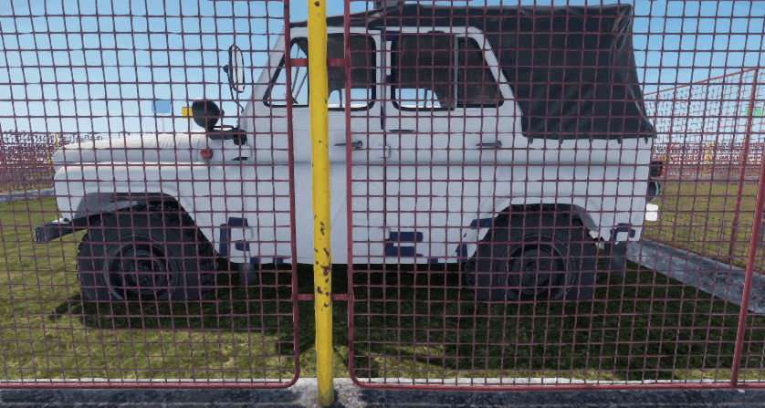
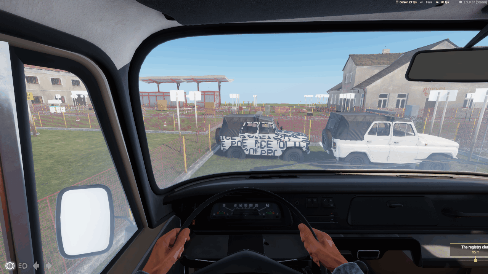
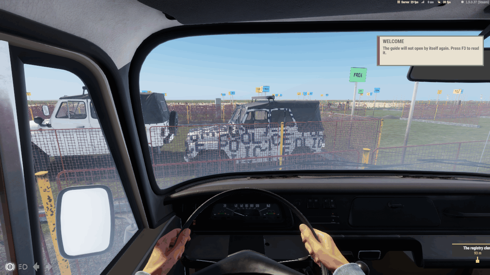
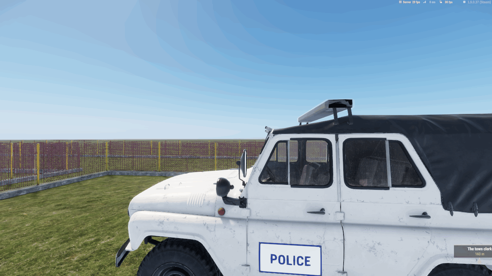
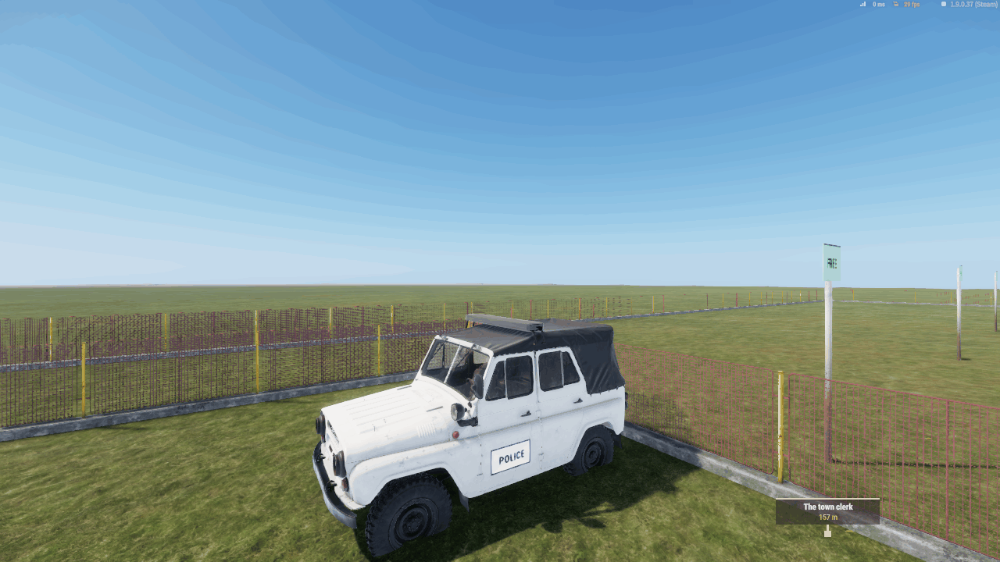

# Livery spike (#4226)

Question: can we fully repaint a vanilla vehicle body, tint a vanilla work garment, and put
lettering on top, and does each render (not white)? Slice WO-L1 of the 0.3.0 plan, decision N30.

**Verdict: go.** Full repaints work. A colour repaint needs only material files and prefab
overrides: no new model and no bake, so it cannot render white. Lettering and stripes come from our
own mask texture, built from the vanilla mask and imported through Workbench; "POLICE" reads on the
UAZ469 body. One limit: on the UAZ469 the mask has about 18 pixels across a door panel's height, so
mask lettering is big and blocky. Small text (a crest, a unit number) belongs on a decal plate.

## Method

Vanilla vehicle bodies and garments use `MatPBRMulti` materials: up to four paint layers
(`Color_1`..`Color_4`, each with a tiling detail texture) placed by a mask texture (`MaskMap`, on UV
set 2), plus mud and dirt layers. The vanilla colour variants (`UAZ469_Body_CIV_BLUE`, `_RED`,
`S1203_body_beige`, ...) are only these numbers. A livery is:

1. **A body material** that inherits the vanilla variant and overrides the layer colours:

   ```
   MatPBRMulti : "{D1F1DD9AE3DC919D}Assets/Vehicles/Wheeled/UAZ469/Data/UAZ469_Body_CIV_BLUE.emat" {
    Color_1 0.62 0.62 0.6 1
   }
   ```

   Inheriting keeps the mud, dirt, scratches and the dark bumper layer, so the repaint looks like
   paint on a used vehicle and not a flat colour.
2. **The prefab** points the vanilla mesh slot at it (`MeshObject` `{51DAA09FEFBFC0E7}` on both the
   UAZ469 and the S1203; slots `UAZ469_Body`, assign `{64F09BE9246E252A}`, and `S1203_body`,
   `{64DA70D3831058D9}`).
3. **The doors too.** The UAZ469's four doors and their four window tops are separate slot entities
   with their own `MeshObject` on the same `UAZ469_Body` material. A livery that overrides only the
   body keeps the vanilla doors (blue on the `CIV_blue` base we inherit). Each livery needs eight part
   prefabs that inherit the vanilla `VehParts/Doors/Blue/UAZ469_door_<L01|R01|L02|R02>[_top]_blue.et`
   and override that slot, with the vehicle's `SlotManagerComponent` (`{55BCE45E438E4CFF}`) slots
   `Door_L01`..`Door_R02` and each door's `DoorTop` slot pointing at them.
   `tools/livery/spike/build.mjs` reads the component and assign GUIDs from the vanilla files and
   writes all of them. The door interiors (`UAZ469_Body_int`) stay vanilla.
4. **Lettering and stripes** are layer 2 of our own mask. The mask's channels are R = layer 2 (the
   second paint colour), G = layer 3, B = layer 4 (bare metal, bumpers), A = kept. Layer 2 shows only
   where R is high with `MaskOffset_2 0.95`, `MaskSharpness_2 10` and `Mask_2 ""` (the vanilla
   PTS livery uses 0.903 and 10). With the vanilla offset of 0.07 the layer is a scratch pattern and our
   lettering does not show.
5. **A tinted garment** is a material that inherits the garment's vanilla material and sets
   `Color_1` (it multiplies the garment texture). `BaseLoadoutClothComponent.WornMaterialsOverride`
   takes it for the worn model and `ItemMaterialsOverride` for the ground model (`MatPBRBasic`, its
   `Color`). A `MeshObject` override on the ground model does nothing: the cloth component swaps the
   model and its materials. A multiply tint over a dark or blue texture comes out dull, so pick a
   garment with a light base texture for strong work colours.

## Building a mask

1. `node tools/livery/spike/edds.mjs <vanilla .edds> <out.dds>` unpacks a game texture into a plain
   DDS. The game's `.edds` is a DDS header, a per-mip chunk table and the mips smallest first. A big
   mip is `LZ4`: a uint32 unpacked size, then blocks of `[uint32 packed size, high bit = last]` that
   each unpack 64 KB and copy from all earlier output.
2. `mask.py`, run in Blender (`blender -b --factory-startup --python tools/livery/spike/mask.py --
   <base.dds> <out.tif> <spec.json>`), reads that DDS with OpenImageIO (BC7), keeps G, B and A, clears
   R and stamps text from a 5x7 font. Spec: `{"text": [{"x","y","h","text","rot","flipx"}]}`.
3. The `.edds.meta` uses the `TextureMask.conf` preset (BC7, linear) and
   `tools\cli ui-image --batch <list>` builds the `.edds` in one headless Workbench boot (16 s).

`node tools/livery/spike/build.mjs --mask tools/livery/spike/police-tiled.json` runs all three into the
spike folders. The tiled spec repeats "POLICE" over the whole mask, so every panel shows it.
**Placing one word on one door** needs that door's UV-2 rectangle. Probing with labelled cells took
three boots and stayed unreadable at `look` resolution. WO-L2 should read the rectangles from the model
(UV set 2 of each door `.xob`) or export a UV template from Blender, not probe.

## File layout for the `livery build` step (WO-L2)

| What | Where |
|---|---|
| Livery material | `addons/LF_Everon1989/Assets/Liveries/<Vehicle>/LF_<Vehicle>_<Livery>.emat` (pack: colours are what this server is) |
| Livery mask | `.../Liveries/<Vehicle>/LF_<Vehicle>_<Livery>_MASK.edds` + `.tif` source, `TextureMask.conf` meta |
| Door and top parts (UAZ469) | `.../Prefabs/Vehicles/Liveries/UAZ469_<Livery>_door_<D>[_top].et`, eight per livery |
| Vehicle prefab | the service prefab (`LF_UAZ469_Police.et`, ...) gains the body `MeshObject` and the door slots |
| Garment tint | `.../Liveries/Clothing/LF_<Garment>_<Tint>[_item].emat` plus a prefab with both overrides |
| Generator | `tools/livery/` writes materials, masks, parts and metas from one table (colours, base variant, mask spec) |

## Credit row format

A colour-only livery derives no texture and needs no row. A mask derived from a vanilla mask, or a
tinted garment, gets one row in `docs/credits.md` under a new `## Liveries` heading:

```
| LF_UAZ469_Police_MASK | Derived from Bohemia Interactive `UAZ469_Body_CIV_GLOBAL_MASK.edds` (Arma Public License, base-game asset) | Police lettering mask for the UAZ469 | `addons/LF_Everon1989/Assets/Liveries/UAZ469/` |
```

Columns: asset, source and license, what it is for, where it lives.

## Results

| Test | Result |
|---|---|
| UAZ469 police repaint, body and all four doors white | Renders in `look` and in a full-profile session. Detail layers intact; not a placeholder |
| UAZ469 with our own mask (tiled "POLICE") | "POLICE" reads on the doors and body in `look` and in the session; big, blocky letters (about 18 px of mask per door height) |
| S1203 police repaint | Renders clean white with `Enabled_2 0`. The first spike's red-pink speckle came from turning layer 2 on over the S1203 base mask |
| Denim jacket tinted work orange, ground model | Tan-orange through `ItemMaterialsOverride` (the first spike's `MeshObject` override did nothing) |
| Denim jacket tinted, worn model | On a shop mannequin the worn model shows the tint. In the session `itemgive` put the jacket in the inventory, not on the body, and the third-person shot missed the character |
| Vehicles moving in a session | **Not done.** The harness refuses `CarThrust` both in `agent-box/harness.mjs` and in the in-game allow list, so a proof can seat a player and start the engine but not drive. The session pictures are of the seated, running vehicles |
| First spike's "two-tone PTS overlay" | **Wrong.** The navy was the vanilla blue doors, not the PTS mask; corrected by item 3 above |

First spike, `look item` and the grid:


Follow-up, the grid (own-mask "POLICE" UAZ469, white police UAZ469, S1203, the jacket on the ground and on a mannequin):





Full-profile session, from the S1203's driver's seat with the engine running:





## What the plan cards can start on

| Card | Start now? |
|---|---|
| WO-L2 `livery build` | Yes. Grow `tools/livery/spike/build.mjs` into the generator: a livery table, the door parts, the mask pipeline, pack paths. First task: UV-2 door rectangles from the `.xob` so one word lands on one door |
| WO-L3 livery sign styles | Yes; independent of the paint |
| WO-L4 police (UAZ469, S1203; S105 to check) | After L2's table; colours only (white, navy) can ship before the lettering |
| WO-L5 ambulance (UAZ452, S1203) | After L2. The UAZ452 doors are not checked: verify they are separate parts as on the UAZ469 |
| WO-L6 company liveries | After L2; colour-only first |
| WO-L9 respray bay, WO-L10 liveries across a restart | After L2 and L4 (they need a livery id per vehicle) |
| A harness throttle | New card: allow `CarThrust` in `agent-box/harness.mjs` and the in-game input allow list, so the livery cards can film moving vehicles |
| Small lettering | New card if wanted: a decal plate entity for crests and unit numbers |

The fallback (vanilla colour variants plus light bars, repaints in 0.3.1) is not needed.

## Update 2026-11-23: words go on door plates, not in the mask (#4232)

Lettering stamped into the shared 512 px mask does not ship. The mask is tiled across the body's UV islands, so
"POLICE" came out as scrambled, repeated fragments over the whole body (`docs-images/4226/session-full-profile-after.png`).
`tools\cli livery build` therefore writes **colours only** into the paint. The words go on a painted plate on each front
door: `SignWall_01_90x45` at scale 0.6 with `LF_SignComponent`, a child of the generated door prefab so it swings with
the door. Its title is a pack sign row and a pack string. It has no read action, so the door's action list stays as it
was. Full-profile client, grid cell:




