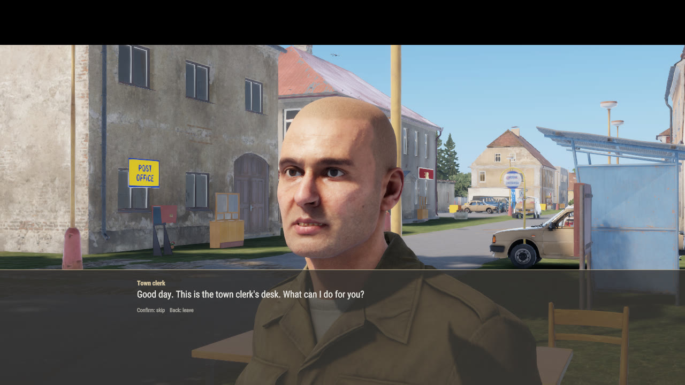
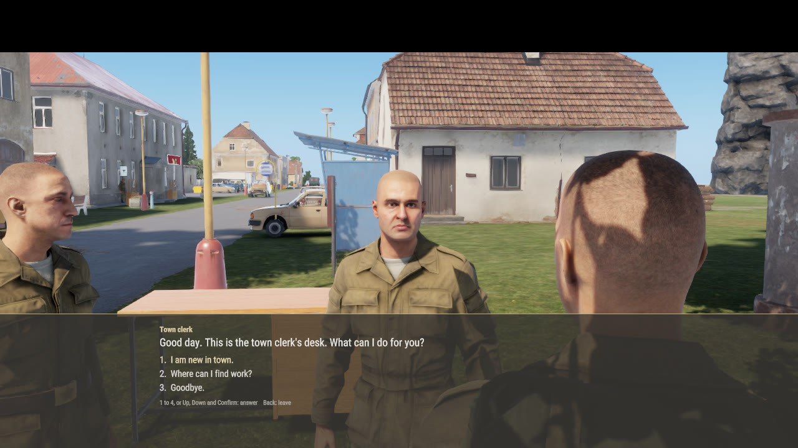
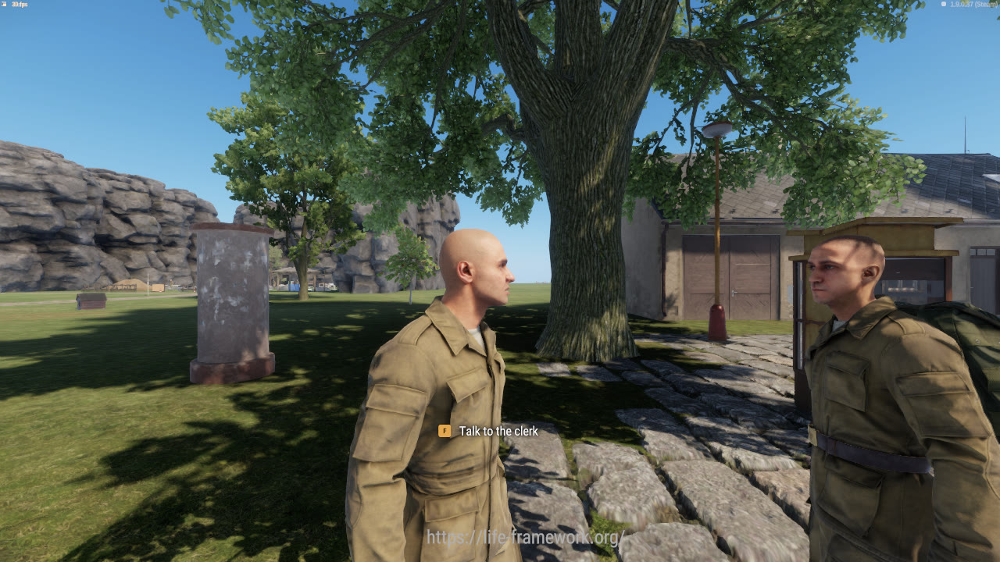
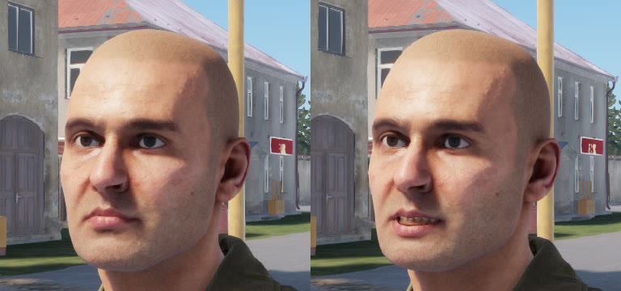

# NPC dialogue scenes: findings and design

Spike of 2026-11-13. Talking to an NPC is now a scene: the camera frames the NPC, its line is a
caption at the bottom with a generated voice, its lips move with the line, and the player answers
from a numbered list. The town clerk is the first NPC converted. How to add another:
[`docs/asset-pipeline/dialogue.md`](../asset-pipeline/dialogue.md).

| | |
|---|---|
|  |  |
| The NPC speaks: face shot, caption, skip and leave hint | The player chooses: over the shoulder, numbered replies |
|  |  |
| The answer to a reply; the lips are mid-word | A second player beside them: no scene, the world goes on, the voice is heard |

Shots are from a two-client dedicated session (`node agent-box/session.mjs dialogue-proof`).

## Verdicts

| Question | Verdict |
|---|---|
| Camera | Works. A locally spawned `ManualCameraBase` set with `CameraManager.SetCamera`, eased by script. Only the talker's client changes. |
| Lip sync | No engine lip sync that a script can reach was found. The head does have a facial rig, and `Animation.SetBone` moves it. The lips now follow each line's loudness, measured at build time. It reads as talking; it is not phoneme-accurate. |
| Voice | ElevenLabs text-to-speech at build time. 10 clerk lines, 1,165 characters of text, 100 seconds of audio. |
| Playback | `AudioSystem.PlayEvent` on a generated `.acp`, positional from the NPC's head. Bystanders within 12 m hear it (a per-NPC setting). |
| Licence | Paid plan: commercial use allowed, no attribution required, the output is ours. Credited anyway as "voices generated with ElevenLabs". One open point for voice-library voices, below. |

## What exists in vanilla (evidence)

- **`SCR_VoiceoverSystem`** (`scripts/Game/Systems/SCR_VoiceoverSystem.c`) is how the tutorial
  instructors talk. A line is a sound event name in the actor's `SCR_CommunicationSoundComponent`
  audio project plus a subtitle key (`Configs/Voiceover/Intro.conf`, class `SCR_VoiceoverData`).
  `PlayLineActual` calls `SoundEvent(eventName)`, shows the subtitle through the
  `SCR_VoiceoverSubtitles` HUD display, and can fire the animation command `CMD_Gesture_NPC`. There
  is no camera, no reply choice, and no mouth code in it. The instructors' talking comes from
  authored full-body `.anm` clips (`Main_Instructor.et` has an `AnimationPlayerComponent` with
  `npc_officerIntro_TalkToNPC.anm`).
- **Engine `Dialogue` classes** (`scripts/GameLib/generated/Dialogue/`: `DialogueData`,
  `AudioDialogueData`, `AnimationDialogueData`, `DialogueTransitionRule`, a Workbench
  `DialogueEditor` module). The generated script side is empty class shells and no vanilla
  scenario config uses them, so this spike did not build on them. Worth a second look when
  Bohemia documents the Dialogue Editor.
- **VoN** (`scripts/Game/generated/Components/VoNComponent.c`, `SCR_VoNComponent.c`) exposes
  `OnCapture` and `OnReceive` and nothing about the face. If the engine moves lips for voice
  chat, it does so natively with no script entry point. `api_search` for Lip, Facial, Mouth,
  Viseme, Jaw and Speech found no API; the wiki's human animation variables list has no speech
  or face variable.
- **Our NPCs are not characters.** `Npc_Base.et` is an `LF_NpcBaseEntity` (a `GenericEntity`) with
  the body mesh, a `CharacterIdentityComponent` and a one-pose animation graph
  (`Anims/Workspaces/Npc/Npc_Main.agr`). No `SCR_CommunicationSoundComponent`, no character
  animation graph, no gestures. That rules out the vanilla voiceover system as it stands and is
  also why nothing fights a script that poses bones.

We took the vanilla shape (sound event per line, subtitle key per line, data in a config) and
built the missing parts.

## Camera

`Feature/Dialogue/LF_DialogueCamera.c`, the same hand-over as the film rig
(`Feature/Film/LF_FilmCameraPath.c`, #392):

- Spawn `{D6DE32D1C0FCC1C7}Prefabs/Editor/Camera/ManualCameraBase.et` locally (not replicated),
  switch its input off, remember `CameraManager.CurrentCamera()`, call `SetCamera`.
- `CameraManager` has no blend. The script eases position, look-at and field of view with a
  smoothstep over 0.8 s: in from the player's own view, between shots, and back out to the
  player's view before the old camera is restored and ours deleted.
- Two shots. **Face**, while the NPC speaks: about a metre in front of the NPC's face, leaning to
  the side the player stands on, 30 degrees. It uses the way the NPC faces, so a player who walks
  up from behind still gets the face (the first version used the player's side and filmed the back
  of the clerk's head). **Shoulder**, while the player chooses: behind and beside the player's
  head, 42 degrees.
- Collision is a script trace (`BaseWorld.TraceMove`) from the subject to the camera; a hit pulls
  the camera in. There is no built-in collision for a free camera.
- While the scene is open the character's movement, view and weapon controls are disabled
  (`CharacterControllerComponent.SetDisableMovementControls/ViewControls/WeaponControls`) and the
  HUD is hidden. Both are restored on every way out: Back, the end of the talk, the NPC
  disappearing, the player going down, or the server not answering for 5 s.
- Multiplayer: everything above is on the talker's client. The server and other clients see a
  player standing still.

## Lip sync

What was tried on the clerk (`Head_White_02`), with the harness posing one bone and a screenshot
per try (`img/npc-dialogue/7-bone-trials.jpg`):

| Bone and motion | Result |
|---|---|
| `Jaw`, any rotation | Only the teeth and tongue move, out through the cheek or the chin. The skin is not weighted to it. |
| `jawRP`, any rotation | Tears the chin and cheek. |
| `Orbicularis_bottomCenterLips`, 8 mm along its +Y | The lower lip drops and the teeth show. This is the motion. |
| The same along other axes | Pout, or nothing visible. |

The skeleton (231 bones, shared by body, head and clothes) has a muscle-style face rig:
`Orbicularis_*` lips, `Zygomaticus*`, `Mentalis_*`, eyelids, tongue. `Animation.SetBone(entity,
bone, angles, translation, scale)` applies an offset from the bone's rest pose and it holds until
set again, because the NPC's graph is a single pose.

The mouth pose in `LF_DialogueVoice.DEFAULT_RIG`: lower lip down 8 mm in the middle and 6 mm at
both sides, upper lip up 2 mm. While a line plays, the pose is scaled every frame by the line's
envelope: one digit 0 to 9 per 50 ms, RMS loudness of the final wav scaled to the line's own loud
level, computed by the pipeline and stored in the dialogue config (`m_sMouth`).



Limits, stated plainly:

- It is loudness, not phonemes. An "o" and an "e" look the same. At conversation distance it reads
  as speech; in the face shot it reads as a man who does not open his mouth much.
- The jaw does not drop, because nothing we can rotate carries the chin skin cleanly.
- The pose was tuned on one head. Other heads share the skeleton, so it should carry over, but
  each new head wants one look. `node agent-box/harness.mjs dialogue rig <pose>` and
  `dialogue mouth 1` pose it live in a session.
- It only works on our static NPCs. A real `SCR_ChimeraCharacter` has an animation graph that
  writes these bones every frame.
- ElevenLabs can return per-character timestamps (`/with-timestamps`). Those could pick between
  two or three mouth shapes later. Not needed for this result.

If the lips ever look wrong on a head, set its rig to empty and the mouth stays shut; the cheapest
fallback after that is a slow head nod, which needs an animation clip we do not have.

## Voice

- `POST /v1/text-to-speech/{voice}` with `eleven_multilingual_v2`, mp3 at 44.1 kHz. Never called
  by the game: `tools\cli asset dialogue <npc>` runs it and commits the result.
- Clerk voice: "JC" from the voice library, a man over sixty with a French accent. The town's own
  names are French (Dupont, Lefevre), and an old official fits the desk. Premade voices are all
  American or British. Alternatives found for later NPCs: Patrick (Czech, middle-aged), Maxim
  (Russian-accented), Veru (Czech, female).
- Cost: 1,165 characters of text for the clerk's 10 lines, 16 to 192 characters a line, about
  11.6 characters per second of speech. The service's own `character-cost` header added up to 465
  for those requests, so the plan bills this model below one credit per character. The account
  stood at 202 of 40,000 before the run and 3,997 afterwards; that counter is shared with the
  sound-effects spike, which was generating at the same time, so it cannot be split per spike.
- An NPC of this size is roughly 3 % of a month on the Starter plan. The spec caps each NPC
  (`budget_chars`, 3,000 for the clerk, never above 6,000).

## Playback

- The engine plays a `.wav` only through an audio project. The pipeline writes one `.acp` per NPC
  with one sound event per line (bank, shader, shared distance curve and spatialiser), modelled on
  `Sounds/Siren/Vehicles_Siren.acp`, into the SFX input of `Sounds/FinalMix.afm`.
- `AudioSystem.PlayEvent(project, event, transform)` at the NPC's head returns a handle; the log
  line `[LFDebug:Dialogue] line 'clerk/greet' plays: ...` is only written when the handle is
  valid. In the session all 26 line starts on both clients had valid handles.
- Format: mono, 44.1 kHz, 16-bit PCM, the same as the siren samples. About 88 KB per second: the
  clerk's 100 seconds are 7.1 MB in the repo. If voiced NPCs multiply, drop speech to 22 kHz.
- **Who hears it.** Recommendation, and the default: players within `m_fHearRange` (12 m) hear
  the NPC and see its lips move; only the talker gets the camera and captions. It is a town, and
  overhearing the clerk register a newcomer is the point. The server sends bystanders the line
  ids; they play the same local event. Set `hear_range_m` to 0 in an NPC's `dialogue.json` to
  make it private. The maintainer decides per NPC.
- Not verified by an agent: how it sounds. Loudness is normalised to -20 LUFS; the level against
  the game's mix and the 25 m fall-off need ears. The files are listed in the PR.
- The lines go to the SFX bus, so the player's "Dialogue" volume slider does not move them. The
  bus port for the Dialogue input was not confirmed from a readable vanilla project.

## Runtime design

```
client                                server
"Talk to the clerk" (LF_QuestAction)
LF_DialogueScene.Begin  -- start(npc) -->  LF_Dialogue.Start: NPC has a dialogue, player within 4 m
  camera eases in                          session {npc, node, offered replies}
  <-- show(node, spoken ids, mask) ---
  line: caption + LF_DialogueVoice.Say     LF_Dialogue.Overhear -> bystanders: hear(spoken ids)
  replies: 1..4
  -- choose(index) ---------------------> LF_Dialogue.Choose: session, reach, index was offered,
                                           condition asked again, action hook runs
  <-- show(next node, spoken, mask) ---
  Back -- leave ------------------------>  session dropped
```

- **Server-authoritative.** The client sends an NPC and a reply index. The server keeps the node
  and the mask of replies it offered; an index outside the mask, a player out of reach, or a
  condition that no longer holds is refused and logged. The server sends ids only; text is
  localization keys resolved on the client.
- **Data.** `Configs/Dialogue/LF_Dialogue_<Name>.conf` (`LF_DialogueConfig`): nodes, replies with
  an optional condition, action and parameter, and the voiced lines. Generated from
  `tools/assets/dialogue/<npc>/dialogue.json`.
- **Reusing other features.** A reply names a hook; the server runs class
  `LF_DialogueHook_<name>`, which lives in the feature that owns the work. The class name is the
  registration, so there is no central list. For the clerk, `QuestConverse`
  (`Feature/Quests/LF_QuestDialogue.c`) calls the same `RequestConverse` that "Talk to the clerk"
  always ran. The clerk's story slips (hand-in, next errand, idle line) are collected instead of
  toasted, and each key is spoken by the dialogue line voiced for it (`for_key`). The quest
  strings were written as narration ("The clerk writes your name..."), so the spoken lines are
  first-person rewordings; the journal keeps the originals.
- **Falls back.** An NPC with no dialogue component, or a broken config, talks the old way.
- **Not saved.** A session is a node id per connected player.

## Input

No new bindings. The scene activates `MenuContext` and `MenuWithEditorContext` each frame and
reads `LF_Keypad1` to `LF_Keypad4` (number row and numpad), `MenuUp`, `MenuDown`, `MenuSelect` and
`MenuBack`, all of which already carry keyboard and pad bindings. A pad picks with up, down and
confirm. Input is ignored for 350 ms after each change so the key that opened a line does not
skip it.

## Licence

Read on 2026-11-13 from elevenlabs.io/terms-of-use, /pricing and /vla (the non-EEA terms):

- Paid plans may use the service commercially ("if you access or use our Services through a paid
  subscription plan ... you may use the Services for commercial purposes"); the pricing page
  lists "Commercial License" from Starter up. The account is on Starter.
- "As between you and ElevenLabs, you retain all rights in and to your Output." Downloaded output
  may be used outside the service, subject to the terms.
- No attribution requirement was found for paid plans. We credit it anyway.
- Nothing in the terms restricts shipping text-to-speech output as files in a free mod. (The
  sound-effects terms do restrict offering output "as isolated audio files or samples"; that
  exhibit covers sound effects, not speech. Relevant to the sound spike.)
- Voice-library voices: "any Outputs generated using your User Voice Model prior to the end of
  the Notice Period will continue to exist and remain available for use thereafter." JC's notice
  period is 180 days. If the voice is withdrawn we keep the clerk's lines but cannot make new
  ones in that voice; a reworded line would need the whole NPC revoiced.
- Not answered by the pages read: whether the commercial licence for audio made on a paid plan
  survives a later downgrade to free. Keep the plan, or ask ElevenLabs, before relying on it.
- Each line's request id, voice, model and text is in
  `tools/assets/dialogue/<npc>/elevenlabs.json`.

## Not done

- Other NPCs. The witness, the bank teller and the shop clerks still answer with toasts or
  menus. The witness needs voices picked by the NPC's seeded name, male and female.
- The NPC does not turn to the player or gesture.
- Translations. The voice is English; captions follow the string table like any other text.
- A late joiner does not hear a line already in progress.
- Dialogue content is pack material (`docs/architecture/core-pack-inventory.md`); the scene
  system is core.
