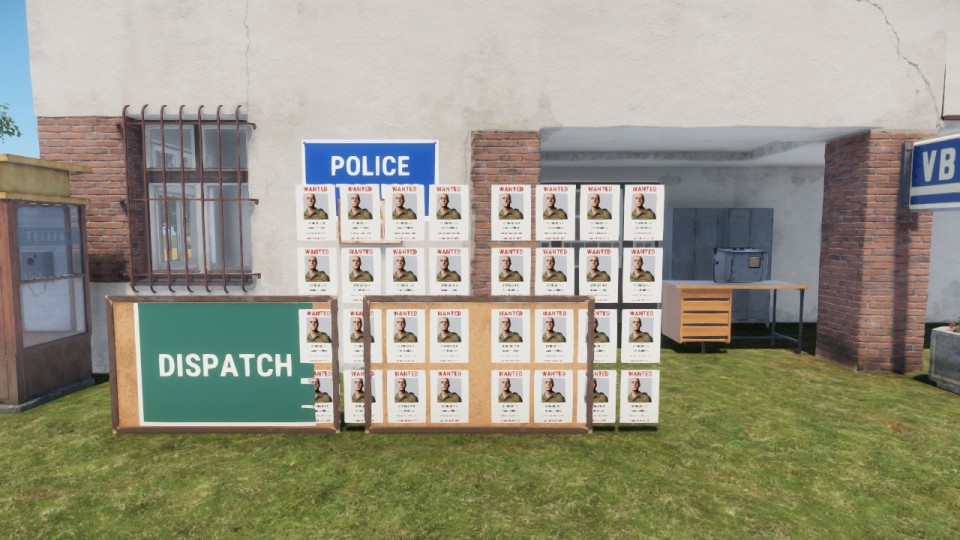

# Visual boards: the measured budget

Issue 7 of `docs/architecture/visual-boards-spike.md`, done first because it sizes
issues 3 and 4: what wanted posters with pictures cost a game client, and the
limits the production board keeps to. Refs #758.

## Method

- Gaming-Box (RTX 3080, 15.6 GB), game build 26257316, one game client at
  1280x720 on a dedicated server: `session up --profile full --levers uncapped`
  (`uncapped` lifts the client's 30 fps cap to 500, so frames faster than the
  cap show).
- The spike PoC (one 768x724 render target and one `ItemPreviewWidget` per
  poster, a dressed character dummy per picture) plus a stress hook, on the
  branch `spike/visual-board-perf` (commit `a6f946f0`, never merged). The hook
  replaces the wanted board's posters with `boards` blocks of `posters` sheets
  in front of the board, each picture a dummy dressed like the local character
  (338 characters of appearance).
- A fixed film camera 4 m in front of the board, HUD off, noon. Per
  configuration: draw, settle 5 s, then the new harness verb `perf 10 <label>`
  samples `World.GetTimeSlice()` every frame for 10 s. Memory is the client
  process (`Get-Process` private and working set) after the window;
  `System.MemoryAllocationKB()` reads 0 on a retail client.
- Re-run: `node agent-box/session.mjs board-perf` on that branch
  (`LF_PERF_ROUND=2` for the second table).

## Results

Frame times in ms; "boards" are blocks of four sheets, the PoC's board.

| Configuration | Mean | p50 | p95 | p99 | Worst | fps |
|---|---:|---:|---:|---:|---:|---:|
| No posters | 6.49 | 6.42 | 8.31 | 9.70 | 20.2 | 154 |
| 1 board, 4 text-only posters | 6.90 | 6.53 | 10.36 | 11.25 | 12.3 | 145 |
| 1 board, 4 posters with pictures | 8.85 | 8.36 | 13.93 | 15.58 | 18.1 | 113 |
| 1 board, 8 posters with pictures | 9.46 | 8.35 | 17.93 | 19.39 | 21.1 | 106 |
| 4 boards, 4 pictures each | 10.14 | 7.21 | 23.16 | 27.18 | 29.5 | 99 |
| 8 boards, 4 pictures each | 12.77 | 7.22 | 36.58 | 41.35 | 48.8 | 78 |
| 8 boards, 4 text-only each | 6.96 | 7.08 | 8.78 | 9.51 | 11.2 | 144 |
| 4 boards, 8 pictures each | 10.55 | 5.77 | 28.29 | 34.36 | 42.3 | 95 |
| 8 boards with pictures, camera turned away | 5.33 | 5.27 | 6.90 | 7.55 | 10.4 | 188 |
| No posters, at the end | 5.67 | 5.54 | 7.50 | 8.24 | 11.8 | 176 |

Second run (a fresh session), the picture variants side by side:

| Configuration | Mean | p95 | p99 | Private MB | fps |
|---|---:|---:|---:|---:|---:|
| No posters | 4.33 | 5.46 | 6.07 | 3759 | 231 |
| 1 board, 4 dressed dummies | 5.17 | 7.75 | 9.61 | 3757 | 193 |
| 1 board, 4 prefab previews (no dummy) | 5.58 | 8.49 | 9.88 | 3765 | 179 |
| 1 board, 4 dressed dummies, **frozen** | 4.65 | 6.19 | 7.20 | 3765 | 215 |
| 8 boards, 4 dressed dummies | 10.16 | 27.03 | 31.70 | 3885 | 98 |
| 8 boards, 4 prefab previews | 10.09 | 28.03 | 33.99 | 4007 | 99 |
| 8 boards, 4 dressed dummies, **frozen** | 5.95 | 7.56 | 8.36 | 3945 | 168 |
| No posters, at the end | 6.40 | 7.80 | 8.27 | 3817 | 156 |

"Frozen" hides the poster's widget root 2.5 s after it is built. The mesh keeps
the last frame the target drew, pictures included:

*Eight blocks of four frozen posters, each a dressed dummy. The cost of all 32
is under 2 ms mean and 2 ms p95 over no posters.*

## What the numbers say

- **Text is cheap.** 32 text-only render targets at `SetMaxFPS(1)` add about
  0.5 ms mean and nothing at p95.
- **A live picture is not.** Each `ItemPreviewWidget` keeps rendering while its
  target is drawn, whatever the target's fps cap: about 1 ms of p95 per
  picture (4 pictures +5.6 ms p95, 32 pictures +28 ms p95, 78 fps). The dummy
  is not the cost: a prefab preview costs the same.
- **A frozen picture is free.** Hide the root once the picture has drawn and
  the target stops rendering; 32 frozen posters cost +1.6 ms mean, +2 ms p95
  over no posters, against +5.8 ms mean and +22 ms p95 live.
- **A board out of view costs nothing.** With the camera turned away the 32
  live posters measured below the no-poster runs (the engine skips a target no
  mesh on screen samples).
- **Memory.** About 4 MB of private memory per live PoC poster (a 768x724
  target, a preview target, a dummy): 32 posters +126 to +248 MB. One target
  per board instead of one per poster cuts the target part.
- The no-poster runs drift by 2 ms between sessions and within one (4.3 to
  6.5 ms mean), so only differences inside one run are read here.

## The budget

| Limit | Value | Where |
|---|---|---|
| Posters per board | **4** by default (one row: the PoC look), at most **8** (two rows) | config, `wantedBoard.posters` (`Configs/Police/LF_WantedPosters.conf`) |
| Stolen cars among them | at most **1** by default, the last place on the row | config, added with the stolen-car posters (spike issue 4) |
| Draw radius | **30 m**: build the target and the pictures inside it, release them beyond 30 m plus 5 m of hysteresis | config, `wantedBoard.drawRadius` |
| Live window | a picture renders live for **3 s** after a (re)build, then the board freezes and the dummies are deleted | code constant |
| Render targets | **1 per board** | code |
| Feed | one coalesced broadcast per change, at most every 2 s; ids and short strings, no prefab paths | code |

At the default, a player at the station has one wanted board in range: 4
pictures live for 3 s after each change (about +6 ms p95 on this GPU for those
3 s), then about 0.2 ms. A slower GPU pays more for the live window and nearly
nothing frozen, so the freeze is what keeps the board inside the 128-player
budget (#335), not the poster count. Eight posters is the layout's hard cap,
not a recommendation: it doubles the live window's cost.

Not measured here: a GPU slower than the RTX 3080 (the laptop's 3070 Ti is the
next pool machine), night (issue 7's readability check), and the server's list
build (no list exists until issue 2; the build is logged there).
