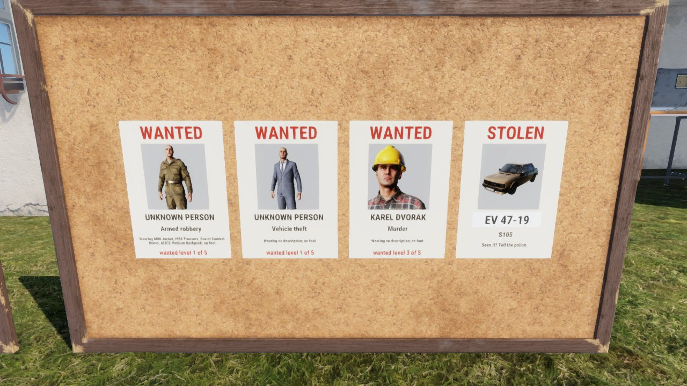
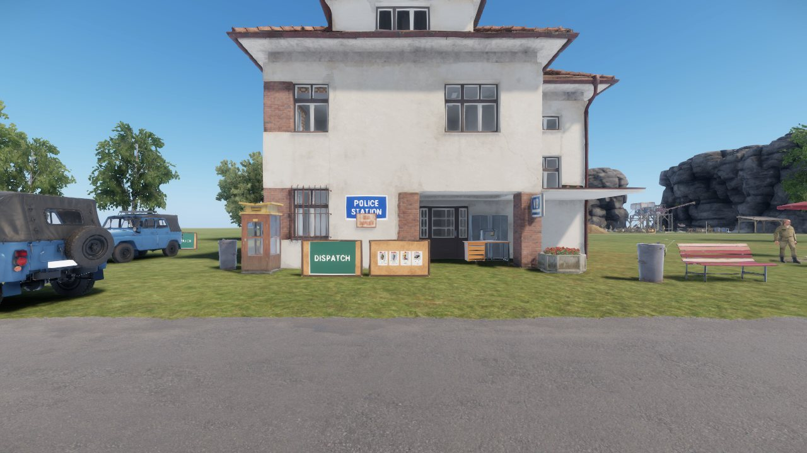
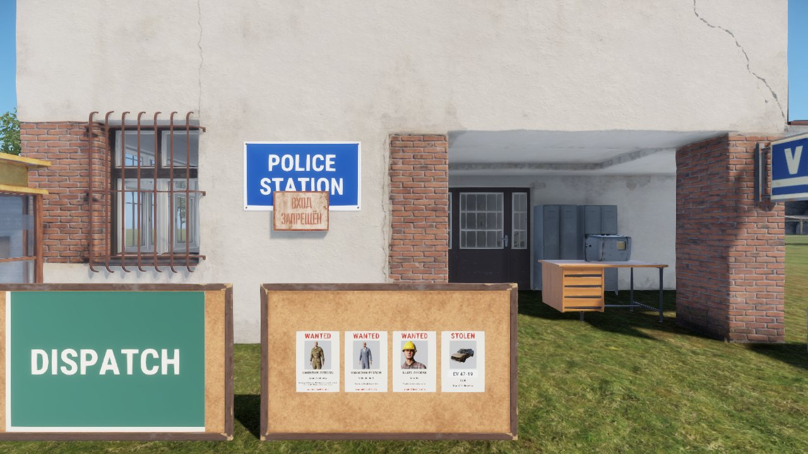
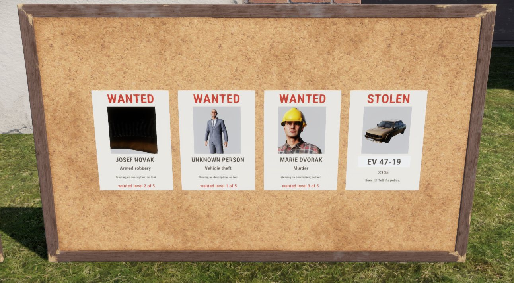
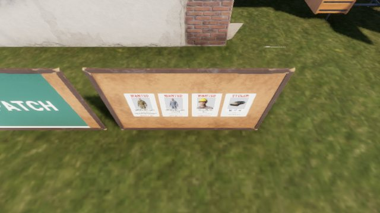
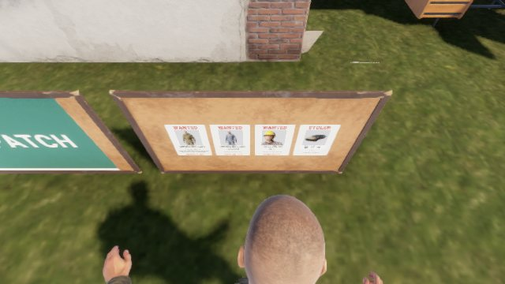

# Visual boards spike: wanted posters on the board itself

Can the police wanted board show its posters on the prop (a picture of each
wanted person with name, offence and wanted level, and stolen cars with their
plate), live and the same for every player, without opening a menu?

**Yes.** A proof of concept does it on a dedicated server with two clients.
Run on 2026-11-12 on Gaming-Box (game build 26257316) from `origin/main` at
`8f9d8e78`. The code is on the unmerged branch `spike/visual-wanted-poc`
(commit `c68e6719`, pushed to origin). It is not production code and is never
merged; this file is the only output. Related: #758 (the per-read board spec).



*A game client on a dedicated server. The first poster is the player who had
just robbed the fuel till, drawn in the clothes they wore. The other three are
made-up entries the spike seeds.*

## Short answers

| # | Question | Answer |
|---|---|---|
| 1 | Can a prop show live text and pictures in the world? | **Yes**: a UI layout drawn into an `RTTextureWidget` that a mesh material samples as `$rendertarget`. The signs already do this for their titles |
| 2 | Can we show a picture of the player? | **Yes**: an `ItemPreviewWidget` (the inventory preview) draws inside that render target. It shows a character prefab, or a local dummy dressed in the suspect's clothes. It shows the default face, not the player's |
| 3 | Cars? | **Yes**: the plate as text, and the same preview widget draws the car model |
| 4 | Multiplayer and late join? | **Yes**: the server sends a short list of strings; `RplSave`/`RplLoad` covers a late joiner, one reliable broadcast covers a change. Both clients drew the same posters 0.7 s after the crime (the PoC polls, so up to 2 s) |
| 5 | Cost? | Four small render targets and four previews per board, drawn by each client. Bandwidth was 835 characters for four posters. Frame time was **not measured** |

## How the board works today

- `Prefabs/Police/LF_WantedBoard.et` inherits `LF_Sign_Board` (the vanilla cork
  board). `LF_SignComponent` prints the title on one A4 sheet turned on its side.
- `LF_WantedBoardReadAction` asks the server; `LF_WantedBoard.ServerRead`
  answers that one reader with parallel arrays (name, offence, clothing,
  vehicle, place, level) and, for on-duty police, the dispatch log, stolen
  cars (`LF_StolenVehicles.BoardEntries`, `V;plate;nameKey;place`) and witness
  lines. The client opens a `LF_UIScreen` card. Nothing is replicated.
- The data: `LF_WantedReports` keeps `LF_WantedReportRecord` per character
  (offence key, clothing name keys, vehicle name key, place, identified flag).
  The wanted level is on `LF_CharacterStanding`. The name is sent only after
  the server marked the report identified. Stolen cars are session state.
- The record holds clothing **display names**, not prefabs, so today's data
  cannot draw a picture.
- The two dispatch boards (`LF_DispatchBoard_Police`, `_Medic`) inherit the
  wanted board prefab.

## Display options

Looked up with `tools\cli call api_search` and `game_read` on the vanilla
scripts; "tried" means it ran in this spike.

| Option | Works on a client? | Evidence | Verdict |
|---|---|---|---|
| Layout in an `RTTextureWidget`, `SetRenderTarget(entity)`, material with `BCRMap "$rendertarget"` | Yes, tried | The pictures here. `scripts/Core/generated/UI/RTTextureWidget.c`; vanilla `BallisticTableRenderTarget.layout` and `Assets/Items/Misc/BallisticTable/Data/RenderTarget.emat`; our `LF_SignComponent` | **Use this** |
| `ItemPreviewWidget` inside that render target | Yes, tried (new finding) | Characters and a car draw on the sheet in Workbench and on a game client | **Use this for pictures** |
| Paper quads as child entities, one render target each | Yes, tried | The PoC spawns one `LF_SignFace` (vanilla A4 poster mesh) per poster with `SpawnEntityPrefabLocal` | Fine for a spike; production wants one target per board |
| A second camera: `RenderTargetWidget.SetWorld(world, camera)`, or `RTTextureWidget.SetRenderView` with `$renderview` | API exists, not tried | `scripts/Core/generated/UI/RenderTargetWidget.c` (`SetRefresh`, `SetMaxFPS`); vanilla `SCR_2DPIPSightsComponent` | No: it renders the live scene again, and the suspect must be streamed in and standing in front of a camera |
| World-space UI widgets | No such thing found | The engine's way to put UI on a prop is the first row | n/a |
| Decals (`World.CreateDecal`, `CreateDecal2`) | Not tried | The call takes a material name, so the picture is fixed when the material is authored | No for names and pictures; possible for a fixed stamp such as CAUGHT |
| Swap a material or texture at runtime (`Material.SetParam`, `SCR_Global.SetMaterial`, `ParametricMaterialInstanceComponent`) | Not tried | The parametric component sets colour, emissive and user params | Only chooses between authored materials; no free text |
| Text on a mesh | No | Only `DebugTextWorldSpace` (debug draw) exists | No |
| Screenshot to a file, then `ImageWidget.LoadImageTexture(..., fromLocalStorage)` | Not tried | `System.MakeScreenshot` captures the whole window | No: every client would need the file |

`ImageWidget.SetImageTexture(int, RTTextureWidget)` also exists: a render
target can be shown as an ordinary UI image, so the Read card could reuse the
poster picture. Not tried.

### Distance





At 1280x720: from the street the board reads as four sheets with pictures. At
2.2 m the headers, pictures and plate read; names are borderline; the small
clothing line does not. At arm's length (the first picture) everything reads.
The material is `MatPBRBasic`, lit by the scene. Night was not tested.

## The picture of the player

Each client draws its own pictures; the dedicated server draws nothing.

- **From a prefab**: `ItemPreviewManagerEntity.SetPreviewItemFromPrefab(widget,
  prefab)`. Works for any character or vehicle prefab.
- **A dressed dummy**: the server captures the suspect's character prefab and
  what each `EquipedLoadoutStorageComponent` slot holds at the crime. The
  client spawns that character prefab locally in the preview world
  (`ResolvePreviewEntityForPrefab(prefab).GetWorld()`), attaches the clothes
  to the same slots, and calls `SetPreviewItem(widget, dummy)`. This is what
  vanilla `SCR_LoadoutPreviewComponent` does for arsenal loadouts. On the
  session both clients logged `picture from dressed dummy:
  {9B5BB216CC7FF18E}Prefabs/Characters/Core/Character_Roleplay.et with 4
  item(s)` and the poster shows the robber's jacket, trousers, boots and pack.
- **Mugshot framing**: the preview camera shows the whole body. A head and
  shoulders picture is a 3x preview behind a clipping frame
  (`WidgetFlags.CLIPCHILDREN`). The PoC uses the full body for an unknown
  suspect and the mugshot for a named one.



*Left: `PreviewRenderAttributes` built in script from a `.conf` drew a black
frame, with two different sets of values. Third: the clipped window works.*

What it does not do:

- The dummy has the prefab's default head. The player's face and hair
  (`SCR_CharacterIdentityComponent`) are not captured. Not tried.
- A snapshot camera was not tried (see the table).
- A silhouette fallback is the grey box: a poster with no appearance data
  draws the text and an empty frame. Nothing fails.

## Cars

The plate is already in `LF_StolenReport.m_sPlate`. The PoC captures the
vehicle prefab when the owner reports it and draws that prefab in the preview
widget beside the plate. Only the seeded entry was drawn in this spike; a real
stolen report was not driven. A preview from a prefab shows the model's
default colour, not a resprayed car.

## Data flow

The server owns the list. In the PoC `LF_VisualBoardComponent` sits on the
board prefab (the cork board already has an `RplComponent`):

1. Server: every 2 s build the public list (one poster per suspect, newest
   report first, at most 3; then at most 1 stolen car) as `array<string>`,
   one entry `kind;title;offence;level;clothing;appearance`. Send it only when
   it differs from the last one.
2. Change: `Rpc(RpcDo_SetEntries, entries)`, reliable broadcast.
3. Late join and stream-in: `RplSave` writes a version, the count and the
   strings; `RplLoad` reads them and redraws. No `RplProp`.
4. Client: clear the sheets, build one per entry.

It carries the public view only: no place, and a name only when the server
marked the report identified, as today. The police-only lines stay on the Read
card, which the PoC leaves in place.

Evidence, from the two-client session (lowspec, dedicated server):

```
server   22:00:02.393 [LFDebug:VisualBoard] server: board list changed, 4 poster(s), 477 chars, broadcast
client1  22:00:45.541 [LFDebug:VisualBoard] client: 4 poster(s) from jip
client2  22:00:49.533 [LFDebug:VisualBoard] client: 4 poster(s) from jip
server   22:01:07.362 [LFDebug:VisualBoard] captured suspect of report #1: 338 chars
server   22:01:07.959 [LFDebug:VisualBoard] server: board list changed, 4 poster(s), 835 chars, broadcast
client2  22:01:07.995 [LFDebug:VisualBoard] client: 4 poster(s) from rpc
client1  22:01:08.006 [LFDebug:VisualBoard] client: 4 poster(s) from rpc
client2  22:01:08.063 [LFDebug:VisualBoard] picture from dressed dummy: {9B5BB216CC7FF18E}Prefabs/Characters/Core/Character_Roleplay.et with 4 item(s)
```

Both clients joined about 45 s after the server built the list, so their first
posters came through `RplLoad`. Client 1 then robbed `Roadmap_Fuel_Till`; both
clients redrew from the broadcast.

| Client 1 (the robber) | Client 2 |
|---|---|
|  |  |

*640x360 lowspec clients after the robbery: the same four posters, the robber
first.*

Not exercised: a poster leaving when the wanted level returns to 0 (the same
"list changed" path), a client joining after a live change, a board streaming
out and back in, and a restart.

## Recommendation

Build it on the first two rows of the table: one component on the board, a
server list sent by `RplSave`/`RplLoad` plus a broadcast, posters drawn per
client into a render target, portraits from a dressed dummy with the clipped
mugshot. Keep the Read action for the detail and for police-only content.

Change these things from the PoC:

- **Events, not a poll.** Rebuild on `LF_OnCrimeCommitted`, a wanted level
  change, identify, and stolen report or recovery; coalesce to one broadcast
  every few seconds.
- **Ids, not prefab paths.** 338 of the 835 characters were one suspect's
  prefab names. Send indices into a clothing catalog.
- **One render target per board**, on a board-face mesh with 0..1 UVs, instead
  of four A4 sheets with a third of each target unused.
- **Draw near, release far.** The PoC draws every board at join. Build the
  target and the dummies when the player is within about 30 m and free them
  beyond.
- **Store the appearance on the report** and persist it, or posters lose
  their picture at restart.

### Cost

Performance, per client, per board in range:

| What | PoC | Note |
|---|---|---|
| Render targets | 4 of 768x724 layout units | `SetMaxFPS(1)` is set on each; that the cap holds was not measured |
| Preview renders | 4 | One per poster |
| Dummy entities | 1 full character prefab plus its clothes per real suspect | Lives while the poster exists. No script error in the client logs |
| Bandwidth | 477 to 835 characters per list | On change and on stream-in; at most 4 entries |
| Server | One list build per board every 2 s | Goes away with events |

Frame time and memory were not measured: the harness has no FPS probe and
`tools\cli perf` was not run. That is issue 7 below, and it gates the rest.

Effort: seven issues, below. Issues 1 to 3 give the wanted board; 2 touches
persistence.

## Risks

- **Unmeasured render cost.** A render target and four previews per board,
  times the boards in view. Mitigated by the distance gate and the FPS cap,
  but only a measurement settles it.
- **A full character prefab as a dummy.** `Character_Roleplay.et` runs its
  components on the client in the preview world. It logged no error here; a
  later component that assumes a real player could. A stripped preview
  character with only the loadout storage would be safer.
- **The picture is not the player's face.** Players may expect their own face.
  Capturing the identity is unproven.
- **An unknown suspect's poster shows a body.** Today an unidentified report
  gives a clothing description only. A full-body picture gives more away. That
  is a design decision.
- **Preview attributes from script do not work** (black frame), so the
  framing depends on the clipping trick and on each prefab's own preview
  camera.
- **Workbench differs from the client.** `LF_SignComponent` scales its title
  by the DPI scale in Workbench. This layout needed no scaling in either, and
  the first render with the scaling was half size. Check both when changing
  the layout.
- **Wrong board.** The dispatch boards inherit the wanted board prefab; the
  PoC skips them by sign id. The real component belongs on its own prefab.
- **Night.** Not tested. The sheet is an ordinary lit material, so it
  probably needs a lamp near the board.

## Proposed issues

1. **Board feed.** A core component that holds the server's public poster
   list and sends it (`RplSave`/`RplLoad`, coalesced reliable broadcast),
   driven by events. LOGIC tests for encode, decode and the caps; a two-client
   proof with a late joiner after a change.
2. **Appearance on the crime report.** Capture clothing as catalog ids (and
   the identity, if the lookup shows it can be applied to a dummy) in
   `LF_WantedReportRecord`; persist it with a version bump; restart proof.
3. **Poster renderer.** One render target per board on a board-face mesh,
   the poster layout, localization keys for WANTED, STOLEN and the tip line,
   the distance gate, a wanted poster and a stolen-car poster. Pictures from a
   `full` session in the PR.
4. **Portraits.** The dressed dummy on a stripped preview character, its
   lifetime and a cap, the mugshot window, the empty-frame fallback.
5. **Stolen cars.** Capture the vehicle prefab and colour on the report;
   drive report and recovery in a session.
6. **Dispatch board.** Decide what is public. Police-only slips cannot go in a
   broadcast; either they stay on the Read card or the feed sends a second
   list to on-duty officers only.
7. **Measure.** Frame time and memory with 1, 4 and 8 boards in view against
   the 128-player budget (#335). Do this before 3 and 4 are sized.

Also worth a small tooling issue: `tools\cli look` frames a board too wide to
read (the PoC narrows the close-up FOV for names containing `WantedBoard`),
and the harness character camera cannot pitch, so a low board needs the
`free` camera.

## Run it again

```
tools\cli wt new visual-poc
git merge origin/spike/visual-wanted-poc       # in the new worktree; never ship it
tools\cli look 235.4,242.9 --close 1          # Workbench, about 16 s
node agent-box/session.mjs up --clients 2
node agent-box/session.mjs visual-board-proof
node agent-box/session.mjs down               # then grep VisualBoard in the client logs
```

Files on the branch: `Scripts/Game/Feature/Police/LF_VisualBoard.c`,
`UI/Layouts/Police/LF_WantedPoster.layout`, two capture hooks
(`LF_WantedReports.Report`, `LF_StolenVehicles.Report`), the board prefabs,
and `agent-box/proofs/visual-board-proof.mjs`.
