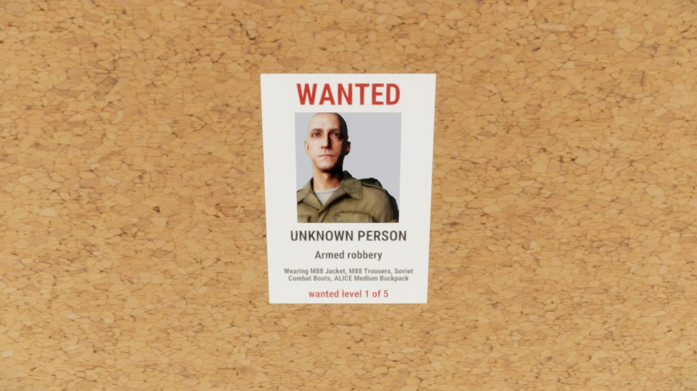
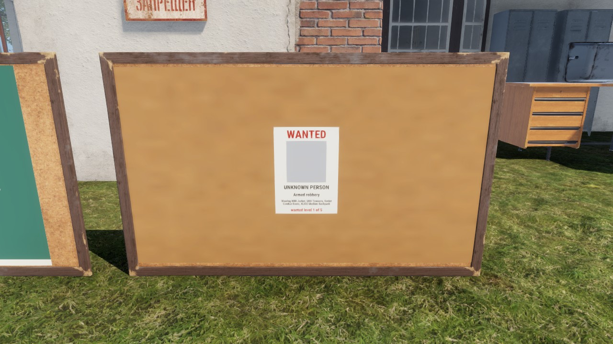
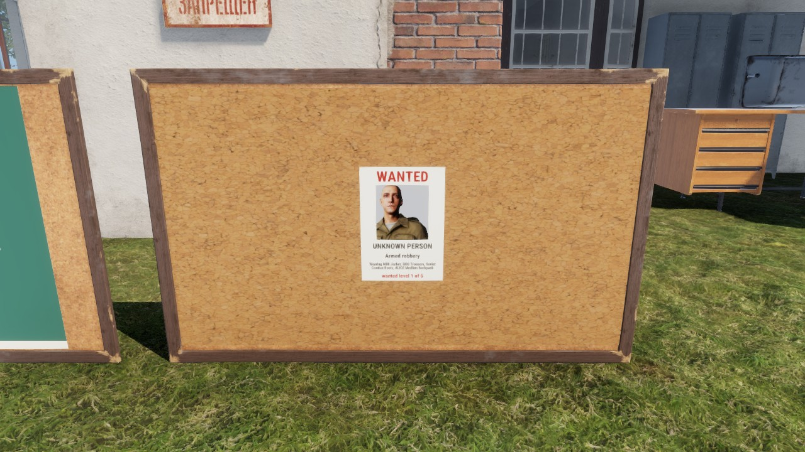
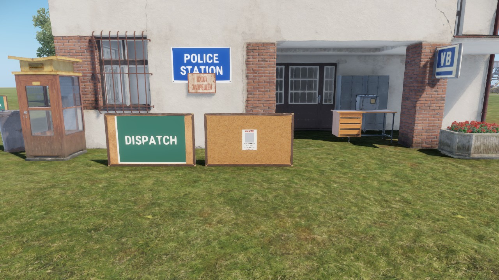
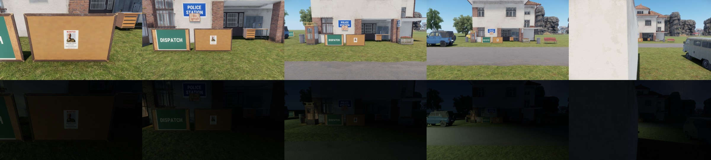
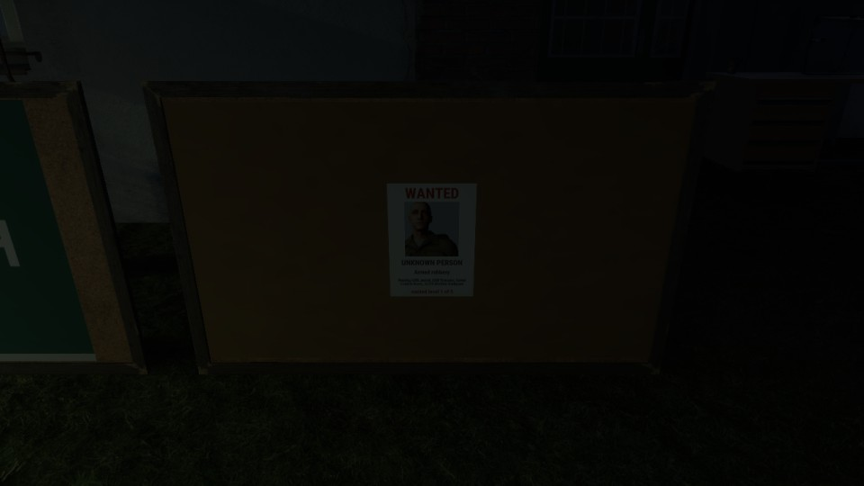
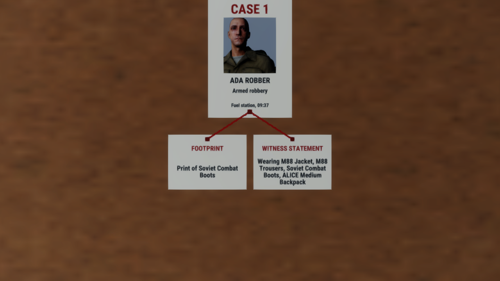

# Visual boards: the wanted board's face

How the police wanted board shows its posters on the prop, for every player
near it, without a menu. The design comes from
`docs/architecture/visual-boards-spike.md`; the limits from
`docs/architecture/visual-boards-budget.md`. Refs #758.

*A game client on a dedicated server, just after it robbed the fuel till: the
robber's poster, unnamed until the police identify them.*

## Pieces

| Piece | Where | Does |
|---|---|---|
| `LF_WantedPosters` | `Feature/Police/LF_WantedPosters.c` | Server: builds the public list from the crime reports and wanted levels, one poster per suspect, newest first, no place, the name only once identified. Rebuilds on `LF_OnCrimeCommitted`, `LF_OnWantedChanged`, `LF_OnSuspectIdentified` and after a load, one rebuild per 1.5 s burst; sends only a changed list |
| `LF_WantedPosterBoardComponent` | `Feature/Police/LF_WantedPosterBoard.c`, on `Prefabs/Police/LF_WantedBoard.et` | Holds the list on every machine: `RplSave`/`RplLoad` for a late joiner or a board streaming in, `RpcDo_SetPosters` (reliable broadcast) on a change |
| `LF_WantedPosterFace` | same file | Client: one render target (`LF_WantedBoardFace.layout`, 1920 x 1080 units) on a local `LF_BoardFace.et` quad over the cork; the vanilla cork texture under the posters; one `LF_WantedPoster.layout` per entry |
| `LF_WantedPosterFaces` | same file | Client: once a second, builds the faces within `drawRadius` of the camera and releases those beyond it plus 5 m |
| `LF_WantedPostersConfig` | `Configs/Police/LF_WantedPosters.conf`, owner section `wantedBoard` | `posters` (4, at most 8 in two rows), `drawRadius` (30 m). The radius reaches clients inside the board's own list |

An entry is a short string of ids: `P;name;offence id;level;clothing keys;vehicle key`,
the offence being the crime catalog id (#685a). Police-only detail (the place,
the dispatch log, stolen cars, witness lines) stays on the Read card.

## Portraits

The server captures the suspect's look when the report is made (`LF_WantedLook`):
the character prefab and each loadout slot's item, as prefab GUIDs, about 120
characters. `LF_WantedPortrait` spawns that character in the preview world,
dresses it slot by slot and hands it to the poster's `ItemPreviewWidget`. The
widget is three photo frames wide and the frame clips it to the head and
shoulders, for every suspect. The dummy is deleted once the face has frozen for
the last time (33 s after a change); the frozen face keeps the picture. The
look is saved in its own payload, `wantedlooks` (save version 29), matched to
the reports by sequence after `wanted` loads, so the portraits come back after a
restart. A version 28 or older save has no looks: its posters show an empty
photo frame until the suspect's next crime.

Measured on the session (one portrait, RTX 3080, 1280x720, uncapped): 6.08 ms
mean, 8.03 ms p95 while live, 5.91 / 7.57 frozen.

## Stolen cars

A car its owner reported stolen takes one of the last places on the row
(`wantedBoard.stolenPosters`, 1 by default; 0 keeps cars off the face, and they
stay on the officers' Read card): STOLEN, the model drawn from its prefab (the
default colour, not a respray), the plate on a white strip, the car's name and
an appeal to tell the police. The stolen report stores the vehicle prefab's GUID
when the owner reports it; the place and the owner stay with the police.

## The live window

A face renders live for 3 s after it is drawn or changed, then hides its widget
root: the mesh keeps the last frame and costs nearly nothing (the budget's
"frozen" rows). It renders again for 2 s at 10 s and at 30 s after it was
built (and after each change), so textures that streamed in late are on the
frozen frame; the cork texture is loaded again without the cache at each
refresh. Before that reload, a late joiner's face kept the cork at its lowest
mip even after the refreshes (left); with it, the late joiner's frozen face has
the full cork (right):

| Before | After |
|---|---|
|  |  |

## From the street

## Checks: distance, night, late join

*`session.mjs wanted-posters-look-proof` on a 1280x720 game client: one robber's
poster, a fixed camera straight in front of the board. At 25 m the camera stands
behind the house across the street; the board is still built (the radius is 30 m).*

- **Distance (noon).** At 1.7 m every line reads, the description included. At
  4 m the header, the portrait, the name and the offence read; the description
  does not. At 8 m it is a WANTED poster with a face; at 15 m a poster on a
  board. Beyond 35 m the face is released and the board shows plain cork, which
  nobody can tell apart at that distance.
- **Night (22:00).** The face is lit like every other sign and prop: no light of
  its own. Up close the header, the portrait and the name read dimly; the small
  lines need a torch. The DISPATCH board beside it is as dark. A lamp over the
  board is the fix if a server wants it readable at night; it is world content
  (where the board stands), so it belongs to the map or the pack, not this
  component.
  
- **Late join.** A player joining after a change draws the current posters from
  the board's `RplLoad` (`wanted-posters-proof`: `1 poster(s) from jip`), with the
  portrait and, after the settle refreshes, the cork texture.

## The dispatch boards

The two dispatch boards (`LF_DispatchBoard_Police.et`, `LF_DispatchBoard_Medic.et`)
inherit the wanted board and keep their painted DISPATCH face and the Read card
(`m_bDrawPosters 0`). Their content is service calls that only the service's
on-duty staff may read (`LF_ServiceBoard.MayRead`). Anything drawn on a prop is
sent to every client that has the board streamed in, and a client-side filter
does not keep it from a modified client, so the calls stay on the per-read card.
`docs/decisions.md`, 2026-11-13.

## The case board

The police case board (#148, `Prefabs/Investigation/LF_CaseBoard.et`, in the station porch) is the
same render target with another layout of paper: up to three case columns, each a sheet for the
suspect (the wanted poster layout: CASE n, the portrait once identified, the offence, the place and
the time) and up to four index cards under it (the same layout with the photo parts hidden). A red
string runs from each card's pin to the suspect sheet's pin: `LF_CaseBoardString.layout` is two pin
heads and a chain of 64 beads, 6 units square, laid along the line at most 5 units apart, so it reads
as one thread and needs no turned widget.

The spike (#148) tried the turned line first. An `ImageWidget` turned with `SetRotation` in the
render target is shrunk to fit its own unturned box: sized as a long thin slot (the gap between the
pins by 5 units) it drew a 1 cm dash at the midpoint; setting the image's own size
(`ImageWidget.SetSize`, as the vanilla map's drawing line does) or the vanilla line texture with
`SizeToContent` drew nothing better. The beads cost 64 small images a string (12 strings at most
on a face), drawn only while the face is live. A `CanvasWidget` `LineDrawCommand` is the
untried alternative if a face ever needs a smoother thread.

A new list builds the face again rather than redrawing it in place. On the session client (0.7 GB
of RAM free with two full-profile clients and a server) a frozen face that was redrawn kept its old
frame through the live window and both settle refreshes; a freshly built face draws its first frame
every time. A change is a pin, a crime or an identification, so the rebuild is rare. The frozen
frame still has the cork at a low mip on such a busy client (the wanted board's face shares it).

| Piece | Where | Does |
|---|---|---|
| `LF_CaseBoard` | `Feature/Investigation/LF_CaseBoard.c` | Server: builds the list from the crime reports and the pinned locker rows, coalesced like the posters, and sends it to on-duty officers only (`LF_SendCaseBoard`, an owner RPC on each officer's controller) |
| `LF_CaseBoardView` | `Feature/Investigation/LF_CaseBoardFace.c` | Client: the list this officer holds; once a second a duty check (coming on duty asks for the list, going off duty drops it and releases the faces) and the distance gate |
| `LF_CaseBoardFace` | same file | Client: `LF_WantedPosterFace` with case columns, cards and strings; the same live window, freeze and settle refreshes |
| `LF_CaseBoardComponent` | same file, on `LF_CaseBoard.et` | The prop: holds no case data; draws the face within 15 m for an on-duty officer |

An entry is `C;report;offence;place;time;name;look;identified` for a case, followed by
`E;report;kind;note` for each of its cards. The name and the look are sent only once the suspect is
identified. Why the list does not ride the prop: `docs/decisions.md` 2026-11-13 "#148".

