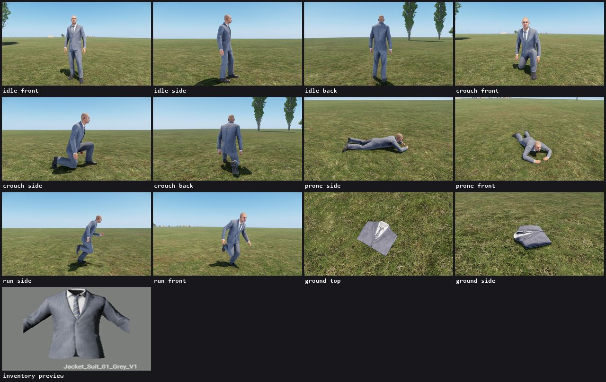
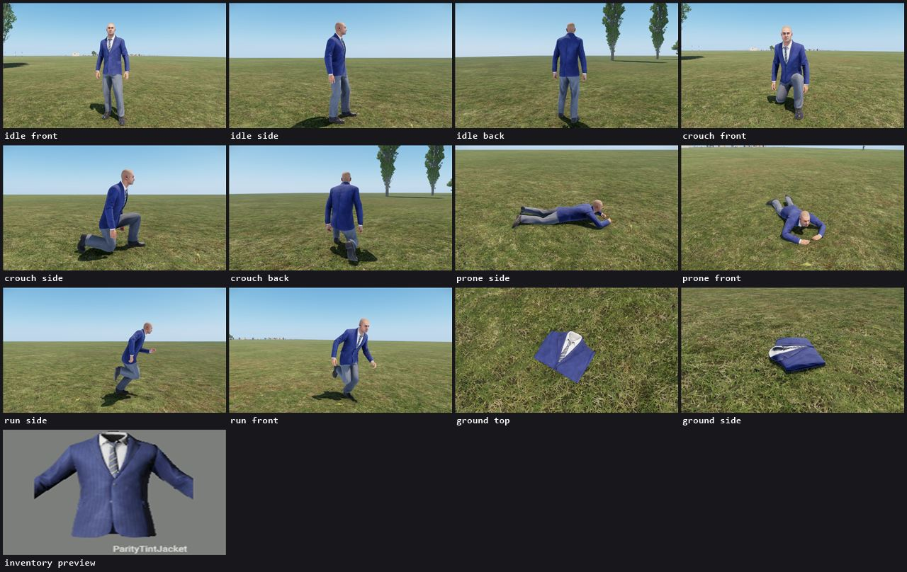

# Clothing: what a garment is, the routes, and the pipeline

`tools\cli asset` kind `clothing` turns a spec into a garment that inherits a vanilla one. The first
half of this page is the research (2026-11-14, game 1.9, Arma Reforger Tools with Enfusion Blender
Tools core 2026-08). The second half is the pipeline and what it proved.

```
tools\cli asset new <slug> --kind clothing --base "{GUID}Prefabs/Characters/...et" --slot Jacket [--route a|b|c]
tools\cli asset run <slug> [--from <stage>] [--only <stage>] [--to <stage>] [--previews] [--no-shots] [--reuse-shots]
```

Stages: `spec`, `vanilla`, `textures`, `fit`, `import`, `prefab`, `verify`. Like the prop kinds,
the spec is `tools/assets/<slug>/spec.json` and everything a stage makes lands in
`tmp/assets/<slug>/`.

## Conclusions

- **Route (a), a retexture, gives vanilla quality and fit with no risk.** The garment keeps the vanilla mesh, skinning, LODs,
  colliders, hidden body parts, pockets, ground model and preview. Only the textures change. The pipeline
  does it end to end, and the parity run below matches vanilla in every state picture.
- **Police uniform, 1989:** route (a) on vanilla civilian pieces whose cut fits. The cotton shirt
  (`Shirt_CottonShirt_01`), the trousers (`Pants_Trousers_01`) and a peaked cap (`Hat_PeakedCap_USSR_01`)
  get a police blue or grey, with the badge, insignia and stripes painted into the BCR map. The result is vanilla
  quality, because it is the vanilla garment. The limit is the silhouette: a 3D badge, epaulettes or a duty belt
  need a mesh.
- **Doctor's white coat:** no vanilla garment has the cut. The longest jacket, `Jacket_Raincoat_01`, is
  0.78 m tall, the same as the suit jacket, and a lab coat reaches the knee. A white raincoat or suit jacket
  (route a) works as a stopgap. The real coat is route (c), and route (c) is blocked at the Workbench
  import (see "Blocked").
- **Route (c) quality:** skin weights transferred from Bohemia's body template agree with Bohemia's
  hand-made weights on 38 % of the sample vest's vertices (dominant bone). That is a starting point
  for hand painting, not a finished skin. Bohemia's own README calls it a "rough transfer of
  skinning". Expect an artist's day per garment on weights and clipping.
- **Route (b), modifying a vanilla mesh, does not exist legitimately.** No vanilla garment ships its
  source (0 `.fbx` among 251,194 files in the game paks), the `.xob` geometry is a compressed, undocumented
  format, and the game EULA forbids reverse engineering the game files. What Bohemia publishes
  is the Samples (below). Route (b) means kitbashing those.

## What a vanilla garment is

Read from the paks with `tools\cli call game_read` and the pipeline's own reader
(`tools/assets/pipeline/clothing-vanilla.mjs`). The worked example is the grey suit jacket,
`{E652D625A46A00FC}Prefabs/Characters/Uniforms/Jacket_Suit_01/Jacket_Suit_01_Grey_V1.et`.

### The prefab chain

`Uniform_Base.et` -> `Jacket_Suit_01_base.et` -> `Jacket_Suit_01_Grey_V1.et`. The colour variant is
690 bytes: it only sets `WornMaterialsOverride` and `ItemMaterialsOverride` on the cloth component
and renames the item. Every colour of every vanilla garment is built this way, and so is route (a).

| Component | What it does for the garment |
|---|---|
| `BaseLoadoutClothComponent` | `AreaType` (the slot), `WornModel` (skinned, on the body), `ItemModel` (on the ground), `OverrideMeshesToHide` (body parts not drawn under it), `SoundInt`, the two material override lists. A BDU jacket adds `DeflatedModel` (a slimmer worn model used when an armoured vest goes on top: `AreaTypeWhenModelChange LoadoutArmoredVestSlotArea`) and `Slots { LoadoutSlotInfo DummyBelt }` |
| `MeshObject` | The ground model again (`_item.xob`). It is what is drawn when nobody wears it |
| `SCR_UniversalInventoryStorageComponent` | The inventory item (name, description, weight 1.25, volume 2000, `PreviewRenderAttributes`) and the pockets (`MaxCumulativeVolume 600`, `m_fMaxWeight 5`). A child `SCR_EquipmentStorageComponent` holds an equipment slot: a flashlight on `PivotID "Spine5"`, drawn on the worn model (`AnimatedMeshRefference`). Hats use `SCR_HeadgearInventoryItemComponent` and have no pockets |
| `RigidBody` | `SimState Collision`, `ModelGeometry 1`: the ground model's collider |
| `SCR_SoundDataComponent` | Pick-up, equip and drop sounds (`Items_PickUp_Uniform.acp`, `Items_Drop_Clothes.acp`) |
| `ActionsManagerComponent` | Pick up and Equip (`SCR_EquipClothAction`, which calls `SCR_InventoryStorageManagerComponent.EquipCloth`) |
| `SCR_ItemOutfitFactionComponent` | The faction a garment reads as (`CIV`, value 40). Faction loadouts put garments in `BaseLoadoutManagerComponent` slots of a character prefab, as `tools/outfits/generate.mjs` does for the NPC roles |
| `ParametricMaterialInstanceComponent` | Per-instance material parameters: how the blood and dirt layer fades in at run time |
| `Persistence`, `RplComponent`, `Hierarchy` | Saving, replication and being parented to the character |

### Slots and hidden body parts

From `Character_Base.et` (`BaseLoadoutManagerComponent`):

| Slot | Area | Hides |
|---|---|---|
| Hat | `LoadoutHeadCoverArea` | - |
| Jacket | `LoadoutJacketArea` | Torso, Arm_L, Arm_R, ArmUpper_L, ArmUpper_R |
| ArmoredVest | `LoadoutArmoredVestSlotArea` | - |
| Pants | `LoadoutPantsArea` | Leg_L, Leg_R, Groin, Calf_L, Calf_R |
| Boots | `LoadoutBootsArea` | - |
| Back | `LoadoutBackpackArea` | - |
| Vest | `LoadoutVestArea` | - |
| HandWear | `LoadoutHandwearSlotArea` | - |

A garment's `OverrideMeshesToHide` replaces the slot's list: the suit jacket hides the same five parts and the
BDU blouse only Torso and the upper arms (its sleeves are rolled). The names are the base body's
mesh parts in `Character_Template.fbx`: Torso, ArmUpper_L/R, Arm_L/R, Hand_L/R, Groin, Leg_L/R,
Calf_L/R, CalfLower_L/R, Foot_L/R.

### The models

| | Worn model (`Jacket_Suit_01.xob`) | Ground model (`Jacket_Suit_01_item.xob`) |
|---|---|---|
| Skeleton | The whole character skeleton: 231 nodes (224 bones, face included, and the `EntityPosition` and IK target locators). A flat cap carries it too | None |
| Size | 1.08 x 0.77 x 0.35 m, on the body | 0.48 x 0.08 x 0.42 m: the garment folded flat |
| Collider | `UTM_Jacket_Suit_01`, trimesh, layer `FireGeo`, `fabric.gamemat` (the cap: `UCX_FG_HatFlat`, `fabric_0_5mm`) | `UBX_Jacket_Suit_01_Item`, a box, layer `ItemFireView`, `fabric_2mm_min.gamemat` |
| Material | `MatPBRMulti`, below | `MatPBRBasic` with its own 2048 maps |

The ground model is a separately modelled folded garment, not a LOD. The inventory preview of the
suit jacket draws the worn model (`PreviewWornModel 1`, camera 4.5 m, FOV 10); the BDU blouse draws
the folded one. Material overrides do show in the preview: the tinted parity jacket shows its tint
there (picture below). The Faction Creation tutorial says the preview does not support material
overrides. In game 1.9 that is no longer true.

**Triangles.** The xob's LOD chunk is LZ4-compressed and undocumented, and there is no script API
for it. The counts come from Bohemia's
[Model Performance](https://community.bistudio.com/wiki/Arma_Reforger:Model_Performance) table
(LOD0 / last LOD faces): BDU M81 jacket 7,950 / 208, KZS jacket 9,968 / 278, M70 jacket 17,090 / 205,
trousers 5,092 to 7,950 / 100 to 220, boots about 3,140 / 100, helmets 3,673 to 12,199, the base body
57,088 faces and 100 bones. The base body in the Samples has 5 LODs (the forearm: 2,902, 761, 347, 141
and 32 triangles). Skinning allows at most 4 bones per vertex
([FBX Import](https://community.bistudio.com/wiki/Arma_Reforger:FBX_Import)).

### Materials and textures

The worn material (`Jacket_Suit_01_Grey.emat`):

```
MatPBRMulti : "{0FB93B007F4E3A39}Assets/_BaseMaterials/Characters_MatPBRMulti.emat" {
 CavityFromAO 0.5
 VFXMap      Jacket_Suit_01_VFX.edds          2048, BC7: red is where blood and dirt can spread
 DirtUserOpacity 1   DirtOpacity 3   DirtRoughness 0.8
 DirtBCRMap  Jacket_Suit_01_Grey_Blood_BCR.edds   2048, BC7 sRGB: the same cloth soaked in blood
 BCR_1       Jacket_Suit_01_Grey_BCR.edds     2048, BC7 sRGB: base colour, roughness in alpha
 NMO_1       Jacket_Suit_01_Black_NMO.edds    2048, BC7: normal X and Y, metallic, AO in alpha
}
```

So vanilla clothing does damage and dirt with a second colour map: the blood-soaked BCR is
faded in through the VFX mask at run time. A retexture repaints `DirtBCRMap` with the cloth so the
blood state matches. The base material only sets `EnableFarHiding 1`. The ground material is a
`MatPBRBasic` (`BCRMap`, `NMOMap`, both 2048). Every map of the suit jacket, worn and ground, is
2048 x 2048 BC7, and the suit jacket's atlas also holds the shirt and the tie, which is why a
repaint needs a mask. Hats' "Dirty" variants are an emat that inherits the clean one and swaps
`BCRMap`. One detail for anyone reading the files: an `.edds` is a DDS header (DX10 extension) followed by
a mip table, smallest first, of `COPY` or `LZ4 ` blocks (a u32 size, then linked LZ4 chunks of up to
64 KB whose u32 header has the high bit set on the last one).

## The routes

| | (a) retexture | (b) modify a published mesh | (c) new mesh |
|---|---|---|---|
| What changes | The BCR (and blood BCR) on the vanilla UV layout; new emats that inherit the vanilla ones | A Bohemia Samples mesh, kitbashed in Blender, then weighted like (c) | Our own model (by hand, or Meshy from a picked concept), fitted to the base body |
| Inherited from vanilla | Everything but the colour | The prefab: slot, pockets, sounds, actions, preview camera | The prefab: slot, pockets, sounds, actions, preview camera |
| Still to make | Paint (a template on the vanilla layout comes out of the `textures` stage) | The garment, its ground model, its maps | The garment, its ground model, its maps |
| Can't do | A new silhouette, 3D badges, a longer hem | Anything the Samples do not hold: the M88 jacket and trousers, Soviet boots (sculpts, no UVs), one vest | - |
| Effort | Hours (painting) | Days | Days to a week |
| Risks | The atlas shares the shirt and tie; colours look about 1.7 times lighter in game lighting; derived textures carry Bohemia's terms | Retopology and UVs for the deflated sculpts; same weight and clipping risks as (c) | Weights are rough (38 % agreement) and need hand painting; clipping in crouch, prone and the arm extremes; normal seams where LODs collapse; the ground model is a second model to make |
| Pipeline state | Working end to end, parity proven | Fit and export working, Workbench import blocked | Fit and export working, Workbench import blocked |

## Tooling

- **Blender** 4.5.9 LTS, portable (`C:\Users\jaspe\Tools\blender-4.5.9-windows-x64`, `LF_BLENDER`).
  It reads the BC7 `.dds` the pipeline unpacks from `.edds`.
- **Enfusion Blender Tools (EBT)** ship with Arma Reforger Tools
  (`Arma Reforger Tools\Blender\scripts\addons\EnfusionBlenderTools`, GPL-3.0, core 2026-08). The fit stage
  enables them headless (`EBT_TEST=1` skips their PySide6 install and Qt window). EBT represents a skeleton
  as one Empty per bone and patches Blender's FBX writer so those Empties become LimbNodes with a bind
  pose (`patch_fbx_export_with_skinning_support`). Its `Import XOB's Source FBX` only finds a source FBX that
  exists, so it cannot open a vanilla garment.
- **Arma Reforger Samples** ([GitHub](https://github.com/BohemiaInteractive/Arma-Reforger-Samples),
  Arma Public License), `SampleMod_NewCharacter/Assets/Characters/`:
  `Character_Template.fbx` (the base body in parts, 5 LODs, the 224-bone skeleton and the helpers; "can
  be used to correctly adjust gear like vests, pants, jackets or shoes and for rough transfer of
  skinning"), `Character_Weights_Template.blend` (`Body_LOD0`, one mesh with the game's weights),
  `Jacket_Deflated_Template.fbx` (M88 jacket 177k tris, M88 trousers 74k, Soviet boots 22k: sculpts to fit
  against, no UVs, no weights), the sample vest and helmet with their `.blend`, `.fbx`, `.tif` and
  `.xob.meta`. Bohemia's README: "any custom gear which is applied to character model has to use EXACTLY
  same skeleton as vanilla Basebody_Male_01.xob - including empty objects/helpers". The pipeline downloads
  what it uses into `tmp/assets/_samples/`; nothing of it is committed.
- **[steffenbk/bk-reforger-blender-addons](https://github.com/steffenbk/bk-reforger-blender-addons/releases)**:
  vehicle and weapon rigging, colliders, LODs, an FBX exporter with a model-quality checker, a weight-gradient
  painter, NLA and animation export profiles, building destruction. Nothing for clothing or weight transfer;
  BK Weight Gradient could help hand-paint the cleanup pass of route (c).
- **Our MCP tools**: `game_read` and `game_browse` read prefabs and folders in the paks; `.emat`,
  `.xob` and `.edds` are binary to it, so the pipeline reads them through the same pak reader
  (`tools/mcp/enfusion-mcp-bk/dist/pak/vfs.js`). `asset_search` gives no GUIDs for vanilla prefabs: the vanilla
  stage resolves them from the references in other vanilla files.
- **Workbench** builds the `.edds` and `.xob` headless through `LF_AssetImportPlugin` (as the prop kinds do) and
  takes the state pictures through `LF_ClothingShotsPlugin` (below).

## Licensing

- The game EULA allows non-commercial use, and modifying and adapting game content in user-made
  content. It forbids hacking, modifying or reverse engineering the game files
  ([Arma Reforger EULA](https://reforger.armaplatform.com/eula)); the Tools licence repeats that.
  The Workshop build of Life Framework is APL (docs/decisions.md, 2026-11-08).
- A **retexture derived from a vanilla texture is Bohemia's art**. The textures stage writes the vanilla maps as
  paint templates in `tmp/assets/<slug>/template/` and never into the repo. A committed derived texture
  must not be put under this repo's MIT licence. It needs a row in `assets-source/LICENSES.md` saying Bohemia's
  terms apply, and the maintainer decides whether one goes in (`docs/credits.md`). The fixtures below
  commit no textures.
- The **Samples** are APL (attribution, non-commercial, Arma only): a garment made from them credits
  Bohemia and stays in Arma.
- **EBT** is GPL-3.0. We run it from the user's own Arma Reforger Tools install and ship none of it.
- Unpacking `.edds` for the paint template reads a DDS container with a short header through the same
  pak reader the MCP server uses. Decoding `.xob` geometry was not attempted.

## The pipeline

### Spec

```json
{
  "slug": "police-shirt", "name": "PoliceShirt", "kind": "clothing", "route": "a",
  "base": "{D0C27D8DB0CC73D9}Prefabs/Characters/Uniforms/Shirt_CottonShirt_01/Shirt_CottonShirt_01_V1.et",
  "slot": "Jacket", "hide": null,
  "materials": [
    { "use": "worn", "maps": {
      "BCR_1": { "tint": { "rgb": [0.07, 0.09, 0.16], "strength": 1, "mask": { "lum": [0.12, 0.55], "sat": [0.08, 0.45] } } },
      "DirtBCRMap": { "paint": "worn_blood.png" } } },
    { "use": "item", "maps": { "BCRMap": { "paint": "item.png" } } }
  ],
  "budget": { "texture_px": 2048 },
  "asset_dir": "Assets/Characters/Uniforms/LF/PoliceShirt", "prefab_dir": "Prefabs/Characters/Uniforms/LF",
  "prefab": { "name_key": "#LF-Police_Shirt_Name", "description_key": null },
  "verify": { "expect": "changed" }
}
```

- `base` is the vanilla garment to inherit (a colour variant is fine). `slot` must be the base's area.
  `hide` null keeps vanilla's list.
- `materials` entries pick a material slot (`use` worn or item, `index`) and the colour maps to repaint:
  `BCR_1`, `BCRMap`, `DirtBCRMap`. `tint` recolours the pixels inside the luminance and saturation mask so
  their mean becomes `rgb`, keeping weave, folds and roughness; `paint` lays a PNG on the vanilla layout
  over it. An entry with no maps still gets its own emat (the parity run).
- Routes (b) and (c) add `mesh`: `source` (a `.blend`/`.fbx`/`.glb` beside the spec, or `samples:vest`),
  `object` and `item_object` (the worn and the ground mesh; `item_source` when the ground mesh is in another
  file), `material`/`item_material` (the FBX material names), `maps` (`BCRMap`/`NMOMap` TIFs for the
  garment's own UV layout), `weights_from` (`body`, or a skinned object in the source), `smooth`,
  `clearance_m`, `compare_to` (a skinned object to measure the weights against). And `budget.lod0_tris`,
  `budget.lod_ratios` (LOD1 and on, as shares of LOD0).

### Stages

| Stage | Does |
|---|---|
| `spec` | The rules above (`clothingSpecProblems`) |
| `vanilla` | Reads the base garment from the paks: the chain, every component with its GUID, slot, hidden parts, both models (nodes, materials, colliders), the effective materials and every texture's size and format. Writes `vanilla.json` |
| `textures` | Unpacks each repainted vanilla map (COPY and LZ4 mips) to `.dds`, writes it as a full-size PNG paint template, applies `tint`/`paint` in Blender (`blender/clothing_textures.py`) and writes 8-bit RGBA TIFs |
| `fit` | Routes (b)/(c): Blender with EBT. The vanilla skeleton from `Character_Template.fbx`, weights from `Body_LOD0` (data transfer, face, finger and toe bones folded into their nearest allowed parent, smoothed, 4 influences, normalised; every LOD limited again after decimation), LODs, one rigid `UTM_` FireGeo piece per dominant bone parented to that bone, a `UBX_` box for the ground model. Exports through EBT's patched writer. `fit.json` has the triangles, influences, bones, and the agreement with `compare_to` |
| `import` | Texture metas and Workbench builds, one emat per materials entry (`MatPBRMulti : "<vanilla emat>" { BCR_1 "<ours>" }`), and for (b)/(c) the model metas (`ExportSkinning`, `ExportSceneHierarchy`, `MeshParams`, FireGeo and ItemFireView colliders), the builds, and a check of each `.xob` against the vanilla skeleton |
| `prefab` | `<prefab_dir>/<Name>.et`, inheriting the base, overriding vanilla's components by GUID: the material lists (vanilla's emat kept in every slot the spec leaves alone), the display name, the hidden parts, and for (b)/(c) `WornModel`, `ItemModel` and `MeshObject`. Generated on every run: edit the spec, not the file |
| `verify` | The checks and the pictures, below |

### Verify

1. **Checks against vanilla** (`garmentProblems`): every vanilla component present with its GUID and none
   added beside it, the slot, a jacket or trousers that hides something, the inventory item with name and
   preview, the pockets and their volume, the override list as long as the model's material slots, every
   emat and texture resolving, textures at the budget, a ground collider.
2. **State pictures** (`clothing-shots.mjs`, `wb/LF_ClothingShotsPlugin.c`): one hidden Workbench in play
   mode on DebugWorld's open grass at (60, 240). For every pose a fresh vanilla civilian
   (`Character_CIV_Businessman_1`) puts the garment on through `EquipCloth`, the Equip action's own call, first vanilla and
   then ours. Poses: idle and crouch from front, side and back; prone from the side, front and back
   (`SetStanceChange`); running (`SetMovement` 3, re-sent every frame) from the side and front. Then each garment
   is dropped on the ground and shot from above and the side. About 90 seconds for 26 pictures.
3. **The difference** per state is the mean |dRGB| over a 16 x 9 grid of block averages, so grass and weave
   cancel out and a garment of another colour does not. Measured on the parity run: still states 0.0 to 0.2,
   prone 1.4 to 1.5, run 1.2 to 1.9 (animation phase and grass). Limits: 1 for still states, 3 for prone
   and run. `verify.expect: same` fails on any state over its limit; `changed` fails when every still worn
   state is under it (the materials did not take).
4. **Inventory preview** (`--previews`): `tools\cli shots previews --prefabs Vanilla=...,Name=...` on a
   session client (Workbench play draws no UI).

`verify/` holds the pictures, `sheet-worn.jpg`, `sheet-motion.jpg`, `sheet-ground.jpg` (vanilla and ours side
by side) and `report.json`. `--reuse-shots` measures the last pictures again without a Workbench.

## Parity

Three fixtures under `tools/assets/`. None commits anything to the addon: run them in a worktree.

- **`clothing-parity-suit`**: the grey suit jacket through route (a) with no map repainted. Its emats inherit
  vanilla's and change nothing. Every check passes, and every state is under its limit: idle 0.08 to 0.14,
  crouch 0.03 to 0.1, prone 1.43 to 1.53, run 1.16 to 1.94, ground 0 to 0.02. The preview cell is the same.
- **`clothing-parity-tint`**: the same jacket with the cloth tinted navy in `BCR_1`, `DirtBCRMap` and the ground
  `BCRMap` (mask: luminance 0.12 to 0.55, saturation 0.08 to 0.45; 77 % of the worn atlas). This proves the
  override takes effect and exercises the texture path: unpack, tint, TIF, Workbench `.edds`, emat, prefab.
  The jacket changes in every state, the ground model and the preview; shirt, tie and trousers do not.
  Still states differ by 1.0 to 1.8.
- **`clothing-roundtrip-vest`**: route (c) on Bohemia's sample vest (a vanilla-made mesh the round trip may
  use). Its weights are thrown away and transferred again from the body: 38 % of vertices keep Bohemia's
  dominant bone (mean weight difference 0.65; smoothing 0 to 8 passes changes it by under 2 points). LODs
  1,964 / 981 / 490 triangles, 4 influences at every LOD, 10 FireGeo pieces, a box on the ground model. The
  ground model imports (material and `UBX_` collider). The worn model does not: see "Blocked".

| | Vanilla | Ours |
|---|---|---|
| Unchanged textures |  |  |
| Navy tint |  |  |

## Blocked: importing a garment skinned to the character skeleton

The headless Workbench build (`ResourceManager.RebuildResourceFiles`, the path every asset kind uses) of
an FBX skinned to the 224-bone character skeleton writes a `.txo` with the 231 skeleton nodes and no mesh:
the `.xob` comes out with no material and no collider, and Workbench removes the `MaterialAssigns` and
`GeometryParams` from the meta ("1 Materials deleted"). Ruled out on 2026-11-14:

- the exporter: stock Blender with the meshes unparented, stock Blender with them parented to the armature
  as the working taser does, and EBT's patched writer all give the same `.txo`;
- our FBX: Bohemia's own `Vest_SampleVest_01.fbx` from the Samples, through the same import, loses its
  meshes the same way;
- the import switches: `ExportSkinning` alone, `ExportSceneHierarchy` alone, both, and a `MeshParams` entry
  as Bohemia's meta has it;
- 4 influences per vertex at every LOD;
- the startup reimport colliding with the plugin's: a second build that changes no file is clean
  ("Build successful", no hang) and still writes no mesh.

The same machinery imports the 6-bone taser and every unskinned model, and the vest's ground model.
What is left untested is EBT's own route: Blender exporting to a Workbench that is running with its
GUI, over EBT's REST connection (`XOBResourceInfo.export_to_workbench`, which sends the same two
switches). The next step is a human, or an agent with a GUI Workbench, doing
"Export FBX (EBT)" of `tmp/assets/clothing-roundtrip-vest/fit/` into the project, or "Reimport" of
`RoundTripVest.fbx` in the Resource Browser. If the mesh appears, the fix is to run the import
stage through a GUI Workbench for skinned models. Until then routes (b) and (c) stop after `fit` with a
valid FBX, a prefab text the selftest checks, and a ground model.

## What the tool does not do

- Paint. `tint` covers a recolour; anything with lettering or insignia is a PNG painted on the
  template.
- Make the deflated model a jacket needs to sit under an armoured vest (the base's is inherited in route (a)).
- Add string table keys, shop rows or faction loadouts. Those reference the generated prefab
  (`tools/outfits/roles.json` for NPCs).
- Decide whether a retexture's textures may be committed (see "Licensing").

## Sources

- [Arma Reforger: Character Gear Creation](https://community.bistudio.com/wiki/Arma_Reforger:Character_Gear_Creation),
  [Headgear](https://community.bistudio.com/wiki/Arma_Reforger:Character_Gear_Creation/Headgear),
  [Vest](https://community.bistudio.com/wiki/Arma_Reforger:Character_Gear_Creation/Vest): the tutorial structure.
  The wiki refuses automated fetches; the text was read from the offline copy the MCP server holds
  (`wiki_read`). The asset preparation subpages were not in that copy; the Samples READMEs and files stand in
  for them.
- [Arma Reforger: Faction Creation](https://community.bistudio.com/wiki/Arma_Reforger:Faction_Creation): "Retexturing existing
  equipment", Worn Model and Item Model, the material override lists, slots and Meshes To Hide.
- [Arma Reforger: FBX Import](https://community.bistudio.com/wiki/Arma_Reforger:FBX_Import): LOD suffixes, collider
  prefixes, `usage` FireGeo, Export Skinning (4 bones per vertex), Export Scene Hierarchy, no leaf bones.
- [Arma Reforger: Model Performance](https://community.bistudio.com/wiki/Arma_Reforger:Model_Performance): the vanilla
  triangle and bone counts.
- [Arma Reforger Samples](https://github.com/BohemiaInteractive/Arma-Reforger-Samples), `SampleMod_NewCharacter`
  and its READMEs; licence: Arma Public License.
- [bk-reforger-blender-addons releases](https://github.com/steffenbk/bk-reforger-blender-addons/releases).
- [Arma Reforger EULA](https://reforger.armaplatform.com/eula).
- Enfusion Blender Tools, `Arma Reforger Tools\Blender\scripts\addons\EnfusionBlenderTools` (`core/fbx/fbx_io.py`,
  `core/fbx/patching.py`, `core/fbx/skeleton_import.py`, `fbx/operators.py`).
- The game data itself (game 1.9) through `tools\cli call game_read|game_browse` and
  `tools/assets/pipeline/clothing-vanilla.mjs`.
