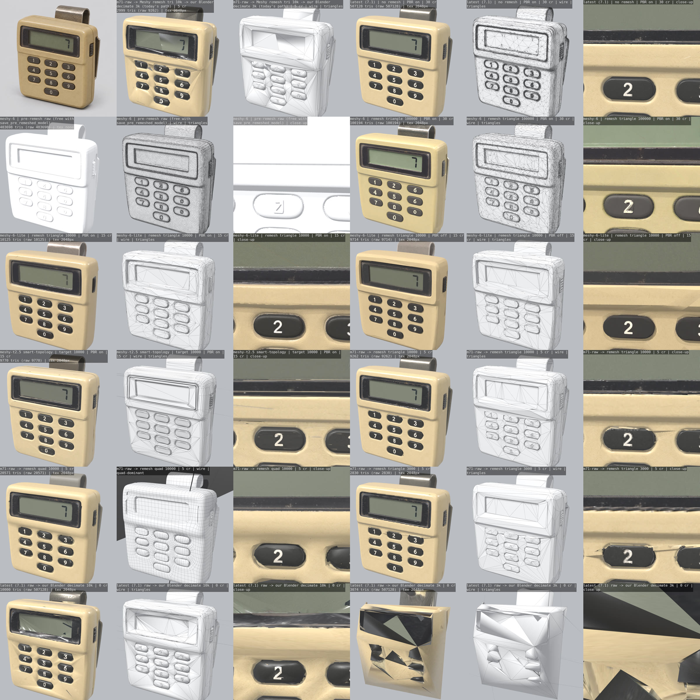
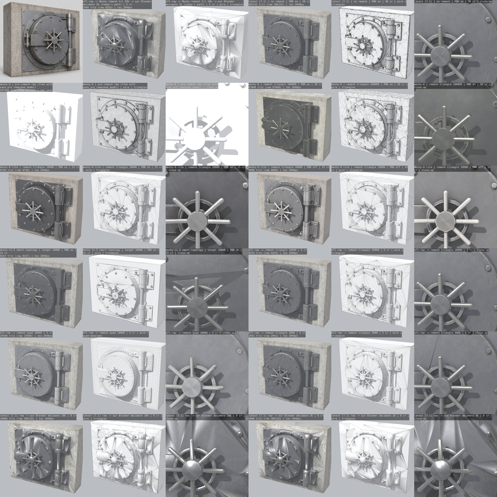
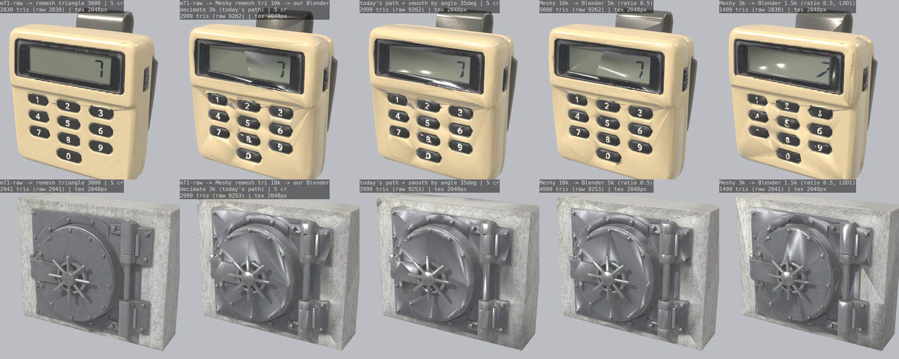

# Meshy 3D endpoints: what they cost and what they give us

A measured comparison of Meshy's 3D endpoints and options, to pick what the asset pipeline
(`tools/assets/pipeline/meshy.mjs`, `blender/clean.py`) should ask for. The endpoint facts come from
[docs.meshy.ai](https://docs.meshy.ai/) as read on 2026-11-14; the measurements come from 16 paid tasks
run the same day on two source pictures (Refs #664).

## Recommendation

| Asset kind | Call | Credits | Why |
|---|---|---|---|
| Handheld weapon or gadget | image-to-3D, `ai_model: latest` (Meshy 7.1), `should_remesh: true`, `topology: triangle`, `target_polycount` = the kind's LOD0 budget, `enable_pbr: true`, `texture_resolution: 2k` | 30 | Seen in first person. 7.1 had the sharpest texture, the right keypad digits (meshy-6 got them wrong) and a closed single-shell mesh |
| Prop | Same, with `ai_model: meshy-6-lite` | 15 | At 10k it matched 7.1 on both test objects for half the credits |
| Deployable | Same as a prop; `target_polycount` = LOD0 budget divided by `fit.repeat` | 15 | Seen from standing height; the link is small and repeated |
| Large hard-surface (vault door, machine) | Same as a handheld (`latest`); consider `texture_resolution: 4k`, which costs the same on 7.1 (not tested here) | 30 | 7.1 at 3k kept the flat panels, bolts and wheel; the raw mesh had no open edges |

- **Ask Meshy for the LOD0 triangle count.** Meshy's remesher beats our Blender decimation by a wide
  margin at the same count (sheet 3). Set `target_polycount` to `budget.lod0_tris`, so the decimate in
  `clean.py` has nothing left to do on LOD0. Never hand `clean.py` an unremeshed model: collapsing
  400-500k triangles to 3k wrecks it (bottom rows of sheets 1 and 2).
- **LOD1 and LOD2 stay in Blender for now.** A Blender ratio of 0.5 already dents flat panels at close
  range (sheet 3, last column), but a LOD is seen from far away. The other option, a remesh call per LOD
  (5 credits each), gives every LOD its own UV layout and texture set, which means a material and a
  texture set per LOD in Enfusion. Prove the LOD distances in game before paying for that.
- **Keep `enable_pbr: true` and `topology: triangle`.** Both cost nothing extra. PBR off loses the
  normal, metallic and roughness maps that `clean.py` packs into `_NMO` and `_BCR`. A quad remesh only
  shows in OBJ or FBX (a GLB is always triangles), and 10k quads are 20k triangles.
- **Do not use** `meshy-6` (twice the price of 6-lite, four times slower, it misread the keypad digits
  and left 255-385 open edges), Smart Topology `meshy-t2.5` (clean edge flow, but 14-61 separate shells
  with 700-1,300 open edges and a few stray slivers), or a 100k `target_polycount` (our budgets are
  3-15k, so it would be decimated anyway).
- **Rigging and animation are not usable for items.** Both are for humanoid (biped) characters only.
  The drill and the handheld items keep the `parts` bones that `clean.py` cuts and skins.
- **Retexture is a repair tool, not a default.** When a model's shape is right and its texture is wrong,
  `POST /openapi/v1/retexture` with `enable_original_uv: true` costs 10 instead of a new 30-credit
  generation. Not tested here.

## The test

One source picture per case, the clean `gpt-image-2-6-flare` render from the concept-model comparison:
a 1980s pager (a handheld gadget) and a bank vault front (large hard-surface). Every variant is
image-to-3D with a 2K texture unless the row says otherwise. Every result went through the same
headless Blender 4.5 render: Eevee, three sun lights, an 85 mm camera at a fixed 3/4 angle, a clay
render with a wire overlay, and a close-up of the front. The mesh numbers come from the same
script after welding the glTF UV-seam splits.

**Credits:** balance 2,096 before, 1,886 after the 10 generations, 1,856 after the 6 remesh tasks:
**240 credits**, which matches the sum of each task's `consumed_credits`. No task queued; times are
from `started_at` to `finished_at`.

| Variant | Credits | Time | Pager tris | Vault tris | Maps | Notes |
|---|---|---|---|---|---|---|
| `latest` (7.1), no remesh | 30 | 71 s / 59 s | 507,128 | 385,132 | base, metallic, roughness, normal | Best texture and shape; one shell; 0-6 open edges |
| `meshy-6`, remesh triangle 100k | 30 | 248 s / 246 s | 100,194 | 97,040 | + emission | Pager digits wrong (1 2 6 / 4 5 6); 255-385 open edges |
| `meshy-6` pre-remesh raw (`save_pre_remeshed_model`) | free | | 403,698 | 237,104 | none | Untextured; useful only as a bake source |
| `meshy-6-lite`, remesh triangle 10k | 15 | 88 s / 112 s | 10,125 | 9,736 | base, metallic, roughness, normal | Close to 7.1; correct digits |
| `meshy-6-lite`, remesh triangle 10k, PBR off | 15 | 67 s / 115 s | 9,714 | 9,688 | base only | Same look as PBR on, minus the maps we pack |
| `meshy-t2.5` Smart Topology, 10k | 15 | 59 s / 52 s | 9,770 | 9,157 | base, metallic, roughness, normal | Tidy loops and radial fans; 14 / 61 shells, 698 / 1,271 open edges |
| 7.1 raw, then remesh endpoint, triangle 10k | 5 | 59 s / 54 s | 9,262 | 9,253 | + `metallic_roughness` | Texture rebaked onto new UVs |
| 7.1 raw, then remesh endpoint, quad 10k | 5 | 79 s / 69 s | 20,571 (10,216 quads) | 19,588 (9,778 quads) | same | Quads only in the OBJ; wobbly key outlines |
| 7.1 raw, then remesh endpoint, triangle 3k | 5 | 51 s / 55 s | 2,830 | 2,941 | same | Still reads well; one smear across the pager's top keys |
| 7.1 raw, then our Blender decimate 10k / 3k | 0 | | 10,000 / 3,074 | 10,000 / 3,000 | | 10k: melted keys, smeared LCD. 3k: destroyed |
| 7.1 remesh 10k, then our Blender decimate 3k (today's path) | 5 | | 2,999 | 2,999 | | Dented flat panels, melted "8" and "0", star facets on the vault door |

Every texture came back at 2048 px; nothing in the pipeline asks for more.

### Sheet 1: pager (handheld gadget)

Each cell is shaded, wire and close-up. The top row is the source picture and today's path.

### Sheet 2: vault front (large hard-surface)

### Sheet 3: Meshy remesh against our Blender decimation

From the left: Meshy remesh to 3k; today's path (Meshy 10k, Blender to 3k); the same with smooth-by-angle
at 35 degrees; Meshy 10k, Blender to 5k (ratio 0.5); Meshy 3k, Blender to 1.5k (a LOD1 at ratio 0.5).

What the sheets show:

- **Silhouette.** Every Meshy-made mesh keeps the outline down to 3k triangles. Only our collapse
  decimation breaks it: from the raw model at any count, and from a Meshy 10k at 3k.
- **Surface.** Blender collapse decimation dents flat faces and leaves star-shaped facets on the vault
  door. Smoothing by angle helps a little; the dents are in the geometry. Meshy's remesh keeps panels flat.
- **Texture sharpness.** 7.1 is the sharpest, 6-lite close behind. Meshy's remesh rebakes the texture onto
  its new UVs, so it stays readable at 3k; our decimation keeps the old UVs and stretches them (the keys melt).
- **Melted detail.** None of the Meshy-made meshes melt at 10k. The pager's keys and the vault's wheel spokes
  survive at 3k as geometry plus texture.
- **LOD readiness.** 7.1 raw and the triangle remeshes are single shells with few open edges, which
  decimates predictably. Smart Topology output is many shells, so a further collapse tears at the seams.

## Endpoint inventory

Prices from the Meshy pricing page; a task's own `consumed_credits` matched them on every task above.
Failed tasks are refunded; a `PENDING` task can be deleted for a refund, an `IN_PROGRESS` one cannot.

### Models

| `ai_model` | State (2026-11-14) | Image-to-3D, mesh only / 2K or 4K texture / 8K |
|---|---|---|
| `latest` = `meshy-7.1` | current default | 20 / 30 / 35 |
| `meshy-7` | deprecated, retires 2026-12-31 as a 3D model (stays as a texture model) | 20 / 30 / 35 |
| `meshy-6` | current | 20 / 30 / 35 |
| `meshy-6-lite` | current, the successor to meshy-5 | 5 / 15 (2K only) / not supported |
| `meshy-t2`, `meshy-t2.5` | Smart Topology (`model_type: "smart-topology"`), triangles only | 5 / 15 / 20 |
| `meshy-5` | retired 2026-10-10; requests return 400 | |
| `meshy-4` | retired 2026-03-20 | |

`geometry_resolution: "2k"` or `"4k"` (7.1 only) adds 5 credits for a denser raw mesh; at our budgets
it is wasted.

### Endpoints

| Endpoint | Does | Credits | Options that matter | Could replace |
|---|---|---|---|---|
| Image-to-3D `POST /openapi/v1/image-to-3d` | One picture to a textured mesh in one task | 30 (7.1, 6) / 15 (6-lite, Smart Topology) | `ai_model`; `should_remesh` (default on for 6-lite only); `topology` (`triangle`, `quad`); `target_polycount` 100-300,000 (Smart Topology: t2 to 15k, t2.5 to 30k); `decimation_mode` 1-4 (adaptive, overrides the count; not tested); `enable_pbr`; `texture_resolution` 2k/4k/8k; `texture_prompt`; `save_pre_remeshed_model`; `image_enhancement`; `remove_lighting` (Meshy 6 texture model only) | Our LOD0 decimation, by asking for the budget count |
| Multi-image-to-3D `POST /openapi/v1/multi-image-to-3d` | 1-4 views of the same object (first is the front) | 30 textured; 20 mesh only | As above, plus `texture_image_urls`. Textured output needs 7.1: `meshy-6` and `meshy-6-lite` return 400 | A single-view guess at the back of an object. Each extra view is another picture (GPT Image image-to-image is 12). Not tested |
| Text-to-3D `POST /openapi/v2/text-to-3d` | `preview` (mesh) then `refine` (texture) | preview 20 (7.1, 6) or 5 (6-lite) + refine 10 (2K, 4K) or 15 (8K) | Preview: the mesh options above. Refine: `enable_pbr`, `texture_resolution`, `texture_prompt`, `texture_image_url`, texture `ai_model` | Nothing; the pipeline's path when there is no picked concept |
| Remesh `POST /openapi/v1/remesh` | New topology at a count, from a task id or a model URL; keeps and rebakes the PBR maps | 5 | `topology`, `target_polycount` 100-300,000, `decimation_mode`, `target_formats` (`obj`/`fbx` keep quads) | Our Blender decimation, measured above; also a model from outside Meshy |
| Retexture `POST /openapi/v1/retexture` | New texture on an existing mesh from a text prompt or a style picture. This is also Meshy's text-to-texture: there is no separate endpoint | 10 (2K, 4K) / 15 (8K) | `text_style_prompt`, `image_style_url`, `enable_original_uv`, `enable_pbr`, `texture_resolution`, `ai_model` | A whole new generation when only the texture is wrong |
| UV unwrap `POST /openapi/v1/uv-unwrap` | New UVs, untextured output, at most 40,000 faces | 5 | none | Nothing for us: remesh already returns UVs with the texture rebaked |
| Rigging `POST /openapi/v1/rigging` | Auto-rig a textured humanoid (at most 380,000 triangles, facing +Z); returns walk and run clips | 5 | `height_meters`, `skeleton_template` (Meshy, Mixamo, UE5, Unity, ...), `include_fingers` | Nothing for items: humanoid characters only |
| Animation `POST /openapi/v1/animations` | Library actions on a rigged character | 3 per action, up to 10 per call | `rig_task_id`, `action_ids`, `post_process` | Nothing for items: needs a rig task, and the library is biped actions |

Options that no longer do anything: `symmetry_mode` (deprecated 2026-05-11), `art_style`,
`surface_mode`, `is_a_t_pose`, `hd_texture` (use `texture_resolution`).

## What the pipeline does today

`imageTo3dBody` in `meshy.mjs` already asks for `meshy-6-lite` by default, `should_remesh: true`,
`topology: triangle`, `enable_pbr: true`, but with `target_polycount: 20000` unless the spec sets one.
`clean.py` then collapse-decimates that to `budget.lod0_tris` (3k for a gadget, 4k for a deployable,
8k for a weapon) and the LODs below it. That second step is the loss in sheet 3. The poly-budget work
owns the code change; this page is the evidence for it.
