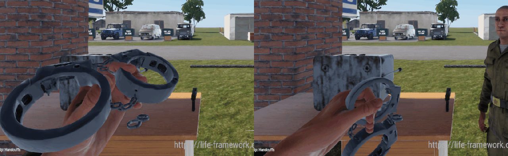

# Asset states: inventory, ground, hand, use

An item has a look and a setup for each state it can be in. The pipeline handles only the states an
asset declares in `spec.states`, after the `prefab` and `anim` stages:

```
tools\cli asset states <slug>            check the prefab against spec.states
tools\cli asset states <slug> --fix      write the values into the prefab
tools\cli asset states <slug> --shots    one picture per declared state: ground and inventory by `look item` (no session), hand and use on a --profile full session
tools\cli asset run <slug>               the states stage runs last and writes the values itself
```

The research below was done on 2026-11-14 against game 1.9 with `tools\cli call game_read`,
`asset_search` and `api_search`, the paks read directly for the binary workspaces, and the harness
verb `heldxf` in a session for the hand. The handcuffs were the spike (#664); the lockpick and the
pager got the same treatment.

## What vanilla does

| State | Where it lives | What vanilla sets |
|---|---|---|
| Inventory | `InventoryItemComponent` > `CustomAttributes` > `PreviewRenderAttributes` | `CameraOrbitAngles` (pitch, yaw, roll), `CameraDistanceToItem`, `CameraOffset`, `FOV`, or a `CameraPreset` (`Left`, `Right`, `Top`, `Front`, `Back`). The compass SY183: `-60 -40 0`, 0.4 m, FOV 10. The radial quick slot has its own `SCR_SelectionMenuPreviewAttributes` (`m_fCustomFov`, `m_fIconSizeXMultiplier`). The engine renders the picture from the prefab at run time; there is no icon file |
| Ground | `ItemPhysAttributes` | `RestingUP` names the model axis that faces up when dropped (`Up`, `Down`, `Left`, `Right`, `Forward`, `Backward`); `RestingAdditiveOffsetLS` and `RestingAdditiveRotationLS` nudge it. Vanilla models a held item upright (the MX991 torch runs 0 to 0.221 m up its y axis from a base origin, the R148 radio 0 to 0.472 m) and lays it down with `RestingUP` (torch `Right`, radios `Forward`, grenades `Up`) plus an offset (torch `-0.08 0 0`, R148 `0 0 0.18`). The drop is placed by the inventory, not a physics fall: our drops came to rest at exactly half their thickness with the `RestingUP` axis up. `RigidBody` (`ModelGeometry 1`, `Mass`, `CenterOfMass`) and the model's `UBX_`/`UCX_` collider matter once it is knocked about |
| Hand | `ItemAnimationAttributes` and `SCR_GadgetComponent` | See below |
| Use | Per gadget | The compass and radios turn parts with a `ProcAnimComponent` (a `.pap` and bone names such as `i_cover`, `i_needle` in the `.xob`); a grenade has its own `.agr`/`.asi` and hides meshes on animation events (`MeshVisibilityConfigurations`, "ring"); the flashlight moves itself in the hand when switched on (`SCR_FlashlightComponent`, `m_vFlashlightAdjustOffset`). A different placement (cuffs on a wrist) is a separate prefab |

### Hand

- **Attach.** A held gadget's origin is put on the character's `LeftHandProp` bone and its axes on
  the bone's axes. Measured with `heldxf`: with no additive the item's origin and axes equal the
  bone's to four decimals, for every pose tried. No vanilla gadget model has a grip socket
  (`Gauze_01_packed.xob` has no nodes; the MX991 has `i_root`, `i_switch` and a centre of mass).
- **The pose** comes from what the item borrows. `AnimationAttachments` binds an item graph and
  anim set as `"Gadget"`; the anim set (`*_player.asi`) fills the character's
  `Gadget.{Erc,Cro,Pne}{Ras,Low}.{Idle,Offset,Aimspace,FingerAnim}` lines, the hold clips for each
  stance. `SCR_GadgetComponent.m_eAnimVariable` (`ADRIANOV`, `SY183`, `ANPRC68`, `R148`, `MX991`,
  `FLASHLIGHT_SOVIET_01`, `M22`, `B12`, `MAP`) goes to `TakeGadgetInLeftHand`
  (`SCR_GadgetManagerComponent.SetGadgetMode`). Vanilla bandages and morphine also set
  `AnimationIKPose` (the RGD5 grenade's finger pose) and `AnimationInstance player_main_1h.asi`.
- **Fingers** close because the borrowed hold clips pose them. The item has no say beyond which set
  it borrows; there are no hand IK targets on a gadget.
- **`HandAdditiveTranslation`** moves the item in the bone's frame. **`HandAdditiveRotation a b c`**
  turns it: the item's axes, as rows in the bone frame, are `Rz(c) * Rx(a) * Ry(b)`, where `Rx(90)`
  takes item y to bone -z and item z to bone y. That order fit seven measured rotations exactly
  (`tools/validation/asset-states-selftest.mjs` keeps the readings).

### Why our cuffs were not held

`Handcuffs.et` (and `LF_Lockpick.et`, `LF_Pager.et`, from the gadget scaffold) borrowed
`Gauze_01.agr` with `Gauze_01_player.asi`. That anim set has no `Gadget.*` lines at all: only the
bandaging and revive clips. The vanilla gauze is held through `m_eAnimVariable ADRIANOV` and the
grenade `AnimationIKPose`, neither of which the scaffold copied, and our `m_eAnimVariable LF_ITEM`
matches no gadget pose. So the character raised the left arm with the default open hand, and
`HandAdditiveRotation -65 -60 -60` turned the cuffs flat in front of it. Nothing closed on them.



## The spec

```json
"states": {
  "inventory": { "angles": [-55, -30, 0], "distance": 0.6, "fov": 20 },
  "ground": { "up": "Up" },
  "hand": { "pose": "fist", "grip": [-0.032, 0, 0], "up": "+z", "out": "+x" },
  "use": [
    { "name": "worn", "needs": "prefab", "prefab": "Prefabs/Items/Roleplay/Handcuffs_Worn.et" },
    { "name": "open", "needs": "bone", "bone": "strand_l", "planned": true }
  ]
}
```

| Key | Becomes |
|---|---|
| `inventory.angles`, `distance`, `fov`, `offset` | `PreviewRenderAttributes` `CameraOrbitAngles`, `CameraDistanceToItem`, `FOV`, `CameraOffset` |
| `ground.up`, `offset`, `rotation` | `RestingUP`, `RestingAdditiveOffsetLS`, `RestingAdditiveRotationLS` |
| `hand.pose` | The borrowed graph, anim set and `m_eAnimVariable` (a key of `HAND_POSES` in `states.mjs`) |
| `hand.grip` | The model point (metres, model space) the hand closes on |
| `hand.up`, `hand.out`, `hand.turn` | The model axis that runs up through the fist, the one that points away from the palm, and an extra turn about the fist's column in degrees |
| `use` | Declared only: what each use state needs (`mesh`, `prefab`, `bone`, `anim`). A built `bone` state must name an `anim.bones` bone; `planned: true` records it before it exists |
| `prefab` | The prefab, when it is not `<prefab_dir>/<name>.et` |

The stage computes `HandAdditiveRotation` and `HandAdditiveTranslation` from the pose's measured
grip point and out direction, so the grip lands in the closed hand: for the cuffs `90 -51.98 0` and
`0.0197 0.045 0.0252`, which is what the calibration found by hand. Only the values the spec
declares are written; everything else in the prefab is left alone. A gadget that declares states
must declare `hand` (the spec stage fails without it). A spec with no `states` behaves as before.
`tools\cli validate` (`asset-states-selftest`) fails when a committed spec with states and its
prefab differ.

### Hand poses

| Pose | Borrowed from | Grip in the bone frame | Fits |
|---|---|---|---|
| `fist` | the MX991 torch (`Flashlight_MX991.agr`, `MX991_player.asi`, `MX991`) | a 5 cm column, centre 4.5 cm up the bone's y; the palm away from `0.616 0 0.788` | something held upright in a fist: cuffs by the lock boxes, a radio handset, a torch, a pager, a lockpick |

Tried and not used: the Soviet flashlight (a claw over the top of a box), the R148 radio and the
SY183 compass (palm up, flat: a candidate for a pager being read), the gauze with the grenade finger
pose (fingers half open). To add a pose, hold the vanilla item in a session, read `heldxf`, and
write its grip centre and out direction into `HAND_POSES` from the bone and finger positions.

## The pictures

`--shots` takes the **ground** and **inventory** pictures with `tools\cli look item` (a hidden
Workbench, about 30 s, no session): the item posed the way the inventory drops it (`RestingUP`,
`RestingAdditiveOffsetLS`, lowest point on the ground) and the prefab's own preview camera
(`CameraOrbitAngles`, distance, FOV, offset) on the item frozen in the air. That inventory picture is the
3D view the engine's picture is made from, not the inventory UI: no slot frame, and the orbit angle
sign convention (a negative pitch looks down from the item's front) is read from one vanilla-like
prefab, so compare once with the sheet from a session before trusting an odd angle. The **hand**
(and **use**) pictures still need a session: it brings up two clients, gives the item to client 1
(`itemgive`), holds it (`hold`), logs `heldxf`, and shoots client 1's own view and client 2's view of
the hand. The PNGs land in `tmp/assets/<slug>/states/`. Read every one: the stage proves the numbers,
the pictures prove the look.

## Use states

| Item | State | Needs | Status |
|---|---|---|---|
| Handcuffs | closed | the model as generated | done |
| Handcuffs | on the wrist | a prefab: `Handcuffs_Worn.et` on the suspect's `righthandprop` (#664) | done |
| Handcuffs | open | each cuff's strand as a separate part on a hinge bone at its pivot, swung 70 degrees by the `anim` stage's `hinge` motion while `LF_AssetAnimComponent` is active | done (2026-11-14) |

The open state could not be cut from the Meshy mesh: it fused each ring into one surface, so a box
split would leave open ends. The handcuffs are now modelled in Blender (`tools/assets/handcuffs/model.py`,
`source.blender`, no credits): per cuff a lock body, a fixed bow and a swinging strand with its hinge
boss, as separate meshes, and a three-link chain. Same footprint as the old model (0.18 m long, rings
2.9 to 3.75 cm radius, 0.034 m high). The script prints the exact pivot and face box of each strand
(`raw/layout.json`) and `spec.anim.bones` copies them (`strand_r`, `strand_l`, a hinge about the
model's y axis, 70 and -70 degrees, 0.5 s).

How to model an asset so a part can be cut off by the stage (it takes every face whose *centre* is
inside an axis-aligned box):

- Keep the moving part's boss and curve in one box, and end it on a flat plane perpendicular to an
  axis (the strand and the bow meet at a vertical cut, 4 mm apart), so no face of the fixed part has
  its centre in the box. The script counts them (`foreign_faces_in_box`, must be 0).
- Keep the fixed part's faces out of the moving part's y or x range where the two touch (the lock
  body ends 1.4 mm short of the hinge boss).
- Centre the model's bounding box on the origin yourself: the clean stage does too, so the pivots you
  print are the pivots it uses. Build with the ring's axis along Blender Z (Enfusion y), the length
  along Y.

Use it: `LF_AssetAnimComponent.SetActive(true)` opens both strands (replicated; a late joiner sees
the same), `false` closes them. `LF_HandcuffsComponent.SetOpen(bool)` wraps that (server). The harness
verbs `itemon <prefab>` and `itemoff <prefab>` do it from a session, and `asset states <slug>
--shots` takes the `use` pictures (in the hand to the owner and to a second player, and dropped
beside a closed pair) when a use state is built on a bone. The cuffing flow did not open the cuffs
at first: the item is consumed in the same step that cuffs the suspect, so showing the open phase needed a
short cuffing action first; that action calls `SetOpen(true)`.

That action exists now (`cuffing-open-state`, `LF_Cuffing.c`, `docs/features.md`): the Cuff and Uncuff
actions are holds of about 1.8 s and 1.5 s. A Cuff opens the cuffs in the officer's hand, shuts them
with a click at the end and only then puts them on the suspect; an Uncuff opens the cuffs on the
wrist (the worn model carries the same two hinged strands, driven by a replicated flag on the
character, `LF_AssetAnimComponent.ShowLocal`) before they come off. The strands take 0.5 s, so the
server waits `CLOSE_MS` (650 ms) before the cuffs leave the hand. The click is the asset's own sound
record, `tools/assets/handcuffs/sounds.json` (`SOUND_LF_CLOSE`, `SOUND_LF_OPEN`).

## Concepts for an asset with states

An asset that declares states is picked on what it costs to build, not only on looks
([concepts.md](concepts.md)). The prompts gain one sentence (solid chunky forms, separate distinct
parts, no thin floating details, and per state a clear grip area, a flat stable side, moving parts
not fused), and the rubric gains six criteria scored from the same picture: `mesh_clean`,
`parts_separate`, `hold_point`, `flat_base`, `reads_small`, `no_floaters`. The contact sheet shows
L (looks) and B (build) per candidate and marks the recommended one BEST: the best combined score,
never one scoring 0 on `hold_point` or `flat_base` for a declared state.
