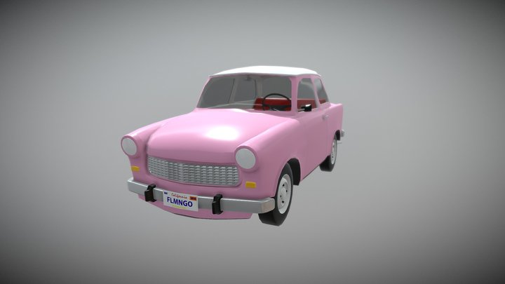
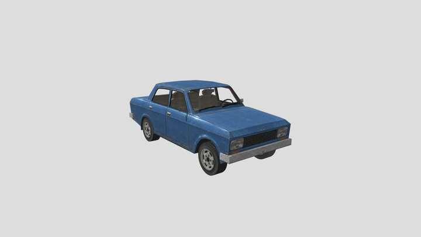
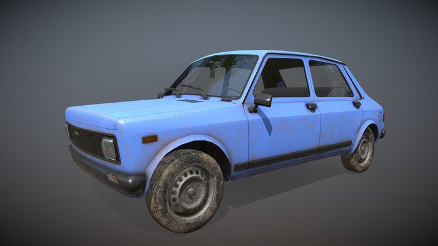
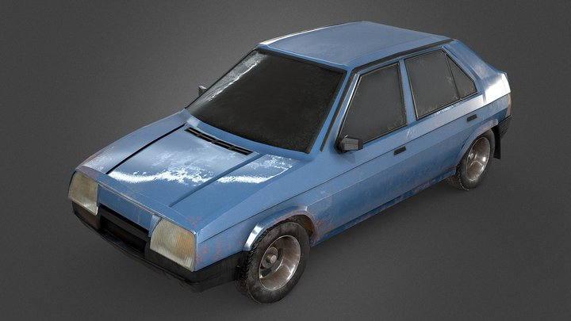
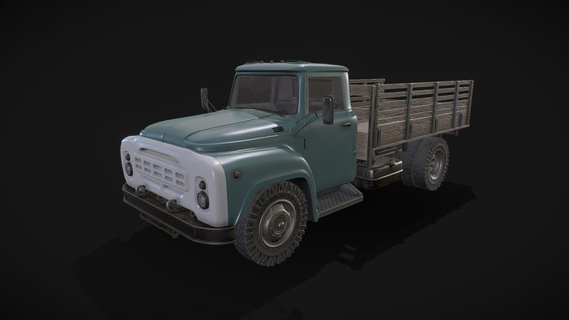
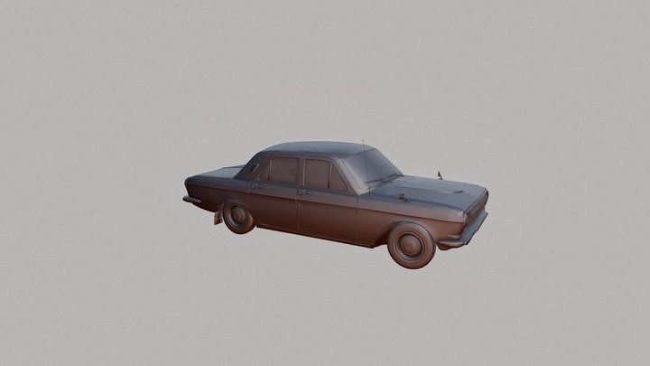
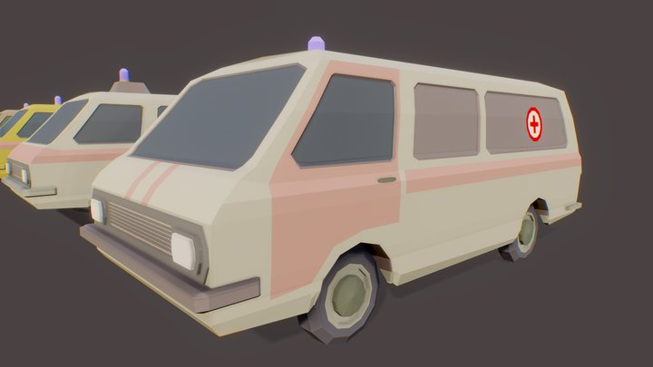
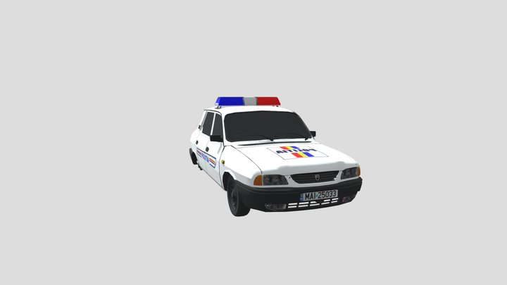
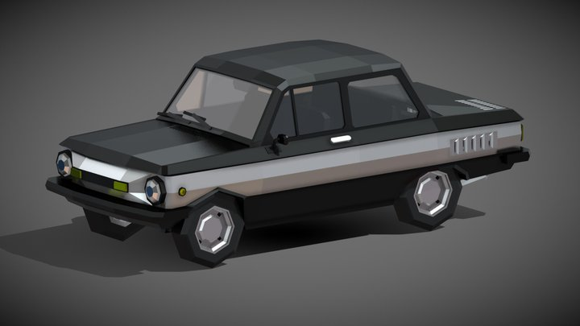
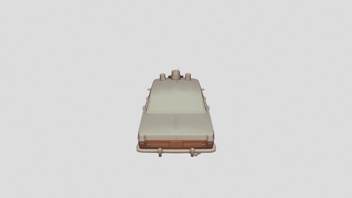

# Vehicle shortlist: free car models for the vehicle pipeline

Research for epic #342 (searched 2026-11-14, no import, no game session). Source rules are the maintainer's comment on #342 and
[sources.md](sources.md): CC0 or CC-BY on the main list, CC-BY-NC listed apart, SA, ND and Editorial skipped.

## Method

- `tools\cli asset-search` (3d-asset-server) for BlenderKit, Poly Fork, Wikimedia Commons, 3DAssets and others, about 45 queries. Its
  Sketchfab leg returned museum scans, not cars, so Sketchfab was searched through its public search API with `downloadable=true` and
  `license=cc0|by|by-nc` (no login needed to search; about 40 queries, 330 models). No CC0 car exists on Sketchfab for these makes.
- Vanilla first (`game_browse Prefabs/Vehicles/Wheeled`): `V2101` (Dana), `T601` (Sputnik), `S105` (Šárka), `S1203` (a Škoda van with
  cargo and transport variants), `UAZ452`, `UAZ469`, `Ural4320`, `Z7211`, plus BRDM2, BTR70, LAV25, M151A2, M923A1 and M998.
  So **UAZ-452 and Ural-4320 are already in the game and were dropped**, as were more Lada, Škoda 105 and Škoda 1203 models.
- Gaps the base game does not fill: Moskvitch 412, Trabant 601, Wartburg 353, Škoda 120 and Favorit, Zaporozhets, Volga, RAF minibus,
  IZh pickup, ZIL-130, Polish, Yugoslav and Romanian saloons, buses.
- The listing gives the poly count (Sketchfab `faceCount`, which is triangles), materials, tags and description, but **not the scene
  graph**. "Separate parts" below is `yes` only when the description says so, `likely` when the description claims wheels or an
  interior, and `check` otherwise. Every `check` needs ten seconds in the Sketchfab viewer's Model Inspector before it is picked.

## Score

The concept-sheet scoring ([concepts.md](concepts.md)): 0 fails, 1 so-so, 2 good, in this order, summed out of 18. The seven concept
keys, applied to the listing and preview: `silhouette`, `era`, `era_current` (a 1989 local would drive it; baked-in rust costs a
point), `scale_grip` (plausible proportions), `background` (one object, plain), `no_text` (plates, badges, decals to remove),
`image_to_3d` (solid form, usable topology). Two keys from the states set apply to a car: `parts_separate` (wheels, doors, steering
wheel apart, so they can take bones) and `mesh_clean` (fits a LOD0 budget).

## Top 10 (CC-BY, free)

| # | Model | Author | Licence | Tris | Separate parts | Interior | Score | Fit |
|---|---|---|---|---|---|---|---|---|
| 1 | [Trabant](https://sketchfab.com/3d-models/trabant-b2506c44e3004c998ce656cd07527124) | Declan McCulloch | CC-BY | 18,245 | yes ("functioning doors", tagged wheels) | yes (modelled) | 17 | The Trabant 601 itself, clean smooth panels, one pink texture to repaint; a plate and badges to remove. |
| 2 | [Moskvich-412](https://sketchfab.com/3d-models/moskvich-412-9a79c07b636a44418a3fd9adb723f4f8) | Vebis_V_stolb_GT | CC-BY | 6,946 | likely ("exterior, interior, wheels, other components") | yes | 16 | The 412 sedan, published 2026-11-06, one material; cheap to fit, needs a detail pass. Fallback: [Moskvich 412](https://sketchfab.com/3d-models/moskvich-412-b6eb96e28f184cf5a8098f68570f2314) by Alexander Bakhtin, 10k. |
| 3 | [Zastava 101 (Stojadin)](https://sketchfab.com/3d-models/zastava-101-stojadin-52c885cfc52a4ac1acb14f84a3feacfa) | Tomislav Tomljenović | CC-BY | 40,277 | check (4 texture sets) | yes (visible) | 16 | Best-looking saloon of the list; a Yugoslav Fiat 128 derivative, so a believable second hatch beside the Dana. Real badges to remove. |
| 4 | [Škoda Favorit](https://sketchfab.com/3d-models/skoda-favorit-a004d69c78ff476b8cd49a4763bbe273) | Matej Ondra | CC-BY | 46,906 | check (3 materials) | visible | 16 | Favorit launched 1987, so it is the newest car of the era and a natural sibling of the Šárka; weathering is baked into the texture and must be repainted. |
| 5 | [ZIL 130 (body) / Lowpoly](https://sketchfab.com/3d-models/zil-130-body-lowpoly-48c2d4c7691c411396a0c22aca853518) | romunql | CC-BY | 64,336 | check (14 materials) | cab | 16 | The flatbed lorry the pipeline lacks (vanilla has only the Ural); author says free use. Check that wheels are not fused to the chassis. |
| 6 | [Gaz 24 Volga](https://sketchfab.com/3d-models/gaz-24-volga-6e87cb4fa6aa4a85b6afd4623a0c2dfb) | assg709 | CC-BY | 70,956 | check (24 materials) | check | 15 | The state sedan, taxi and police base. Heavy for the detail it shows, and the preview is untextured clay. Lighter fallback: [Gaz 24](https://sketchfab.com/3d-models/gaz-24-8492f930a3b64b52a24b7c4dff9f7b4f) by Sergey Egelsky, 5.5k, 4K PBR. |
| 7 | [Minibuses RAF-2203](https://sketchfab.com/3d-models/minibuses-raf-2203-low-poly-ee223cdf5a0a4cbf80a250b84c1aa210) | pinkycolada | CC-BY | 49,225 (7 vans) | check | no | 14 | Seven RAF-2203 in one file (3 civilian, 3 ambulance, 1 police): one download, three jobs. Chunky stylised shapes, so it needs a retexture to sit beside the vanilla cars. Red cross decals to remove. |
| 8 | [Dacia Police Car](https://sketchfab.com/3d-models/dacia-police-car-2f309cfdec7849068e57a4a392971fec) | Fratzica | CC-BY | 35,020 | check (32 materials) | check | 14 | Dacia 1310 with a roof bar; the plain [Dacia 1310](https://sketchfab.com/3d-models/dacia-1310-222b4b39563b48eba6d1aea268af9cd8) is the same author, 28k. Real plate, post-1990 decals and Dacia badges all come off. |
| 9 | [low-poly ZAZ-968](https://sketchfab.com/3d-models/low-poly-zaz-968-97edbb5bb10b4209a74d42e236a0ea2c) | D_U | CC-BY | 15,508 | check (engine modelled) | visible | 13 | The Zaporozhets, the era's cheapest car. Faceted style does not match vanilla; usable only after smoothing, or take the 63k [ZAZ-968](https://sketchfab.com/3d-models/zaz-968-558d409681ae412c88dd43bebb5473e7) by hans1240. |
| 10 | [VOLGA VA 24 Police](https://sketchfab.com/3d-models/volga-va-24-police-8d2030fab071400c90a9b763bdbcdd0b) | CloudHubOmniTeam | CC-BY | 42,844 | check (66 materials) | check | 11 | The police Volga from the list, but the preview is an untextured clay render and the listing has no description. Use only if Volga #6 is retextured instead. |

Previews (Sketchfab thumbnails, credited to the authors above; CC-BY allows reuse with credit):

| | | |
|---|---|---|
|  |  |  |
|  |  |  |
|  |  |  |
|  | | |

**Formats.** Sketchfab offers glTF, GLB and USDZ for every row; a `.blend` or `.fbx` source is the author's choice and shows only
after login. **Downloads: the maintainer downloads all ten by hand** (Sketchfab needs a login) into
`tmp/assets/<slug>/purchased/`, or stores a token as `SKETCHFAB_TOKEN`. Each CC-BY model needs its author and URL in
`docs/credits.md` before it ships; none is added yet because nothing is imported.

## Gaps with no CC0 or CC-BY model

| Car | Finding |
|---|---|
| Wartburg 353 | No Sketchfab model under CC0, CC-BY or NC. BlenderKit has a **CC0** Wartburg 353 by Sepple (85k, blend and glb), but the tool marks it non-free: it needs a BlenderKit paid plan, so a maintainer decision. The same author has a CC0 Trabant-601 (14k, blend), also paid. |
| Škoda 120 | None free. BlenderKit has a Skoda 105 by BumpkinCZ (8k, paid) but vanilla already has the S105. |
| IZh-2715 pickup | One CC-BY only: [Abandoned Soviet Car IZH-2715](https://sketchfab.com/3d-models/abandoned-soviet-car-izh-2715-b97884f0730d42a68c1a6a9a9874159d) by Mikhail Volkov (photogrammetry, 200k, 4 materials, baked dirt and a real plate). Score about 9: fused parts, no interior, decayed. Keep as a rebuild reference; the pipeline's concept-to-3D route fits an IZh pickup better. |
| Police Volga | Only the clay model at #10. The Volga #6 plus a decal pass is the better route. |

## Needs approval: CC-BY-NC

Usable only while the mod stays non-commercial; flag to the maintainer before any pick.

| Model | Author | Tris | Note |
|---|---|---|---|
| [Gaz 24 Volga](https://sketchfab.com/3d-models/gaz-24-volga-e608a61a15de4eb4b1667eb811b1744a) | korchevskytea | 63,956 | Alternative Volga |
| [VAZ-2105](https://sketchfab.com/3d-models/vaz-2105-bce15209fa0449deb88950c5965540eb) | matthew0451 | 45,784 | Lada 2105 |
| [VAZ-2105 Taxi](https://sketchfab.com/3d-models/vaz-2105-taxi-a043e2f3af464f528861544b449a7a81) | 42manako | 6,978 | Low poly taxi |
| [Moskvich 412](https://sketchfab.com/3d-models/moskvich-412-965fb5c6d5de49dba4372b099117c1e1) | Renafox | 1,680 | Too low for a driveable car |
| [Lada Zhiguli (Riva)](https://sketchfab.com/3d-models/lada-zhiguli-riva-1058625a0f8940c9871e3f252140422e) | rtrule | 153,198 | Heavy |
| [ZIL-131](https://sketchfab.com/3d-models/zil-131-8d58891f9de343b2bc2b93bfd938352a) | 42manako | 7,028 | Military truck |
| [Kamaz-4310](https://sketchfab.com/3d-models/kamaz-4310-501381652ed74aeba73e1dd123acebb4) | 42manako | 17,648 | Military truck |
| [3D Model avia](https://sketchfab.com/3d-models/3d-model-avia-d00f85d2869e44298a174668505375f6) | kayla30001 | 24,999 | Avia van |
| [Wrecked FSO Polonez](https://sketchfab.com/3d-models/wrecked-fso-polonez-8e850a975b3d44f4af523d18145c4dc9) and [Wrecked Fiat 125p](https://sketchfab.com/3d-models/wrecked-fiat-125p-de35ebedca7d45329f36800ccdd3fb9f) | AsG_Alligator | 7-8k | Wrecks only |

## Reserve (CC-BY, not in the top 10)

FSO Polonez 1500 "Borewicz" police by bamber z prl (6.9k, flat-shaded); Fiat 125p by miechh (82k); LAZ-695 and PAZ-672 buses by
hans1240 (59k and 35k, many materials, so parts are probably separate); Avia A-15 truck by Heisenberg (8.5k); Tatra-815 by hans1240
(128k); Zil 130 by javanilga (7k); Skoda Favorit stylized by FPSunreal (2.9k, too low). A BlenderKit Royalty Free GAZ-13 Chaika by
Alexander Samusenko (25k) is reviewable only by a human (not CC0 or CC-BY), and Poly Fork's generic low-poly vehicles are Royalty
Free and not era-specific.

## Next step

Maintainer: open the top 5 in the Sketchfab viewer (Model Inspector) to confirm wheels, doors and steering wheel are separate nodes,
then download the winner by hand. The pipeline's vehicle rig stage takes it from there.
