# Everon building pictures

Taken with `toolscli look <x,z> --world Worlds/CoreOnEveron/CoreOnEveron.ent` on vanilla Everon, 2026-11-16 (free camera, midday). One or two per building type; coordinates are where the camera looked, the prefab is the catalog entry ([catalog-buildings.md](catalog-buildings.md)).

Not pictured: garages and workshops, hen houses, sheds (no clean shot; see the catalog for sizes).

## townhouse

### House_Town_E_2I02

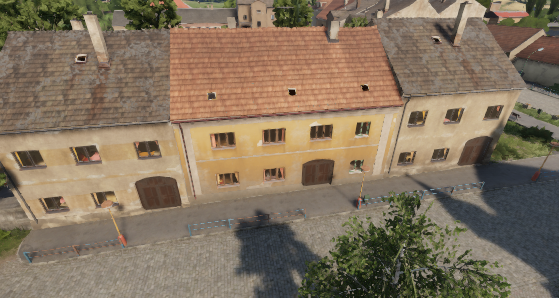

`{54F1C704EB440885}Prefabs/Structures/Houses/Town/House_Town_E_2I02/House_Town_E_2I02.et` at x 4476, z 10765.4. oblique from 270: terrace row

### House_Town_E_2I01

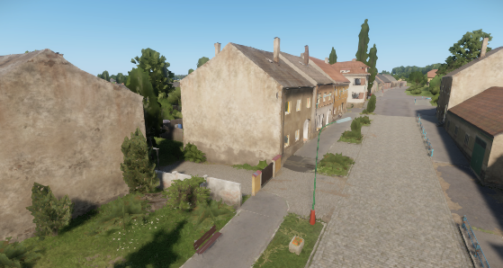

`{38A5F3E4578087AB}Prefabs/Structures/Houses/Town/House_Town_E_2I01/House_Town_E_2I01.et` at x 4503.5, z 10744.6. street view of the terrace

## police

### Villa_E_2I01_Police

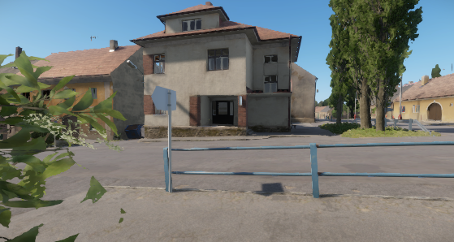

`{151CFDB2968ADB77}Prefabs/Structures/Houses/Villa/Villa_E_2I01/Villa_E_2I01_Police.et` at x 4552.6, z 10748.3. wide, front

### Villa_E_2I01_Police

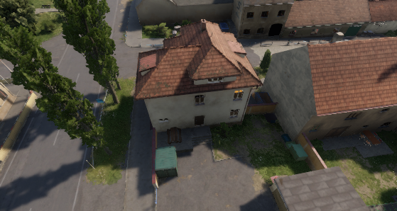

`{151CFDB2968ADB77}Prefabs/Structures/Houses/Villa/Villa_E_2I01/Villa_E_2I01_Police.et` at x 4552.6, z 10748.3. oblique from 0

## government

### MunicipalOffice_E_01_school

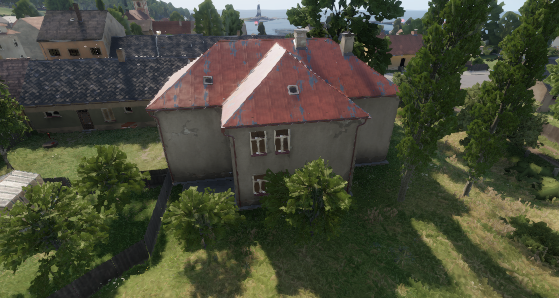

`{B514DD5B90A27E78}Prefabs/Structures/Services/Government/MunicipalOffice_E_01/MunicipalOffice_E_01_school.et` at x 4592.3, z 10818.2. oblique from 90

### MunicipalOffice_E_01

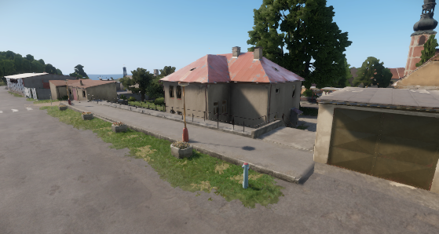

`{363A616E6C64BB7F}Prefabs/Structures/Services/Government/MunicipalOffice_E_01/MunicipalOffice_E_01.et` at x 4418.9, z 10647.5. wide

## church

### Church_01_crypt_attic

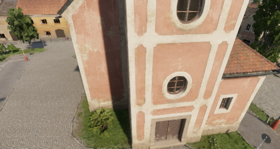

`{A683E3049A6872A3}Prefabs/Structures/Cultural/Churches/Church_01/Church_01_crypt_attic.et` at x 4448.4, z 10733.6. oblique from 270, facade

## pub

### PubVillage_E_2L01_V1

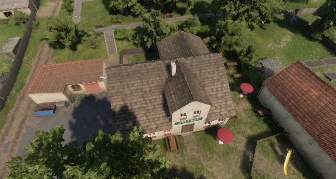

`{1B68F3EE279C97A1}Prefabs/Structures/Commercial/Pubs/PubVillage_E_2L01/PubVillage_E_2L01_V1.et` at x 4468.5, z 10902.3. oblique from 270, sign and garden

## fuel

### FuelStation_E_01_building

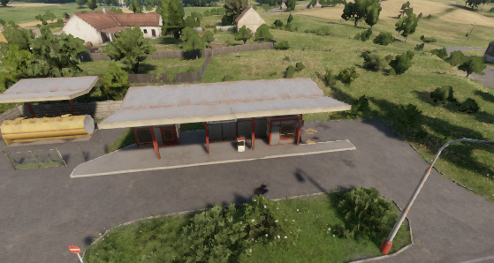

`{00FD2B4A0BDEC271}Prefabs/Structures/Commercial/FuelStations/FuelStation_E_01/HouseAddons/FuelStation_E_01_building.et` at x 4616.6, z 10658.7. oblique from 270

## fire

### FireStation_E_01

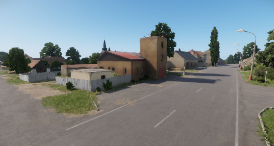

`{E8C14F26268A4D6D}Prefabs/Structures/Services/Fire/FireStation_E_01/FireStation_E_01.et` at x 4572.5, z 10673.6. wide

## kiosk

### NewspaperBooth_E_01_redyellow

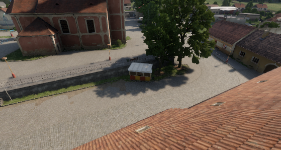

`{DA33ED8E94FD68DF}Prefabs/Structures/Commercial/Booth/NewspaperBooth_E_01/NewspaperBooth_E_01_redyellow.et` at x 4424.9, z 10753.7. small booth at lower right of an oblique from 0; area view of the square, not a close-up

## port

### PierConcrete_01_20m

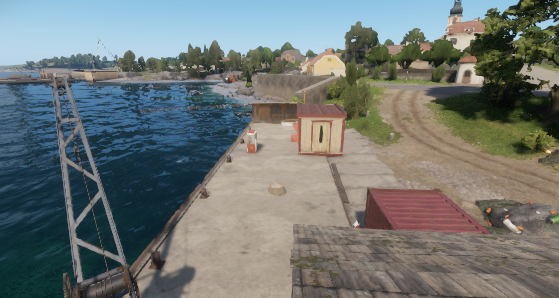

`{DB3F36604A282237}Prefabs/Structures/Infrastructure/Naval/Piers/PierConcrete_01_20m.et` at x 4272.5, z 10721.2. wide of the quay and shed

## shop

### ShopHouse_E_2I01t_drugstore

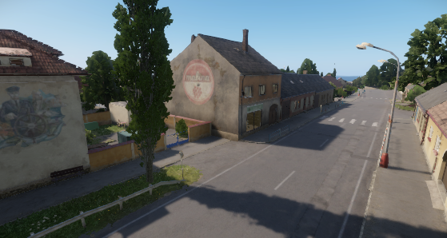

`{FF48B5059EB0AC65}Prefabs/Structures/Commercial/Shops/ShopHouse_E_2l01/ShopHouse_E_2I01t_drugstore.et` at x 4552.9, z 10774.1. wide, painted wall sign

### ShopModern_E_01

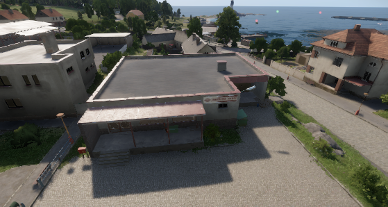

`{CFE8511B2B7E8AAA}Prefabs/Structures/Commercial/Shops/ShopModern_E_01/ShopModern_E_01.et` at x 4373.5, z 10681.5. oblique from 90, flat-roof shop

## chapel

### Chapel_01_base

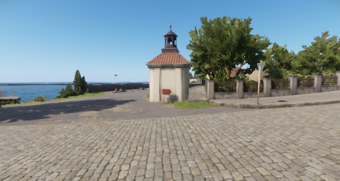

`{0E9DBC9B70C345F3}Prefabs/Structures/Cultural/Chapels/Chapel_01/Chapel_01_base.et` at x 4314.3, z 10710. wide

## industrial

### Warehouse_01

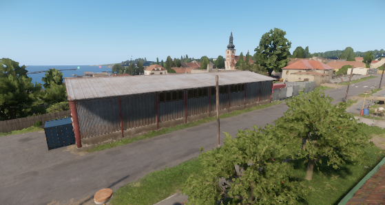

`{12310677867A85D4}Prefabs/Structures/Industrial/Houses/Warehouse_01/Warehouse_01.et` at x 4343.7, z 10623.2. wide

### MunicipalOffice_E_01

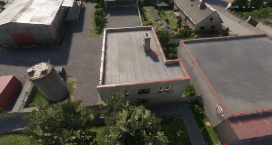

`{363A616E6C64BB7F}Prefabs/Structures/Services/Government/MunicipalOffice_E_01/MunicipalOffice_E_01.et` at x 4418.9, z 10647.5. oblique from 90

### Sawmill_E_01

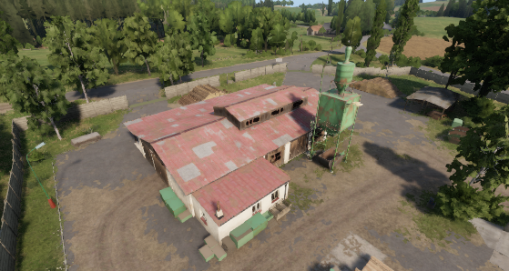

`{1A18A755842DCA36}Prefabs/Structures/Industrial/Houses/Sawmill_E_01/Sawmill_E_01.et` at x 3092.7, z 5240.8. oblique from 270

## house

### House_Village_E_1L03t

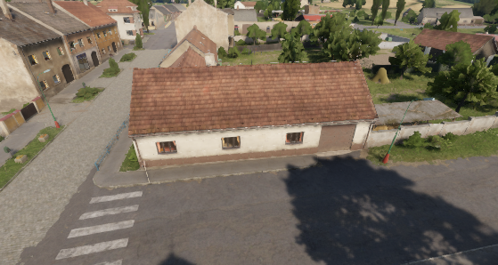

`{B2172573ED15AA82}Prefabs/Structures/Houses/Village/House_Village_E_1L03/House_Village_E_1L03t.et` at x 4488.3, z 10702.3. oblique from 270

### House_Wooden_E_1I01

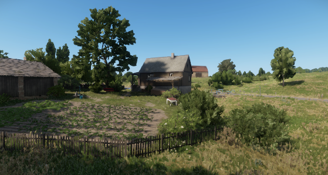

`{C212C8AC6001F002}Prefabs/Structures/Houses/Wooden/House_Wooden_E_1I01/House_Wooden_E_1I01.et` at x 4665.9, z 10577.2. wide

## villa

### Villa_E_2I01

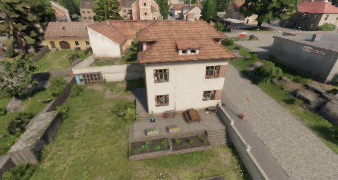

`{5CADC96916FF1CC4}Prefabs/Structures/Houses/Villa/Villa_E_2I01/Villa_E_2I01.et` at x 4359.1, z 10718.2. oblique from 270

## farm

### Barn_E_01

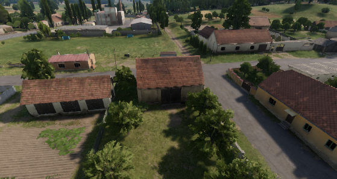

`{99F6E8E52B71B137}Prefabs/Structures/Agriculture/Barn/Barn_E_01/Barn_E_01.et` at x 4501.3, z 10648.5. oblique from 0 (two barns in frame)

## military

### Bunker_01_3fp

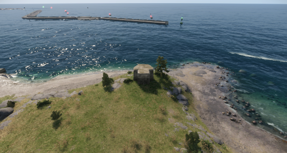

`{EE5219B38424AB12}Prefabs/Structures/Military/Bunkers/Bunker_01/Bunker_01_3fp.et` at x 4396.2, z 11300.1. oblique from 90, small on a headland

## airport

### ControlTower_01

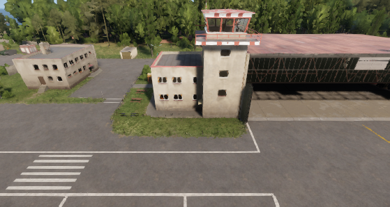

`{9CEC8BB63429FF28}Prefabs/Structures/Airport/ControlTower_01/ControlTower_01.et` at x 4920.8, z 11792.5. oblique from 270 with hangar

## farmhouse

### FarmHouse_E_1L01_Green

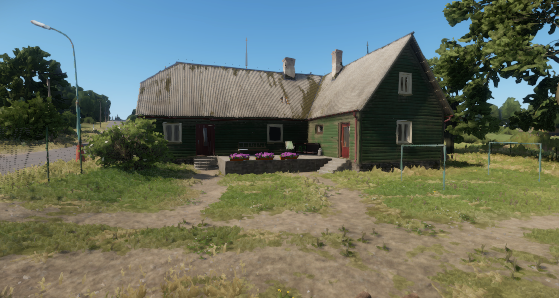

`{87D032F62D9FF82F}Prefabs/Structures/Houses/Farm/FarmHouse_E_1L01/FarmHouse_E_1L01_Green.et` at x 5369.6, z 10100.2. wide

## hotel

### MountainHotel_01_red

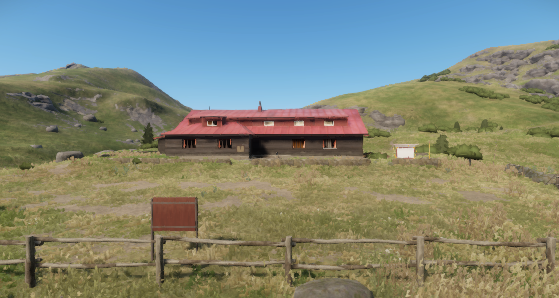

`{FC4BFDB06DC30F3F}Prefabs/Structures/Services/Hotels/MountainHotel_01/MountainHotel_01_red.et` at x 8245.4, z 2198.2. wide, mountain lodge

