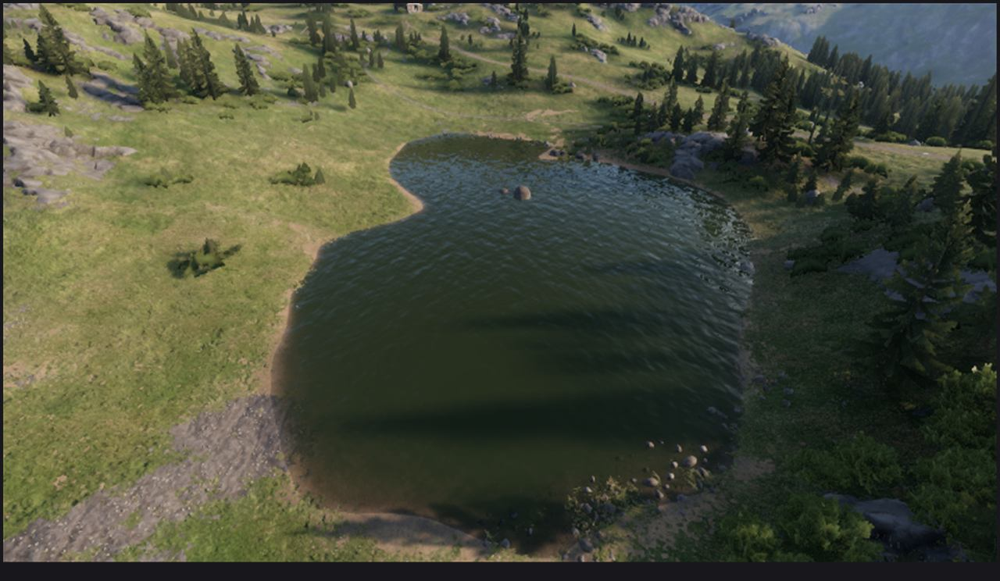
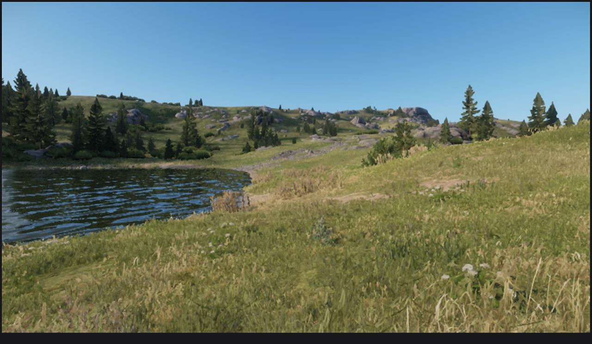
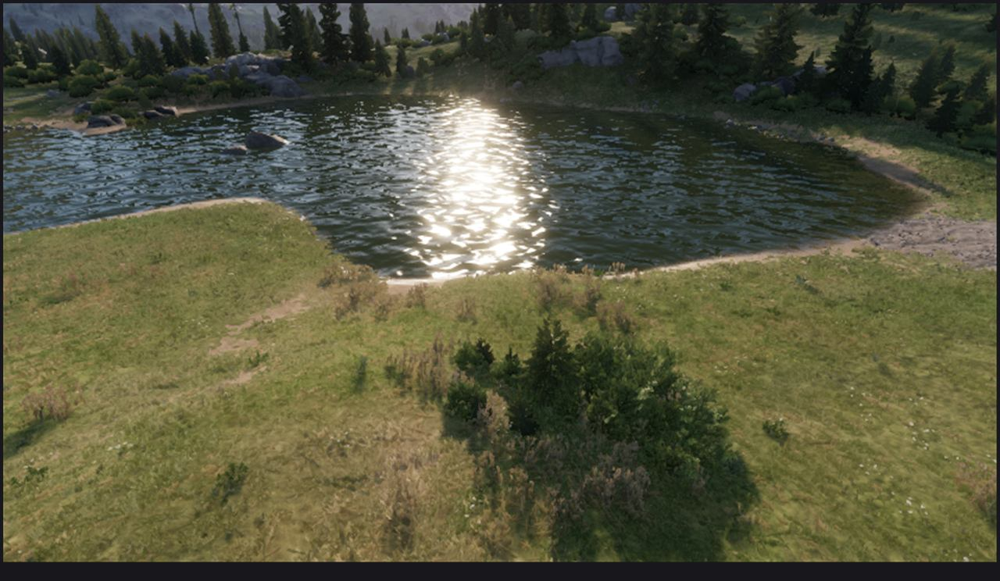

# Black Lake: location dossier

Generated 2026-11-19 by `tools\cli scout`. Do not edit by hand; run `tools\cli scout "Black Lake"` to refresh. The machine-readable twin is `dossier.json`.

- **Place:** Black Lake (aquatic), from the map's own label
- **Centre:** x 9482.455, z 3047.666, ground 207.163 m; **radius** 120 m
- **World:** Worlds/CoreOnEveron/CoreOnEveron.ent, Arma Reforger build 26266485 (installed 2026-11-08)
- **Other labels nearby:** Mill Pond (aquatic, 675 m W)

## At a glance

0 buildings (0 homes, 0 civic, 0 ruins), 0 enterable (a door entity below them), 0 entrances from outside among 0 door entities; 4 road(s), 1 junction(s); 0 notable props; 0 trees, bushes and other generated vegetation; 8 free plot(s).

_none_

## Overview

## Terrain

- ground 204.4 to 228.9 m (24.4 m of relief) within 120 m; mean 212.7 m
- 7% of the ground is under 3 degrees, 34% 3 to 8, 15% over 15
- overall the ground falls 1.9 degrees toward the S
- steepest ground 32.1 degrees at 9372.5, 3092.7

## Roads and junctions

**Main street:** Lake_Durras, 0 buildings within 25 m of it; its busiest stretch is at x 9516, z 3044.6.

| Id | Road | Length in radius (m) | Points |
| --- | --- | --- | --- |
| r01 | NW-SE road r01 | 138.8 | 7 |
| r03 | Lake_Durras | 346.5 | 11 |
| r04 | NW-SE road r04 | 162.8 | 7 |
| r05 | NE-SW road r05 | 20.5 | 2 |

| x | z | Kind | Arms | Roads |
| --- | --- | --- | --- | --- |
| 9399.7 | 2979 | t-junction | 3 | r04, r01 |

## Civic candidates

Public-facing buildings a town plan would use (church, chapel, government, police, fire, pub, shop, fuel station, hotel, recreation), nearest first. Each links its pictures.

_none_

## All buildings

_none_

Footprint: `catalog` and `measure` are the model's own extents turned by the yaw; `world-bounds` is the engine's axis-aligned box. Yaw is Enfusion's (0 faces +z north, 90 faces +x east). Interior `yes` means door entities and a walkable floor (a heuristic, not walked); `unknown` means door entities but no walkable floor. Entrances are the doors on the outline; `?` means the building was not found in the engine dump. Furniture is the count of furnishing props inside the footprint where the place file has it.

## Notable props

_none_

## Free plots

| Id | x | z | Size (m) | Area (m2) | Ground (m) | Nearest road | Nearest building | From centre |
| --- | --- | --- | --- | --- | --- | --- | --- | --- |
| p1 | 9481.5 | 3027.7 | 54 x 88 | 4752 | 204.4 to 208 | Lake_Durras 32.8 m | - | 20 m |
| p2 | 9553.5 | 3075.7 | 62 x 40 | 2480 | 208.6 to 216.8 | Lake_Durras 36.8 m | - | 76.3 m |
| p3 | 9527.5 | 3125.7 | 46 x 40 | 1840 | 210.4 to 217.5 | Lake_Durras 47.6 m | - | 90 m |
| p4 | 9402.5 | 3069.7 | 36 x 40 | 1440 | 216.5 to 220.1 | Lake_Durras 39.6 m | - | 83 m |
| p5 | 9427.5 | 3105.7 | 46 x 20 | 920 | 212.5 to 219.7 | Lake_Durras 38.8 m | - | 79.9 m |
| p6 | 9485.5 | 3111.7 | 30 x 28 | 840 | 208.1 to 211.9 | Lake_Durras 17.8 m | - | 64.1 m |
| p7 | 9529.5 | 2989.7 | 10 x 80 | 800 | 209.4 to 212.4 | Lake_Durras 10.7 m | - | 74.7 m |
| p8 | 9495.5 | 2972.7 | 42 x 18 | 756 | 205.7 to 208.4 | Lake_Durras 16.7 m | - | 76.1 m |

plots are open rectangles at least 10 m on the short side, kept 2.5 m off buildings, 4.5 m off a road's centre line, 2 m off a tree, on ground under 12 degrees; axis aligned, not the best use of the land

## Limits of this dossier

- buildings (types, footprints, floors, interiors) are read from the Everon catalog, docs/everon/catalog-buildings.json; 0 of 0 matched an entity of the engine dump, which adds the door positions

## Prefab references

Every distinct building prefab, as the world file refers to it.

_none_
