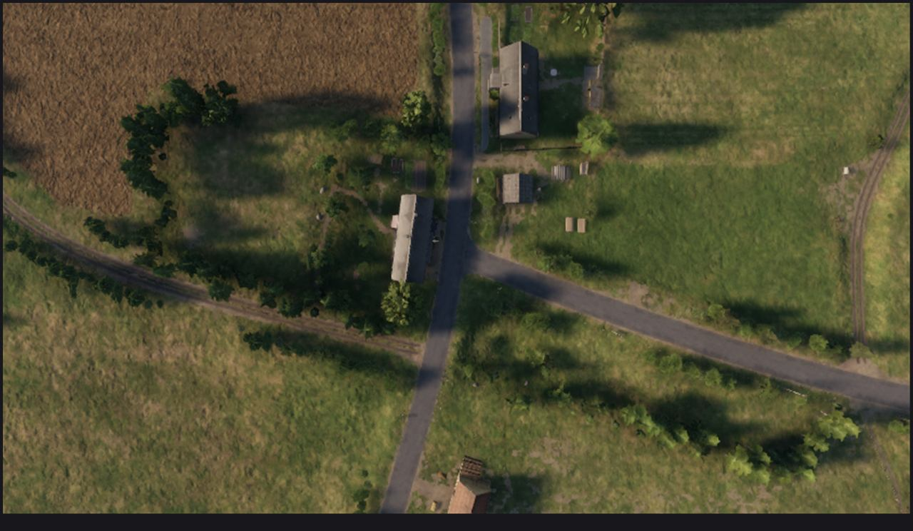
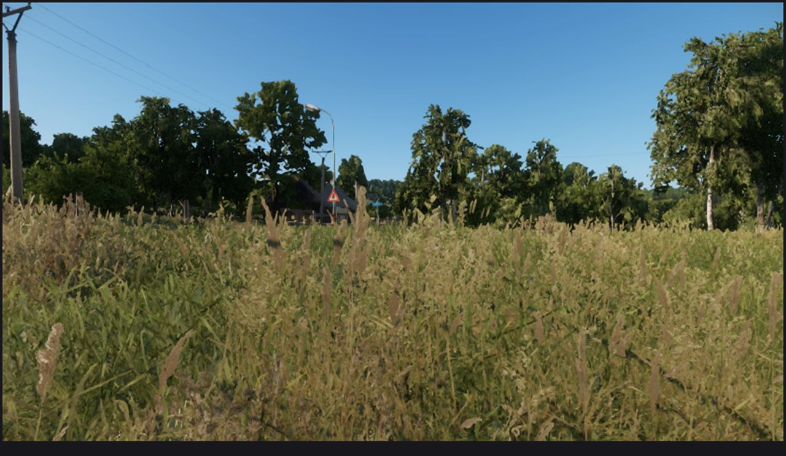
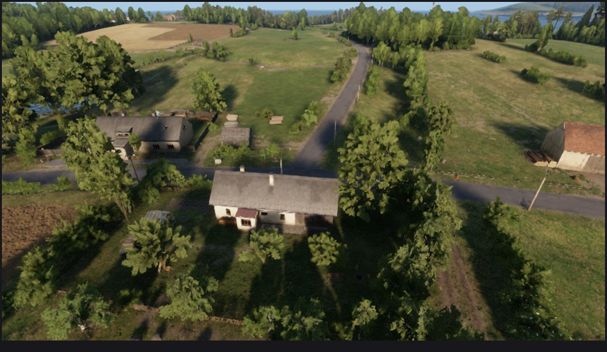
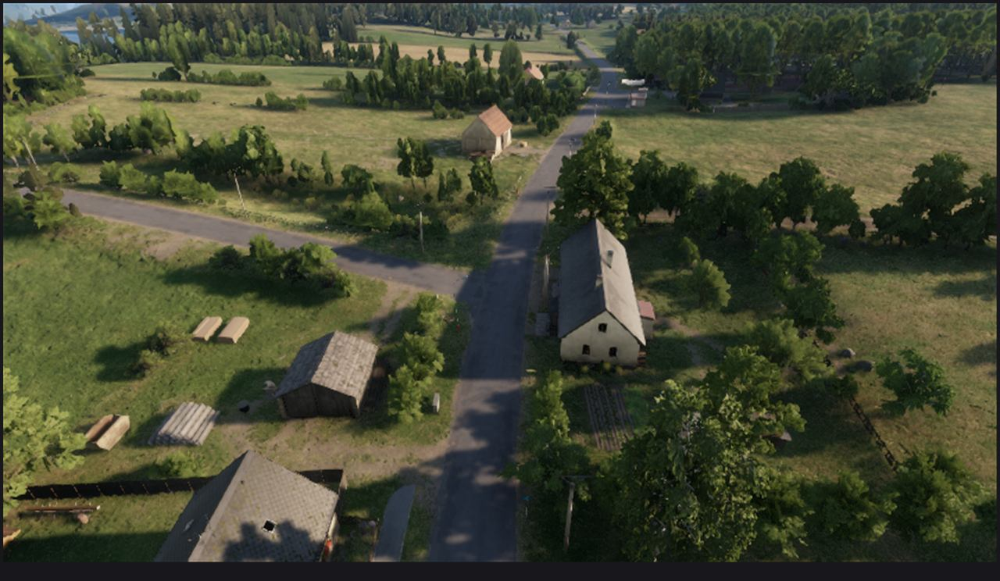
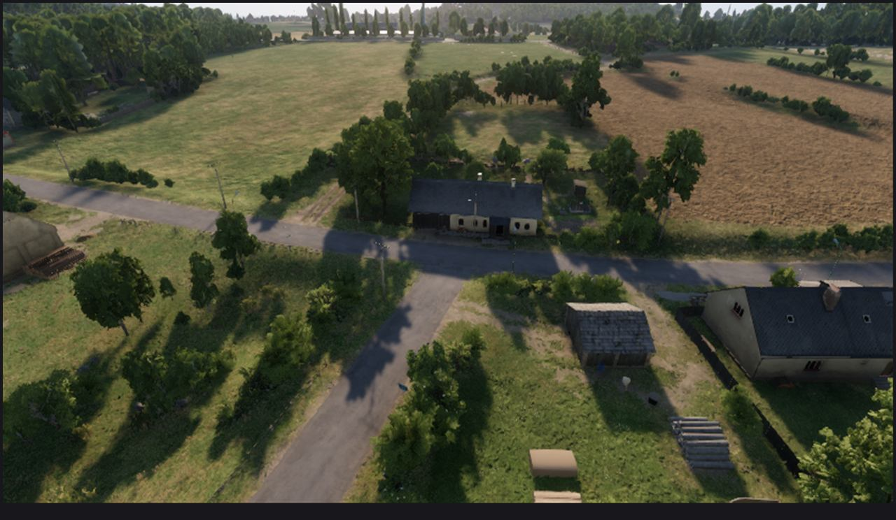
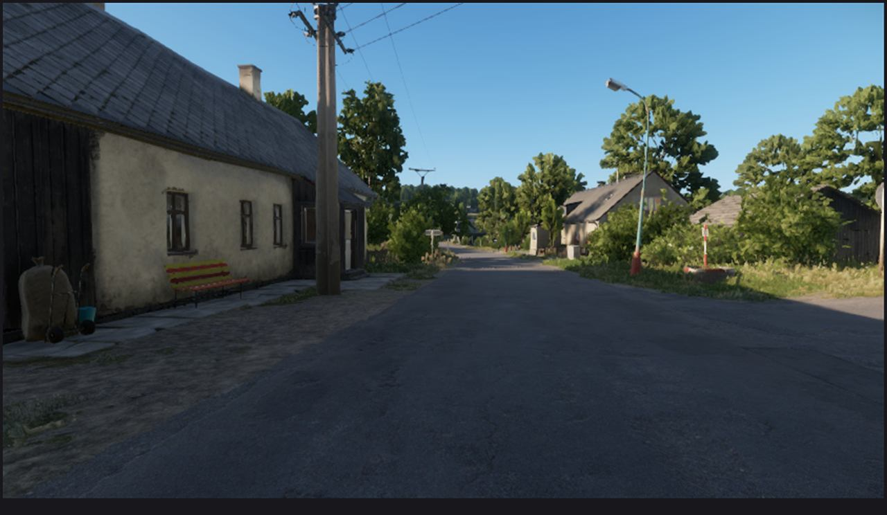
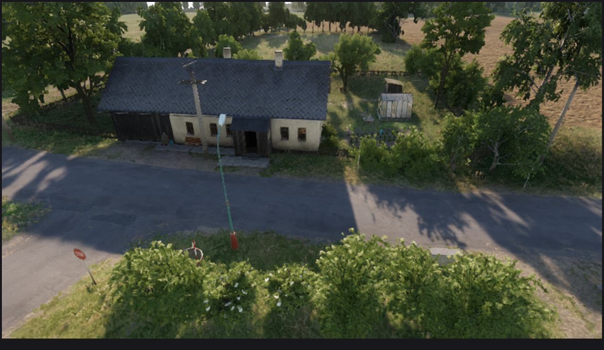

# Étoupe: location dossier

Generated 2026-11-18 by `tools\cli scout`. Do not edit by hand; run `tools\cli scout "Étoupe"` to refresh. The machine-readable twin is `dossier.json`.

- **Place:** Étoupe (urban), from the map's own label
- **Centre:** x 5357.94, z 9971.913, ground 20.14 m; **radius** 120 m
- **World:** Worlds/CoreOnEveron/CoreOnEveron.ent, Arma Reforger build 26266485 (installed 2026-11-08)
- **Other labels nearby:** farm (other, 353 m W); power plant (urban, 491 m SE); GALLOW'S HILL (natural, 619 m NW)

## At a glance

15 buildings (2 homes, 0 civic, 0 ruins), 7 enterable (a door entity below them), 13 entrances from outside among 36 door entities; 7 road(s), 3 junction(s); 13 notable props; 933 trees, bushes and other generated vegetation; 8 free plot(s).

| Type | Count |
| --- | --- |
| shed | 8 |
| farm-small | 3 |
| house | 2 |
| farm | 2 |

## Overview

## Terrain

- ground 12.7 to 26.3 m (13.5 m of relief) within 120 m; mean 20.3 m
- 41% of the ground is under 3 degrees, 50% 3 to 8, 1% over 15
- overall the ground falls 1.5 degrees toward the NE
- steepest ground 20.3 degrees at 5427.9, 10066.9

## Roads and junctions

**Main street:** N-S road r01, 11 buildings within 25 m of it; its busiest stretch is at x 5355, z 9986.5.

| Id | Road | Length in radius (m) | Points |
| --- | --- | --- | --- |
| r01 | N-S road r01 | 386.1 | 4 |
| r02 | E-W road r02 | 169.8 | 2 |
| r03 | Lake_NorthEast | 104.9 | 3 |
| r04 | E-W road r04 | 146.4 | 3 |
| r05 | NE-SW road r05 | 8.8 | 2 |
| r06 | N-S road r06 | 11.1 | 3 |
| r07 | N-S road r07 | 10.4 | 3 |

| x | z | Kind | Arms | Roads |
| --- | --- | --- | --- | --- |
| 5347.6 | 9944.6 | t-junction | 3 | r04, r01 |
| 5356.6 | 9967.6 | t-junction | 3 | r05, r01 |
| 5364.7 | 9971.1 | bend-or-join | 2 | r05, r02 |

## Civic candidates

Public-facing buildings a town plan would use (church, chapel, government, police, fire, pub, shop, fuel station, hotel, recreation), nearest first. Each links its pictures.

_none_

## All buildings

| Id | Type | Vanilla prefab | x | z | Yaw | Facing | Footprint (m) | Floors | Interior | Entrances | Furniture |
| --- | --- | --- | --- | --- | --- | --- | --- | --- | --- | --- | --- |
| b01 | house | House_Mountain_E_1I01 | 5344.5 | 9977.1 | 98 | E | 24.7 x 13.5 (333.5 m2) | 2 | yes | ? | - |
| b02 | shed | Door_HouseAddon_Shed_E_L_EXT_COV_01 | 5373.6 | 9988.2 | 0 | N | 1.9 x 0.1 (0.2 m2) | - | no | ? | - |
| b03 | shed | Door_HouseAddon_Shed_E_R_EXT_COV_01 | 5377 | 9988.2 | 180 | S | 1.7 x 0.1 (0.2 m2) | - | no | ? | - |
| b04 | shed | Door_HouseAddon_Shed_E_R_EXT_COV_02 | 5378.4 | 9988.2 | 0 | N | 1.6 x 0.1 (0.2 m2) | - | no | ? | - |
| b05 | farm | Barn_E_02 | 5377.2 | 9992.3 | 0 | N | 9.5 x 8.5 (80.8 m2) | 0 | unknown | 4 | - |
| b06 | shed | Door_HouseAddon_Shed_E_R_EXT_COV_02 | 5375.8 | 9996.2 | 180 | S | 1.6 x 0.1 (0.2 m2) | - | no | ? | - |
| b07 | farm-small | Greenhouse_01 | 5339.4 | 9999.4 | -174 | S | 3.8 x 4.2 (16 m2) | 1 | yes | 1 | - |
| b08 | shed | Shed_01 | 5333.5 | 10000.7 | -173 | S | 3.6 x 2.7 (9.7 m2) | 1 | yes | 1 | - |
| b09 | farm-small | Henhouse_01 | 5331.3 | 10001 | -84 | W | 3.3 x 1.2 (4 m2) | - | no | - | - |
| b10 | house | House_Village_E_1I03_Furniture | 5377.1 | 10020.3 | 0 | N | 15.3 x 25.5 (390.2 m2) | 2 | yes | ? | - |
| b11 | shed | Shed_03 | 5401.6 | 10019.7 | -87 | W | 6.8 x 3.9 (26.5 m2) | 0 | no | - | - |
| b12 | shed | Shed_01 | 5401.6 | 10023.8 | 3 | N | 3.6 x 2.7 (9.7 m2) | 1 | yes | 1 | - |
| b13 | farm | Barn_E_01 | 5361.3 | 9900 | 107 | E | 15.1 x 10.8 (163.1 m2) | 0 | unknown | 4 | - |
| b14 | shed | Shed_01 | 5400.3 | 10058.2 | 0 | N | 3.6 x 2.7 (9.7 m2) | 1 | yes | 1 | - |
| b15 | farm-small | Greenhouse_01 | 5390 | 10068.6 | -13 | N | 3.8 x 4.2 (16 m2) | 1 | yes | 1 | - |

Footprint: `catalog` and `measure` are the model's own extents turned by the yaw; `world-bounds` is the engine's axis-aligned box. Yaw is Enfusion's (0 faces +z north, 90 faces +x east). Interior `yes` means door entities and a walkable floor (a heuristic, not walked); `unknown` means door entities but no walkable floor. Entrances are the doors on the outline; `?` means the building was not found in the engine dump. Furniture is the count of furnishing props inside the footprint where the place file has it.

## Notable props

| Kind | Vanilla prefab | x | z | Distance |
| --- | --- | --- | --- | --- |
| bench | BenchStreet_01_yellow_red | 5349.2 | 9974.6 | 9.1 m |
| well | Well_02_blue | 5341.1 | 9995.5 | 29 m |
| bench | BenchStreet_01_green | 5371.1 | 10015.7 | 45.7 m |
| bench | BenchStreet_02 | 5368.8 | 10039.6 | 68.6 m |
| bus-shelter | SignBusStop_01 | 5365.5 | 10043.8 | 72.3 m |
| well | Well_02_blue | 5385.1 | 10039.7 | 73.1 m |
| bench | BenchStreet_01_green | 5399.1 | 10045.4 | 84.2 m |
| well | Well_02_blue | 5386.3 | 10074 | 106 m |

Counted, not listed: 5 street-lamp.

## Free plots

| Id | x | z | Size (m) | Area (m2) | Ground (m) | Nearest road | Nearest building | From centre |
| --- | --- | --- | --- | --- | --- | --- | --- | --- |
| p1 | 5433.9 | 10001.9 | 56 x 64 | 3584 | 17.1 to 20.6 | E-W road r02 47.9 m | b11 shed 33.7 m | 81.7 m |
| p2 | 5315.9 | 10041.9 | 64 x 52 | 3328 | 18 to 23.7 | N-S road r01 39.1 m | b09 farm-small 41.3 m | 81.6 m |
| p3 | 5294.9 | 9916.9 | 62 x 42 | 2604 | 19.4 to 22.9 | E-W road r04 40.2 m | b13 farm 63 m | 83.6 m |
| p4 | 5396.9 | 9893.9 | 50 x 48 | 2400 | 20.3 to 22.5 | N-S road r01 58.9 m | b13 farm 30.4 m | 87.2 m |
| p5 | 5293.9 | 9990.9 | 36 x 34 | 1224 | 21.9 to 24.4 | E-W road r04 31.1 m | b09 farm-small 37.7 m | 66.8 m |
| p6 | 5371.9 | 10070.9 | 24 x 38 | 912 | 15.9 to 17 | N-S road r01 16.9 m | b15 farm-small 15.8 m | 100 m |
| p7 | 5265.9 | 9947.9 | 48 x 16 | 768 | 22 to 25.8 | E-W road r04 17.7 m | b01 house 72.4 m | 95.1 m |
| p8 | 5306.9 | 9882.9 | 34 x 22 | 748 | 19.1 to 20.9 | N-S road r01 24.3 m | b13 farm 48.4 m | 102.6 m |

plots are open rectangles at least 10 m on the short side, kept 2.5 m off buildings, 4.5 m off a road's centre line, 2 m off a tree, on ground under 12 degrees; axis aligned, not the best use of the land

## Limits of this dossier

- buildings (types, footprints, floors, interiors) are read from the Everon catalog, docs/everon/catalog-buildings.json; 9 of 15 matched an entity of the engine dump, which adds the door positions, and the other 6 have no entrances listed
- 6 quay, pier and waterworks pieces are counted, not listed

## Prefab references

Every distinct building prefab, as the world file refers to it.

| Prefab | Type | Count |
| --- | --- | --- |
| `{BEF9077AF9F93AE7}Prefabs/Structures/Houses/Village/House_Mountain_E_1I01/House_Mountain_E_1I01.et` | house | 1 |
| `{9D6C69116A1DE3B0}Prefabs/Structures/BuildingParts/Doors/Door_HouseAddon_Shed_E_L_EXT_COV_01.et` | shed | 1 |
| `{270728E69E8B2D7E}Prefabs/Structures/BuildingParts/Doors/Door_HouseAddon_Shed_E_R_EXT_COV_01.et` | shed | 1 |
| `{4B531C06224FA250}Prefabs/Structures/BuildingParts/Doors/Door_HouseAddon_Shed_E_R_EXT_COV_02.et` | shed | 2 |
| `{F5A2DC0597B53E19}Prefabs/Structures/Agriculture/Barn/Barn_E_02/Barn_E_02.et` | farm | 1 |
| `{3299E6F34CE40185}Prefabs/Structures/Agriculture/Greenhouse/Greenhouse_01/Greenhouse_01.et` | farm-small | 2 |
| `{F08D8E78433D713A}Prefabs/Structures/Houses/Shed/Shed_01/Shed_01.et` | shed | 3 |
| `{E005876522A8CE1D}Prefabs/Structures/Agriculture/Henhouse/Henhouse_01/Henhouse_01.et` | farm-small | 1 |
| `{366759CF520BC4CA}Prefabs/Structures/Houses/Village/House_Village_E_1I03/Furniture/House_Village_E_1I03_Furniture.et` | house | 1 |
| `{8597237EA3C59701}Prefabs/Structures/Houses/Shed/Shed_03/Shed_03.et` | shed | 1 |
| `{99F6E8E52B71B137}Prefabs/Structures/Agriculture/Barn/Barn_E_01/Barn_E_01.et` | farm | 1 |
