# Chotain: location dossier

Generated 2026-11-23 by `tools\cli scout`. Do not edit by hand; run `tools\cli scout "Chotain"` to refresh. The machine-readable twin is `dossier.json`.

- **Place:** Chotain (other), from the map's own label
- **Centre:** x 7086.131, z 6012.347, ground 129.414 m; **radius** 120 m
- **World:** Worlds/CoreOnEveron/CoreOnEveron.ent, Arma Reforger build 26266485 (installed 2026-11-08)
- **Other labels nearby:** SIX BELLS (natural, 422 m SE); farm (urban, 452 m W); La Valette (urban, 503 m SW); Laruns (other, 667 m SE); Reed Pond (aquatic, 701 m SW)

## At a glance

37 buildings (11 homes, 2 civic, 0 ruins), 34 enterable (a door entity below them), 58 entrances from outside among 149 door entities; 21 road(s), 13 junction(s); 45 notable props; 2031 trees, bushes and other generated vegetation; 8 free plot(s).

| Type | Count |
| --- | --- |
| shed | 17 |
| house | 9 |
| garage | 5 |
| townhouse | 2 |
| farm-small | 2 |
| church | 1 |
| shop | 1 |

## Overview

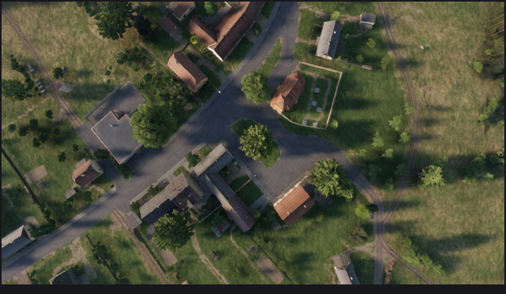

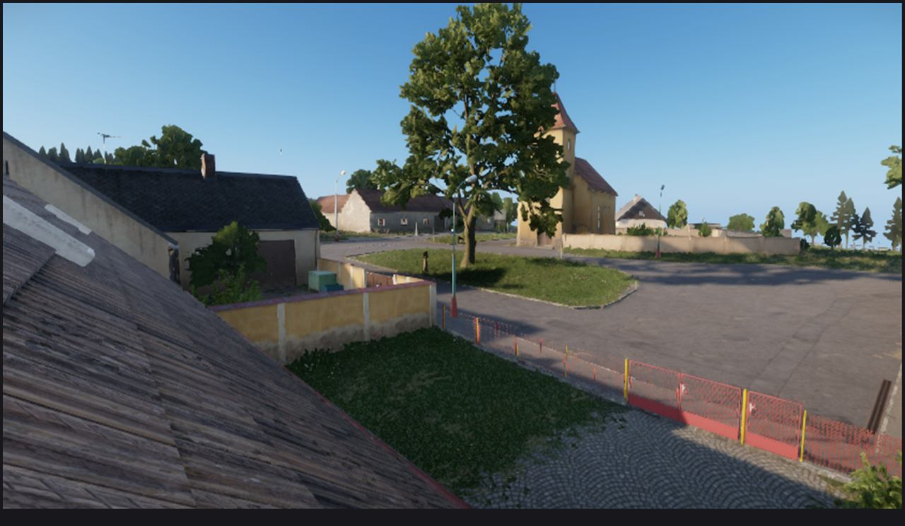

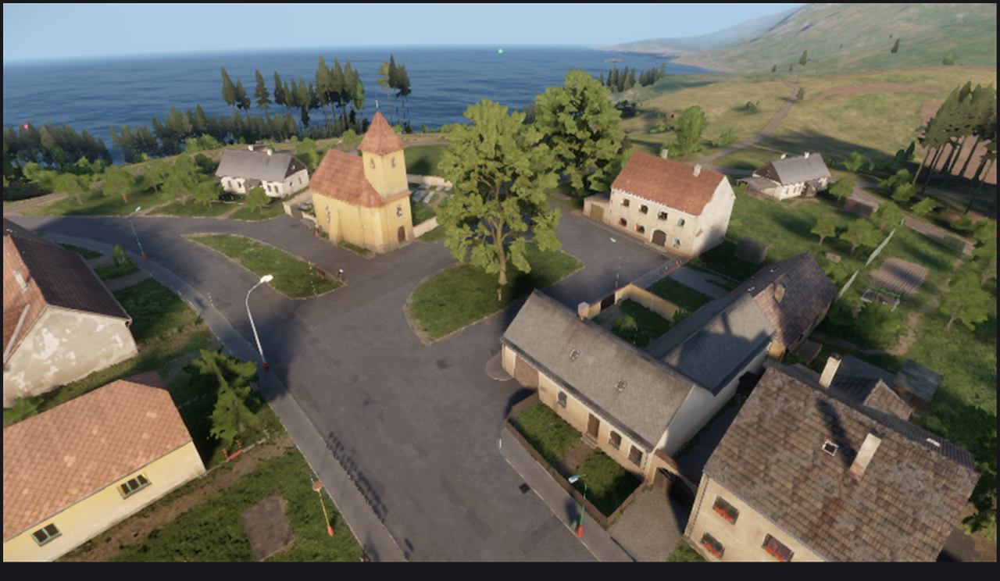

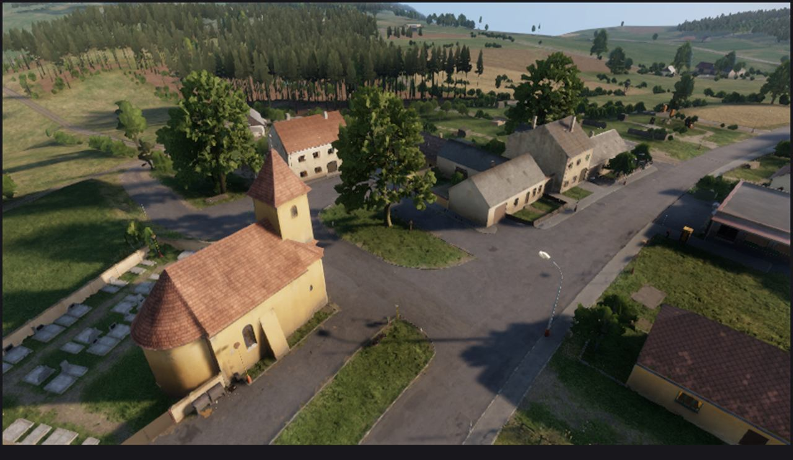

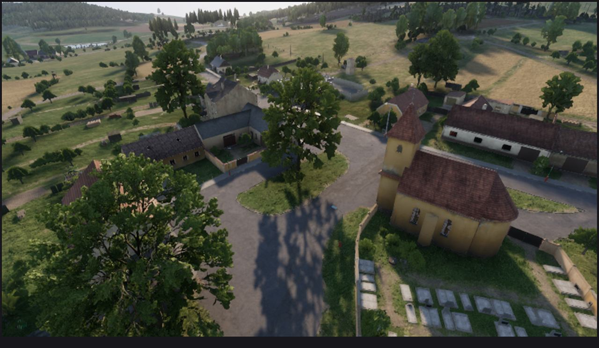

## Terrain

- ground 109.3 to 122.4 m (13.1 m of relief) within 120 m; mean 116.9 m
- 43% of the ground is under 3 degrees, 44% 3 to 8, 1% over 15
- overall the ground falls 2.3 degrees toward the SE
- steepest ground 19.6 degrees at 7141.1, 6117.3

## Roads and junctions

**Main street:** NE-SW road r01, 12 buildings within 25 m of it; its busiest stretch is at x 7044.3, z 6015.5.

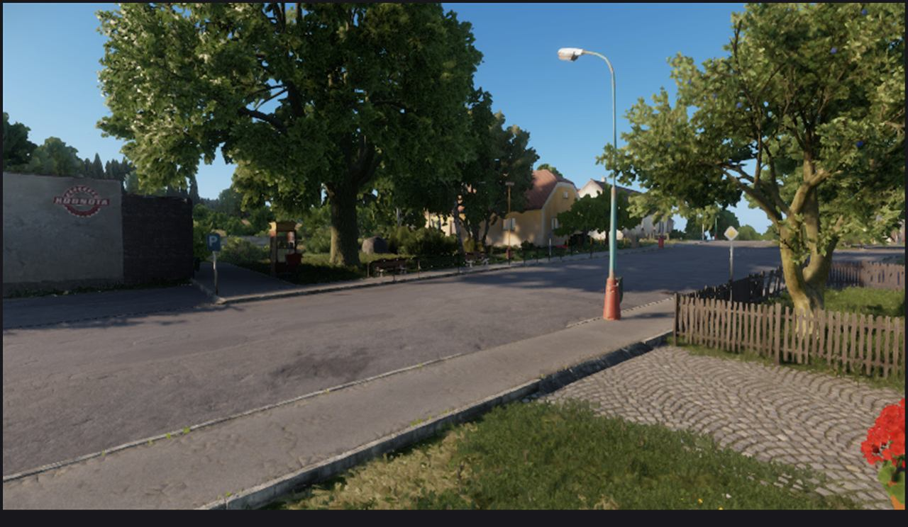

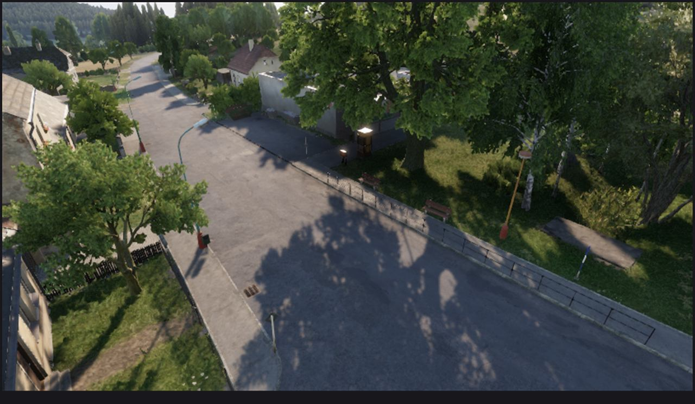

| Id | Road | Length in radius (m) | Points |
| --- | --- | --- | --- |
| r01 | NE-SW road r01 | 255 | 4 |
| r02 | NW-SE road r02 | 45.3 | 3 |
| r03 | N-S road r03 | 190.8 | 8 |
| r04 | E-W road r04 | 106.4 | 6 |
| r05 | N-S road r05 | 99.5 | 5 |
| r06 | NW-SE road r06 | 90.5 | 8 |
| r08 | NW-SE road r08 | 17.9 | 3 |
| r09 | NE-SW road r09 | 63.8 | 5 |
| r10 | NW-SE road r10 | 49.8 | 3 |
| r11 | NE-SW road r11 | 22 | 3 |
| r12 | NW-SE road r12 | 21.1 | 5 |
| r13 | NW-SE road r13 | 21.1 | 5 |
| r14 | NE-SW road r14 | 31.2 | 8 |
| r15 | NW-SE road r15 | 9.2 | 4 |
| r16 | NW-SE road r16 | 16.6 | 3 |
| r17 | NW-SE road r17 | 17.3 | 3 |
| r18 | NW-SE road r18 | 108.1 | 9 |
| r19 | NW-SE road r19 | 46.5 | 3 |
| r20 | NE-SW road r20 | 8.9 | 2 |
| r21 | NE-SW road r21 | 8.7 | 2 |
| r22 | N-S road r22 | 24.3 | 6 |

| x | z | Kind | Arms | Roads |
| --- | --- | --- | --- | --- |
| 7012.9 | 5986.6 | crossroads | 4 | r01, r19, r22 |
| 7161.1 | 5966.2 | crossroads | 4 | r02, r03, r05 |
| 7112.7 | 6120.6 | t-junction | 3 | r03, r01 |
| 7004 | 5978.9 | t-junction | 3 | r18, r01 |
| 7065.2 | 5892.1 | t-junction | 3 | r04, r18 |
| 7014.2 | 5965.7 | t-junction | 3 | r22, r18 |
| 7142.2 | 5996.8 | bend-or-join | 2 | r05, r06 |
| 6988.9 | 6019.5 | bend-or-join | 2 | r10, r19 |
| 7088.2 | 5949.4 | bend-or-join | 2 | r12, r13 |
| 7102.1 | 5933.6 | bend-or-join | 2 | r12, r13 |
| 7097.8 | 5985.6 | bend-or-join | 2 | r14, r15 |
| 7030.2 | 5958.1 | bend-or-join | 2 | r16, r17 |
| 6969 | 5997.3 | bend-or-join | 2 | r20, r21 |

## Civic candidates

Public-facing buildings a town plan would use (church, chapel, government, police, fire, pub, shop, fuel station, hotel, recreation), nearest first. Each links its pictures.

| Id | Type | Vanilla prefab | Distance | Footprint | Floors | Interior | Entrances |
| --- | --- | --- | --- | --- | --- | --- | --- |
| b02 | church | ChurchSmall_E_01 | 30.5 m NE | 15.5 x 22.3 m (345.7 m2) | 2 | yes | ? |
| b18 | shop | ShopModern_E_01 | 71.5 m W | 24.4 x 19.8 m (483.1 m2) | 2 | yes | ? |

### b02 church: ChurchSmall_E_01

`{0FD764569422DBA7}Prefabs/Structures/Cultural/Churches/ChurchSmall_E_01/ChurchSmall_E_01.et` at x 7104.5, z 6036.6, facing SW; footprint 15.5 x 22.3 m; interior yes (catalog: 2 door entities and a walkable floor (2 floors)).

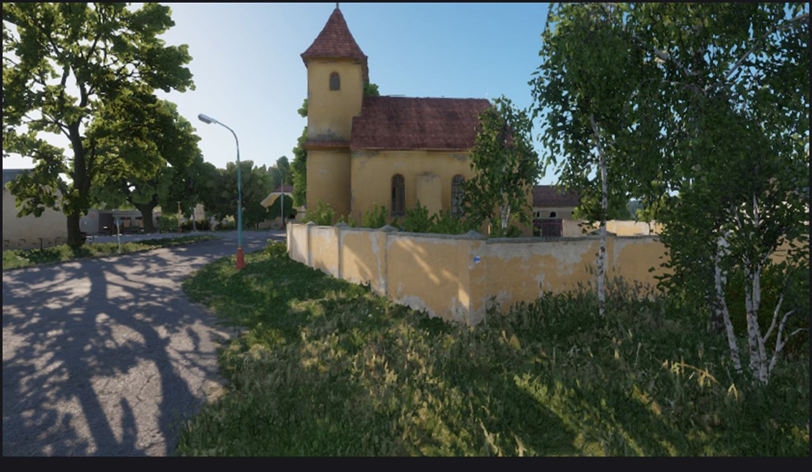

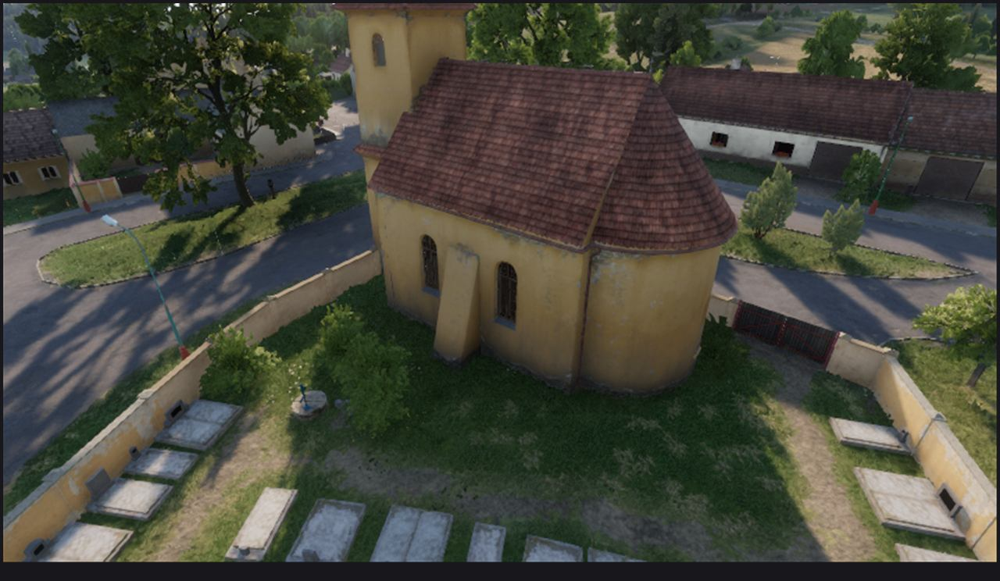

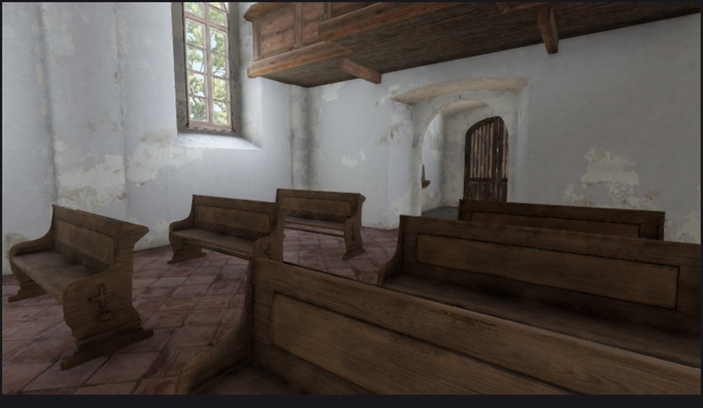

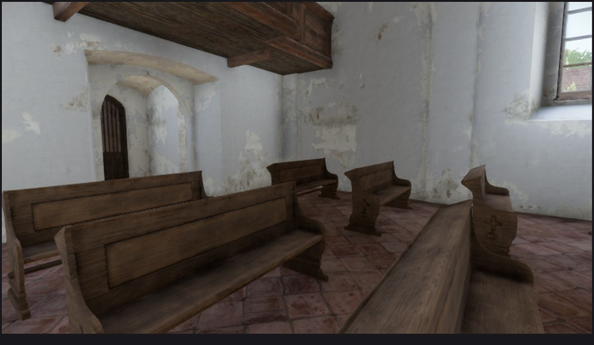

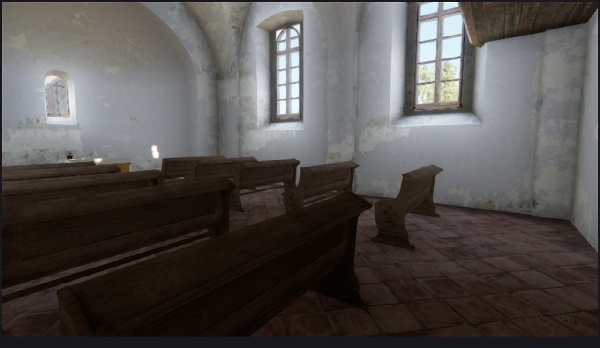

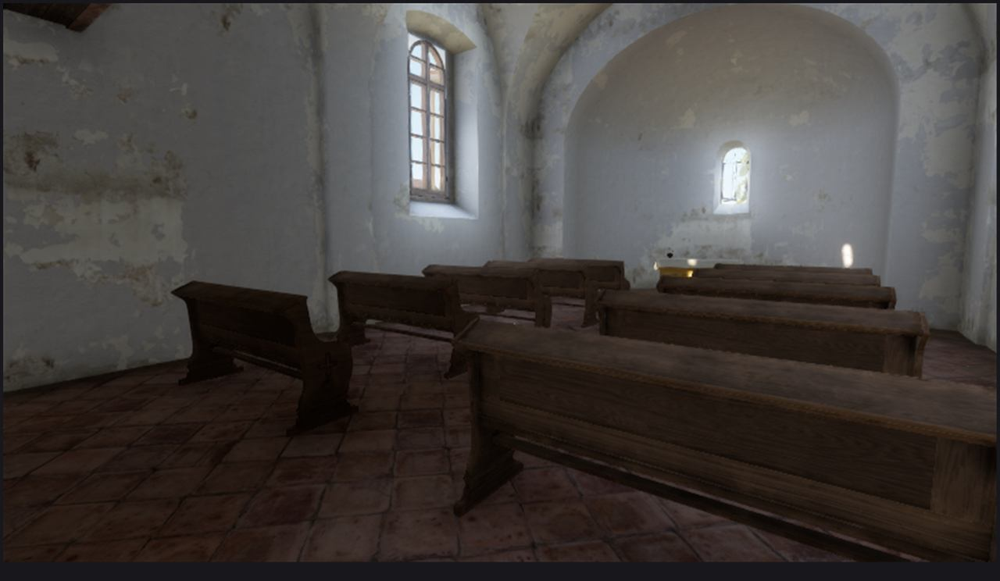

### b18 shop: ShopModern_E_01

`{CFE8511B2B7E8AAA}Prefabs/Structures/Commercial/Shops/ShopModern_E_01/ShopModern_E_01.et` at x 7015, z 6019.7, facing NE; footprint 24.4 x 19.8 m; interior yes (catalog: 8 door entities and a walkable floor (2 floors)).

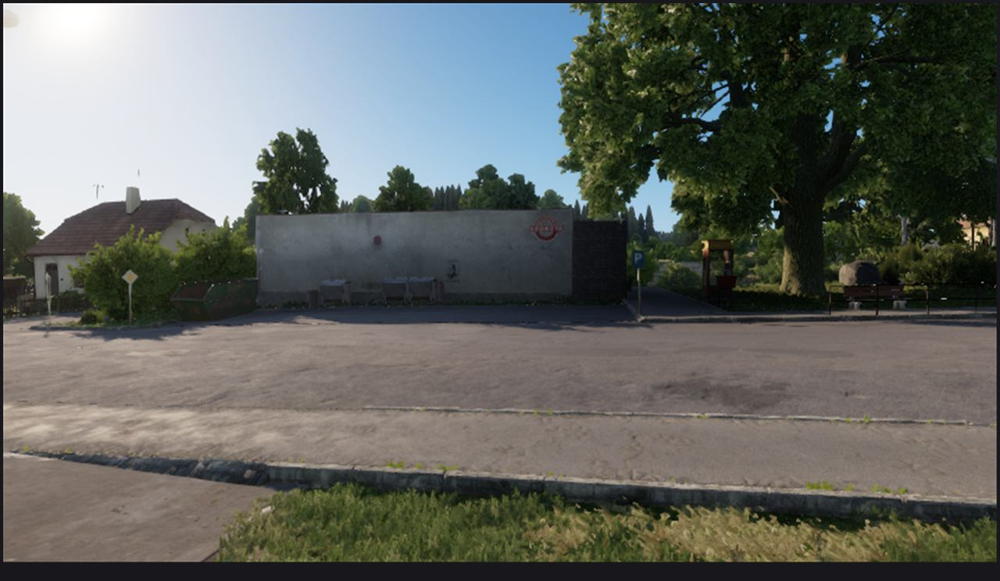

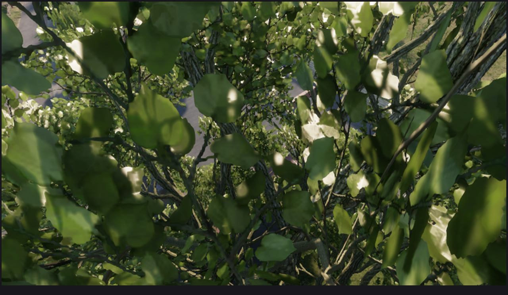

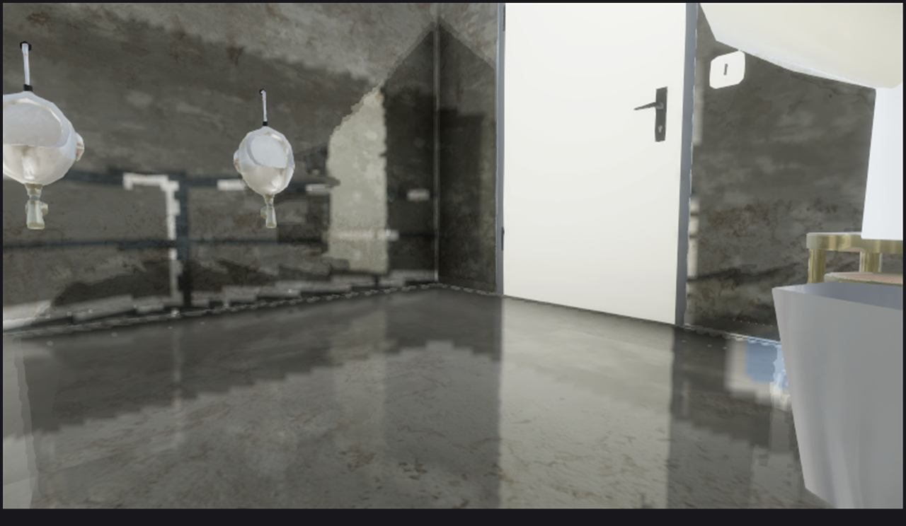

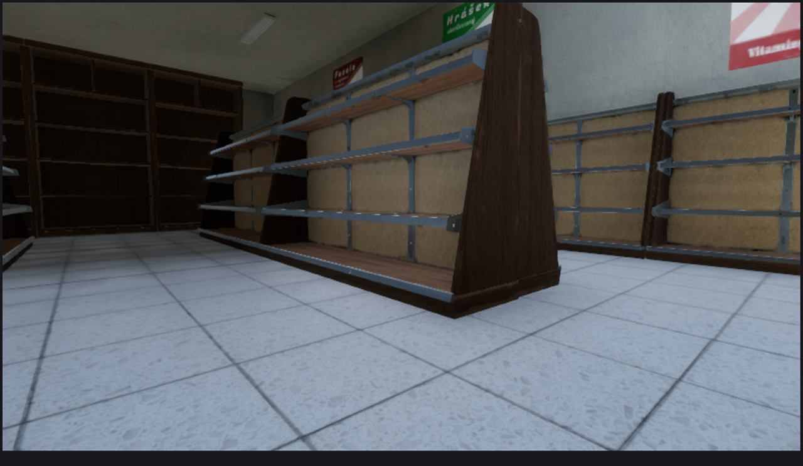

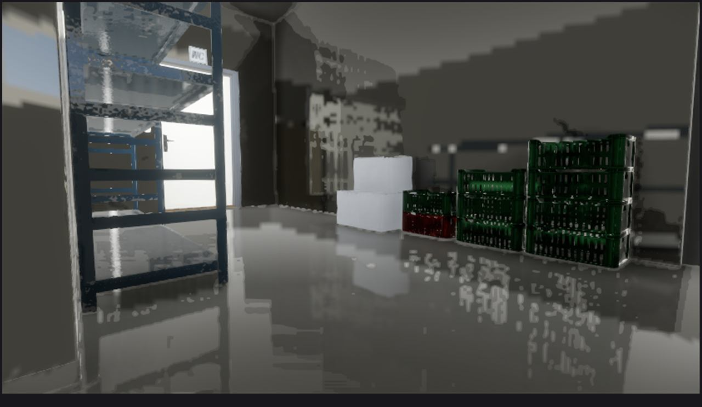

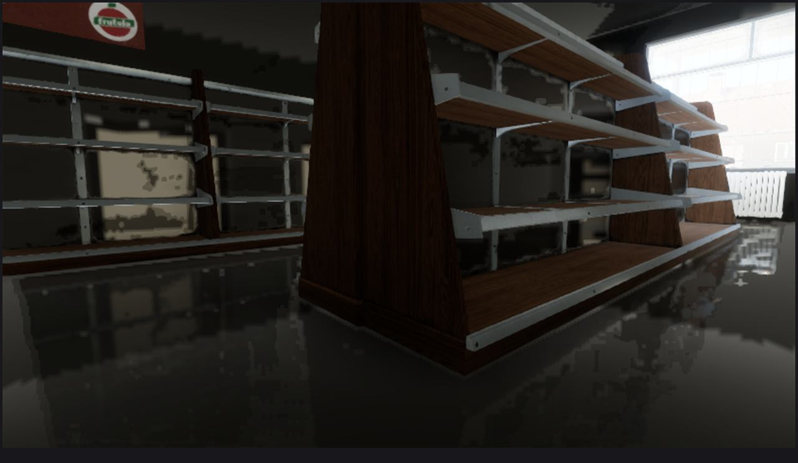

## All buildings

| Id | Type | Vanilla prefab | x | z | Yaw | Facing | Footprint (m) | Floors | Interior | Entrances | Furniture |
| --- | --- | --- | --- | --- | --- | --- | --- | --- | --- | --- | --- |
| b01 | house | House_Village_E_1L02t | 7064.3 | 6001.8 | 139 | SE | 20.6 x 25.6 (527.4 m2) | 2 | yes | 1 | - |
| b02 | church | ChurchSmall_E_01 | 7104.5 | 6036.6 | -144 | SW | 15.5 x 22.3 (345.7 m2) | 2 | yes | ? | - |
| b03 | shed | Shed_02_small | 7064 | 5984.2 | -40 | NW | 3.5 x 2.6 (9.1 m2) | 1 | yes | 1 | - |
| b04 | garage | HouseAddon_Garage_E_01 | 7116.5 | 5990.1 | -40 | NW | 7 x 8.2 (57.4 m2) | 1 | yes | 3 | - |
| b05 | house | House_Village_E_1I08t | 7078.5 | 5975.2 | 49 | NE | 18.9 x 10.2 (192.8 m2) | 3 | yes | 5 | - |
| b06 | townhouse | House_Town_E_2I02_v2 | 7108.5 | 5980.1 | -40 | NW | 18.5 x 13.4 (247.9 m2) | 3 | yes | 4 | - |
| b07 | townhouse | House_Town_E_2I01 | 7048.9 | 5987.5 | -40 | NW | 12.4 x 16.8 (208.3 m2) | 3 | yes | 3 | - |
| b08 | shed | Shed_02_square | 7099.1 | 5967.6 | 138 | SE | 4.4 x 3.7 (16.3 m2) | 2 | yes | 1 | - |
| b09 | house | House_Village_E_1I02_Furniture | 7051.3 | 6049.3 | 134 | SE | 11 x 20.5 (225.5 m2) | 2 | yes | ? | - |
| b10 | shed | Shed_02_big_V1 | 7065.6 | 5965.1 | 49 | NE | 6.5 x 3.7 (24.1 m2) | 2 | yes | 2 | - |
| b11 | shed | Shed_02_big_V2 | 7127.9 | 5980.4 | -40 | NW | 7 x 3.7 (25.9 m2) | 2 | yes | 1 | - |
| b12 | house | House_Village_E_1L03t | 7073.7 | 6067.3 | -49 | NW | 25.9 x 25.6 (663 m2) | 2 | yes | - | - |
| b13 | farm-small | Greenhouse_01 | 7085.7 | 5954 | -130 | SW | 3.8 x 4.2 (16 m2) | 1 | yes | 1 | - |
| b14 | house | House_Village_E_1I04sr | 7034.6 | 5979.9 | -36 | NW | 21.1 x 11.1 (234.2 m2) | 2 | yes | 7 | - |
| b15 | shed | Shed_02_small | 7041.5 | 6056.8 | -47 | NW | 3.5 x 2.6 (9.1 m2) | 1 | yes | 1 | - |
| b16 | shed | Shed_01 | 7063.4 | 5951.8 | -129 | SW | 3.6 x 2.7 (9.7 m2) | 1 | yes | 1 | - |
| b17 | house | House_Mountain_E_1I01_short | 7128.9 | 6069.4 | -75 | W | 17.5 x 11.6 (203 m2) | 2 | yes | - | - |
| b18 | shop | ShopModern_E_01 | 7015 | 6019.7 | 49 | NE | 24.4 x 19.8 (483.1 m2) | 2 | yes | ? | - |
| b19 | house | House_Village_E_1I05s | 7088 | 6088.6 | -60 | NW | 26.7 x 11.2 (299 m2) | 2 | yes | 4 | - |
| b20 | garage | Workshop_01_Garage | 7039.3 | 6073.5 | 42 | NE | 8.3 x 5.8 (48.1 m2) | 1 | yes | 3 | - |
| b21 | farm-small | Greenhouse_01 | 7026.7 | 5961.1 | 139 | SE | 3.8 x 4.2 (16 m2) | 1 | yes | 1 | - |
| b22 | garage | Garage_E_01 | 7018.3 | 5971.1 | -36 | NW | 4.9 x 9.9 (48.5 m2) | 2 | yes | 2 | - |
| b23 | garage | Workshop_01_Main | 7047.5 | 6082.8 | 135 | SE | 12.2 x 7.6 (92.7 m2) | 1 | yes | 3 | - |
| b24 | shed | Shed_02_square | 7061.3 | 6089 | -137 | SW | 4.4 x 3.7 (16.3 m2) | 2 | yes | 1 | - |
| b25 | shed | Shed_03 | 7134.7 | 5947.6 | 67 | NE | 6.8 x 3.9 (26.5 m2) | 0 | no | - | - |
| b26 | shed | Shed_03 | 7138.1 | 5949.2 | -112 | W | 6.8 x 3.9 (26.5 m2) | 0 | no | - | - |
| b27 | house | House_Mountain_E_1I01_short | 7139.3 | 5941.4 | -114 | SW | 17.5 x 11.6 (203 m2) | 2 | yes | - | - |
| b28 | shed | Shed_02_line | 7149.8 | 6074.7 | -171 | S | 6.6 x 2.8 (18.5 m2) | 1 | yes | 1 | - |
| b29 | garage | Garage_E_01 | 7150 | 6078.4 | -81 | W | 4.9 x 9.9 (48.5 m2) | 2 | yes | 2 | - |
| b30 | shed | Shed_02_big_V1 | 7126.2 | 5928.4 | -23 | NW | 6.5 x 3.7 (24.1 m2) | 2 | yes | 2 | - |
| b31 | house | House_Village_E_1I01 | 6993.7 | 5996.5 | -126 | SW | 9.9 x 12.5 (123.8 m2) | 2 | yes | 2 | - |
| b32 | shed | Shed_02_line | 7020.9 | 6081.8 | 135 | SE | 6.6 x 2.8 (18.5 m2) | 1 | yes | 1 | - |
| b33 | shed | Shed_03 | 6989.7 | 6000.8 | 143 | SE | 6.8 x 3.9 (26.5 m2) | 0 | no | - | - |
| b34 | shed | Shed_02_big_V2 | 7072 | 6112.9 | 123 | SE | 7 x 3.7 (25.9 m2) | 2 | yes | 1 | - |
| b35 | shed | Shed_02_small | 7091.5 | 6118 | 24 | NE | 3.5 x 2.6 (9.1 m2) | 1 | yes | 1 | - |
| b36 | shed | Shed_02_big_V2 | 7017.9 | 5931.3 | 55 | NE | 7 x 3.7 (25.9 m2) | 2 | yes | 1 | - |
| b37 | shed | Shed_02_big_V1 | 6982.8 | 5985.3 | -35 | NW | 6.5 x 3.7 (24.1 m2) | 2 | yes | 2 | - |

Footprint: `catalog` and `measure` are the model's own extents turned by the yaw; `world-bounds` is the engine's axis-aligned box. Yaw is Enfusion's (0 faces +z north, 90 faces +x east). Interior `yes` means door entities and a walkable floor (a heuristic, not walked); `unknown` means door entities but no walkable floor. Entrances are the doors on the outline; `?` means the building was not found in the engine dump. Furniture is the count of furnishing props inside the footprint where the place file has it.

## Notable props

| Kind | Vanilla prefab | x | z | Distance |
| --- | --- | --- | --- | --- |
| shrine | BelfrySmall_01 | 7083.3 | 6012.3 | 2.8 m |
| bus-shelter | SignBusStop_01 | 7085.9 | 6036.1 | 23.8 m |
| bench | BenchStreet_02 | 7088.1 | 6040 | 27.8 m |
| well | Well_02_blue | 7114.3 | 6027.7 | 32.1 m |
| bench | BenchStreet_02 | 7045.9 | 6022.2 | 41.4 m |
| bench | BenchWooden_02_Worn | 7054.7 | 5980.7 | 44.6 m |
| bench | BenchStreet_02 | 7040.8 | 6017.5 | 45.6 m |
| market-stand | MarketStand_01_Umbrella | 7068.1 | 5967.3 | 48.5 m |
| phone-booth | PhoneBooth_E_01 | 7034.5 | 6017.2 | 51.8 m |
| well | Well_02_blue | 7081.9 | 5960.4 | 52 m |
| bench | BenchStreet_01_green | 7122.9 | 5973.2 | 53.7 m |
| bench | BenchStreet_01_green | 7024.2 | 6019.2 | 62.3 m |
| bench | BenchStreet_01_green | 7022.5 | 6021.2 | 64.2 m |
| bench | BenchWooden_02_Worn | 7069.3 | 6077 | 66.8 m |
| bench | BenchStreet_01_green | 7032.7 | 5971.4 | 67.3 m |
| pier-or-dock | Pier_01 | 7134.8 | 6063 | 70.4 m |
| well | Well_02_blue | 7035.3 | 6061.3 | 70.6 m |
| well | Well_02_blue | 7044.4 | 5954.9 | 70.9 m |
| notice-board | MessageBoardSmall_01 | 7015.2 | 6026.3 | 72.3 m |
| pier-or-dock | Pier_02 | 7135.1 | 6069.1 | 75 m |
| bench | BenchStreet_02 | 7134.4 | 5940.3 | 86.7 m |
| well | Well_02_blue | 7092.8 | 6104 | 91.9 m |
| bench | BenchStreet_01_green | 6992 | 6002.5 | 94.6 m |
| bench | BenchStreet_02 | 7086.8 | 6126.2 | 113.9 m |
| bench | BenchStreet_02 | 7088.8 | 6128.9 | 116.6 m |

Counted, not listed: 12 street-lamp, 8 manhole.

## Free plots

| Id | x | z | Size (m) | Area (m2) | Ground (m) | Nearest road | Nearest building | From centre |
| --- | --- | --- | --- | --- | --- | --- | --- | --- |
| p1 | 7144.1 | 6035.3 | 48 x 38 | 1824 | 116.8 to 119.1 | NW-SE road r06 31.2 m | b17 house 26.9 m | 62.4 m |
| p2 | 6999.1 | 6058.3 | 26 x 44 | 1144 | 117.7 to 121.5 | NW-SE road r10 30.1 m | b18 shop 27.6 m | 98.4 m |
| p3 | 7074.1 | 5925.3 | 32 x 34 | 1088 | 111.8 to 115.8 | NW-SE road r12 26.4 m | b16 shed 26.5 m | 87.8 m |
| p4 | 7132.1 | 5962.3 | 48 x 16 | 768 | 113.7 to 116.5 | N-S road r05 27.9 m | b26 shed 11 m | 67.9 m |
| p5 | 7125.1 | 6093.3 | 30 x 22 | 660 | 116.2 to 118.7 | N-S road r03 19.9 m | b17 house 14 m | 89.9 m |
| p6 | 7192.1 | 6031.3 | 12 x 54 | 648 | 112.7 to 114.5 | N-S road r03 12.3 m | b28 shed 57.1 m | 107.7 m |
| p7 | 7003.1 | 5948.3 | 22 x 24 | 528 | 114.5 to 116.2 | NW-SE road r18 19.3 m | b36 shed 18.9 m | 104.8 m |
| p8 | 7024.1 | 6097.3 | 24 x 22 | 528 | 121.2 to 122.4 | NE-SW road r09 20.2 m | b32 shed 12.3 m | 105.2 m |

plots are open rectangles at least 10 m on the short side, kept 2.5 m off buildings, 4.5 m off a road's centre line, 2 m off a tree, on ground under 12 degrees; axis aligned, not the best use of the land

## Interiors

## Limits of this dossier

- buildings (types, footprints, floors, interiors) are read from the Everon catalog, docs/everon/catalog-buildings.json; 34 of 37 matched an entity of the engine dump, which adds the door positions, and the other 3 have no entrances listed
- 12 quay, pier and waterworks pieces are counted, not listed

## Prefab references

Every distinct building prefab, as the world file refers to it.

| Prefab | Type | Count |
| --- | --- | --- |
| `{DE43119351D125AC}Prefabs/Structures/Houses/Village/House_Village_E_1L02/House_Village_E_1L02t.et` | house | 1 |
| `{0FD764569422DBA7}Prefabs/Structures/Cultural/Churches/ChurchSmall_E_01/ChurchSmall_E_01.et` | church | 1 |
| `{8590602F727399F4}Prefabs/Structures/Houses/Shed/Shed_02/Shed_02_small.et` | shed | 3 |
| `{448D2BD96AA205E4}Prefabs/Structures/Houses/Village/HouseAddon_Garage_E_01/HouseAddon_Garage_E_01.et` | garage | 1 |
| `{D424A3CD07F7A6F0}Prefabs/Structures/Houses/Village/House_Village_E_1I08/House_Village_E_1I08t.et` | house | 1 |
| `{27CC3110521583D6}Prefabs/Structures/Houses/Town/House_Town_E_2I02/House_Town_E_2I02_v2.et` | townhouse | 1 |
| `{38A5F3E4578087AB}Prefabs/Structures/Houses/Town/House_Town_E_2I01/House_Town_E_2I01.et` | townhouse | 1 |
| `{D61A7F2891D457C6}Prefabs/Structures/Houses/Shed/Shed_02/Shed_02_square.et` | shed | 2 |
| `{1F0A3A2A077ED92F}Prefabs/Structures/Houses/Village/House_Village_E_1I02/Furniture/House_Village_E_1I02_Furniture.et` | house | 1 |
| `{6FA58B435F69B179}Prefabs/Structures/Houses/Shed/Shed_02/Shed_02_big_V1.et` | shed | 3 |
| `{03F1BFA3E3AD3E57}Prefabs/Structures/Houses/Shed/Shed_02/Shed_02_big_V2.et` | shed | 3 |
| `{B2172573ED15AA82}Prefabs/Structures/Houses/Village/House_Village_E_1L03/House_Village_E_1L03t.et` | house | 1 |
| `{3299E6F34CE40185}Prefabs/Structures/Agriculture/Greenhouse/Greenhouse_01/Greenhouse_01.et` | farm-small | 2 |
| `{751E011171780C2E}Prefabs/Structures/Houses/Village/House_Village_E_1I04/House_Village_E_1I04sr.et` | house | 1 |
| `{F08D8E78433D713A}Prefabs/Structures/Houses/Shed/Shed_01/Shed_01.et` | shed | 1 |
| `{678574044F58E1CA}Prefabs/Structures/Houses/Village/House_Mountain_E_1I01/House_Mountain_E_1I01_short.et` | house | 2 |
| `{CFE8511B2B7E8AAA}Prefabs/Structures/Commercial/Shops/ShopModern_E_01/ShopModern_E_01.et` | shop | 1 |
| `{60333F74EE12B52F}Prefabs/Structures/Houses/Village/House_Village_E_1I05/House_Village_E_1I05s.et` | house | 1 |
| `{5F00FD9BDAD8C1A5}Prefabs/Structures/Industrial/Houses/Workshop_01/Workshop_01_Garage.et` | garage | 1 |
| `{A548C1C5370D0734}Prefabs/Structures/Houses/Garage/Garage_E_01/Garage_E_01.et` | garage | 2 |
| `{CFF7F6F7042AFFEF}Prefabs/Structures/Industrial/Houses/Workshop_01/Workshop_01_Main.et` | garage | 1 |
| `{8597237EA3C59701}Prefabs/Structures/Houses/Shed/Shed_03/Shed_03.et` | shed | 3 |
| `{24BA2E136E8815C2}Prefabs/Structures/Houses/Shed/Shed_02/Shed_02_line.et` | shed | 2 |
| `{EDBC0E94793BA9F1}Prefabs/Structures/Houses/Village/House_Village_E_1I01/House_Village_E_1I01.et` | house | 1 |
