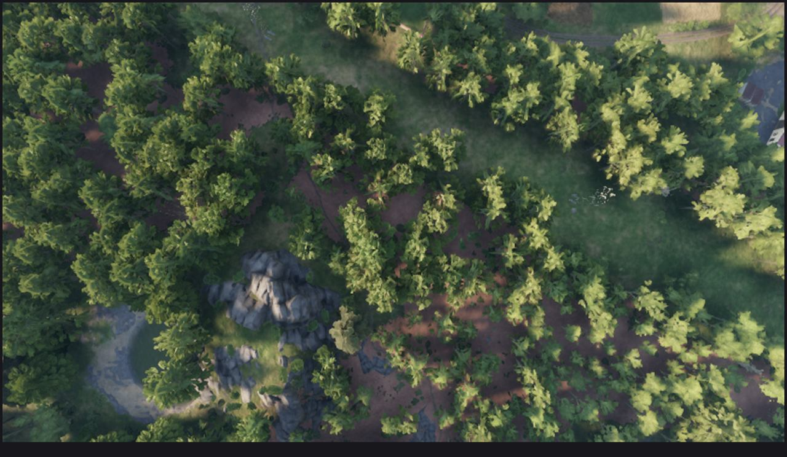
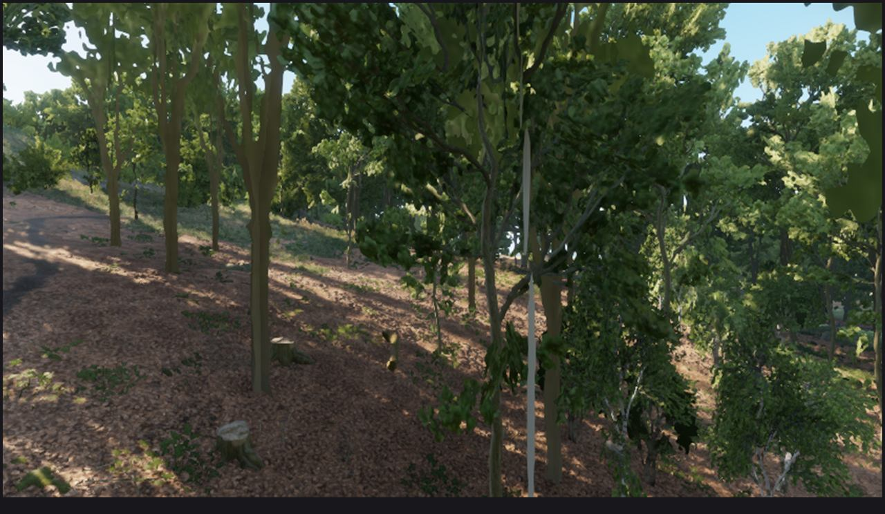
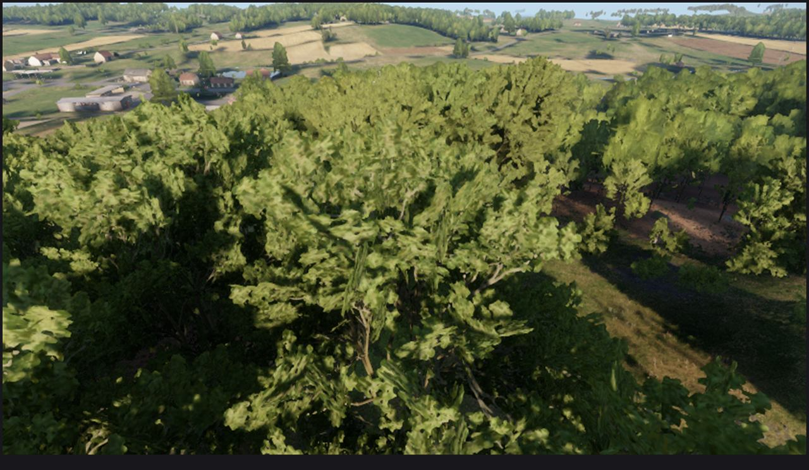
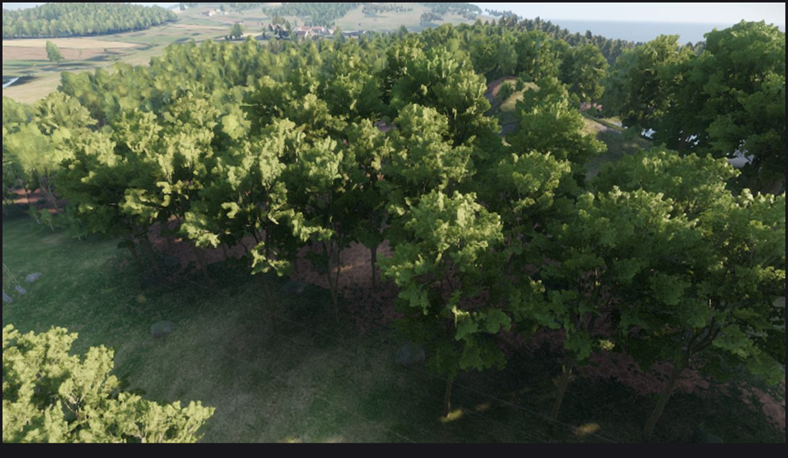
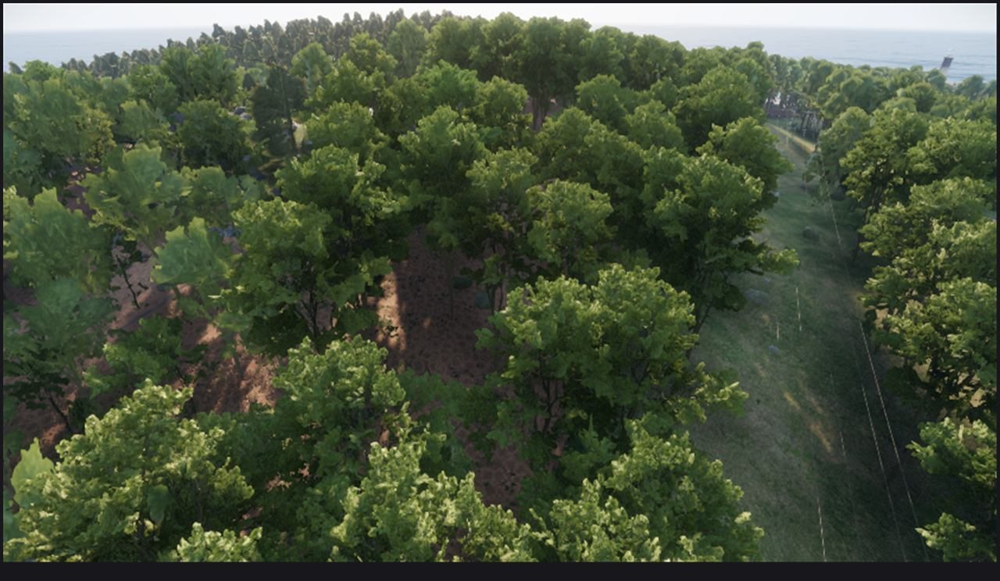
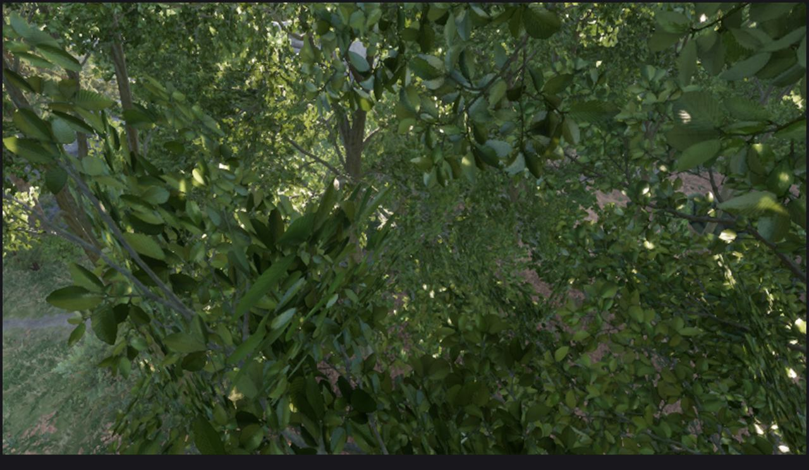

# xz-4337-10349: location dossier

Generated 2026-11-22 by `tools\cli scout`. Do not edit by hand; run `tools\cli scout 4337,10349 --radius 80` to refresh. The machine-readable twin is `dossier.json`.

- **Place:** xz-4337-10349, from coordinates
- **Centre:** x 4337, z 10349, ground 37.4 m; **radius** 80 m
- **World:** Worlds/CoreOnEveron/CoreOnEveron.ent, Arma Reforger build 26266485 (installed 2026-11-08)
- **Other labels nearby:** power plant (other, 252 m S); factory (urban, 291 m NE); Spring Pond (aquatic, 368 m NE); Saint-Philippe (other, 376 m N); Saint-Philippe (urban, 454 m N); GALLOW'S HILL (natural, 590 m E); Lighthouse (other, 592 m NW); Charlet Bay (aquatic, 657 m NW)

## At a glance

0 buildings (0 homes, 0 civic, 0 ruins), 0 enterable (a door entity below them), 0 entrances from outside among 0 door entities; 1 road(s), 0 junction(s); 0 notable props; 18 trees, bushes and other generated vegetation; 8 free plot(s).

_none_

## Overview

## Terrain

- ground 25.3 to 55.3 m (30.1 m of relief) within 80 m; mean 37.9 m
- 4% of the ground is under 3 degrees, 22% 3 to 8, 27% over 15
- overall the ground falls 9.3 degrees toward the NE
- steepest ground 39.8 degrees at 4307, 10284

## Water

| Id | Name | Kind | Centre x | Centre z | Area (m2) | Surface y (m) | From centre |
| --- | --- | --- | --- | --- | --- | --- | --- |
| w1 | Lake_NorthWest | pond | 4253.2 | 10301.1 | 934 | 40.1 | 96.5 m |

Shore points (dry ground a step from the outline, facing the water):

| Water | x | z | Ground y (m) | Faces | Yaw | From centre |
| --- | --- | --- | --- | --- | --- | --- |
| w1 | 4264.3 | 10313 | 42.5 | SW | 223 | 81.1 m |
| w1 | 4269.8 | 10294.5 | 42.1 | W | 292 | 86.5 m |
| w1 | 4268.5 | 10282.1 | 40.6 | NW | 321 | 95.8 m |

lakes and ponds are the closed outlines of the dump's water shapes (the sea probe cannot see them); the grid, the terrain share and the free plots count the cells inside them as water. Shore points are dry ground 2.5 m outside an outline, not checked against trees or props

## Roads and junctions

**Main street:** NW-SE road r01, 0 buildings within 25 m of it; its busiest stretch is at x 4321.9, z 10339.

| Id | Road | Length in radius (m) | Points |
| --- | --- | --- | --- |
| r01 | NW-SE road r01 | 181.9 | 23 |

_none_

## Civic candidates

Public-facing buildings a town plan would use (church, chapel, government, police, fire, pub, shop, fuel station, hotel, recreation), nearest first. Each links its pictures.

_none_

## All buildings

_none_

Footprint: `catalog` and `measure` are the model's own extents turned by the yaw; `world-bounds` is the engine's axis-aligned box. Yaw is Enfusion's (0 faces +z north, 90 faces +x east). Interior `yes` means door entities and a walkable floor (a heuristic, not walked); `unknown` means door entities but no walkable floor. Entrances are the doors on the outline; `?` means the building was not found in the engine dump. Furniture is the count of furnishing props inside the footprint where the place file has it.

## Notable props

_none_

## Free plots

| Id | x | z | Size (m) | Area (m2) | Ground (m) | Nearest road | Nearest building | From centre |
| --- | --- | --- | --- | --- | --- | --- | --- | --- |
| p1 | 4397 | 10346 | 32 x 50 | 1600 | 28.1 to 31.9 | NW-SE road r01 69 m | - | 60.1 m |
| p2 | 4330 | 10404 | 30 x 46 | 1380 | 32.4 to 37.6 | NW-SE road r01 37.8 m | - | 55.4 m |
| p3 | 4278 | 10363 | 34 x 28 | 952 | 43.4 to 46.3 | NW-SE road r01 25.6 m | - | 60.6 m |
| p4 | 4362 | 10359 | 34 x 16 | 544 | 31.4 to 37.2 | NW-SE road r01 44.5 m | - | 26.9 m |
| p5 | 4370 | 10405 | 22 x 24 | 528 | 27.6 to 30.5 | NW-SE road r01 74.7 m | - | 65 m |
| p6 | 4394 | 10386 | 14 x 26 | 364 | 26.5 to 28.9 | NW-SE road r01 86.1 m | - | 68 m |
| p7 | 4342 | 10331 | 14 x 20 | 280 | 38.9 to 41.6 | NW-SE road r01 15 m | - | 18.7 m |
| p8 | 4304 | 10341 | 10 x 20 | 200 | 45.7 to 48.7 | NW-SE road r01 13.5 m | - | 34 m |

plots are open rectangles at least 10 m on the short side, kept 2.5 m off buildings, 4.5 m off a road's centre line, 2 m off a tree, on ground under 12 degrees; axis aligned, not the best use of the land

## Limits of this dossier

- buildings (types, footprints, floors, interiors) are read from the Everon catalog, docs/everon/catalog-buildings.json; 0 of 0 matched an entity of the engine dump, which adds the door positions

## Prefab references

Every distinct building prefab, as the world file refers to it.

_none_
