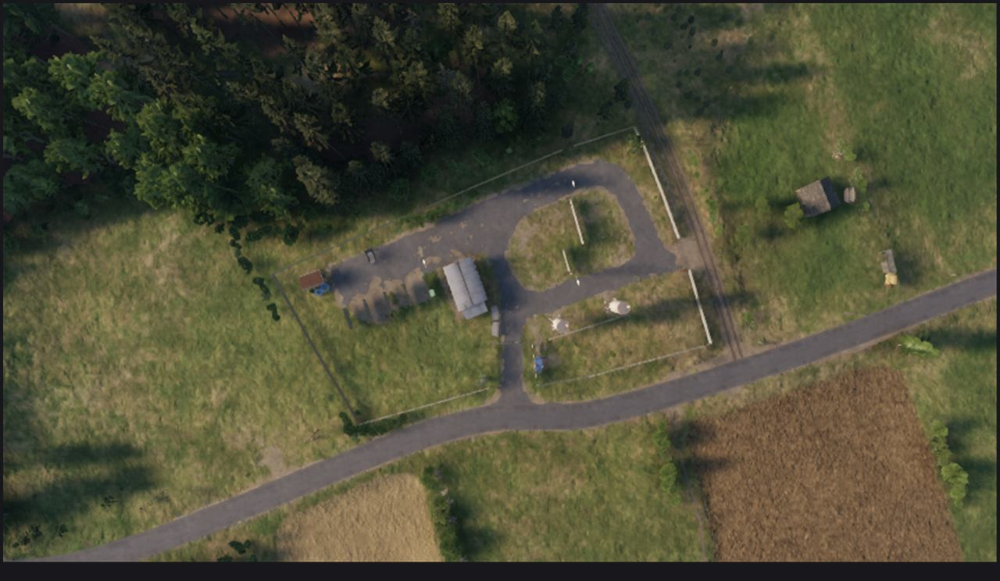
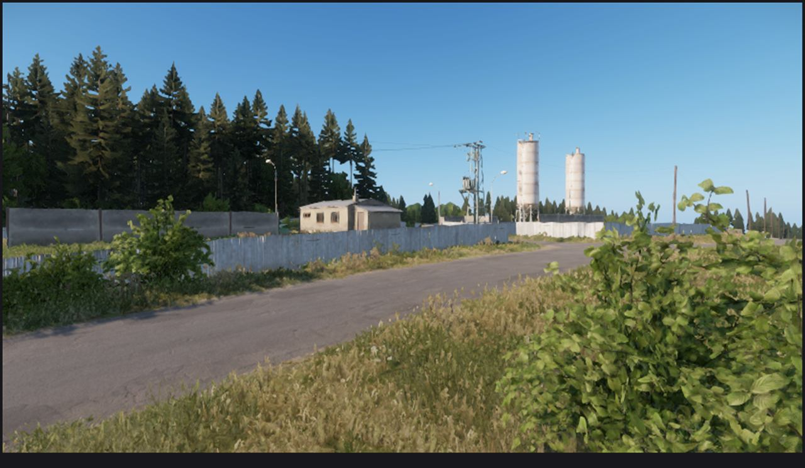
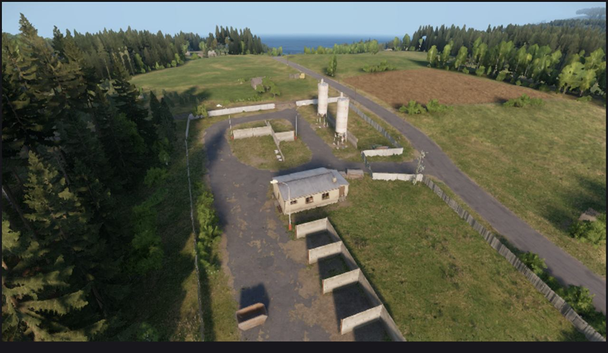
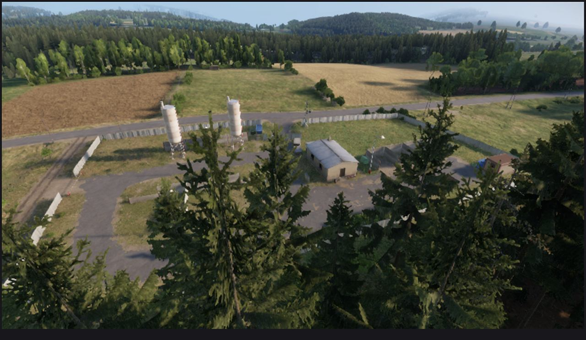
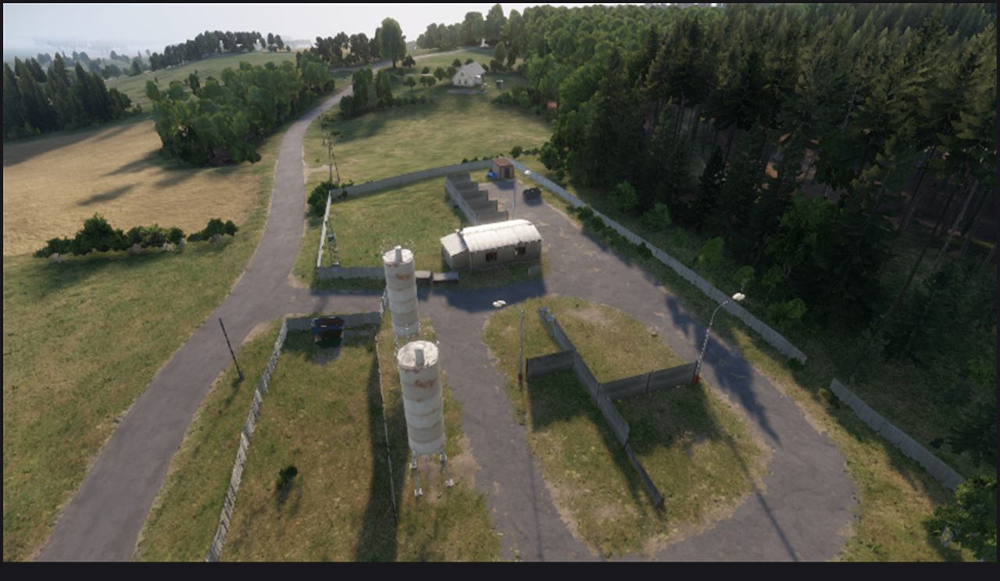
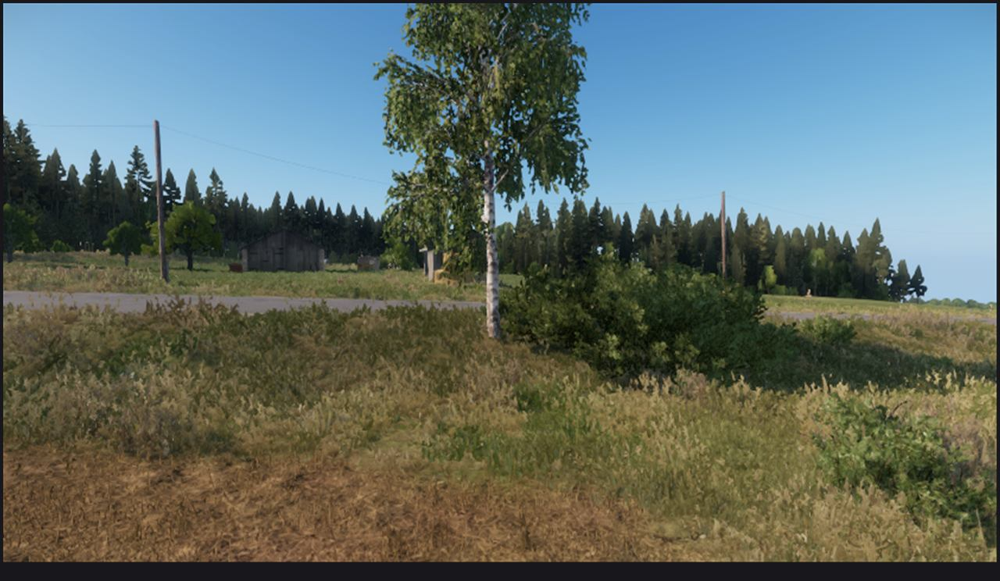
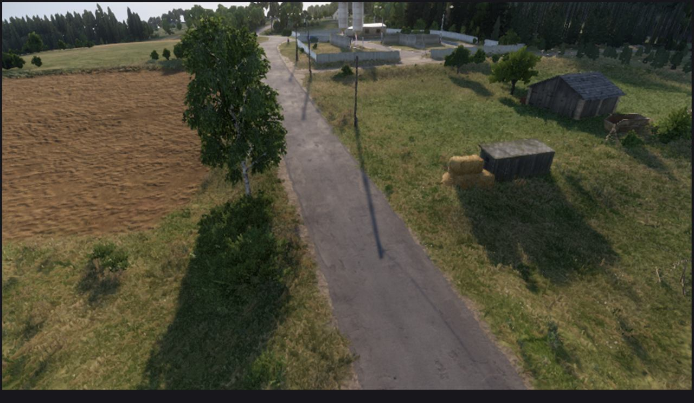

# xz-6459-6482: location dossier

Generated 2026-11-24 by `tools\cli scout`. Do not edit by hand; run `tools\cli scout 6459,6482 --radius 150` to refresh. The machine-readable twin is `dossier.json`.

- **Place:** xz-6459-6482, from coordinates
- **Centre:** x 6459, z 6482, ground 162 m; **radius** 150 m
- **World:** Worlds/CoreOnEveron/CoreOnEveron.ent, Arma Reforger build 26266485 (installed 2026-11-08)
- **Other labels nearby:** Periwinkle Pond (aquatic, 405 m NE); farm (urban, 612 m S); Bénac (urban, 650 m N)

## At a glance

11 buildings (0 homes, 0 civic, 0 ruins), 4 enterable (a door entity below them), 9 entrances from outside among 12 door entities; 6 road(s), 4 junction(s); 4 notable props; 50 trees, bushes and other generated vegetation; 8 free plot(s).

| Type | Count |
| --- | --- |
| shed | 6 |
| industrial-tank | 2 |
| garage | 1 |
| industrial | 1 |
| farm | 1 |

## Overview

## Terrain

- ground 154 to 163.8 m (9.8 m of relief) within 150 m; mean 159.6 m
- 42% of the ground is under 3 degrees, 53% 3 to 8, 0% over 15
- the ground is level overall
- steepest ground 15.5 degrees at 6449, 6617

## Roads and junctions

**Main street:** E-W road r01, 1 buildings within 25 m of it; its busiest stretch is at x 6576.6, z 6472.4.

| Id | Road | Length in radius (m) | Points |
| --- | --- | --- | --- |
| r01 | E-W road r01 | 326.4 | 6 |
| r02 | E-W road r02 | 293.9 | 52 |
| r03 | NE-SW road r03 | 44.3 | 5 |
| r04 | NW-SE road r04 | 51.6 | 3 |
| r05 | NW-SE road r05 | 168.3 | 6 |
| r06 | N-S road r06 | 102.3 | 26 |

| x | z | Kind | Arms | Roads |
| --- | --- | --- | --- | --- |
| 6465.4 | 6601.3 | crossroads | 4 | r03, r05, r04 |
| 6528.9 | 6459.5 | t-junction | 3 | r05, r01 |
| 6515.9 | 6494.3 | t-junction | 3 | r02, r05 |
| 6459.5 | 6612.6 | bend-or-join | 2 | r05, r04 |

## Civic candidates

Public-facing buildings a town plan would use (church, chapel, government, police, fire, pub, shop, fuel station, hotel, recreation), nearest first. Each links its pictures.

_none_

## All buildings

| Id | Type | Vanilla prefab | x | z | Yaw | Facing | Footprint (m) | Floors | Interior | Entrances | Furniture |
| --- | --- | --- | --- | --- | --- | --- | --- | --- | --- | --- | --- |
| b01 | garage | Workshop_02_grey | 6449.3 | 6481.7 | -21 | N | 8.9 x 15.5 (138 m2) | 1 | yes | 1 | - |
| b02 | industrial-tank | Silo_02_white | 6475.2 | 6471.1 | -108 | W | 3.5 x 4.4 (15.4 m2) | 1 | no | - | - |
| b03 | industrial-tank | Silo_02_white | 6491 | 6475.7 | -108 | W | 3.5 x 4.4 (15.4 m2) | 1 | no | - | - |
| b04 | industrial | PortableCabin_E_01_beige | 6406 | 6482.8 | 71 | E | 3.8 x 6.4 (24.3 m2) | 2 | yes | 1 | - |
| b05 | shed | Door_HouseAddon_Shed_E_L_EXT_COV_01 | 6549.4 | 6500.4 | -23 | NW | 1.9 x 0.1 (0.2 m2) | - | no | ? | - |
| b06 | shed | Door_HouseAddon_Shed_E_R_EXT_COV_02 | 6548.2 | 6508.6 | 157 | SE | 1.6 x 0.1 (0.2 m2) | - | no | ? | - |
| b07 | farm | Barn_E_02 | 6551 | 6505.5 | -23 | NW | 9.5 x 8.5 (80.8 m2) | 0 | unknown | 4 | - |
| b08 | shed | Door_HouseAddon_Shed_E_R_EXT_COV_01 | 6552.5 | 6501.7 | 157 | SE | 1.7 x 0.1 (0.2 m2) | - | no | ? | - |
| b09 | shed | Door_HouseAddon_Shed_E_R_EXT_COV_02 | 6553.7 | 6502.3 | -23 | NW | 1.6 x 0.1 (0.2 m2) | - | no | ? | - |
| b10 | shed | Shed_02_line | 6571.7 | 6487.6 | -106 | W | 6.6 x 2.8 (18.5 m2) | 1 | yes | 1 | - |
| b11 | shed | Shed_02_big_V1 | 6514.3 | 6346 | -12 | N | 6.5 x 3.7 (24.1 m2) | 2 | yes | 2 | - |

Footprint: `catalog` and `measure` are the model's own extents turned by the yaw; `world-bounds` is the engine's axis-aligned box. Yaw is Enfusion's (0 faces +z north, 90 faces +x east). Interior `yes` means door entities and a walkable floor (a heuristic, not walked); `unknown` means door entities but no walkable floor. Entrances are the doors on the outline; `?` means the building was not found in the engine dump. Furniture is the count of furnishing props inside the footprint where the place file has it.

## Notable props

| Kind | Vanilla prefab | x | z | Distance |
| --- | --- | --- | --- | --- |
| bench | BenchStreet_02 | 6444.8 | 6487 | 15 m |

Counted, not listed: 3 street-lamp.

## Free plots

| Id | x | z | Size (m) | Area (m2) | Ground (m) | Nearest road | Nearest building | From centre |
| --- | --- | --- | --- | --- | --- | --- | --- | --- |
| p1 | 6452 | 6383 | 110 x 78 | 8580 | 154.8 to 161.3 | E-W road r01 58.7 m | b11 shed 68.8 m | 99.2 m |
| p2 | 6359 | 6476 | 84 x 88 | 7392 | 156.8 to 162.1 | E-W road r01 60.3 m | b04 industrial 44 m | 100.2 m |
| p3 | 6541 | 6550 | 56 x 72 | 4032 | 157.4 to 162.1 | NW-SE road r05 44.6 m | b07 farm 40.8 m | 106.5 m |
| p4 | 6401 | 6574 | 68 x 56 | 3808 | 158.5 to 162 | E-W road r02 36.4 m | b04 industrial 88.7 m | 108.8 m |
| p5 | 6553 | 6423 | 56 x 58 | 3248 | 158 to 160.9 | N-S road r06 36.6 m | b10 shed 63.7 m | 111 m |
| p6 | 6440 | 6512 | 74 x 40 | 2960 | 161 to 163.3 | E-W road r02 29.9 m | b01 garage 25.4 m | 35.5 m |
| p7 | 6436 | 6459 | 66 x 22 | 1452 | 160.2 to 162.2 | E-W road r01 18.3 m | b01 garage 17.6 m | 32.5 m |
| p8 | 6585 | 6514 | 24 x 60 | 1440 | 156.4 to 159.1 | E-W road r01 37 m | b10 shed 26.2 m | 130 m |

plots are open rectangles at least 10 m on the short side, kept 2.5 m off buildings, 4.5 m off a road's centre line, 2 m off a tree, on ground under 12 degrees; axis aligned, not the best use of the land

## Limits of this dossier

- buildings (types, footprints, floors, interiors) are read from the Everon catalog, docs/everon/catalog-buildings.json; 7 of 11 matched an entity of the engine dump, which adds the door positions, and the other 4 have no entrances listed

## Prefab references

Every distinct building prefab, as the world file refers to it.

| Prefab | Type | Count |
| --- | --- | --- |
| `{CF7E43120709D9BE}Prefabs/Structures/Industrial/Houses/Workshop_02/Workshop_02_grey.et` | garage | 1 |
| `{ECC9D2866789526D}Prefabs/Structures/Industrial/Containers/Silos/Silo_02/Silo_02_white.et` | industrial-tank | 2 |
| `{E30E1250FD927736}Prefabs/Structures/Industrial/Houses/PortableCabin_E_01/PortableCabin_E_01_beige.et` | industrial | 1 |
| `{9D6C69116A1DE3B0}Prefabs/Structures/BuildingParts/Doors/Door_HouseAddon_Shed_E_L_EXT_COV_01.et` | shed | 1 |
| `{4B531C06224FA250}Prefabs/Structures/BuildingParts/Doors/Door_HouseAddon_Shed_E_R_EXT_COV_02.et` | shed | 2 |
| `{F5A2DC0597B53E19}Prefabs/Structures/Agriculture/Barn/Barn_E_02/Barn_E_02.et` | farm | 1 |
| `{270728E69E8B2D7E}Prefabs/Structures/BuildingParts/Doors/Door_HouseAddon_Shed_E_R_EXT_COV_01.et` | shed | 1 |
| `{24BA2E136E8815C2}Prefabs/Structures/Houses/Shed/Shed_02/Shed_02_line.et` | shed | 1 |
| `{6FA58B435F69B179}Prefabs/Structures/Houses/Shed/Shed_02/Shed_02_big_V1.et` | shed | 1 |
