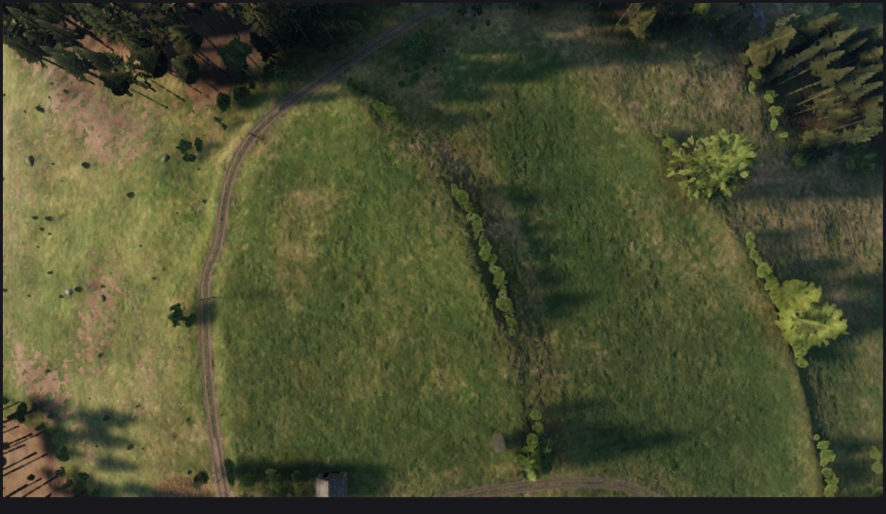
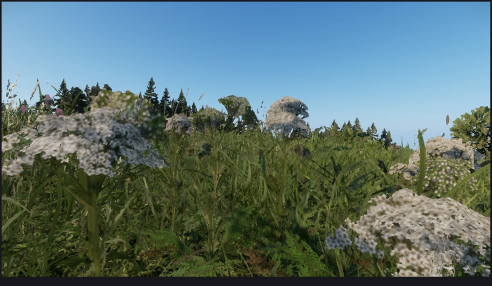
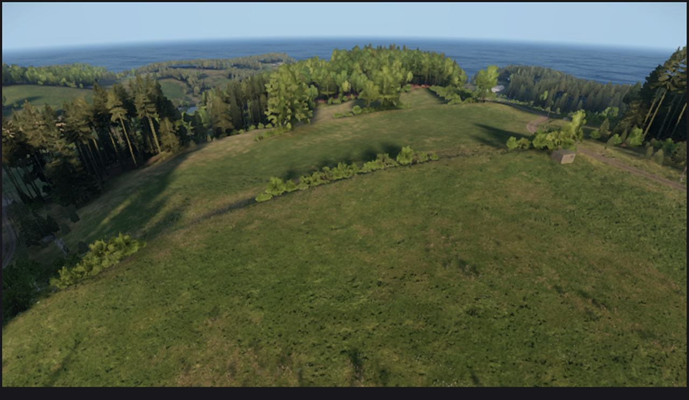
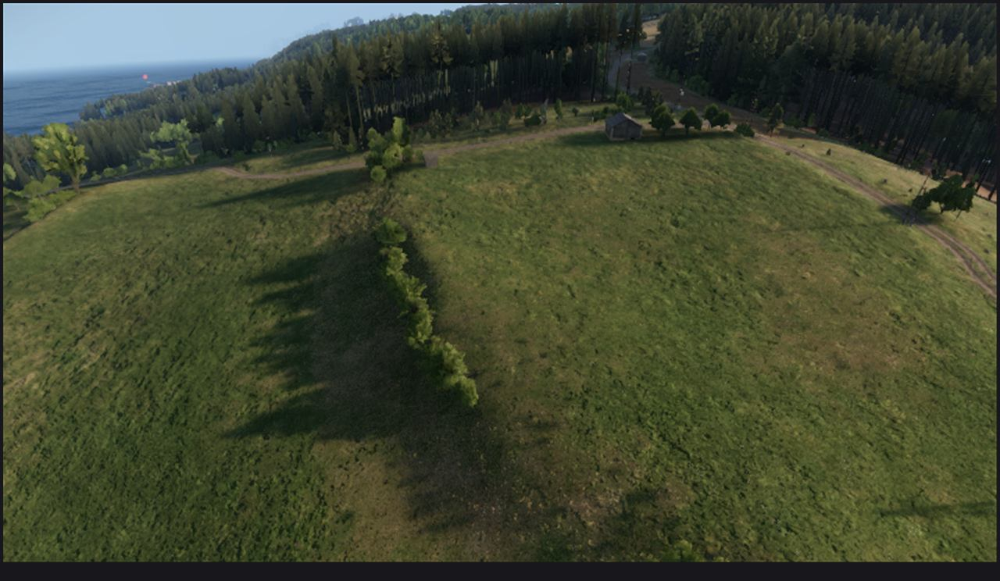
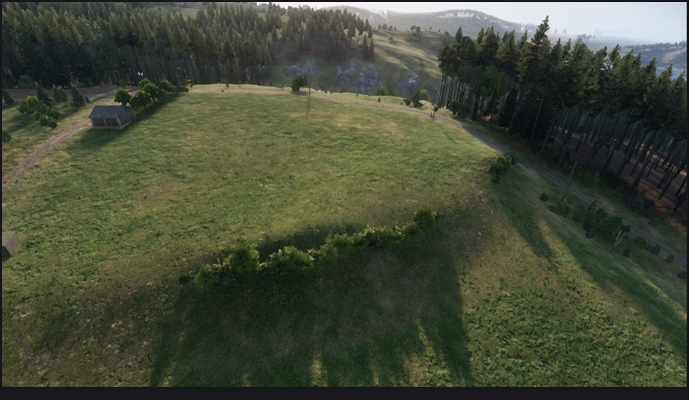
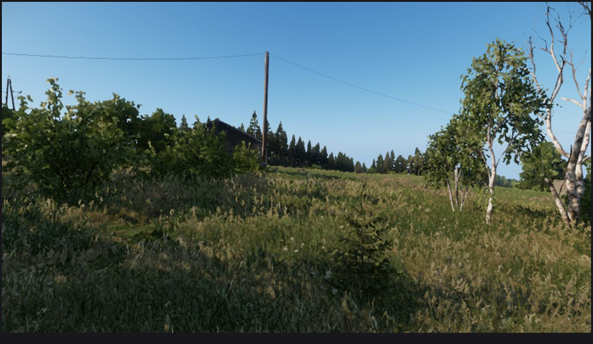
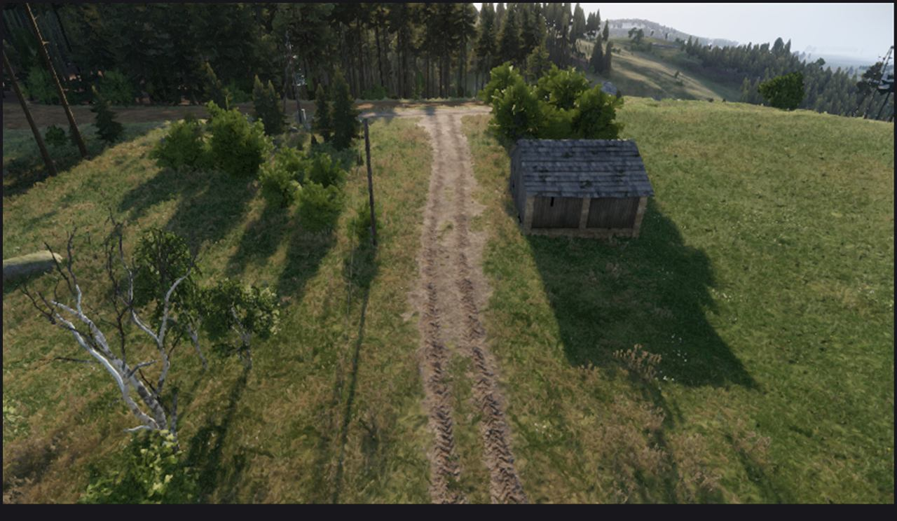

# xz-6712-7944: location dossier

Generated 2026-11-24 by `tools\cli scout`. Do not edit by hand; run `tools\cli scout 6712,7944 --radius 150` to refresh. The machine-readable twin is `dossier.json`.

- **Place:** xz-6712-7944, from coordinates
- **Centre:** x 6712, z 7944, ground 145.5 m; **radius** 150 m
- **World:** Worlds/CoreOnEveron/CoreOnEveron.ent, Arma Reforger build 26266485 (installed 2026-11-08)
- **Other labels nearby:** Gillnet Pond (aquatic, 429 m NE); André's Beacon (natural, 576 m NE); Aluette Pond (aquatic, 657 m W)

## At a glance

6 buildings (0 homes, 0 civic, 0 ruins), 1 enterable (a door entity below them), 5 entrances from outside among 5 door entities; 2 road(s), 1 junction(s); 0 notable props; 7 trees, bushes and other generated vegetation; 8 free plot(s).

| Type | Count |
| --- | --- |
| shed | 5 |
| farm | 1 |

## Overview

## Terrain

- ground 110.6 to 153.2 m (42.6 m of relief) within 150 m; mean 137 m
- 4% of the ground is under 3 degrees, 26% 3 to 8, 25% over 15
- overall the ground falls 6.7 degrees toward the NE
- steepest ground 30.4 degrees at 6687, 7994

## Roads and junctions

**Main street:** E-W road r04, 6 buildings within 25 m of it; its busiest stretch is at x 6685.9, z 7864.8.

| Id | Road | Length in radius (m) | Points |
| --- | --- | --- | --- |
| r01 | N-S road r01 | 388 | 13 |
| r04 | E-W road r04 | 182.4 | 8 |

| x | z | Kind | Arms | Roads |
| --- | --- | --- | --- | --- |
| 6646 | 7863.8 | t-junction | 3 | r04, r01 |

## Civic candidates

Public-facing buildings a town plan would use (church, chapel, government, police, fire, pub, shop, fuel station, hotel, recreation), nearest first. Each links its pictures.

_none_

## All buildings

| Id | Type | Vanilla prefab | x | z | Yaw | Facing | Footprint (m) | Floors | Interior | Entrances | Furniture |
| --- | --- | --- | --- | --- | --- | --- | --- | --- | --- | --- | --- |
| b01 | shed | Shed_02_square | 6729.8 | 7885.4 | -105 | W | 4.4 x 3.7 (16.3 m2) | 2 | yes | 1 | - |
| b02 | shed | Door_HouseAddon_Shed_E_R_EXT_COV_02 | 6676.6 | 7878.1 | 180 | S | 1.6 x 0.1 (0.2 m2) | - | no | ? | - |
| b03 | farm | Barn_E_02 | 6678 | 7874.2 | 0 | N | 9.5 x 8.5 (80.8 m2) | 0 | unknown | 4 | - |
| b04 | shed | Door_HouseAddon_Shed_E_R_EXT_COV_02 | 6679.2 | 7870.1 | 0 | N | 1.6 x 0.1 (0.2 m2) | - | no | ? | - |
| b05 | shed | Door_HouseAddon_Shed_E_R_EXT_COV_01 | 6677.9 | 7870.1 | 180 | S | 1.7 x 0.1 (0.2 m2) | - | no | ? | - |
| b06 | shed | Door_HouseAddon_Shed_E_L_EXT_COV_01 | 6674.5 | 7870.1 | 0 | N | 1.9 x 0.1 (0.2 m2) | - | no | ? | - |

Footprint: `catalog` and `measure` are the model's own extents turned by the yaw; `world-bounds` is the engine's axis-aligned box. Yaw is Enfusion's (0 faces +z north, 90 faces +x east). Interior `yes` means door entities and a walkable floor (a heuristic, not walked); `unknown` means door entities but no walkable floor. Entrances are the doors on the outline; `?` means the building was not found in the engine dump. Furniture is the count of furnishing props inside the footprint where the place file has it.

## Notable props

_none_

## Free plots

| Id | x | z | Size (m) | Area (m2) | Ground (m) | Nearest road | Nearest building | From centre |
| --- | --- | --- | --- | --- | --- | --- | --- | --- |
| p1 | 6681 | 7921 | 66 x 82 | 5412 | 144.3 to 153 | N-S road r01 43.4 m | b03 farm 42.6 m | 38.6 m |
| p2 | 6787 | 7914 | 66 x 76 | 5016 | 129 to 142.6 | E-W road r04 49.1 m | b01 shed 61.7 m | 80.8 m |
| p3 | 6719 | 7841 | 122 x 38 | 4636 | 137.2 to 152.4 | E-W road r04 27.4 m | b01 shed 42.9 m | 103.2 m |
| p4 | 6762 | 7999 | 36 x 34 | 1224 | 127.3 to 133.9 | N-S road r01 56.5 m | b01 shed 115.2 m | 74.3 m |
| p5 | 6628 | 7862 | 16 x 76 | 1216 | 149 to 151.8 | N-S road r01 17.9 m | b03 farm 45.9 m | 117.4 m |
| p6 | 6831 | 7888 | 18 x 48 | 864 | 128.8 to 130.7 | E-W road r04 47.3 m | b01 shed 98.9 m | 131.5 m |
| p7 | 6676 | 7973 | 36 x 18 | 648 | 144.9 to 146.9 | N-S road r01 23.2 m | b03 farm 94.6 m | 46.2 m |
| p8 | 6647 | 8013 | 14 x 46 | 644 | 136.5 to 143.4 | N-S road r01 26.2 m | b03 farm 137.1 m | 94.8 m |

plots are open rectangles at least 10 m on the short side, kept 2.5 m off buildings, 4.5 m off a road's centre line, 2 m off a tree, on ground under 12 degrees; axis aligned, not the best use of the land

## Limits of this dossier

- buildings (types, footprints, floors, interiors) are read from the Everon catalog, docs/everon/catalog-buildings.json; 2 of 6 matched an entity of the engine dump, which adds the door positions, and the other 4 have no entrances listed

## Prefab references

Every distinct building prefab, as the world file refers to it.

| Prefab | Type | Count |
| --- | --- | --- |
| `{D61A7F2891D457C6}Prefabs/Structures/Houses/Shed/Shed_02/Shed_02_square.et` | shed | 1 |
| `{4B531C06224FA250}Prefabs/Structures/BuildingParts/Doors/Door_HouseAddon_Shed_E_R_EXT_COV_02.et` | shed | 2 |
| `{F5A2DC0597B53E19}Prefabs/Structures/Agriculture/Barn/Barn_E_02/Barn_E_02.et` | farm | 1 |
| `{270728E69E8B2D7E}Prefabs/Structures/BuildingParts/Doors/Door_HouseAddon_Shed_E_R_EXT_COV_01.et` | shed | 1 |
| `{9D6C69116A1DE3B0}Prefabs/Structures/BuildingParts/Doors/Door_HouseAddon_Shed_E_L_EXT_COV_01.et` | shed | 1 |
