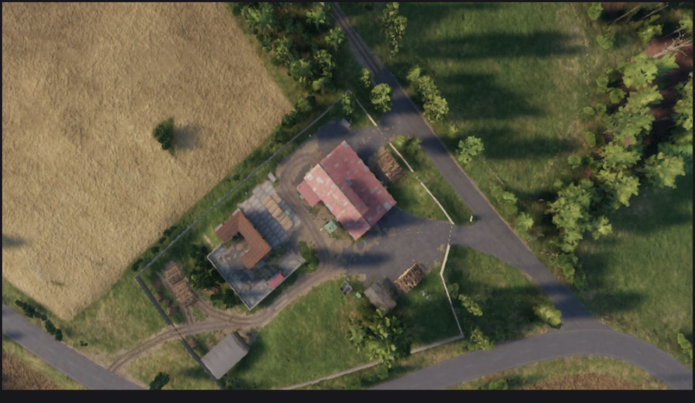
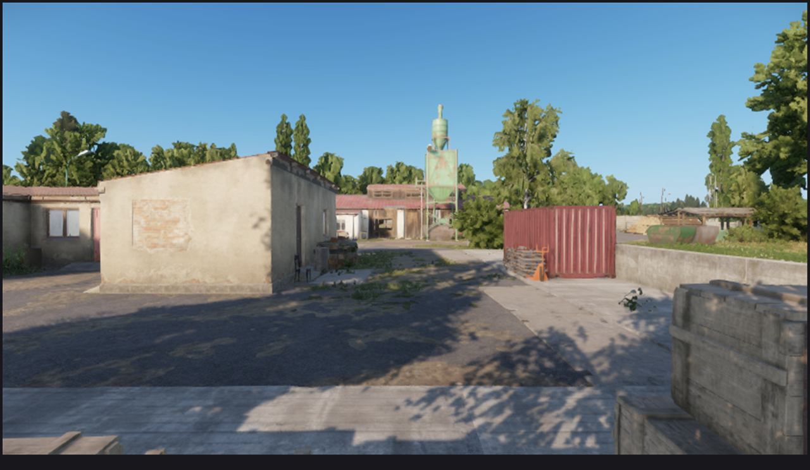
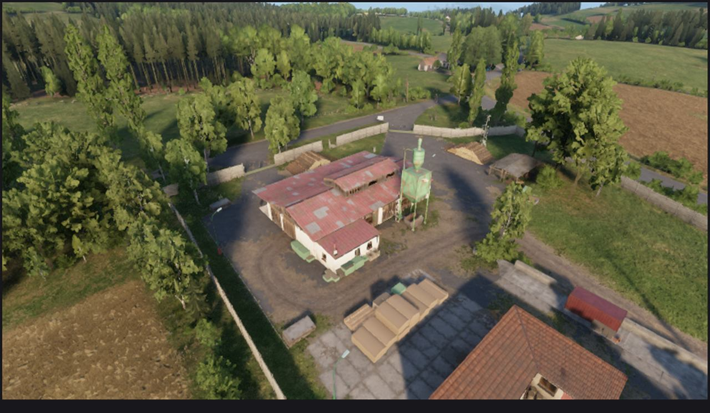
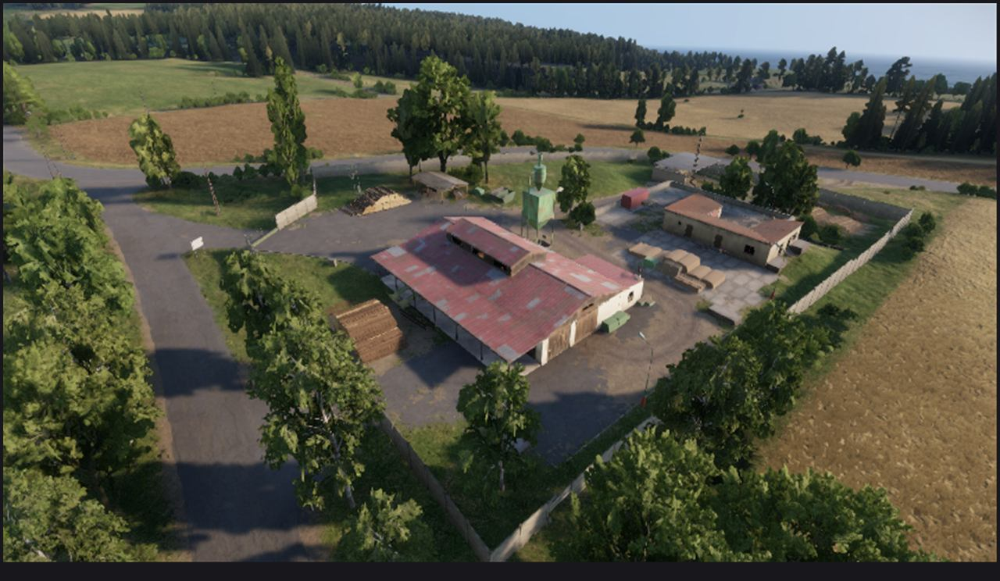
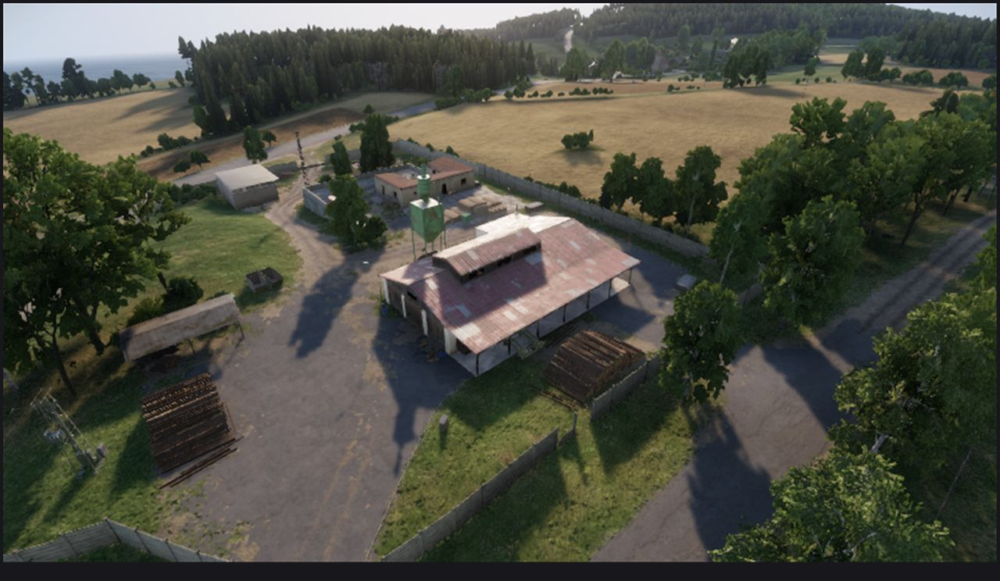
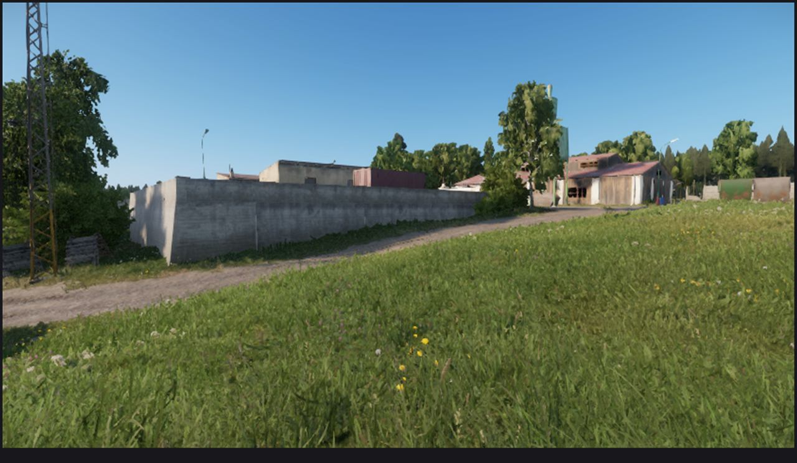
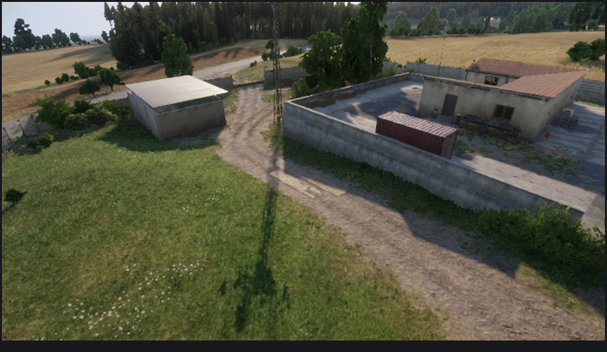

# xz-3093-5241: location dossier

Generated 2026-11-19 by `tools\cli scout`. Do not edit by hand; run `tools\cli scout 3093,5241` to refresh. The machine-readable twin is `dossier.json`.

- **Place:** xz-3093-5241, from coordinates
- **Centre:** x 3093, z 5241, ground 118.5 m; **radius** 120 m
- **World:** Worlds/CoreOnEveron/CoreOnEveron.ent, Arma Reforger build 26266485 (installed 2026-11-08)
- **Other labels nearby:** sawmill (other, 35 m SE); farm (urban, 259 m N); Le Moule (other, 497 m W); Shepherd's Pond (aquatic, 625 m SE); Richemont (urban, 713 m E)

## At a glance

9 buildings (0 homes, 0 civic, 0 ruins), 4 enterable (a door entity below them), 6 entrances from outside among 19 door entities; 16 road(s), 12 junction(s); 4 notable props; 177 trees, bushes and other generated vegetation; 8 free plot(s).

| Type | Count |
| --- | --- |
| garage | 3 |
| industrial | 2 |
| shed | 2 |
| industrial-tower | 1 |
| industrial-tank | 1 |

## Overview

## Terrain

- ground 110.1 to 123.9 m (13.8 m of relief) within 120 m; mean 117.8 m
- 48% of the ground is under 3 degrees, 43% 3 to 8, 1% over 15
- overall the ground falls 2.4 degrees toward the S
- steepest ground 27.2 degrees at 3043, 5211

## Roads and junctions

**Main street:** E-W road r15, 6 buildings within 25 m of it; its busiest stretch is at x 3065, z 5198.7.

| Id | Road | Length in radius (m) | Points |
| --- | --- | --- | --- |
| r01 | E-W road r01 | 197.1 | 4 |
| r03 | NW-SE road r03 | 105.1 | 3 |
| r04 | NE-SW road r04 | 56.9 | 2 |
| r05 | NW-SE road r05 | 146.6 | 6 |
| r06 | NW-SE road r06 | 22 | 2 |
| r07 | NW-SE road r07 | 22 | 2 |
| r08 | NW-SE road r08 | 22 | 2 |
| r09 | NW-SE road r09 | 22 | 2 |
| r10 | NE-SW road r10 | 34.4 | 7 |
| r11 | E-W road r11 | 47.7 | 6 |
| r12 | E-W road r12 | 31.4 | 6 |
| r13 | N-S road r13 | 69.7 | 13 |
| r14 | NW-SE road r14 | 32.6 | 7 |
| r15 | E-W road r15 | 83.4 | 10 |
| r17 | NE-SW road r17 | 38.7 | 7 |
| r18 | NW-SE road r18 | 23.8 | 5 |

| x | z | Kind | Arms | Roads |
| --- | --- | --- | --- | --- |
| 3122.1 | 5227.5 | crossroads | 4 | r11, r12 |
| 3025.4 | 5187 | crossroads | 4 | r17, r15, r18 |
| 3071.8 | 5337.3 | t-junction | 3 | r03, r04 |
| 3103.9 | 5228.7 | t-junction | 3 | r11, r10 |
| 3100.5 | 5219.4 | t-junction | 3 | r12, r10 |
| 3130.3 | 5226.8 | t-junction | 3 | r12, r11 |
| 3080.1 | 5209.1 | t-junction | 3 | r13, r15 |
| 3052.6 | 5190.5 | t-junction | 3 | r14, r15 |
| 3016.6 | 5184.4 | t-junction | 3 | r15, r17 |
| 3203.3 | 5182.3 | bend-or-join | 2 | r01, r05 |
| 3106.6 | 5287.8 | bend-or-join | 2 | r03, r05 |
| 3087.4 | 5213.1 | bend-or-join | 2 | r10, r15 |

## Civic candidates

Public-facing buildings a town plan would use (church, chapel, government, police, fire, pub, shop, fuel station, hotel, recreation), nearest first. Each links its pictures.

_none_

## All buildings

| Id | Type | Vanilla prefab | x | z | Yaw | Facing | Footprint (m) | Floors | Interior | Entrances | Furniture |
| --- | --- | --- | --- | --- | --- | --- | --- | --- | --- | --- | --- |
| b01 | industrial | Sawmill_E_01 | 3092.7 | 5240.8 | -41 | NW | 27.1 x 31.9 (864.5 m2) | 2 | yes | ? | - |
| b02 | shed | Shed_03_wide | 3107.7 | 5202.9 | -131 | SW | 12.3 x 3.9 (48 m2) | 0 | no | - | - |
| b03 | shed | Shed_03_wide | 3104.9 | 5200.4 | 49 | NE | 12.3 x 3.9 (48 m2) | 0 | no | - | - |
| b04 | garage | Workshop_01_Main | 3055.3 | 5219.6 | 139 | SE | 12.2 x 7.6 (92.7 m2) | 1 | yes | 2 | - |
| b05 | garage | Workshop_01_Main | 3050.9 | 5228.3 | 49 | NE | 12.2 x 7.6 (92.7 m2) | 1 | yes | 3 | - |
| b06 | garage | Workshop_01_Side | 3043.9 | 5226.6 | -41 | NW | 5.4 x 5.8 (31.3 m2) | 1 | yes | 1 | - |
| b07 | industrial-tower | LightTower_01 | 3047.2 | 5195 | 48 | NE | 2.3 x 1.9 (4.4 m2) | - | no | - | - |
| b08 | industrial-tank | FuelTank_02_Base | 3045.8 | 5178.8 | 140 | SE | 9.1 x 2.8 (25.5 m2) | 2 | no | - | - |
| b09 | industrial | ShedMetal_02_short_nowalls | 3042.1 | 5177.9 | -41 | NW | 16.3 x 11.2 (182.6 m2) | 1 | no | ? | - |

Footprint: `catalog` and `measure` are the model's own extents turned by the yaw; `world-bounds` is the engine's axis-aligned box. Yaw is Enfusion's (0 faces +z north, 90 faces +x east). Interior `yes` means door entities and a walkable floor (a heuristic, not walked); `unknown` means door entities but no walkable floor. Entrances are the doors on the outline; `?` means the building was not found in the engine dump. Furniture is the count of furnishing props inside the footprint where the place file has it.

## Notable props

_none_

Counted, not listed: 4 street-lamp.

## Free plots

| Id | x | z | Size (m) | Area (m2) | Ground (m) | Nearest road | Nearest building | From centre |
| --- | --- | --- | --- | --- | --- | --- | --- | --- |
| p1 | 3041 | 5292 | 72 x 62 | 4464 | 118.3 to 120.3 | N-S road r13 48.9 m | b01 industrial 56.6 m | 72.8 m |
| p2 | 3165 | 5282 | 48 x 66 | 3168 | 118.5 to 120.6 | NW-SE road r05 42.7 m | b01 industrial 68 m | 82.9 m |
| p3 | 3004 | 5236 | 54 x 46 | 2484 | 114.2 to 118.7 | NW-SE road r18 30.2 m | b06 garage 37.1 m | 89.1 m |
| p4 | 3121 | 5326 | 36 x 54 | 1944 | 120.5 to 122.9 | NW-SE road r03 33.8 m | b01 industrial 70.3 m | 89.5 m |
| p5 | 3093 | 5139 | 92 x 20 | 1840 | 110.2 to 114.3 | E-W road r01 15.7 m | b03 shed 57.3 m | 102 m |
| p6 | 3137 | 5199 | 44 x 40 | 1760 | 115.9 to 119.1 | E-W road r11 26.7 m | b02 shed 23.8 m | 60.8 m |
| p7 | 3086 | 5178 | 50 x 26 | 1300 | 114.6 to 118 | E-W road r01 23.6 m | b03 shed 27 m | 63.4 m |
| p8 | 3198 | 5248 | 14 x 78 | 1092 | 115.1 to 118.9 | NW-SE road r05 44.5 m | b01 industrial 85.2 m | 105.2 m |

plots are open rectangles at least 10 m on the short side, kept 2.5 m off buildings, 4.5 m off a road's centre line, 2 m off a tree, on ground under 12 degrees; axis aligned, not the best use of the land

## Limits of this dossier

- buildings (types, footprints, floors, interiors) are read from the Everon catalog, docs/everon/catalog-buildings.json; 7 of 9 matched an entity of the engine dump, which adds the door positions, and the other 2 have no entrances listed

## Prefab references

Every distinct building prefab, as the world file refers to it.

| Prefab | Type | Count |
| --- | --- | --- |
| `{1A18A755842DCA36}Prefabs/Structures/Industrial/Houses/Sawmill_E_01/Sawmill_E_01.et` | industrial | 1 |
| `{EF96889E35217E1E}Prefabs/Structures/Houses/Shed/Shed_03/Shed_03_wide.et` | shed | 2 |
| `{CFF7F6F7042AFFEF}Prefabs/Structures/Industrial/Houses/Workshop_01/Workshop_01_Main.et` | garage | 2 |
| `{F9F2F6D2BD65B719}Prefabs/Structures/Industrial/Houses/Workshop_01/Workshop_01_Side.et` | garage | 1 |
| `{80DF3BD810D032AF}Prefabs/Structures/Industrial/Towers/LightTower_01/LightTower_01.et` | industrial-tower | 1 |
| `{C7A59DCCFF7BF19F}Prefabs/Structures/Industrial/Containers/FuelTanks/FuelTank_02/FuelTank_02_Base.et` | industrial-tank | 1 |
| `{DEBC2FB8DA61B83E}Prefabs/Structures/Industrial/Sheds/ShedMetal_02/ShedMetal_02_short_nowalls.et` | industrial | 1 |
