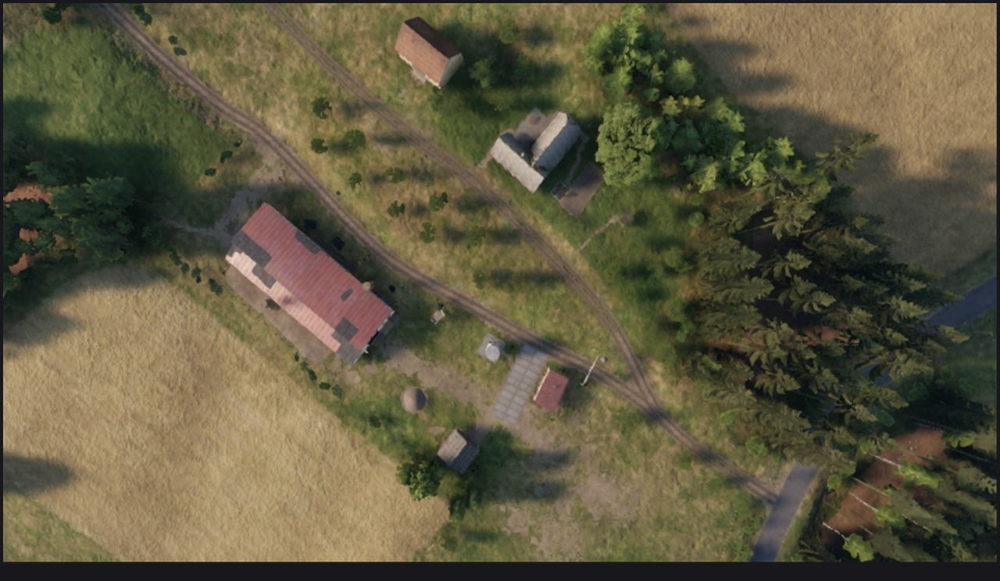
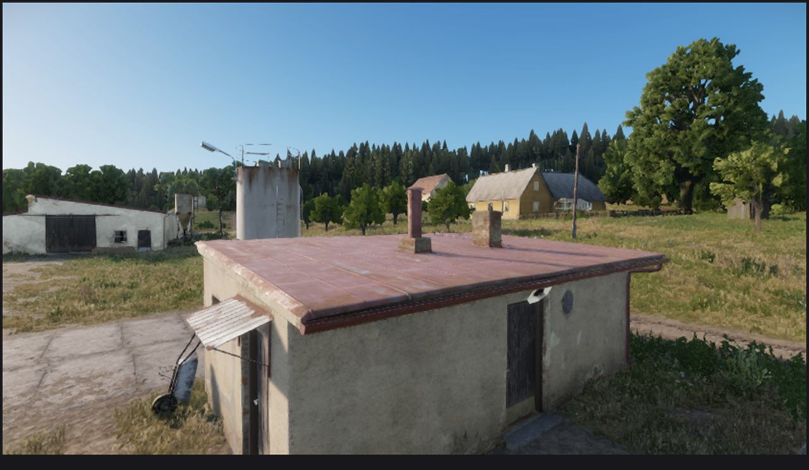
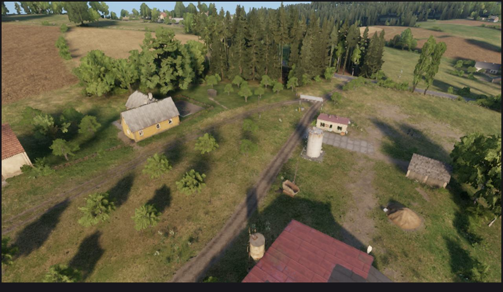
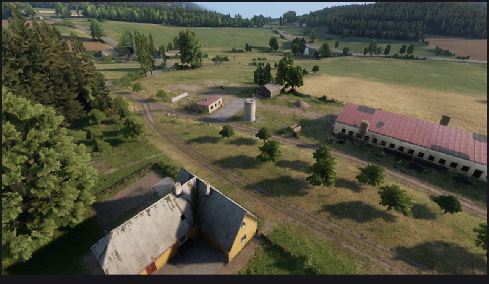
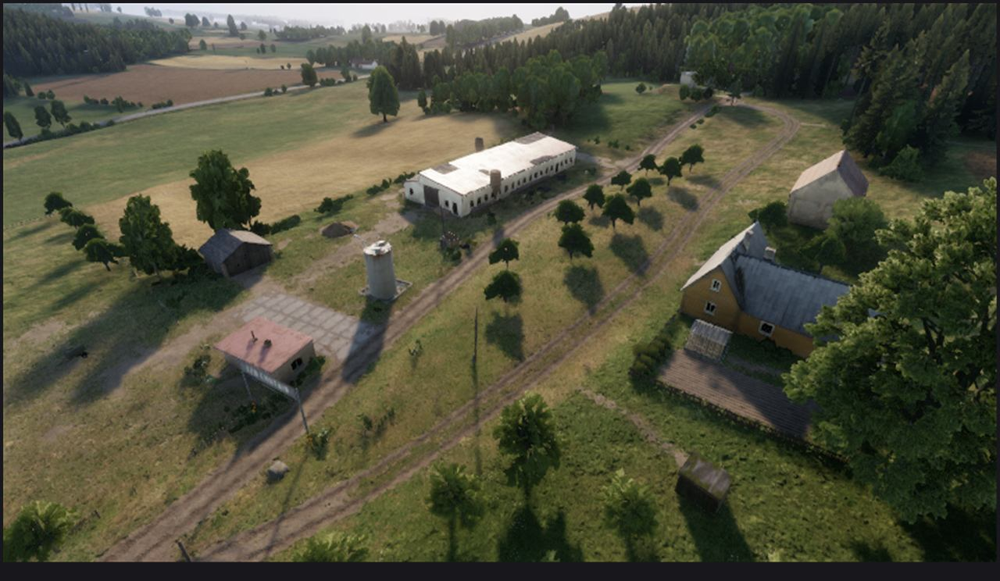
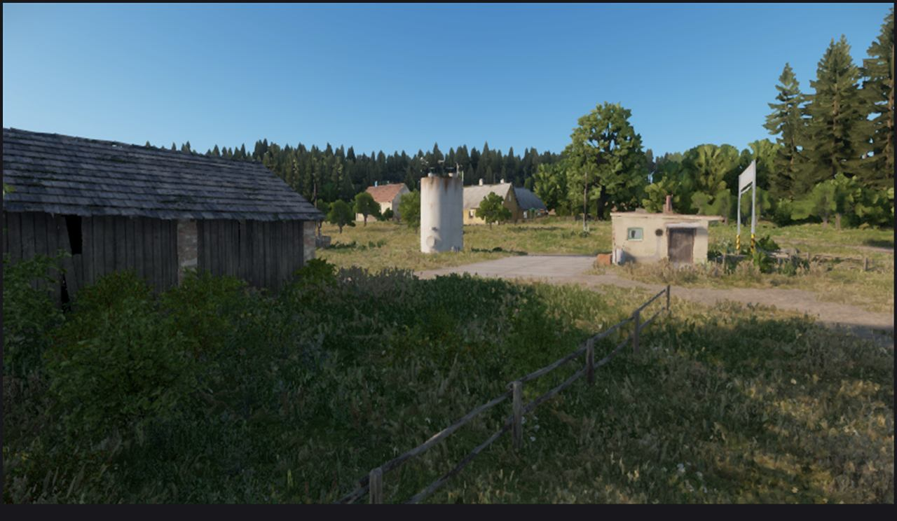
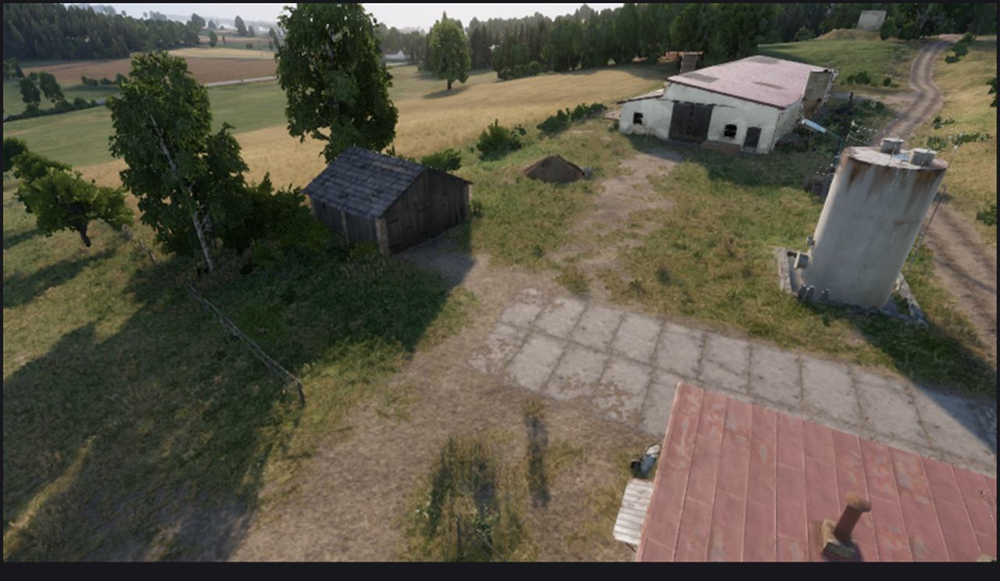

# xz-6649-5900: location dossier

Generated 2026-11-19 by `tools\cli scout`. Do not edit by hand; run `tools\cli scout 6649,5900 --radius 90` to refresh. The machine-readable twin is `dossier.json`.

- **Place:** xz-6649-5900, from coordinates
- **Centre:** x 6649, z 5900, ground 112.2 m; **radius** 90 m
- **World:** Worlds/CoreOnEveron/CoreOnEveron.ent, Arma Reforger build 26266485 (installed 2026-11-08)
- **Other labels nearby:** La Valette (urban, 265 m S); Reed Pond (aquatic, 342 m S); Chotain (other, 451 m E); industrial compound (urban, 612 m N)

## At a glance

14 buildings (1 homes, 0 civic, 0 ruins), 5 enterable (a door entity below them), 22 entrances from outside among 32 door entities; 6 road(s), 3 junction(s); 3 notable props; 273 trees, bushes and other generated vegetation; 8 free plot(s).

| Type | Count |
| --- | --- |
| shed | 5 |
| farm | 4 |
| industrial-tank | 3 |
| farm-small | 1 |
| farmhouse | 1 |

## Overview

## Terrain

- ground 104.4 to 118.3 m (14 m of relief) within 90 m; mean 111.2 m
- 25% of the ground is under 3 degrees, 62% 3 to 8, 0% over 15
- overall the ground falls 4 degrees toward the S
- steepest ground 15.9 degrees at 6594, 5935

## Roads and junctions

**Main street:** NE-SW road r08, 7 buildings within 25 m of it; its busiest stretch is at x 6647.7, z 5862.2.

| Id | Road | Length in radius (m) | Points |
| --- | --- | --- | --- |
| r02 | NE-SW road r02 | 17.1 | 3 |
| r03 | NE-SW road r03 | 16.9 | 3 |
| r04 | NW-SE road r04 | 221.8 | 8 |
| r05 | NW-SE road r05 | 159.8 | 11 |
| r07 | NE-SW road r07 | 22.4 | 2 |
| r08 | NE-SW road r08 | 22.6 | 2 |

| x | z | Kind | Arms | Roads |
| --- | --- | --- | --- | --- |
| 6661.7 | 5880.7 | crossroads | 4 | r07, r05, r08 |
| 6700.7 | 5858.6 | t-junction | 3 | r05, r04 |
| 6678.6 | 5930.7 | bend-or-join | 2 | r02, r03 |

## Civic candidates

Public-facing buildings a town plan would use (church, chapel, government, police, fire, pub, shop, fuel station, hotel, recreation), nearest first. Each links its pictures.

_none_

## All buildings

| Id | Type | Vanilla prefab | x | z | Yaw | Facing | Footprint (m) | Floors | Interior | Entrances | Furniture |
| --- | --- | --- | --- | --- | --- | --- | --- | --- | --- | --- | --- |
| b01 | industrial-tank | FuelTank_01_rust | 6647 | 5881.6 | -64 | NW | 5.2 x 4.6 (23.9 m2) | 1 | no | - | - |
| b02 | farm-small | Greenhouse_01 | 6665.9 | 5924.4 | 39 | NE | 3.8 x 4.2 (16 m2) | 1 | yes | 1 | - |
| b03 | farm | WeightStation_01 | 6664.1 | 5871.2 | -153 | SW | 6.6 x 11 (72.6 m2) | 2 | yes | 2 | - |
| b04 | farmhouse | FarmHouse_E_1L01 | 6660 | 5934 | 40 | NE | 16.2 x 21.2 (343.4 m2) | 2 | yes | - | - |
| b05 | industrial-tank | Silo_01 | 6612.6 | 5899.3 | 41 | NE | 2.5 x 3.7 (9.3 m2) | 0 | no | - | - |
| b06 | shed | Shed_01 | 6684.3 | 5916.6 | -44 | NW | 3.6 x 2.7 (9.7 m2) | 1 | yes | 1 | - |
| b07 | shed | Door_HouseAddon_Shed_E_R_EXT_COV_02 | 6638.8 | 5858.1 | -141 | SW | 1.6 x 0.1 (0.2 m2) | - | no | ? | - |
| b08 | shed | Door_HouseAddon_Shed_E_R_EXT_COV_01 | 6639.9 | 5857.3 | 39 | NE | 1.7 x 0.1 (0.2 m2) | - | no | ? | - |
| b09 | shed | Door_HouseAddon_Shed_E_L_EXT_COV_01 | 6642.5 | 5855.1 | -141 | SW | 1.9 x 0.1 (0.2 m2) | - | no | ? | - |
| b10 | farm | Barn_E_02 | 6637.1 | 5854.2 | -141 | SW | 9.5 x 8.5 (80.8 m2) | 0 | unknown | 4 | - |
| b11 | shed | Door_HouseAddon_Shed_E_R_EXT_COV_02 | 6635.8 | 5850.3 | 39 | NE | 1.6 x 0.1 (0.2 m2) | - | no | ? | - |
| b12 | farm | CowShed_E_01_short | 6596.1 | 5897.8 | -51 | NW | 19.6 x 46.7 (915.3 m2) | 1 | yes | 10 | - |
| b13 | farm | Barn_E_01 | 6629.8 | 5959.2 | 38 | NE | 15.1 x 10.8 (163.1 m2) | 0 | unknown | 4 | - |
| b14 | industrial-tank | Silo_01 | 6583.8 | 5894.3 | -139 | SW | 2.5 x 3.7 (9.3 m2) | 0 | no | - | - |

Footprint: `catalog` and `measure` are the model's own extents turned by the yaw; `world-bounds` is the engine's axis-aligned box. Yaw is Enfusion's (0 faces +z north, 90 faces +x east). Interior `yes` means door entities and a walkable floor (a heuristic, not walked); `unknown` means door entities but no walkable floor. Entrances are the doors on the outline; `?` means the building was not found in the engine dump. Furniture is the count of furnishing props inside the footprint where the place file has it.

## Notable props

| Kind | Vanilla prefab | x | z | Distance |
| --- | --- | --- | --- | --- |
| notice-board | MessageBoardSmall_01 | 6661.6 | 5873.5 | 29.3 m |
| market-stand | MarketStand_01 | 6658.6 | 5936.9 | 38.1 m |
| well | Well_02_blue | 6673.8 | 5933 | 41.2 m |

## Free plots

| Id | x | z | Size (m) | Area (m2) | Ground (m) | Nearest road | Nearest building | From centre |
| --- | --- | --- | --- | --- | --- | --- | --- | --- |
| p1 | 6710 | 5911 | 38 x 66 | 2508 | 111 to 115.8 | NW-SE road r04 36.5 m | b06 shed 24.2 m | 62 m |
| p2 | 6649 | 5831 | 88 x 22 | 1936 | 104.5 to 108.3 | NE-SW road r07 30 m | b10 farm 20.1 m | 69 m |
| p3 | 6601 | 5860 | 48 x 32 | 1536 | 105.3 to 109.6 | NE-SW road r08 46.8 m | b12 farm 18.1 m | 62.5 m |
| p4 | 6649 | 5976 | 80 x 12 | 960 | 115.2 to 118.4 | NW-SE road r04 44.1 m | b13 farm 19.7 m | 76 m |
| p5 | 6690 | 5957 | 38 x 22 | 836 | 114.7 to 117.8 | NE-SW road r03 28.2 m | b04 farmhouse 25.3 m | 70.2 m |
| p6 | 6672 | 5850 | 54 x 12 | 648 | 107.9 to 109.4 | NE-SW road r07 23.3 m | b03 farm 16.3 m | 55 m |
| p7 | 6717 | 5869 | 28 x 14 | 392 | 109.8 to 111.1 | NW-SE road r04 17.4 m | b03 farm 48.2 m | 74.7 m |
| p8 | 6634 | 5875 | 14 x 26 | 364 | 109.2 to 109.6 | NE-SW road r08 18 m | b01 industrial-tank 11.1 m | 29.2 m |

plots are open rectangles at least 10 m on the short side, kept 2.5 m off buildings, 4.5 m off a road's centre line, 2 m off a tree, on ground under 12 degrees; axis aligned, not the best use of the land

## Limits of this dossier

- buildings (types, footprints, floors, interiors) are read from the Everon catalog, docs/everon/catalog-buildings.json; 10 of 14 matched an entity of the engine dump, which adds the door positions, and the other 4 have no entrances listed
- 2 quay, pier and waterworks pieces are counted, not listed

## Prefab references

Every distinct building prefab, as the world file refers to it.

| Prefab | Type | Count |
| --- | --- | --- |
| `{AD207D3DE43922D8}Prefabs/Structures/Industrial/Containers/FuelTanks/FuelTank_01/FuelTank_01_rust.et` | industrial-tank | 1 |
| `{3299E6F34CE40185}Prefabs/Structures/Agriculture/Greenhouse/Greenhouse_01/Greenhouse_01.et` | farm-small | 1 |
| `{B461AC17AE9B29EF}Prefabs/Structures/Agriculture/WeightStation/WeightStation_01/WeightStation_01.et` | farm | 1 |
| `{CD370ECB385DE67A}Prefabs/Structures/Houses/Farm/FarmHouse_E_1L01/FarmHouse_E_1L01.et` | farmhouse | 1 |
| `{4D100F180B3EFEC1}Prefabs/Structures/Industrial/Containers/Silos/Silo_01/Silo_01.et` | industrial-tank | 2 |
| `{F08D8E78433D713A}Prefabs/Structures/Houses/Shed/Shed_01/Shed_01.et` | shed | 1 |
| `{4B531C06224FA250}Prefabs/Structures/BuildingParts/Doors/Door_HouseAddon_Shed_E_R_EXT_COV_02.et` | shed | 2 |
| `{270728E69E8B2D7E}Prefabs/Structures/BuildingParts/Doors/Door_HouseAddon_Shed_E_R_EXT_COV_01.et` | shed | 1 |
| `{9D6C69116A1DE3B0}Prefabs/Structures/BuildingParts/Doors/Door_HouseAddon_Shed_E_L_EXT_COV_01.et` | shed | 1 |
| `{F5A2DC0597B53E19}Prefabs/Structures/Agriculture/Barn/Barn_E_02/Barn_E_02.et` | farm | 1 |
| `{4E0845B85F4535D8}Prefabs/Structures/Agriculture/CowShed/CowShed_E_01/CowShed_E_01_short.et` | farm | 1 |
| `{99F6E8E52B71B137}Prefabs/Structures/Agriculture/Barn/Barn_E_01/Barn_E_01.et` | farm | 1 |
