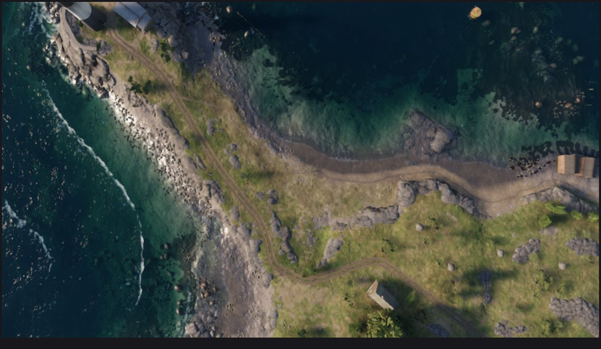
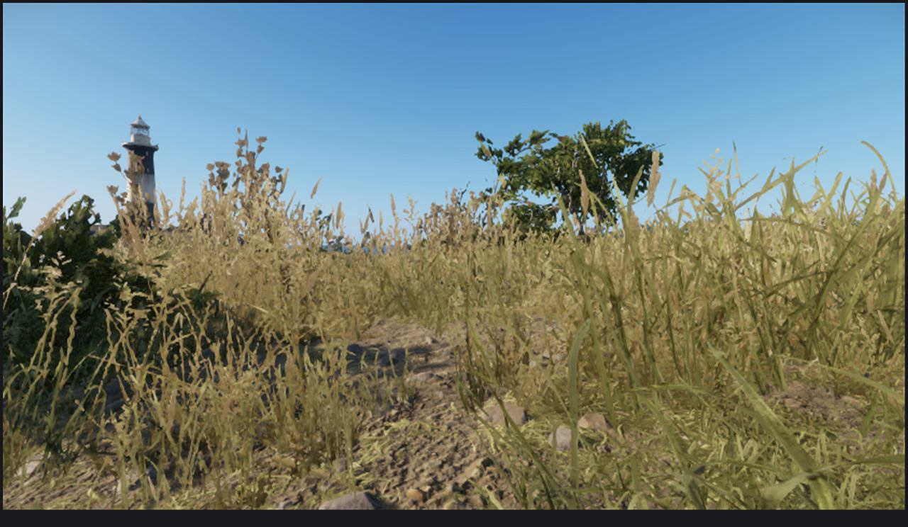
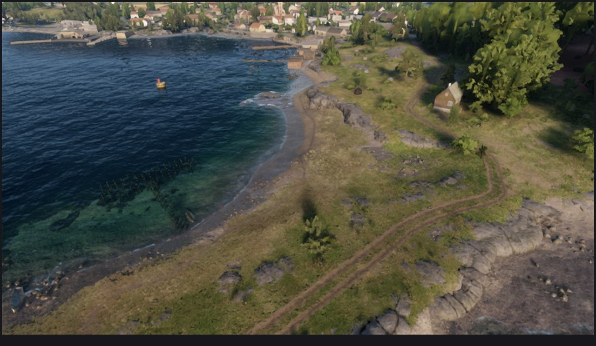
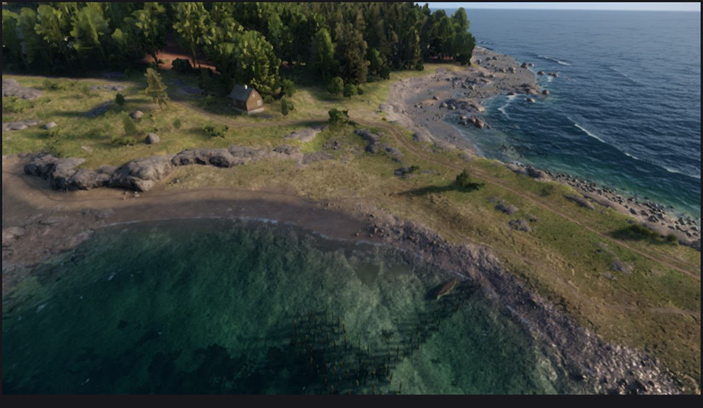
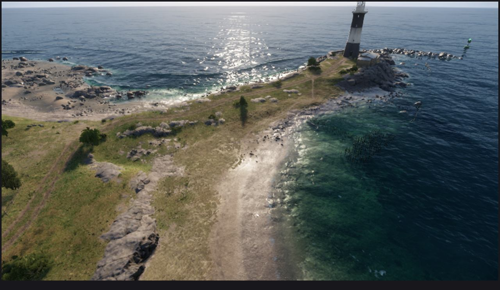
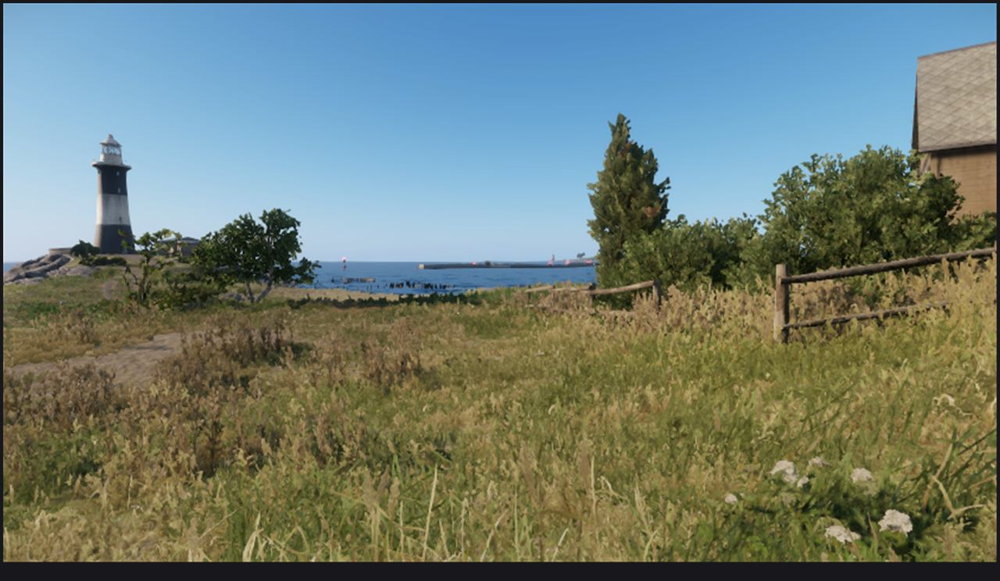
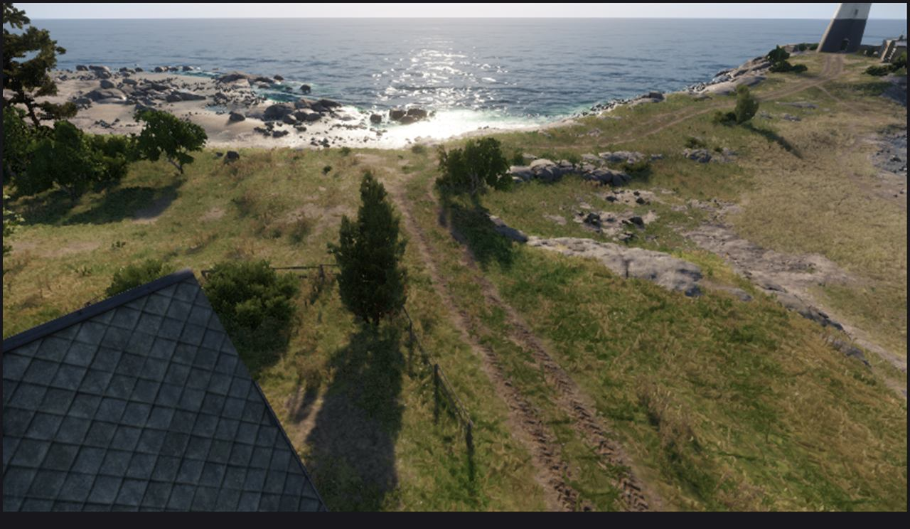

# xz-4018-10705: location dossier

Generated 2026-11-19 by `tools\cli scout`. Do not edit by hand; run `tools\cli scout 4018,10705 --radius 140` to refresh. The machine-readable twin is `dossier.json`.

- **Place:** xz-4018-10705, from coordinates
- **Centre:** x 4018, z 10705, ground 0.3 m; **radius** 140 m
- **World:** Worlds/CoreOnEveron/CoreOnEveron.ent, Arma Reforger build 26266485 (installed 2026-11-08)
- **Other labels nearby:** Lighthouse (other, 117 m NW); Charlet Bay (aquatic, 249 m N); Saint-Philippe (other, 410 m E); Coalman's Brow (natural, 478 m SE); Saint-Philippe (urban, 489 m E); factory (urban, 538 m E); Spring Pond (aquatic, 683 m E); power plant (other, 694 m SE)

## At a glance

3 buildings (1 homes, 0 civic, 0 ruins), 3 enterable (a door entity below them), 4 entrances from outside among 10 door entities; 3 road(s), 1 junction(s); 40 notable props; 148 trees, bushes and other generated vegetation; 7 free plot(s).

| Type | Count |
| --- | --- |
| house | 1 |
| garage | 1 |
| military | 1 |

## Overview

## Terrain

- ground 0 to 16.1 m (16.1 m of relief) within 140 m; mean 4.3 m
- 16% of the ground is under 3 degrees, 44% 3 to 8, 12% over 15
- overall the ground falls 2.2 degrees toward the NW
- steepest ground 39 degrees at 3913, 10785
- open water (the sea or a lake) is 14.1 m away to the NE (52% of the circle is water)

## Roads and junctions

**Main street:** NW-SE road r01, 3 buildings within 25 m of it; its busiest stretch is at x 4035.7, z 10659.3.

| Id | Road | Length in radius (m) | Points |
| --- | --- | --- | --- |
| r01 | NW-SE road r01 | 334.4 | 22 |
| r02 | E-W road r02 | 226.5 | 39 |
| r04 | NE-SW road r04 | 109.9 | 4 |

| x | z | Kind | Arms | Roads |
| --- | --- | --- | --- | --- |
| 3957.3 | 10741 | t-junction | 3 | r02, r01 |

## Civic candidates

Public-facing buildings a town plan would use (church, chapel, government, police, fire, pub, shop, fuel station, hotel, recreation), nearest first. Each links its pictures.

_none_

## All buildings

| Id | Type | Vanilla prefab | x | z | Yaw | Facing | Footprint (m) | Floors | Interior | Entrances | Furniture |
| --- | --- | --- | --- | --- | --- | --- | --- | --- | --- | --- | --- |
| b01 | house | House_Wooden_E_1I01 | 4055.3 | 10650.5 | 40 | NE | 13.5 x 7.1 (95.9 m2) | 2 | yes | 1 | - |
| b02 | garage | Workshop_02_grey | 3942.6 | 10771.9 | -53 | NW | 8.9 x 15.5 (138 m2) | 1 | yes | 1 | - |
| b03 | military | Bunker_01_1fp | 4091.7 | 10616.7 | 23 | NE | 5.5 x 6.2 (34.1 m2) | 2 | yes | 2 | - |

Footprint: `catalog` and `measure` are the model's own extents turned by the yaw; `world-bounds` is the engine's axis-aligned box. Yaw is Enfusion's (0 faces +z north, 90 faces +x east). Interior `yes` means door entities and a walkable floor (a heuristic, not walked); `unknown` means door entities but no walkable floor. Entrances are the doors on the outline; `?` means the building was not found in the engine dump. Furniture is the count of furnishing props inside the footprint where the place file has it.

## Notable props

| Kind | Vanilla prefab | x | z | Distance |
| --- | --- | --- | --- | --- |
| pier-or-dock | PierWooden_01_25m_abandoned | 4006.1 | 10734 | 31.3 m |
| pier-or-dock | PierWooden_01_25m_abandoned | 4017.8 | 10741.3 | 36.3 m |
| pier-or-dock | PierWooden_01_25m_abandoned | 4014.6 | 10741.1 | 36.3 m |
| pier-or-dock | PierWooden_01_25m_abandoned | 4018.8 | 10744.1 | 39.1 m |
| pier-or-dock | PierWooden_01_pole_01 | 4000.1 | 10765.2 | 62.8 m |
| pier-or-dock | PierCover_01 | 3998.7 | 10767.5 | 65.4 m |
| pier-or-dock | PierWooden_01_pole_01 | 3995.9 | 10768.8 | 67.5 m |
| pier-or-dock | PierWooden_01_25m_abandoned | 3982.7 | 10762.7 | 67.7 m |
| pier-or-dock | PierCover_01 | 3994.1 | 10771.3 | 70.5 m |
| pier-or-dock | PierWooden_01_pole_01 | 3990.8 | 10773 | 73.2 m |
| pier-or-dock | PierCover_01 | 3989.6 | 10775.2 | 75.7 m |
| pier-or-dock | PierWooden_01_pole_01 | 3987.3 | 10776 | 77.4 m |
| pier-or-dock | PierWooden_01_25m_abandoned | 4099 | 10710.6 | 81.1 m |
| pier-or-dock | PierWooden_01_25m_abandoned | 4099 | 10733.9 | 86 m |
| pier-or-dock | PierWooden_01_pole_01 | 3969 | 10789.5 | 97.7 m |
| pier-or-dock | PierWooden_01_pole_01 | 3969.7 | 10789.9 | 97.7 m |
| pier-or-dock | PierWooden_01_pole_01 | 3961.3 | 10796.2 | 107.4 m |
| pier-or-dock | PierWooden_01_pole_01 | 3961.9 | 10796.7 | 107.5 m |
| mooring | MooringBuoy_01 | 4102.2 | 10776.3 | 110.3 m |
| pier-or-dock | PierWooden_01_25m_abandoned | 3946.8 | 10793.8 | 113.8 m |
| pier-or-dock | PierWooden_01_pole_01 | 3952.9 | 10802.8 | 117.5 m |
| pier-or-dock | PierCover_01 | 3951.5 | 10805.1 | 120.2 m |
| pier-or-dock | PierWooden_01_pole_01 | 3948.7 | 10806.3 | 122.8 m |
| pier-or-dock | PierCover_01 | 3946.8 | 10808.8 | 125.9 m |
| pier-or-dock | PierWooden_01_pole_01 | 3943.4 | 10810.3 | 129 m |
| pier-or-dock | PierCover_01 | 3942.1 | 10812.5 | 131.6 m |
| pier-or-dock | PierWooden_01_pole_01 | 3939.8 | 10813.3 | 133.6 m |
| pier-or-dock | PierWooden_01_pole_01 | 4156.5 | 10718.7 | 139.2 m |
| pier-or-dock | PierWooden_01_pole_01 | 4156.9 | 10715 | 139.3 m |
| pier-or-dock | PierWooden_01_pole_01 | 4156.7 | 10721.6 | 139.7 m |
| pier-or-dock | PierWooden_01_pole_01 | 4157 | 10724.6 | 140.4 m |
| pier-or-dock | PierWooden_01_pole_01 | 3933.3 | 10817.7 | 141 m |
| pier-or-dock | PierWooden_01_pole_01 | 4156.9 | 10730.6 | 141.2 m |
| pier-or-dock | PierWooden_01_25m_abandoned | 3921.9 | 10809.3 | 141.8 m |
| pier-or-dock | PierWooden_01_pole_01 | 4157.2 | 10734.6 | 142.3 m |
| pier-or-dock | PierWooden_01_pole_01 | 4157.5 | 10738.1 | 143.4 m |
| pier-or-dock | PierWooden_01_pole_01 | 4157.7 | 10741.8 | 144.5 m |
| pier-or-dock | PierWooden_01_pole_01 | 4157.9 | 10744.5 | 145.4 m |
| pier-or-dock | PierWooden_01_pole_01 | 4158 | 10745.3 | 145.7 m |
| pier-or-dock | PierWooden_01_pole_01 | 3927.4 | 10820.8 | 147.1 m |

## Free plots

| Id | x | z | Size (m) | Area (m2) | Ground (m) | Nearest road | Nearest building | From centre |
| --- | --- | --- | --- | --- | --- | --- | --- | --- |
| p1 | 4043 | 10619 | 66 x 44 | 2904 | 3 to 11.6 | NW-SE road r01 40.7 m | b01 house 28.6 m | 89.6 m |
| p2 | 4108 | 10673 | 88 x 20 | 1760 | 2.8 to 6.6 | E-W road r02 17.2 m | b01 house 51 m | 95.5 m |
| p3 | 4021 | 10576 | 70 x 14 | 980 | 2.7 to 10.2 | NE-SW road r04 71.9 m | b01 house 76.8 m | 129 m |
| p4 | 4121 | 10648 | 30 x 26 | 780 | 5.7 to 10 | NW-SE road r01 19.2 m | b03 military 39 m | 117.7 m |
| p5 | 3964 | 10595 | 44 x 16 | 704 | 0.1 to 1.3 | NE-SW road r04 19.5 m | b01 house 101.6 m | 122.5 m |
| p6 | 3991 | 10636 | 10 x 62 | 620 | 0.2 to 1.7 | NE-SW road r04 26.9 m | b01 house 59.5 m | 74.1 m |
| p7 | 4018 | 10685 | 24 x 24 | 576 | 0.8 to 2.3 | E-W road r02 18.6 m | b01 house 44.9 m | 20 m |

plots are open rectangles at least 10 m on the short side, kept 2.5 m off buildings, 4.5 m off a road's centre line, 2 m off a tree, on ground under 12 degrees; axis aligned, not the best use of the land

## Limits of this dossier

- buildings (types, footprints, floors, interiors) are read from the Everon catalog, docs/everon/catalog-buildings.json; 3 of 3 matched an entity of the engine dump, which adds the door positions
- 16 quay, pier and waterworks pieces are counted, not listed

## Prefab references

Every distinct building prefab, as the world file refers to it.

| Prefab | Type | Count |
| --- | --- | --- |
| `{C212C8AC6001F002}Prefabs/Structures/Houses/Wooden/House_Wooden_E_1I01/House_Wooden_E_1I01.et` | house | 1 |
| `{CF7E43120709D9BE}Prefabs/Structures/Industrial/Houses/Workshop_02/Workshop_02_grey.et` | garage | 1 |
| `{44B2776836744D69}Prefabs/Structures/Military/Bunkers/Bunker_01/Bunker_01_1fp.et` | military | 1 |
