# xz-5014-8475: location dossier

Generated 2026-11-24 by `tools\cli scout`. Do not edit by hand; run `tools\cli scout 5014,8475 --radius 150` to refresh. The machine-readable twin is `dossier.json`.

- **Place:** xz-5014-8475, from coordinates
- **Centre:** x 5014, z 8475, ground 112.7 m; **radius** 150 m
- **World:** Worlds/CoreOnEveron/CoreOnEveron.ent, Arma Reforger build 26266485 (installed 2026-11-08)
- **Other labels nearby:** TYRONE RIDGE (natural, 170 m NW); Gorey (urban, 419 m SW); Raccoon Rock (natural, 497 m S); Tyrone (other, 624 m N)

## At a glance

1 buildings (0 homes, 1 civic, 0 ruins), 1 enterable (a door entity below them), 0 entrances from outside among 1 door entities; 2 road(s), 1 junction(s); 0 notable props; 95 trees, bushes and other generated vegetation; 8 free plot(s).

| Type | Count |
| --- | --- |
| recreation | 1 |

## Overview

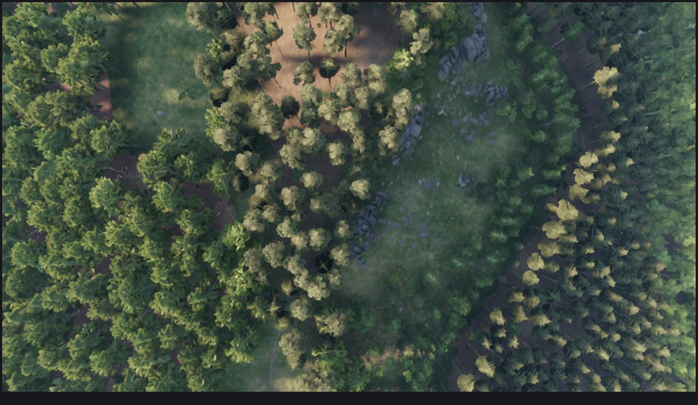

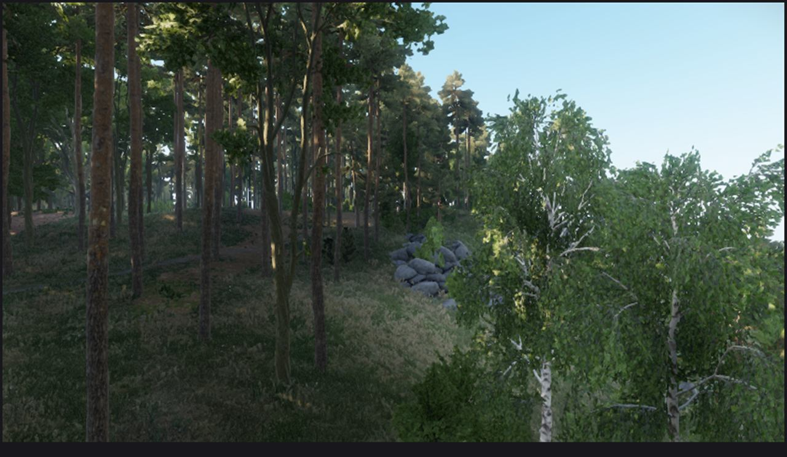

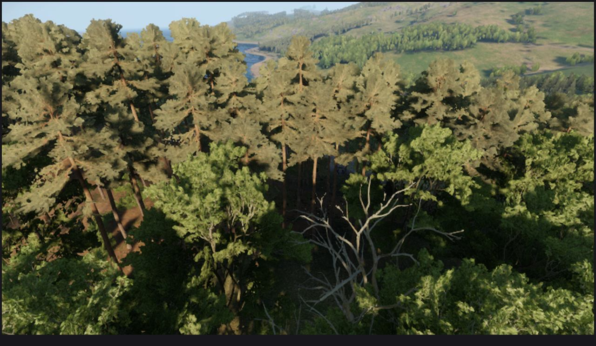

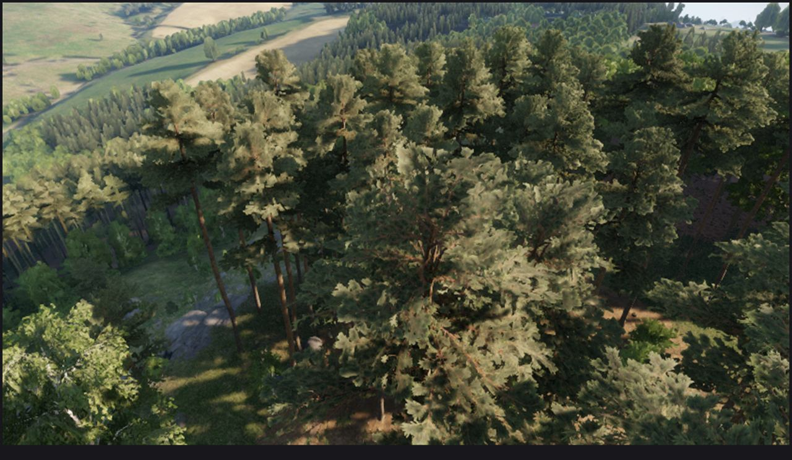

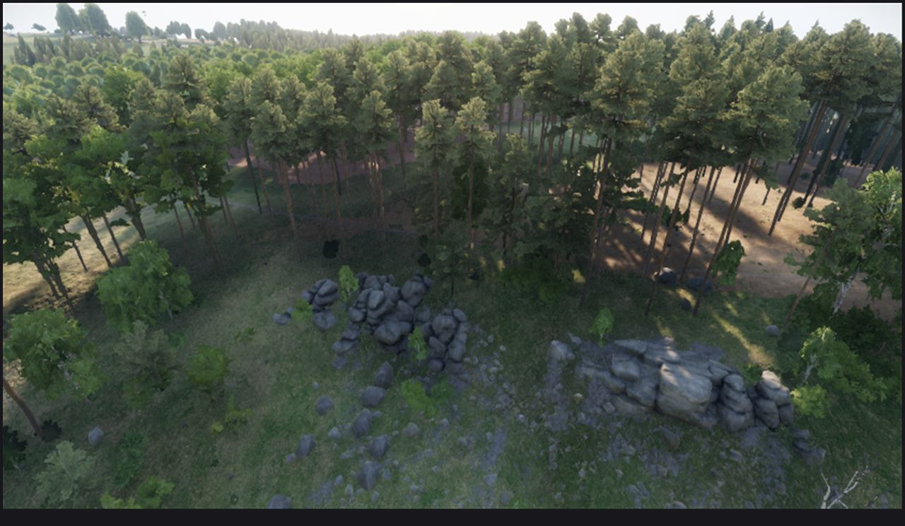

## Terrain

- ground 61.2 to 117.4 m (56.2 m of relief) within 150 m; mean 99.8 m
- 5% of the ground is under 3 degrees, 20% 3 to 8, 37% over 15
- overall the ground falls 8.8 degrees toward the SE
- steepest ground 58.7 degrees at 5079, 8570
- open water (the sea or a lake) is 141.5 m away to the NE

## Water

| Id | Name | Kind | Centre x | Centre z | Area (m2) | Surface y (m) | From centre |
| --- | --- | --- | --- | --- | --- | --- | --- |
| w1 | Lake_Forest1 | pond | 5103.3 | 8598.9 | 571 | 83.6 | 152.8 m |

Shore points (dry ground a step from the outline, facing the water):

| Water | x | z | Ground y (m) | Faces | Yaw | From centre |
| --- | --- | --- | --- | --- | --- | --- |
| w1 | 5093 | 8589.5 | 85.5 | NE | 48 | 139.1 m |
| w1 | 5110.7 | 8584.8 | 84.9 | NW | 333 | 146.3 m |
| w1 | 5087 | 8602.9 | 86.2 | E | 104 | 147.3 m |
| w1 | 5119 | 8591.6 | 84.3 | NW | 295 | 156.9 m |
| w1 | 5097.1 | 8613.3 | 85.1 | SE | 156 | 161.3 m |
| w1 | 5120.7 | 8599.4 | 84.1 | W | 268 | 163.9 m |

lakes and ponds are the closed outlines of the dump's water shapes (the sea probe cannot see them); the grid, the terrain share and the free plots count the cells inside them as water. Shore points are dry ground 2.5 m outside an outline, not checked against trees or props

## Roads and junctions

**Main street:** NE-SW road r05, 0 buildings within 25 m of it; its busiest stretch is at x 5008.8, z 8477.2.

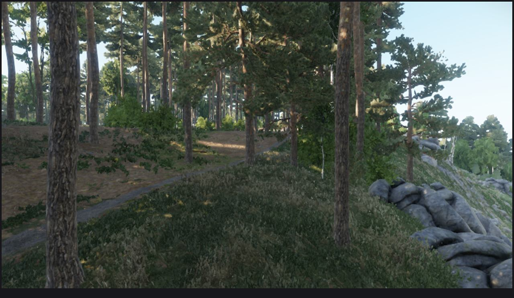

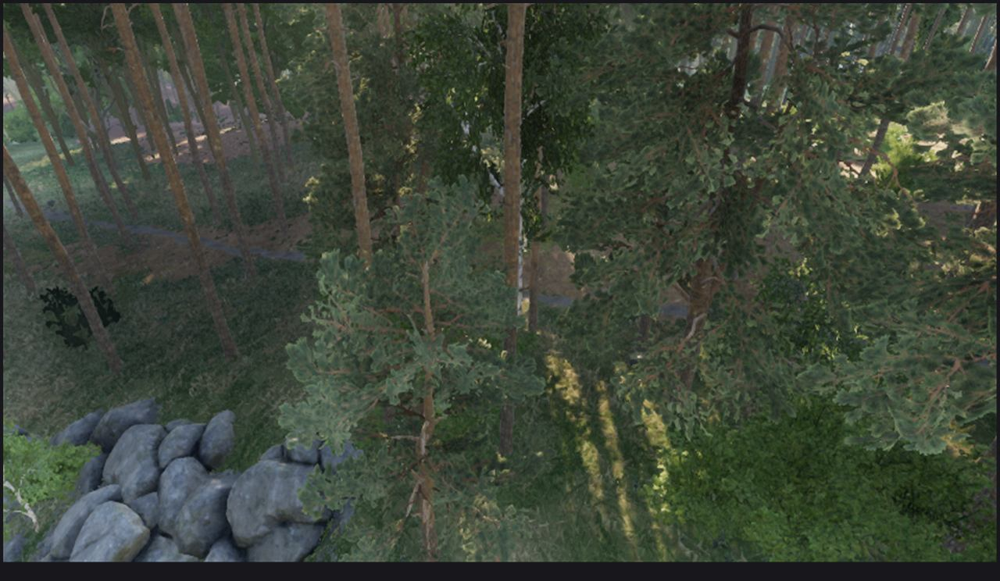

| Id | Road | Length in radius (m) | Points |
| --- | --- | --- | --- |
| r05 | NE-SW road r05 | 215.5 | 4 |
| r07 | NE-SW road r07 | 129.4 | 9 |

| x | z | Kind | Arms | Roads |
| --- | --- | --- | --- | --- |
| 5017.6 | 8498 | bend-or-join | 2 | r05, r07 |

## Civic candidates

Public-facing buildings a town plan would use (church, chapel, government, police, fire, pub, shop, fuel station, hotel, recreation), nearest first. Each links its pictures.

| Id | Type | Vanilla prefab | Distance | Footprint | Floors | Interior | Entrances |
| --- | --- | --- | --- | --- | --- | --- | --- |
| b01 | recreation | Cottage_E_01 | 142.4 m NE | 6 x 9.4 m (56.4 m2) | 1 | yes | - |

### b01 recreation: Cottage_E_01

`{9562159FDE627B33}Prefabs/Structures/Recreation/Houses/Cottage_E_01/Cottage_E_01.et` at x 5111.5, z 8578.8, facing NW; footprint 6 x 9.4 m; interior yes (catalog: 1 door entity and a walkable floor (1 floor)).

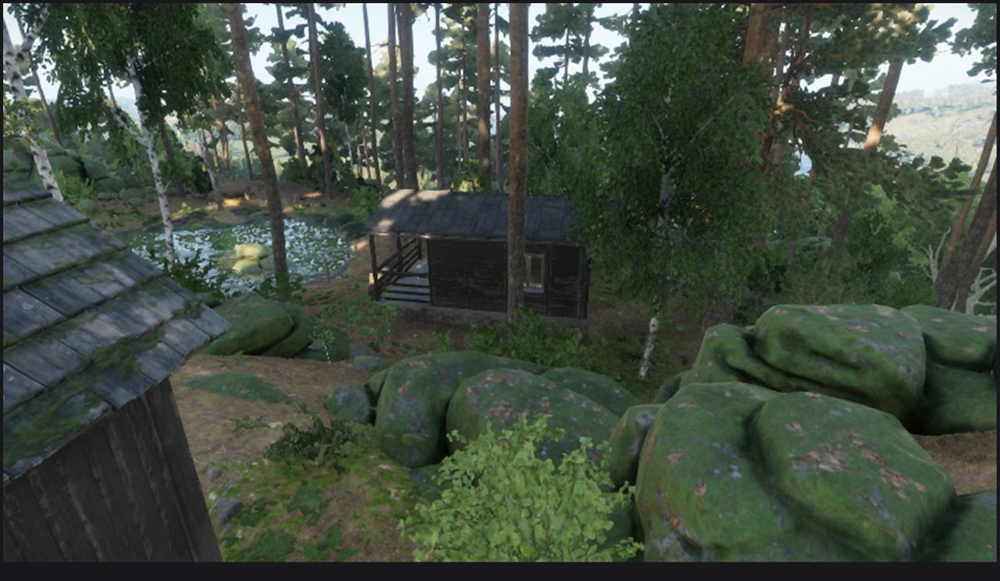

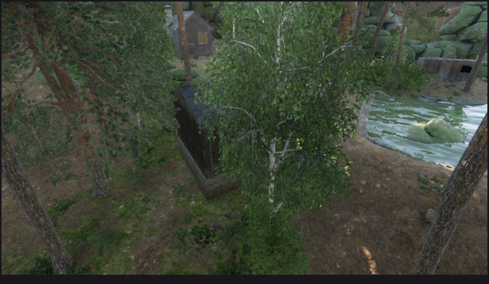

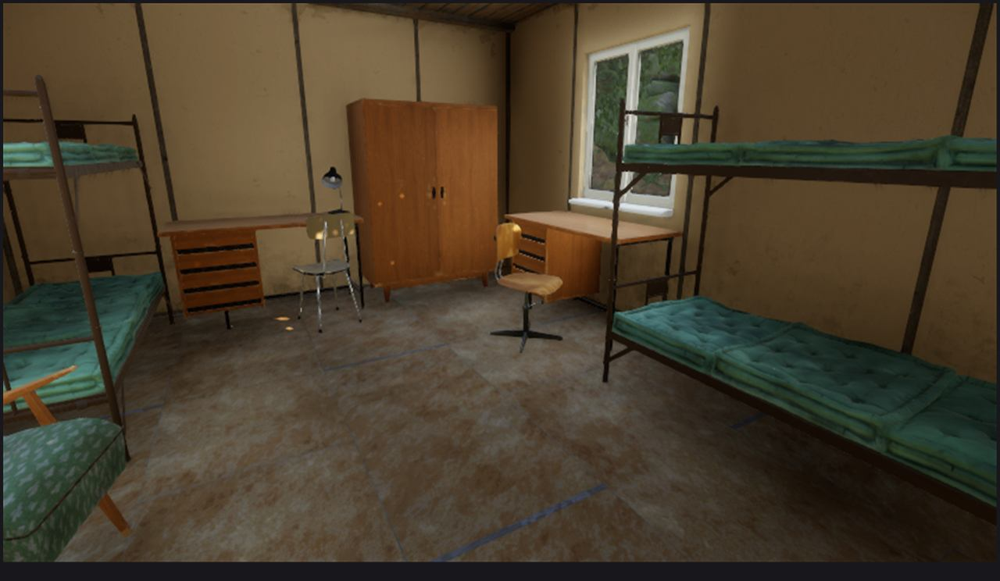

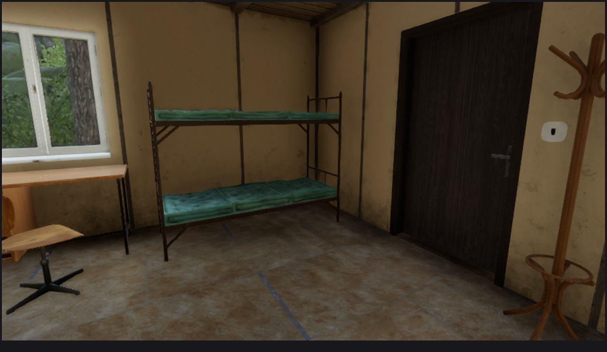

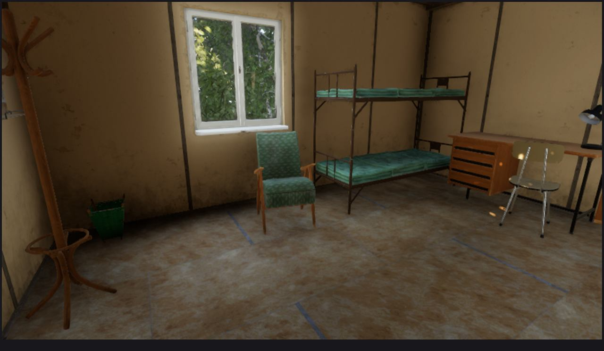

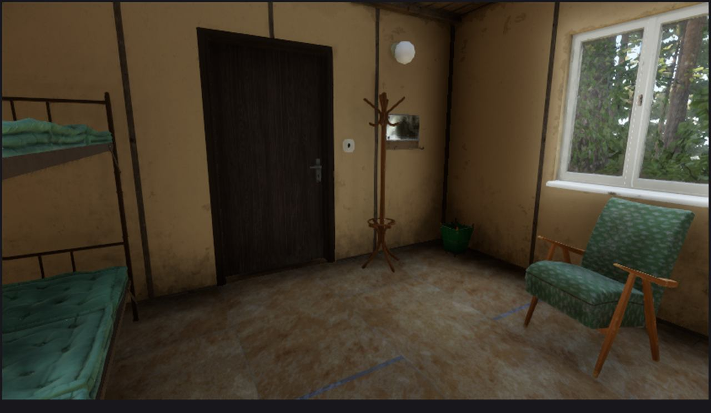

## All buildings

| Id | Type | Vanilla prefab | x | z | Yaw | Facing | Footprint (m) | Floors | Interior | Entrances | Furniture |
| --- | --- | --- | --- | --- | --- | --- | --- | --- | --- | --- | --- |
| b01 | recreation | Cottage_E_01 | 5111.5 | 8578.8 | -30 | NW | 6 x 9.4 (56.4 m2) | 1 | yes | - | - |

Footprint: `catalog` and `measure` are the model's own extents turned by the yaw; `world-bounds` is the engine's axis-aligned box. Yaw is Enfusion's (0 faces +z north, 90 faces +x east). Interior `yes` means door entities and a walkable floor (a heuristic, not walked); `unknown` means door entities but no walkable floor. Entrances are the doors on the outline; `?` means the building was not found in the engine dump. Furniture is the count of furnishing props inside the footprint where the place file has it.

## Notable props

_none_

## Free plots

| Id | x | z | Size (m) | Area (m2) | Ground (m) | Nearest road | Nearest building | From centre |
| --- | --- | --- | --- | --- | --- | --- | --- | --- |
| p1 | 4935 | 8535 | 58 x 84 | 4872 | 106.5 to 115.9 | NE-SW road r07 89.1 m | b01 recreation 177.7 m | 99.2 m |
| p2 | 4895 | 8461 | 58 x 32 | 1856 | 101.7 to 112.1 | NE-SW road r05 98.5 m | b01 recreation 243.5 m | 119.8 m |
| p3 | 4978 | 8523 | 16 x 112 | 1792 | 111.8 to 116.1 | NE-SW road r07 44.6 m | b01 recreation 141.3 m | 60 m |
| p4 | 4949 | 8431 | 66 x 16 | 1056 | 107.1 to 111.4 | NE-SW road r05 37.1 m | b01 recreation 216 m | 78.5 m |
| p5 | 4926 | 8396 | 72 x 14 | 1008 | 102.3 to 107.8 | NE-SW road r05 52.2 m | b01 recreation 256.6 m | 118.3 m |
| p6 | 4956 | 8466 | 24 x 42 | 1008 | 111.9 to 115.9 | NE-SW road r05 44.2 m | b01 recreation 188.9 m | 58.7 m |
| p7 | 5008 | 8541 | 12 x 84 | 1008 | 113.8 to 117.3 | NE-SW road r07 22.7 m | b01 recreation 106.6 m | 66.3 m |
| p8 | 4991 | 8356 | 26 x 34 | 884 | 95.1 to 100.1 | NE-SW road r05 19.6 m | b01 recreation 248.7 m | 121.2 m |

plots are open rectangles at least 10 m on the short side, kept 2.5 m off buildings, 4.5 m off a road's centre line, 2 m off a tree, on ground under 12 degrees; axis aligned, not the best use of the land

## Interiors

## Limits of this dossier

- buildings (types, footprints, floors, interiors) are read from the Everon catalog, docs/everon/catalog-buildings.json; 1 of 1 matched an entity of the engine dump, which adds the door positions
- 2 quay, pier and waterworks pieces are counted, not listed

## Prefab references

Every distinct building prefab, as the world file refers to it.

| Prefab | Type | Count |
| --- | --- | --- |
| `{9562159FDE627B33}Prefabs/Structures/Recreation/Houses/Cottage_E_01/Cottage_E_01.et` | recreation | 1 |
