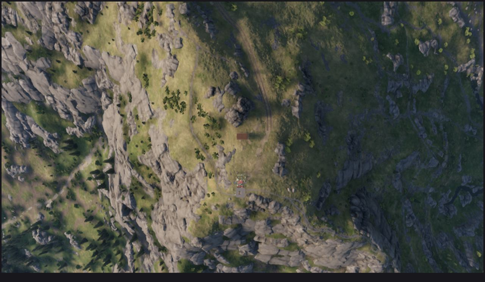
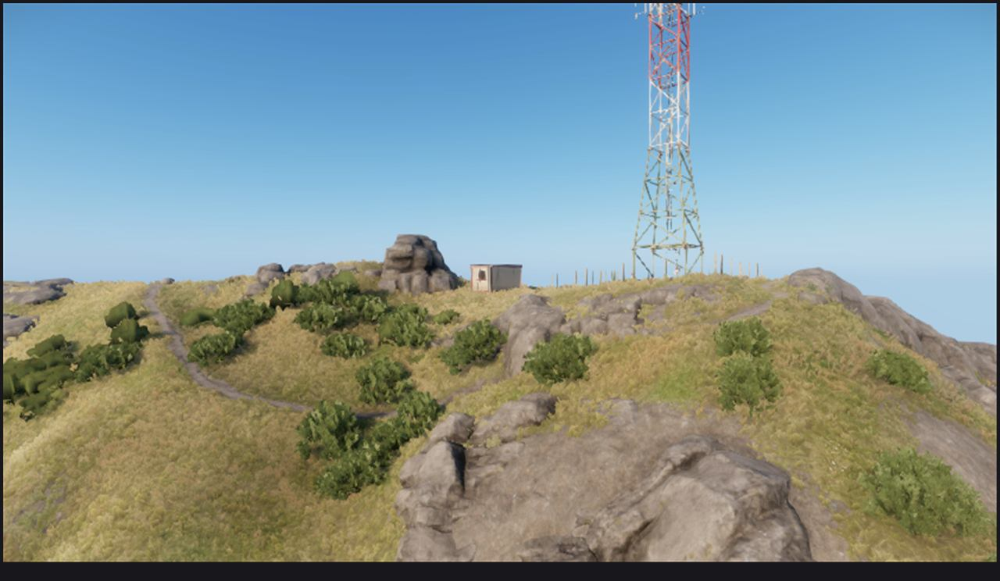
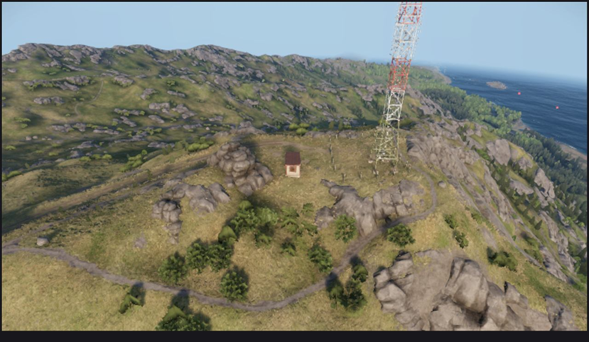
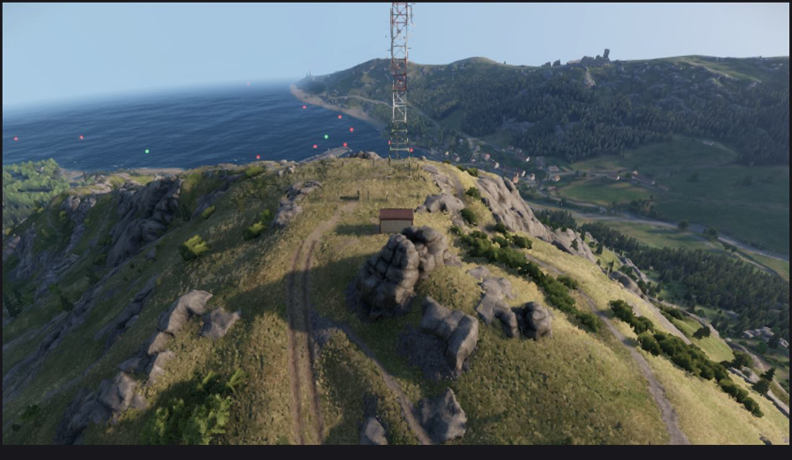
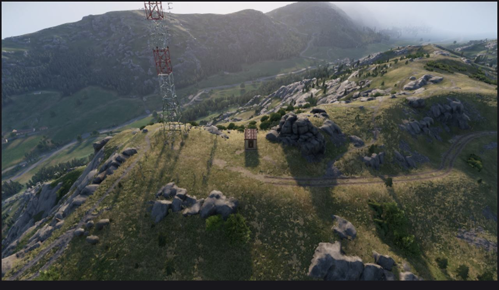
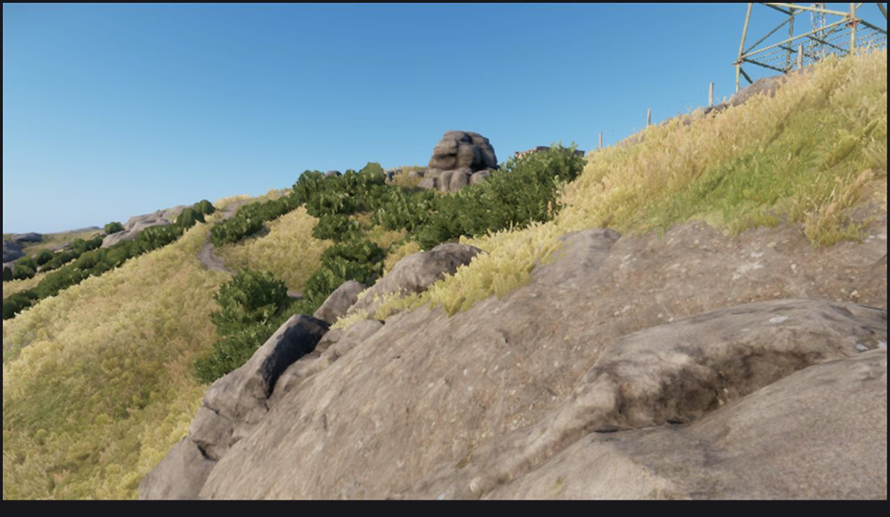
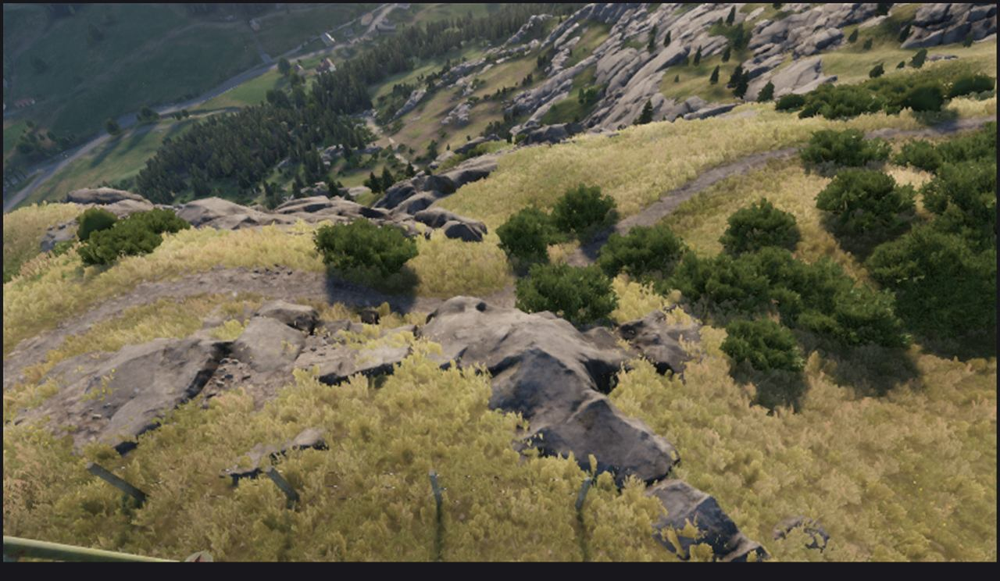

# xz-9946-2283: location dossier

Generated 2026-11-19 by `tools\cli scout`. Do not edit by hand; run `tools\cli scout 9946,2283` to refresh. The machine-readable twin is `dossier.json`.

- **Place:** xz-9946-2283, from coordinates
- **Centre:** x 9946, z 2283, ground 315.3 m; **radius** 120 m
- **World:** Worlds/CoreOnEveron/CoreOnEveron.ent, Arma Reforger build 26266485 (installed 2026-11-08)
- **Other labels nearby:** PICK MOUNTAIN (natural, 18 m N); Pick Creek (aquatic, 534 m SE); Millstone Creek (aquatic, 682 m SW)

## At a glance

1 buildings (0 homes, 0 civic, 0 ruins), 1 enterable (a door entity below them), 1 entrances from outside among 1 door entities; 6 road(s), 11 junction(s); 0 notable props; 6 trees, bushes and other generated vegetation; 2 free plot(s).

| Type | Count |
| --- | --- |
| industrial | 1 |

## Overview

## Terrain

- ground 236.4 to 318.6 m (82.2 m of relief) within 120 m; mean 289.6 m
- 1% of the ground is under 3 degrees, 2% 3 to 8, 88% over 15
- overall the ground falls 8.3 degrees toward the S
- steepest ground 57.8 degrees at 9856, 2258

## Roads and junctions

**Main street:** NW-SE road r07, 1 buildings within 25 m of it; its busiest stretch is at x 9927, z 2268.8.

| Id | Road | Length in radius (m) | Points |
| --- | --- | --- | --- |
| r01 | N-S road r01 | 140.4 | 7 |
| r03 | NW-SE road r03 | 12.9 | 3 |
| r05 | NW-SE road r05 | 135.6 | 9 |
| r06 | NW-SE road r06 | 92.6 | 8 |
| r07 | NW-SE road r07 | 227.8 | 23 |
| r08 | NW-SE road r08 | 67.1 | 8 |

| x | z | Kind | Arms | Roads |
| --- | --- | --- | --- | --- |
| 9916.9 | 2337.4 | crossroads | 4 | r07, r05, r08 |
| 9984.3 | 2237.2 | crossroads | 4 | r06, r07 |
| 9996.4 | 2227 | crossroads | 4 | r06, r07 |
| 10007.1 | 2223.9 | crossroads | 4 | r06, r07 |
| 10017.8 | 2220.9 | crossroads | 4 | r06, r07 |
| 10028.1 | 2219 | crossroads | 4 | r06, r07 |
| 10034.5 | 2213.6 | crossroads | 4 | r06, r07 |
| 9897.5 | 2389.2 | t-junction | 3 | r03, r05 |
| 9891.3 | 2396.7 | t-junction | 3 | r03, r05 |
| 9973.5 | 2247.7 | t-junction | 3 | r06, r07 |
| 10042.5 | 2206.4 | bend-or-join | 2 | r06, r07 |

## Civic candidates

Public-facing buildings a town plan would use (church, chapel, government, police, fire, pub, shop, fuel station, hotel, recreation), nearest first. Each links its pictures.

_none_

## All buildings

| Id | Type | Vanilla prefab | x | z | Yaw | Facing | Footprint (m) | Floors | Interior | Entrances | Furniture |
| --- | --- | --- | --- | --- | --- | --- | --- | --- | --- | --- | --- |
| b01 | industrial | PortableCabin_E_01_beige | 9945.9 | 2283.4 | 90 | E | 3.8 x 6.4 (24.3 m2) | 2 | yes | 1 | - |

Footprint: `catalog` and `measure` are the model's own extents turned by the yaw; `world-bounds` is the engine's axis-aligned box. Yaw is Enfusion's (0 faces +z north, 90 faces +x east). Interior `yes` means door entities and a walkable floor (a heuristic, not walked); `unknown` means door entities but no walkable floor. Entrances are the doors on the outline; `?` means the building was not found in the engine dump. Furniture is the count of furnishing props inside the footprint where the place file has it.

## Notable props

_none_

## Free plots

| Id | x | z | Size (m) | Area (m2) | Ground (m) | Nearest road | Nearest building | From centre |
| --- | --- | --- | --- | --- | --- | --- | --- | --- |
| p1 | 9954 | 2268 | 20 x 22 | 440 | 314.9 to 316.8 | NW-SE road r07 14.8 m | b01 industrial 14.4 m | 17 m |
| p2 | 9956 | 2380 | 24 x 10 | 240 | 295.4 to 299.2 | N-S road r01 29.8 m | b01 industrial 95 m | 97.5 m |

plots are open rectangles at least 10 m on the short side, kept 2.5 m off buildings, 4.5 m off a road's centre line, 2 m off a tree, on ground under 12 degrees; axis aligned, not the best use of the land

## Limits of this dossier

- buildings (types, footprints, floors, interiors) are read from the Everon catalog, docs/everon/catalog-buildings.json; 1 of 1 matched an entity of the engine dump, which adds the door positions

## Prefab references

Every distinct building prefab, as the world file refers to it.

| Prefab | Type | Count |
| --- | --- | --- |
| `{E30E1250FD927736}Prefabs/Structures/Industrial/Houses/PortableCabin_E_01/PortableCabin_E_01_beige.et` | industrial | 1 |
