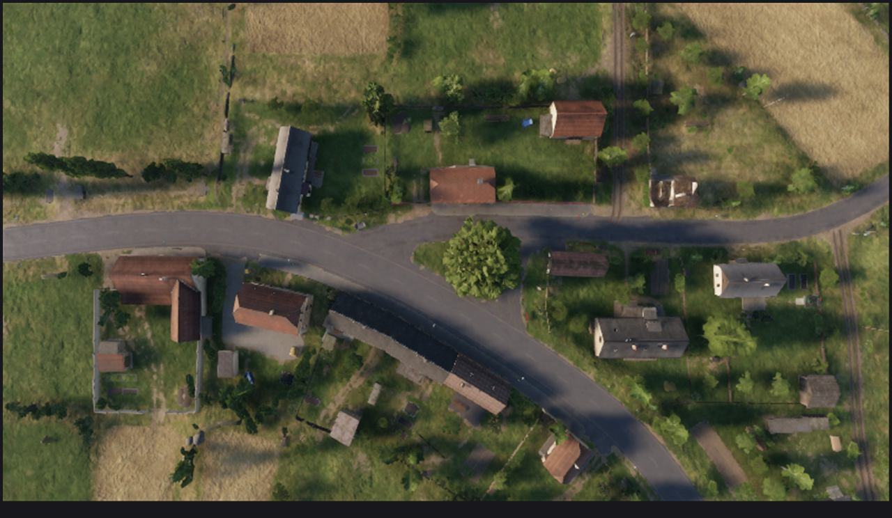
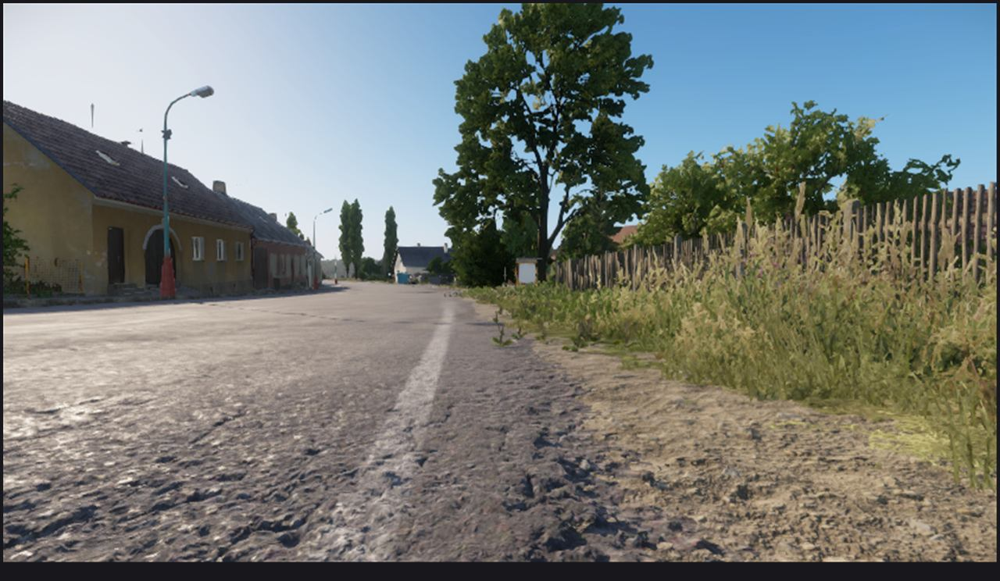
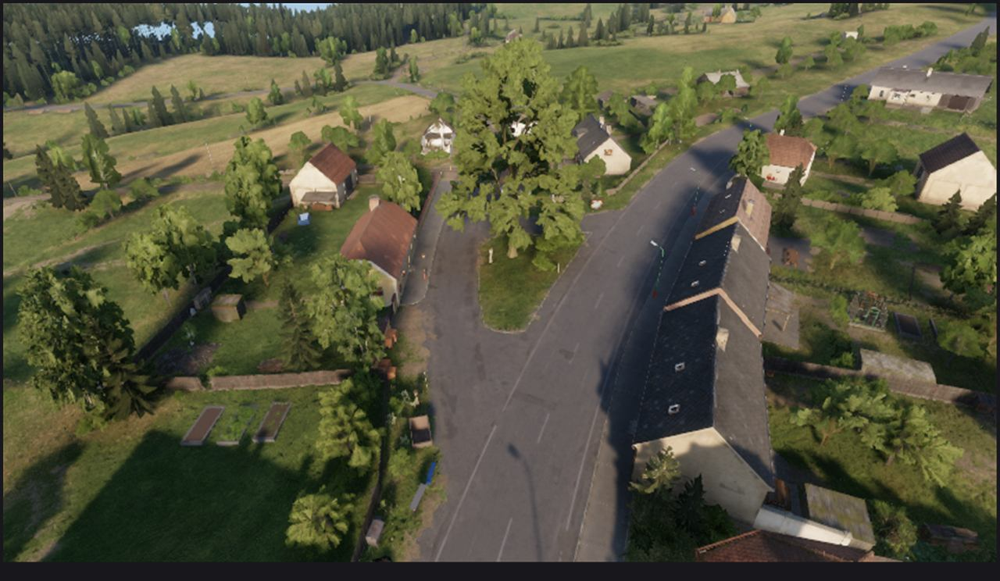
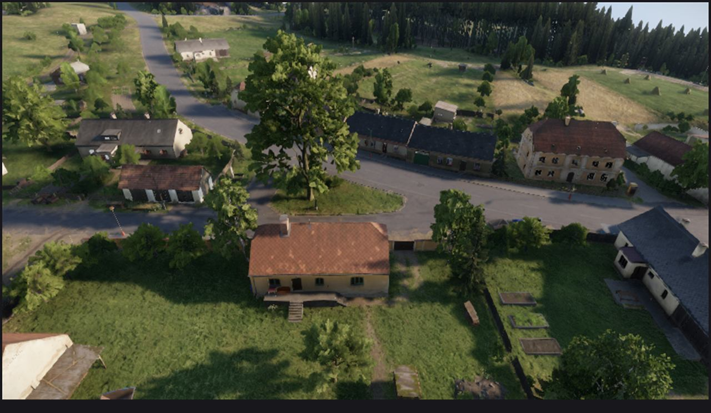
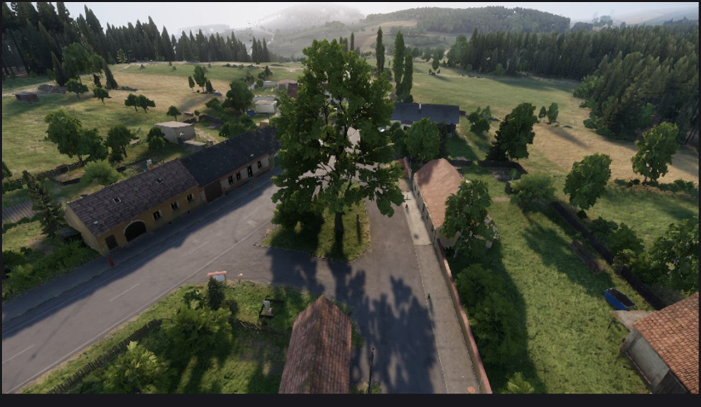
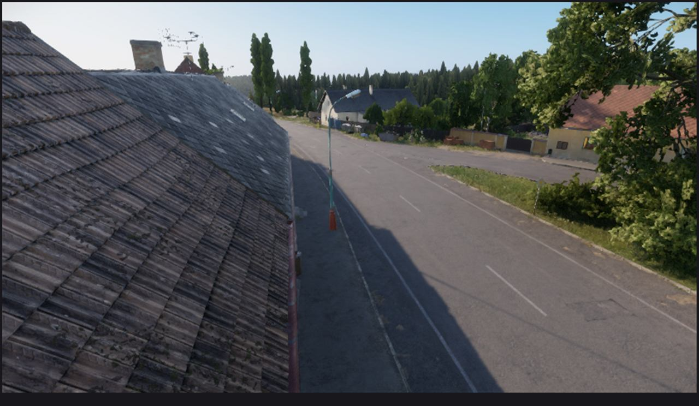
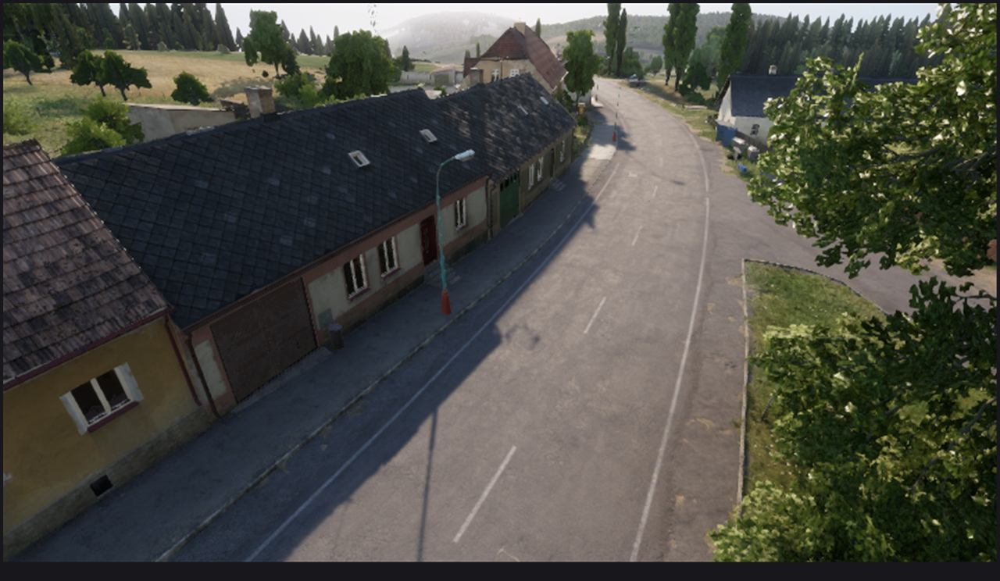

# Levie: location dossier

Generated 2026-11-23 by `tools\cli scout`. Do not edit by hand; run `tools\cli scout "Levie"` to refresh. The machine-readable twin is `dossier.json`.

- **Place:** Levie (other), from the map's own label
- **Centre:** x 7464.442, z 4738.911, ground 142.167 m; **radius** 120 m
- **World:** Worlds/CoreOnEveron/CoreOnEveron.ent, Arma Reforger build 26266485 (installed 2026-11-08)
- **Other labels nearby:** military site (urban, 458 m S)

## At a glance

56 buildings (10 homes, 0 civic, 11 ruins), 25 enterable (a door entity below them), 51 entrances from outside among 126 door entities; 11 road(s), 6 junction(s); 39 notable props; 1582 trees, bushes and other generated vegetation; 8 free plot(s).

| Type | Count |
| --- | --- |
| shed | 21 |
| ruin | 11 |
| house | 9 |
| farm-small | 9 |
| farm | 3 |
| garage | 2 |
| townhouse | 1 |

## Overview

## Terrain

- ground 128.1 to 145.9 m (17.8 m of relief) within 120 m; mean 136.8 m
- 29% of the ground is under 3 degrees, 60% 3 to 8, 1% over 15
- overall the ground falls 3.9 degrees toward the N
- steepest ground 19.1 degrees at 7414.4, 4693.9

## Roads and junctions

**Main street:** NW-SE road r01, 12 buildings within 25 m of it; its busiest stretch is at x 7458.7, z 4719.5.

| Id | Road | Length in radius (m) | Points |
| --- | --- | --- | --- |
| r01 | NW-SE road r01 | 291.6 | 4 |
| r03 | E-W road r03 | 196.9 | 5 |
| r04 | NW-SE road r04 | 32.5 | 7 |
| r05 | NW-SE road r05 | 32.5 | 7 |
| r07 | N-S road r07 | 110.8 | 4 |
| r08 | N-S road r08 | 34.8 | 3 |
| r09 | N-S road r09 | 13.3 | 5 |
| r10 | N-S road r10 | 13.4 | 5 |
| r11 | NE-SW road r11 | 13.3 | 3 |
| r12 | NE-SW road r12 | 13.3 | 3 |
| r13 | N-S road r13 | 85.7 | 14 |

| x | z | Kind | Arms | Roads |
| --- | --- | --- | --- | --- |
| 7517.7 | 4746.6 | t-junction | 3 | r07, r03 |
| 7491.2 | 4745.7 | t-junction | 3 | r08, r03 |
| 7540.6 | 4688.3 | bend-or-join | 2 | r04, r05 |
| 7558.6 | 4661.3 | bend-or-join | 2 | r04, r05 |
| 7534 | 4737.9 | bend-or-join | 2 | r09, r10 |
| 7534.2 | 4724.6 | bend-or-join | 2 | r09, r10 |

## Civic candidates

Public-facing buildings a town plan would use (church, chapel, government, police, fire, pub, shop, fuel station, hotel, recreation), nearest first. Each links its pictures.

_none_

## All buildings

| Id | Type | Vanilla prefab | x | z | Yaw | Facing | Footprint (m) | Floors | Interior | Entrances | Furniture |
| --- | --- | --- | --- | --- | --- | --- | --- | --- | --- | --- | --- |
| b01 | house | House_Village_E_1I02_Furniture | 7468.6 | 4757.9 | -91 | W | 11 x 20.5 (225.5 m2) | 2 | yes | ? | - |
| b02 | house | House_Village_E_1I04t_red | 7457.7 | 4709.3 | 29 | NE | 20.1 x 11.1 (223.1 m2) | 2 | yes | 6 | - |
| b03 | house | House_Village_E_1I04sf_green | 7439.4 | 4718.5 | 24 | NE | 21.1 x 11.1 (234.2 m2) | 2 | yes | 7 | - |
| b04 | shed | Door_HouseAddon_Shed_E_R_EXT_COV_01 | 7498.9 | 4738.5 | 3 | N | 1.7 x 0.1 (0.2 m2) | - | no | ? | - |
| b05 | shed | Door_HouseAddon_Shed_E_L_EXT_COV_01 | 7498.6 | 4732.5 | 3 | N | 1.9 x 0.1 (0.2 m2) | - | no | ? | - |
| b06 | shed | Shed_03 | 7454.5 | 4703.1 | 30 | NE | 6.8 x 3.9 (26.5 m2) | 0 | no | - | - |
| b07 | shed | Door_HouseAddon_Shed_E_L_EXT_COV_01 | 7502.3 | 4738.3 | -177 | S | 1.9 x 0.1 (0.2 m2) | - | no | ? | - |
| b08 | shed | Door_HouseAddon_Shed_E_R_EXT_COV_01 | 7502.1 | 4732.4 | -177 | S | 1.7 x 0.1 (0.2 m2) | - | no | ? | - |
| b09 | shed | Shed_01 | 7458.7 | 4777.3 | 88 | E | 3.6 x 2.7 (9.7 m2) | 1 | yes | 1 | - |
| b10 | house | House_Village_E_1I08t | 7474.1 | 4700.2 | 30 | NE | 18.9 x 10.2 (192.8 m2) | 3 | yes | 5 | - |
| b11 | ruin | HouseRuin_01_BrickPile_Big | 7451.8 | 4777.4 | 106 | E | 5 x 4.7 (23.5 m2) | 0 | no | - | - |
| b12 | ruin | HouseRuin_01_BrickPile_Big | 7448.9 | 4776.8 | -171 | S | 4.9 x 4.6 (22.6 m2) | 0 | no | - | - |
| b13 | farm | Barn_E_03_open | 7505.2 | 4735.2 | -177 | S | 17.8 x 7.3 (129.9 m2) | 2 | yes | 5 | - |
| b14 | ruin | HouseRuin_01_BrickPile_Big | 7448.5 | 4779.7 | -24 | NW | 4.9 x 4.6 (22.1 m2) | 0 | no | - | - |
| b15 | ruin | HouseRuin_01_BrickPile_Big | 7450.8 | 4781.1 | 32 | NE | 4.7 x 4.4 (20.3 m2) | 0 | no | - | - |
| b16 | shed | Shed_02_square | 7427.5 | 4711.7 | 111 | E | 4.4 x 3.7 (16.3 m2) | 2 | yes | 1 | - |
| b17 | shed | Door_HouseAddon_Shed_E_R_EXT_COV_02 | 7509.7 | 4731.9 | 3 | N | 1.6 x 0.1 (0.2 m2) | - | no | ? | - |
| b18 | shed | Shed_02_line | 7442.2 | 4696.9 | 113 | SE | 6.6 x 2.8 (18.5 m2) | 1 | yes | 1 | - |
| b19 | farm-small | Greenhouse_01 | 7453.4 | 4691.7 | -61 | NW | 3.8 x 4.2 (16 m2) | 1 | yes | 1 | - |
| b20 | shed | Shed_01 | 7482.2 | 4693.4 | 123 | SE | 3.6 x 2.7 (9.7 m2) | 1 | yes | 1 | - |
| b21 | shed | Shed_03 | 7496.3 | 4776.8 | 90 | E | 6.8 x 3.9 (26.5 m2) | 0 | no | - | - |
| b22 | ruin | HouseRuin_01_BrickPile_Big | 7514 | 4761.8 | 57 | NE | 5.3 x 5 (26.4 m2) | 0 | no | - | - |
| b23 | farm-small | Henhouse_01 | 7437.6 | 4691.1 | -68 | W | 3.3 x 1.2 (4 m2) | - | no | - | - |
| b24 | house | House_Mountain_E_1I01 | 7414.7 | 4763.4 | -79 | W | 24.7 x 13.5 (333.5 m2) | 2 | yes | - | - |
| b25 | townhouse | House_Town_E_2I03 | 7411 | 4722.1 | 12 | N | 20.3 x 12.6 (255.8 m2) | 3 | yes | 2 | - |
| b26 | ruin | HouseRuin_01_BrickPile_Big | 7515.3 | 4763.9 | -21 | N | 5.3 x 5 (26.4 m2) | 0 | no | - | - |
| b27 | farm | Barn_E_01_old | 7505.5 | 4778.4 | 0 | N | 15.1 x 10.8 (163.1 m2) | 0 | unknown | 4 | - |
| b28 | shed | Shed_01 | 7495.6 | 4689.6 | -143 | SW | 3.6 x 2.7 (9.7 m2) | 1 | yes | 1 | - |
| b29 | shed | HouseAddon_Workshop_E_01 | 7432.6 | 4687.8 | -68 | W | 8.1 x 7 (56.7 m2) | 1 | yes | 2 | - |
| b30 | shed | Shed_03 | 7522.3 | 4721.1 | 179 | S | 6.8 x 3.9 (26.5 m2) | 0 | no | - | - |
| b31 | farm-small | Greenhouse_01 | 7413 | 4700 | -74 | W | 3.8 x 4.2 (16 m2) | 1 | yes | 1 | - |
| b32 | house | House_Village_E_1I03_Furniture | 7524.1 | 4713.6 | 90 | E | 15.3 x 25.5 (390.2 m2) | 2 | yes | ? | - |
| b33 | farm-small | Henhouse_01 | 7457.8 | 4673.4 | 29 | NE | 3.3 x 1.2 (4 m2) | - | no | - | - |
| b34 | house | House_Village_E_1I01 | 7501.1 | 4680.2 | -142 | SW | 9.9 x 12.5 (123.8 m2) | 2 | yes | ? | - |
| b35 | farm-small | Henhouse_01 | 7540.8 | 4732.4 | 88 | E | 3.3 x 1.2 (4 m2) | - | no | - | - |
| b36 | garage | Garage_E_01 | 7394.7 | 4705.5 | 1 | N | 4.9 x 9.9 (48.5 m2) | 2 | yes | 2 | - |
| b37 | shed | Shed_02_line | 7393.2 | 4772.3 | 93 | E | 6.6 x 2.8 (18.5 m2) | 1 | yes | 1 | - |
| b38 | shed | Shed_03 | 7388.3 | 4716.4 | -90 | W | 6.8 x 3.9 (26.5 m2) | 0 | no | - | - |
| b39 | farm-small | Henhouse_01 | 7531.4 | 4783.9 | 92 | E | 3.3 x 1.2 (4 m2) | - | no | - | - |
| b40 | farm-small | Henhouse_01 | 7397.8 | 4785.9 | -179 | S | 3.3 x 1.2 (4 m2) | - | no | - | - |
| b41 | shed | Shed_02_square | 7533.3 | 4789.9 | 96 | E | 4.4 x 3.7 (16.3 m2) | 2 | yes | 1 | - |
| b42 | farm | Barn_E_01 | 7488 | 4653.7 | 34 | NE | 15.1 x 10.8 (163.1 m2) | 0 | unknown | 4 | - |
| b43 | shed | Shed_02_square | 7470 | 4828.1 | -178 | S | 4.4 x 3.7 (16.3 m2) | 2 | yes | 1 | - |
| b44 | farm-small | Henhouse_01 | 7548.1 | 4707.2 | -179 | S | 3.3 x 1.2 (4 m2) | - | no | - | - |
| b45 | house | House_Village_E_1L03t | 7374.7 | 4732.7 | -180 | S | 25.9 x 25.6 (663 m2) | 2 | yes | - | - |
| b46 | ruin | HouseRuin_01_BrickPile_Big | 7382.6 | 4695.1 | -76 | W | 4.9 x 4.6 (22.6 m2) | 0 | no | - | - |
| b47 | ruin | HouseRuin_01_BrickPile_Big | 7381.1 | 4696.6 | 120 | SE | 4.9 x 4.6 (22.1 m2) | 0 | no | - | - |
| b48 | ruin | HouseRuin_01_BrickPile_Big | 7381.1 | 4692.7 | -179 | S | 5 x 4.7 (23.5 m2) | 0 | no | - | - |
| b49 | ruin | HouseRuin_01_BrickPile_Big | 7378.5 | 4695.8 | 54 | NE | 4.8 x 4.5 (21.7 m2) | 0 | no | - | - |
| b50 | ruin | HouseRuin_01_BrickPile_Big | 7378.6 | 4693.6 | 148 | SE | 5.1 x 4.8 (24.4 m2) | 0 | no | - | - |
| b51 | house | House_Mountain_E_1I01_short | 7561.8 | 4730.7 | -2 | N | 17.5 x 11.6 (203 m2) | 2 | yes | - | - |
| b52 | shed | Shed_03 | 7357.3 | 4710.1 | 179 | S | 6.8 x 3.9 (26.5 m2) | 0 | no | - | - |
| b53 | garage | Workshop_01_Garage | 7358.5 | 4705.6 | -1 | N | 8.3 x 5.8 (48.1 m2) | 1 | yes | 3 | - |
| b54 | shed | Shed_03_wide | 7568.5 | 4689 | 178 | S | 12.3 x 3.9 (48 m2) | 0 | no | - | - |
| b55 | farm-small | Greenhouse_01 | 7579.8 | 4724 | -93 | W | 3.8 x 4.2 (16 m2) | 1 | yes | 1 | - |
| b56 | shed | Door_HouseAddon_Shed_E_R_EXT_COV_02 | 7574.5 | 4697.2 | 89 | E | 1.6 x 0.1 (0.2 m2) | - | no | ? | - |

Footprint: `catalog` and `measure` are the model's own extents turned by the yaw; `world-bounds` is the engine's axis-aligned box. Yaw is Enfusion's (0 faces +z north, 90 faces +x east). Interior `yes` means door entities and a walkable floor (a heuristic, not walked); `unknown` means door entities but no walkable floor. Entrances are the doors on the outline; `?` means the building was not found in the engine dump. Furniture is the count of furnishing props inside the footprint where the place file has it.

## Notable props

| Kind | Vanilla prefab | x | z | Distance |
| --- | --- | --- | --- | --- |
| shrine | CalvarySmall_02 | 7472.7 | 4740.5 | 8.4 m |
| notice-board | MessageBoardSmall_01 | 7461.6 | 4753.4 | 14.7 m |
| shrine | BelfrySmall_01 | 7441.2 | 4747.8 | 24.8 m |
| bench | BenchStreet_01_yellow_red | 7474.9 | 4764.1 | 27.3 m |
| well | Well_02_red | 7495 | 4732.1 | 31.4 m |
| monument | StatueFIA_01_big | 7494.1 | 4727.9 | 31.7 m |
| notice-board | BoardMap_01 | 7489.8 | 4719.8 | 31.8 m |
| mailbox | Mailbox_02 | 7433.2 | 4745.1 | 31.8 m |
| mailbox | Mailbox_02 | 7432.7 | 4745.2 | 32.3 m |
| mailbox | Mailbox_02 | 7432.2 | 4745.3 | 32.8 m |
| mailbox | Mailbox_02 | 7431.8 | 4745.3 | 33.3 m |
| notice-board | MessageBoard_02_filled_V1 | 7429.4 | 4745.8 | 35.7 m |
| bench | BenchStreet_01_yellow_red | 7454.7 | 4704.6 | 35.7 m |
| bench | BenchStreet_01_yellow_red | 7456.5 | 4703.6 | 36.2 m |
| market-stand | MarketStand_01 | 7470.1 | 4696.6 | 42.7 m |
| bus-shelter | BusShed_E_01_blue | 7417.1 | 4749.9 | 48.6 m |
| bus-shelter | SignBusStop_01 | 7412.3 | 4748.9 | 53 m |
| well | Well_02_red | 7466.9 | 4684.3 | 54.7 m |
| bench | BenchStreet_01_yellow_red | 7409.7 | 4716.3 | 59.2 m |
| bench | BenchStreet_01_yellow_red | 7522 | 4719.9 | 60.6 m |
| bench | BenchStreet_01_yellow_red | 7525.2 | 4721.3 | 63.3 m |
| phone-booth | PhoneBooth_E_01 | 7400.9 | 4733 | 63.8 m |
| bench | BenchWooden_02_Worn | 7403.3 | 4759.1 | 64.4 m |
| bench | BenchStreet_01_red | 7497.1 | 4682.4 | 65.3 m |
| bench | BenchWooden_02_Worn | 7523.7 | 4707.6 | 67 m |
| well | Well_02_blue | 7407.3 | 4701.2 | 68.4 m |
| well | Well_02_green | 7491.1 | 4666.8 | 76.9 m |
| well | Well_02_blue | 7554.6 | 4723.4 | 91.5 m |
| shrine | CalvarySmall_01 | 7526.2 | 4806.9 | 91.9 m |
| well | Well_02_blue | 7375.6 | 4700.9 | 96.5 m |
| bench | BenchStreet_01_red | 7358.4 | 4708.7 | 110.2 m |
| well | Well_02_blue | 7563.1 | 4678.8 | 115.6 m |

Counted, not listed: 7 street-lamp.

## Free plots

| Id | x | z | Size (m) | Area (m2) | Ground (m) | Nearest road | Nearest building | From centre |
| --- | --- | --- | --- | --- | --- | --- | --- | --- |
| p1 | 7456.4 | 4809.9 | 120 x 26 | 3120 | 130.2 to 133.4 | E-W road r03 64.4 m | b43 shed 20 m | 71.4 m |
| p2 | 7425.4 | 4659.9 | 58 x 42 | 2436 | 139.8 to 143.6 | NE-SW road r12 45.2 m | b29 shed 24.5 m | 88.1 m |
| p3 | 7464.4 | 4840.9 | 92 x 20 | 1840 | 128.5 to 130.6 | N-S road r07 57.6 m | b43 shed 11.4 m | 102 m |
| p4 | 7553.4 | 4775.9 | 30 x 50 | 1500 | 132.9 to 138.1 | E-W road r03 29.5 m | b41 shed 21.8 m | 96.4 m |
| p5 | 7371.4 | 4771.9 | 26 x 50 | 1300 | 131.8 to 135.6 | N-S road r13 19 m | b37 shed 20.3 m | 98.7 m |
| p6 | 7464.4 | 4630.9 | 80 x 12 | 960 | 143 to 145.1 | NE-SW road r11 39.9 m | b42 farm 26.7 m | 108 m |
| p7 | 7478.4 | 4780.9 | 32 x 28 | 896 | 133.9 to 136.3 | E-W road r03 35.1 m | b21 shed 16 m | 44.3 m |
| p8 | 7433.4 | 4768.9 | 18 x 44 | 792 | 134.2 to 136.9 | E-W road r03 28.2 m | b24 house 10.2 m | 43.1 m |

plots are open rectangles at least 10 m on the short side, kept 2.5 m off buildings, 4.5 m off a road's centre line, 2 m off a tree, on ground under 12 degrees; axis aligned, not the best use of the land

## Limits of this dossier

- buildings (types, footprints, floors, interiors) are read from the Everon catalog, docs/everon/catalog-buildings.json; 47 of 56 matched an entity of the engine dump, which adds the door positions, and the other 9 have no entrances listed
- 14 quay, pier and waterworks pieces are counted, not listed

## Prefab references

Every distinct building prefab, as the world file refers to it.

| Prefab | Type | Count |
| --- | --- | --- |
| `{1F0A3A2A077ED92F}Prefabs/Structures/Houses/Village/House_Village_E_1I02/Furniture/House_Village_E_1I02_Furniture.et` | house | 1 |
| `{1E6FF35236AFF31C}Prefabs/Structures/Houses/Village/House_Village_E_1I04/House_Village_E_1I04t_red.et` | house | 1 |
| `{9EC1D8CA0391BF16}Prefabs/Structures/Houses/Village/House_Village_E_1I04/House_Village_E_1I04sf_green.et` | house | 1 |
| `{270728E69E8B2D7E}Prefabs/Structures/BuildingParts/Doors/Door_HouseAddon_Shed_E_R_EXT_COV_01.et` | shed | 2 |
| `{9D6C69116A1DE3B0}Prefabs/Structures/BuildingParts/Doors/Door_HouseAddon_Shed_E_L_EXT_COV_01.et` | shed | 2 |
| `{8597237EA3C59701}Prefabs/Structures/Houses/Shed/Shed_03/Shed_03.et` | shed | 5 |
| `{F08D8E78433D713A}Prefabs/Structures/Houses/Shed/Shed_01/Shed_01.et` | shed | 3 |
| `{D424A3CD07F7A6F0}Prefabs/Structures/Houses/Village/House_Village_E_1I08/House_Village_E_1I08t.et` | house | 1 |
| `{5A81BD9171FC3B07}Prefabs/Structures/Ruins/HouseRuins/HouseRuin_01/HouseRuin_01_BrickPile_Big.et` | ruin | 11 |
| `{66F1A0049CC2F5BD}Prefabs/Structures/Agriculture/Barn/Barn_E_03/Barn_E_03_open.et` | farm | 1 |
| `{D61A7F2891D457C6}Prefabs/Structures/Houses/Shed/Shed_02/Shed_02_square.et` | shed | 3 |
| `{4B531C06224FA250}Prefabs/Structures/BuildingParts/Doors/Door_HouseAddon_Shed_E_R_EXT_COV_02.et` | shed | 2 |
| `{24BA2E136E8815C2}Prefabs/Structures/Houses/Shed/Shed_02/Shed_02_line.et` | shed | 2 |
| `{3299E6F34CE40185}Prefabs/Structures/Agriculture/Greenhouse/Greenhouse_01/Greenhouse_01.et` | farm-small | 3 |
| `{E005876522A8CE1D}Prefabs/Structures/Agriculture/Henhouse/Henhouse_01/Henhouse_01.et` | farm-small | 6 |
| `{BEF9077AF9F93AE7}Prefabs/Structures/Houses/Village/House_Mountain_E_1I01/House_Mountain_E_1I01.et` | house | 1 |
| `{E7EC0E80F0645DFE}Prefabs/Structures/Houses/Town/House_Town_E_2I03/House_Town_E_2I03.et` | townhouse | 1 |
| `{5943A8F87263D906}Prefabs/Structures/Agriculture/Barn/Barn_E_01/Barn_E_01_old.et` | farm | 1 |
| `{DC1CA32A90006916}Prefabs/Structures/Houses/Village/HouseAddon_Workshop_E_01/HouseAddon_Workshop_E_01.et` | shed | 1 |
| `{366759CF520BC4CA}Prefabs/Structures/Houses/Village/House_Village_E_1I03/Furniture/House_Village_E_1I03_Furniture.et` | house | 1 |
| `{EDBC0E94793BA9F1}Prefabs/Structures/Houses/Village/House_Village_E_1I01/House_Village_E_1I01.et` | house | 1 |
| `{A548C1C5370D0734}Prefabs/Structures/Houses/Garage/Garage_E_01/Garage_E_01.et` | garage | 1 |
| `{99F6E8E52B71B137}Prefabs/Structures/Agriculture/Barn/Barn_E_01/Barn_E_01.et` | farm | 1 |
| `{B2172573ED15AA82}Prefabs/Structures/Houses/Village/House_Village_E_1L03/House_Village_E_1L03t.et` | house | 1 |
| `{678574044F58E1CA}Prefabs/Structures/Houses/Village/House_Mountain_E_1I01/House_Mountain_E_1I01_short.et` | house | 1 |
| `{5F00FD9BDAD8C1A5}Prefabs/Structures/Industrial/Houses/Workshop_01/Workshop_01_Garage.et` | garage | 1 |
| `{EF96889E35217E1E}Prefabs/Structures/Houses/Shed/Shed_03/Shed_03_wide.et` | shed | 1 |
