# Meaux: location dossier

Generated 2026-11-17 by `tools\cli scout`. Do not edit by hand; run `tools\cli scout "Meaux"` to refresh. The machine-readable twin is `dossier.json`.

- **Place:** Meaux (other), from the map's own label
- **Centre:** x 4520.45, z 9467.976, ground 14.178 m; **radius** 120 m
- **World:** Worlds/CoreOnEveron/CoreOnEveron.ent, Arma Reforger build 26266485 (installed 2026-11-08)
- **Other labels nearby:** harbor (urban, 221 m W); Crabapple Bay (aquatic, 481 m W); Tyrone (other, 554 m SE); power plant (other, 651 m N); farm (other, 697 m NE)

## At a glance

61 buildings (13 homes, 5 civic, 3 ruins), 46 enterable (a door entity below them), 111 entrances from outside among 236 door entities; 21 road(s), 13 junction(s); 81 notable props; 3017 trees, bushes and other generated vegetation; 8 free plot(s).

| Type | Count |
| --- | --- |
| shed | 18 |
| house | 12 |
| garage | 11 |
| farm-small | 6 |
| farm | 3 |
| ruin | 3 |
| kiosk | 1 |
| townhouse | 1 |
| government | 1 |
| shop | 1 |
| pub | 1 |
| police | 1 |
| church | 1 |
| military | 1 |

## Overview

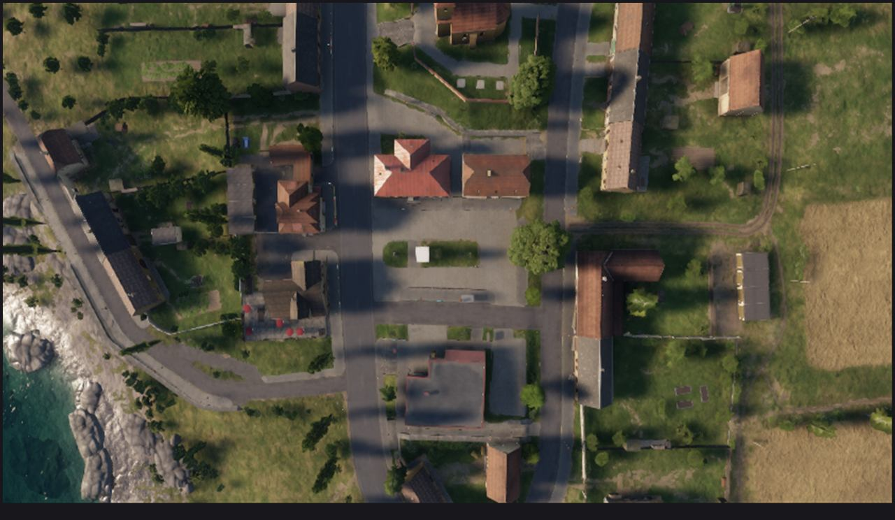

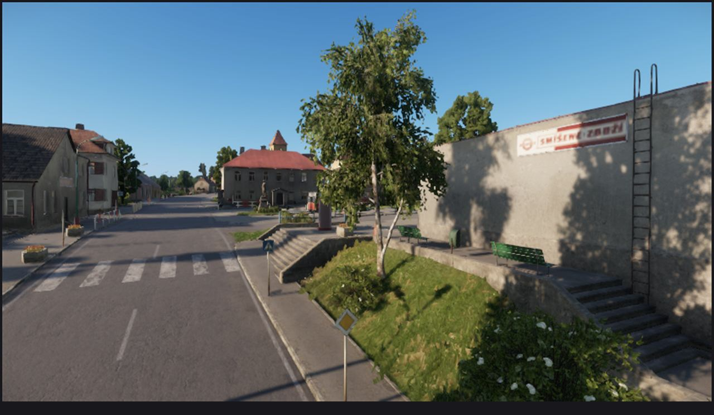

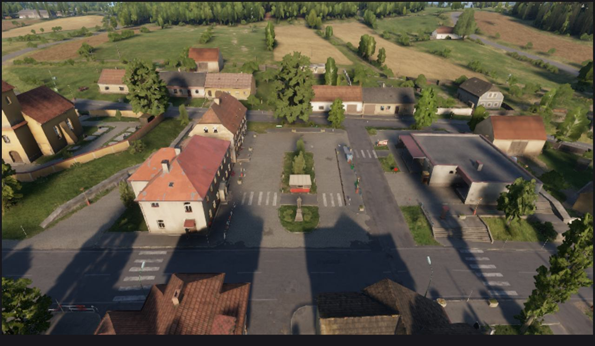

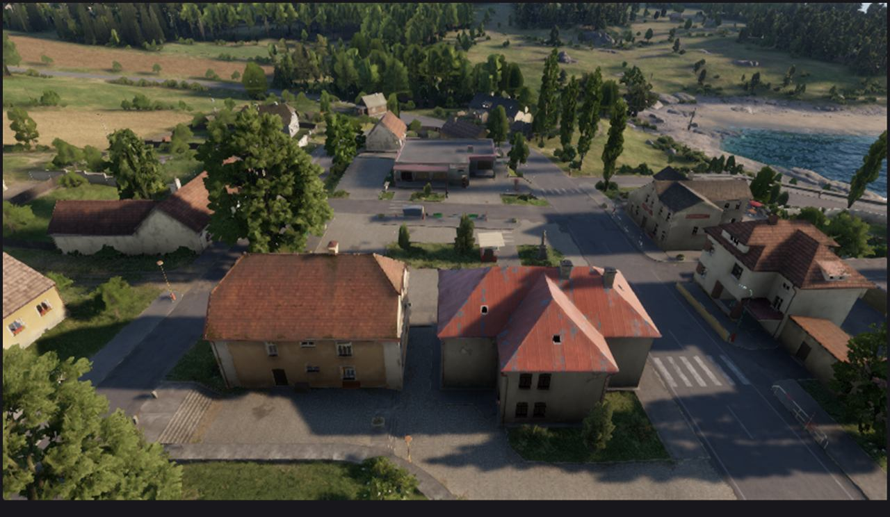

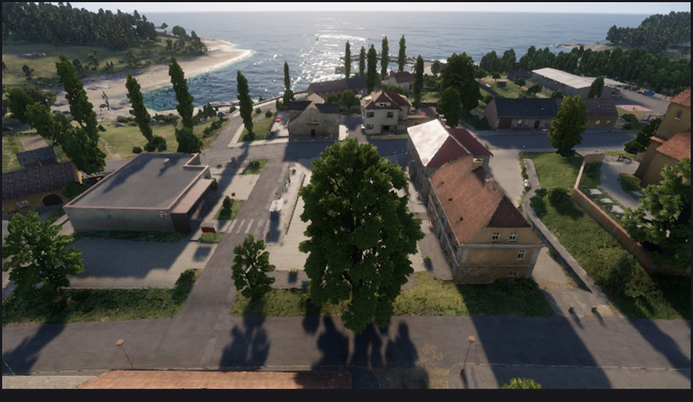

## Terrain

- ground 1.6 to 21.9 m (20.3 m of relief) within 120 m; mean 13.8 m
- 41% of the ground is under 3 degrees, 38% 3 to 8, 3% over 15
- overall the ground falls 3.6 degrees toward the SW
- steepest ground 38.7 degrees at 4410.5, 9438

## Roads and junctions

**Main street:** N-S road r02, 17 buildings within 25 m of it; its busiest stretch is at x 4491.7, z 9453.4.

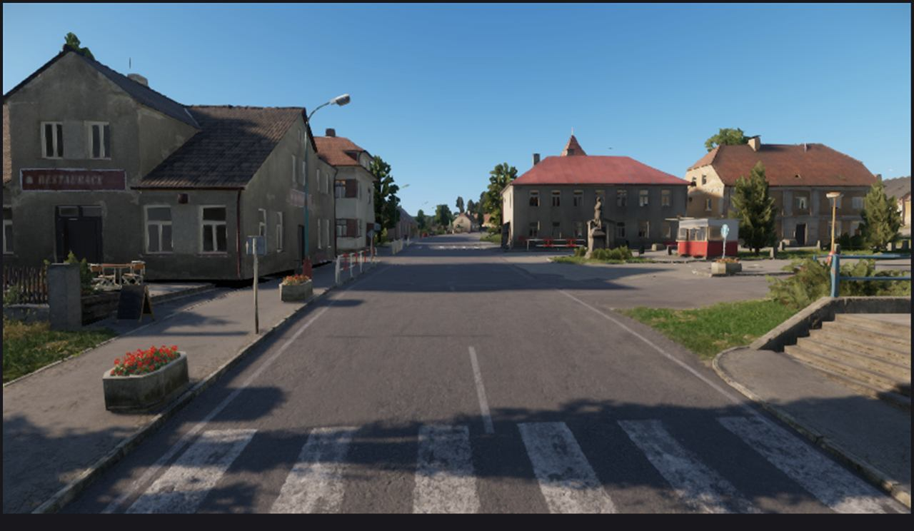

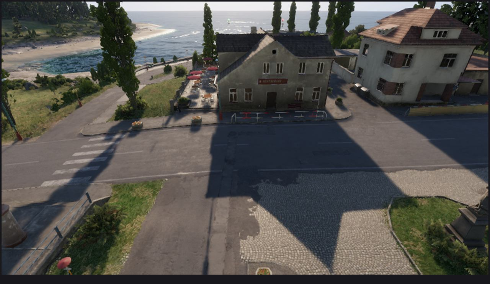

| Id | Road | Length in radius (m) | Points |
| --- | --- | --- | --- |
| r01 | N-S road r01 | 269.1 | 5 |
| r02 | N-S road r02 | 348.7 | 6 |
| r03 | NE-SW road r03 | 133.8 | 11 |
| r04 | N-S road r04 | 115.2 | 8 |
| r05 | NW-SE road r05 | 25.1 | 3 |
| r06 | E-W road r06 | 22.9 | 2 |
| r07 | N-S road r07 | 37.7 | 3 |
| r08 | E-W road r08 | 57.7 | 7 |
| r09 | NW-SE road r09 | 163.3 | 5 |
| r11 | E-W road r11 | 41.7 | 3 |
| r12 | E-W road r12 | 14.5 | 2 |
| r13 | E-W road r13 | 15.3 | 2 |
| r14 | E-W road r14 | 68.8 | 5 |
| r15 | E-W road r15 | 59.3 | 4 |
| r16 | NE-SW road r16 | 11.5 | 2 |
| r17 | NE-SW road r17 | 23.3 | 3 |
| r18 | E-W road r18 | 17 | 2 |
| r19 | E-W road r19 | 17.6 | 2 |
| r20 | NE-SW road r20 | 48.4 | 6 |
| r23 | E-W road r23 | 23.3 | 2 |
| r24 | E-W road r24 | 22.2 | 2 |

| x | z | Kind | Arms | Roads |
| --- | --- | --- | --- | --- |
| 4560.6 | 9545.6 | crossroads | 4 | r01, r07 |
| 4554.1 | 9450.8 | crossroads | 4 | r01, r14, r15 |
| 4491.7 | 9451.9 | crossroads | 4 | r02, r14, r15 |
| 4532.6 | 9357.7 | t-junction | 3 | r01, r02 |
| 4558.2 | 9475.5 | t-junction | 3 | r03, r01 |
| 4558.1 | 9521.9 | t-junction | 3 | r07, r01 |
| 4497.9 | 9572.5 | t-junction | 3 | r08, r02 |
| 4490.4 | 9428.1 | t-junction | 3 | r09, r02 |
| 4618.2 | 9476.4 | t-junction | 3 | r04, r03 |
| 4620.1 | 9432.6 | t-junction | 3 | r05, r04 |
| 4604.1 | 9493.9 | bend-or-join | 2 | r12, r13 |
| 4446.8 | 9452.2 | bend-or-join | 2 | r18, r19 |
| 4420.1 | 9522 | bend-or-join | 2 | r23, r24 |

## Civic candidates

Public-facing buildings a town plan would use (church, chapel, government, police, fire, pub, shop, fuel station, hotel, recreation), nearest first. Each links its pictures.

| Id | Type | Vanilla prefab | Distance | Footprint | Floors | Interior | Entrances |
| --- | --- | --- | --- | --- | --- | --- | --- |
| b03 | government | MunicipalOffice_E_01 | 26.6 m NW | 24.1 x 17.8 m (429 m2) | 3 | yes | - |
| b04 | shop | ShopModern_E_01 | 37.7 m S | 24.4 x 19.8 m (483.1 m2) | 2 | yes | right/NE |
| b06 | pub | PubVillage_E_2L01_V3_UCeperu | 47.4 m W | 17.9 x 17 m (304.3 m2) | 3 | yes | right/E, back/S |
| b07 | police | Villa_E_2I01_Police | 47.8 m W | 15.3 x 12.7 m (194.3 m2) | 5 | yes | back/W |
| b17 | church | ChurchSmall_E_01 | 67.4 m N | 15.5 x 22.3 m (345.7 m2) | 2 | yes | front/W, front/W, front/W, front/W |

### b03 government: MunicipalOffice_E_01

`{363A616E6C64BB7F}Prefabs/Structures/Services/Government/MunicipalOffice_E_01/MunicipalOffice_E_01.et` at x 4509.8, z 9492.4, facing S; footprint 24.1 x 17.8 m; interior yes (catalog: 14 door entities and a walkable floor (3 floors)).

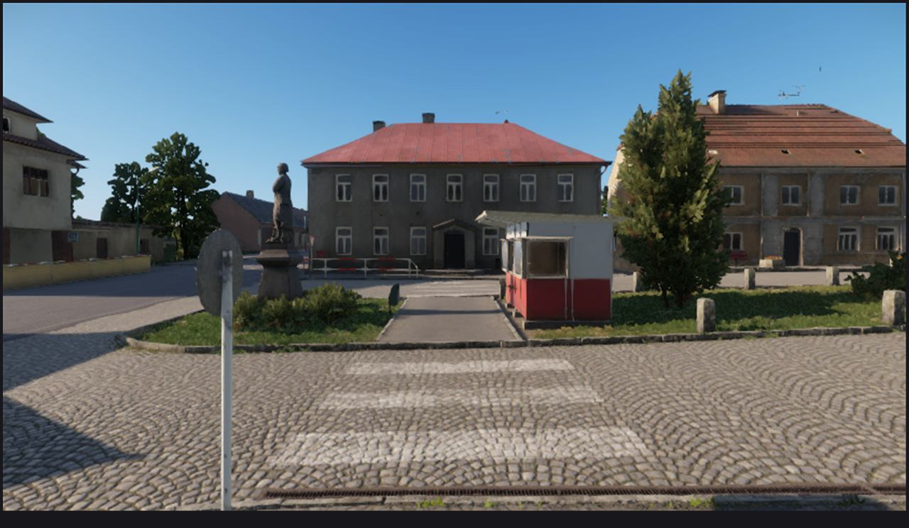

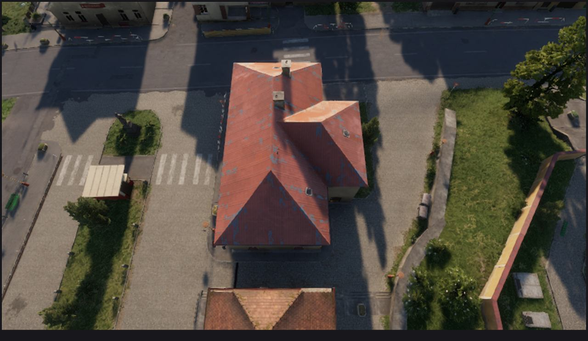

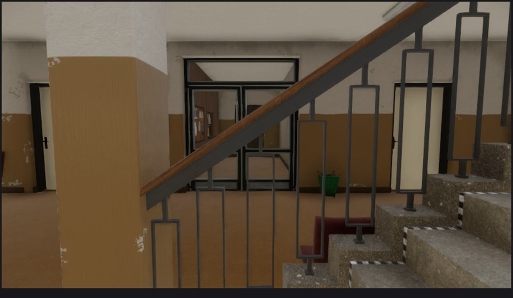

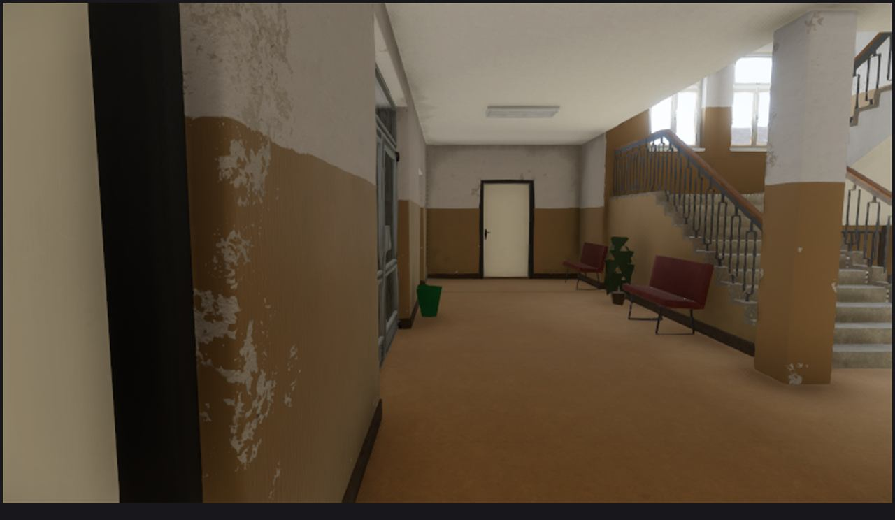

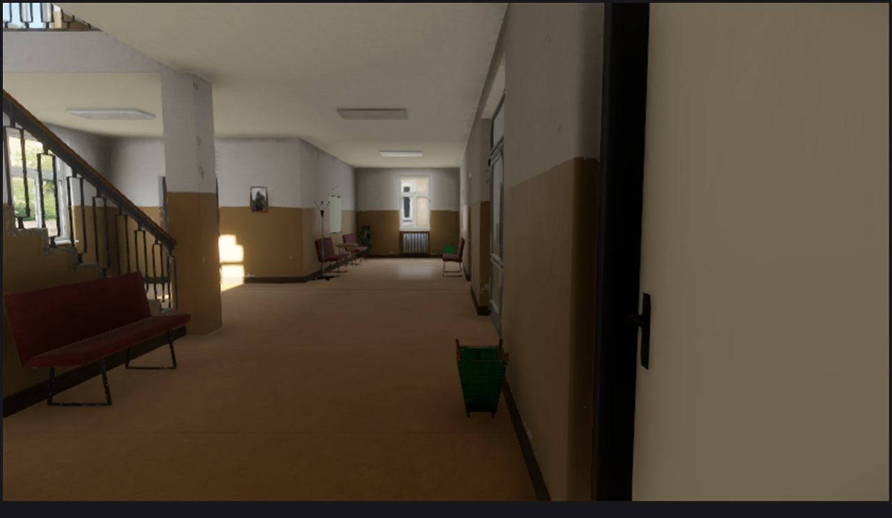

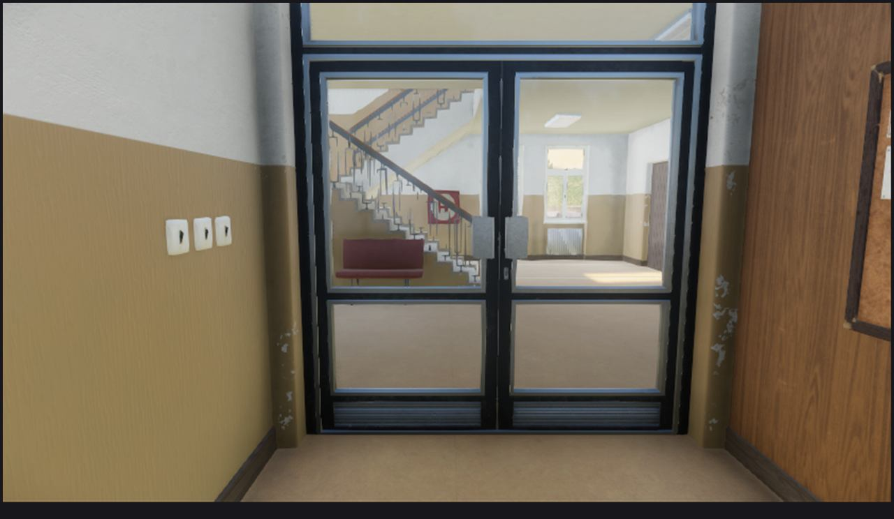

### b04 shop: ShopModern_E_01

`{CFE8511B2B7E8AAA}Prefabs/Structures/Commercial/Shops/ShopModern_E_01/ShopModern_E_01.et` at x 4519.4, z 9430.3, facing N; footprint 24.4 x 19.8 m; interior yes (catalog: 8 door entities and a walkable floor (2 floors)).

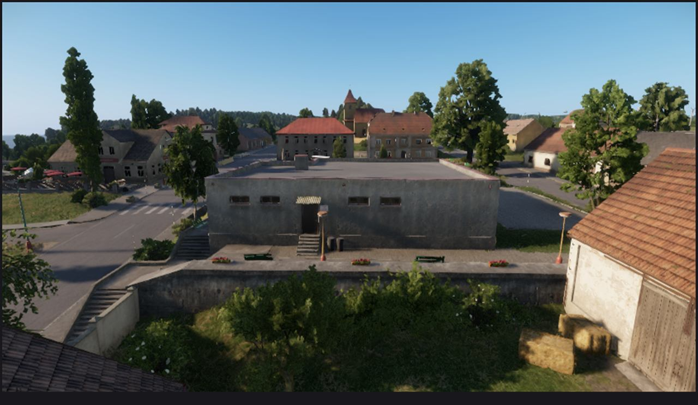

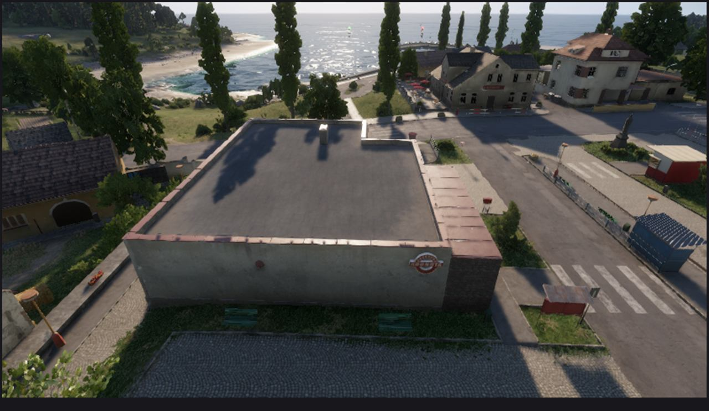

### b06 pub: PubVillage_E_2L01_V3_UCeperu

`{7BFECEE28B046E72}Prefabs/Structures/Commercial/Pubs/PubVillage_E_2L01/PubVillage_E_2L01_V3_UCeperu.et` at x 4474.1, z 9458.3, facing N; footprint 17.9 x 17 m; interior yes (catalog: 10 door entities and a walkable floor (3 floors)).

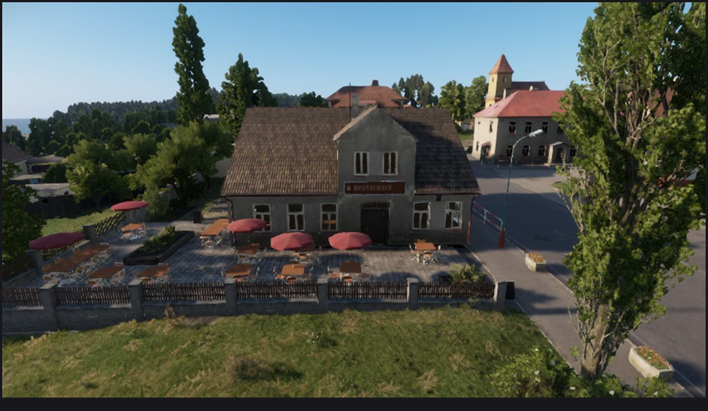

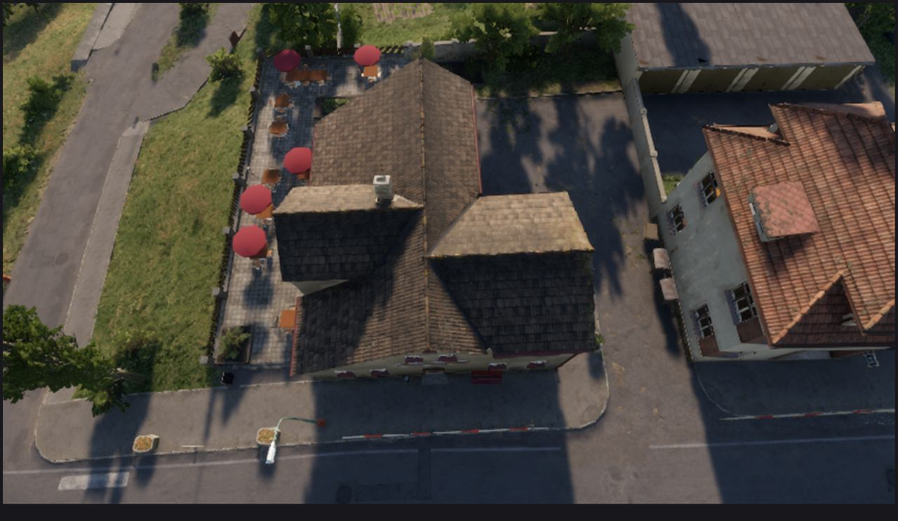

### b07 police: Villa_E_2I01_Police

`{151CFDB2968ADB77}Prefabs/Structures/Houses/Villa/Villa_E_2I01/Villa_E_2I01_Police.et` at x 4474.4, z 9480.6, facing E; footprint 15.3 x 12.7 m; interior yes (catalog: 8 door entities and a walkable floor (5 floors)).

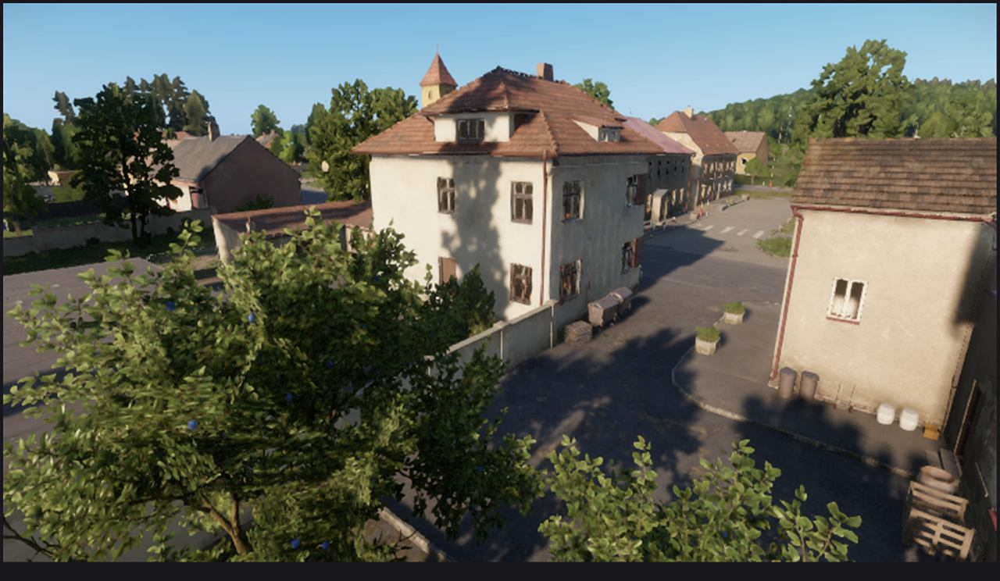

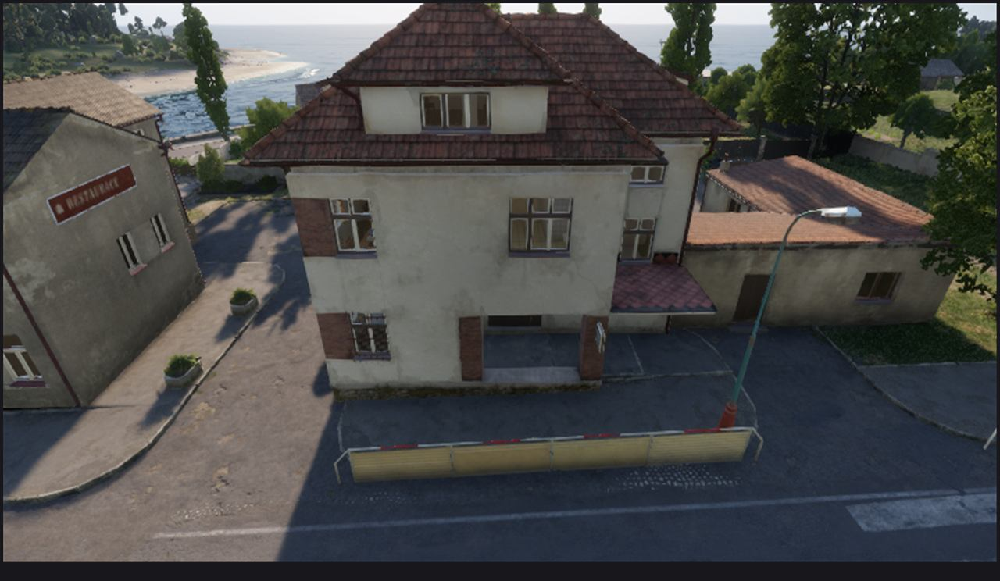

### b17 church: ChurchSmall_E_01

`{0FD764569422DBA7}Prefabs/Structures/Cultural/Churches/ChurchSmall_E_01/ChurchSmall_E_01.et` at x 4526.3, z 9535.1, facing W; footprint 15.5 x 22.3 m; interior yes (catalog: 2 door entities and a walkable floor (2 floors)).

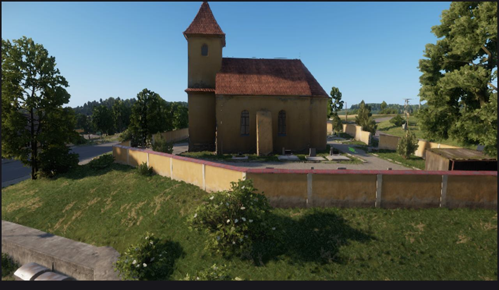

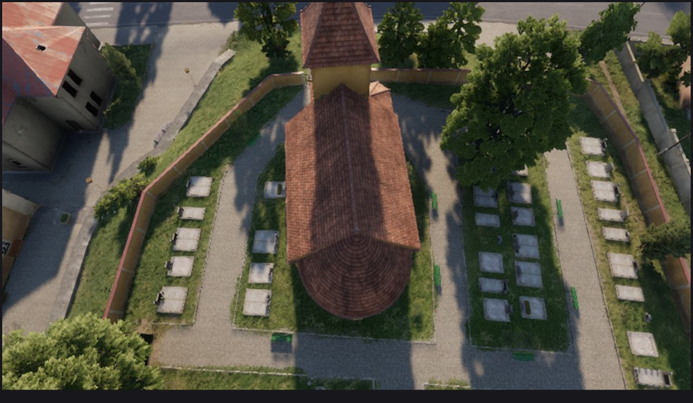

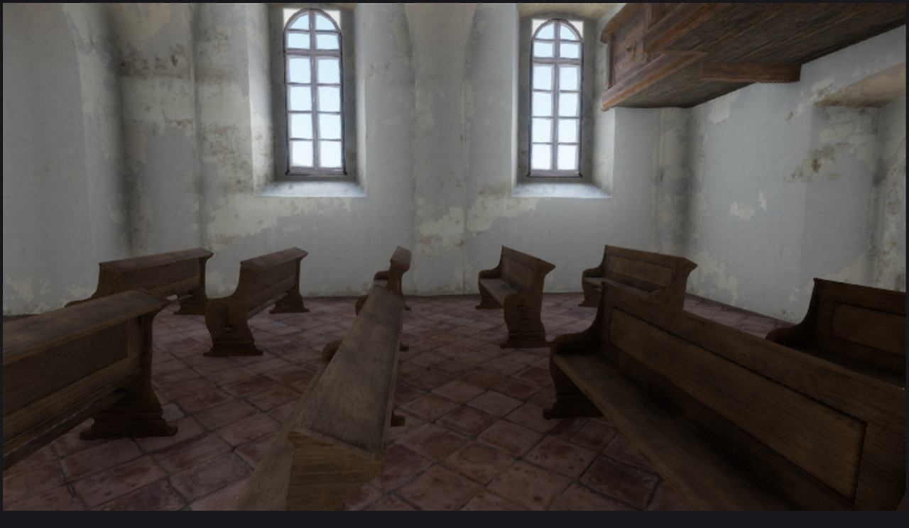

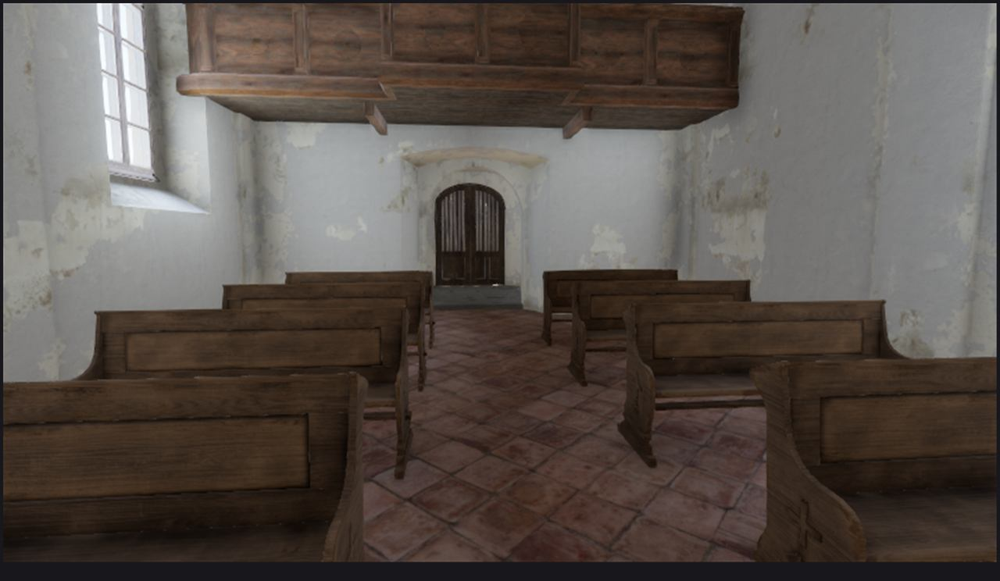

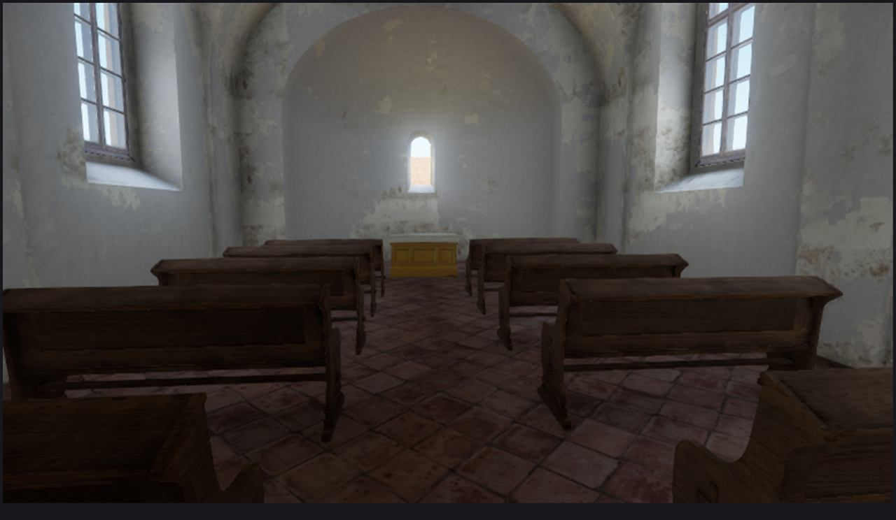

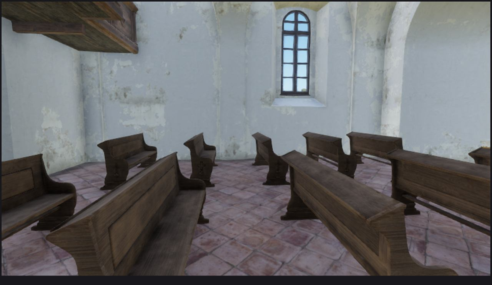

## All buildings

| Id | Type | Vanilla prefab | x | z | Yaw | Facing | Footprint (m) | Floors | Interior | Entrances | Furniture |
| --- | --- | --- | --- | --- | --- | --- | --- | --- | --- | --- | --- |
| b01 | kiosk | NewspaperBooth_E_01_redwhite | 4512.9 | 9467.5 | -1 | N | 4.1 x 5 (20.5 m2) | 2 | yes | 1 | - |
| b02 | townhouse | House_Town_E_2I03 | 4535.2 | 9490.1 | -180 | S | 20.3 x 12.6 (255.8 m2) | 3 | yes | 2 | - |
| b03 | government | MunicipalOffice_E_01 | 4509.8 | 9492.4 | 180 | S | 24.1 x 17.8 (429 m2) | 3 | yes | - | - |
| b04 | shop | ShopModern_E_01 | 4519.4 | 9430.3 | 2 | N | 24.4 x 19.8 (483.1 m2) | 2 | yes | 1 | - |
| b05 | house | House_Village_E_1L03t | 4565.8 | 9456.5 | 91 | E | 25.9 x 25.6 (663 m2) | 2 | yes | - | - |
| b06 | pub | PubVillage_E_2L01_V3_UCeperu | 4474.1 | 9458.3 | -3 | N | 17.9 x 17 (304.3 m2) | 3 | yes | 2 | - |
| b07 | police | Villa_E_2I01_Police | 4474.4 | 9480.6 | 89 | E | 15.3 x 12.7 (194.3 m2) | 5 | yes | 1 | - |
| b08 | shed | Shed_01 | 4541.5 | 9515.1 | 0 | N | 3.6 x 2.7 (9.7 m2) | 1 | yes | 1 | - |
| b09 | garage | Workshop_01_Main | 4473.9 | 9493.8 | 88 | E | 12.2 x 7.6 (92.7 m2) | 1 | yes | 3 | - |
| b10 | house | House_Village_E_1I04t | 4566.3 | 9433.9 | -90 | W | 20.1 x 11.1 (223.1 m2) | 2 | yes | 6 | - |
| b11 | house | House_Village_E_1I08t | 4574 | 9495.4 | -85 | W | 18.9 x 10.2 (192.8 m2) | 3 | yes | 5 | - |
| b12 | garage | Workshop_01_Side | 4467.6 | 9496.8 | -2 | N | 5.4 x 5.8 (31.3 m2) | 1 | yes | 1 | - |
| b13 | garage | Garage_E_01 | 4456.1 | 9476.1 | 88 | E | 4.9 x 9.9 (48.5 m2) | 2 | yes | 2 | - |
| b14 | garage | Garage_E_01 | 4456 | 9481 | 88 | E | 4.9 x 9.9 (48.5 m2) | 2 | yes | 2 | - |
| b15 | farm-small | Henhouse_01 | 4582.1 | 9443.7 | 0 | N | 3.3 x 1.2 (4 m2) | - | no | - | - |
| b16 | garage | Garage_E_01 | 4455.8 | 9485.9 | 88 | E | 4.9 x 9.9 (48.5 m2) | 2 | yes | 2 | - |
| b17 | church | ChurchSmall_E_01 | 4526.3 | 9535.1 | -95 | W | 15.5 x 22.3 (345.7 m2) | 2 | yes | 4 | - |
| b18 | farm | Barn_E_01_white | 4538.3 | 9402.9 | 91 | E | 15.1 x 10.8 (163.1 m2) | 0 | unknown | 4 | - |
| b19 | shed | Shed_01 | 4587.9 | 9454.9 | -90 | W | 3.6 x 2.7 (9.7 m2) | 1 | yes | 1 | - |
| b20 | garage | Garage_E_01 | 4455.7 | 9490.7 | 88 | E | 4.9 x 9.9 (48.5 m2) | 2 | yes | 2 | - |
| b21 | house | House_Village_E_1I04t_red | 4575.4 | 9515.2 | -85 | W | 20.1 x 11.1 (223.1 m2) | 2 | yes | 6 | - |
| b22 | house | House_Village_E_1I04t_red | 4475.3 | 9526 | 90 | E | 20.1 x 11.1 (223.1 m2) | 2 | yes | 6 | - |
| b23 | house | House_Village_E_1I08t | 4513.4 | 9391.9 | -121 | SW | 18.9 x 10.2 (192.8 m2) | 3 | yes | 5 | - |
| b24 | shed | Shed_02_square | 4588.7 | 9505.7 | 3 | N | 4.4 x 3.7 (16.3 m2) | 2 | yes | 1 | - |
| b25 | shed | Shed_01 | 4528.3 | 9386.7 | -127 | SW | 3.6 x 2.7 (9.7 m2) | 1 | yes | 1 | - |
| b26 | shed | Shed_02_square | 4579.1 | 9410.5 | 0 | N | 4.4 x 3.7 (16.3 m2) | 2 | yes | 1 | - |
| b27 | farm-small | Greenhouse_01 | 4437.2 | 9458.9 | -99 | W | 3.8 x 4.2 (16 m2) | 1 | yes | 1 | - |
| b28 | shed | Shed_01 | 4434.3 | 9470.2 | 174 | S | 3.6 x 2.7 (9.7 m2) | 1 | yes | 1 | - |
| b29 | house | House_Village_E_1I05t | 4577.4 | 9536.3 | -85 | W | 24.7 x 11.2 (276.6 m2) | 2 | yes | 4 | - |
| b30 | house | House_Village_E_1I08t | 4475.7 | 9545.8 | 90 | E | 18.9 x 10.2 (192.8 m2) | 3 | yes | 5 | - |
| b31 | shed | Shed_02_line | 4457.5 | 9533.1 | 91 | E | 6.6 x 2.8 (18.5 m2) | 1 | yes | 1 | - |
| b32 | farm-small | Henhouse_01 | 4590.8 | 9410.4 | -93 | W | 3.3 x 1.2 (4 m2) | - | no | - | - |
| b33 | shed | Shed_01 | 4610.7 | 9486.3 | -88 | W | 3.6 x 2.7 (9.7 m2) | 1 | yes | 1 | - |
| b34 | garage | Garage_E_01 | 4428 | 9473.3 | -97 | W | 4.9 x 9.9 (48.5 m2) | 2 | yes | 2 | - |
| b35 | garage | Garage_E_01 | 4613.7 | 9465.6 | -92 | W | 4.9 x 9.9 (48.5 m2) | 2 | yes | 2 | - |
| b36 | garage | Garage_E_01 | 4613.9 | 9460.7 | -93 | W | 4.9 x 9.9 (48.5 m2) | 2 | yes | 2 | - |
| b37 | garage | Garage_E_01 | 4614.1 | 9455.8 | -93 | W | 4.9 x 9.9 (48.5 m2) | 2 | yes | 2 | - |
| b38 | ruin | HouseRuin_01_BrickPile_Small | 4615.2 | 9469.9 | -151 | SW | 3.2 x 3.1 (10.1 m2) | 0 | no | - | - |
| b39 | garage | Garage_E_01 | 4614.3 | 9450.9 | -93 | W | 4.9 x 9.9 (48.5 m2) | 2 | yes | 2 | - |
| b40 | ruin | HouseRuin_01_BrickPile_Big | 4617.3 | 9471.2 | -118 | SW | 5.1 x 4.7 (24 m2) | 0 | no | - | - |
| b41 | farm-small | Henhouse_01 | 4423.4 | 9450.4 | 152 | SE | 3.3 x 1.2 (4 m2) | - | no | - | - |
| b42 | shed | Door_HouseAddon_Shed_E_R_EXT_COV_02 | 4486.4 | 9374.8 | 136 | SE | 1.6 x 0.1 (0.2 m2) | - | no | ? | - |
| b43 | shed | Shed_03 | 4476.5 | 9557 | 180 | S | 6.8 x 3.9 (26.5 m2) | 0 | no | - | - |
| b44 | farm | Barn_E_02 | 4490.1 | 9373 | -44 | NW | 9.5 x 8.5 (80.8 m2) | 0 | unknown | 4 | - |
| b45 | house | House_Village_E_1I06 | 4581.2 | 9388.8 | -2 | N | 18.3 x 14 (256.2 m2) | 2 | yes | 1 | - |
| b46 | ruin | HouseRuin_01_WoodPile | 4528.1 | 9368.5 | 0 | N | 4.9 x 4.5 (22 m2) | 0 | no | - | - |
| b47 | farm | Barn_E_01 | 4608.7 | 9515 | -89 | W | 15.1 x 10.8 (163.1 m2) | 0 | unknown | 4 | - |
| b48 | shed | Door_HouseAddon_Shed_E_R_EXT_COV_02 | 4493.8 | 9370.9 | -44 | NW | 1.6 x 0.1 (0.2 m2) | - | no | ? | - |
| b49 | shed | Door_HouseAddon_Shed_E_R_EXT_COV_01 | 4492.9 | 9369.9 | 136 | SE | 1.7 x 0.1 (0.2 m2) | - | no | ? | - |
| b50 | house | House_Village_E_1I08t | 4418.1 | 9459 | -120 | SW | 18.9 x 10.2 (192.8 m2) | 3 | yes | 5 | - |
| b51 | shed | Door_HouseAddon_Shed_E_L_EXT_COV_01 | 4490.4 | 9367.6 | -44 | NW | 1.9 x 0.1 (0.2 m2) | - | no | ? | - |
| b52 | shed | Shed_01 | 4609.1 | 9526.4 | 3 | N | 3.6 x 2.7 (9.7 m2) | 1 | yes | 1 | - |
| b53 | shed | Shed_02_square | 4411.7 | 9489.2 | -7 | N | 4.4 x 3.7 (16.3 m2) | 2 | yes | 1 | - |
| b54 | shed | Shed_01 | 4549.7 | 9575.4 | 3 | N | 3.6 x 2.7 (9.7 m2) | 1 | yes | 1 | - |
| b55 | house | House_Village_E_1I04t_red | 4409 | 9475.4 | 61 | NE | 20.1 x 11.1 (223.1 m2) | 2 | yes | 6 | - |
| b56 | military | GuardHouse_01 | 4468.6 | 9568.1 | 0 | N | 7.6 x 8.9 (67.6 m2) | 2 | yes | 1 | - |
| b57 | farm-small | Greenhouse_01 | 4608.4 | 9539.2 | -85 | W | 3.8 x 4.2 (16 m2) | 1 | yes | 1 | - |
| b58 | shed | Shed_01 | 4573 | 9366.2 | -128 | SW | 3.6 x 2.7 (9.7 m2) | 1 | yes | 1 | - |
| b59 | farm-small | Henhouse_01 | 4409.3 | 9502.8 | 65 | NE | 3.3 x 1.2 (4 m2) | - | no | - | - |
| b60 | shed | Shed_01 | 4609.1 | 9390.9 | -93 | W | 3.6 x 2.7 (9.7 m2) | 1 | yes | 1 | - |
| b61 | house | House_Wooden_E_1I01 | 4550.6 | 9353.7 | -49 | NW | 13.5 x 7.1 (95.9 m2) | 2 | yes | 1 | - |

Footprint: `catalog` and `measure` are the model's own extents turned by the yaw; `world-bounds` is the engine's axis-aligned box. Yaw is Enfusion's (0 faces +z north, 90 faces +x east). Interior `yes` means door entities and a walkable floor (a heuristic, not walked); `unknown` means door entities but no walkable floor. Entrances are the doors on the outline; `?` means the building was not found in the engine dump. Furniture is the count of furnishing props inside the footprint where the place file has it.

## Notable props

| Kind | Vanilla prefab | x | z | Distance |
| --- | --- | --- | --- | --- |
| bench | BenchStreet_01_green | 4521.9 | 9453.8 | 14.3 m |
| bus-shelter | SignBusStop_01 | 4529.9 | 9456.4 | 14.9 m |
| bench | BenchStreet_01_green | 4514.8 | 9454 | 15.1 m |
| bus-shelter | BusShed_E_01_blue | 4526.9 | 9454.1 | 15.3 m |
| bench | BenchStreet_01_red | 4518.7 | 9483.9 | 16 m |
| monument | StatueSoldier_02 | 4503.8 | 9467.7 | 16.7 m |
| bench | BenchStreet_01_red | 4530.7 | 9484 | 19 m |
| bench | BenchStreet_01_green | 4545.6 | 9462.3 | 25.7 m |
| bench | BenchStreet_01_green | 4545.7 | 9474.1 | 25.9 m |
| notice-board | MessageBoard_01_filled_V5 | 4533.3 | 9442.8 | 28.2 m |
| bench | BenchStreet_01_yellow_red | 4530.9 | 9496.1 | 30 m |
| phone-booth | PhoneBooth_E_01 | 4516 | 9437.5 | 30.8 m |
| bench | BenchStreet_01_green | 4518.6 | 9437.1 | 31 m |
| poster-column | PosterColumn_01 | 4503.9 | 9438.4 | 34 m |
| bench | BenchStreet_01_green | 4533.9 | 9432.8 | 37.7 m |
| bench | BenchStreet_01_red | 4482.4 | 9460.8 | 38.7 m |
| bench | BenchStreet_01_green | 4505 | 9427.8 | 43.1 m |
| bench | BenchStreet_01_green | 4533.6 | 9423.4 | 46.5 m |
| bench | BenchStreet_01_green | 4504.9 | 9421.3 | 49.2 m |
| market-stand | MarketStand_01_Umbrella | 4473.9 | 9444.4 | 52.3 m |
| market-stand | MarketStand_01_Umbrella | 4470.7 | 9444.2 | 55.2 m |
| bench | BenchStreet_01_green | 4525.1 | 9412.7 | 55.5 m |
| bench | BenchStreet_01_green | 4513 | 9412.9 | 55.6 m |
| bench | BenchStreet_01_green | 4519 | 9523.8 | 55.8 m |
| market-stand | MarketStand_01_Umbrella | 4467.4 | 9446.9 | 57.1 m |
| bench | BenchStreet_01_green | 4538.8 | 9412.4 | 58.5 m |
| bench | BenchStreet_01_red | 4580.2 | 9459.9 | 60.2 m |
| bench | BenchStreet_01_green | 4540.2 | 9528.9 | 64 m |
| market-stand | MarketStand_01_Umbrella | 4457.1 | 9451.3 | 65.5 m |
| bench | BenchStreet_01_green | 4571.9 | 9425.8 | 66.5 m |
| market-stand | MarketStand_01_Umbrella | 4457.7 | 9444.4 | 67.1 m |
| well | Well_02_blue | 4544.9 | 9532.6 | 69.1 m |
| bench | BenchStreet_01_yellow_red | 4580.3 | 9507.1 | 71.5 m |
| bench | BenchStreet_01_red | 4519.4 | 9391.6 | 76.4 m |
| bench | BenchStreet_01_green | 4526.6 | 9545 | 77.3 m |
| notice-board | MessageBoardSmall_01_pole_filled_V1 | 4449.7 | 9436.1 | 77.6 m |
| bench | BenchStreet_01_green | 4534.5 | 9544.5 | 77.7 m |
| well | Well_02_blue | 4586.5 | 9426.2 | 78.1 m |
| notice-board | MessageBoardSmall_01 | 4549.4 | 9543.1 | 80.5 m |
| bench | BenchStreet_01_yellow_red | 4571.9 | 9534.9 | 84.3 m |
| bench | BenchStreet_01_green | 4519.1 | 9553.7 | 85.7 m |
| bench | BenchStreet_01_green | 4541.7 | 9551.8 | 86.4 m |
| bench | BenchStreet_01_green | 4480.8 | 9545.9 | 87.5 m |
| well | Well_02_red | 4431.5 | 9456 | 89.8 m |
| bench | BenchStreet_01_green | 4527.5 | 9559 | 91.2 m |
| bench | BenchStreet_01_green | 4536.7 | 9558 | 91.5 m |
| bench | BenchStreet_01_green | 4470.6 | 9549.2 | 95.3 m |
| bench | BenchStreet_01_green | 4436.8 | 9422.3 | 95.4 m |
| bench | BenchStreet_01_green | 4424.4 | 9458.2 | 96.6 m |
| bench | BenchStreet_01_green | 4427.9 | 9428.1 | 100.8 m |
| bench | BenchStreet_01_red | 4413.8 | 9477.4 | 107.1 m |
| well | Well_02_green | 4440.9 | 9541.5 | 108.3 m |
| bench | BenchStreet_01_green | 4416.8 | 9435.6 | 108.6 m |
| bench | BenchStreet_01_red | 4545 | 9359.8 | 110.9 m |
| well | Well_02_blue | 4522.7 | 9581.3 | 113.3 m |
| bench | BenchStreet_01_green | 4404 | 9450.6 | 117.8 m |

Counted, not listed: 25 street-lamp.

## Free plots

| Id | x | z | Size (m) | Area (m2) | Ground (m) | Nearest road | Nearest building | From centre |
| --- | --- | --- | --- | --- | --- | --- | --- | --- |
| p1 | 4600.5 | 9421 | 16 x 50 | 800 | 12.6 to 17.8 | N-S road r04 14 m | b32 farm-small 12.5 m | 92.8 m |
| p2 | 4472.5 | 9410 | 28 x 24 | 672 | 6.4 to 11.1 | NW-SE road r09 15.8 m | b23 house 34.1 m | 75.3 m |
| p3 | 4530.5 | 9468 | 28 x 24 | 672 | 13.9 to 14.9 | E-W road r14 16.9 m | b01 kiosk 15.6 m | 10 m |
| p4 | 4593.5 | 9534 | 14 x 48 | 672 | 18.4 to 20.9 | NE-SW road r03 26.7 m | b29 house 10.6 m | 98.4 m |
| p5 | 4562.5 | 9394 | 12 x 52 | 624 | 11 to 13.9 | N-S road r01 10.9 m | b45 house 7.8 m | 85.1 m |
| p6 | 4462.5 | 9508 | 48 x 12 | 576 | 12.3 to 14.8 | E-W road r23 23.8 m | b12 garage 8.7 m | 70.5 m |
| p7 | 4506.5 | 9552 | 16 x 32 | 512 | 16.1 to 18.2 | N-S road r02 15.7 m | b17 church 13.9 m | 85.2 m |
| p8 | 4427.5 | 9489 | 22 x 22 | 484 | 8.8 to 11.5 | E-W road r23 33.1 m | b34 garage 13.2 m | 95.3 m |

plots are open rectangles at least 10 m on the short side, kept 2.5 m off buildings, 4.5 m off a road's centre line, 2 m off a tree, on ground under 12 degrees; axis aligned, not the best use of the land

## Interiors

## Limits of this dossier

- buildings (types, footprints, floors, interiors) are read from the Everon catalog, docs/everon/catalog-buildings.json; 57 of 61 matched an entity of the engine dump, which adds the door positions, and the other 4 have no entrances listed
- 10 quay, pier and waterworks pieces are counted, not listed

## Prefab references

Every distinct building prefab, as the world file refers to it.

| Prefab | Type | Count |
| --- | --- | --- |
| `{B0C7B3A0C937328B}Prefabs/Structures/Commercial/Booth/NewspaperBooth_E_01/NewspaperBooth_E_01_redwhite.et` | kiosk | 1 |
| `{E7EC0E80F0645DFE}Prefabs/Structures/Houses/Town/House_Town_E_2I03/House_Town_E_2I03.et` | townhouse | 1 |
| `{363A616E6C64BB7F}Prefabs/Structures/Services/Government/MunicipalOffice_E_01/MunicipalOffice_E_01.et` | government | 1 |
| `{CFE8511B2B7E8AAA}Prefabs/Structures/Commercial/Shops/ShopModern_E_01/ShopModern_E_01.et` | shop | 1 |
| `{B2172573ED15AA82}Prefabs/Structures/Houses/Village/House_Village_E_1L03/House_Village_E_1L03t.et` | house | 1 |
| `{7BFECEE28B046E72}Prefabs/Structures/Commercial/Pubs/PubVillage_E_2L01/PubVillage_E_2L01_V3_UCeperu.et` | pub | 1 |
| `{151CFDB2968ADB77}Prefabs/Structures/Houses/Villa/Villa_E_2I01/Villa_E_2I01_Police.et` | police | 1 |
| `{F08D8E78433D713A}Prefabs/Structures/Houses/Shed/Shed_01/Shed_01.et` | shed | 9 |
| `{CFF7F6F7042AFFEF}Prefabs/Structures/Industrial/Houses/Workshop_01/Workshop_01_Main.et` | garage | 1 |
| `{2A0D72C46FDCD368}Prefabs/Structures/Houses/Village/House_Village_E_1I04/House_Village_E_1I04t.et` | house | 1 |
| `{D424A3CD07F7A6F0}Prefabs/Structures/Houses/Village/House_Village_E_1I08/House_Village_E_1I08t.et` | house | 4 |
| `{F9F2F6D2BD65B719}Prefabs/Structures/Industrial/Houses/Workshop_01/Workshop_01_Side.et` | garage | 1 |
| `{A548C1C5370D0734}Prefabs/Structures/Houses/Garage/Garage_E_01/Garage_E_01.et` | garage | 9 |
| `{E005876522A8CE1D}Prefabs/Structures/Agriculture/Henhouse/Henhouse_01/Henhouse_01.et` | farm-small | 4 |
| `{0FD764569422DBA7}Prefabs/Structures/Cultural/Churches/ChurchSmall_E_01/ChurchSmall_E_01.et` | church | 1 |
| `{10297A86E459E9D4}Prefabs/Structures/Agriculture/Barn/Barn_E_01/Barn_E_01_white.et` | farm | 1 |
| `{1E6FF35236AFF31C}Prefabs/Structures/Houses/Village/House_Village_E_1I04/House_Village_E_1I04t_red.et` | house | 3 |
| `{D61A7F2891D457C6}Prefabs/Structures/Houses/Shed/Shed_02/Shed_02_square.et` | shed | 3 |
| `{3299E6F34CE40185}Prefabs/Structures/Agriculture/Greenhouse/Greenhouse_01/Greenhouse_01.et` | farm-small | 2 |
| `{6ABF4CB2949CB4DE}Prefabs/Structures/Houses/Village/House_Village_E_1I05/House_Village_E_1I05t.et` | house | 1 |
| `{24BA2E136E8815C2}Prefabs/Structures/Houses/Shed/Shed_02/Shed_02_line.et` | shed | 1 |
| `{F7919E01B9B17B3E}Prefabs/Structures/Ruins/HouseRuins/HouseRuin_01/HouseRuin_01_BrickPile_Small.et` | ruin | 1 |
| `{5A81BD9171FC3B07}Prefabs/Structures/Ruins/HouseRuins/HouseRuin_01/HouseRuin_01_BrickPile_Big.et` | ruin | 1 |
| `{4B531C06224FA250}Prefabs/Structures/BuildingParts/Doors/Door_HouseAddon_Shed_E_R_EXT_COV_02.et` | shed | 2 |
| `{8597237EA3C59701}Prefabs/Structures/Houses/Shed/Shed_03/Shed_03.et` | shed | 1 |
| `{F5A2DC0597B53E19}Prefabs/Structures/Agriculture/Barn/Barn_E_02/Barn_E_02.et` | farm | 1 |
| `{AD57E850A575A54F}Prefabs/Structures/Houses/Village/House_Village_E_1I06/House_Village_E_1I06.et` | house | 1 |
| `{5CDDDFB2D698DCC3}Prefabs/Structures/Ruins/HouseRuins/HouseRuin_01/HouseRuin_01_WoodPile.et` | ruin | 1 |
| `{99F6E8E52B71B137}Prefabs/Structures/Agriculture/Barn/Barn_E_01/Barn_E_01.et` | farm | 1 |
| `{270728E69E8B2D7E}Prefabs/Structures/BuildingParts/Doors/Door_HouseAddon_Shed_E_R_EXT_COV_01.et` | shed | 1 |
| `{9D6C69116A1DE3B0}Prefabs/Structures/BuildingParts/Doors/Door_HouseAddon_Shed_E_L_EXT_COV_01.et` | shed | 1 |
| `{3F91DEEC9C78E473}Prefabs/Structures/Military/Houses/GuardHouse_01/GuardHouse_01.et` | military | 1 |
| `{C212C8AC6001F002}Prefabs/Structures/Houses/Wooden/House_Wooden_E_1I01/House_Wooden_E_1I01.et` | house | 1 |
