# Montignac: location dossier

Generated 2026-11-19 by `tools\cli scout`. Do not edit by hand; run `tools\cli scout "Montignac"` to refresh. The machine-readable twin is `dossier.json`.

- **Place:** Montignac (other), from the map's own label
- **Centre:** x 4773.455, z 7094.566, ground 164.342 m; **radius** 120 m
- **World:** Worlds/CoreOnEveron/CoreOnEveron.ent, Arma Reforger build 26266485 (installed 2026-11-08)
- **Other labels nearby:** sawmill (other, 344 m SW); sawmill (other, 344 m SW); farm (other, 364 m E)

## At a glance

52 buildings (14 homes, 7 civic, 0 ruins), 40 enterable (a door entity below them), 67 entrances from outside among 256 door entities; 43 road(s), 19 junction(s); 74 notable props; 3329 trees, bushes and other generated vegetation; 8 free plot(s).

| Type | Count |
| --- | --- |
| shed | 16 |
| house | 12 |
| garage | 8 |
| farm-small | 5 |
| townhouse | 2 |
| fire | 2 |
| industrial | 2 |
| church | 2 |
| government | 1 |
| police | 1 |
| pub | 1 |

## Overview

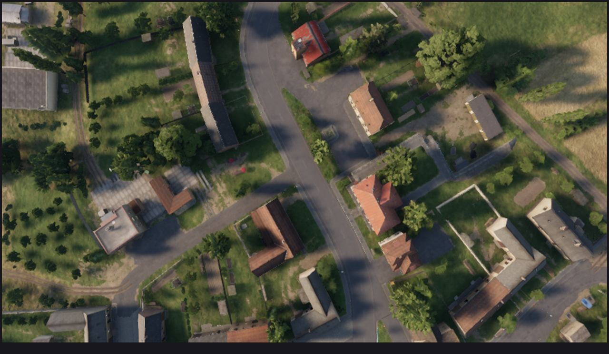

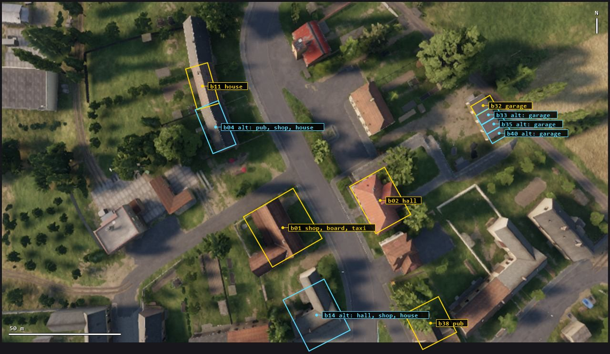

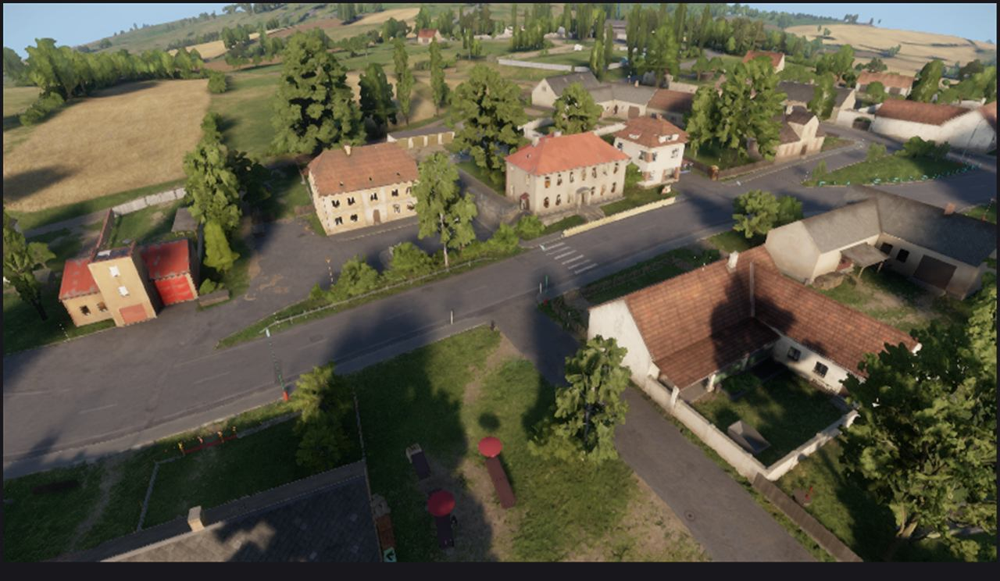

## Terrain

- ground 154.6 to 171 m (16.3 m of relief) within 120 m; mean 163.8 m
- 47% of the ground is under 3 degrees, 39% 3 to 8, 3% over 15
- overall the ground falls 3.1 degrees toward the NW
- steepest ground 30.3 degrees at 4788.5, 6989.6

## Roads and junctions

**Main street:** N-S road r01, 14 buildings within 25 m of it; its busiest stretch is at x 4767.4, z 7111.7.

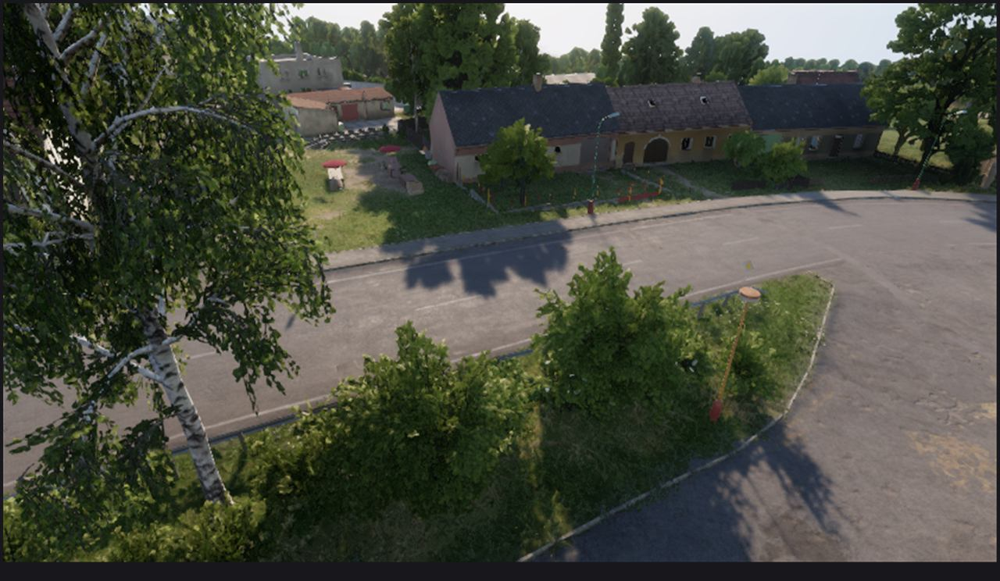

| Id | Road | Length in radius (m) | Points |
| --- | --- | --- | --- |
| r01 | N-S road r01 | 288.4 | 7 |
| r02 | NE-SW PolylineShapeEntity r02 | 31.5 | 3 |
| r03 | NE-SW road r03 | 18.7 | 6 |
| r04 | N-S road r04 | 31.6 | 5 |
| r05 | NE-SW road r05 | 17.3 | 2 |
| r06 | E-W road r06 | 46 | 3 |
| r07 | NW-SE road r07 | 167.4 | 13 |
| r08 | NE-SW road r08 | 19.9 | 5 |
| r09 | E-W road r09 | 24.5 | 7 |
| r10 | NE-SW road r10 | 17.5 | 5 |
| r11 | NE-SW road r11 | 17.6 | 5 |
| r12 | NE-SW road r12 | 15.6 | 4 |
| r13 | NE-SW road r13 | 119.9 | 9 |
| r14 | NE-SW road r14 | 89.3 | 4 |
| r15 | NW-SE road r15 | 76.7 | 6 |
| r16 | E-W road r16 | 113.3 | 9 |
| r18 | E-W road r18 | 13.1 | 4 |
| r19 | E-W road r19 | 13.2 | 4 |
| r20 | NW-SE road r20 | 6.5 | 2 |
| r21 | E-W road r21 | 17.4 | 7 |
| r22 | E-W road r22 | 17.4 | 7 |
| r23 | NE-SW road r23 | 14 | 2 |
| r24 | NE-SW road r24 | 28 | 2 |
| r25 | NE-SW road r25 | 22 | 3 |
| r26 | NW-SE road r26 | 12.4 | 2 |
| r27 | NW-SE road r27 | 12.4 | 2 |
| r28 | NW-SE road r28 | 12.4 | 2 |
| r29 | N-S road r29 | 22.1 | 7 |
| r30 | N-S road r30 | 22.1 | 7 |
| r32 | NW-SE road r32 | 22 | 7 |
| r33 | NE-SW road r33 | 17.8 | 5 |
| r34 | N-S road r34 | 36.7 | 3 |
| r35 | NE-SW road r35 | 14 | 2 |
| r36 | NE-SW road r36 | 6.2 | 2 |
| r37 | NE-SW road r37 | 14 | 3 |
| r38 | E-W road r38 | 35.7 | 4 |
| r39 | NE-SW road r39 | 10.1 | 2 |
| r40 | NE-SW road r40 | 8 | 2 |
| r41 | NE-SW road r41 | 14 | 2 |
| r42 | NE-SW road r42 | 14 | 2 |
| r43 | N-S road r43 | 51.6 | 4 |
| r44 | NE-SW road r44 | 4 | 2 |
| r45 | NE-SW road r45 | 6 | 2 |

| x | z | Kind | Arms | Roads |
| --- | --- | --- | --- | --- |
| 4683.8 | 7088 | crossroads | 7 | r23, r39, r24, r43, r35, r40 |
| 4766.6 | 7200.3 | crossroads | 4 | r06, r01, r04 |
| 4679.3 | 7080.3 | crossroads | 4 | r25, r45, r39, r44 |
| 4756.3 | 7136.3 | t-junction | 3 | r01, r09 |
| 4774.2 | 7096.8 | t-junction | 3 | r13, r01 |
| 4798.9 | 7029 | t-junction | 3 | r16, r01 |
| 4785.1 | 7203.9 | t-junction | 3 | r05, r07 |
| 4748.5 | 7208.3 | t-junction | 3 | r20, r06 |
| 4731.7 | 7071.4 | t-junction | 3 | r13, r32 |
| 4690.3 | 7045 | t-junction | 3 | r38, r13 |
| 4832.4 | 6992.3 | t-junction | 3 | r14, r15 |
| 4689.8 | 7005.7 | t-junction | 3 | r16, r34 |
| 4883.2 | 7090.7 | bend-or-join | 2 | r10, r11 |
| 4870.1 | 7079.1 | bend-or-join | 2 | r10, r11 |
| 4685.9 | 7028.5 | bend-or-join | 2 | r13, r34 |
| 4734.5 | 7192.3 | bend-or-join | 2 | r18, r19 |
| 4722.2 | 7196.9 | bend-or-join | 2 | r18, r19 |
| 4720.5 | 7089 | bend-or-join | 2 | r28, r32 |
| 4694.8 | 7086.1 | bend-or-join | 2 | r36, r40 |

## Civic candidates

Public-facing buildings a town plan would use (church, chapel, government, police, fire, pub, shop, fuel station, hotel, recreation), nearest first. Each links its pictures.

| Id | Type | Vanilla prefab | Distance | Footprint | Floors | Interior | Entrances |
| --- | --- | --- | --- | --- | --- | --- | --- |
| b02 | government | MunicipalOffice_E_01 | 35.7 m E | 24.1 x 17.8 m (429 m2) | 3 | yes | ? |
| b07 | fire | FireStation_E_01_hose_hanger | 53.1 m N | 0.6 x 2 m (1.2 m2) | 0 | no | ? |
| b08 | police | Villa_E_2I01_Police | 54.2 m SE | 15.3 x 12.7 m (194.3 m2) | 5 | yes | back/NE |
| b09 | fire | FireStation_E_01 | 56.7 m N | 15.9 x 15.7 m (249.6 m2) | 4 | yes | front/SW, front/W, back/E, left/S |
| b38 | pub | PubVillage_E_2L01_V2 | 88.3 m SE | 17.9 x 17 m (304.3 m2) | 3 | yes | right/S, back/SW |
| b50 | church | Church_01_yellow | 102.8 m S | 20 x 33.8 m (676 m2) | 2 | yes | front/W, front/SW, right/N |
| b51 | church | Church_01_crypt_attic | 102.8 m S | 16.5 x 28 m (462 m2) | 1 | no | ? |

### b02 government: MunicipalOffice_E_01

`{363A616E6C64BB7F}Prefabs/Structures/Services/Government/MunicipalOffice_E_01/MunicipalOffice_E_01.et` at x 4806.9, z 7082.1, facing SW; footprint 24.1 x 17.8 m; interior yes (catalog: 14 door entities and a walkable floor (3 floors)).

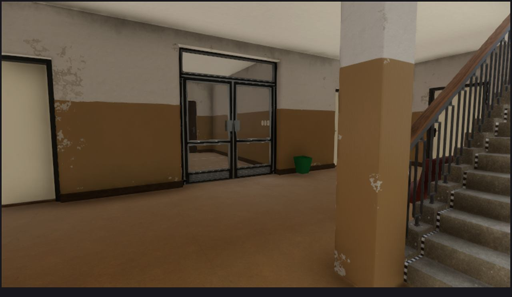

### b08 police: Villa_E_2I01_Police

`{151CFDB2968ADB77}Prefabs/Structures/Houses/Villa/Villa_E_2I01/Villa_E_2I01_Police.et` at x 4816.5, z 7061.6, facing SW; footprint 15.3 x 12.7 m; interior yes (catalog: 8 door entities and a walkable floor (5 floors)).

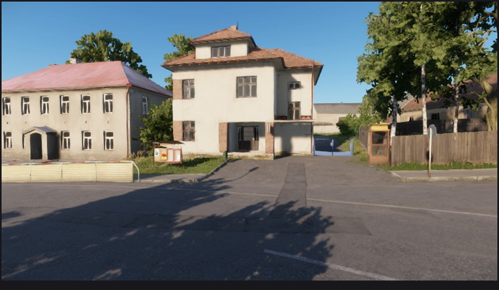

### b09 fire: FireStation_E_01

`{E8C14F26268A4D6D}Prefabs/Structures/Services/Fire/FireStation_E_01/FireStation_E_01.et` at x 4775.3, z 7151.3, facing SW; footprint 15.9 x 15.7 m; interior yes (catalog: 9 door entities and a walkable floor (4 floors)).

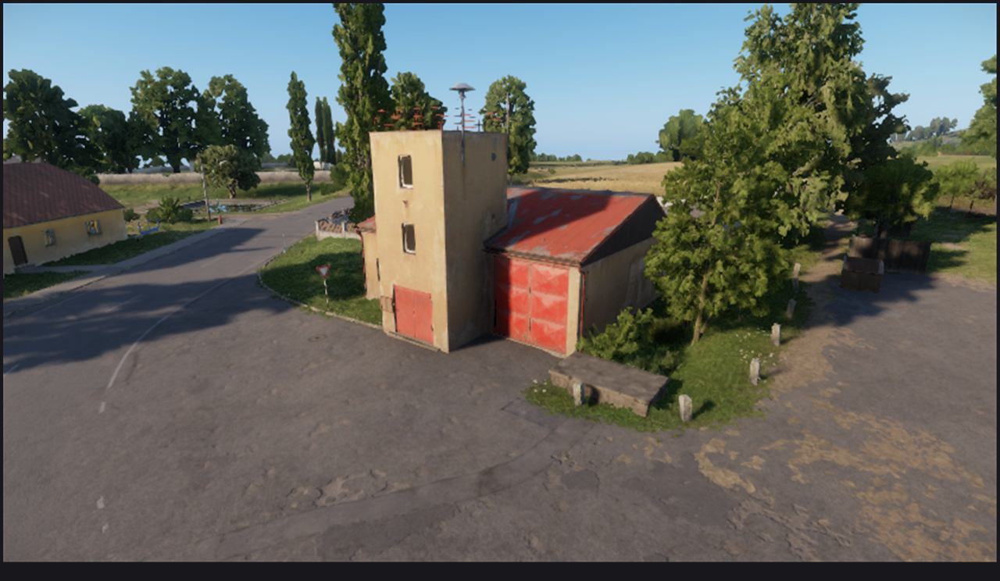

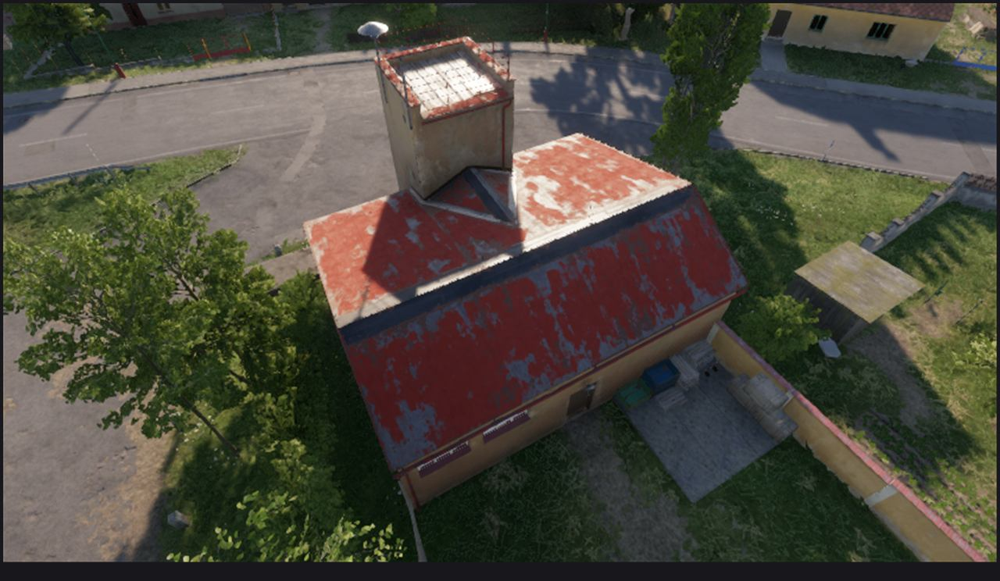

### b38 pub: PubVillage_E_2L01_V2

`{C7B11EF2ABFDF49F}Prefabs/Structures/Commercial/Pubs/PubVillage_E_2L01/PubVillage_E_2L01_V2.et` at x 4830.7, z 7027.3, facing NE; footprint 17.9 x 17 m; interior yes (catalog: 10 door entities and a walkable floor (3 floors)).

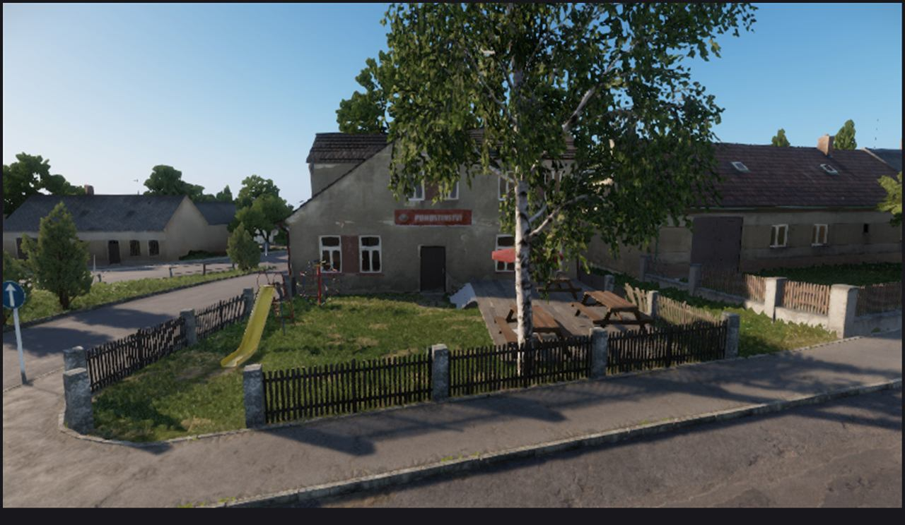

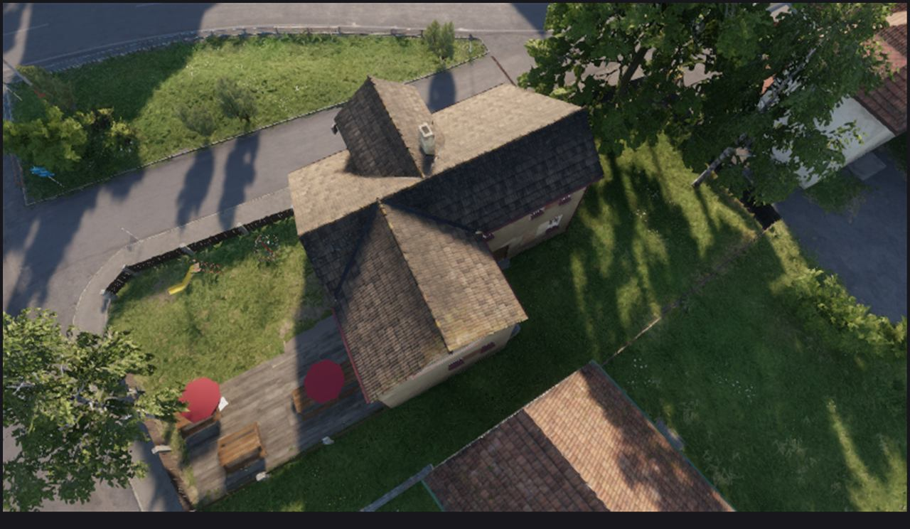

### b50 church: Church_01_yellow

`{22D7D4C89F6AEDDF}Prefabs/Structures/Cultural/Churches/Church_01/Church_01_yellow.et` at x 4780.2, z 6992, facing W; footprint 20 x 33.8 m; interior yes (catalog: 11 door entities and a walkable floor (2 floors)).

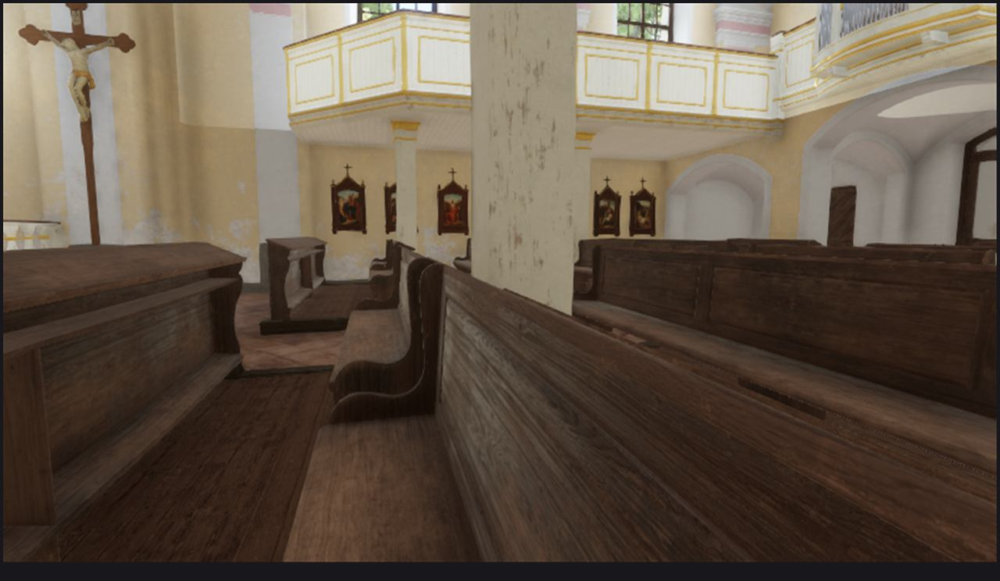

## All buildings

| Id | Type | Vanilla prefab | x | z | Yaw | Facing | Footprint (m) | Floors | Interior | Entrances | Furniture |
| --- | --- | --- | --- | --- | --- | --- | --- | --- | --- | --- | --- |
| b01 | house | House_Village_E_1L03t | 4763.4 | 7069.9 | -120 | SW | 25.9 x 25.6 (663 m2) | 2 | yes | - | - |
| b02 | government | MunicipalOffice_E_01 | 4806.9 | 7082.1 | -119 | SW | 24.1 x 17.8 (429 m2) | 3 | yes | ? | - |
| b03 | townhouse | House_Town_E_2I03_v2 | 4803.9 | 7121.9 | -119 | SW | 20.3 x 12.6 (255.8 m2) | 3 | yes | 2 | - |
| b04 | house | House_Village_E_1I04sf_red | 4733.4 | 7114.9 | -112 | W | 21.1 x 11.1 (234.2 m2) | 2 | yes | 7 | - |
| b05 | garage | RampVehicle_01_concrete | 4724.8 | 7091.5 | 148 | SE | 5.4 x 12.7 (68.6 m2) | 1 | no | - | - |
| b06 | shed | Shed_03 | 4773.1 | 7041.6 | 63 | NE | 6.8 x 3.9 (26.5 m2) | 0 | no | - | - |
| b07 | fire | FireStation_E_01_hose_hanger | 4772.5 | 7147.7 | -118 | SW | 0.6 x 2 (1.2 m2) | 0 | no | ? | - |
| b08 | police | Villa_E_2I01_Police | 4816.5 | 7061.6 | -118 | SW | 15.3 x 12.7 (194.3 m2) | 5 | yes | 1 | - |
| b09 | fire | FireStation_E_01 | 4775.3 | 7151.3 | -118 | SW | 15.9 x 15.7 (249.6 m2) | 4 | yes | 4 | - |
| b10 | garage | Workshop_01_Side | 4717.3 | 7083.7 | 147 | SE | 5.4 x 5.8 (31.3 m2) | 1 | yes | 1 | - |
| b11 | house | House_Village_E_1I08t | 4727.5 | 7133.2 | 74 | E | 18.9 x 10.2 (192.8 m2) | 3 | yes | 5 | - |
| b12 | farm-small | Greenhouse_01 | 4719.3 | 7123 | -19 | N | 3.8 x 4.2 (16 m2) | 1 | yes | 1 | - |
| b13 | shed | Shed_02_square | 4739.8 | 7042.6 | 80 | E | 4.4 x 3.7 (16.3 m2) | 2 | yes | 1 | - |
| b14 | house | House_Village_E_1L02t | 4778.5 | 7030.8 | -27 | NW | 20.6 x 25.6 (527.4 m2) | 2 | yes | 1 | - |
| b15 | garage | Workshop_01_Main | 4710.2 | 7083 | -123 | SW | 12.2 x 7.6 (92.7 m2) | 1 | yes | 2 | - |
| b16 | shed | Shed_03_wide | 4796 | 7155.1 | -26 | NW | 12.3 x 3.9 (48 m2) | 0 | no | - | - |
| b17 | shed | Shed_02_small | 4811 | 7147.2 | 151 | SE | 3.5 x 2.6 (9.1 m2) | 1 | yes | 1 | - |
| b18 | farm-small | Greenhouse_01 | 4824.6 | 7134.7 | -120 | SW | 3.8 x 4.2 (16 m2) | 1 | yes | 1 | - |
| b19 | shed | Shed_02_square | 4712.9 | 7120.5 | -17 | N | 4.4 x 3.7 (16.3 m2) | 2 | yes | 1 | - |
| b20 | shed | Shed_03 | 4709.1 | 7112.2 | 57 | NE | 6.8 x 3.9 (26.5 m2) | 0 | no | - | - |
| b21 | garage | Workshop_01_Side | 4704.7 | 7089.6 | -123 | SW | 5.4 x 5.8 (31.3 m2) | 1 | yes | 1 | - |
| b22 | shed | Shed_03 | 4735.6 | 7034.7 | 76 | E | 6.8 x 3.9 (26.5 m2) | 0 | no | - | - |
| b23 | shed | Shed_02_square | 4776.6 | 7168.5 | 61 | NE | 4.4 x 3.7 (16.3 m2) | 2 | yes | 1 | - |
| b24 | shed | Shed_02_square | 4838.1 | 7134 | -32 | NW | 4.4 x 3.7 (16.3 m2) | 2 | yes | 1 | - |
| b25 | townhouse | House_Town_E_2I02 | 4749.3 | 7022.3 | 170 | S | 18.5 x 13.4 (247.9 m2) | 3 | yes | ? | - |
| b26 | house | House_Village_E_1I04sr_green | 4723.2 | 7152 | 80 | E | 21.1 x 11.1 (234.2 m2) | 2 | yes | 7 | - |
| b27 | shed | Shed_02_line | 4846.4 | 7065.9 | 50 | NE | 6.6 x 2.8 (18.5 m2) | 1 | yes | 1 | - |
| b28 | farm-small | Greenhouse_01 | 4712.4 | 7044.4 | -124 | SW | 3.8 x 4.2 (16 m2) | 1 | yes | 1 | - |
| b29 | shed | Shed_03 | 4706.2 | 7139.4 | -13 | N | 6.8 x 3.9 (26.5 m2) | 0 | no | - | - |
| b30 | industrial | PortableCabin_E_01_beige | 4693.7 | 7079 | 146 | SE | 3.8 x 6.4 (24.3 m2) | 2 | yes | 1 | - |
| b31 | shed | Door_HouseAddon_Shed_E_L_EXT_COV_01 | 4737.6 | 7170.5 | -69 | W | 1.9 x 0.1 (0.2 m2) | - | no | ? | - |
| b32 | garage | Garage_E_01 | 4853.4 | 7124.8 | -120 | SW | 4.9 x 9.9 (48.5 m2) | 2 | yes | 2 | - |
| b33 | garage | Garage_E_01 | 4855.8 | 7120.7 | -120 | SW | 4.9 x 9.9 (48.5 m2) | 2 | yes | 2 | - |
| b34 | shed | Door_HouseAddon_Shed_E_R_EXT_COV_01 | 4738.8 | 7173.6 | 111 | E | 1.7 x 0.1 (0.2 m2) | - | no | ? | - |
| b35 | garage | Garage_E_01 | 4858.1 | 7116.6 | -120 | SW | 4.9 x 9.9 (48.5 m2) | 2 | yes | 2 | - |
| b36 | house | House_Prefab_2I01_v2 | 4781.2 | 7182.1 | -29 | NW | 16.6 x 13.4 (222.4 m2) | 3 | yes | - | - |
| b37 | shed | HouseAddon_Shed_E_01 | 4734.4 | 7173.3 | -69 | W | 4.9 x 8.5 (41.7 m2) | 0 | unknown | 3 | - |
| b38 | pub | PubVillage_E_2L01_V2 | 4830.7 | 7027.3 | 63 | NE | 17.9 x 17 (304.3 m2) | 3 | yes | 2 | - |
| b39 | house | House_Village_E_1I04t | 4730.2 | 7017.6 | 170 | S | 20.1 x 11.1 (223.1 m2) | 2 | yes | ? | - |
| b40 | garage | Garage_E_01 | 4860.5 | 7112.4 | -120 | SW | 4.9 x 9.9 (48.5 m2) | 2 | yes | 2 | - |
| b41 | industrial | Office_E_01 | 4687.2 | 7069.1 | 146 | SE | 17 x 15 (255 m2) | 3 | yes | 2 | - |
| b42 | shed | Door_HouseAddon_Shed_E_R_EXT_COV_02 | 4730.9 | 7175.3 | 111 | E | 1.6 x 0.1 (0.2 m2) | - | no | ? | - |
| b43 | house | House_Village_E_1I05s | 4850.7 | 7038.7 | -41 | NW | 26.7 x 11.2 (299 m2) | 2 | yes | 4 | - |
| b44 | farm-small | Greenhouse_01 | 4708.5 | 7164.8 | -10 | N | 3.8 x 4.2 (16 m2) | 1 | yes | 1 | - |
| b45 | shed | Shed_02_square | 4697.5 | 7155.9 | 169 | S | 4.4 x 3.7 (16.3 m2) | 2 | yes | 1 | - |
| b46 | house | House_Village_E_1I02_Furniture | 4738.2 | 7185.8 | 20 | N | 11 x 20.5 (225.5 m2) | 2 | yes | ? | - |
| b47 | farm-small | Greenhouse_01 | 4703 | 7163.7 | -12 | N | 3.8 x 4.2 (16 m2) | 1 | yes | 1 | - |
| b48 | house | House_Village_E_1L02t | 4867.8 | 7053.9 | -42 | NW | 20.6 x 25.6 (527.4 m2) | 2 | yes | 1 | - |
| b49 | house | House_Village_E_1I04t_red | 4700.6 | 7022.3 | -91 | W | 20.1 x 11.1 (223.1 m2) | 2 | yes | ? | - |
| b50 | church | Church_01_yellow | 4780.2 | 6992 | -105 | W | 20 x 33.8 (676 m2) | 2 | yes | 3 | - |
| b51 | church | Church_01_crypt_attic | 4780.2 | 6992 | -105 | W | 16.5 x 28 (462 m2) | 1 | no | ? | - |
| b52 | house | House_Village_E_1I03_Furniture | 4885.8 | 7070.8 | 137 | SE | 15.3 x 25.5 (390.2 m2) | 2 | yes | ? | - |

Footprint: `catalog` and `measure` are the model's own extents turned by the yaw; `world-bounds` is the engine's axis-aligned box. Yaw is Enfusion's (0 faces +z north, 90 faces +x east). Interior `yes` means door entities and a walkable floor (a heuristic, not walked); `unknown` means door entities but no walkable floor. Entrances are the doors on the outline; `?` means the building was not found in the engine dump. Furniture is the count of furnishing props inside the footprint where the place file has it.

## Notable props

| Kind | Vanilla prefab | x | z | Distance |
| --- | --- | --- | --- | --- |
| fountain | Fountain_01 | 4785.5 | 7111.8 | 21 m |
| market-stand | MarketStand_01_Umbrella | 4744.8 | 7095.6 | 28.7 m |
| market-stand | MarketStand_01 | 4743.5 | 7095 | 30 m |
| market-stand | MarketStand_01 | 4744.3 | 7102.5 | 30.2 m |
| market-stand | MarketStand_01 | 4741 | 7094.1 | 32.5 m |
| market-stand | MarketStand_01 | 4740.3 | 7100.3 | 33.7 m |
| market-stand | MarketStand_01_Umbrella | 4739 | 7099.7 | 34.9 m |
| market-stand | MarketStand_01 | 4737.8 | 7099.4 | 36 m |
| bench | BenchWooden_02_Worn | 4751.8 | 7059 | 41.7 m |
| bench | BenchStreet_01_yellow_red | 4731.1 | 7102 | 43 m |
| well | Well_02_red | 4739.6 | 7067.8 | 43.2 m |
| notice-board | MessageBoard_01_filled_V1 | 4804.6 | 7060.1 | 46.5 m |
| bench | BenchWooden_02_Worn | 4728.1 | 7113.8 | 49.3 m |
| bench | BenchWooden_01 | 4727.6 | 7115.7 | 50.5 m |
| bench | BenchWooden_02_Worn | 4749.9 | 7046.6 | 53.5 m |
| pier-or-dock | Pier_Stairs01 | 4820.3 | 7122.9 | 54.7 m |
| notice-board | MessageBoardSmall_01 | 4767.8 | 7149.2 | 54.9 m |
| pier-or-dock | Pier_02 | 4823 | 7124.4 | 57.8 m |
| bench | BenchStreet_01_red | 4824.8 | 7126.1 | 60.2 m |
| phone-booth | PhoneBooth_E_01 | 4813.3 | 7047.1 | 61.9 m |
| bench | BenchWooden_02_Worn | 4819.8 | 7141.8 | 66.1 m |
| pier-or-dock | Pier_02 | 4720.7 | 7134.7 | 66.3 m |
| bench | BenchStreet_02 | 4747.2 | 7028.5 | 71.2 m |
| monument | StatueFIA_01_big | 4741 | 7164.4 | 77 m |
| well | Well_02_red | 4829.1 | 7148.6 | 77.5 m |
| pier-or-dock | Pier_Stairs02 | 4836.2 | 7017.8 | 99.1 m |
| market-stand | MarketStand_01_Umbrella | 4839.3 | 7019.6 | 99.7 m |
| pier-or-dock | Pier_01 | 4838.9 | 7019.2 | 99.9 m |
| bench | BenchStreet_02 | 4765.3 | 6994.2 | 100.7 m |
| bench | BenchStreet_02 | 4763.1 | 6991.4 | 103.8 m |
| pier-or-dock | PierCover_05 | 4693.5 | 7027.2 | 104.7 m |
| pier-or-dock | Pier_01 | 4841.6 | 7013.8 | 105.7 m |
| market-stand | MarketStand_01_Umbrella | 4840.3 | 7012.5 | 105.8 m |
| well | Well_02_blue | 4859.1 | 7030.1 | 107.2 m |
| bench | BenchStreet_01_green | 4871.9 | 7050.2 | 107.9 m |
| well | Well_02_blue | 4727.2 | 7198.6 | 113.9 m |
| pier-or-dock | PierCover_05 | 4872.6 | 7038.1 | 114.1 m |
| pier-or-dock | PierCover_05 | 4874.1 | 7036 | 116.4 m |
| bench | BenchStreet_02 | 4713.4 | 6994.8 | 116.5 m |
| bench | BenchStreet_02 | 4708.7 | 6994.9 | 118.9 m |
| bench | BenchStreet_02 | 4730.7 | 6983.2 | 119.3 m |

Counted, not listed: 15 manhole, 18 street-lamp.

## Free plots

| Id | x | z | Size (m) | Area (m2) | Ground (m) | Nearest road | Nearest building | From centre |
| --- | --- | --- | --- | --- | --- | --- | --- | --- |
| p1 | 4685.5 | 7126.6 | 28 x 48 | 1344 | 156.7 to 161.1 | E-W road r21 18.3 m | b29 shed 20.5 m | 93.6 m |
| p2 | 4833.5 | 7062.6 | 16 x 40 | 640 | 166.8 to 169.5 | NW-SE road r15 33.2 m | b08 police 10.5 m | 68 m |
| p3 | 4711.5 | 7178.6 | 32 x 16 | 512 | 157.5 to 160.3 | E-W road r19 18.6 m | b44 farm-small 11.5 m | 104.4 m |
| p4 | 4833.5 | 7181.6 | 28 x 18 | 504 | 163.9 to 164.9 | NW-SE road r07 19.2 m | b17 shed 38.9 m | 105.7 m |
| p5 | 4854.5 | 7161.6 | 26 x 18 | 468 | 164.8 to 165.5 | NW-SE road r07 18.7 m | b24 shed 29.3 m | 105.1 m |
| p6 | 4838.5 | 7118.6 | 14 x 24 | 336 | 163.8 to 164.6 | NW-SE road r07 23.6 m | b32 garage 10.5 m | 69.3 m |
| p7 | 4732.5 | 6993.6 | 18 x 18 | 324 | 161.9 to 163.4 | E-W road r16 13.3 m | b39 house 18.5 m | 109 m |
| p8 | 4753.5 | 7106.6 | 16 x 20 | 320 | 161.8 to 163.6 | N-S road r01 14.8 m | b04 house 11 m | 23.3 m |

plots are open rectangles at least 10 m on the short side, kept 2.5 m off buildings, 4.5 m off a road's centre line, 2 m off a tree, on ground under 12 degrees; axis aligned, not the best use of the land

## Interiors

## Limits of this dossier

- buildings (types, footprints, floors, interiors) are read from the Everon catalog, docs/everon/catalog-buildings.json; 41 of 52 matched an entity of the engine dump, which adds the door positions, and the other 11 have no entrances listed
- 15 quay, pier and waterworks pieces are counted, not listed

## Prefab references

Every distinct building prefab, as the world file refers to it.

| Prefab | Type | Count |
| --- | --- | --- |
| `{B2172573ED15AA82}Prefabs/Structures/Houses/Village/House_Village_E_1L03/House_Village_E_1L03t.et` | house | 1 |
| `{363A616E6C64BB7F}Prefabs/Structures/Services/Government/MunicipalOffice_E_01/MunicipalOffice_E_01.et` | government | 1 |
| `{F29BECBA5BAFB1B6}Prefabs/Structures/Houses/Town/House_Town_E_2I03/House_Town_E_2I03_v2.et` | townhouse | 1 |
| `{4942F5A04C472230}Prefabs/Structures/Houses/Village/House_Village_E_1I04/House_Village_E_1I04sf_red.et` | house | 1 |
| `{FFDC9C8026E15E29}Prefabs/Structures/Industrial/Repair/RampVehicle_01/RampVehicle_01_concrete.et` | garage | 1 |
| `{8597237EA3C59701}Prefabs/Structures/Houses/Shed/Shed_03/Shed_03.et` | shed | 4 |
| `{575A6852D1E5CAA6}Prefabs/Structures/Services/Fire/FireStation_E_01/FireStation_E_01_hose_hanger.et` | fire | 1 |
| `{151CFDB2968ADB77}Prefabs/Structures/Houses/Villa/Villa_E_2I01/Villa_E_2I01_Police.et` | police | 1 |
| `{E8C14F26268A4D6D}Prefabs/Structures/Services/Fire/FireStation_E_01/FireStation_E_01.et` | fire | 1 |
| `{F9F2F6D2BD65B719}Prefabs/Structures/Industrial/Houses/Workshop_01/Workshop_01_Side.et` | garage | 2 |
| `{D424A3CD07F7A6F0}Prefabs/Structures/Houses/Village/House_Village_E_1I08/House_Village_E_1I08t.et` | house | 1 |
| `{3299E6F34CE40185}Prefabs/Structures/Agriculture/Greenhouse/Greenhouse_01/Greenhouse_01.et` | farm-small | 5 |
| `{D61A7F2891D457C6}Prefabs/Structures/Houses/Shed/Shed_02/Shed_02_square.et` | shed | 5 |
| `{DE43119351D125AC}Prefabs/Structures/Houses/Village/House_Village_E_1L02/House_Village_E_1L02t.et` | house | 2 |
| `{CFF7F6F7042AFFEF}Prefabs/Structures/Industrial/Houses/Workshop_01/Workshop_01_Main.et` | garage | 1 |
| `{EF96889E35217E1E}Prefabs/Structures/Houses/Shed/Shed_03/Shed_03_wide.et` | shed | 1 |
| `{8590602F727399F4}Prefabs/Structures/Houses/Shed/Shed_02/Shed_02_small.et` | shed | 1 |
| `{54F1C704EB440885}Prefabs/Structures/Houses/Town/House_Town_E_2I02/House_Town_E_2I02.et` | townhouse | 1 |
| `{5D91774D9139FF87}Prefabs/Structures/Houses/Village/House_Village_E_1I04/House_Village_E_1I04sr_green.et` | house | 1 |
| `{24BA2E136E8815C2}Prefabs/Structures/Houses/Shed/Shed_02/Shed_02_line.et` | shed | 1 |
| `{E30E1250FD927736}Prefabs/Structures/Industrial/Houses/PortableCabin_E_01/PortableCabin_E_01_beige.et` | industrial | 1 |
| `{9D6C69116A1DE3B0}Prefabs/Structures/BuildingParts/Doors/Door_HouseAddon_Shed_E_L_EXT_COV_01.et` | shed | 1 |
| `{A548C1C5370D0734}Prefabs/Structures/Houses/Garage/Garage_E_01/Garage_E_01.et` | garage | 4 |
| `{270728E69E8B2D7E}Prefabs/Structures/BuildingParts/Doors/Door_HouseAddon_Shed_E_R_EXT_COV_01.et` | shed | 1 |
| `{34D88C9132A17F8F}Prefabs/Structures/Houses/Prefabricated/House_Prefab_2I01/House_Prefab_2I01_v2.et` | house | 1 |
| `{325991D9993FA95B}Prefabs/Structures/Houses/Village/HouseAddon_Shed_E_01/HouseAddon_Shed_E_01.et` | shed | 1 |
| `{C7B11EF2ABFDF49F}Prefabs/Structures/Commercial/Pubs/PubVillage_E_2L01/PubVillage_E_2L01_V2.et` | pub | 1 |
| `{2A0D72C46FDCD368}Prefabs/Structures/Houses/Village/House_Village_E_1I04/House_Village_E_1I04t.et` | house | 1 |
| `{51F233A0BA73532A}Prefabs/Structures/Industrial/Houses/Office_E_01/Office_E_01.et` | industrial | 1 |
| `{4B531C06224FA250}Prefabs/Structures/BuildingParts/Doors/Door_HouseAddon_Shed_E_R_EXT_COV_02.et` | shed | 1 |
| `{60333F74EE12B52F}Prefabs/Structures/Houses/Village/House_Village_E_1I05/House_Village_E_1I05s.et` | house | 1 |
| `{1F0A3A2A077ED92F}Prefabs/Structures/Houses/Village/House_Village_E_1I02/Furniture/House_Village_E_1I02_Furniture.et` | house | 1 |
| `{1E6FF35236AFF31C}Prefabs/Structures/Houses/Village/House_Village_E_1I04/House_Village_E_1I04t_red.et` | house | 1 |
| `{22D7D4C89F6AEDDF}Prefabs/Structures/Cultural/Churches/Church_01/Church_01_yellow.et` | church | 1 |
| `{A683E3049A6872A3}Prefabs/Structures/Cultural/Churches/Church_01/Church_01_crypt_attic.et` | church | 1 |
| `{366759CF520BC4CA}Prefabs/Structures/Houses/Village/House_Village_E_1I03/Furniture/House_Village_E_1I03_Furniture.et` | house | 1 |
