# Montignac: location dossier

Generated 2026-11-19 by `tools\cli scout`. Do not edit by hand; run `tools\cli scout "Montignac" --radius 300` to refresh. The machine-readable twin is `dossier.json`.

- **Place:** Montignac (other), from the map's own label
- **Centre:** x 4773.455, z 7094.566, ground 164.342 m; **radius** 300 m
- **World:** Worlds/CoreOnEveron/CoreOnEveron.ent, Arma Reforger build 26266485 (installed 2026-11-08)
- **Other labels nearby:** sawmill (other, 344 m SW); sawmill (other, 344 m SW); farm (other, 364 m E); HORNBEAM VALLEY (natural, 860 m NE); Cowbell Pond (aquatic, 882 m SE)

## At a glance

164 buildings (31 homes, 10 civic, 34 ruins), 89 enterable (a door entity below them), 209 entrances from outside among 543 door entities; 103 road(s), 57 junction(s); 145 notable props; 6747 trees, bushes and other generated vegetation; 8 free plot(s).

| Type | Count |
| --- | --- |
| shed | 50 |
| ruin | 34 |
| house | 26 |
| garage | 15 |
| farm-small | 13 |
| farm | 6 |
| townhouse | 5 |
| industrial | 3 |
| fire | 2 |
| church | 2 |
| kiosk | 2 |
| shop | 2 |
| government | 1 |
| police | 1 |
| pub | 1 |
| chapel | 1 |

## Overview

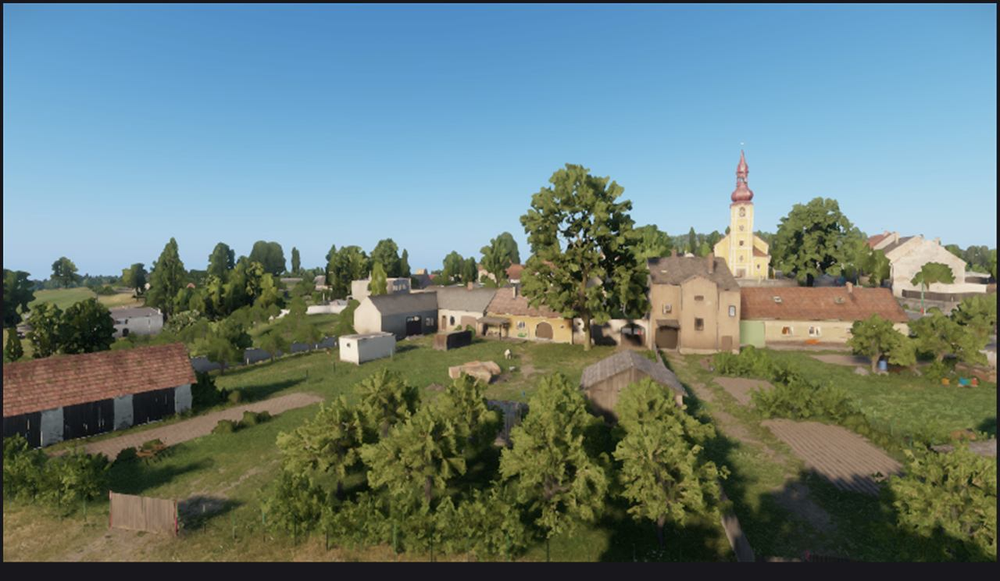

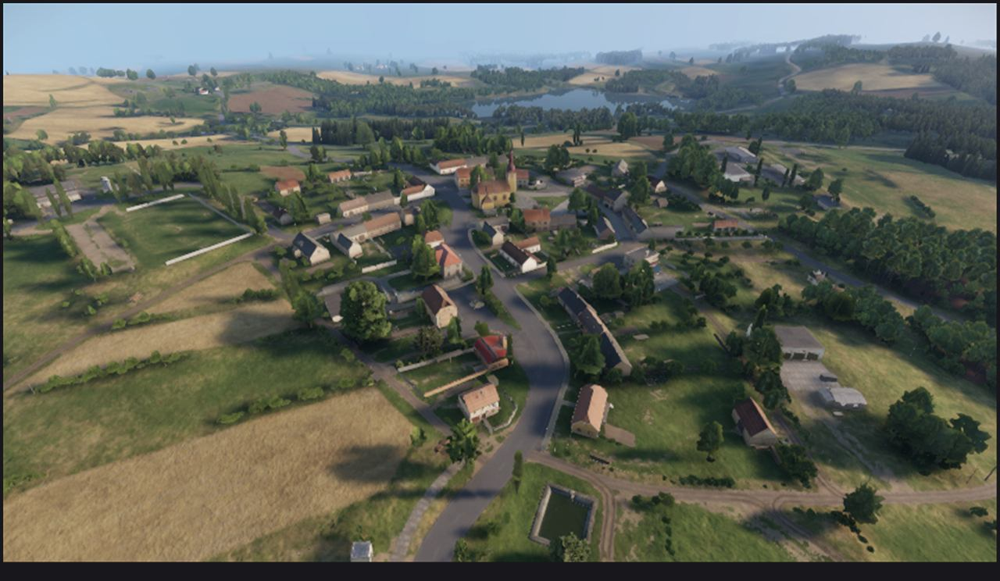

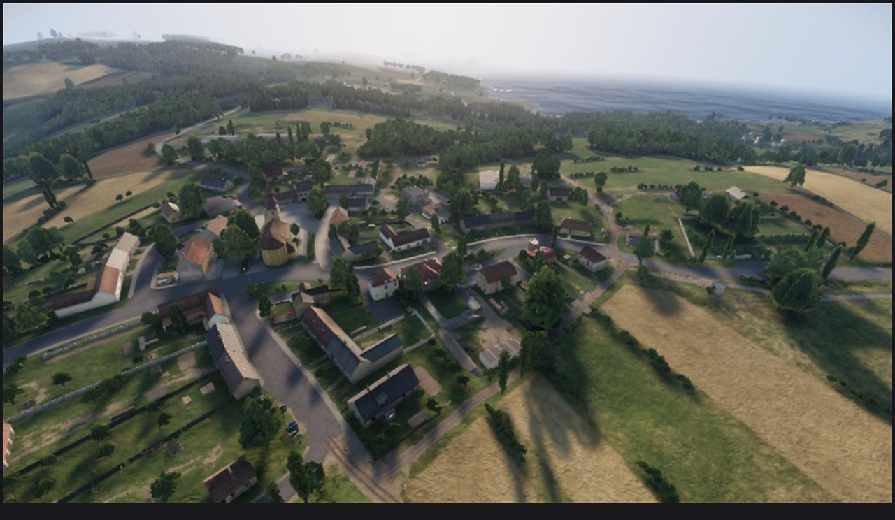

## Terrain

- ground 131.2 to 177.6 m (46.4 m of relief) within 300 m; mean 161.3 m
- 37% of the ground is under 3 degrees, 40% 3 to 8, 3% over 15
- overall the ground falls 2.9 degrees toward the W
- steepest ground 32.4 degrees at 4648.5, 7094.6

## Roads and junctions

**Main street:** N-S road r03, 16 buildings within 25 m of it; its busiest stretch is at x 4775.8, z 7094.1.

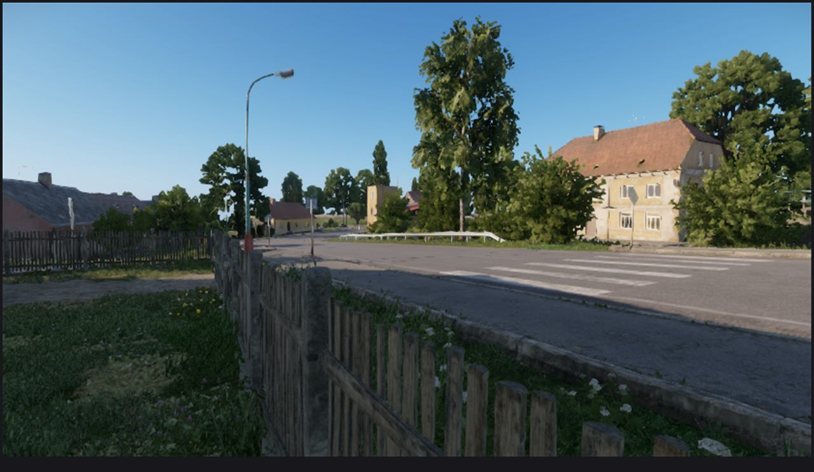

| Id | Road | Length in radius (m) | Points |
| --- | --- | --- | --- |
| r01 | NW-SE road r01 | 228.8 | 4 |
| r02 | NW-SE road r02 | 257.6 | 5 |
| r03 | N-S road r03 | 386.6 | 9 |
| r04 | N-S road r04 | 95.5 | 2 |
| r05 | NE-SW road r05 | 77.6 | 5 |
| r06 | NE-SW road r06 | 267.7 | 5 |
| r07 | NE-SW road r07 | 119.3 | 3 |
| r08 | NE-SW road r08 | 259.9 | 10 |
| r09 | N-S road r09 | 225.5 | 10 |
| r10 | N-S road r10 | 22.8 | 6 |
| r11 | N-S road r11 | 23.1 | 6 |
| r12 | N-S road r12 | 23 | 6 |
| r13 | N-S road r13 | 180.4 | 10 |
| r14 | NW-SE road r14 | 95.8 | 7 |
| r15 | NW-SE road r15 | 34.7 | 8 |
| r16 | NE-SW road r16 | 149.4 | 8 |
| r17 | N-S road r17 | 6.9 | 2 |
| r18 | N-S PolylineShapeEntity r18 | 62.7 | 6 |
| r19 | NE-SW road r19 | 18.7 | 6 |
| r20 | N-S road r20 | 31.6 | 5 |
| r21 | E-W road r21 | 326.7 | 11 |
| r22 | NW-SE road r22 | 205.7 | 17 |
| r23 | NE-SW road r23 | 19.9 | 5 |
| r24 | E-W road r24 | 24.5 | 7 |
| r25 | NE-SW road r25 | 17.5 | 5 |
| r26 | NE-SW road r26 | 17.6 | 5 |
| r27 | NE-SW road r27 | 15.6 | 4 |
| r28 | NE-SW road r28 | 119.9 | 9 |
| r29 | E-W road r29 | 174.3 | 7 |
| r30 | NW-SE road r30 | 76.7 | 6 |
| r31 | NW-SE road r31 | 34.5 | 7 |
| r32 | NE-SW road r32 | 11.5 | 3 |
| r33 | NE-SW road r33 | 11.5 | 3 |
| r34 | E-W road r34 | 119.5 | 10 |
| r35 | NW-SE road r35 | 57.9 | 11 |
| r36 | E-W road r36 | 99.2 | 10 |
| r37 | NW-SE road r37 | 42.6 | 9 |
| r38 | NE-SW road r38 | 10.4 | 3 |
| r39 | E-W road r39 | 143.6 | 7 |
| r40 | E-W road r40 | 83.5 | 14 |
| r41 | NW-SE road r41 | 26.5 | 6 |
| r42 | NW-SE road r42 | 32.1 | 6 |
| r43 | NW-SE road r43 | 32.1 | 6 |
| r45 | E-W road r45 | 13.1 | 4 |
| r46 | E-W road r46 | 13.2 | 4 |
| r47 | N-S road r47 | 37.5 | 8 |
| r48 | NE-SW road r48 | 22.5 | 6 |
| r49 | E-W road r49 | 17.4 | 7 |
| r50 | E-W road r50 | 17.4 | 7 |
| r51 | NE-SW road r51 | 14 | 2 |
| r52 | NE-SW road r52 | 28 | 2 |
| r53 | NE-SW road r53 | 22 | 3 |
| r54 | NW-SE road r54 | 12.4 | 2 |
| r55 | NW-SE road r55 | 12.4 | 2 |
| r56 | NW-SE road r56 | 12.4 | 2 |
| r57 | N-S road r57 | 22.1 | 7 |
| r58 | N-S road r58 | 22.1 | 7 |
| r59 | NW-SE road r59 | 187.6 | 7 |
| r60 | NW-SE road r60 | 22 | 7 |
| r61 | NE-SW road r61 | 17.8 | 5 |
| r62 | N-S road r62 | 88.5 | 6 |
| r63 | NE-SW road r63 | 14 | 2 |
| r64 | NE-SW road r64 | 6.2 | 2 |
| r65 | NE-SW road r65 | 14 | 3 |
| r66 | E-W road r66 | 130.4 | 10 |
| r67 | NE-SW road r67 | 10.1 | 2 |
| r68 | NE-SW road r68 | 8 | 2 |
| r69 | NE-SW road r69 | 14 | 2 |
| r70 | NE-SW road r70 | 14 | 2 |
| r71 | NW-SE road r71 | 15.1 | 5 |
| r72 | NW-SE road r72 | 15.1 | 5 |
| r73 | NW-SE road r73 | 11.8 | 4 |
| r74 | NW-SE road r74 | 11.5 | 4 |
| r75 | NE-SW road r75 | 30.6 | 7 |
| r76 | NE-SW road r76 | 30.6 | 7 |
| r77 | NE-SW road r77 | 30.6 | 7 |
| r78 | NE-SW road r78 | 30.6 | 7 |
| r79 | N-S road r79 | 8.7 | 2 |
| r80 | E-W road r80 | 26 | 2 |
| r81 | E-W road r81 | 26 | 2 |
| r82 | E-W road r82 | 16 | 4 |
| r83 | E-W road r83 | 14 | 2 |
| r84 | E-W road r84 | 22 | 3 |
| r85 | N-S road r85 | 145 | 9 |
| r86 | E-W road r86 | 4 | 2 |
| r87 | E-W road r87 | 12 | 2 |
| r88 | E-W road r88 | 10 | 3 |
| r89 | NE-SW road r89 | 4 | 2 |
| r90 | NE-SW road r90 | 6 | 2 |
| r91 | E-W road r91 | 26.5 | 6 |
| r92 | E-W road r92 | 26.5 | 6 |
| r93 | N-S road r93 | 10 | 2 |
| r94 | NE-SW road r94 | 13.6 | 6 |
| r95 | NE-SW road r95 | 14.2 | 6 |
| r96 | NE-SW road r96 | 14.2 | 6 |
| r97 | NE-SW road r97 | 14.2 | 6 |
| r98 | E-W road r98 | 22 | 2 |
| r99 | E-W road r99 | 12 | 2 |
| r100 | E-W road r100 | 10.1 | 2 |
| r101 | E-W road r101 | 4 | 2 |
| r102 | E-W road r102 | 8 | 2 |
| r103 | E-W road r103 | 12.7 | 2 |
| r104 | NE-SW road r104 | 83 | 5 |

| x | z | Kind | Arms | Roads |
| --- | --- | --- | --- | --- |
| 4683.8 | 7088 | crossroads | 7 | r51, r67, r52, r85, r63, r68 |
| 4831.2 | 6941.5 | crossroads | 6 | r39, r02, r40, r35 |
| 4581.2 | 6975.9 | crossroads | 6 | r93, r101, r102, r98, r100, r99 |
| 4766.6 | 7200.3 | crossroads | 4 | r21, r03, r20 |
| 4811.2 | 6977.3 | crossroads | 4 | r03, r29, r36 |
| 4715.6 | 6951.7 | crossroads | 4 | r36, r39, r59, r62 |
| 4679.3 | 7080.3 | crossroads | 4 | r53, r90, r67, r89 |
| 4637.6 | 7153.7 | crossroads | 4 | r82, r88, r84, r86 |
| 4654.5 | 6958.7 | crossroads | 4 | r94, r95, r96, r97 |
| 4472 | 7120.8 | t-junction | 3 | r01, r21 |
| 4590.9 | 7002 | t-junction | 3 | r01, r59 |
| 4586.3 | 7008.6 | t-junction | 3 | r59, r01 |
| 4562.1 | 7048 | t-junction | 3 | r66, r01 |
| 4814.9 | 6969.8 | t-junction | 3 | r02, r03, r35 |
| 4863 | 6895.8 | t-junction | 3 | r02, r16 |
| 4845.9 | 6923.6 | t-junction | 3 | r35, r02 |
| 4756.3 | 7136.3 | t-junction | 3 | r03, r24 |
| 4774.2 | 7096.8 | t-junction | 3 | r28, r03 |
| 4798.9 | 7029 | t-junction | 3 | r34, r03 |
| 4969 | 6997 | t-junction | 3 | r16, r06 |
| 4982.3 | 7218.2 | t-junction | 3 | r08, r14 |
| 4913.3 | 7064.6 | t-junction | 3 | r08, r22 |
| 4785.1 | 7203.9 | t-junction | 3 | r09, r22 |
| 4673.6 | 7299 | t-junction | 3 | r10, r11, r12 |
| 4697.5 | 7216.9 | t-junction | 3 | r13, r21 |
| 4678.3 | 7228.9 | t-junction | 3 | r48, r13 |
| 4748.5 | 7208.3 | t-junction | 3 | r47, r21 |
| 4671 | 7216.7 | t-junction | 3 | r48, r21 |
| 4662.2 | 7215.9 | t-junction | 3 | r21, r79 |
| 4644.4 | 7214.3 | t-junction | 3 | r21, r85 |
| 4731.7 | 7071.4 | t-junction | 3 | r28, r60 |
| 4690.3 | 7045 | t-junction | 3 | r66, r28 |
| 4832.4 | 6992.3 | t-junction | 3 | r29, r30 |
| 4687.9 | 7005.4 | t-junction | 3 | r34, r62 |
| 4607.4 | 6971 | t-junction | 3 | r103, r59 |
| 4659.3 | 7208.3 | t-junction | 3 | r79, r85 |
| 4792 | 7332.8 | bend-or-join | 2 | r03, r04 |
| 4947.3 | 7018.1 | bend-or-join | 2 | r06, r29 |
| 4676.5 | 7322.6 | bend-or-join | 2 | r11, r12 |
| 4928.9 | 7019.4 | bend-or-join | 2 | r15, r31 |
| 4952.7 | 6994.1 | bend-or-join | 2 | r15, r31 |
| 4883.2 | 7090.7 | bend-or-join | 2 | r25, r26 |
| 4870.1 | 7079.1 | bend-or-join | 2 | r25, r26 |
| 4685.9 | 7028.5 | bend-or-join | 2 | r28, r62 |
| 4820.1 | 6892 | bend-or-join | 2 | r42, r43 |
| 4835.9 | 6864 | bend-or-join | 2 | r42, r43 |
| 4734.5 | 7192.3 | bend-or-join | 2 | r45, r46 |
| 4722.2 | 7196.9 | bend-or-join | 2 | r45, r46 |
| 4720.5 | 7089 | bend-or-join | 2 | r56, r60 |
| 4694.8 | 7086.1 | bend-or-join | 2 | r64, r68 |
| 4710.4 | 6889.7 | bend-or-join | 2 | r73, r74 |
| 4719.1 | 6881.7 | bend-or-join | 2 | r73, r74 |
| 4635.5 | 7161.7 | bend-or-join | 2 | r83, r87 |
| 4633.6 | 7006.3 | bend-or-join | 2 | r91, r92 |
| 4666.2 | 6965.8 | bend-or-join | 2 | r94, r95 |
| 4639.8 | 6952.9 | bend-or-join | 2 | r96, r97 |
| 4594.8 | 6970.4 | bend-or-join | 2 | r100, r103 |

## Civic candidates

Public-facing buildings a town plan would use (church, chapel, government, police, fire, pub, shop, fuel station, hotel, recreation), nearest first. Each links its pictures.

| Id | Type | Vanilla prefab | Distance | Footprint | Floors | Interior | Entrances |
| --- | --- | --- | --- | --- | --- | --- | --- |
| b02 | government | MunicipalOffice_E_01 | 35.7 m E | 24.1 x 17.8 m (429 m2) | 3 | yes | ? |
| b07 | fire | FireStation_E_01_hose_hanger | 53.1 m N | 0.6 x 2 m (1.2 m2) | 0 | no | ? |
| b08 | police | Villa_E_2I01_Police | 54.2 m SE | 15.3 x 12.7 m (194.3 m2) | 5 | yes | back/NE |
| b09 | fire | FireStation_E_01 | 56.7 m N | 15.9 x 15.7 m (249.6 m2) | 4 | yes | front/SW, front/W, back/E, left/S |
| b38 | pub | PubVillage_E_2L01_V2 | 88.3 m SE | 17.9 x 17 m (304.3 m2) | 3 | yes | right/S, back/SW |
| b50 | church | Church_01_yellow | 102.8 m S | 20 x 33.8 m (676 m2) | 2 | yes | front/W, front/SW, right/N |
| b51 | church | Church_01_crypt_attic | 102.8 m S | 16.5 x 28 m (462 m2) | 1 | no | ? |
| b67 | shop | ShopHouse_E_2I01t_householdwares | 147.3 m SW | 12.4 x 16.8 m (208.3 m2) | 3 | yes | front/NE, front/NE, left/W, back/SW |
| b101 | shop | ShopModern_E_01 | 182.6 m S | 24.4 x 19.8 m (483.1 m2) | 2 | yes | ? |
| b144 | chapel | Chapel_01_base | 204 m N | 4.7 x 4.7 m (22.1 m2) | 1 | yes | front/E |

### b02 government: MunicipalOffice_E_01

`{363A616E6C64BB7F}Prefabs/Structures/Services/Government/MunicipalOffice_E_01/MunicipalOffice_E_01.et` at x 4806.9, z 7082.1, facing SW; footprint 24.1 x 17.8 m; interior yes (catalog: 14 door entities and a walkable floor (3 floors)).

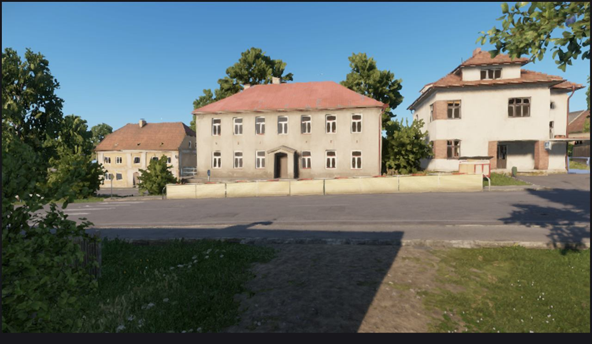

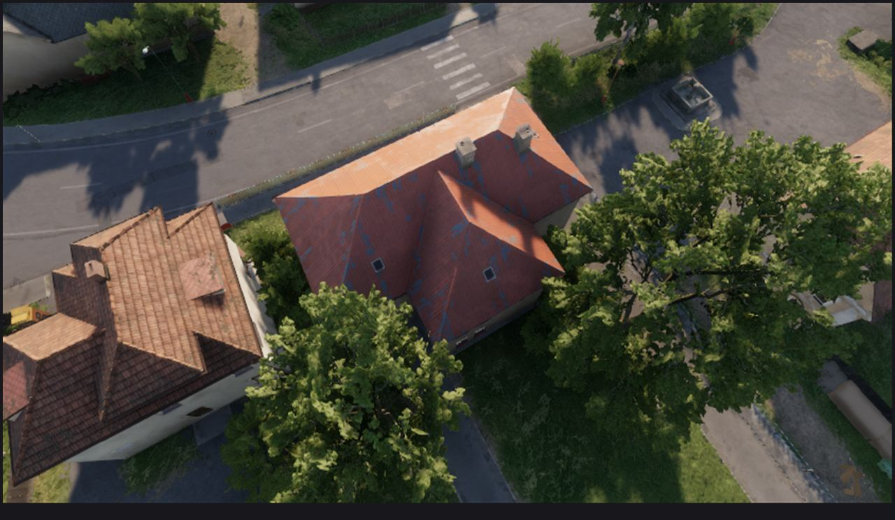

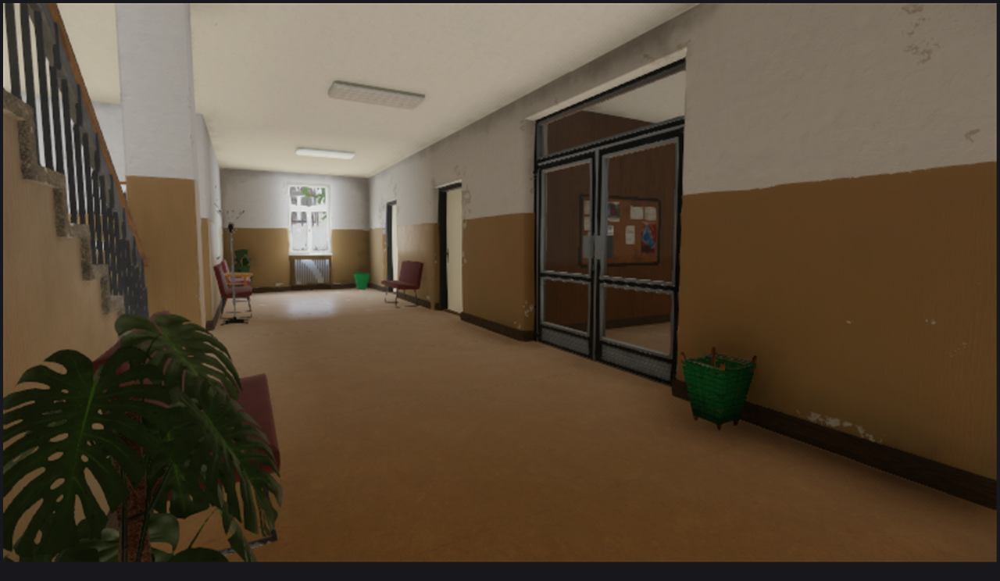

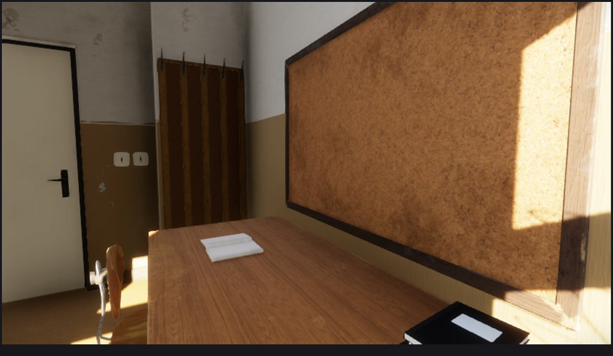

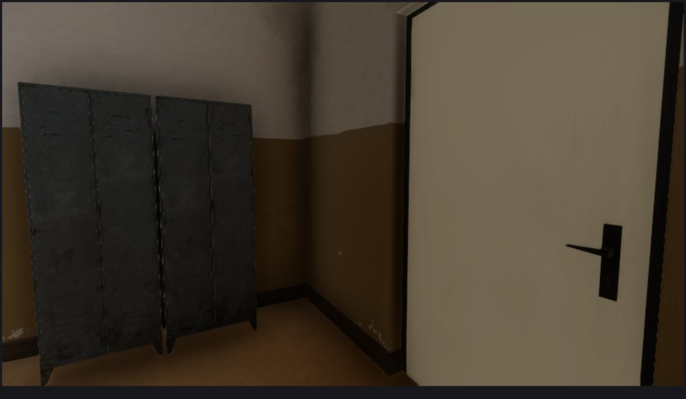

### b08 police: Villa_E_2I01_Police

`{151CFDB2968ADB77}Prefabs/Structures/Houses/Villa/Villa_E_2I01/Villa_E_2I01_Police.et` at x 4816.5, z 7061.6, facing SW; footprint 15.3 x 12.7 m; interior yes (catalog: 8 door entities and a walkable floor (5 floors)).

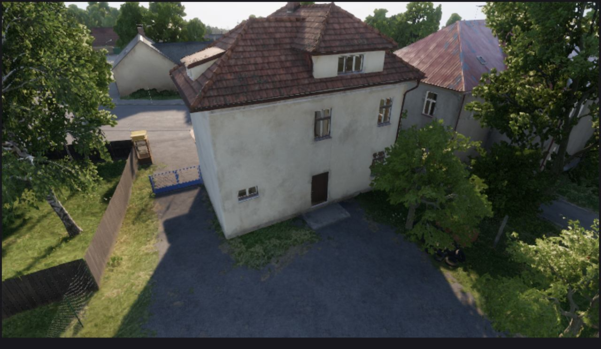

### b09 fire: FireStation_E_01

`{E8C14F26268A4D6D}Prefabs/Structures/Services/Fire/FireStation_E_01/FireStation_E_01.et` at x 4775.3, z 7151.3, facing SW; footprint 15.9 x 15.7 m; interior yes (catalog: 9 door entities and a walkable floor (4 floors)).

### b38 pub: PubVillage_E_2L01_V2

`{C7B11EF2ABFDF49F}Prefabs/Structures/Commercial/Pubs/PubVillage_E_2L01/PubVillage_E_2L01_V2.et` at x 4830.7, z 7027.3, facing NE; footprint 17.9 x 17 m; interior yes (catalog: 10 door entities and a walkable floor (3 floors)).

### b50 church: Church_01_yellow

`{22D7D4C89F6AEDDF}Prefabs/Structures/Cultural/Churches/Church_01/Church_01_yellow.et` at x 4780.2, z 6992, facing W; footprint 20 x 33.8 m; interior yes (catalog: 11 door entities and a walkable floor (2 floors)).

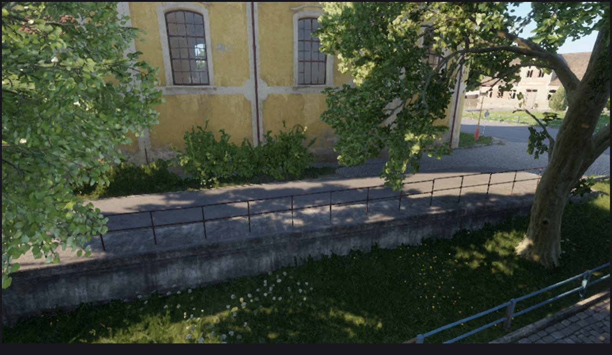

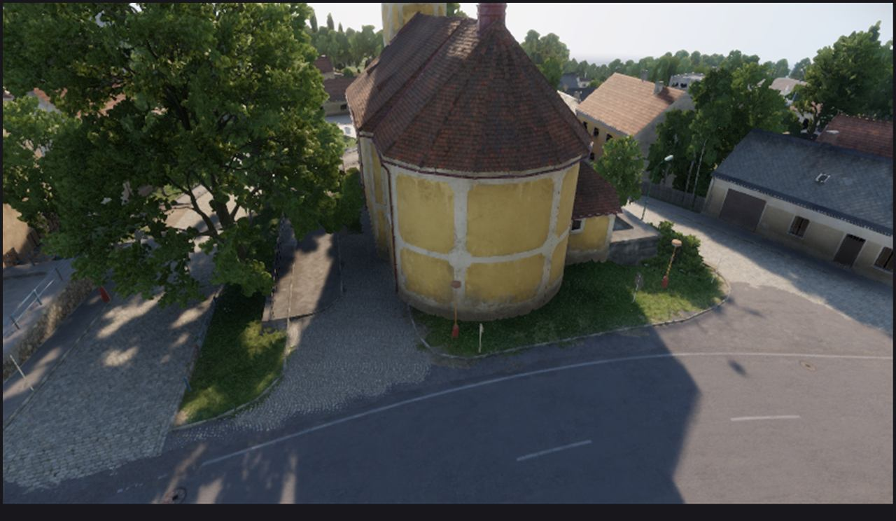

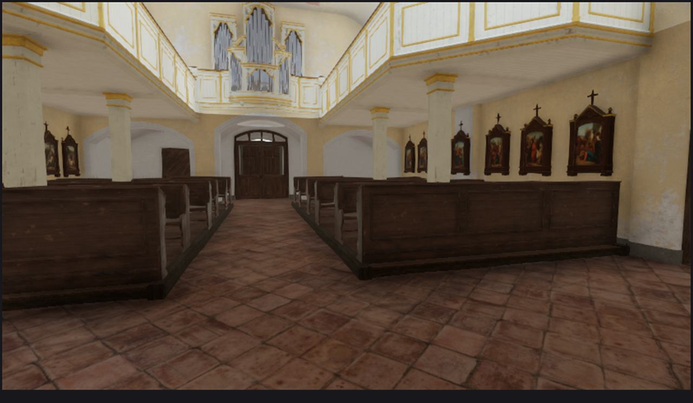

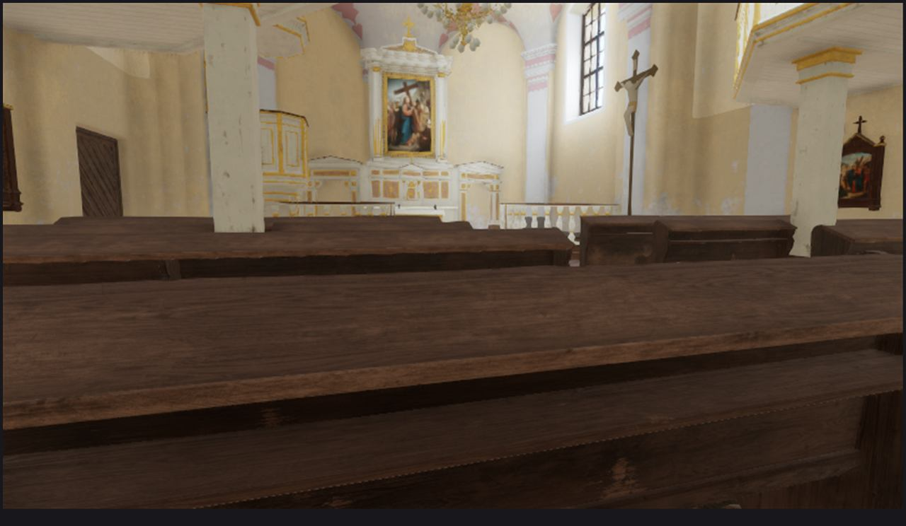

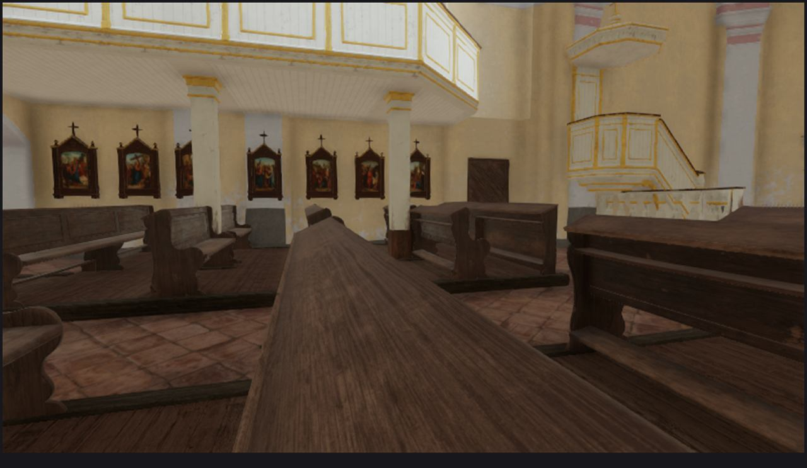

### b67 shop: ShopHouse_E_2I01t_householdwares

`{F51B9B9BD15BBE64}Prefabs/Structures/Commercial/Shops/ShopHouse_E_2l01/ShopHouse_E_2I01t_householdwares.et` at x 4682.8, z 6978.5, facing NE; footprint 12.4 x 16.8 m; interior yes (catalog: 12 door entities and a walkable floor (3 floors)).

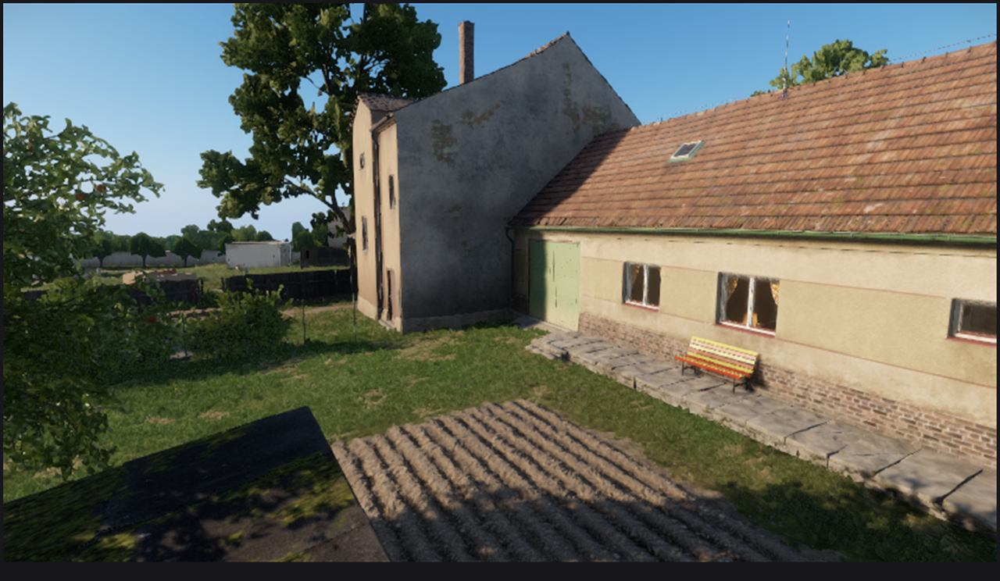

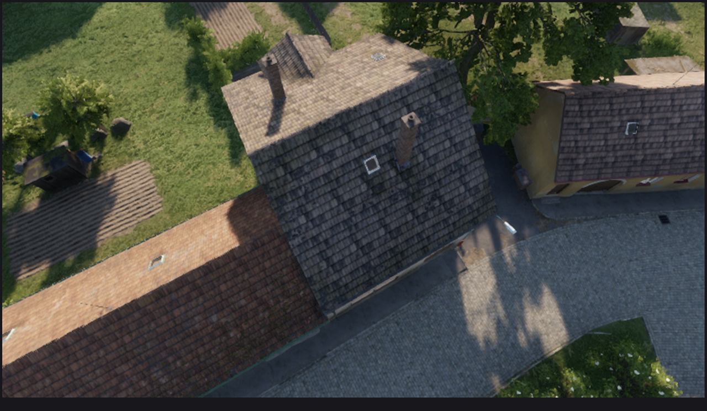

## All buildings

| Id | Type | Vanilla prefab | x | z | Yaw | Facing | Footprint (m) | Floors | Interior | Entrances | Furniture |
| --- | --- | --- | --- | --- | --- | --- | --- | --- | --- | --- | --- |
| b01 | house | House_Village_E_1L03t | 4763.4 | 7069.9 | -120 | SW | 25.9 x 25.6 (663 m2) | 2 | yes | - | - |
| b02 | government | MunicipalOffice_E_01 | 4806.9 | 7082.1 | -119 | SW | 24.1 x 17.8 (429 m2) | 3 | yes | ? | - |
| b03 | townhouse | House_Town_E_2I03_v2 | 4803.9 | 7121.9 | -119 | SW | 20.3 x 12.6 (255.8 m2) | 3 | yes | 2 | - |
| b04 | house | House_Village_E_1I04sf_red | 4733.4 | 7114.9 | -112 | W | 21.1 x 11.1 (234.2 m2) | 2 | yes | 7 | - |
| b05 | garage | RampVehicle_01_concrete | 4724.8 | 7091.5 | 148 | SE | 5.4 x 12.7 (68.6 m2) | 1 | no | - | - |
| b06 | shed | Shed_03 | 4773.1 | 7041.6 | 63 | NE | 6.8 x 3.9 (26.5 m2) | 0 | no | - | - |
| b07 | fire | FireStation_E_01_hose_hanger | 4772.5 | 7147.7 | -118 | SW | 0.6 x 2 (1.2 m2) | 0 | no | ? | - |
| b08 | police | Villa_E_2I01_Police | 4816.5 | 7061.6 | -118 | SW | 15.3 x 12.7 (194.3 m2) | 5 | yes | 1 | - |
| b09 | fire | FireStation_E_01 | 4775.3 | 7151.3 | -118 | SW | 15.9 x 15.7 (249.6 m2) | 4 | yes | 4 | - |
| b10 | garage | Workshop_01_Side | 4717.3 | 7083.7 | 147 | SE | 5.4 x 5.8 (31.3 m2) | 1 | yes | 1 | - |
| b11 | house | House_Village_E_1I08t | 4727.5 | 7133.2 | 74 | E | 18.9 x 10.2 (192.8 m2) | 3 | yes | 5 | - |
| b12 | farm-small | Greenhouse_01 | 4719.3 | 7123 | -19 | N | 3.8 x 4.2 (16 m2) | 1 | yes | 1 | - |
| b13 | shed | Shed_02_square | 4739.8 | 7042.6 | 80 | E | 4.4 x 3.7 (16.3 m2) | 2 | yes | 1 | - |
| b14 | house | House_Village_E_1L02t | 4778.5 | 7030.8 | -27 | NW | 20.6 x 25.6 (527.4 m2) | 2 | yes | 1 | - |
| b15 | garage | Workshop_01_Main | 4710.2 | 7083 | -123 | SW | 12.2 x 7.6 (92.7 m2) | 1 | yes | 2 | - |
| b16 | shed | Shed_03_wide | 4796 | 7155.1 | -26 | NW | 12.3 x 3.9 (48 m2) | 0 | no | - | - |
| b17 | shed | Shed_02_small | 4811 | 7147.2 | 151 | SE | 3.5 x 2.6 (9.1 m2) | 1 | yes | 1 | - |
| b18 | farm-small | Greenhouse_01 | 4824.6 | 7134.7 | -120 | SW | 3.8 x 4.2 (16 m2) | 1 | yes | 1 | - |
| b19 | shed | Shed_02_square | 4712.9 | 7120.5 | -17 | N | 4.4 x 3.7 (16.3 m2) | 2 | yes | 1 | - |
| b20 | shed | Shed_03 | 4709.1 | 7112.2 | 57 | NE | 6.8 x 3.9 (26.5 m2) | 0 | no | - | - |
| b21 | garage | Workshop_01_Side | 4704.7 | 7089.6 | -123 | SW | 5.4 x 5.8 (31.3 m2) | 1 | yes | 1 | - |
| b22 | shed | Shed_03 | 4735.6 | 7034.7 | 76 | E | 6.8 x 3.9 (26.5 m2) | 0 | no | - | - |
| b23 | shed | Shed_02_square | 4776.6 | 7168.5 | 61 | NE | 4.4 x 3.7 (16.3 m2) | 2 | yes | 1 | - |
| b24 | shed | Shed_02_square | 4838.1 | 7134 | -32 | NW | 4.4 x 3.7 (16.3 m2) | 2 | yes | 1 | - |
| b25 | townhouse | House_Town_E_2I02 | 4749.3 | 7022.3 | 170 | S | 18.5 x 13.4 (247.9 m2) | 3 | yes | ? | - |
| b26 | house | House_Village_E_1I04sr_green | 4723.2 | 7152 | 80 | E | 21.1 x 11.1 (234.2 m2) | 2 | yes | 7 | - |
| b27 | shed | Shed_02_line | 4846.4 | 7065.9 | 50 | NE | 6.6 x 2.8 (18.5 m2) | 1 | yes | 1 | - |
| b28 | farm-small | Greenhouse_01 | 4712.4 | 7044.4 | -124 | SW | 3.8 x 4.2 (16 m2) | 1 | yes | 1 | - |
| b29 | shed | Shed_03 | 4706.2 | 7139.4 | -13 | N | 6.8 x 3.9 (26.5 m2) | 0 | no | - | - |
| b30 | industrial | PortableCabin_E_01_beige | 4693.7 | 7079 | 146 | SE | 3.8 x 6.4 (24.3 m2) | 2 | yes | 1 | - |
| b31 | shed | Door_HouseAddon_Shed_E_L_EXT_COV_01 | 4737.6 | 7170.5 | -69 | W | 1.9 x 0.1 (0.2 m2) | - | no | ? | - |
| b32 | garage | Garage_E_01 | 4853.4 | 7124.8 | -120 | SW | 4.9 x 9.9 (48.5 m2) | 2 | yes | 2 | - |
| b33 | garage | Garage_E_01 | 4855.8 | 7120.7 | -120 | SW | 4.9 x 9.9 (48.5 m2) | 2 | yes | 2 | - |
| b34 | shed | Door_HouseAddon_Shed_E_R_EXT_COV_01 | 4738.8 | 7173.6 | 111 | E | 1.7 x 0.1 (0.2 m2) | - | no | ? | - |
| b35 | garage | Garage_E_01 | 4858.1 | 7116.6 | -120 | SW | 4.9 x 9.9 (48.5 m2) | 2 | yes | 2 | - |
| b36 | house | House_Prefab_2I01_v2 | 4781.2 | 7182.1 | -29 | NW | 16.6 x 13.4 (222.4 m2) | 3 | yes | - | - |
| b37 | shed | HouseAddon_Shed_E_01 | 4734.4 | 7173.3 | -69 | W | 4.9 x 8.5 (41.7 m2) | 0 | unknown | 3 | - |
| b38 | pub | PubVillage_E_2L01_V2 | 4830.7 | 7027.3 | 63 | NE | 17.9 x 17 (304.3 m2) | 3 | yes | 2 | - |
| b39 | house | House_Village_E_1I04t | 4730.2 | 7017.6 | 170 | S | 20.1 x 11.1 (223.1 m2) | 2 | yes | ? | - |
| b40 | garage | Garage_E_01 | 4860.5 | 7112.4 | -120 | SW | 4.9 x 9.9 (48.5 m2) | 2 | yes | 2 | - |
| b41 | industrial | Office_E_01 | 4687.2 | 7069.1 | 146 | SE | 17 x 15 (255 m2) | 3 | yes | 2 | - |
| b42 | shed | Door_HouseAddon_Shed_E_R_EXT_COV_02 | 4730.9 | 7175.3 | 111 | E | 1.6 x 0.1 (0.2 m2) | - | no | ? | - |
| b43 | house | House_Village_E_1I05s | 4850.7 | 7038.7 | -41 | NW | 26.7 x 11.2 (299 m2) | 2 | yes | 4 | - |
| b44 | farm-small | Greenhouse_01 | 4708.5 | 7164.8 | -10 | N | 3.8 x 4.2 (16 m2) | 1 | yes | 1 | - |
| b45 | shed | Shed_02_square | 4697.5 | 7155.9 | 169 | S | 4.4 x 3.7 (16.3 m2) | 2 | yes | 1 | - |
| b46 | house | House_Village_E_1I02_Furniture | 4738.2 | 7185.8 | 20 | N | 11 x 20.5 (225.5 m2) | 2 | yes | ? | - |
| b47 | farm-small | Greenhouse_01 | 4703 | 7163.7 | -12 | N | 3.8 x 4.2 (16 m2) | 1 | yes | 1 | - |
| b48 | house | House_Village_E_1L02t | 4867.8 | 7053.9 | -42 | NW | 20.6 x 25.6 (527.4 m2) | 2 | yes | 1 | - |
| b49 | house | House_Village_E_1I04t_red | 4700.6 | 7022.3 | -91 | W | 20.1 x 11.1 (223.1 m2) | 2 | yes | ? | - |
| b50 | church | Church_01_yellow | 4780.2 | 6992 | -105 | W | 20 x 33.8 (676 m2) | 2 | yes | 3 | - |
| b51 | church | Church_01_crypt_attic | 4780.2 | 6992 | -105 | W | 16.5 x 28 (462 m2) | 1 | no | ? | - |
| b52 | house | House_Village_E_1I03_Furniture | 4885.8 | 7070.8 | 137 | SE | 15.3 x 25.5 (390.2 m2) | 2 | yes | ? | - |
| b53 | house | House_Village_E_1L02t | 4675.3 | 7023 | -94 | W | 20.6 x 25.6 (527.4 m2) | 2 | yes | 1 | - |
| b54 | shed | Shed_02_big_V2 | 4895.9 | 7084 | -131 | SW | 7 x 3.7 (25.9 m2) | 2 | yes | 1 | - |
| b55 | kiosk | NewspaperBooth_E_01_redwhite | 4703 | 6991.7 | 175 | S | 4.1 x 5 (20.5 m2) | 2 | yes | 1 | - |
| b56 | shed | Shed_03 | 4851.8 | 6992.8 | 53 | NE | 6.8 x 3.9 (26.5 m2) | 0 | no | - | - |
| b57 | house | House_Village_E_1I04sr_green | 4862.1 | 6999.6 | -37 | NW | 21.1 x 11.1 (234.2 m2) | 2 | yes | 7 | - |
| b58 | house | House_Village_E_1I08t | 4677 | 7003.8 | 86 | E | 18.9 x 10.2 (192.8 m2) | 3 | yes | ? | - |
| b59 | house | House_Village_E_1I08t_white | 4877 | 7011.8 | -43 | NW | 18.9 x 10.2 (192.8 m2) | 3 | yes | 5 | - |
| b60 | shed | Shed_03 | 4670.4 | 7009.5 | 86 | E | 6.8 x 3.9 (26.5 m2) | 0 | no | - | - |
| b61 | farm | Barn_E_01 | 4673.8 | 7187.1 | -90 | W | 15.1 x 10.8 (163.1 m2) | 0 | unknown | 4 | - |
| b62 | house | House_Village_E_1L03t | 4834.1 | 6970.8 | 55 | NE | 25.9 x 25.6 (663 m2) | 2 | yes | - | - |
| b63 | shed | HouseAddon_Workshop_E_01 | 4893.5 | 7026.8 | 140 | SE | 8.1 x 7 (56.7 m2) | 1 | yes | 2 | - |
| b64 | shed | Shed_02_big_V1 | 4660.1 | 7009.8 | 177 | S | 6.5 x 3.7 (24.1 m2) | 2 | yes | 2 | - |
| b65 | townhouse | House_Town_E_2I02 | 4799.7 | 6953.8 | -17 | N | 18.5 x 13.4 (247.9 m2) | 3 | yes | 4 | - |
| b66 | garage | Garage_E_02 | 4633.1 | 7133.8 | 3 | N | 28.1 x 18.9 (531.1 m2) | 3 | yes | 14 | - |
| b67 | shop | ShopHouse_E_2I01t_householdwares | 4682.8 | 6978.5 | 62 | NE | 12.4 x 16.8 (208.3 m2) | 3 | yes | 4 | - |
| b68 | townhouse | House_Town_E_2I01 | 4785.6 | 6947.8 | -17 | N | 12.4 x 16.8 (208.3 m2) | 3 | yes | 3 | - |
| b69 | garage | Garage_E_01 | 4648.1 | 7016.6 | 87 | E | 4.9 x 9.9 (48.5 m2) | 2 | yes | 2 | - |
| b70 | townhouse | House_Town_E_2I02_v2 | 4759.1 | 6945.7 | 0 | N | 18.5 x 13.4 (247.9 m2) | 3 | yes | 4 | - |
| b71 | house | House_Village_E_1I05t | 4693.4 | 6964.1 | 62 | NE | 24.7 x 11.2 (276.6 m2) | 2 | yes | 4 | - |
| b72 | shed | Shed_02_square | 4874.1 | 6977.1 | -37 | NW | 4.4 x 3.7 (16.3 m2) | 2 | yes | 1 | - |
| b73 | farm-small | Greenhouse_01 | 4851.7 | 6959.9 | 145 | SE | 3.8 x 4.2 (16 m2) | 1 | yes | 1 | - |
| b74 | garage | Workshop_01_Garage | 4807.4 | 6942.4 | 71 | E | 8.3 x 5.8 (48.1 m2) | 1 | yes | 3 | - |
| b75 | garage | Garage_E_01 | 4743.6 | 6940.8 | 147 | SE | 4.9 x 9.9 (48.5 m2) | 2 | yes | 2 | - |
| b76 | shed | Shed_03 | 4886.4 | 6985.6 | -134 | SW | 6.8 x 3.9 (26.5 m2) | 0 | no | - | - |
| b77 | house | House_Village_E_1I01 | 4918.8 | 7028.2 | 135 | SE | 9.9 x 12.5 (123.8 m2) | 2 | yes | 2 | - |
| b78 | farm-small | Greenhouse_01 | 4906.6 | 7003 | 48 | NE | 3.8 x 4.2 (16 m2) | 1 | yes | 1 | - |
| b79 | ruin | HouseRuin_01_BrickPile_Small | 4649.9 | 6990 | 109 | E | 2.8 x 2.7 (7.5 m2) | 0 | no | - | - |
| b80 | ruin | HouseRuin_01_BrickPile_Small | 4648.7 | 6989.6 | 119 | SE | 2.8 x 2.7 (7.7 m2) | 0 | no | - | - |
| b81 | ruin | HouseRuin_01_BrickPile_Small | 4647.4 | 6990.3 | 42 | NE | 2.7 x 2.6 (7.2 m2) | 0 | no | - | - |
| b82 | ruin | HouseRuin_01_BrickPile_Small | 4647.5 | 6989 | 173 | S | 3.1 x 3 (9.1 m2) | 0 | no | - | - |
| b83 | garage | Workshop_02_grey | 4625.9 | 7169.9 | -86 | W | 8.9 x 15.5 (138 m2) | 1 | yes | 1 | - |
| b84 | ruin | HouseRuin_01_BrickPile_Small | 4641.5 | 6994.2 | 75 | E | 2.7 x 2.6 (7.2 m2) | 0 | no | - | - |
| b85 | ruin | HouseRuin_01_BrickPile_Small | 4641.9 | 6992.9 | -159 | S | 2.8 x 2.8 (7.9 m2) | 0 | no | - | - |
| b86 | farm-small | Greenhouse_01 | 4764.8 | 6925.1 | -4 | N | 3.8 x 4.2 (16 m2) | 1 | yes | 1 | - |
| b87 | shed | Shed_02_small | 4680.5 | 6951.9 | 58 | NE | 3.5 x 2.6 (9.1 m2) | 1 | yes | 1 | - |
| b88 | shed | Door_HouseAddon_Shed_E_R_EXT_COV_02 | 4649.5 | 6974.7 | -117 | SW | 1.6 x 0.1 (0.2 m2) | - | no | ? | - |
| b89 | shed | Door_HouseAddon_Shed_E_R_EXT_COV_01 | 4650.1 | 6973.5 | 63 | NE | 1.7 x 0.1 (0.2 m2) | - | no | ? | - |
| b90 | shed | Door_HouseAddon_Shed_E_L_EXT_COV_01 | 4619.1 | 7015.6 | 177 | S | 1.9 x 0.1 (0.2 m2) | - | no | ? | - |
| b91 | shed | Door_HouseAddon_Shed_E_L_EXT_COV_01 | 4651.7 | 6970.4 | -117 | SW | 1.9 x 0.1 (0.2 m2) | - | no | ? | - |
| b92 | shed | Door_HouseAddon_Shed_E_R_EXT_COV_01 | 4615.7 | 7015.4 | -3 | N | 1.7 x 0.1 (0.2 m2) | - | no | ? | - |
| b93 | farm | Barn_E_02 | 4646.4 | 6971.8 | -117 | SW | 9.5 x 8.5 (80.8 m2) | 0 | unknown | 4 | - |
| b94 | shed | Shed_02_big_V1 | 4927.3 | 7005.3 | -135 | SW | 6.5 x 3.7 (24.1 m2) | 2 | yes | 2 | - |
| b95 | farm | Barn_E_03_closed | 4612.9 | 7012.3 | -3 | N | 17.8 x 7.3 (129.9 m2) | 2 | yes | 4 | - |
| b96 | shed | Door_HouseAddon_Shed_E_R_EXT_COV_02 | 4643.6 | 6968.8 | 63 | NE | 1.6 x 0.1 (0.2 m2) | - | no | ? | - |
| b97 | farm-small | Greenhouse_01 | 4634.7 | 6978.6 | 152 | SE | 3.8 x 4.2 (16 m2) | 1 | yes | 1 | - |
| b98 | ruin | HouseRuin_01_BrickPile_Small | 4592.4 | 7085.5 | 27 | NE | 3.2 x 3.1 (9.8 m2) | 0 | no | - | - |
| b99 | ruin | HouseRuin_01_BrickPile_Small | 4592.4 | 7084 | -66 | NW | 3.1 x 3 (9.4 m2) | 0 | no | - | - |
| b100 | ruin | HouseRuin_01_BrickPile_Small | 4591.1 | 7087.5 | 78 | E | 3.2 x 3.1 (9.8 m2) | 0 | no | - | - |
| b101 | shop | ShopModern_E_01 | 4706.4 | 6924.8 | -39 | NW | 24.4 x 19.8 (483.1 m2) | 2 | yes | ? | - |
| b102 | house | House_Village_E_1L03t | 4816.9 | 6916.8 | 150 | SE | 25.9 x 25.6 (663 m2) | 2 | yes | - | - |
| b103 | shed | Door_HouseAddon_Shed_E_R_EXT_COV_02 | 4608.1 | 7015 | 177 | S | 1.6 x 0.1 (0.2 m2) | - | no | ? | - |
| b104 | ruin | HouseRuin_01_BrickPile_Small | 4693 | 7261.3 | -82 | W | 3.3 x 3.2 (10.3 m2) | 0 | no | - | - |
| b105 | ruin | HouseRuin_01_BrickPile_Small | 4691.1 | 7261.9 | 0 | N | 3.1 x 3 (9.4 m2) | 0 | no | - | - |
| b106 | ruin | HouseRuin_01_BrickPile_Small | 4689.2 | 7262.2 | 71 | E | 2.8 x 2.7 (7.4 m2) | 0 | no | - | - |
| b107 | ruin | HouseRuin_01_BrickPile_Small | 4690.6 | 7263.6 | 61 | NE | 3.2 x 3.1 (9.8 m2) | 0 | no | - | - |
| b108 | ruin | HouseRuin_01_BrickPile_Small | 4686.1 | 7262.7 | -1 | N | 3.1 x 3 (9.1 m2) | 0 | no | - | - |
| b109 | ruin | HouseRuin_01_BrickPile_Small | 4684.1 | 7261.9 | 75 | E | 3.3 x 3.2 (10.3 m2) | 0 | no | - | - |
| b110 | ruin | HouseRuin_01_BrickPile_Small | 4689.5 | 7264.8 | -5 | N | 3 x 2.9 (8.5 m2) | 0 | no | - | - |
| b111 | house | House_Village_E_1I04sr_red | 4796.8 | 6905.6 | -24 | NW | 21.1 x 11.1 (234.2 m2) | 2 | yes | 7 | - |
| b112 | ruin | HouseRuin_01_BrickPile_Small | 4685.9 | 7264.4 | -35 | NW | 2.8 x 2.7 (7.4 m2) | 0 | no | - | - |
| b113 | ruin | HouseRuin_01_BrickPile_Small | 4684.5 | 7263.8 | -43 | NW | 2.9 x 2.8 (8 m2) | 0 | no | - | - |
| b114 | ruin | HouseRuin_01_BrickPile_Small | 4682.8 | 7263.4 | -110 | W | 3.2 x 3.1 (10 m2) | 0 | no | - | - |
| b115 | ruin | HouseRuin_01_BrickPile_Small | 4687.5 | 7265.9 | 120 | SE | 3 x 2.9 (8.7 m2) | 0 | no | - | - |
| b116 | ruin | HouseRuin_01_BrickPile_Small | 4685.9 | 7266 | 71 | E | 2.8 x 2.7 (7.7 m2) | 0 | no | - | - |
| b117 | ruin | HouseRuin_01_BrickPile_Small | 4683 | 7265.3 | 85 | E | 2.8 x 2.7 (7.5 m2) | 0 | no | - | - |
| b118 | ruin | HouseRuin_01_BrickPile_Small | 4681.4 | 7264.7 | -54 | NW | 3 x 2.9 (8.9 m2) | 0 | no | - | - |
| b119 | ruin | HouseRuin_01_BrickPile_Small | 4684.4 | 7266.2 | -35 | NW | 3.3 x 3.2 (10.3 m2) | 0 | no | - | - |
| b120 | ruin | HouseRuin_01_BrickPile_Small | 4686.4 | 7267.3 | -1 | N | 2.8 x 2.7 (7.5 m2) | 0 | no | - | - |
| b121 | ruin | HouseRuin_01_BrickPile_Small | 4681.8 | 7266.3 | -3 | N | 3.2 x 3.1 (10.1 m2) | 0 | no | - | - |
| b122 | ruin | HouseRuin_01_BrickPile_Small | 4682.8 | 7267.3 | -50 | NW | 2.8 x 2.8 (7.9 m2) | 0 | no | - | - |
| b123 | ruin | HouseRuin_01_BrickPile_Small | 4680.5 | 7266.1 | 60 | NE | 2.7 x 2.6 (7 m2) | 0 | no | - | - |
| b124 | ruin | HouseRuin_01_BrickPile_Small | 4681.4 | 7267.8 | 1 | N | 2.8 x 2.7 (7.4 m2) | 0 | no | - | - |
| b125 | house | House_Village_E_1I04sr | 4777.9 | 6898.2 | -18 | N | 21.1 x 11.1 (234.2 m2) | 2 | yes | 7 | - |
| b126 | shed | Door_HouseAddon_Shed_E_R_EXT_COV_02 | 4765.5 | 6897.9 | 162 | S | 1.6 x 0.1 (0.2 m2) | - | no | ? | - |
| b127 | shed | Shed_02_square | 4971.5 | 7098.7 | 130 | SE | 4.4 x 3.7 (16.3 m2) | 2 | yes | 1 | - |
| b128 | shed | Door_HouseAddon_Shed_E_R_EXT_COV_02 | 4902 | 6942.8 | 143 | SE | 1.6 x 0.1 (0.2 m2) | - | no | ? | - |
| b129 | ruin | HouseRuin_01_BrickPile_Small | 4941.1 | 6986.7 | -9 | N | 3.2 x 3 (9.6 m2) | 0 | no | - | - |
| b130 | shed | Door_HouseAddon_Shed_E_R_EXT_COV_01 | 4908.2 | 6947.3 | -37 | NW | 1.7 x 0.1 (0.2 m2) | - | no | ? | - |
| b131 | ruin | HouseRuin_01_BrickPile_Small | 4574.1 | 7082.5 | 44 | NE | 3 x 2.9 (8.5 m2) | 0 | no | - | - |
| b132 | shed | Door_HouseAddon_Shed_E_L_EXT_COV_01 | 4910.9 | 6949.4 | 143 | SE | 1.9 x 0.1 (0.2 m2) | - | no | ? | - |
| b133 | farm | Barn_E_01 | 4936 | 6977.7 | -46 | NW | 15.1 x 10.8 (163.1 m2) | 0 | unknown | 4 | - |
| b134 | shed | Shed_03 | 4637.8 | 6947 | 149 | SE | 8.4 x 4.8 (40.1 m2) | 0 | no | - | - |
| b135 | shed | HouseAddon_Shed_E_01 | 4766.1 | 6893.9 | -18 | N | 4.9 x 8.5 (41.7 m2) | 0 | unknown | 3 | - |
| b136 | ruin | HouseRuin_01_BrickPile_Small | 4942.9 | 6986.3 | 78 | E | 2.8 x 2.7 (7.5 m2) | 0 | no | - | - |
| b137 | shed | Shed_03 | 4786.2 | 6893.9 | -18 | N | 6.8 x 3.9 (26.5 m2) | 0 | no | - | - |
| b138 | ruin | HouseRuin_01_BrickPile_Small | 4942.3 | 6985.1 | -8 | N | 3.3 x 3.2 (10.5 m2) | 0 | no | - | - |
| b139 | ruin | HouseRuin_01_BrickPile_Big | 4572.3 | 7082.7 | -143 | SW | 5 x 4.7 (23 m2) | 0 | no | - | - |
| b140 | farm | Barn_E_03_open | 4907.5 | 6943.1 | -37 | NW | 17.8 x 7.3 (129.9 m2) | 2 | yes | 5 | - |
| b141 | farm | Barn_E_01 | 4642.9 | 6938.6 | 58 | NE | 15.1 x 10.8 (163.1 m2) | 0 | unknown | 4 | - |
| b142 | farm-small | Henhouse_01 | 4680.2 | 7275.5 | 10 | N | 3.3 x 1.2 (4 m2) | - | no | - | - |
| b143 | shed | Door_HouseAddon_Shed_E_R_EXT_COV_01 | 4769.2 | 6890.7 | 162 | S | 1.7 x 0.1 (0.2 m2) | - | no | ? | - |
| b144 | chapel | Chapel_01_base | 4740.7 | 7295.9 | 88 | E | 4.7 x 4.7 (22.1 m2) | 1 | yes | 1 | - |
| b145 | shed | Shed_03_wide | 4692.3 | 6906.9 | -135 | SW | 12.3 x 3.9 (48 m2) | 0 | no | - | - |
| b146 | house | House_Village_E_1I02_Furniture | 4723.4 | 6896.2 | 46 | NE | 11 x 20.5 (225.5 m2) | 2 | yes | ? | - |
| b147 | shed | Door_HouseAddon_Shed_E_L_EXT_COV_01 | 4765.9 | 6889.7 | -18 | N | 1.9 x 0.1 (0.2 m2) | - | no | ? | - |
| b148 | shed | Door_HouseAddon_Shed_E_L_EXT_COV_01 | 4911.7 | 6942.5 | -37 | NW | 1.9 x 0.1 (0.2 m2) | - | no | ? | - |
| b149 | shed | Door_HouseAddon_Shed_E_R_EXT_COV_01 | 4914.5 | 6944.5 | 143 | SE | 1.7 x 0.1 (0.2 m2) | - | no | ? | - |
| b150 | shed | Shed_02_line | 4799.4 | 6887.9 | -27 | NW | 6.6 x 2.8 (18.5 m2) | 1 | yes | 1 | - |
| b151 | house | House_Village_E_1I01 | 4682.8 | 7285.1 | 0 | N | 9.9 x 12.5 (123.8 m2) | 2 | yes | 2 | - |
| b152 | farm-small | Greenhouse_01 | 4803 | 6883.3 | 60 | NE | 3.8 x 4.2 (16 m2) | 1 | yes | 1 | - |
| b153 | shed | Shed_02_line | 4722.2 | 6885.3 | 135 | SE | 6.6 x 2.8 (18.5 m2) | 1 | yes | 1 | - |
| b154 | industrial | PortableCabin_E_02 | 4584.6 | 6977.9 | -92 | W | 3.7 x 2.9 (10.7 m2) | 2 | yes | 1 | - |
| b155 | house | House_Village_E_1I03_Furniture | 4662.3 | 6897.3 | 20 | N | 15.3 x 25.5 (390.2 m2) | 2 | yes | ? | - |
| b156 | shed | Shed_02_big_V1 | 4685 | 7303.3 | 91 | E | 6.5 x 3.7 (24.1 m2) | 2 | yes | 2 | - |
| b157 | farm-small | Greenhouse_01 | 4648.4 | 6891.4 | 19 | N | 3.8 x 4.2 (16 m2) | 1 | yes | 1 | - |
| b158 | farm-small | Henhouse_01 | 4644.4 | 6885.5 | 22 | N | 3.3 x 1.2 (4 m2) | - | no | - | - |
| b159 | house | House_Mountain_E_1I01_short | 4688.1 | 7330.8 | 0 | N | 17.5 x 11.6 (203 m2) | 2 | yes | - | - |
| b160 | kiosk | NewspaperBooth_E_01_redyellow | 5027.3 | 7046.2 | 132 | SE | 4.1 x 5 (20.5 m2) | 2 | yes | 1 | - |
| b161 | shed | Shed_03 | 4694 | 7341.9 | -88 | W | 6.8 x 3.9 (26.5 m2) | 0 | no | - | - |
| b162 | shed | Shed_02_line | 4859.4 | 6849.1 | -60 | NW | 6.6 x 2.8 (18.5 m2) | 1 | yes | 1 | - |
| b163 | garage | HouseAddon_Garage_E_01 | 4550 | 6911.9 | -90 | W | 7 x 8.2 (57.4 m2) | 1 | yes | 3 | - |
| b164 | garage | Garage_E_02 | 4555.3 | 6894.7 | -90 | W | 28.1 x 18.9 (531.1 m2) | 3 | yes | 14 | - |

Footprint: `catalog` and `measure` are the model's own extents turned by the yaw; `world-bounds` is the engine's axis-aligned box. Yaw is Enfusion's (0 faces +z north, 90 faces +x east). Interior `yes` means door entities and a walkable floor (a heuristic, not walked); `unknown` means door entities but no walkable floor. Entrances are the doors on the outline; `?` means the building was not found in the engine dump. Furniture is the count of furnishing props inside the footprint where the place file has it.

## Notable props

| Kind | Vanilla prefab | x | z | Distance |
| --- | --- | --- | --- | --- |
| fountain | Fountain_01 | 4785.5 | 7111.8 | 21 m |
| market-stand | MarketStand_01_Umbrella | 4744.8 | 7095.6 | 28.7 m |
| market-stand | MarketStand_01 | 4743.5 | 7095 | 30 m |
| market-stand | MarketStand_01 | 4744.3 | 7102.5 | 30.2 m |
| market-stand | MarketStand_01 | 4741 | 7094.1 | 32.5 m |
| market-stand | MarketStand_01 | 4740.3 | 7100.3 | 33.7 m |
| market-stand | MarketStand_01_Umbrella | 4739 | 7099.7 | 34.9 m |
| market-stand | MarketStand_01 | 4737.8 | 7099.4 | 36 m |
| bench | BenchWooden_02_Worn | 4751.8 | 7059 | 41.7 m |
| bench | BenchStreet_01_yellow_red | 4731.1 | 7102 | 43 m |
| well | Well_02_red | 4739.6 | 7067.8 | 43.2 m |
| notice-board | MessageBoard_01_filled_V1 | 4804.6 | 7060.1 | 46.5 m |
| bench | BenchWooden_02_Worn | 4728.1 | 7113.8 | 49.3 m |
| bench | BenchWooden_01 | 4727.6 | 7115.7 | 50.5 m |
| bench | BenchWooden_02_Worn | 4749.9 | 7046.6 | 53.5 m |
| pier-or-dock | Pier_Stairs01 | 4820.3 | 7122.9 | 54.7 m |
| notice-board | MessageBoardSmall_01 | 4767.8 | 7149.2 | 54.9 m |
| pier-or-dock | Pier_02 | 4823 | 7124.4 | 57.8 m |
| bench | BenchStreet_01_red | 4824.8 | 7126.1 | 60.2 m |
| phone-booth | PhoneBooth_E_01 | 4813.3 | 7047.1 | 61.9 m |
| bench | BenchWooden_02_Worn | 4819.8 | 7141.8 | 66.1 m |
| pier-or-dock | Pier_02 | 4720.7 | 7134.7 | 66.3 m |
| bench | BenchStreet_02 | 4747.2 | 7028.5 | 71.2 m |
| monument | StatueFIA_01_big | 4741 | 7164.4 | 77 m |
| well | Well_02_red | 4829.1 | 7148.6 | 77.5 m |
| pier-or-dock | Pier_Stairs02 | 4836.2 | 7017.8 | 99.1 m |
| market-stand | MarketStand_01_Umbrella | 4839.3 | 7019.6 | 99.7 m |
| pier-or-dock | Pier_01 | 4838.9 | 7019.2 | 99.9 m |
| bench | BenchStreet_02 | 4765.3 | 6994.2 | 100.7 m |
| bench | BenchStreet_02 | 4763.1 | 6991.4 | 103.8 m |
| pier-or-dock | PierCover_05 | 4693.5 | 7027.2 | 104.7 m |
| pier-or-dock | Pier_01 | 4841.6 | 7013.8 | 105.7 m |
| market-stand | MarketStand_01_Umbrella | 4840.3 | 7012.5 | 105.8 m |
| well | Well_02_blue | 4859.1 | 7030.1 | 107.2 m |
| bench | BenchStreet_01_green | 4871.9 | 7050.2 | 107.9 m |
| well | Well_02_blue | 4727.2 | 7198.6 | 113.9 m |
| pier-or-dock | PierCover_05 | 4872.6 | 7038.1 | 114.1 m |
| pier-or-dock | PierCover_05 | 4874.1 | 7036 | 116.4 m |
| bench | BenchStreet_02 | 4713.4 | 6994.8 | 116.5 m |
| bench | BenchStreet_02 | 4708.7 | 6994.9 | 118.9 m |
| bench | BenchStreet_02 | 4730.7 | 6983.2 | 119.3 m |
| bench | BenchStreet_02 | 4728.8 | 6980.1 | 122.9 m |
| pier-or-dock | PierCover_05 | 4863.3 | 7009 | 124 m |
| monument | PlagueColumn_01 | 4732.3 | 6976.8 | 124.8 m |
| bench | BenchStreet_02 | 4724.7 | 6973.3 | 130.8 m |
| pier-or-dock | Pier_02 | 4670.5 | 7009.4 | 133.7 m |
| bus-shelter | SignBusStop_01 | 4822.2 | 6969.3 | 134.4 m |
| notice-board | BoardMap_01 | 4723 | 6969.5 | 134.9 m |
| bus-shelter | BusShed_E_01_blue | 4825.2 | 6968.9 | 136 m |
| bench | BenchStreet_01_green | 4671.9 | 7004.2 | 136 m |
| pier-or-dock | Pier_02 | 4670.8 | 7005.1 | 136.2 m |
| pier-or-dock | Pier_Stairs01 | 4669.4 | 7003.2 | 138.5 m |
| market-stand | MarketStand_01_Umbrella | 4846 | 6974.1 | 140.6 m |
| well | Well_02_blue | 4887.7 | 7011.4 | 141.3 m |
| shrine | BelfrySmall_01 | 4917.6 | 7059.3 | 148.3 m |
| bench | BenchStreet_01_green | 4896.7 | 7001.9 | 154.1 m |
| bus-shelter | BusShed_E_01_blue | 4811.6 | 6942 | 157.2 m |
| bus-shelter | SignBusStop_01 | 4814.8 | 6942.5 | 157.6 m |
| bench | BenchStreet_01_yellow_red | 4688.7 | 6961.3 | 158 m |
| pier-or-dock | Pier_01 | 4669.4 | 6968.7 | 163.4 m |
| well | Well_02_blue | 4641.1 | 6980.6 | 174.7 m |
| pier-or-dock | PierCover_05 | 4750.7 | 6910.9 | 185.1 m |
| bench | BenchStreet_01_green | 4933.4 | 6998.7 | 186.4 m |
| bus-shelter | BusShed_E_01_blue | 4960.2 | 7033.4 | 196.4 m |
| bench | BenchStreet_01_green | 4797.4 | 6899.6 | 196.4 m |
| bench | BenchStreet_01_yellow_red | 4827.9 | 6905 | 197.3 m |
| well | Well_02_red | 4758.6 | 7294.7 | 200.7 m |
| bench | BenchWooden_02_Worn | 4777.9 | 6892.3 | 202.3 m |
| bench | BenchStreet_01_green | 4741.8 | 7298.5 | 206.4 m |
| bench | BenchWooden_02_Worn | 4728.2 | 6892.5 | 207.1 m |
| shrine | CalvarySmall_01 | 4741.6 | 7301.4 | 209.2 m |
| bench | BenchStadium_01 | 4988.9 | 7072.5 | 216.6 m |
| well | Well_02_green | 4655.2 | 6912.9 | 216.8 m |
| bus-shelter | BusShed_E_01_blue | 4977.1 | 7018.9 | 217.2 m |
| pier-or-dock | Pier_01 | 4781.1 | 6877.5 | 217.3 m |
| pier-or-dock | Pier_01 | 4775.5 | 6875.4 | 219.2 m |
| bench | BenchStadium_01 | 4992 | 7069.8 | 219.9 m |
| well | Well_02_red | 4670.7 | 7294.5 | 224.8 m |
| bench | BenchStadium_01 | 4997.5 | 7064.9 | 226 m |
| bench | BenchStadium_01 | 5000.5 | 7062.1 | 229.4 m |
| bench | BenchStadium_01 | 5007.2 | 7056.8 | 236.7 m |
| bench | BenchStadium_01 | 5010.3 | 7054.2 | 240.2 m |
| bench | BenchWooden_02_Worn | 4687.8 | 7325.9 | 246.7 m |
| market-stand | MarketStand_01_Umbrella | 5019.1 | 7052.1 | 249.3 m |
| market-stand | MarketStand_01_Umbrella | 5022.1 | 7049.6 | 252.7 m |

Counted, not listed: 27 manhole, 33 street-lamp.

## Free plots

| Id | x | z | Size (m) | Area (m2) | Ground (m) | Nearest road | Nearest building | From centre |
| --- | --- | --- | --- | --- | --- | --- | --- | --- |
| p1 | 4893.5 | 7249.6 | 144 x 154 | 22176 | 161.4 to 169.4 | N-S road r09 84.2 m | b36 house 120.4 m | 196 m |
| p2 | 4606.5 | 7263.6 | 90 x 90 | 8100 | 142.4 to 157.7 | E-W road r21 53.7 m | b123 ruin 72.3 m | 237.6 m |
| p3 | 4744.5 | 7343.6 | 86 x 86 | 7396 | 160.4 to 164 | N-S road r04 47.3 m | b144 chapel 45.3 m | 250.7 m |
| p4 | 5024.5 | 7100.6 | 94 x 52 | 4888 | 172 to 175.7 | NE-SW road r06 67.9 m | b127 shed 50.2 m | 251.1 m |
| p5 | 4741.5 | 7267.6 | 92 x 46 | 4232 | 159.7 to 164.2 | N-S road r47 28.5 m | b144 chapel 26 m | 175.9 m |
| p6 | 4976.5 | 6934.6 | 58 x 64 | 3712 | 166.9 to 174.9 | NE-SW road r06 44.7 m | b133 farm 53.7 m | 258.5 m |
| p7 | 4705.5 | 6837.6 | 120 x 30 | 3600 | 155.1 to 160.2 | NE-SW road r75 42.5 m | b153 shed 47 m | 265.8 m |
| p8 | 4908.5 | 7147.6 | 74 x 46 | 3404 | 164.9 to 170.1 | NW-SE road r22 46 m | b35 garage 54.7 m | 145 m |

plots are open rectangles at least 10 m on the short side, kept 2.5 m off buildings, 4.5 m off a road's centre line, 2 m off a tree, on ground under 12 degrees; axis aligned, not the best use of the land

## Interiors

## Limits of this dossier

- buildings (types, footprints, floors, interiors) are read from the Everon catalog, docs/everon/catalog-buildings.json; 134 of 164 matched an entity of the engine dump, which adds the door positions, and the other 30 have no entrances listed
- 36 quay, pier and waterworks pieces are counted, not listed

## Prefab references

Every distinct building prefab, as the world file refers to it.

| Prefab | Type | Count |
| --- | --- | --- |
| `{B2172573ED15AA82}Prefabs/Structures/Houses/Village/House_Village_E_1L03/House_Village_E_1L03t.et` | house | 3 |
| `{363A616E6C64BB7F}Prefabs/Structures/Services/Government/MunicipalOffice_E_01/MunicipalOffice_E_01.et` | government | 1 |
| `{F29BECBA5BAFB1B6}Prefabs/Structures/Houses/Town/House_Town_E_2I03/House_Town_E_2I03_v2.et` | townhouse | 1 |
| `{4942F5A04C472230}Prefabs/Structures/Houses/Village/House_Village_E_1I04/House_Village_E_1I04sf_red.et` | house | 1 |
| `{FFDC9C8026E15E29}Prefabs/Structures/Industrial/Repair/RampVehicle_01/RampVehicle_01_concrete.et` | garage | 1 |
| `{8597237EA3C59701}Prefabs/Structures/Houses/Shed/Shed_03/Shed_03.et` | shed | 10 |
| `{575A6852D1E5CAA6}Prefabs/Structures/Services/Fire/FireStation_E_01/FireStation_E_01_hose_hanger.et` | fire | 1 |
| `{151CFDB2968ADB77}Prefabs/Structures/Houses/Villa/Villa_E_2I01/Villa_E_2I01_Police.et` | police | 1 |
| `{E8C14F26268A4D6D}Prefabs/Structures/Services/Fire/FireStation_E_01/FireStation_E_01.et` | fire | 1 |
| `{F9F2F6D2BD65B719}Prefabs/Structures/Industrial/Houses/Workshop_01/Workshop_01_Side.et` | garage | 2 |
| `{D424A3CD07F7A6F0}Prefabs/Structures/Houses/Village/House_Village_E_1I08/House_Village_E_1I08t.et` | house | 2 |
| `{3299E6F34CE40185}Prefabs/Structures/Agriculture/Greenhouse/Greenhouse_01/Greenhouse_01.et` | farm-small | 11 |
| `{D61A7F2891D457C6}Prefabs/Structures/Houses/Shed/Shed_02/Shed_02_square.et` | shed | 7 |
| `{DE43119351D125AC}Prefabs/Structures/Houses/Village/House_Village_E_1L02/House_Village_E_1L02t.et` | house | 3 |
| `{CFF7F6F7042AFFEF}Prefabs/Structures/Industrial/Houses/Workshop_01/Workshop_01_Main.et` | garage | 1 |
| `{EF96889E35217E1E}Prefabs/Structures/Houses/Shed/Shed_03/Shed_03_wide.et` | shed | 2 |
| `{8590602F727399F4}Prefabs/Structures/Houses/Shed/Shed_02/Shed_02_small.et` | shed | 2 |
| `{54F1C704EB440885}Prefabs/Structures/Houses/Town/House_Town_E_2I02/House_Town_E_2I02.et` | townhouse | 2 |
| `{5D91774D9139FF87}Prefabs/Structures/Houses/Village/House_Village_E_1I04/House_Village_E_1I04sr_green.et` | house | 2 |
| `{24BA2E136E8815C2}Prefabs/Structures/Houses/Shed/Shed_02/Shed_02_line.et` | shed | 4 |
| `{E30E1250FD927736}Prefabs/Structures/Industrial/Houses/PortableCabin_E_01/PortableCabin_E_01_beige.et` | industrial | 1 |
| `{9D6C69116A1DE3B0}Prefabs/Structures/BuildingParts/Doors/Door_HouseAddon_Shed_E_L_EXT_COV_01.et` | shed | 6 |
| `{A548C1C5370D0734}Prefabs/Structures/Houses/Garage/Garage_E_01/Garage_E_01.et` | garage | 6 |
| `{270728E69E8B2D7E}Prefabs/Structures/BuildingParts/Doors/Door_HouseAddon_Shed_E_R_EXT_COV_01.et` | shed | 6 |
| `{34D88C9132A17F8F}Prefabs/Structures/Houses/Prefabricated/House_Prefab_2I01/House_Prefab_2I01_v2.et` | house | 1 |
| `{325991D9993FA95B}Prefabs/Structures/Houses/Village/HouseAddon_Shed_E_01/HouseAddon_Shed_E_01.et` | shed | 2 |
| `{C7B11EF2ABFDF49F}Prefabs/Structures/Commercial/Pubs/PubVillage_E_2L01/PubVillage_E_2L01_V2.et` | pub | 1 |
| `{2A0D72C46FDCD368}Prefabs/Structures/Houses/Village/House_Village_E_1I04/House_Village_E_1I04t.et` | house | 1 |
| `{51F233A0BA73532A}Prefabs/Structures/Industrial/Houses/Office_E_01/Office_E_01.et` | industrial | 1 |
| `{4B531C06224FA250}Prefabs/Structures/BuildingParts/Doors/Door_HouseAddon_Shed_E_R_EXT_COV_02.et` | shed | 6 |
| `{60333F74EE12B52F}Prefabs/Structures/Houses/Village/House_Village_E_1I05/House_Village_E_1I05s.et` | house | 1 |
| `{1F0A3A2A077ED92F}Prefabs/Structures/Houses/Village/House_Village_E_1I02/Furniture/House_Village_E_1I02_Furniture.et` | house | 2 |
| `{1E6FF35236AFF31C}Prefabs/Structures/Houses/Village/House_Village_E_1I04/House_Village_E_1I04t_red.et` | house | 1 |
| `{22D7D4C89F6AEDDF}Prefabs/Structures/Cultural/Churches/Church_01/Church_01_yellow.et` | church | 1 |
| `{A683E3049A6872A3}Prefabs/Structures/Cultural/Churches/Church_01/Church_01_crypt_attic.et` | church | 1 |
| `{366759CF520BC4CA}Prefabs/Structures/Houses/Village/House_Village_E_1I03/Furniture/House_Village_E_1I03_Furniture.et` | house | 2 |
| `{03F1BFA3E3AD3E57}Prefabs/Structures/Houses/Shed/Shed_02/Shed_02_big_V2.et` | shed | 1 |
| `{B0C7B3A0C937328B}Prefabs/Structures/Commercial/Booth/NewspaperBooth_E_01/NewspaperBooth_E_01_redwhite.et` | kiosk | 1 |
| `{6A4927BB36DFC030}Prefabs/Structures/Houses/Village/House_Village_E_1I08/House_Village_E_1I08t_white.et` | house | 1 |
| `{99F6E8E52B71B137}Prefabs/Structures/Agriculture/Barn/Barn_E_01/Barn_E_01.et` | farm | 3 |
| `{DC1CA32A90006916}Prefabs/Structures/Houses/Village/HouseAddon_Workshop_E_01/HouseAddon_Workshop_E_01.et` | shed | 1 |
| `{6FA58B435F69B179}Prefabs/Structures/Houses/Shed/Shed_02/Shed_02_big_V1.et` | shed | 3 |
| `{80A5B37A1472B084}Prefabs/Structures/Industrial/Garages/Garage_E_02/Garage_E_02.et` | garage | 2 |
| `{F51B9B9BD15BBE64}Prefabs/Structures/Commercial/Shops/ShopHouse_E_2l01/ShopHouse_E_2I01t_householdwares.et` | shop | 1 |
| `{38A5F3E4578087AB}Prefabs/Structures/Houses/Town/House_Town_E_2I01/House_Town_E_2I01.et` | townhouse | 1 |
| `{27CC3110521583D6}Prefabs/Structures/Houses/Town/House_Town_E_2I02/House_Town_E_2I02_v2.et` | townhouse | 1 |
| `{6ABF4CB2949CB4DE}Prefabs/Structures/Houses/Village/House_Village_E_1I05/House_Village_E_1I05t.et` | house | 1 |
| `{5F00FD9BDAD8C1A5}Prefabs/Structures/Industrial/Houses/Workshop_01/Workshop_01_Garage.et` | garage | 1 |
| `{EDBC0E94793BA9F1}Prefabs/Structures/Houses/Village/House_Village_E_1I01/House_Village_E_1I01.et` | house | 2 |
| `{F7919E01B9B17B3E}Prefabs/Structures/Ruins/HouseRuins/HouseRuin_01/HouseRuin_01_BrickPile_Small.et` | ruin | 33 |
| `{CF7E43120709D9BE}Prefabs/Structures/Industrial/Houses/Workshop_02/Workshop_02_grey.et` | garage | 1 |
| `{F5A2DC0597B53E19}Prefabs/Structures/Agriculture/Barn/Barn_E_02/Barn_E_02.et` | farm | 1 |
| `{C363B659675041BA}Prefabs/Structures/Agriculture/Barn/Barn_E_03/Barn_E_03_closed.et` | farm | 1 |
| `{CFE8511B2B7E8AAA}Prefabs/Structures/Commercial/Shops/ShopModern_E_01/ShopModern_E_01.et` | shop | 1 |
| `{9A87AD2E3BA2C7FA}Prefabs/Structures/Houses/Village/House_Village_E_1I04/House_Village_E_1I04sr_red.et` | house | 1 |
| `{751E011171780C2E}Prefabs/Structures/Houses/Village/House_Village_E_1I04/House_Village_E_1I04sr.et` | house | 1 |
| `{5A81BD9171FC3B07}Prefabs/Structures/Ruins/HouseRuins/HouseRuin_01/HouseRuin_01_BrickPile_Big.et` | ruin | 1 |
| `{66F1A0049CC2F5BD}Prefabs/Structures/Agriculture/Barn/Barn_E_03/Barn_E_03_open.et` | farm | 1 |
| `{E005876522A8CE1D}Prefabs/Structures/Agriculture/Henhouse/Henhouse_01/Henhouse_01.et` | farm-small | 2 |
| `{0E9DBC9B70C345F3}Prefabs/Structures/Cultural/Chapels/Chapel_01/Chapel_01_base.et` | chapel | 1 |
| `{A42182DF49D50A3B}Prefabs/Structures/Industrial/Houses/PortableCabin_E_02/PortableCabin_E_02.et` | industrial | 1 |
| `{678574044F58E1CA}Prefabs/Structures/Houses/Village/House_Mountain_E_1I01/House_Mountain_E_1I01_short.et` | house | 1 |
| `{DA33ED8E94FD68DF}Prefabs/Structures/Commercial/Booth/NewspaperBooth_E_01/NewspaperBooth_E_01_redyellow.et` | kiosk | 1 |
| `{448D2BD96AA205E4}Prefabs/Structures/Houses/Village/HouseAddon_Garage_E_01/HouseAddon_Garage_E_01.et` | garage | 1 |
