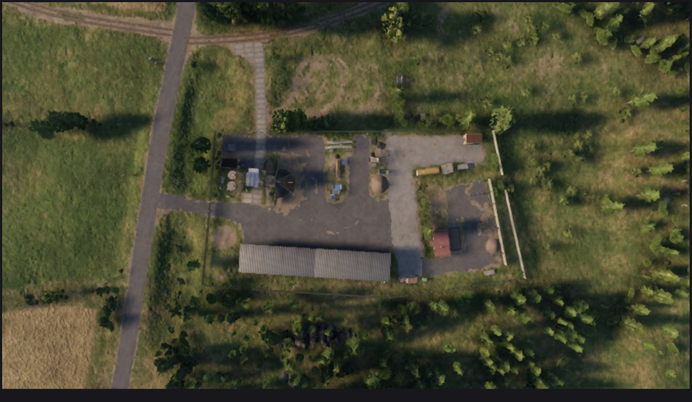

# North-east compound: truck yard site

The site card for the truck yard (#4418, plan `docs/roadmap/next-release-0.3.0.md`, decision N12, work W19). The machine
data is the `yard` block of [dossier.json](dossier.json); the scout's own pages are [dossier.md](dossier.md).

## Why here

- **0.6 km east of Saint-Philippe** (centre 5061, 10848; Saint-Philippe 4480, 10715), reachable before Montignac is live.
- **On a road.** The N-S road r02 is 23 m west of the fence and a paved spur already runs from it into the yard.
- **A yard that is already a yard.** A fenced works compound: a concrete apron, a long open-sided metal shed on the south
  edge (b03, b05), a weighbridge office with its scale (b09, b10) and two portable cabins (b11, b12). Ground 25 to 38 m,
  36% under 3 degrees, level overall.
- **Free ground beside it** for the lot move and a queue: plot p1 (5145, 10855; 66 x 172 m) east of the fence.

## Layout (first values; the place card seats them)

| Part | x, z | Note |
|---|---|---|
| Yard bounds | 4996 to 5126, 10815 to 10880 | the fence line and the long shed on the south edge |
| Gate | 4997, 10851, facing W | the only vehicle opening; the spur runs 23 m west to r02 |
| Sales hut | b09 weighbridge office at 5093, 10835.9 | doors on its west side at 5091.1, 10835.6 and 5091.2, 10840.9; the scale b10 stays as dressing |
| Salesman | 5088.5, 10843, faces W | outside the front door, looking down the truck row |
| Truck row | 5014 to 5054 step 10, z 10841, yaw 270 | five bays nose west, tail toward the shed (north face z 10835) |
| Spawn bay | 5064, 10848, yaw 270 | on the apron lane at the east end; the lane runs west to the gate, 4 m north of the row |

The centre, buildings, doors, terrain and pictures are measured by the scout. The bounds, gate and the four yard spots are
read off the overhead picture (4.5 px per metre) and the building outlines; each spot keeps at least 4 m off every building
outline. Nothing here is a placement: the place card seats them with `town fit --terrain` and `audit placement`.
