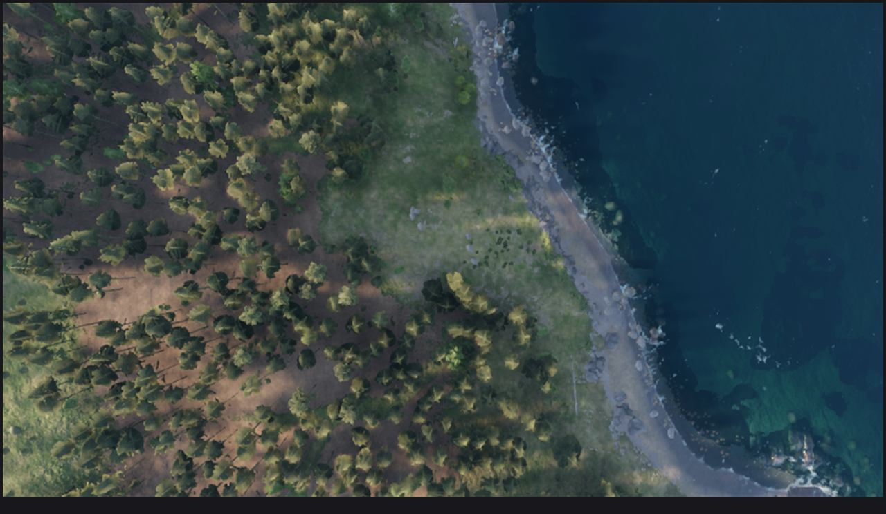
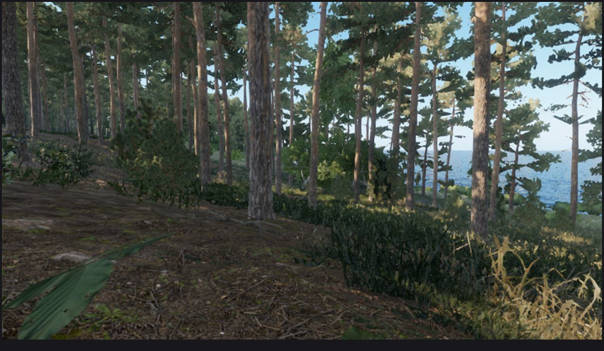
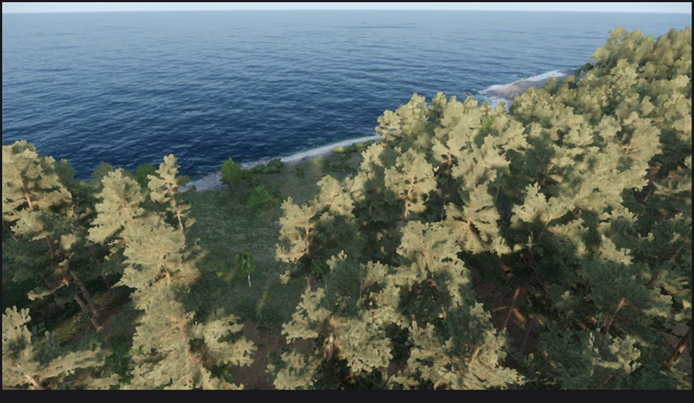
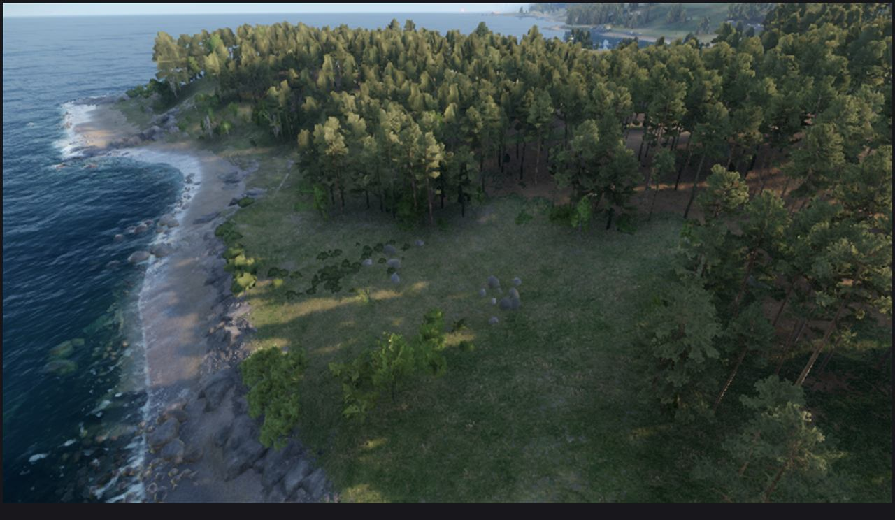
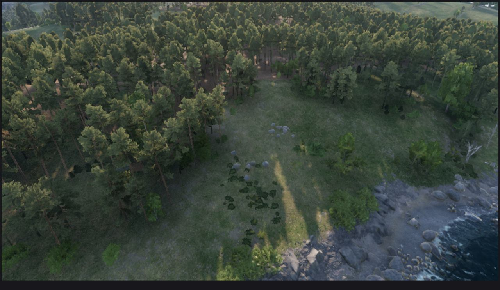

# xz-7730-8345: location dossier

Generated 2026-11-23 by `tools\cli scout`. Do not edit by hand; run `tools\cli scout 7730,8345` to refresh. The machine-readable twin is `dossier.json`.

- **Place:** xz-7730-8345, from coordinates
- **Centre:** x 7730, z 8345, ground 7.1 m; **radius** 120 m
- **World:** Worlds/CoreOnEveron/CoreOnEveron.ent, Arma Reforger build 26266485 (installed 2026-11-08)
- **Other labels nearby:** Schooner's End (natural, 232 m SE); André's Beacon (natural, 658 m W); Gillnet Pond (aquatic, 676 m W)

## At a glance

0 buildings (0 homes, 0 civic, 0 ruins), 0 enterable (a door entity below them), 0 entrances from outside among 0 door entities; 0 road(s), 0 junction(s); 0 notable props; 15 trees, bushes and other generated vegetation; 8 free plot(s).

_none_

## Overview

## Terrain

- ground 0 to 26.9 m (26.9 m of relief) within 120 m; mean 12.9 m
- 16% of the ground is under 3 degrees, 23% 3 to 8, 21% over 15
- overall the ground falls 6.7 degrees toward the E
- steepest ground 37.3 degrees at 7780, 8260
- open water (the sea or a lake) is 47.2 m away to the NE (25% of the circle is water)

## Roads and junctions

No main street could be picked (no road geometry in the dump).

_none_

_none_

## Civic candidates

Public-facing buildings a town plan would use (church, chapel, government, police, fire, pub, shop, fuel station, hotel, recreation), nearest first. Each links its pictures.

_none_

## All buildings

_none_

Footprint: `catalog` and `measure` are the model's own extents turned by the yaw; `world-bounds` is the engine's axis-aligned box. Yaw is Enfusion's (0 faces +z north, 90 faces +x east). Interior `yes` means door entities and a walkable floor (a heuristic, not walked); `unknown` means door entities but no walkable floor. Entrances are the doors on the outline; `?` means the building was not found in the engine dump. Furniture is the count of furnishing props inside the footprint where the place file has it.

## Notable props

_none_

## Free plots

| Id | x | z | Size (m) | Area (m2) | Ground (m) | Nearest road | Nearest building | From centre |
| --- | --- | --- | --- | --- | --- | --- | --- | --- |
| p1 | 7667 | 8385 | 50 x 56 | 2800 | 15.1 to 16.9 | - | - | 74.6 m |
| p2 | 7688 | 8296 | 20 x 118 | 2360 | 14.3 to 18.5 | - | - | 64.5 m |
| p3 | 7745 | 8327 | 34 x 60 | 2040 | 3.6 to 11.5 | - | - | 23.4 m |
| p4 | 7732 | 8238 | 64 x 18 | 1152 | 15 to 17.3 | - | - | 107 m |
| p5 | 7628 | 8328 | 28 x 30 | 840 | 23.4 to 26.9 | - | - | 103.4 m |
| p6 | 7664 | 8267 | 24 x 28 | 672 | 14.7 to 18.3 | - | - | 102.2 m |
| p7 | 7706 | 8290 | 12 x 46 | 552 | 13.9 to 17.7 | - | - | 60 m |
| p8 | 7679 | 8429 | 18 x 28 | 504 | 12.8 to 15.8 | - | - | 98.3 m |

plots are open rectangles at least 10 m on the short side, kept 2.5 m off buildings, 4.5 m off a road's centre line, 2 m off a tree, on ground under 12 degrees; axis aligned, not the best use of the land

## Limits of this dossier

- no road geometry could be read from the engine: roads, junctions, the main street and free plots (which keep off roads) are incomplete
- buildings (types, footprints, floors, interiors) are read from the Everon catalog, docs/everon/catalog-buildings.json; 0 of 0 matched an entity of the engine dump, which adds the door positions

## Prefab references

Every distinct building prefab, as the world file refers to it.

_none_
