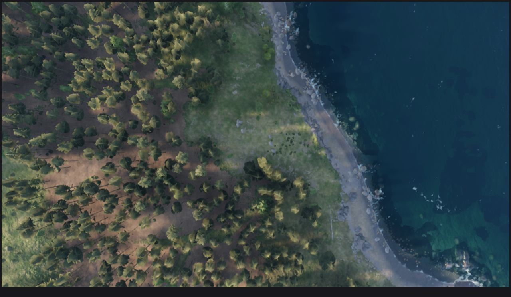

# North outpost site: Schooner's End camp

The site card for the north rebel outpost (#4218, plan `docs/roadmap/next-release-0.3.0.md`, decision N29). The machine
data is the `outpost` block of [dossier.json](dossier.json); the scout's own pages are [dossier.md](dossier.md).

## Why here

- **On the plateau, plot p1** (#4675 follow-up, 2026-11-24). The camp first stood on plot p3, the meadow that falls 8 m toward
  the sea: its rows stood between 5.8 and 9.4 m, and the maintainer found it "on a hillside". p1 is the flat plateau just west
  of that meadow (50 x 56 m, ground 15.1 to 16.9 m). The 33 rows of the camp now stand between 15.60 and 16.26 m, a 0.65 m
  fall across the whole 20 x 20 m camp (`tools/town/terrain/outpost-north-camp.json`).
- **3.94 km from Saint-Philippe** (the camp's middle, 7661, 8395; Saint-Philippe 4480, 10715), east-north-east; the nearest
  row is 3.92 km out. The first site card asked for at least 4 km. That was our own rule, not a game rule, and p1 missed it
  by 50 m, so flat ground won: the minimum is now about 3.9 km.
- **Off the roads.** The survey has no road inside 120 m. The nearest mapped road is the training area's yard road r02 about
  270 m south; the main road r01 is further south-west. A car comes up the free strip p2 (x 7688, z 8237 to 8355) and crosses the
  south half of p1 to the gate.
- **Hidden.** Pines ring the plateau on every side; from the air and from the strip the camp shows only between the trunks.
  The kit's boxed `clear` entries hide the 30 trees and bushes that stood in the camp and on the gate approach, and the granite
  stone that stood in the gate opening (`town vegetation outpost-north camp --write`, then `--verify`: 0 still drawn).
- **Not the scope file's spot.** The gangs scope names "about 7000 to 8000, 11000" east of the airbase. That ground is sea
  (Maiden's Bay); the north-east bulge near the old training area is the only land of the north half that far out.

## Layout (as fitted)

| Part | x, z | Note |
|---|---|---|
| Camp | 7651 to 7671, 8388 to 8405 | the kit's footprint on the plot centre (7667, 8385), yaw 0 |
| Safe zone | centre 7661, 8395, radius 60 m | the `outpost-site` row (`LF_OutpostComponent`, the `LF_Outposts.conf` default radius); all on the plateau |
| Gate | sandbag line at z 8388.7, opening x 7657 to 7664, facing S | guards at 7654.8, 8390.7 and 7665, 8390.7, facing the approach |
| Chalk board | 7656.8, 8392.6, facing S | just inside the gate, read before the quartermaster |
| Quartermaster ("Sarge") | 7657.9, 8399.2 | before the FIA tent, by the table and the pallets under the camo net |
| Contraband buyer | 7665.4, 8397.7 | under the canvas cover |
| Mechanic canopy | 7666, 8402.7 | two workbenches |
| Campfire | 7661.5, 8395.6 | three stools and a crate bench |
| Radio mast | 7670.5, 8404.7 | |
| Flag pole | 7651.3, 8404.7 | the green cloth |

Every value is read back from `Place_outpost-north_camp.layer`; nothing here is typed into a layer. `town fit outpost-north camp
--refit --terrain` seats the kit on the plot and `audit placement` (`--strict`, `--world MainWorld --baseline`) passes.

The first site (plot p3, centre 7728, 8368, 4.01 km out) is in the history of this file.

## Dressing kit (#4458, #4555)

The camp's 1989 smuggler look is the kit `tools/town/kits/outpost-north.json` (29 rows, vanilla assets only, open ground:
every row `"mount": "terrain"`), authored in the debug grid and archived as `tools/town/kits/sources/outpost-north.layer`.
It holds the sandbag gate (4 m opening), the FIA tent for the quartermaster, a canvas cover over the crate spot, a camo net
shrunk to the two pallets, the fire with three stools and a crate bench, the mechanic canopy over two workbenches, the generator,
the R161 mast, the table, the barrel, and the flag pole with the vanilla green cloth (`Flag_1_2` with `Flag_1_2_Green.emat`,
the vanilla green flag prefab's GUID is not in the game's reference index). Six prefab-less rows (`outpost-spot-crate`,
`-chalk-board`, `-buyer`, `-quartermaster`, `-guard-s`, `-guard-n`) mark where cards #4223, GA-O3 and #4519 put their
interactables and NPCs. `town fit --terrain` seats it on the site; `town author --reopen outpost-north` rebuilds the grid bay.
