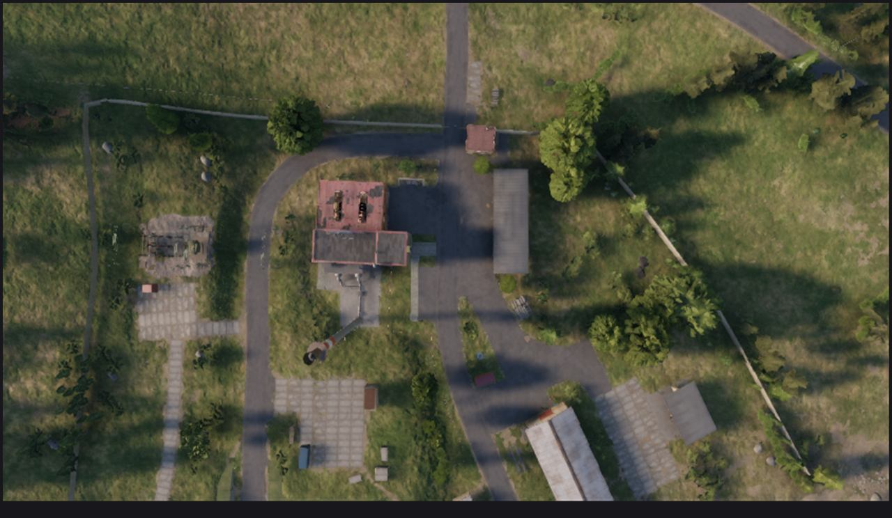
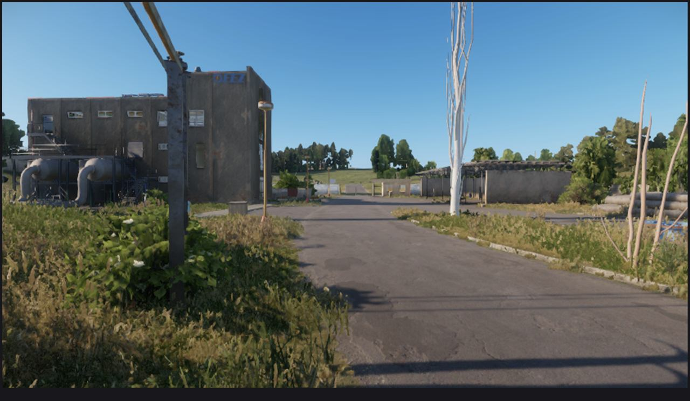
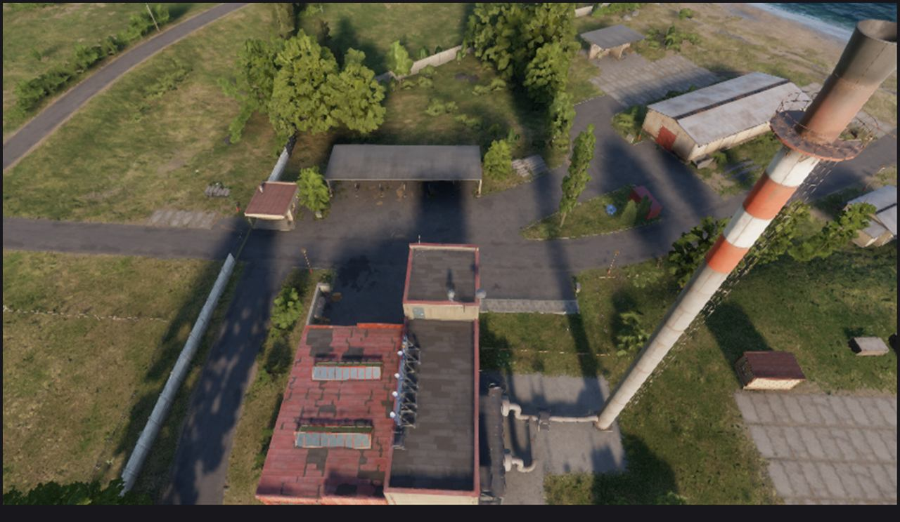
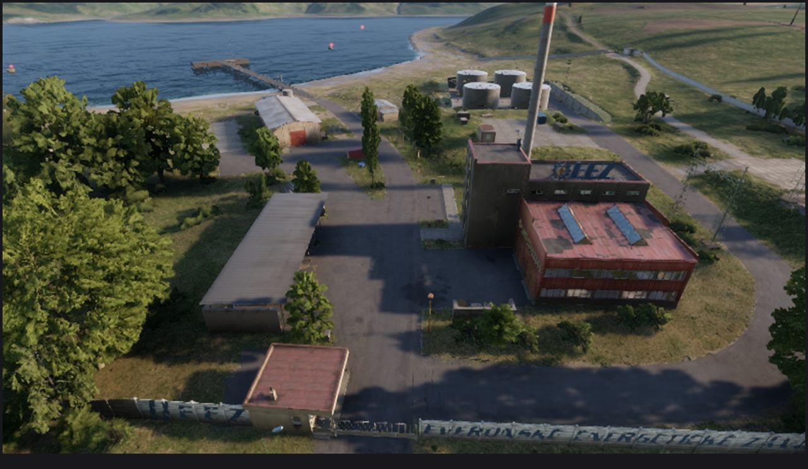
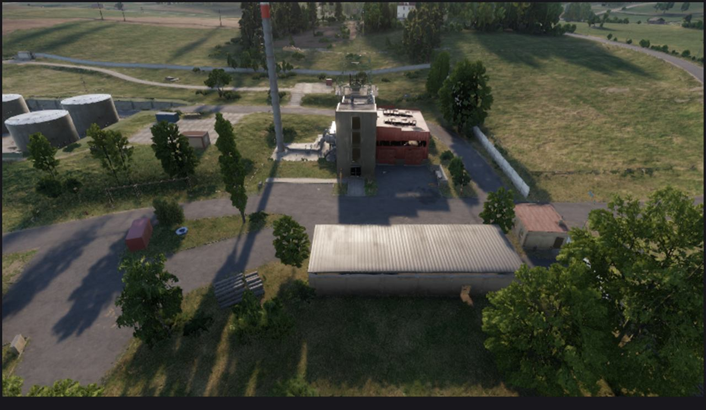

# xz-5834-9786: location dossier

Generated 2026-11-24 by `tools\cli scout`. Do not edit by hand; run `tools\cli scout 5834,9786 --radius 130` to refresh. The machine-readable twin is `dossier.json`.

- **Place:** xz-5834-9786, from coordinates
- **Centre:** x 5834, z 9786, ground 4.6 m; **radius** 130 m
- **World:** Worlds/CoreOnEveron/CoreOnEveron.ent, Arma Reforger build 26266485 (installed 2026-11-08)
- **Other labels nearby:** power plant (urban, 50 m SW); Étoupe (urban, 511 m W); Kermovan (urban, 547 m E); Tyrone Bay (aquatic, 611 m SE); Lighthouse (other, 662 m E); Lacan's Head (natural, 677 m S)

## At a glance

14 buildings (0 homes, 0 civic, 0 ruins), 4 enterable (a door entity below them), 3 entrances from outside among 12 door entities; 33 road(s), 18 junction(s); 19 notable props; 341 trees, bushes and other generated vegetation; 8 free plot(s).

| Type | Count |
| --- | --- |
| industrial-tank | 5 |
| industrial | 4 |
| industrial-tower | 2 |
| garage | 2 |
| military | 1 |

## Overview

## Terrain

- ground 3 to 15.2 m (12.2 m of relief) within 130 m; mean 6.8 m
- 44% of the ground is under 3 degrees, 38% 3 to 8, 3% over 15
- overall the ground falls 1.5 degrees toward the SE
- steepest ground 25 degrees at 5934, 9836

## Roads and junctions

**Main street:** N-S road r03, 6 buildings within 25 m of it; its busiest stretch is at x 5843.2, z 9736.1.

| Id | Road | Length in radius (m) | Points |
| --- | --- | --- | --- |
| r02 | NW-SE road r02 | 459 | 4 |
| r03 | N-S road r03 | 229.1 | 12 |
| r04 | N-S road r04 | 33.2 | 5 |
| r05 | NE-SW road r05 | 179.7 | 8 |
| r06 | N-S road r06 | 12.7 | 2 |
| r07 | N-S road r07 | 27.2 | 2 |
| r08 | N-S road r08 | 27.1 | 2 |
| r09 | N-S road r09 | 26.5 | 2 |
| r10 | N-S road r10 | 26 | 2 |
| r11 | N-S road r11 | 10.6 | 2 |
| r12 | NW-SE road r12 | 34.5 | 2 |
| r13 | NW-SE road r13 | 19.6 | 2 |
| r14 | N-S road r14 | 26.2 | 2 |
| r15 | N-S road r15 | 10.1 | 2 |
| r16 | NW-SE road r16 | 35.1 | 2 |
| r17 | NW-SE road r17 | 14.4 | 2 |
| r18 | NW-SE road r18 | 21.3 | 2 |
| r19 | NE-SW road r19 | 22.3 | 2 |
| r20 | NE-SW road r20 | 12.6 | 2 |
| r21 | N-S road r21 | 24.2 | 3 |
| r22 | NE-SW road r22 | 21.9 | 2 |
| r23 | NW-SE road r23 | 15.7 | 2 |
| r24 | NE-SW road r24 | 25.3 | 2 |
| r25 | NW-SE road r25 | 83.9 | 7 |
| r26 | NW-SE road r26 | 59.8 | 6 |
| r27 | E-W road r27 | 12.9 | 4 |
| r28 | E-W road r28 | 18.8 | 2 |
| r29 | E-W road r29 | 18.1 | 2 |
| r30 | N-S road r30 | 75.3 | 3 |
| r31 | E-W road r31 | 18.2 | 2 |
| r32 | E-W road r32 | 18.3 | 2 |
| r33 | E-W road r33 | 20 | 2 |
| r34 | NE-SW road r34 | 102.2 | 10 |

| x | z | Kind | Arms | Roads |
| --- | --- | --- | --- | --- |
| 5870.6 | 9678.3 | crossroads | 5 | r24, r03, r19, r22 |
| 5756 | 9762.9 | crossroads | 5 | r27, r33, r34, r30 |
| 5774.5 | 9763.2 | crossroads | 4 | r05, r34, r27 |
| 5900.9 | 9711.9 | crossroads | 4 | r12, r21, r25, r16 |
| 5886.6 | 9743.3 | crossroads | 4 | r12, r25, r16 |
| 5898.4 | 9727.6 | crossroads | 4 | r13, r23, r17, r18 |
| 5892.3 | 9689.7 | crossroads | 4 | r19, r21, r24, r22 |
| 5747.5 | 9726.8 | crossroads | 4 | r30, r34 |
| 5748.6 | 9741.4 | crossroads | 4 | r30, r34 |
| 5749.4 | 9751 | crossroads | 4 | r30, r34 |
| 5745.9 | 9717.2 | crossroads | 4 | r30, r34 |
| 5837.4 | 9885.1 | t-junction | 3 | r03, r02 |
| 5835.9 | 9818.6 | t-junction | 3 | r05, r03 |
| 5842.5 | 9737.8 | t-junction | 3 | r03, r25 |
| 5836.3 | 9797.3 | t-junction | 3 | r26, r03 |
| 5869.9 | 9751.1 | t-junction | 3 | r26, r25 |
| 5766.2 | 9763.2 | t-junction | 3 | r27, r34 |
| 5737.1 | 9688.7 | bend-or-join | 2 | r30, r34 |

## Civic candidates

Public-facing buildings a town plan would use (church, chapel, government, police, fire, pub, shop, fuel station, hotel, recreation), nearest first. Each links its pictures.

_none_

## All buildings

| Id | Type | Vanilla prefab | x | z | Yaw | Facing | Footprint (m) | Floors | Interior | Entrances | Furniture |
| --- | --- | --- | --- | --- | --- | --- | --- | --- | --- | --- | --- |
| b01 | industrial | ShedMetal_02_long_nowalls | 5854.4 | 9795.2 | -90 | W | 31 x 11.2 (347.2 m2) | 1 | no | ? | - |
| b02 | industrial-tower | SmokestackMetal_E_01 | 5806.2 | 9765.3 | -178 | S | 4.6 x 4.6 (21.2 m2) | - | no | ? | - |
| b03 | military | GuardHouse_01_beige | 5845.7 | 9819.7 | -86 | W | 7.6 x 8.9 (67.6 m2) | 2 | yes | 1 | - |
| b04 | industrial | PortableCabin_E_01_beige | 5810.8 | 9743.3 | -178 | S | 3.8 x 6.4 (24.3 m2) | 2 | yes | 1 | - |
| b05 | garage | RampVehicle_01_metal | 5858 | 9720.6 | -23 | NW | 5.1 x 11.1 (56.6 m2) | 1 | no | - | - |
| b06 | industrial | Warehouse_01_V3 | 5872.6 | 9722.1 | -115 | SW | 41.3 x 19.2 (793 m2) | 1 | yes | - | - |
| b07 | garage | Workshop_02_grey | 5842.3 | 9703.6 | 156 | SE | 8.9 x 15.5 (138 m2) | 1 | yes | 1 | - |
| b08 | industrial | ShedMetal_02_short_nowalls | 5909.9 | 9738.4 | -116 | SW | 16.3 x 11.2 (182.6 m2) | 1 | no | ? | - |
| b09 | industrial-tank | FuelTank_03_grey | 5804.2 | 9697.4 | -5 | N | 16 x 17.5 (280 m2) | 0 | no | - | - |
| b10 | industrial-tank | FuelTank_03_grey | 5785.3 | 9697.7 | -4 | N | 16 x 17.5 (280 m2) | 0 | no | - | - |
| b11 | industrial-tank | FuelTank_01_grey | 5880.3 | 9692.4 | -118 | SW | 5.2 x 4.6 (23.9 m2) | 1 | no | - | - |
| b12 | industrial-tank | FuelTank_03_grey | 5803.1 | 9667.9 | 177 | S | 16 x 17.5 (280 m2) | 0 | no | - | - |
| b13 | industrial-tower | LightTower_01 | 5766.8 | 9684.1 | -91 | W | 2.3 x 1.9 (4.4 m2) | - | no | - | - |
| b14 | industrial-tank | FuelTank_03_grey | 5785.8 | 9667.5 | 174 | S | 16 x 17.5 (280 m2) | 0 | no | - | - |

Footprint: `catalog` and `measure` are the model's own extents turned by the yaw; `world-bounds` is the engine's axis-aligned box. Yaw is Enfusion's (0 faces +z north, 90 faces +x east). Interior `yes` means door entities and a walkable floor (a heuristic, not walked); `unknown` means door entities but no walkable floor. Entrances are the doors on the outline; `?` means the building was not found in the engine dump. Furniture is the count of furnishing props inside the footprint where the place file has it.

## Notable props

| Kind | Vanilla prefab | x | z | Distance |
| --- | --- | --- | --- | --- |
| notice-board | MessageBoardSmall_01_pole_filled_V5 | 5827.3 | 9784.7 | 6.9 m |
| pier-or-dock | PierWooden_02_bridge | 5892.2 | 9647.3 | 150.5 m |

Counted, not listed: 8 street-lamp, 9 manhole.

## Free plots

| Id | x | z | Size (m) | Area (m2) | Ground (m) | Nearest road | Nearest building | From centre |
| --- | --- | --- | --- | --- | --- | --- | --- | --- |
| p1 | 5896 | 9797 | 72 x 74 | 5328 | 3.7 to 7.9 | NW-SE road r17 49.9 m | b01 industrial 36 m | 63 m |
| p2 | 5789 | 9853 | 86 x 58 | 4988 | 4.2 to 12.7 | NE-SW road r05 36.3 m | b03 military 59.4 m | 80.7 m |
| p3 | 5723 | 9786 | 22 x 96 | 2112 | 9 to 15.2 | E-W road r31 19.3 m | b02 industrial-tower 83 m | 111 m |
| p4 | 5945 | 9766 | 22 x 56 | 1232 | 4.4 to 7.6 | NW-SE road r17 54.5 m | b08 industrial 38.1 m | 112.8 m |
| p5 | 5840 | 9675 | 36 x 34 | 1224 | 4 to 7.7 | N-S road r03 27 m | b07 garage 21.1 m | 111.2 m |
| p6 | 5875 | 9845 | 54 x 18 | 972 | 4.8 to 9 | NW-SE road r02 25.8 m | b03 military 33.4 m | 71.8 m |
| p7 | 5926 | 9729 | 12 x 58 | 696 | 3.7 to 4.6 | NW-SE road r18 21.8 m | b08 industrial 8.8 m | 108.2 m |
| p8 | 5883 | 9889 | 38 x 18 | 684 | 8.6 to 10.3 | NW-SE road r02 18.4 m | b03 military 73.7 m | 114.1 m |

plots are open rectangles at least 10 m on the short side, kept 2.5 m off buildings, 4.5 m off a road's centre line, 2 m off a tree, on ground under 12 degrees; axis aligned, not the best use of the land

## Limits of this dossier

- buildings (types, footprints, floors, interiors) are read from the Everon catalog, docs/everon/catalog-buildings.json; 11 of 14 matched an entity of the engine dump, which adds the door positions, and the other 3 have no entrances listed
- 2 quay, pier and waterworks pieces are counted, not listed
- picture `main-street` missing: no wide shot came back
- picture `main-street` missing: no ob090 shot came back

## Prefab references

Every distinct building prefab, as the world file refers to it.

| Prefab | Type | Count |
| --- | --- | --- |
| `{137E98DD5A116B68}Prefabs/Structures/Industrial/Sheds/ShedMetal_02/ShedMetal_02_long_nowalls.et` | industrial | 1 |
| `{6FC492B696FF2DFC}Prefabs/Structures/Industrial/Smokestacks/SmokestackMetal_E_01/SmokestackMetal_E_01.et` | industrial-tower | 1 |
| `{CCE6A451A226AF4E}Prefabs/Structures/Military/Houses/GuardHouse_01/GuardHouse_01_beige.et` | military | 1 |
| `{E30E1250FD927736}Prefabs/Structures/Industrial/Houses/PortableCabin_E_01/PortableCabin_E_01_beige.et` | industrial | 1 |
| `{74FAABE8512145EF}Prefabs/Structures/Industrial/Repair/RampVehicle_01/RampVehicle_01_metal.et` | garage | 1 |
| `{1350F724723AAC87}Prefabs/Structures/Industrial/Houses/Warehouse_01/Warehouse_01_V3.et` | industrial | 1 |
| `{CF7E43120709D9BE}Prefabs/Structures/Industrial/Houses/Workshop_02/Workshop_02_grey.et` | garage | 1 |
| `{DEBC2FB8DA61B83E}Prefabs/Structures/Industrial/Sheds/ShedMetal_02/ShedMetal_02_short_nowalls.et` | industrial | 1 |
| `{AAB10C30EE97D12D}Prefabs/Structures/Industrial/Containers/FuelTanks/FuelTank_03/FuelTank_03_grey.et` | industrial-tank | 4 |
| `{389D6DF9941FF22D}Prefabs/Structures/Industrial/Containers/FuelTanks/FuelTank_01/FuelTank_01_grey.et` | industrial-tank | 1 |
| `{80DF3BD810D032AF}Prefabs/Structures/Industrial/Towers/LightTower_01/LightTower_01.et` | industrial-tower | 1 |
