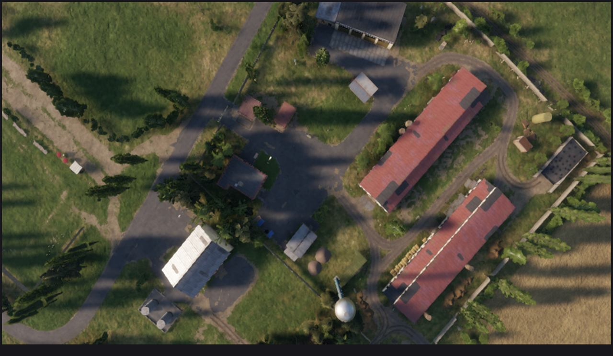
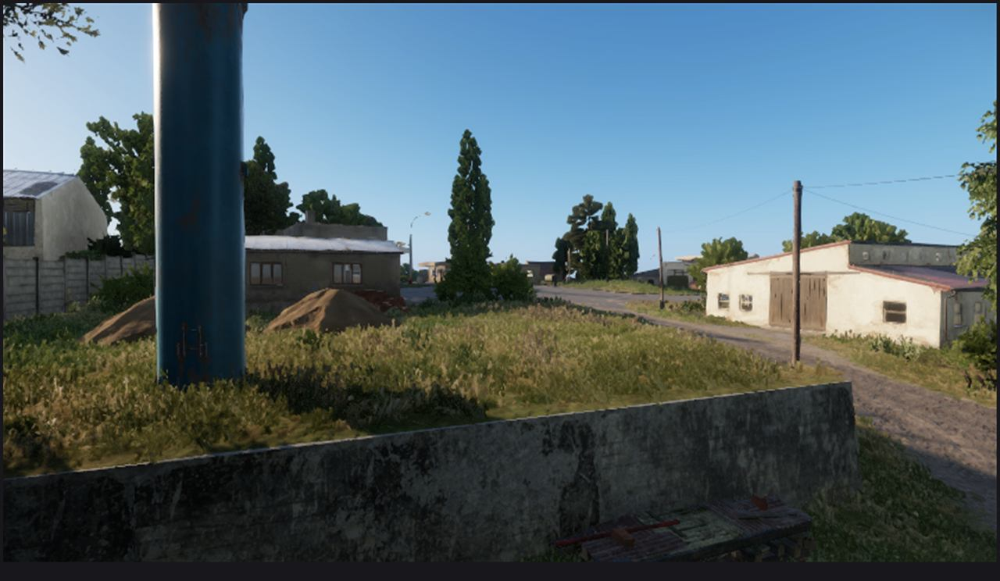
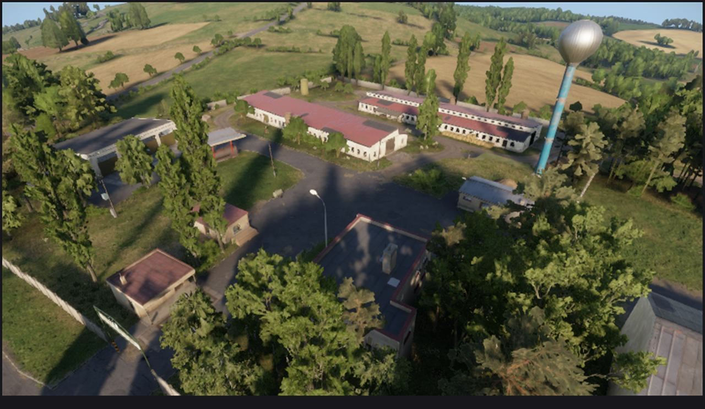
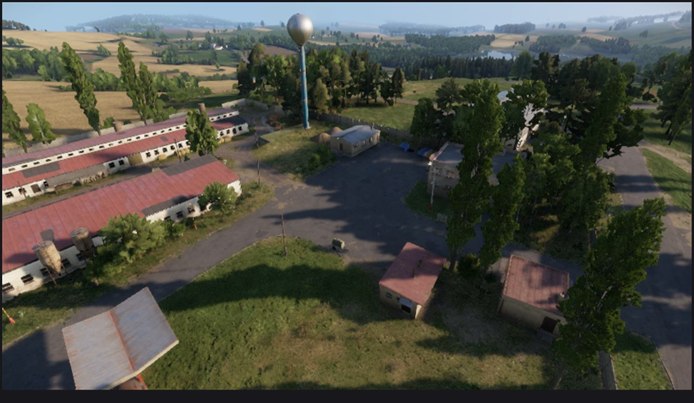
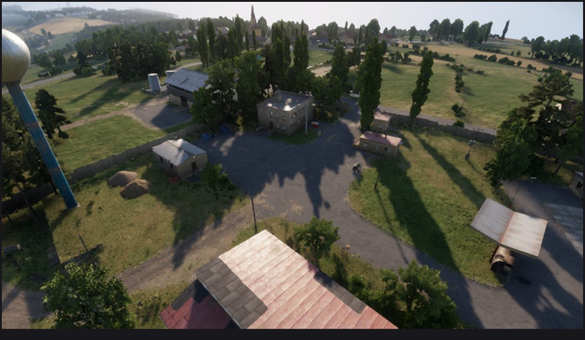
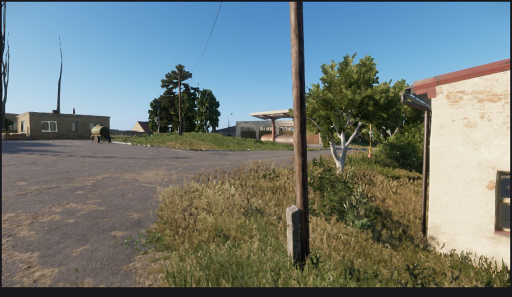
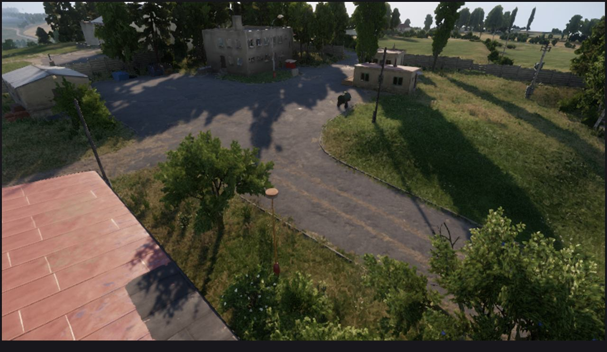

# xz-5134-7044: location dossier

Generated 2026-11-19 by `tools\cli scout`. Do not edit by hand; run `tools\cli scout 5134,7044 --radius 110` to refresh. The machine-readable twin is `dossier.json`.

- **Place:** xz-5134-7044, from coordinates
- **Centre:** x 5134, z 7044, ground 175.7 m; **radius** 110 m
- **World:** Worlds/CoreOnEveron/CoreOnEveron.ent, Arma Reforger build 26266485 (installed 2026-11-08)
- **Other labels nearby:** Montignac (other, 364 m W); sawmill (other, 629 m W); sawmill (other, 629 m W); Entre-Deux (other, 633 m E); Cowbell Pond (aquatic, 664 m S)

## At a glance

21 buildings (0 homes, 0 civic, 0 ruins), 11 enterable (a door entity below them), 41 entrances from outside among 76 door entities; 17 road(s), 19 junction(s); 15 notable props; 581 trees, bushes and other generated vegetation; 8 free plot(s).

| Type | Count |
| --- | --- |
| industrial-tank | 7 |
| farm | 6 |
| garage | 3 |
| industrial | 2 |
| military | 1 |
| shed | 1 |
| kiosk | 1 |

## Overview

## Terrain

- ground 168.8 to 177.8 m (9.1 m of relief) within 110 m; mean 174.3 m
- 54% of the ground is under 3 degrees, 34% 3 to 8, 1% over 15
- overall the ground falls 1.6 degrees toward the E
- steepest ground 24.5 degrees at 5154, 6999

## Roads and junctions

**Main street:** E-W road r06, 8 buildings within 25 m of it; its busiest stretch is at x 5153.9, z 7054.3.

| Id | Road | Length in radius (m) | Points |
| --- | --- | --- | --- |
| r01 | NE-SW road r01 | 210.6 | 4 |
| r03 | NW-SE road r03 | 119.6 | 5 |
| r05 | NE-SW road r05 | 80.7 | 13 |
| r06 | E-W road r06 | 116.2 | 13 |
| r07 | N-S road r07 | 212.1 | 19 |
| r08 | NW-SE road r08 | 30.7 | 8 |
| r09 | E-W road r09 | 31.5 | 6 |
| r10 | N-S road r10 | 38 | 6 |
| r11 | E-W road r11 | 28.6 | 2 |
| r12 | E-W road r12 | 19 | 2 |
| r13 | NE-SW road r13 | 24 | 5 |
| r14 | E-W road r14 | 11.1 | 2 |
| r17 | NW-SE road r17 | 44.8 | 7 |
| r18 | NW-SE road r18 | 46.6 | 4 |
| r19 | E-W road r19 | 124.3 | 13 |
| r20 | N-S road r20 | 17.2 | 4 |
| r21 | NW-SE road r21 | 61.2 | 10 |

| x | z | Kind | Arms | Roads |
| --- | --- | --- | --- | --- |
| 5181.9 | 7085.3 | crossroads | 5 | r05, r06, r07 |
| 5133.1 | 7153.1 | crossroads | 4 | r01, r03, r13 |
| 5157.8 | 7058.3 | crossroads | 4 | r05, r06 |
| 5171.8 | 7074.2 | crossroads | 4 | r05, r06 |
| 5121.7 | 7138.3 | t-junction | 3 | r13, r01 |
| 5190.4 | 7091.2 | t-junction | 3 | r06, r05, r07 |
| 5149.8 | 7034 | t-junction | 3 | r05, r17, r18 |
| 5121.2 | 7054.3 | t-junction | 3 | r06, r17 |
| 5186.1 | 7016.9 | t-junction | 3 | r09, r07 |
| 5232.6 | 7067.2 | t-junction | 3 | r10, r07 |
| 5166.1 | 6994.5 | t-junction | 3 | r18, r07 |
| 5185.4 | 6970 | t-junction | 3 | r07, r19 |
| 5168.1 | 6983.8 | t-junction | 3 | r20, r07 |
| 5228.7 | 7053.3 | t-junction | 3 | r08, r10 |
| 5160.6 | 7021.9 | t-junction | 3 | r09, r18 |
| 5169.3 | 6968.5 | t-junction | 3 | r20, r19 |
| 5088.8 | 6981.7 | t-junction | 3 | r19, r21 |
| 5098.3 | 6974.4 | t-junction | 3 | r21, r19 |
| 5154.7 | 7099.9 | bend-or-join | 2 | r12, r14 |

## Civic candidates

Public-facing buildings a town plan would use (church, chapel, government, police, fire, pub, shop, fuel station, hotel, recreation), nearest first. Each links its pictures.

_none_

## All buildings

| Id | Type | Vanilla prefab | x | z | Yaw | Facing | Footprint (m) | Floors | Interior | Entrances | Furniture |
| --- | --- | --- | --- | --- | --- | --- | --- | --- | --- | --- | --- |
| b01 | farm | WeightStation_01 | 5123.8 | 7068.9 | 32 | NE | 6.6 x 11 (72.6 m2) | 2 | yes | 2 | - |
| b02 | industrial | Office_E_01 | 5106 | 7041.4 | 31 | NE | 17 x 15 (255 m2) | 3 | yes | 2 | - |
| b03 | garage | Workshop_02_grey | 5131.9 | 7014.6 | 40 | NE | 8.9 x 15.5 (138 m2) | 1 | yes | 1 | - |
| b04 | farm | WeightStation_01_scale | 5107.3 | 7071.1 | 120 | SE | 0.3 x 1.7 (0.5 m2) | - | no | - | - |
| b05 | military | GuardHouse_01_beige | 5108.6 | 7072.9 | -150 | SW | 7.6 x 8.9 (67.6 m2) | 2 | yes | 1 | - |
| b06 | industrial-tank | FuelTank_02_Pump_grey | 5160.2 | 7082.1 | -136 | SW | 11.2 x 2.8 (31.4 m2) | 2 | no | - | - |
| b07 | industrial-tank | Silo_01 | 5177.4 | 7062.3 | -48 | NW | 2.5 x 3.7 (9.3 m2) | 0 | no | - | - |
| b08 | farm | CowShed_E_01_long | 5182.8 | 7050.7 | -137 | SW | 19.7 x 70.6 (1390.8 m2) | 1 | yes | 3 | - |
| b09 | industrial-tank | Silo_01 | 5180.5 | 7065.6 | -48 | NW | 2.5 x 3.7 (9.3 m2) | 0 | no | - | - |
| b10 | farm | Hayloft_E_01_metal | 5086.4 | 7008 | -49 | NW | 25.1 x 18.7 (469.4 m2) | 2 | yes | 5 | - |
| b11 | shed | Shed_03_wide | 5204.5 | 7029.3 | 133 | SE | 12.3 x 3.9 (48 m2) | 0 | no | - | - |
| b12 | garage | Warehouse_01_Workshop | 5144.2 | 7115.5 | -71 | W | 9.7 x 10.4 (100.9 m2) | 1 | yes | 4 | - |
| b13 | garage | Garage_E_02 | 5163.6 | 7113.1 | -161 | S | 28.1 x 18.9 (531.1 m2) | 3 | yes | 14 | - |
| b14 | farm | CowShed_E_01_long | 5207.3 | 7017.2 | 43 | NE | 19.7 x 70.6 (1390.8 m2) | 1 | yes | 3 | - |
| b15 | industrial-tank | Silo_01 | 5190.3 | 6981.1 | 132 | SE | 2.5 x 3.7 (9.3 m2) | 0 | no | - | - |
| b16 | industrial-tank | Silo_01 | 5209.7 | 7002.3 | 132 | SE | 2.5 x 3.7 (9.3 m2) | 0 | no | - | - |
| b17 | industrial-tank | FuelTank_01_rust | 5070.2 | 6981.1 | -4 | N | 5.2 x 4.6 (23.9 m2) | 1 | no | - | - |
| b18 | industrial-tank | FuelTank_01_rust | 5063.4 | 6986.6 | -4 | N | 5.2 x 4.6 (23.9 m2) | 1 | no | - | - |
| b19 | industrial | PortableCabin_E_01_beige | 5237.4 | 7057.2 | -42 | NW | 3.8 x 6.4 (24.3 m2) | 2 | yes | 1 | - |
| b20 | kiosk | NewspaperBooth_E_01_redyellow | 5027.3 | 7046.2 | 132 | SE | 4.1 x 5 (20.5 m2) | 2 | yes | 1 | - |
| b21 | farm | Barn_E_01 | 5102.5 | 7147.9 | -64 | NW | 15.1 x 10.8 (163.1 m2) | 0 | unknown | 4 | - |

Footprint: `catalog` and `measure` are the model's own extents turned by the yaw; `world-bounds` is the engine's axis-aligned box. Yaw is Enfusion's (0 faces +z north, 90 faces +x east). Interior `yes` means door entities and a walkable floor (a heuristic, not walked); `unknown` means door entities but no walkable floor. Entrances are the doors on the outline; `?` means the building was not found in the engine dump. Furniture is the count of furnishing props inside the footprint where the place file has it.

## Notable props

| Kind | Vanilla prefab | x | z | Distance |
| --- | --- | --- | --- | --- |
| notice-board | MessageBoard_01 | 5110.8 | 7051.6 | 24.4 m |

Counted, not listed: 8 street-lamp, 6 manhole.

## Free plots

| Id | x | z | Size (m) | Area (m2) | Ground (m) | Nearest road | Nearest building | From centre |
| --- | --- | --- | --- | --- | --- | --- | --- | --- |
| p1 | 5063 | 7090 | 34 x 44 | 1496 | 174.1 to 176.9 | NE-SW road r01 29.2 m | b05 military 44.3 m | 84.6 m |
| p2 | 5125 | 6987 | 34 x 34 | 1156 | 174.9 to 176.8 | E-W road r19 28.4 m | b03 garage 18.2 m | 57.7 m |
| p3 | 5126 | 7094 | 28 x 32 | 896 | 174 to 176.2 | E-W road r14 21.6 m | b01 farm 18.2 m | 50.6 m |
| p4 | 5039 | 7050 | 10 x 84 | 840 | 173.9 to 176.9 | NE-SW road r01 29.9 m | b20 kiosk 9.3 m | 95.2 m |
| p5 | 5089 | 7126 | 34 x 20 | 680 | 173.4 to 175.3 | NE-SW road r01 24.4 m | b21 farm 18.1 m | 93.5 m |
| p6 | 5112 | 7018 | 20 x 24 | 480 | 176 to 177.1 | NW-SE road r17 36.2 m | b02 industrial 12.9 m | 34.1 m |
| p7 | 5197 | 7108 | 30 x 16 | 480 | 171.3 to 173.9 | N-S road r07 12.4 m | b13 garage 19.2 m | 89.8 m |
| p8 | 5080 | 6964 | 28 x 16 | 448 | 175.4 to 176.7 | E-W road r19 19.4 m | b17 industrial-tank 16.6 m | 96.5 m |

plots are open rectangles at least 10 m on the short side, kept 2.5 m off buildings, 4.5 m off a road's centre line, 2 m off a tree, on ground under 12 degrees; axis aligned, not the best use of the land

## Limits of this dossier

- buildings (types, footprints, floors, interiors) are read from the Everon catalog, docs/everon/catalog-buildings.json; 21 of 21 matched an entity of the engine dump, which adds the door positions

## Prefab references

Every distinct building prefab, as the world file refers to it.

| Prefab | Type | Count |
| --- | --- | --- |
| `{B461AC17AE9B29EF}Prefabs/Structures/Agriculture/WeightStation/WeightStation_01/WeightStation_01.et` | farm | 1 |
| `{51F233A0BA73532A}Prefabs/Structures/Industrial/Houses/Office_E_01/Office_E_01.et` | industrial | 1 |
| `{CF7E43120709D9BE}Prefabs/Structures/Industrial/Houses/Workshop_02/Workshop_02_grey.et` | garage | 1 |
| `{82992F7B47B6191F}Prefabs/Structures/Agriculture/WeightStation/WeightStation_01/BuildingAddons/WeightStation_01_scale.et` | farm | 1 |
| `{CCE6A451A226AF4E}Prefabs/Structures/Military/Houses/GuardHouse_01/GuardHouse_01_beige.et` | military | 1 |
| `{2D4B0333F2858BDD}Prefabs/Structures/Industrial/Containers/FuelTanks/FuelTank_02/FuelTank_02_Pump_grey.et` | industrial-tank | 1 |
| `{4D100F180B3EFEC1}Prefabs/Structures/Industrial/Containers/Silos/Silo_01/Silo_01.et` | industrial-tank | 4 |
| `{8ED47AC94995D71A}Prefabs/Structures/Agriculture/CowShed/CowShed_E_01/CowShed_E_01_long.et` | farm | 2 |
| `{EC63F328F15AD3AF}Prefabs/Structures/Agriculture/Hayloft/Hayloft_E_01/Hayloft_E_01_metal.et` | farm | 1 |
| `{EF96889E35217E1E}Prefabs/Structures/Houses/Shed/Shed_03/Shed_03_wide.et` | shed | 1 |
| `{BE70E3BA6C1911A9}Prefabs/Structures/Industrial/Houses/Warehouse_01/Warehouse_01_Workshop.et` | garage | 1 |
| `{80A5B37A1472B084}Prefabs/Structures/Industrial/Garages/Garage_E_02/Garage_E_02.et` | garage | 1 |
| `{AD207D3DE43922D8}Prefabs/Structures/Industrial/Containers/FuelTanks/FuelTank_01/FuelTank_01_rust.et` | industrial-tank | 2 |
| `{E30E1250FD927736}Prefabs/Structures/Industrial/Houses/PortableCabin_E_01/PortableCabin_E_01_beige.et` | industrial | 1 |
| `{DA33ED8E94FD68DF}Prefabs/Structures/Commercial/Booth/NewspaperBooth_E_01/NewspaperBooth_E_01_redyellow.et` | kiosk | 1 |
| `{99F6E8E52B71B137}Prefabs/Structures/Agriculture/Barn/Barn_E_01/Barn_E_01.et` | farm | 1 |
