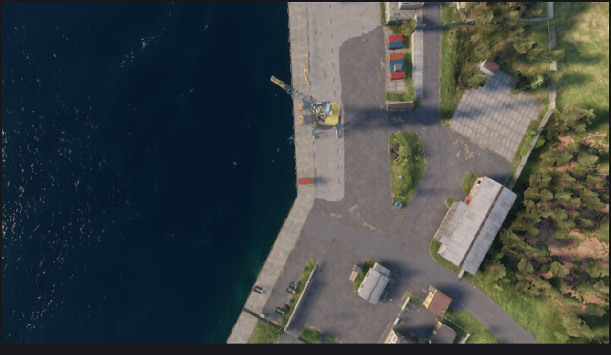
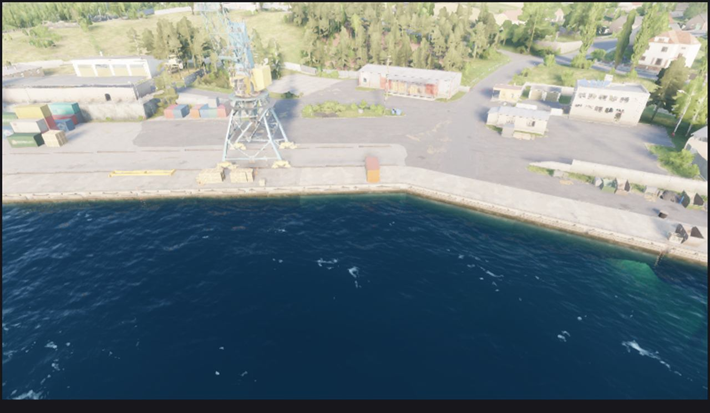
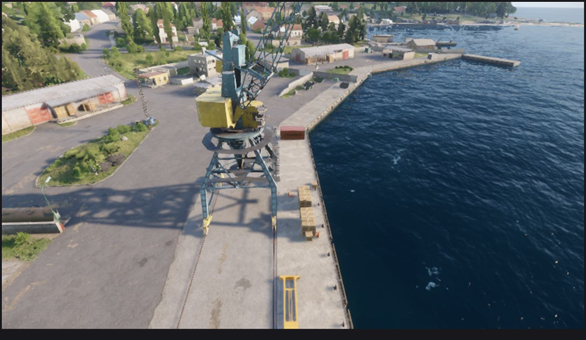
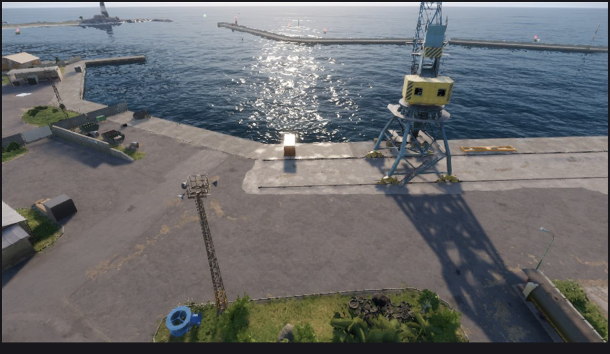
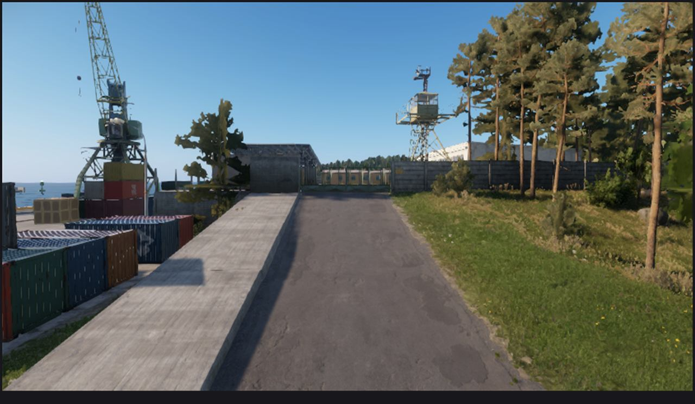
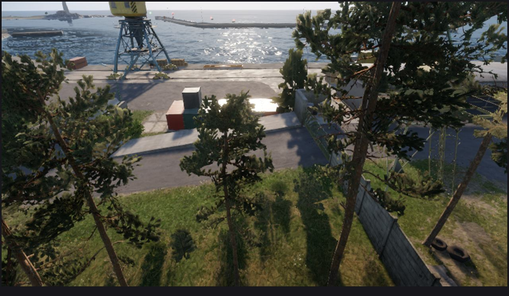

# xz-4390-11100: location dossier

Generated 2026-11-17 by `tools\cli scout`. Do not edit by hand; run `tools\cli scout 4390,11100 --radius 150` to refresh. The machine-readable twin is `dossier.json`.

- **Place:** xz-4390-11100, from coordinates
- **Centre:** x 4390, z 11100, ground 1.6 m; **radius** 150 m
- **World:** Worlds/CoreOnEveron/CoreOnEveron.ent, Arma Reforger build 26266485 (installed 2026-11-08)
- **Other labels nearby:** Birchwood Bay (aquatic, 331 m N); Saint-Philippe (urban, 347 m S); Charlet Bay (aquatic, 356 m SW); Saint-Philippe (other, 388 m S); factory (urban, 558 m S); Lighthouse (other, 574 m SW); Spring Pond (aquatic, 659 m SE); industrial compound (urban, 708 m E)

## At a glance

47 buildings (1 homes, 0 civic, 12 ruins), 15 enterable (a door entity below them), 36 entrances from outside among 84 door entities; 38 road(s), 19 junction(s); 33 notable props; 805 trees, bushes and other generated vegetation; 8 free plot(s).

| Type | Count |
| --- | --- |
| industrial | 12 |
| ruin | 12 |
| garage | 9 |
| military | 8 |
| industrial-tower | 4 |
| industrial-tank | 1 |
| villa | 1 |

## Overview

## Terrain

- ground 0.1 to 20.2 m (20.1 m of relief) within 150 m; mean 4.3 m
- 55% of the ground is under 3 degrees, 13% 3 to 8, 17% over 15
- overall the ground falls 2.9 degrees toward the W
- steepest ground 41.9 degrees at 4390, 11085
- the sea is 0 m away to the N (42% of the circle is water)

## Roads and junctions

**Main street:** N-S road r05, 15 buildings within 25 m of it; its busiest stretch is at x 4445.3, z 11153.2.

| Id | Road | Length in radius (m) | Points |
| --- | --- | --- | --- |
| r01 | NE-SW road r01 | 104 | 4 |
| r02 | NW-SE road r02 | 105.5 | 3 |
| r03 | N-S road r03 | 35.7 | 2 |
| r04 | NW-SE road r04 | 10.8 | 2 |
| r05 | N-S road r05 | 154.7 | 11 |
| r06 | N-S road r06 | 9.6 | 2 |
| r07 | NE-SW road r07 | 65.1 | 3 |
| r08 | N-S road r08 | 26.2 | 2 |
| r09 | NW-SE road r09 | 34 | 2 |
| r10 | NW-SE road r10 | 18.2 | 2 |
| r11 | NW-SE road r11 | 32.1 | 2 |
| r12 | NW-SE road r12 | 18 | 2 |
| r13 | N-S road r13 | 15.1 | 3 |
| r14 | N-S road r14 | 6.2 | 2 |
| r15 | E-W road r15 | 11.9 | 2 |
| r16 | N-S road r16 | 6 | 2 |
| r17 | N-S road r17 | 88.4 | 4 |
| r18 | NE-SW road r18 | 100.3 | 20 |
| r19 | N-S road r19 | 25.9 | 2 |
| r20 | N-S road r20 | 26 | 2 |
| r21 | NE-SW road r21 | 38.6 | 7 |
| r22 | NE-SW PolylineShapeEntity r22 | 8.2 | 3 |
| r23 | NW-SE road r23 | 51.6 | 2 |
| r24 | N-S road r24 | 48.1 | 9 |
| r25 | NW-SE road r25 | 10.7 | 3 |
| r26 | NW-SE road r26 | 6 | 2 |
| r27 | NW-SE road r27 | 32.1 | 2 |
| r28 | NW-SE road r28 | 32 | 2 |
| r29 | NW-SE road r29 | 12 | 2 |
| r30 | NW-SE road r30 | 16 | 2 |
| r31 | NW-SE road r31 | 6.4 | 2 |
| r32 | NE-SW road r32 | 82.8 | 14 |
| r33 | NW-SE road r33 | 84.3 | 5 |
| r34 | NW-SE road r34 | 10 | 2 |
| r35 | NW-SE road r35 | 14.8 | 2 |
| r36 | NE-SW road r36 | 84 | 5 |
| r37 | N-S road r37 | 14 | 4 |
| r38 | N-S road r38 | 13.7 | 4 |

| x | z | Kind | Arms | Roads |
| --- | --- | --- | --- | --- |
| 4429.1 | 11066.2 | crossroads | 8 | r05, r23, r24, r33, r17 |
| 4479.6 | 11112.7 | crossroads | 7 | r26, r34, r27, r32, r31, r35 |
| 4465.5 | 11124.7 | crossroads | 6 | r27, r32, r28 |
| 4456.6 | 11052.3 | crossroads | 5 | r02, r23, r33, r24 |
| 4447.4 | 11099.6 | crossroads | 5 | r05, r17, r32 |
| 4439.7 | 11087.6 | crossroads | 5 | r24, r05, r17 |
| 4460.8 | 11118.2 | crossroads | 5 | r25, r32, r35, r30 |
| 4495.7 | 11010.1 | crossroads | 4 | r01, r02, r07 |
| 4459.2 | 11207.7 | crossroads | 4 | r08, r15, r13, r14 |
| 4416 | 11070.7 | crossroads | 4 | r23, r33 |
| 4407.3 | 11074.6 | crossroads | 4 | r23, r33, r36 |
| 4475.9 | 11123.9 | crossroads | 4 | r28, r32 |
| 4464.4 | 11047.1 | t-junction | 3 | r33, r02 |
| 4526.5 | 11042.4 | t-junction | 3 | r04, r07 |
| 4444.8 | 11150.2 | t-junction | 3 | r17, r05 |
| 4448.6 | 11056.2 | t-junction | 3 | r23, r33 |
| 4456.3 | 11187.3 | bend-or-join | 2 | r13, r16 |
| 4470.8 | 11117.4 | bend-or-join | 2 | r30, r34 |
| 4450.7 | 10959.6 | bend-or-join | 2 | r37, r38 |

## Civic candidates

Public-facing buildings a town plan would use (church, chapel, government, police, fire, pub, shop, fuel station, hotel, recreation), nearest first. Each links its pictures.

_none_

## All buildings

| Id | Type | Vanilla prefab | x | z | Yaw | Facing | Footprint (m) | Floors | Interior | Entrances | Furniture |
| --- | --- | --- | --- | --- | --- | --- | --- | --- | --- | --- | --- |
| b01 | industrial-tower | LightTower_01 | 4429.5 | 11090.5 | 81 | E | 2.3 x 1.9 (4.4 m2) | - | no | - | - |
| b02 | industrial-tank | FuelTank_02_Pump_green | 4431.4 | 11127.5 | -2 | N | 11.2 x 2.8 (31.4 m2) | 2 | no | - | - |
| b03 | garage | Workshop_02_grey | 4419.6 | 11053.1 | -150 | SW | 8.9 x 15.5 (138 m2) | 1 | yes | 1 | - |
| b04 | industrial-tower | LightTower_01 | 4379.6 | 11037.6 | -60 | NW | 2.3 x 1.9 (4.4 m2) | - | no | - | - |
| b05 | industrial | HouseAddon_ShedMetal_01_Long | 4453.5 | 11079.3 | -60 | NW | 19 x 4.8 (91.2 m2) | 1 | no | - | - |
| b06 | industrial | Warehouse_01_Office | 4464.6 | 11080.2 | -60 | NW | 38.3 x 19.2 (735.4 m2) | 1 | yes | - | - |
| b07 | military | GuardHouse_01 | 4447.3 | 11045.6 | 30 | NE | 7.6 x 8.9 (67.6 m2) | 2 | yes | 1 | - |
| b08 | industrial | Office_E_01_ENP | 4430.3 | 11024.3 | -60 | NW | 17 x 15 (255 m2) | 3 | yes | 2 | - |
| b09 | military | Dragontooth_01_V2 | 4450.3 | 11165.5 | -180 | S | 1.3 x 1.5 (2 m2) | - | no | - | - |
| b10 | military | GuardTower_01 | 4453.1 | 11164.1 | 175 | S | 7.5 x 8.7 (65.3 m2) | 0 | no | - | - |
| b11 | garage | Garage_E_01 | 4450.9 | 11033.8 | -60 | NW | 4.9 x 9.9 (48.5 m2) | 2 | yes | 2 | - |
| b12 | garage | Garage_E_01 | 4448.5 | 11029.6 | -60 | NW | 4.9 x 9.9 (48.5 m2) | 2 | yes | 2 | - |
| b13 | industrial | ShedMetal_02_long_nowalls | 4403.9 | 11009 | -122 | SW | 31 x 11.2 (347.2 m2) | 1 | no | ? | - |
| b14 | industrial | PortableCabin_E_01_yellow | 4471.1 | 11143.9 | 122 | SE | 3.8 x 6.4 (24.3 m2) | 2 | yes | 1 | - |
| b15 | industrial | ShedMetal_02_long_nowalls | 4434.7 | 11182.1 | 87 | E | 31 x 11.2 (347.2 m2) | 1 | no | ? | - |
| b16 | military | Dragontooth_01_V2 | 4460.2 | 11169 | 140 | SE | 1.3 x 1.5 (2 m2) | - | no | - | - |
| b17 | industrial-tower | LightTower_01 | 4483.6 | 11134.4 | 26 | NE | 2.3 x 1.9 (4.4 m2) | - | no | - | - |
| b18 | industrial | HouseAddon_ShedMetal_01_Long | 4374.4 | 11000.3 | -32 | NW | 19 x 4.8 (91.2 m2) | 1 | no | - | - |
| b19 | industrial-tower | LightTower_01 | 4456.4 | 11177.3 | 87 | E | 2.3 x 1.9 (4.4 m2) | - | no | - | - |
| b20 | garage | RampVehicle_01_metal | 4459.9 | 11174.4 | -91 | W | 5.1 x 11.1 (56.6 m2) | 1 | no | - | - |
| b21 | military | Dragontooth_01_V2 | 4465.3 | 11175.8 | -94 | W | 1.3 x 1.5 (2 m2) | - | no | - | - |
| b22 | industrial | Warehouse_01_V3 | 4373 | 10988.5 | -32 | NW | 41.3 x 19.2 (793 m2) | 1 | yes | - | - |
| b23 | industrial | ShedMetal_02_short_nowalls | 4433.5 | 11205.2 | 87 | E | 16.3 x 11.2 (182.6 m2) | 1 | no | ? | - |
| b24 | garage | Garage_E_02 | 4472.1 | 11194.1 | -93 | W | 28.1 x 18.9 (531.1 m2) | 3 | yes | 14 | - |
| b25 | garage | Workshop_01_Garage | 4400.9 | 10970.3 | -18 | N | 8.3 x 5.8 (48.1 m2) | 1 | yes | 3 | - |
| b26 | industrial | HouseAddon_ShedMetal_01_Short | 4355.1 | 10974.5 | -122 | SW | 9.6 x 4.7 (45.1 m2) | 1 | no | - | - |
| b27 | industrial | ShedMetal_02_short_nowalls | 4325.6 | 10984.1 | 57 | NE | 16.3 x 11.2 (182.6 m2) | 1 | no | ? | - |
| b28 | garage | Workshop_01_Main | 4391.9 | 10966.2 | -18 | N | 12.2 x 7.6 (92.7 m2) | 1 | yes | 2 | - |
| b29 | military | FlagPole_01_empty | 4451.5 | 11222.8 | -99 | W | 0.1 x 0.3 (0 m2) | 0 | no | - | - |
| b30 | industrial | ShedMetal_02_short_nowalls | 4414.6 | 11236.1 | 177 | S | 16.3 x 11.2 (182.6 m2) | 1 | no | ? | - |
| b31 | garage | Workshop_01_Side | 4390.7 | 10959.2 | -108 | W | 5.4 x 5.8 (31.3 m2) | 1 | yes | 1 | - |
| b32 | ruin | HouseRuin_01_BrickPile_Small | 4323.7 | 10970.8 | 124 | SE | 2.9 x 2.8 (8 m2) | 0 | no | - | - |
| b33 | ruin | HouseRuin_01_BrickPile_Small | 4325.5 | 10969.6 | 86 | E | 2.9 x 2.8 (8.2 m2) | 0 | no | - | - |
| b34 | ruin | HouseRuin_01_BrickPile_Small | 4322.2 | 10970.4 | -101 | W | 2.8 x 2.7 (7.4 m2) | 0 | no | - | - |
| b35 | military | Barracks_01_military_yellow | 4453.6 | 11231.9 | 87 | E | 15.9 x 30.1 (478.6 m2) | 1 | yes | 4 | - |
| b36 | ruin | HouseRuin_01_BrickPile_Small | 4323.9 | 10969.1 | 76 | E | 3.1 x 3 (9.1 m2) | 0 | no | - | - |
| b37 | ruin | HouseRuin_01_BrickPile_Small | 4325.3 | 10967.6 | 26 | NE | 3.3 x 3.2 (10.3 m2) | 0 | no | - | - |
| b38 | ruin | HouseRuin_01_BrickPile_Small | 4320 | 10970.2 | -159 | S | 3.2 x 3.1 (10.1 m2) | 0 | no | - | - |
| b39 | garage | Garage_E_01 | 4430.9 | 10958.2 | 168 | S | 4.9 x 9.9 (48.5 m2) | 2 | yes | 2 | - |
| b40 | ruin | HouseRuin_01_BrickPile_Small | 4326.8 | 10966.6 | -150 | SW | 3 x 2.9 (8.7 m2) | 0 | no | - | - |
| b41 | ruin | HouseRuin_01_BrickPile_Small | 4322.1 | 10968.5 | -34 | NW | 3 x 2.9 (8.9 m2) | 0 | no | - | - |
| b42 | military | Dragontooth_01_V1 | 4468.3 | 11226.1 | -131 | SW | 1.3 x 1.5 (2 m2) | - | no | - | - |
| b43 | ruin | HouseRuin_01_BrickPile_Small | 4323.9 | 10966.2 | -25 | NW | 3.2 x 3 (9.6 m2) | 0 | no | - | - |
| b44 | ruin | HouseRuin_01_BrickPile_Small | 4326 | 10964.9 | 38 | NE | 2.8 x 2.7 (7.5 m2) | 0 | no | - | - |
| b45 | villa | Villa_E_2I01 | 4471.1 | 10974.2 | -26 | NW | 15.3 x 12.7 (194.3 m2) | 5 | yes | 1 | - |
| b46 | ruin | HouseRuin_01_BrickPile_Small | 4320.1 | 10967.6 | -68 | W | 3.3 x 3.2 (10.3 m2) | 0 | no | - | - |
| b47 | ruin | HouseRuin_01_BrickPile_Small | 4321.5 | 10966.9 | -167 | S | 2.9 x 2.8 (8.2 m2) | 0 | no | - | - |

Footprint: `catalog` and `measure` are the model's own extents turned by the yaw; `world-bounds` is the engine's axis-aligned box. Yaw is Enfusion's (0 faces +z north, 90 faces +x east). Interior `yes` means door entities and a walkable floor (a heuristic, not walked); `unknown` means door entities but no walkable floor. Entrances are the doors on the outline; `?` means the building was not found in the engine dump. Furniture is the count of furnishing props inside the footprint where the place file has it.

## Notable props

| Kind | Vanilla prefab | x | z | Distance |
| --- | --- | --- | --- | --- |
| pier-or-dock | PierConcrete_01_20m | 4390 | 11101 | 1 m |
| pier-or-dock | PierConcrete_01_corner_30_inner | 4389.9 | 11088.1 | 11.9 m |
| pier-or-dock | PierConcrete_01_20m | 4389 | 11120.9 | 20.9 m |
| pier-or-dock | PierConcrete_01_20m | 4385.4 | 11079.2 | 21.3 m |
| pier-or-dock | PierConcrete_01_20m | 4376.4 | 11061.4 | 40.9 m |
| pier-or-dock | PierConcrete_01_20m | 4387.9 | 11140.9 | 41 m |
| pier-or-dock | PierConcrete_01_20m | 4367.3 | 11043.6 | 60.8 m |
| pier-or-dock | PierConcrete_01_20m | 4386.9 | 11160.9 | 61 m |
| pier-or-dock | PierConcrete_01_20m | 4358.2 | 11025.8 | 80.7 m |
| pier-or-dock | PierConcrete_01_20m | 4385.8 | 11180.9 | 81 m |
| pier-or-dock | PierConcrete_01_corner_30_inner | 4351.7 | 11014.7 | 93.5 m |
| pier-or-dock | PierConcrete_01_20m | 4384.8 | 11200.9 | 101 m |
| pier-or-dock | PierConcrete_01_20m | 4343.3 | 11009.2 | 102.1 m |
| pier-or-dock | PierConcrete_01_20m | 4326.6 | 10998.4 | 119.8 m |
| pier-or-dock | PierConcrete_01_20m | 4383.7 | 11220.8 | 121 m |
| pier-or-dock | PierConcrete_01_10m_end | 4383 | 11234.2 | 134.4 m |
| pier-or-dock | PierConcrete_01_20m | 4309.8 | 10987.5 | 138.2 m |
| bench | BenchWooden_02_Worn | 4432.5 | 10965.7 | 140.9 m |
| pier-or-dock | PierConcrete_01_20m | 4293 | 10976.6 | 156.9 m |

Counted, not listed: 11 street-lamp, 3 manhole.

## Free plots

| Id | x | z | Size (m) | Area (m2) | Ground (m) | Nearest road | Nearest building | From centre |
| --- | --- | --- | --- | --- | --- | --- | --- | --- |
| p1 | 4407 | 11197 | 30 x 62 | 1860 | 1.6 to 2 | N-S road r05 37.1 m | b23 industrial 21.3 m | 98.5 m |
| p2 | 4418 | 11114 | 12 x 76 | 912 | 1.6 to 1.6 | NE-SW road r18 11.2 m | b02 industrial-tank 14.6 m | 31.3 m |
| p3 | 4491 | 11179 | 14 x 54 | 756 | 5.1 to 7.7 | N-S road r08 30.5 m | b24 garage 9.2 m | 128.2 m |
| p4 | 4481 | 11061 | 14 x 42 | 588 | 1.6 to 5.7 | NW-SE road r33 21.7 m | b06 industrial 15.6 m | 99 m |
| p5 | 4433 | 11110 | 14 x 32 | 448 | 1.4 to 2.2 | N-S road r17 13.7 m | b02 industrial-tank 16.2 m | 44.1 m |
| p6 | 4408 | 11035 | 28 x 14 | 392 | 1.6 to 1.7 | NE-SW road r36 19.3 m | b13 industrial 12.4 m | 67.4 m |
| p7 | 4396 | 11240 | 16 x 20 | 320 | 0.4 to 1.7 | N-S road r03 13.6 m | b30 industrial 10.2 m | 140.1 m |
| p8 | 4496 | 11035 | 12 x 26 | 312 | 5.4 to 7.6 | NW-SE road r02 17.1 m | b11 garage 40.1 m | 124.3 m |

plots are open rectangles at least 10 m on the short side, kept 2.5 m off buildings, 4.5 m off a road's centre line, 2 m off a tree, on ground under 12 degrees; axis aligned, not the best use of the land

## Limits of this dossier

- buildings (types, footprints, floors, interiors) are read from the Everon catalog, docs/everon/catalog-buildings.json; 42 of 47 matched an entity of the engine dump, which adds the door positions, and the other 5 have no entrances listed
- 29 quay, pier and waterworks pieces are counted, not listed

## Prefab references

Every distinct building prefab, as the world file refers to it.

| Prefab | Type | Count |
| --- | --- | --- |
| `{80DF3BD810D032AF}Prefabs/Structures/Industrial/Towers/LightTower_01/LightTower_01.et` | industrial-tower | 4 |
| `{51453500F5727B57}Prefabs/Structures/Industrial/Containers/FuelTanks/FuelTank_02/FuelTank_02_Pump_green.et` | industrial-tank | 1 |
| `{CF7E43120709D9BE}Prefabs/Structures/Industrial/Houses/Workshop_02/Workshop_02_grey.et` | garage | 1 |
| `{EBD26252635EDDCE}Prefabs/Structures/Industrial/Houses/HouseAddon_ShedMetal_01/HouseAddon_ShedMetal_01_Long.et` | industrial | 2 |
| `{BBCEDBF2C4E3E896}Prefabs/Structures/Industrial/Houses/Warehouse_01/Warehouse_01_Office.et` | industrial | 1 |
| `{3F91DEEC9C78E473}Prefabs/Structures/Military/Houses/GuardHouse_01/GuardHouse_01.et` | military | 1 |
| `{A33B68467443EBAF}Prefabs/Structures/Industrial/Houses/Office_E_01/Office_E_01_ENP.et` | industrial | 1 |
| `{8B7B5323534404A7}Prefabs/Structures/Military/Fortifications/Dragontooth_01/Dragontooth_01_V2.et` | military | 3 |
| `{FBCE1861B987EA68}Prefabs/Structures/Military/Houses/GuardTower_01/GuardTower_01.et` | military | 1 |
| `{A548C1C5370D0734}Prefabs/Structures/Houses/Garage/Garage_E_01/Garage_E_01.et` | garage | 3 |
| `{137E98DD5A116B68}Prefabs/Structures/Industrial/Sheds/ShedMetal_02/ShedMetal_02_long_nowalls.et` | industrial | 2 |
| `{B9F18808252E22C3}Prefabs/Structures/Industrial/Houses/PortableCabin_E_01/PortableCabin_E_01_yellow.et` | industrial | 1 |
| `{74FAABE8512145EF}Prefabs/Structures/Industrial/Repair/RampVehicle_01/RampVehicle_01_metal.et` | garage | 1 |
| `{1350F724723AAC87}Prefabs/Structures/Industrial/Houses/Warehouse_01/Warehouse_01_V3.et` | industrial | 1 |
| `{DEBC2FB8DA61B83E}Prefabs/Structures/Industrial/Sheds/ShedMetal_02/ShedMetal_02_short_nowalls.et` | industrial | 3 |
| `{80A5B37A1472B084}Prefabs/Structures/Industrial/Garages/Garage_E_02/Garage_E_02.et` | garage | 1 |
| `{5F00FD9BDAD8C1A5}Prefabs/Structures/Industrial/Houses/Workshop_01/Workshop_01_Garage.et` | garage | 1 |
| `{9753007229A082C4}Prefabs/Structures/Industrial/Houses/HouseAddon_ShedMetal_01/HouseAddon_ShedMetal_01_Short.et` | industrial | 1 |
| `{CFF7F6F7042AFFEF}Prefabs/Structures/Industrial/Houses/Workshop_01/Workshop_01_Main.et` | garage | 1 |
| `{1A8791C2BC2B8B75}Prefabs/Structures/Military/Flags/FlagPole_01/FlagPole_01_empty.et` | military | 1 |
| `{F9F2F6D2BD65B719}Prefabs/Structures/Industrial/Houses/Workshop_01/Workshop_01_Side.et` | garage | 1 |
| `{F7919E01B9B17B3E}Prefabs/Structures/Ruins/HouseRuins/HouseRuin_01/HouseRuin_01_BrickPile_Small.et` | ruin | 12 |
| `{88044D117268E628}Prefabs/Structures/Military/Houses/Barracks_01/Barracks_01_military_yellow.et` | military | 1 |
| `{C16C62041E2AAAB2}Prefabs/Structures/Military/Fortifications/Dragontooth_01/Dragontooth_01_V1.et` | military | 1 |
| `{5CADC96916FF1CC4}Prefabs/Structures/Houses/Villa/Villa_E_2I01/Villa_E_2I01.et` | villa | 1 |
