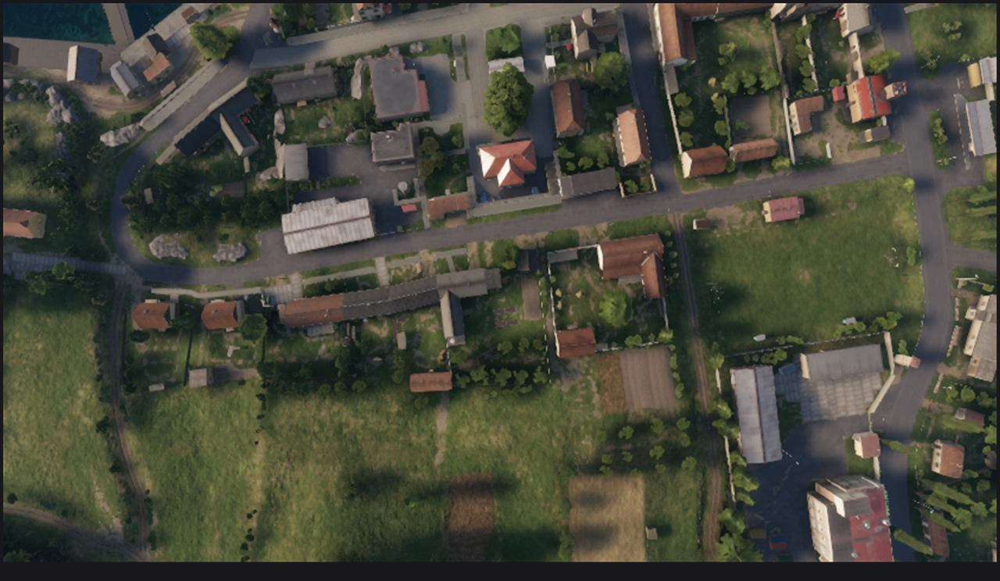
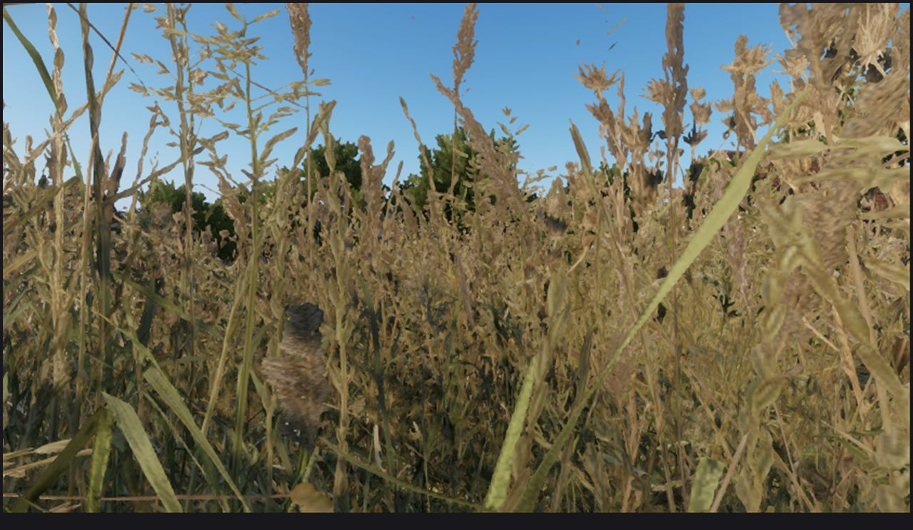
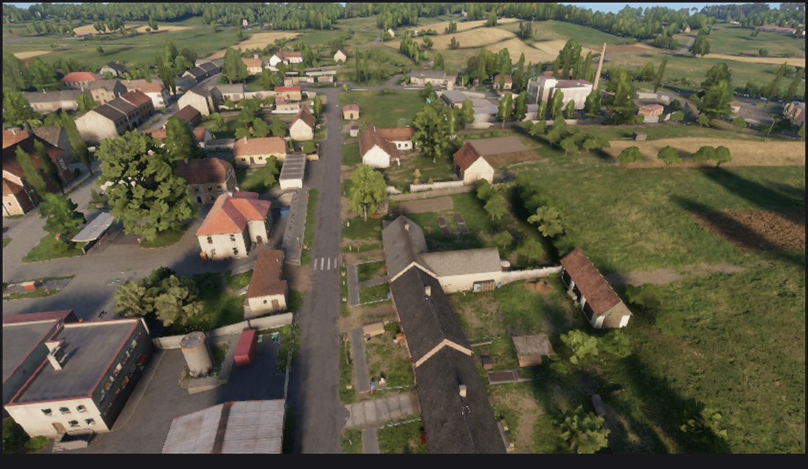
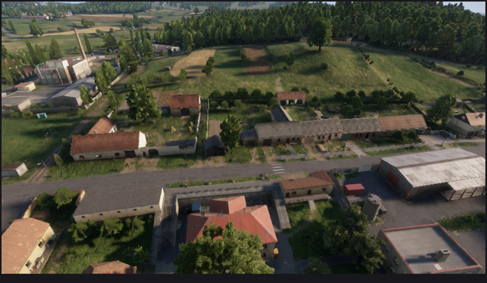
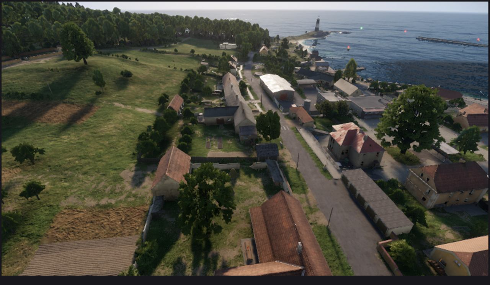
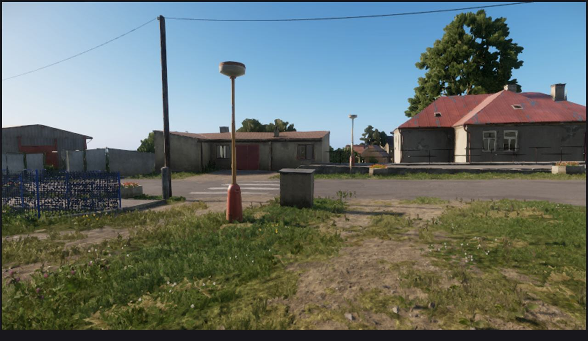
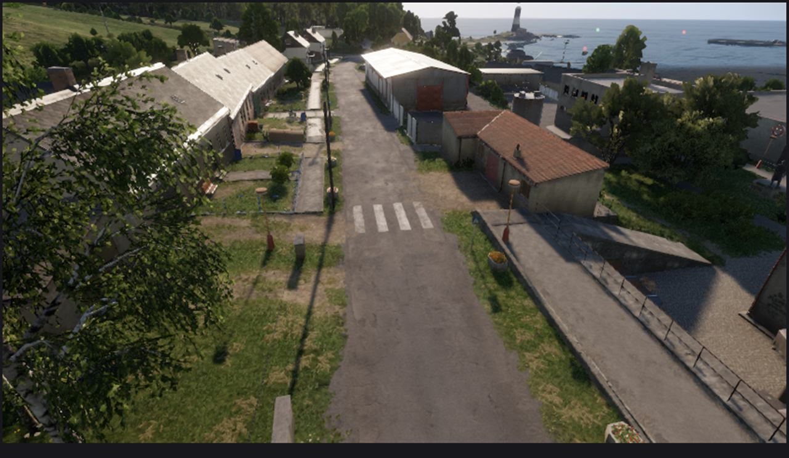
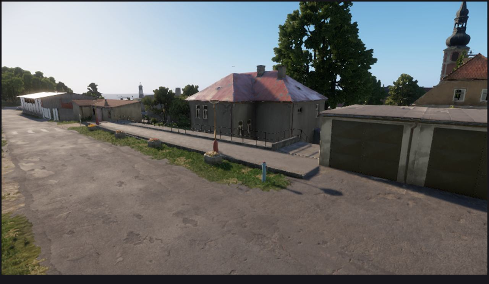
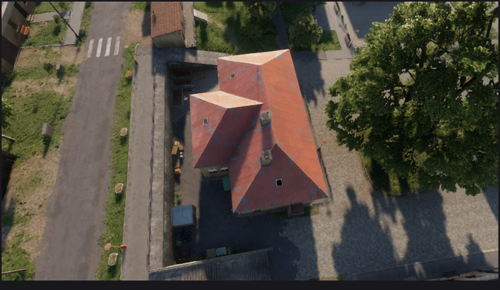

# xz-4415-10600: location dossier

Generated 2026-11-19 by `tools\cli scout`. Do not edit by hand; run `tools\cli scout 4415,10600 --radius 110` to refresh. The machine-readable twin is `dossier.json`.

- **Place:** xz-4415-10600, from coordinates
- **Centre:** x 4415, z 10600, ground 16.6 m; **radius** 110 m
- **World:** Worlds/CoreOnEveron/CoreOnEveron.ent, Arma Reforger build 26266485 (installed 2026-11-08)
- **Other labels nearby:** Saint-Philippe (other, 115 m N); factory (urban, 128 m E); Saint-Philippe (urban, 193 m NE); Coalman's Brow (natural, 263 m S); Spring Pond (aquatic, 273 m E); Charlet Bay (aquatic, 492 m NW); power plant (other, 506 m S); Lighthouse (other, 523 m W)

## At a glance

51 buildings (7 homes, 3 civic, 0 ruins), 27 enterable (a door entity below them), 68 entrances from outside among 168 door entities; 21 road(s), 8 junction(s); 42 notable props; 2167 trees, bushes and other generated vegetation; 6 free plot(s).

| Type | Count |
| --- | --- |
| shed | 18 |
| garage | 8 |
| house | 6 |
| industrial | 5 |
| farm | 4 |
| farm-small | 4 |
| government | 1 |
| industrial-tank | 1 |
| townhouse | 1 |
| shop | 1 |
| kiosk | 1 |
| pub | 1 |

## Overview

## Terrain

- ground 6.8 to 31.1 m (24.3 m of relief) within 110 m; mean 16.9 m
- 39% of the ground is under 3 degrees, 37% 3 to 8, 6% over 15
- overall the ground falls 4 degrees toward the N
- steepest ground 30.6 degrees at 4320, 10650

## Roads and junctions

**Main street:** E-W road r01, 28 buildings within 25 m of it; its busiest stretch is at x 4404.2, z 10620.

| Id | Road | Length in radius (m) | Points |
| --- | --- | --- | --- |
| r01 | E-W road r01 | 232 | 8 |
| r05 | N-S road r05 | 74.6 | 4 |
| r06 | N-S road r06 | 62.6 | 2 |
| r07 | N-S road r07 | 47.7 | 3 |
| r08 | E-W road r08 | 27.7 | 2 |
| r09 | N-S road r09 | 115 | 3 |
| r10 | N-S road r10 | 12 | 2 |
| r11 | N-S road r11 | 26.9 | 2 |
| r12 | N-S road r12 | 26.7 | 6 |
| r13 | N-S road r13 | 26.9 | 4 |
| r14 | N-S road r14 | 26.9 | 7 |
| r15 | N-S road r15 | 27.5 | 2 |
| r16 | N-S road r16 | 27.8 | 6 |
| r17 | N-S road r17 | 27.7 | 6 |
| r18 | N-S road r18 | 19.5 | 5 |
| r19 | N-S road r19 | 19.4 | 5 |
| r20 | N-S road r20 | 11.1 | 2 |
| r21 | NW-SE PolylineShapeEntity r21 | 17.7 | 7 |
| r22 | E-W road r22 | 20 | 2 |
| r23 | E-W road r23 | 12.1 | 2 |
| r24 | E-W road r24 | 12 | 2 |

| x | z | Kind | Arms | Roads |
| --- | --- | --- | --- | --- |
| 4471 | 10547.3 | crossroads | 5 | r11, r12, r13, r14 |
| 4472.9 | 10574.4 | crossroads | 5 | r13, r14, r15, r16 |
| 4490.4 | 10632.2 | crossroads | 4 | r05, r01, r09 |
| 4482.8 | 10547.7 | t-junction | 3 | r15, r16, r17 |
| 4327.2 | 10592.3 | t-junction | 3 | r20, r23, r24 |
| 4312.8 | 10591.8 | t-junction | 3 | r23, r21, r24 |
| 4409.4 | 10661.5 | bend-or-join | 2 | r07, r08 |
| 4481.5 | 10575.1 | bend-or-join | 2 | r16, r15 |

## Civic candidates

Public-facing buildings a town plan would use (church, chapel, government, police, fire, pub, shop, fuel station, hotel, recreation), nearest first. Each links its pictures.

| Id | Type | Vanilla prefab | Distance | Footprint | Floors | Interior | Entrances |
| --- | --- | --- | --- | --- | --- | --- | --- |
| b15 | government | MunicipalOffice_E_01 | 47.7 m N | 24.1 x 17.8 m (429 m2) | 3 | yes | ? |
| b41 | shop | ShopModern_E_01 | 91.5 m NW | 24.4 x 19.8 m (483.1 m2) | 2 | yes | right/SE |
| b51 | pub | PubVillage_E_2L01_V8_ProgresBar | 108.1 m N | 17.9 x 17 m (304.3 m2) | 3 | yes | right/W, back/NW |

### b15 government: MunicipalOffice_E_01

`{363A616E6C64BB7F}Prefabs/Structures/Services/Government/MunicipalOffice_E_01/MunicipalOffice_E_01.et` at x 4418.9, z 10647.5, facing N; footprint 24.1 x 17.8 m; interior yes (catalog: 14 door entities and a walkable floor (3 floors)).

## All buildings

| Id | Type | Vanilla prefab | x | z | Yaw | Facing | Footprint (m) | Floors | Interior | Entrances | Furniture |
| --- | --- | --- | --- | --- | --- | --- | --- | --- | --- | --- | --- |
| b01 | garage | HouseAddon_Garage_E_01 | 4412.2 | 10602.1 | -7 | N | 7 x 8.2 (57.4 m2) | 1 | yes | 3 | - |
| b02 | shed | Door_HouseAddon_Shed_E_R_EXT_COV_02 | 4428.5 | 10605.2 | -4 | N | 1.6 x 0.1 (0.2 m2) | - | no | ? | - |
| b03 | farm | Barn_E_02 | 4426.9 | 10609 | 176 | S | 9.5 x 8.5 (80.8 m2) | 0 | unknown | 4 | - |
| b04 | house | House_Village_E_1L02t | 4399.1 | 10599.3 | 172 | S | 20.6 x 25.6 (527.4 m2) | 2 | yes | 1 | - |
| b05 | shed | Door_HouseAddon_Shed_E_R_EXT_COV_02 | 4425.4 | 10613 | 176 | S | 1.6 x 0.1 (0.2 m2) | - | no | ? | - |
| b06 | shed | Door_HouseAddon_Shed_E_R_EXT_COV_01 | 4426.8 | 10613.1 | -4 | N | 1.7 x 0.1 (0.2 m2) | - | no | ? | - |
| b07 | shed | Door_HouseAddon_Shed_E_L_EXT_COV_01 | 4430.1 | 10613.3 | 176 | S | 1.9 x 0.1 (0.2 m2) | - | no | ? | - |
| b08 | shed | Shed_03_wide | 4441.5 | 10610.4 | 172 | S | 12.3 x 3.9 (48 m2) | 0 | no | - | - |
| b09 | house | House_Village_E_1I04sf_red | 4379.5 | 10595.7 | -13 | N | 21.1 x 11.1 (234.2 m2) | 2 | yes | 7 | - |
| b10 | garage | Workshop_01_Side | 4399.3 | 10632.3 | -9 | N | 5.4 x 5.8 (31.3 m2) | 1 | yes | 1 | - |
| b11 | garage | Workshop_01_Main | 4391 | 10629.9 | -9 | N | 12.2 x 7.6 (92.7 m2) | 1 | yes | 3 | - |
| b12 | farm | Barn_E_01 | 4446.4 | 10576.1 | -7 | N | 15.1 x 10.8 (163.1 m2) | 0 | unknown | 4 | - |
| b13 | farm-small | Henhouse_01 | 4371.3 | 10584.8 | 87 | E | 3.3 x 1.2 (4 m2) | - | no | - | - |
| b14 | garage | Garage_E_01 | 4443.3 | 10638.1 | 170 | S | 4.9 x 9.9 (48.5 m2) | 2 | yes | 2 | - |
| b15 | government | MunicipalOffice_E_01 | 4418.9 | 10647.5 | -8 | N | 24.1 x 17.8 (429 m2) | 3 | yes | ? | - |
| b16 | shed | Shed_03 | 4373.1 | 10576.3 | 85 | E | 6.8 x 3.9 (26.5 m2) | 0 | no | - | - |
| b17 | shed | Door_HouseAddon_Shed_E_R_EXT_COV_02 | 4390.7 | 10557.4 | -3 | N | 1.6 x 0.1 (0.2 m2) | - | no | ? | - |
| b18 | shed | Door_HouseAddon_Shed_E_L_EXT_COV_01 | 4382.8 | 10563.1 | 177 | S | 1.9 x 0.1 (0.2 m2) | - | no | ? | - |
| b19 | farm | Barn_E_03_open | 4385.9 | 10560.2 | 177 | S | 17.8 x 7.3 (129.9 m2) | 2 | yes | 5 | - |
| b20 | shed | Shed_02_line | 4457.4 | 10574.4 | -6 | N | 6.6 x 2.8 (18.5 m2) | 1 | yes | 1 | - |
| b21 | garage | Garage_E_01 | 4447.9 | 10639 | 170 | S | 4.9 x 9.9 (48.5 m2) | 2 | yes | 2 | - |
| b22 | shed | Door_HouseAddon_Shed_E_R_EXT_COV_01 | 4379.4 | 10562.9 | -3 | N | 1.7 x 0.1 (0.2 m2) | - | no | ? | - |
| b23 | shed | Door_HouseAddon_Shed_E_R_EXT_COV_01 | 4383.1 | 10557.1 | 177 | S | 1.7 x 0.1 (0.2 m2) | - | no | ? | - |
| b24 | garage | Garage_E_01 | 4452.4 | 10639.8 | 170 | S | 4.9 x 9.9 (48.5 m2) | 2 | yes | 2 | - |
| b25 | shed | Door_HouseAddon_Shed_E_L_EXT_COV_01 | 4379.7 | 10556.9 | -3 | N | 1.9 x 0.1 (0.2 m2) | - | no | ? | - |
| b26 | house | House_Village_E_1I04sr_green | 4359.4 | 10591.8 | -7 | N | 21.1 x 11.1 (234.2 m2) | 2 | yes | 6 | - |
| b27 | industrial-tank | FuelTank_01_grey | 4373.8 | 10638.8 | 20 | N | 5.2 x 4.6 (23.9 m2) | 1 | no | - | - |
| b28 | house | House_Village_E_1L03t | 4470.2 | 10612.7 | 172 | S | 25.9 x 25.6 (663 m2) | 2 | yes | - | - |
| b29 | garage | Garage_E_01 | 4457.1 | 10640.6 | 170 | S | 4.9 x 9.9 (48.5 m2) | 2 | yes | 2 | - |
| b30 | garage | Garage_E_01 | 4461.8 | 10641.4 | 170 | S | 4.9 x 9.9 (48.5 m2) | 2 | yes | 2 | - |
| b31 | farm-small | Greenhouse_01 | 4348.5 | 10575.6 | -99 | W | 3.8 x 4.2 (16 m2) | 1 | yes | 1 | - |
| b32 | industrial | Office_E_01 | 4368.8 | 10655.9 | 173 | S | 17 x 15 (255 m2) | 3 | yes | 2 | - |
| b33 | farm-small | Henhouse_01 | 4352.9 | 10562.3 | -7 | N | 3.3 x 1.2 (4 m2) | - | no | - | - |
| b34 | industrial | Warehouse_01 | 4343.7 | 10623.2 | -11 | N | 41.3 x 19.2 (793 m2) | 1 | yes | - | - |
| b35 | townhouse | House_Town_E_2I03 | 4444.3 | 10670.6 | -98 | W | 20.3 x 12.6 (255.8 m2) | 3 | yes | 2 | - |
| b36 | house | House_Village_E_1I05t | 4336.2 | 10588.5 | -7 | N | 24.7 x 11.2 (276.6 m2) | 2 | yes | 4 | - |
| b37 | house | House_Village_E_1I02_Furniture | 4473.1 | 10657.8 | 170 | S | 11 x 20.5 (225.5 m2) | 2 | yes | ? | - |
| b38 | industrial | HouseAddon_ShedMetal_01_Long | 4335.8 | 10630.8 | -11 | N | 19 x 4.8 (91.2 m2) | 1 | no | - | - |
| b39 | shed | Shed_03 | 4468.4 | 10670.1 | 168 | S | 6.8 x 3.9 (26.5 m2) | 0 | no | - | - |
| b40 | industrial | PortableCabin_E_01_white | 4501.5 | 10623.6 | 87 | E | 3.8 x 6.4 (24.3 m2) | 2 | yes | 1 | - |
| b41 | shop | ShopModern_E_01 | 4373.5 | 10681.5 | 82 | E | 24.4 x 19.8 (483.1 m2) | 2 | yes | 1 | - |
| b42 | shed | Door_HouseAddon_Shed_E_R_EXT_COV_01 | 4325 | 10583.4 | 173 | S | 1.7 x 0.1 (0.2 m2) | - | no | ? | - |
| b43 | shed | Door_HouseAddon_Shed_E_R_EXT_COV_02 | 4322.8 | 10591.2 | 173 | S | 1.6 x 0.1 (0.2 m2) | - | no | ? | - |
| b44 | shed | HouseAddon_Shed_E_01 | 4322.6 | 10587.1 | -7 | N | 4.9 x 8.5 (41.7 m2) | 0 | unknown | 3 | - |
| b45 | farm-small | Greenhouse_01 | 4347.8 | 10665.1 | -124 | SW | 3.8 x 4.2 (16 m2) | 1 | yes | 1 | - |
| b46 | kiosk | NewspaperBooth_E_01_redwhite | 4437 | 10691.4 | -5 | N | 4.1 x 5 (20.5 m2) | 2 | yes | 1 | - |
| b47 | shed | Door_HouseAddon_Shed_E_L_EXT_COV_01 | 4321.6 | 10583 | -7 | N | 1.9 x 0.1 (0.2 m2) | - | no | ? | - |
| b48 | farm | Barn_E_01 | 4501.3 | 10648.5 | -8 | N | 15.1 x 10.8 (163.1 m2) | 0 | unknown | 4 | - |
| b49 | shed | Shed_02_line | 4456.2 | 10690.3 | 84 | E | 6.6 x 2.8 (18.5 m2) | 1 | yes | 1 | - |
| b50 | industrial | ShedMetal_02_short_nowalls | 4326.9 | 10649.5 | 86 | E | 16.3 x 11.2 (182.6 m2) | 1 | no | ? | - |
| b51 | pub | PubVillage_E_2L01_V8_ProgresBar | 4455.4 | 10700.3 | 172 | S | 17.9 x 17 (304.3 m2) | 3 | yes | 2 | - |

Footprint: `catalog` and `measure` are the model's own extents turned by the yaw; `world-bounds` is the engine's axis-aligned box. Yaw is Enfusion's (0 faces +z north, 90 faces +x east). Interior `yes` means door entities and a walkable floor (a heuristic, not walked); `unknown` means door entities but no walkable floor. Entrances are the doors on the outline; `?` means the building was not found in the engine dump. Furniture is the count of furnishing props inside the footprint where the place file has it.

## Notable props

| Kind | Vanilla prefab | x | z | Distance |
| --- | --- | --- | --- | --- |
| well | Well_02_red | 4417.7 | 10593 | 7.5 m |
| bench | BenchStreet_01_yellow_red | 4398.3 | 10604.6 | 17.3 m |
| bench | BenchStreet_01_red | 4398.6 | 10578.5 | 27.1 m |
| bench | BenchStreet_01_yellow_red | 4382.8 | 10590.6 | 33.5 m |
| well | Well_02_blue | 4382.6 | 10579.9 | 38.1 m |
| well | Well_02_blue | 4456.4 | 10593.8 | 41.9 m |
| market-stand | MarketStand_01 | 4427.8 | 10644.5 | 46.3 m |
| shrine | CalvarySmall_01 | 4460.3 | 10588.3 | 46.8 m |
| bench | BenchWooden_02_Worn | 4462.1 | 10591.4 | 47.9 m |
| bench | BenchStreet_02 | 4407.2 | 10647.4 | 48 m |
| phone-booth | PhoneBooth_E_01 | 4406.3 | 10653 | 53.7 m |
| bench | BenchStreet_01_red | 4358.7 | 10597 | 56.4 m |
| bench | BenchStreet_01_yellow_red | 4358.2 | 10586 | 58.5 m |
| bench | BenchStreet_02 | 4386.7 | 10651.8 | 59 m |
| monument | StatueCharacter_01 | 4389.7 | 10661.5 | 66.5 m |
| bench | BenchStreet_02 | 4396.1 | 10668.2 | 70.8 m |
| bench | BenchStreet_02 | 4387 | 10667.2 | 72.8 m |
| bench | BenchStreet_02 | 4437.7 | 10675.2 | 78.5 m |
| bench | BenchWooden_02_Worn | 4450.3 | 10671.2 | 79.5 m |
| bench | BenchStreet_01_red | 4465.9 | 10663.9 | 81.7 m |
| bench | BenchWooden_02_Worn | 4334.7 | 10581.3 | 82.5 m |
| bench | BenchStreet_01_green | 4332.7 | 10593.6 | 82.6 m |
| bus-shelter | SignBusStop_01 | 4412.7 | 10685.2 | 85.2 m |
| bench | BenchStreet_02 | 4412.9 | 10688.8 | 88.8 m |
| bench | BenchStreet_02 | 4415.3 | 10689.2 | 89.2 m |
| notice-board | MessageBoard_01_filled_V2 | 4395.6 | 10690.5 | 92.6 m |
| bench | BenchWooden_02_Worn | 4461.8 | 10686.1 | 98 m |
| shrine | CalvaryLarge_01 | 4415.5 | 10698.5 | 98.5 m |
| market-stand | MarketStand_01_Umbrella | 4445.2 | 10697.3 | 101.9 m |
| notice-board | MessageBoard_02_filled_V2 | 4518.8 | 10620 | 105.7 m |
| market-stand | MarketStand_01 | 4456.7 | 10697.3 | 105.9 m |

Counted, not listed: 11 street-lamp.

## Free plots

| Id | x | z | Size (m) | Area (m2) | Ground (m) | Nearest road | Nearest building | From centre |
| --- | --- | --- | --- | --- | --- | --- | --- | --- |
| p1 | 4433 | 10535 | 60 x 70 | 4200 | 18.5 to 25.1 | N-S road r11 39.9 m | b12 farm 35.4 m | 67.4 m |
| p2 | 4513 | 10596 | 20 x 44 | 880 | 16.2 to 17.1 | N-S road r09 16.8 m | b40 industrial 27.1 m | 98.1 m |
| p3 | 4354 | 10547 | 66 x 10 | 660 | 18.6 to 22.4 | E-W road r22 45.7 m | b33 farm-small 14.8 m | 80.8 m |
| p4 | 4477 | 10530 | 24 x 24 | 576 | 20.3 to 22.5 | N-S road r13 17.8 m | b20 shed 46.3 m | 93.5 m |
| p5 | 4445 | 10595 | 20 x 22 | 440 | 17.3 to 18.8 | N-S road r19 15.2 m | b12 farm 13.5 m | 30.4 m |
| p6 | 4394 | 10523 | 14 x 30 | 420 | 21.6 to 26.4 | N-S road r18 69.3 m | b19 farm 33.9 m | 79.8 m |

plots are open rectangles at least 10 m on the short side, kept 2.5 m off buildings, 4.5 m off a road's centre line, 2 m off a tree, on ground under 12 degrees; axis aligned, not the best use of the land

## Limits of this dossier

- buildings (types, footprints, floors, interiors) are read from the Everon catalog, docs/everon/catalog-buildings.json; 36 of 51 matched an entity of the engine dump, which adds the door positions, and the other 15 have no entrances listed
- 14 quay, pier and waterworks pieces are counted, not listed

## Prefab references

Every distinct building prefab, as the world file refers to it.

| Prefab | Type | Count |
| --- | --- | --- |
| `{448D2BD96AA205E4}Prefabs/Structures/Houses/Village/HouseAddon_Garage_E_01/HouseAddon_Garage_E_01.et` | garage | 1 |
| `{4B531C06224FA250}Prefabs/Structures/BuildingParts/Doors/Door_HouseAddon_Shed_E_R_EXT_COV_02.et` | shed | 4 |
| `{F5A2DC0597B53E19}Prefabs/Structures/Agriculture/Barn/Barn_E_02/Barn_E_02.et` | farm | 1 |
| `{DE43119351D125AC}Prefabs/Structures/Houses/Village/House_Village_E_1L02/House_Village_E_1L02t.et` | house | 1 |
| `{270728E69E8B2D7E}Prefabs/Structures/BuildingParts/Doors/Door_HouseAddon_Shed_E_R_EXT_COV_01.et` | shed | 4 |
| `{9D6C69116A1DE3B0}Prefabs/Structures/BuildingParts/Doors/Door_HouseAddon_Shed_E_L_EXT_COV_01.et` | shed | 4 |
| `{EF96889E35217E1E}Prefabs/Structures/Houses/Shed/Shed_03/Shed_03_wide.et` | shed | 1 |
| `{4942F5A04C472230}Prefabs/Structures/Houses/Village/House_Village_E_1I04/House_Village_E_1I04sf_red.et` | house | 1 |
| `{F9F2F6D2BD65B719}Prefabs/Structures/Industrial/Houses/Workshop_01/Workshop_01_Side.et` | garage | 1 |
| `{CFF7F6F7042AFFEF}Prefabs/Structures/Industrial/Houses/Workshop_01/Workshop_01_Main.et` | garage | 1 |
| `{99F6E8E52B71B137}Prefabs/Structures/Agriculture/Barn/Barn_E_01/Barn_E_01.et` | farm | 2 |
| `{E005876522A8CE1D}Prefabs/Structures/Agriculture/Henhouse/Henhouse_01/Henhouse_01.et` | farm-small | 2 |
| `{A548C1C5370D0734}Prefabs/Structures/Houses/Garage/Garage_E_01/Garage_E_01.et` | garage | 5 |
| `{363A616E6C64BB7F}Prefabs/Structures/Services/Government/MunicipalOffice_E_01/MunicipalOffice_E_01.et` | government | 1 |
| `{8597237EA3C59701}Prefabs/Structures/Houses/Shed/Shed_03/Shed_03.et` | shed | 2 |
| `{66F1A0049CC2F5BD}Prefabs/Structures/Agriculture/Barn/Barn_E_03/Barn_E_03_open.et` | farm | 1 |
| `{24BA2E136E8815C2}Prefabs/Structures/Houses/Shed/Shed_02/Shed_02_line.et` | shed | 2 |
| `{5D91774D9139FF87}Prefabs/Structures/Houses/Village/House_Village_E_1I04/House_Village_E_1I04sr_green.et` | house | 1 |
| `{389D6DF9941FF22D}Prefabs/Structures/Industrial/Containers/FuelTanks/FuelTank_01/FuelTank_01_grey.et` | industrial-tank | 1 |
| `{B2172573ED15AA82}Prefabs/Structures/Houses/Village/House_Village_E_1L03/House_Village_E_1L03t.et` | house | 1 |
| `{3299E6F34CE40185}Prefabs/Structures/Agriculture/Greenhouse/Greenhouse_01/Greenhouse_01.et` | farm-small | 2 |
| `{51F233A0BA73532A}Prefabs/Structures/Industrial/Houses/Office_E_01/Office_E_01.et` | industrial | 1 |
| `{12310677867A85D4}Prefabs/Structures/Industrial/Houses/Warehouse_01/Warehouse_01.et` | industrial | 1 |
| `{E7EC0E80F0645DFE}Prefabs/Structures/Houses/Town/House_Town_E_2I03/House_Town_E_2I03.et` | townhouse | 1 |
| `{6ABF4CB2949CB4DE}Prefabs/Structures/Houses/Village/House_Village_E_1I05/House_Village_E_1I05t.et` | house | 1 |
| `{1F0A3A2A077ED92F}Prefabs/Structures/Houses/Village/House_Village_E_1I02/Furniture/House_Village_E_1I02_Furniture.et` | house | 1 |
| `{EBD26252635EDDCE}Prefabs/Structures/Industrial/Houses/HouseAddon_ShedMetal_01/HouseAddon_ShedMetal_01_Long.et` | industrial | 1 |
| `{D445D04331B6809E}Prefabs/Structures/Industrial/Houses/PortableCabin_E_01/PortableCabin_E_01_white.et` | industrial | 1 |
| `{CFE8511B2B7E8AAA}Prefabs/Structures/Commercial/Shops/ShopModern_E_01/ShopModern_E_01.et` | shop | 1 |
| `{325991D9993FA95B}Prefabs/Structures/Houses/Village/HouseAddon_Shed_E_01/HouseAddon_Shed_E_01.et` | shed | 1 |
| `{B0C7B3A0C937328B}Prefabs/Structures/Commercial/Booth/NewspaperBooth_E_01/NewspaperBooth_E_01_redwhite.et` | kiosk | 1 |
| `{DEBC2FB8DA61B83E}Prefabs/Structures/Industrial/Sheds/ShedMetal_02/ShedMetal_02_short_nowalls.et` | industrial | 1 |
| `{965AFAD159CB0C8A}Prefabs/Structures/Commercial/Pubs/PubVillage_E_2L01/PubVillage_E_2L01_V8_ProgresBar.et` | pub | 1 |
