# xz-4480-10715: location dossier

Generated 2026-11-17 by `tools\cli scout`. Do not edit by hand; run `tools\cli scout 4480,10715 --radius 170` to refresh. The machine-readable twin is `dossier.json`.

- **Place:** xz-4480-10715, from coordinates
- **Centre:** x 4480, z 10715, ground 13.6 m; **radius** 170 m
- **World:** Worlds/CoreOnEveron/CoreOnEveron.ent, Arma Reforger build 26266485 (installed 2026-11-07)
- **Other labels nearby:** Saint-Philippe (other, 52 m W); Saint-Philippe (urban, 61 m N); factory (urban, 164 m S); Spring Pond (aquatic, 285 m SE); Coalman's Brow (natural, 393 m S); Charlet Bay (aquatic, 474 m NW); GALLOW'S HILL (natural, 537 m SE); Lighthouse (other, 562 m W)

## At a glance

128 buildings (36 homes, 16 civic, 1 ruins), 90 enterable (a door entity below them), 212 entrances from outside among 639 door entities; 56 road(s), 26 junction(s); 148 notable props; 8832 trees, bushes and other generated vegetation; 4 free plot(s).

| Type | Count |
| --- | --- |
| shed | 27 |
| house | 25 |
| garage | 17 |
| farm-small | 16 |
| townhouse | 10 |
| industrial | 6 |
| shop | 5 |
| farm | 5 |
| church | 2 |
| kiosk | 2 |
| government | 2 |
| fire | 2 |
| industrial-tank | 2 |
| fuel | 2 |
| ruin | 1 |
| pub | 1 |
| police | 1 |
| villa | 1 |
| chapel | 1 |

## Overview

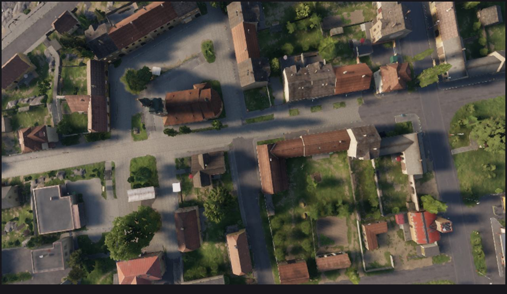

## Terrain

- ground 0 to 22.7 m (22.7 m of relief) within 170 m; mean 13.7 m
- 48% of the ground is under 3 degrees, 34% 3 to 8, 6% over 15
- overall the ground falls 2.8 degrees toward the NW
- steepest ground 34.6 degrees at 4430, 10810
- the sea is 162.6 m away to the NW

## Roads and junctions

**Main street:** NW-SE road r02, 39 buildings within 25 m of it; its busiest stretch is at x 4432.7, z 10624.

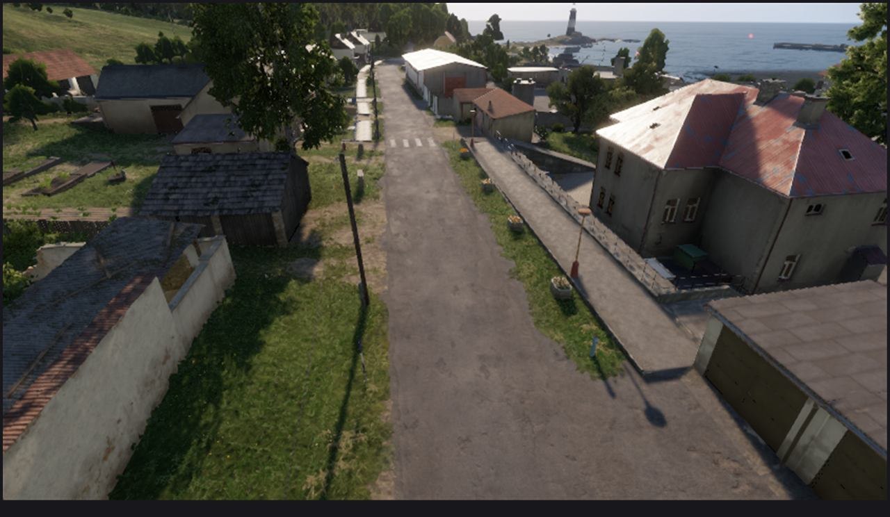

| Id | Road | Length in radius (m) | Points |
| --- | --- | --- | --- |
| r01 | E-W road r01 | 35.7 | 3 |
| r02 | NW-SE road r02 | 481.1 | 14 |
| r03 | N-S road r03 | 57 | 3 |
| r04 | E-W road r04 | 109.4 | 5 |
| r05 | E-W road r05 | 247.5 | 9 |
| r06 | N-S road r06 | 301.3 | 5 |
| r07 | E-W road r07 | 48.7 | 3 |
| r09 | N-S road r09 | 8.2 | 2 |
| r10 | N-S road r10 | 32.4 | 7 |
| r11 | E-W road r11 | 14 | 4 |
| r12 | E-W road r12 | 13.7 | 4 |
| r13 | E-W road r13 | 25.8 | 6 |
| r14 | E-W road r14 | 25.8 | 6 |
| r15 | E-W road r15 | 52 | 14 |
| r16 | N-S road r16 | 49.9 | 6 |
| r17 | E-W road r17 | 41.5 | 2 |
| r18 | E-W road r18 | 25.8 | 6 |
| r19 | E-W road r19 | 25.8 | 6 |
| r20 | N-S road r20 | 3.9 | 2 |
| r21 | N-S road r21 | 3.8 | 2 |
| r22 | N-S road r22 | 4.1 | 2 |
| r23 | N-S road r23 | 99.3 | 7 |
| r24 | NE-SW road r24 | 97.6 | 7 |
| r25 | E-W PolylineShapeEntity r25 | 130.3 | 11 |
| r26 | E-W road r26 | 9.3 | 2 |
| r27 | E-W road r27 | 9.3 | 2 |
| r28 | E-W road r28 | 19.8 | 2 |
| r29 | E-W road r29 | 19.9 | 2 |
| r30 | E-W road r30 | 19.9 | 2 |
| r31 | E-W road r31 | 19.6 | 2 |
| r32 | E-W road r32 | 19.3 | 2 |
| r33 | N-S road r33 | 90.5 | 5 |
| r34 | N-S road r34 | 62.6 | 2 |
| r35 | N-S road r35 | 47.7 | 3 |
| r36 | E-W road r36 | 27.7 | 2 |
| r37 | N-S road r37 | 115 | 3 |
| r38 | N-S road r38 | 11.9 | 2 |
| r39 | N-S road r39 | 13.1 | 2 |
| r40 | N-S road r40 | 29.7 | 2 |
| r41 | N-S road r41 | 28.1 | 2 |
| r42 | N-S road r42 | 25.9 | 2 |
| r43 | N-S road r43 | 29.8 | 2 |
| r44 | E-W road r44 | 14.4 | 2 |
| r45 | E-W road r45 | 10.5 | 2 |
| r47 | N-S road r47 | 12.7 | 2 |
| r48 | N-S road r48 | 14.9 | 2 |
| r50 | N-S road r50 | 12 | 2 |
| r51 | N-S road r51 | 26.9 | 2 |
| r52 | N-S road r52 | 26.7 | 6 |
| r53 | N-S road r53 | 26.9 | 4 |
| r54 | N-S road r54 | 26.9 | 7 |
| r55 | N-S road r55 | 27.5 | 2 |
| r56 | N-S road r56 | 27.8 | 6 |
| r57 | N-S road r57 | 27.7 | 6 |
| r58 | N-S road r58 | 19.5 | 5 |
| r59 | N-S road r59 | 19.4 | 5 |

| x | z | Kind | Arms | Roads |
| --- | --- | --- | --- | --- |
| 4576.6 | 10736.7 | crossroads | 6 | r04, r06, r17, r15, r16 |
| 4555.8 | 10847.9 | crossroads | 5 | r07, r06, r10 |
| 4471 | 10547.3 | crossroads | 5 | r51, r52, r53, r54 |
| 4472.9 | 10574.4 | crossroads | 5 | r53, r54, r55, r56 |
| 4310.9 | 10697.4 | crossroads | 4 | r02, r05 |
| 4490.4 | 10632.2 | crossroads | 4 | r33, r02, r37 |
| 4470.3 | 10720.3 | crossroads | 4 | r23, r05, r33 |
| 4405.4 | 10710.8 | crossroads | 4 | r05, r24, r35 |
| 4552.7 | 10860.8 | crossroads | 4 | r06, r10 |
| 4542.8 | 10561.5 | crossroads | 4 | r44, r43, r45 |
| 4591.3 | 10649.4 | t-junction | 3 | r02, r06 |
| 4628.1 | 10745.2 | t-junction | 3 | r15, r04 |
| 4427.5 | 10712.4 | t-junction | 3 | r34, r05 |
| 4555.1 | 10837.8 | t-junction | 3 | r10, r06 |
| 4569 | 10791.2 | t-junction | 3 | r16, r06 |
| 4482.8 | 10547.7 | t-junction | 3 | r55, r56, r57 |
| 4536.9 | 10730.6 | bend-or-join | 2 | r05, r17 |
| 4560.8 | 10864.5 | bend-or-join | 2 | r09, r10 |
| 4486.3 | 10858.5 | bend-or-join | 2 | r11, r12 |
| 4413.9 | 10865.5 | bend-or-join | 2 | r13, r14 |
| 4389 | 10858.6 | bend-or-join | 2 | r13, r14 |
| 4516.9 | 10776.3 | bend-or-join | 2 | r18, r19 |
| 4542.3 | 10781.3 | bend-or-join | 2 | r18, r19 |
| 4533.4 | 10672.6 | bend-or-join | 2 | r29, r30 |
| 4409.4 | 10661.5 | bend-or-join | 2 | r35, r36 |
| 4481.5 | 10575.1 | bend-or-join | 2 | r56, r55 |

## Civic candidates

Public-facing buildings a town plan would use (church, chapel, government, police, fire, pub, shop, fuel station, hotel, recreation), nearest first. Each links its pictures.

| Id | Type | Vanilla prefab | Distance | Footprint | Floors | Interior | Entrances |
| --- | --- | --- | --- | --- | --- | --- | --- |
| b03 | pub | PubVillage_E_2L01_V8_ProgresBar | 28.7 m SW | 17.9 x 17 m (304.3 m2) | 3 | yes | right/W, back/NW |
| b07 | church | Church_01_red | 36.7 m NW | 20 x 33.8 m (676 m2) | 2 | yes | front/W, front/W, right/N |
| b08 | church | Church_01_crypt_attic | 36.7 m NW | 16.5 x 28 m (462 m2) | 1 | no | ? |
| b12 | shop | ShopHouse_E_2I01t_householdwares | 47 m NE | 12.4 x 16.8 m (208.3 m2) | 3 | yes | front/SE, front/SE, left/NE, back/NW |
| b32 | police | Villa_E_2I01_Police | 79.9 m NE | 15.3 x 12.7 m (194.3 m2) | 5 | yes | back/N |
| b38 | shop | ShopHouse_E_2I01t_clothesstore | 83.3 m NW | 12.4 x 16.8 m (208.3 m2) | 3 | yes | front/SE, front/SE, left/N, back/NW |
| b45 | government | MunicipalOffice_E_01 | 91 m SW | 24.1 x 17.8 m (429 m2) | 3 | yes | ? |
| b48 | shop | ShopHouse_E_2I01t_drugstore | 93.8 m NE | 12.4 x 16.8 m (208.3 m2) | 3 | yes | front/NE, front/NE, left/NW, back/SW |
| b58 | fire | FireStation_E_01 | 101.3 m SE | 15.9 x 15.7 m (249.6 m2) | 4 | yes | front/E, front/E, back/W, left/N |
| b62 | fire | FireStation_E_01_hose_hanger | 103.8 m E | 0.6 x 2 m (1.2 m2) | 0 | no | ? |
| b66 | shop | ShopModern_E_01 | 111.6 m W | 24.4 x 19.8 m (483.1 m2) | 2 | yes | right/SE |
| b88 | shop | ShopHouse_E_2I01t_drugstore | 135.5 m N | 12.4 x 16.8 m (208.3 m2) | 3 | yes | front/NE, front/NE, left/NW, back/SW |
| b97 | fuel | FuelStation_E_01_building_small | 143 m E | 4.8 x 3.7 m (17.8 m2) | 2 | yes | front/SW |
| b107 | fuel | FuelStation_E_01_building | 147.7 m E | 10.9 x 5.5 m (60 m2) | 2 | yes | right/N |
| b109 | government | MunicipalOffice_E_01_school | 152.5 m NE | 24.1 x 17.8 m (429 m2) | 3 | yes | - |
| b122 | chapel | Chapel_01_base | 165.8 m W | 4.7 x 4.7 m (22.1 m2) | 1 | yes | front/W |

### b03 pub: PubVillage_E_2L01_V8_ProgresBar

`{965AFAD159CB0C8A}Prefabs/Structures/Commercial/Pubs/PubVillage_E_2L01/PubVillage_E_2L01_V8_ProgresBar.et` at x 4455.4, z 10700.3, facing S; footprint 17.9 x 17 m; interior yes (catalog: 10 door entities and a walkable floor (3 floors)).

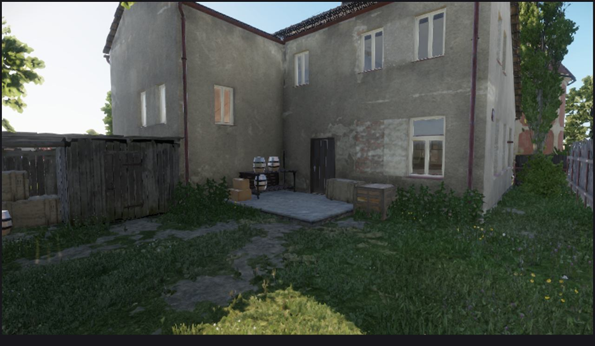

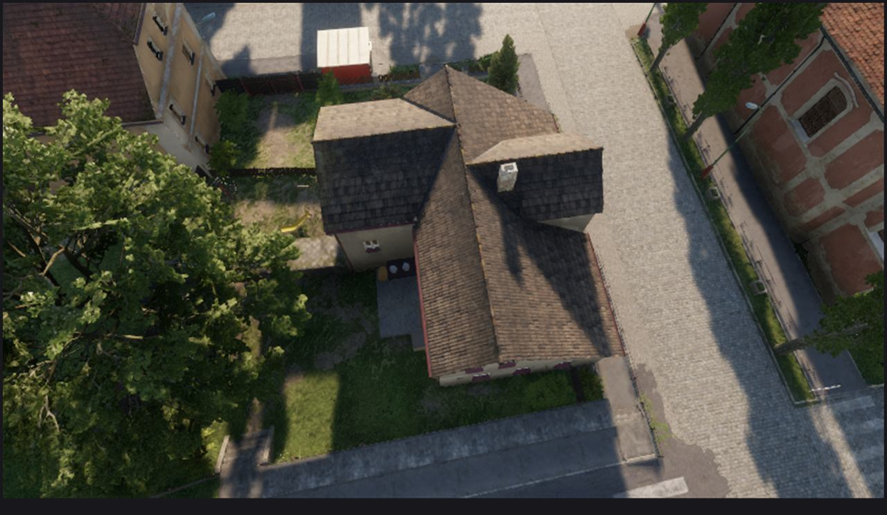

### b07 church: Church_01_red

`{D645C54FF0E4D55E}Prefabs/Structures/Cultural/Churches/Church_01/Church_01_red.et` at x 4448.4, z 10733.6, facing W; footprint 20 x 33.8 m; interior yes (catalog: 11 door entities and a walkable floor (2 floors)).

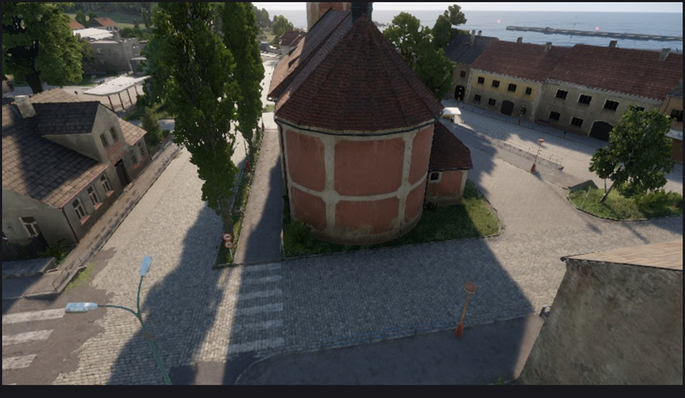

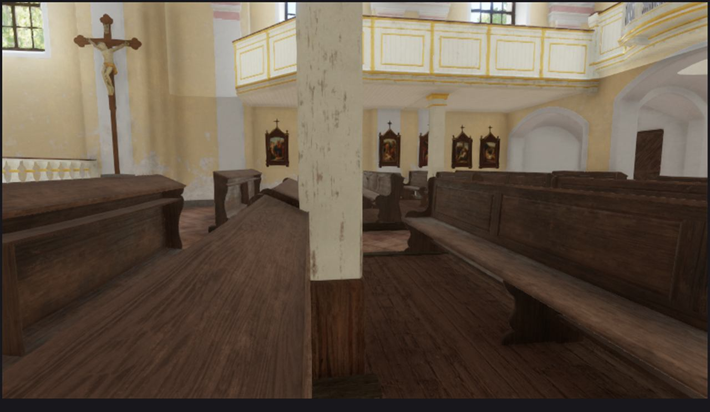

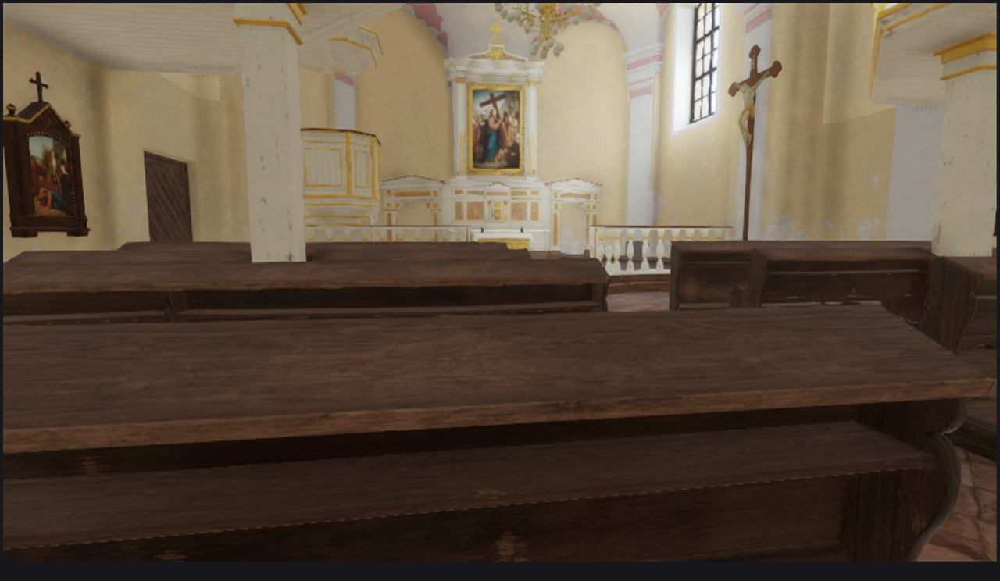

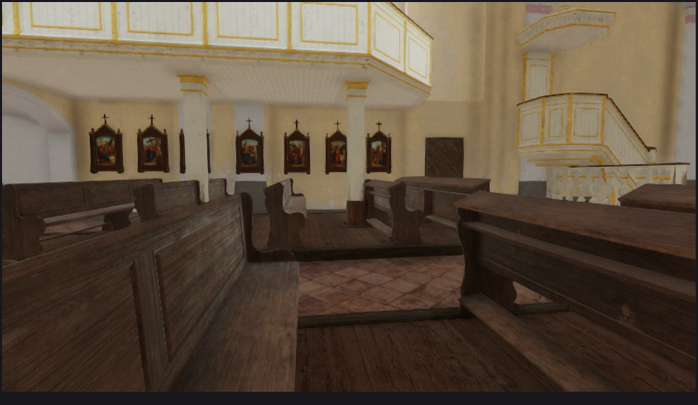

### b12 shop: ShopHouse_E_2I01t_householdwares

`{F51B9B9BD15BBE64}Prefabs/Structures/Commercial/Shops/ShopHouse_E_2l01/ShopHouse_E_2I01t_householdwares.et` at x 4515.3, z 10746.1, facing S; footprint 12.4 x 16.8 m; interior yes (catalog: 12 door entities and a walkable floor (3 floors)).

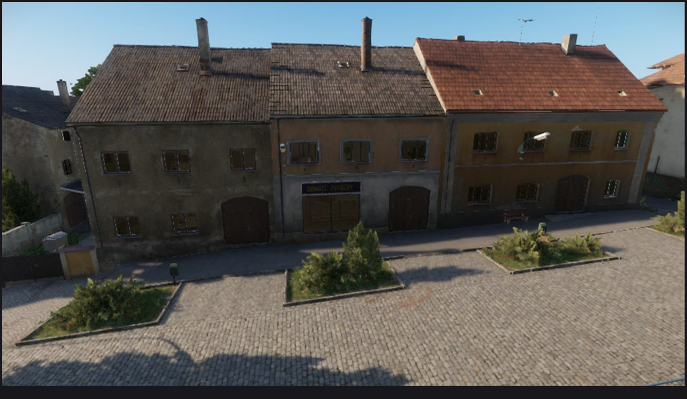

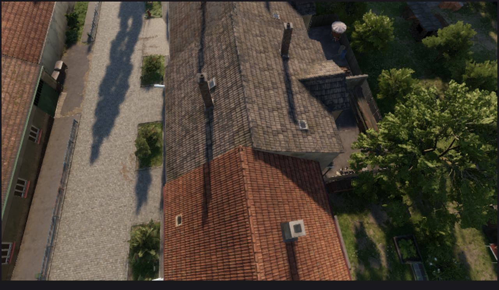

### b32 police: Villa_E_2I01_Police

`{151CFDB2968ADB77}Prefabs/Structures/Houses/Villa/Villa_E_2I01/Villa_E_2I01_Police.et` at x 4552.6, z 10748.3, facing S; footprint 15.3 x 12.7 m; interior yes (catalog: 8 door entities and a walkable floor (5 floors)).

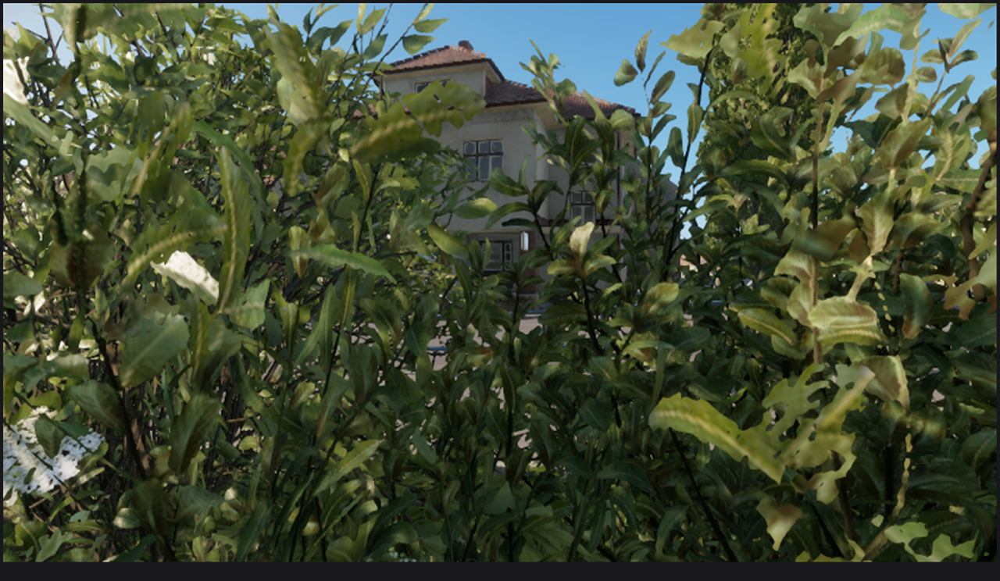

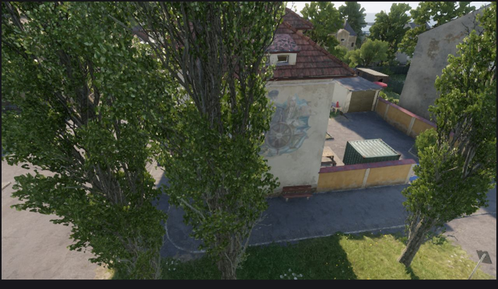

### b38 shop: ShopHouse_E_2I01t_clothesstore

`{92E8F78BCF17D93D}Prefabs/Structures/Commercial/Shops/ShopHouse_E_2l01/ShopHouse_E_2I01t_clothesstore.et` at x 4441.4, z 10788.8, facing SE; footprint 12.4 x 16.8 m; interior yes (catalog: 12 door entities and a walkable floor (3 floors)).

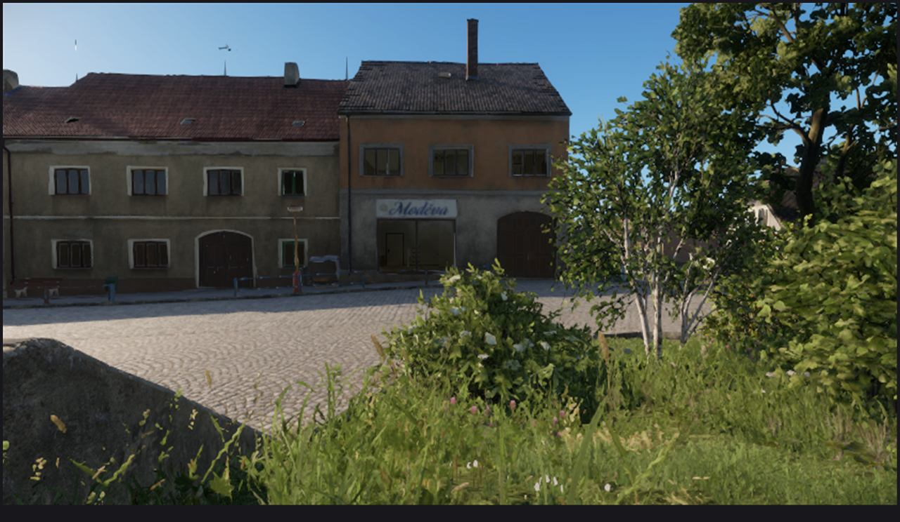

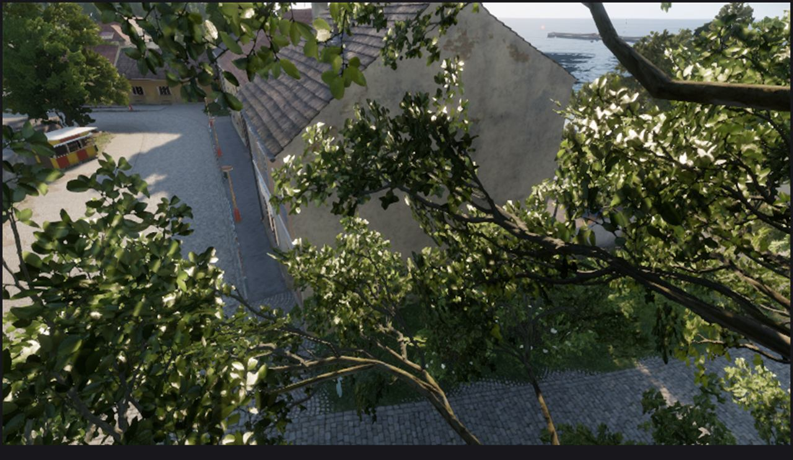

### b45 government: MunicipalOffice_E_01

`{363A616E6C64BB7F}Prefabs/Structures/Services/Government/MunicipalOffice_E_01/MunicipalOffice_E_01.et` at x 4418.9, z 10647.5, facing N; footprint 24.1 x 17.8 m; interior yes (catalog: 14 door entities and a walkable floor (3 floors)).

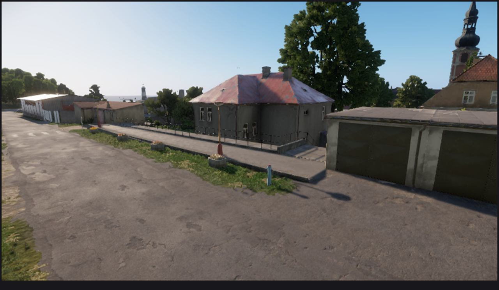

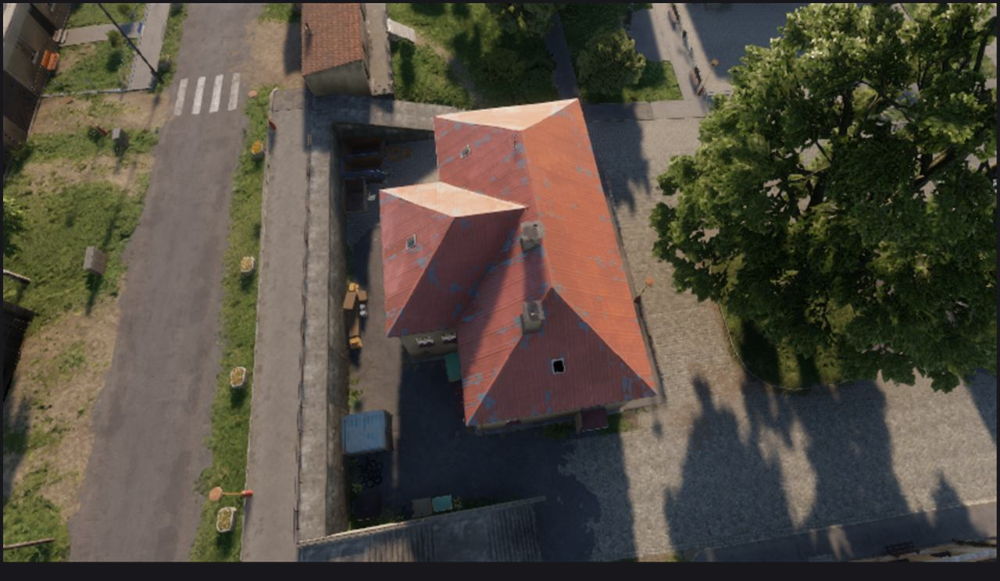

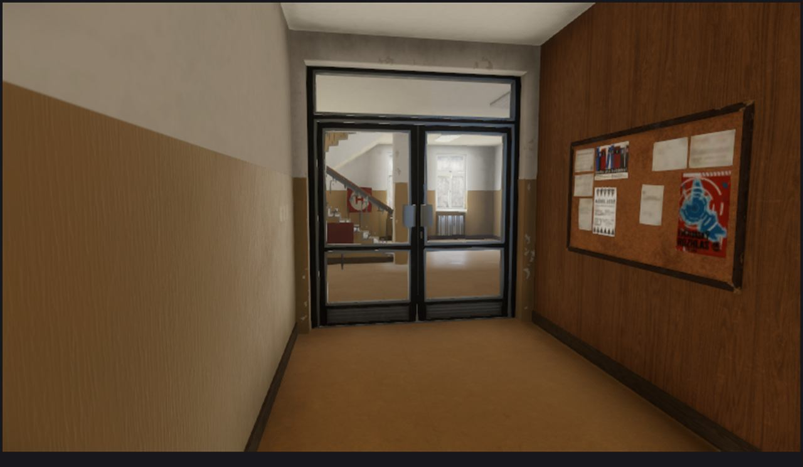

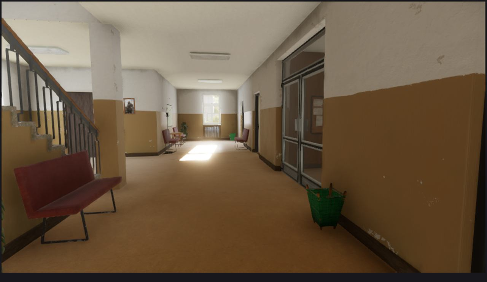

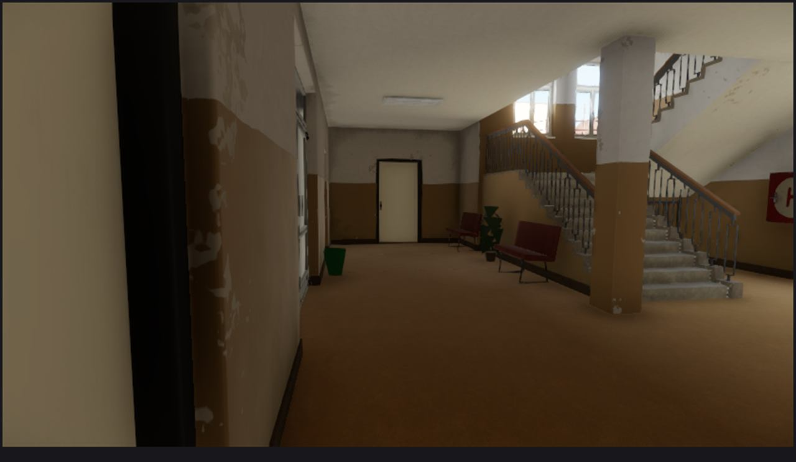

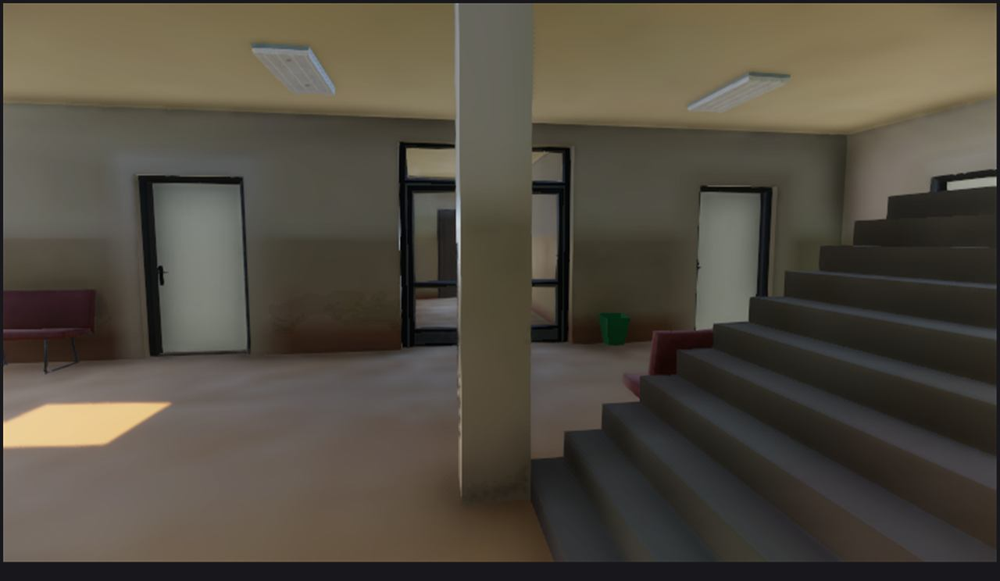

## All buildings

| Id | Type | Vanilla prefab | x | z | Yaw | Facing | Footprint (m) | Floors | Interior | Entrances | Furniture |
| --- | --- | --- | --- | --- | --- | --- | --- | --- | --- | --- | --- |
| b01 | house | House_Village_E_1L03t | 4488.3 | 10702.3 | 82 | E | 25.9 x 25.6 (663 m2) | 2 | yes | - | 209 |
| b02 | ruin | HouseRuin_01_WoodPile | 4484.9 | 10742.4 | -13 | N | 5.5 x 4.9 (27 m2) | 0 | no | - | 1 |
| b03 | pub | PubVillage_E_2L01_V8_ProgresBar | 4455.4 | 10700.3 | 172 | S | 17.9 x 17 (304.3 m2) | 3 | yes | 2 | 263 |
| b04 | shed | Shed_03_wide | 4488.9 | 10683.1 | 80 | E | 12.3 x 3.9 (48 m2) | 0 | no | - | 11 |
| b05 | shed | Shed_02_line | 4456.2 | 10690.3 | 84 | E | 6.6 x 2.8 (18.5 m2) | 1 | yes | 1 | 5 |
| b06 | townhouse | House_Town_E_2I01 | 4480.3 | 10750.7 | -100 | W | 12.4 x 16.8 (208.3 m2) | 3 | yes | 3 | 200 |
| b07 | church | Church_01_red | 4448.4 | 10733.6 | -98 | W | 20 x 33.8 (676 m2) | 2 | yes | 3 | 66 |
| b08 | church | Church_01_crypt_attic | 4448.4 | 10733.6 | -98 | W | 16.5 x 28 (462 m2) | 1 | no | ? | 61 |
| b09 | townhouse | House_Town_E_2I01 | 4503.5 | 10744.6 | 171 | S | 12.4 x 16.8 (208.3 m2) | 3 | yes | 3 | 201 |
| b10 | house | House_Village_E_1I05t | 4518.5 | 10715.1 | -8 | N | 24.7 x 11.2 (276.6 m2) | 2 | yes | 4 | 148 |
| b11 | shed | Shed_03 | 4468.4 | 10670.1 | 168 | S | 6.8 x 3.9 (26.5 m2) | 0 | no | - | 1 |
| b12 | shop | ShopHouse_E_2I01t_householdwares | 4515.3 | 10746.1 | 171 | S | 12.4 x 16.8 (208.3 m2) | 3 | yes | 4 | 121 |
| b13 | kiosk | NewspaperBooth_E_01_redwhite | 4437 | 10691.4 | -5 | N | 4.1 x 5 (20.5 m2) | 2 | yes | 1 | 0 |
| b14 | townhouse | House_Town_E_2I02 | 4476 | 10765.4 | -100 | W | 18.5 x 13.4 (247.9 m2) | 3 | yes | 4 | 257 |
| b15 | townhouse | House_Town_E_2I03 | 4444.3 | 10670.6 | -98 | W | 20.3 x 12.6 (255.8 m2) | 3 | yes | 2 | 250 |
| b16 | townhouse | House_Town_E_2I01 | 4537.5 | 10715.3 | -8 | N | 12.4 x 16.8 (208.3 m2) | 3 | yes | 3 | 201 |
| b17 | house | House_Village_E_1I02_Furniture | 4473.1 | 10657.8 | 170 | S | 11 x 20.5 (225.5 m2) | 2 | yes | ? | 141 |
| b18 | townhouse | House_Town_E_2I02 | 4530.5 | 10746.9 | 171 | S | 18.5 x 13.4 (247.9 m2) | 3 | yes | 4 | 255 |
| b19 | shed | Shed_02_big_V2 | 4492.7 | 10775.8 | 167 | S | 7 x 3.7 (25.9 m2) | 2 | yes | 1 | 3 |
| b20 | townhouse | House_Town_E_2I01_orange | 4474.5 | 10780.5 | -100 | W | 12.4 x 16.8 (208.3 m2) | 3 | yes | 3 | 202 |
| b21 | kiosk | NewspaperBooth_E_01_redyellow | 4424.9 | 10753.7 | 100 | E | 4.1 x 5 (20.5 m2) | 2 | yes | 1 | 0 |
| b22 | farm-small | Henhouse_01 | 4518.5 | 10772.4 | 83 | E | 3.3 x 1.2 (4 m2) | - | no | - | - |
| b23 | farm | Barn_E_01 | 4501.3 | 10648.5 | -8 | N | 15.1 x 10.8 (163.1 m2) | 0 | unknown | 4 | 31 |
| b24 | shed | Shed_02_big_V1 | 4525.9 | 10773.1 | 169 | S | 6.5 x 3.7 (24.1 m2) | 2 | yes | 2 | 0 |
| b25 | farm | Barn_E_03_closed | 4522.5 | 10653.2 | 171 | S | 17.8 x 7.3 (129.9 m2) | 2 | yes | 4 | 23 |
| b26 | shed | Door_HouseAddon_Shed_E_L_EXT_COV_01 | 4516.6 | 10649.3 | -9 | N | 1.9 x 0.1 (0.2 m2) | - | no | ? | - |
| b27 | garage | Garage_E_01 | 4461.8 | 10641.4 | 170 | S | 4.9 x 9.9 (48.5 m2) | 2 | yes | 2 | 5 |
| b28 | shed | Door_HouseAddon_Shed_E_R_EXT_COV_01 | 4520 | 10649.8 | 171 | S | 1.7 x 0.1 (0.2 m2) | - | no | ? | - |
| b29 | garage | Garage_E_01 | 4540.4 | 10762.9 | 80 | E | 4.9 x 9.9 (48.5 m2) | 2 | yes | 2 | 5 |
| b30 | garage | Garage_E_01 | 4457.1 | 10640.6 | 170 | S | 4.9 x 9.9 (48.5 m2) | 2 | yes | 2 | 5 |
| b31 | shed | Door_HouseAddon_Shed_E_R_EXT_COV_02 | 4527.6 | 10650.9 | -9 | N | 1.6 x 0.1 (0.2 m2) | - | no | ? | - |
| b32 | police | Villa_E_2I01_Police | 4552.6 | 10748.3 | 171 | S | 15.3 x 12.7 (194.3 m2) | 5 | yes | 1 | 218 |
| b33 | garage | Workshop_01_Main | 4546.2 | 10670 | -11 | N | 12.2 x 7.6 (92.7 m2) | 1 | yes | 3 | 36 |
| b34 | garage | Garage_E_01 | 4452.4 | 10639.8 | 170 | S | 4.9 x 9.9 (48.5 m2) | 2 | yes | 2 | 5 |
| b35 | farm-small | Henhouse_01 | 4551.4 | 10678 | -9 | N | 3.3 x 1.2 (4 m2) | - | no | - | - |
| b36 | garage | Workshop_01_Side | 4544.2 | 10663.2 | -101 | W | 5.4 x 5.8 (31.3 m2) | 1 | yes | 1 | 17 |
| b37 | garage | Garage_E_01 | 4447.9 | 10639 | 170 | S | 4.9 x 9.9 (48.5 m2) | 2 | yes | 2 | 5 |
| b38 | shop | ShopHouse_E_2I01t_clothesstore | 4441.4 | 10788.8 | 153 | SE | 12.4 x 16.8 (208.3 m2) | 3 | yes | 4 | 92 |
| b39 | townhouse | House_Town_E_2I02_v2 | 4427.8 | 10781.8 | 152 | SE | 18.5 x 13.4 (247.9 m2) | 3 | yes | 4 | 256 |
| b40 | house | House_Village_E_1L02t | 4564.8 | 10709.7 | -99 | W | 20.6 x 25.6 (527.4 m2) | 2 | yes | 1 | 131 |
| b41 | garage | Garage_E_01 | 4443.3 | 10638.1 | 170 | S | 4.9 x 9.9 (48.5 m2) | 2 | yes | 2 | 5 |
| b42 | shed | Shed_02_small | 4495.9 | 10799.6 | -10 | N | 3.5 x 2.6 (9.1 m2) | 1 | yes | 1 | 0 |
| b43 | townhouse | House_Town_E_2I02_yellow | 4411.6 | 10773.4 | 152 | SE | 18.5 x 13.4 (247.9 m2) | 3 | yes | 4 | 254 |
| b44 | house | House_Village_E_1L01_Furniture | 4391.5 | 10732.5 | 179 | S | 20.2 x 19.3 (389.9 m2) | 2 | yes | ? | 152 |
| b45 | government | MunicipalOffice_E_01 | 4418.9 | 10647.5 | -8 | N | 24.1 x 17.8 (429 m2) | 3 | yes | ? | 217 |
| b46 | shed | Shed_02_square | 4565.1 | 10682.5 | -100 | W | 4.4 x 3.7 (16.3 m2) | 2 | yes | 1 | 0 |
| b47 | house | House_Village_E_1I06 | 4471.3 | 10806.1 | -14 | N | 18.3 x 14 (256.2 m2) | 2 | yes | 1 | 162 |
| b48 | shop | ShopHouse_E_2I01t_drugstore | 4552.9 | 10774.1 | 80 | E | 12.4 x 16.8 (208.3 m2) | 3 | yes | 4 | 110 |
| b49 | industrial | PortableCabin_E_01_white | 4501.5 | 10623.6 | 87 | E | 3.8 x 6.4 (24.3 m2) | 2 | yes | 1 | 6 |
| b50 | house | House_Village_E_1I08t | 4391.2 | 10749.1 | -91 | W | 18.9 x 10.2 (192.8 m2) | 3 | yes | 5 | 112 |
| b51 | shed | Shed_02_big_V2 | 4532.2 | 10794.6 | 171 | S | 7 x 3.7 (25.9 m2) | 2 | yes | 1 | 4 |
| b52 | farm-small | Greenhouse_01 | 4527.8 | 10797.9 | -10 | N | 3.8 x 4.2 (16 m2) | 1 | yes | 1 | 0 |
| b53 | shed | Shed_03_wide | 4508.6 | 10806.7 | -96 | W | 12.3 x 3.9 (48 m2) | 0 | no | - | 7 |
| b54 | farm-small | Henhouse_01 | 4471.1 | 10811.2 | -12 | N | 3.3 x 1.2 (4 m2) | - | no | - | - |
| b55 | townhouse | House_Town_E_2I01 | 4397.5 | 10767.8 | 153 | SE | 12.4 x 16.8 (208.3 m2) | 3 | yes | 3 | 202 |
| b56 | farm-small | Greenhouse_01 | 4416 | 10789.8 | 63 | NE | 3.8 x 4.2 (16 m2) | 1 | yes | 1 | 0 |
| b57 | farm-small | Henhouse_01 | 4427.9 | 10800.2 | 157 | SE | 3.3 x 1.2 (4 m2) | - | no | - | - |
| b58 | fire | FireStation_E_01 | 4572.5 | 10673.6 | 79 | E | 15.9 x 15.7 (249.6 m2) | 4 | yes | 4 | 89 |
| b59 | garage | Workshop_02 | 4535.4 | 10629.6 | -99 | W | 8.9 x 15.5 (138 m2) | 1 | yes | 1 | 35 |
| b60 | house | House_Village_E_1L03t | 4470.2 | 10612.7 | 172 | S | 25.9 x 25.6 (663 m2) | 2 | yes | - | 208 |
| b61 | farm-small | Henhouse_01 | 4380.1 | 10740 | 0 | N | 3.3 x 1.2 (4 m2) | - | no | - | - |
| b62 | fire | FireStation_E_01_hose_hanger | 4576.3 | 10676.2 | 79 | E | 0.6 x 2 (1.2 m2) | 0 | no | ? | 0 |
| b63 | house | House_Village_E_1I04t_red | 4552.6 | 10789.7 | 79 | E | 20.1 x 11.1 (223.1 m2) | 2 | yes | 6 | 100 |
| b64 | garage | Garage_E_01 | 4575 | 10659.8 | -99 | W | 4.9 x 9.9 (48.5 m2) | 2 | yes | 2 | 5 |
| b65 | shed | Shed_03_wide | 4441.5 | 10610.4 | 172 | S | 12.3 x 3.9 (48 m2) | 0 | no | - | 8 |
| b66 | shop | ShopModern_E_01 | 4373.5 | 10681.5 | 82 | E | 24.4 x 19.8 (483.1 m2) | 2 | yes | 1 | 251 |
| b67 | shed | Door_HouseAddon_Shed_E_L_EXT_COV_01 | 4430.1 | 10613.3 | 176 | S | 1.9 x 0.1 (0.2 m2) | - | no | ? | - |
| b68 | house | House_Village_E_1L02t | 4586.9 | 10757.1 | 80 | E | 20.6 x 25.6 (527.4 m2) | 2 | yes | 1 | 130 |
| b69 | shed | Door_HouseAddon_Shed_E_R_EXT_COV_01 | 4426.8 | 10613.1 | -4 | N | 1.7 x 0.1 (0.2 m2) | - | no | ? | - |
| b70 | garage | Workshop_01_Side | 4399.3 | 10632.3 | -9 | N | 5.4 x 5.8 (31.3 m2) | 1 | yes | 1 | 17 |
| b71 | shed | Door_HouseAddon_Shed_E_R_EXT_COV_02 | 4425.4 | 10613 | 176 | S | 1.6 x 0.1 (0.2 m2) | - | no | ? | - |
| b72 | house | House_Village_E_1I04t | 4548.9 | 10809.2 | 80 | E | 20.1 x 11.1 (223.1 m2) | 2 | yes | 6 | 99 |
| b73 | farm | Barn_E_02 | 4426.9 | 10609 | 176 | S | 9.5 x 8.5 (80.8 m2) | 0 | unknown | 4 | 0 |
| b74 | house | House_Village_E_1I08t | 4583.3 | 10776.1 | 80 | E | 18.9 x 10.2 (192.8 m2) | 3 | yes | 5 | 108 |
| b75 | villa | Villa_E_2I01 | 4359.1 | 10718.2 | 170 | S | 15.3 x 12.7 (194.3 m2) | 5 | yes | 1 | 199 |
| b76 | shed | Door_HouseAddon_Shed_E_R_EXT_COV_02 | 4428.5 | 10605.2 | -4 | N | 1.6 x 0.1 (0.2 m2) | - | no | ? | - |
| b77 | garage | Workshop_01_Main | 4391 | 10629.9 | -9 | N | 12.2 x 7.6 (92.7 m2) | 1 | yes | 3 | 38 |
| b78 | garage | Garage_E_01 | 4430.6 | 10827.9 | 77 | E | 4.9 x 9.9 (48.5 m2) | 2 | yes | 2 | 5 |
| b79 | industrial | Office_E_01 | 4368.8 | 10655.9 | 173 | S | 17 x 15 (255 m2) | 3 | yes | 2 | 104 |
| b80 | garage | Garage_E_01 | 4429.5 | 10832.7 | 77 | E | 4.9 x 9.9 (48.5 m2) | 2 | yes | 2 | 7 |
| b81 | house | House_Village_E_1I04t_green | 4580 | 10795.7 | -100 | W | 20.1 x 11.1 (223.1 m2) | 2 | yes | 6 | 98 |
| b82 | shed | Shed_03 | 4363 | 10770.4 | -130 | SW | 6.8 x 3.9 (26.5 m2) | 0 | no | - | 1 |
| b83 | house | House_Village_E_1I01 | 4368.8 | 10782.3 | 48 | NE | 9.9 x 12.5 (123.8 m2) | 2 | yes | 2 | 62 |
| b84 | industrial-tank | FuelTank_01_grey | 4373.8 | 10638.8 | 20 | N | 5.2 x 4.6 (23.9 m2) | 1 | no | - | 0 |
| b85 | garage | HouseAddon_Garage_E_01 | 4412.2 | 10602.1 | -7 | N | 7 x 8.2 (57.4 m2) | 1 | yes | 3 | 23 |
| b86 | shed | Shed_02_line | 4347.7 | 10733.5 | 169 | S | 6.6 x 2.8 (18.5 m2) | 1 | yes | 1 | 2 |
| b87 | house | House_Village_E_1I04t_red | 4456.8 | 10846.9 | -104 | W | 20.1 x 11.1 (223.1 m2) | 2 | yes | 6 | 99 |
| b88 | shop | ShopHouse_E_2I01t_drugstore | 4431.4 | 10841.5 | 76 | E | 12.4 x 16.8 (208.3 m2) | 3 | yes | 4 | 110 |
| b89 | shed | Shed_02_big_V1 | 4499.6 | 10850.6 | -100 | W | 6.5 x 3.7 (24.1 m2) | 2 | yes | 2 | 0 |
| b90 | shed | Door_HouseAddon_Shed_E_L_EXT_COV_01 | 4604.8 | 10774.9 | -9 | N | 1.9 x 0.1 (0.2 m2) | - | no | ? | - |
| b91 | industrial-tank | FuelTank_02_Base | 4616.5 | 10684.8 | 81 | E | 9.1 x 2.8 (25.5 m2) | 2 | no | - | 0 |
| b92 | house | House_Village_E_1L02t | 4399.1 | 10599.3 | 172 | S | 20.6 x 25.6 (527.4 m2) | 2 | yes | 1 | 138 |
| b93 | farm-small | Greenhouse_01 | 4347.8 | 10665.1 | -124 | SW | 3.8 x 4.2 (16 m2) | 1 | yes | 1 | 0 |
| b94 | shed | Door_HouseAddon_Shed_E_R_EXT_COV_01 | 4608.2 | 10775.4 | 171 | S | 1.7 x 0.1 (0.2 m2) | - | no | ? | - |
| b95 | shed | Shed_02_line | 4457.4 | 10574.4 | -6 | N | 6.6 x 2.8 (18.5 m2) | 1 | yes | 1 | 2 |
| b96 | farm | Barn_E_01 | 4446.4 | 10576.1 | -7 | N | 15.1 x 10.8 (163.1 m2) | 0 | unknown | 4 | 31 |
| b97 | fuel | FuelStation_E_01_building_small | 4615.5 | 10669.4 | -100 | W | 4.8 x 3.7 (17.8 m2) | 2 | yes | 1 | 20 |
| b98 | shed | Door_HouseAddon_Shed_E_R_EXT_COV_02 | 4609.5 | 10775.7 | -9 | N | 1.6 x 0.1 (0.2 m2) | - | no | ? | - |
| b99 | shed | Door_HouseAddon_Shed_E_R_EXT_COV_02 | 4605.7 | 10783.2 | 171 | S | 1.6 x 0.1 (0.2 m2) | - | no | ? | - |
| b100 | farm | Barn_E_02 | 4607.7 | 10779.5 | -9 | N | 9.5 x 8.5 (80.8 m2) | 0 | unknown | 4 | 0 |
| b101 | house | House_Village_E_1I04sr_green | 4617.6 | 10756 | 176 | S | 21.1 x 11.1 (234.2 m2) | 2 | yes | 7 | 101 |
| b102 | shed | Shed_02_line | 4417 | 10845.5 | -15 | N | 6.6 x 2.8 (18.5 m2) | 1 | yes | 1 | 2 |
| b103 | farm-small | Henhouse_01 | 4626.3 | 10729.4 | 84 | E | 3.3 x 1.2 (4 m2) | - | no | - | - |
| b104 | garage | HouseAddon_Garage_E_01 | 4333.1 | 10724.2 | 172 | S | 7 x 8.2 (57.4 m2) | 1 | yes | 3 | 23 |
| b105 | farm-small | Greenhouse_01 | 4602.1 | 10797.5 | 79 | E | 3.8 x 4.2 (16 m2) | 1 | yes | 1 | 0 |
| b106 | house | House_Village_E_1I02_Furniture | 4338.4 | 10756.5 | 49 | NE | 11 x 20.5 (225.5 m2) | 2 | yes | ? | 136 |
| b107 | fuel | FuelStation_E_01_building | 4616.6 | 10658.7 | -100 | W | 10.9 x 5.5 (60 m2) | 2 | yes | 1 | 50 |
| b108 | house | House_Village_E_1I02_Furniture | 4535.9 | 10852 | 171 | S | 11 x 20.5 (225.5 m2) | 2 | yes | ? | 135 |
| b109 | government | MunicipalOffice_E_01_school | 4592.3 | 10818.2 | -100 | W | 24.1 x 17.8 (429 m2) | 3 | yes | - | 297 |
| b110 | house | House_Village_E_1I05t | 4429 | 10860.2 | 75 | E | 24.7 x 11.2 (276.6 m2) | 2 | yes | 4 | 149 |
| b111 | house | House_Village_E_1I03_Furniture | 4328.2 | 10683.6 | 81 | E | 15.3 x 25.5 (390.2 m2) | 2 | yes | ? | 227 |
| b112 | house | House_Village_E_1I04sf_red | 4379.5 | 10595.7 | -13 | N | 21.1 x 11.1 (234.2 m2) | 2 | yes | 7 | 108 |
| b113 | farm-small | Henhouse_01 | 4530.3 | 10862.8 | -11 | N | 3.3 x 1.2 (4 m2) | - | no | - | - |
| b114 | house | House_Village_E_1L03t | 4451 | 10868.7 | 76 | E | 25.9 x 25.6 (663 m2) | 2 | yes | - | 201 |
| b115 | garage | Garage_E_01 | 4323.6 | 10740 | 22 | N | 4.9 x 9.9 (48.5 m2) | 2 | yes | 2 | 5 |
| b116 | shed | Shed_02_line | 4517.8 | 10872.3 | 161 | S | 6.6 x 2.8 (18.5 m2) | 1 | yes | 1 | 1 |
| b117 | house | House_Village_E_1I02_Furniture | 4642.5 | 10723.7 | -3 | N | 11 x 20.5 (225.5 m2) | 2 | yes | ? | 136 |
| b118 | farm-small | Henhouse_01 | 4541.4 | 10866 | -101 | W | 3.3 x 1.2 (4 m2) | - | no | - | - |
| b119 | house | House_Village_E_1I04sr_red | 4638 | 10756.3 | -178 | S | 21.1 x 11.1 (234.2 m2) | 2 | yes | 7 | 102 |
| b120 | farm-small | Henhouse_01 | 4321.3 | 10676.3 | 171 | S | 3.3 x 1.2 (4 m2) | - | no | - | - |
| b121 | industrial | Warehouse_01 | 4343.7 | 10623.2 | -11 | N | 41.3 x 19.2 (793 m2) | 1 | yes | - | 162 |
| b122 | chapel | Chapel_01_base | 4314.3 | 10710 | -81 | W | 4.7 x 4.7 (22.1 m2) | 1 | yes | 1 | 0 |
| b123 | farm-small | Greenhouse_01 | 4474.4 | 10880.8 | 165 | S | 3.8 x 4.2 (16 m2) | 1 | yes | 1 | 0 |
| b124 | industrial | ShedMetal_02_short_nowalls | 4326.9 | 10649.5 | 86 | E | 16.3 x 11.2 (182.6 m2) | 1 | no | ? | 4 |
| b125 | industrial | HouseAddon_ShedMetal_01_Long | 4335.8 | 10630.8 | -11 | N | 19 x 4.8 (91.2 m2) | 1 | no | - | 0 |
| b126 | industrial | ShedMetal_02_long_nowalls | 4560.2 | 10567.9 | 172 | S | 31 x 11.2 (347.2 m2) | 1 | no | ? | 23 |
| b127 | farm-small | Henhouse_01 | 4371.3 | 10584.8 | 87 | E | 3.3 x 1.2 (4 m2) | - | no | - | - |
| b128 | farm-small | Greenhouse_01 | 4406.9 | 10868.2 | 74 | E | 3.8 x 4.2 (16 m2) | 1 | yes | 1 | 0 |

Footprint: `catalog` and `measure` are the model's own extents turned by the yaw; `world-bounds` is the engine's axis-aligned box. Yaw is Enfusion's (0 faces +z north, 90 faces +x east). Interior `yes` means door entities and a walkable floor (a heuristic, not walked); `unknown` means door entities but no walkable floor. Entrances are the doors on the outline; `?` means the building was not found in the engine dump. Furniture is the count of furnishing props inside the footprint where the place file has it.

## Notable props

| Kind | Vanilla prefab | x | z | Distance |
| --- | --- | --- | --- | --- |
| poster-column | PosterColumn_01 | 4476.7 | 10732.5 | 17.8 m |
| bench | BenchStreet_02 | 4485 | 10732.7 | 18.4 m |
| bench | BenchStreet_01_yellow_red | 4498.1 | 10702.7 | 21.9 m |
| market-stand | MarketStand_01 | 4456.7 | 10697.3 | 29.3 m |
| bench | BenchWooden_02_Worn | 4461.8 | 10686.1 | 34.1 m |
| market-stand | MarketStand_01_Umbrella | 4445.2 | 10697.3 | 39.1 m |
| market-stand | MarketStand_01 | 4501.7 | 10753.6 | 44.3 m |
| bench | BenchStreet_01_yellow_red | 4508.4 | 10756.8 | 50.5 m |
| bench | BenchWooden_02_Worn | 4450.3 | 10671.2 | 52.9 m |
| bench | BenchStreet_01_red | 4465.9 | 10663.9 | 53 m |
| bench | BenchStreet_02 | 4528.9 | 10740.1 | 54.9 m |
| bench | BenchStreet_02 | 4437.7 | 10675.2 | 58.1 m |
| bench | BenchWooden_02_Worn | 4538.8 | 10706.4 | 59.4 m |
| bench | BenchStreet_02 | 4426.6 | 10750.3 | 64.1 m |
| bench | BenchStreet_02 | 4418.2 | 10732.2 | 64.1 m |
| notice-board | BoardMap_01 | 4417.4 | 10735.7 | 66 m |
| shrine | CalvaryLarge_01 | 4415.5 | 10698.5 | 66.6 m |
| monument | PlagueColumn_01 | 4412.2 | 10721.9 | 68.2 m |
| bench | BenchStreet_02 | 4415.3 | 10689.2 | 69.7 m |
| bench | BenchStreet_02 | 4412.9 | 10688.8 | 72.1 m |
| bus-shelter | SignBusStop_01 | 4412.7 | 10685.2 | 73.6 m |
| bench | BenchWooden_02_Worn | 4479.8 | 10793.1 | 78.1 m |
| market-stand | MarketStand_01_Umbrella | 4557.7 | 10706.8 | 78.2 m |
| market-stand | MarketStand_01_Umbrella | 4539 | 10767.6 | 79 m |
| bench | BenchStreet_02 | 4424.5 | 10772.8 | 80.1 m |
| bench | BenchWooden_02_Worn | 4514.3 | 10789.4 | 81.9 m |
| bench | BenchStreet_02 | 4397.5 | 10733.4 | 84.5 m |
| bench | BenchStreet_01_yellow_red | 4544 | 10772.1 | 85.8 m |
| well | Well_02_green | 4519.3 | 10792.1 | 86.5 m |
| market-stand | MarketStand_01 | 4427.8 | 10644.5 | 87.7 m |
| bench | BenchStreet_02 | 4559.8 | 10751.8 | 87.9 m |
| notice-board | MessageBoard_01_filled_V2 | 4395.6 | 10690.5 | 87.9 m |
| bench | BenchStreet_01_green | 4520.4 | 10795 | 89.6 m |
| well | Well_02_blue | 4565.4 | 10685.7 | 90.3 m |
| bench | BenchStreet_01_yellow_red | 4422.3 | 10786.2 | 91.6 m |
| bench | BenchStreet_01_yellow_red | 4478.2 | 10807.5 | 92.5 m |
| bench | BenchWooden_02_Worn | 4386.5 | 10729 | 94.5 m |
| market-stand | MarketStand_01 | 4414.8 | 10785.5 | 96 m |
| bench | BenchStreet_02 | 4396.1 | 10668.2 | 96.1 m |
| phone-booth | PhoneBooth_E_01 | 4406.3 | 10653 | 96.3 m |
| market-stand | MarketStand_01 | 4438.4 | 10805.2 | 99.4 m |
| bench | BenchStreet_02 | 4407.2 | 10647.4 | 99.4 m |
| notice-board | MessageBoard_02_filled_V2 | 4518.8 | 10620 | 102.6 m |
| market-stand | MarketStand_01 | 4398.8 | 10779.8 | 103.9 m |
| bench | BenchStreet_01_yellow_red | 4545.7 | 10795.7 | 104 m |
| bench | BenchStreet_02 | 4387 | 10667.2 | 104.6 m |
| monument | StatueCharacter_01 | 4389.7 | 10661.5 | 105 m |
| well | Well_02_red | 4371 | 10728.3 | 109.9 m |
| bench | BenchStadium_01 | 4552.5 | 10629.1 | 112.4 m |
| bench | BenchStreet_02 | 4386.7 | 10651.8 | 112.7 m |
| bench | BenchStadium_01 | 4556.5 | 10629.9 | 114.4 m |
| bench | BenchStreet_02 | 4597.4 | 10710.8 | 117.5 m |
| bench | BenchStadium_01 | 4563.2 | 10631.2 | 118.1 m |
| bench | BenchStadium_01 | 4567.3 | 10631.9 | 120.5 m |
| bench | BenchStreet_01_red | 4592.2 | 10759.5 | 120.7 m |
| bench | BenchStreet_02 | 4601.3 | 10719.2 | 121.3 m |
| shrine | CalvaryLarge_01 | 4602.6 | 10713.7 | 122.6 m |
| bench | BenchStreet_02 | 4357 | 10710.3 | 123.1 m |
| well | Well_02_blue | 4456.4 | 10593.8 | 123.5 m |
| bench | BenchWooden_02_Worn | 4462.1 | 10591.4 | 124.9 m |
| bench | BenchStreet_01_red | 4370.7 | 10778 | 126.1 m |
| shrine | CalvarySmall_01 | 4460.3 | 10588.3 | 128.2 m |
| well | Well_02_red | 4354.4 | 10758.9 | 133 m |
| well | Well_02_red | 4590.1 | 10790.9 | 133.8 m |
| bench | BenchStreet_01_yellow_red | 4585.4 | 10797.9 | 134.1 m |
| bench | BenchWooden_02_Worn | 4353.1 | 10765.1 | 136.4 m |
| well | Well_02_red | 4417.7 | 10593 | 137 m |
| bench | BenchStreet_01_yellow_red | 4398.3 | 10604.6 | 137.3 m |
| bench | BenchWooden_02_Worn | 4422.5 | 10839.8 | 137.4 m |
| well | Well_02_red | 4418.3 | 10841.4 | 140.7 m |
| well | Well_02_green | 4488.6 | 10856.5 | 141.8 m |
| bench | BenchStreet_02 | 4363.9 | 10798.6 | 143.1 m |
| bench | BenchStreet_02 | 4578.8 | 10820.2 | 144.3 m |
| bus-shelter | BusShed_E_01_blue | 4526.4 | 10577.7 | 144.9 m |
| bench | BenchStreet_02 | 4569.9 | 10830.2 | 146.1 m |
| bench | BenchStreet_02 | 4354.7 | 10791.1 | 146.6 m |
| market-stand | MarketStand_01_Umbrella | 4527 | 10857.1 | 149.7 m |
| bench | BenchStreet_02 | 4345.5 | 10783.5 | 151 m |
| bench | BenchStreet_01_yellow_red | 4330.1 | 10677.8 | 154.5 m |
| shrine | CalvaryLarge_02 | 4565.2 | 10844.7 | 155.2 m |
| bus-shelter | BusShed_E_01_blue | 4564.5 | 10584.5 | 155.4 m |
| bench | BenchStreet_02 | 4335 | 10775 | 156.9 m |
| monument | StatueAnchor_01_plaque | 4338 | 10783.5 | 157.7 m |
| bench | BenchStreet_01_yellow_red | 4637.9 | 10717.1 | 157.9 m |
| bench | BenchStreet_01_yellow_red | 4382.8 | 10590.6 | 157.9 m |
| bench | BenchStreet_01_red | 4398.6 | 10578.5 | 159 m |
| monument | StatueAnchor_01 | 4336.8 | 10784.3 | 159.1 m |
| bench | BenchStreet_02 | 4329 | 10770.1 | 160.7 m |
| bench | BenchStreet_02 | 4497.9 | 10879 | 165 m |
| well | Well_02_green | 4645.1 | 10710.4 | 165.2 m |
| well | Well_02_blue | 4382.6 | 10579.9 | 166.6 m |
| bench | BenchStreet_02 | 4319.1 | 10762 | 167.6 m |
| bench | BenchStreet_01_red | 4648.6 | 10724.2 | 168.9 m |
| bench | BenchStreet_01_yellow_red | 4488.9 | 10883.8 | 169 m |
| bench | BenchStreet_01_red | 4358.7 | 10597 | 169.2 m |
| bench | BenchStreet_02 | 4520.3 | 10879.4 | 169.3 m |
| pier-or-dock | PierWooden_01_25m_destroyed | 4328.8 | 10808.1 | 177.6 m |

Counted, not listed: 50 street-lamp, 1 manhole.

## Free plots

| Id | x | z | Size (m) | Area (m2) | Ground (m) | Nearest road | Nearest building | From centre |
| --- | --- | --- | --- | --- | --- | --- | --- | --- |
| p1 | 4566 | 10602 | 52 x 30 | 1560 | 16.2 to 16.8 | N-S road r42 25.5 m | b126 industrial 27.4 m | 142 m |
| p2 | 4528 | 10693 | 44 x 24 | 1056 | 14.3 to 17.8 | E-W road r28 17.9 m | b16 townhouse 13.9 m | 52.8 m |
| p3 | 4514 | 10594 | 20 x 50 | 1000 | 16.2 to 17.4 | N-S road r37 17.5 m | b49 industrial 29.3 m | 125.7 m |
| p4 | 4619 | 10711 | 30 x 28 | 840 | 19.4 to 22.1 | E-W road r04 32.4 m | b103 farm-small 17.5 m | 139.1 m |

plots are open rectangles at least 10 m on the short side, kept 2.5 m off buildings, 4.5 m off a road's centre line, 2 m off a tree, on ground under 12 degrees; axis aligned, not the best use of the land

## Interiors

## Limits of this dossier

- buildings (types, footprints, floors, interiors) are read from the Everon catalog, docs/everon/catalog-buildings.json; 106 of 128 matched an entity of the engine dump, which adds the door positions, and the other 22 have no entrances listed
- 42 quay, pier and waterworks pieces are counted, not listed

## Prefab references

Every distinct building prefab, as the world file refers to it.

| Prefab | Type | Count |
| --- | --- | --- |
| `{B2172573ED15AA82}Prefabs/Structures/Houses/Village/House_Village_E_1L03/House_Village_E_1L03t.et` | house | 3 |
| `{5CDDDFB2D698DCC3}Prefabs/Structures/Ruins/HouseRuins/HouseRuin_01/HouseRuin_01_WoodPile.et` | ruin | 1 |
| `{965AFAD159CB0C8A}Prefabs/Structures/Commercial/Pubs/PubVillage_E_2L01/PubVillage_E_2L01_V8_ProgresBar.et` | pub | 1 |
| `{EF96889E35217E1E}Prefabs/Structures/Houses/Shed/Shed_03/Shed_03_wide.et` | shed | 3 |
| `{24BA2E136E8815C2}Prefabs/Structures/Houses/Shed/Shed_02/Shed_02_line.et` | shed | 5 |
| `{38A5F3E4578087AB}Prefabs/Structures/Houses/Town/House_Town_E_2I01/House_Town_E_2I01.et` | townhouse | 4 |
| `{D645C54FF0E4D55E}Prefabs/Structures/Cultural/Churches/Church_01/Church_01_red.et` | church | 1 |
| `{A683E3049A6872A3}Prefabs/Structures/Cultural/Churches/Church_01/Church_01_crypt_attic.et` | church | 1 |
| `{6ABF4CB2949CB4DE}Prefabs/Structures/Houses/Village/House_Village_E_1I05/House_Village_E_1I05t.et` | house | 2 |
| `{8597237EA3C59701}Prefabs/Structures/Houses/Shed/Shed_03/Shed_03.et` | shed | 2 |
| `{F51B9B9BD15BBE64}Prefabs/Structures/Commercial/Shops/ShopHouse_E_2l01/ShopHouse_E_2I01t_householdwares.et` | shop | 1 |
| `{B0C7B3A0C937328B}Prefabs/Structures/Commercial/Booth/NewspaperBooth_E_01/NewspaperBooth_E_01_redwhite.et` | kiosk | 1 |
| `{54F1C704EB440885}Prefabs/Structures/Houses/Town/House_Town_E_2I02/House_Town_E_2I02.et` | townhouse | 2 |
| `{E7EC0E80F0645DFE}Prefabs/Structures/Houses/Town/House_Town_E_2I03/House_Town_E_2I03.et` | townhouse | 1 |
| `{1F0A3A2A077ED92F}Prefabs/Structures/Houses/Village/House_Village_E_1I02/Furniture/House_Village_E_1I02_Furniture.et` | house | 4 |
| `{03F1BFA3E3AD3E57}Prefabs/Structures/Houses/Shed/Shed_02/Shed_02_big_V2.et` | shed | 2 |
| `{C50CF821412A2E0F}Prefabs/Structures/Houses/Town/House_Town_E_2I01/House_Town_E_2I01_orange.et` | townhouse | 1 |
| `{DA33ED8E94FD68DF}Prefabs/Structures/Commercial/Booth/NewspaperBooth_E_01/NewspaperBooth_E_01_redyellow.et` | kiosk | 1 |
| `{E005876522A8CE1D}Prefabs/Structures/Agriculture/Henhouse/Henhouse_01/Henhouse_01.et` | farm-small | 10 |
| `{99F6E8E52B71B137}Prefabs/Structures/Agriculture/Barn/Barn_E_01/Barn_E_01.et` | farm | 2 |
| `{6FA58B435F69B179}Prefabs/Structures/Houses/Shed/Shed_02/Shed_02_big_V1.et` | shed | 2 |
| `{C363B659675041BA}Prefabs/Structures/Agriculture/Barn/Barn_E_03/Barn_E_03_closed.et` | farm | 1 |
| `{9D6C69116A1DE3B0}Prefabs/Structures/BuildingParts/Doors/Door_HouseAddon_Shed_E_L_EXT_COV_01.et` | shed | 3 |
| `{A548C1C5370D0734}Prefabs/Structures/Houses/Garage/Garage_E_01/Garage_E_01.et` | garage | 10 |
| `{270728E69E8B2D7E}Prefabs/Structures/BuildingParts/Doors/Door_HouseAddon_Shed_E_R_EXT_COV_01.et` | shed | 3 |
| `{4B531C06224FA250}Prefabs/Structures/BuildingParts/Doors/Door_HouseAddon_Shed_E_R_EXT_COV_02.et` | shed | 5 |
| `{151CFDB2968ADB77}Prefabs/Structures/Houses/Villa/Villa_E_2I01/Villa_E_2I01_Police.et` | police | 1 |
| `{CFF7F6F7042AFFEF}Prefabs/Structures/Industrial/Houses/Workshop_01/Workshop_01_Main.et` | garage | 2 |
| `{F9F2F6D2BD65B719}Prefabs/Structures/Industrial/Houses/Workshop_01/Workshop_01_Side.et` | garage | 2 |
| `{92E8F78BCF17D93D}Prefabs/Structures/Commercial/Shops/ShopHouse_E_2l01/ShopHouse_E_2I01t_clothesstore.et` | shop | 1 |
| `{27CC3110521583D6}Prefabs/Structures/Houses/Town/House_Town_E_2I02/House_Town_E_2I02_v2.et` | townhouse | 1 |
| `{DE43119351D125AC}Prefabs/Structures/Houses/Village/House_Village_E_1L02/House_Village_E_1L02t.et` | house | 3 |
| `{8590602F727399F4}Prefabs/Structures/Houses/Shed/Shed_02/Shed_02_small.et` | shed | 1 |
| `{7B197693AE45574A}Prefabs/Structures/Houses/Town/House_Town_E_2I02/House_Town_E_2I02_yellow.et` | townhouse | 1 |
| `{AAF978B0E605529F}Prefabs/Structures/Houses/Village/House_Village_E_1L01/Furniture/House_Village_E_1L01_Furniture.et` | house | 1 |
| `{363A616E6C64BB7F}Prefabs/Structures/Services/Government/MunicipalOffice_E_01/MunicipalOffice_E_01.et` | government | 1 |
| `{D61A7F2891D457C6}Prefabs/Structures/Houses/Shed/Shed_02/Shed_02_square.et` | shed | 1 |
| `{AD57E850A575A54F}Prefabs/Structures/Houses/Village/House_Village_E_1I06/House_Village_E_1I06.et` | house | 1 |
| `{FF48B5059EB0AC65}Prefabs/Structures/Commercial/Shops/ShopHouse_E_2l01/ShopHouse_E_2I01t_drugstore.et` | shop | 2 |
| `{D445D04331B6809E}Prefabs/Structures/Industrial/Houses/PortableCabin_E_01/PortableCabin_E_01_white.et` | industrial | 1 |
| `{D424A3CD07F7A6F0}Prefabs/Structures/Houses/Village/House_Village_E_1I08/House_Village_E_1I08t.et` | house | 2 |
| `{3299E6F34CE40185}Prefabs/Structures/Agriculture/Greenhouse/Greenhouse_01/Greenhouse_01.et` | farm-small | 6 |
| `{E8C14F26268A4D6D}Prefabs/Structures/Services/Fire/FireStation_E_01/FireStation_E_01.et` | fire | 1 |
| `{4DC0293EF161C898}Prefabs/Structures/Industrial/Houses/Workshop_02/Workshop_02.et` | garage | 1 |
| `{575A6852D1E5CAA6}Prefabs/Structures/Services/Fire/FireStation_E_01/FireStation_E_01_hose_hanger.et` | fire | 1 |
| `{1E6FF35236AFF31C}Prefabs/Structures/Houses/Village/House_Village_E_1I04/House_Village_E_1I04t_red.et` | house | 2 |
| `{CFE8511B2B7E8AAA}Prefabs/Structures/Commercial/Shops/ShopModern_E_01/ShopModern_E_01.et` | shop | 1 |
| `{2A0D72C46FDCD368}Prefabs/Structures/Houses/Village/House_Village_E_1I04/House_Village_E_1I04t.et` | house | 1 |
| `{F5A2DC0597B53E19}Prefabs/Structures/Agriculture/Barn/Barn_E_02/Barn_E_02.et` | farm | 2 |
| `{5CADC96916FF1CC4}Prefabs/Structures/Houses/Villa/Villa_E_2I01/Villa_E_2I01.et` | villa | 1 |
| `{51F233A0BA73532A}Prefabs/Structures/Industrial/Houses/Office_E_01/Office_E_01.et` | industrial | 1 |
| `{F874C1A05BB6FE2D}Prefabs/Structures/Houses/Village/House_Village_E_1I04/House_Village_E_1I04t_green.et` | house | 1 |
| `{EDBC0E94793BA9F1}Prefabs/Structures/Houses/Village/House_Village_E_1I01/House_Village_E_1I01.et` | house | 1 |
| `{389D6DF9941FF22D}Prefabs/Structures/Industrial/Containers/FuelTanks/FuelTank_01/FuelTank_01_grey.et` | industrial-tank | 1 |
| `{448D2BD96AA205E4}Prefabs/Structures/Houses/Village/HouseAddon_Garage_E_01/HouseAddon_Garage_E_01.et` | garage | 2 |
| `{C7A59DCCFF7BF19F}Prefabs/Structures/Industrial/Containers/FuelTanks/FuelTank_02/FuelTank_02_Base.et` | industrial-tank | 1 |
| `{627FE49D4DC922AE}Prefabs/Structures/Commercial/FuelStations/FuelStation_E_01/HouseAddons/FuelStation_E_01_building_small.et` | fuel | 1 |
| `{5D91774D9139FF87}Prefabs/Structures/Houses/Village/House_Village_E_1I04/House_Village_E_1I04sr_green.et` | house | 1 |
| `{00FD2B4A0BDEC271}Prefabs/Structures/Commercial/FuelStations/FuelStation_E_01/HouseAddons/FuelStation_E_01_building.et` | fuel | 1 |
| `{B514DD5B90A27E78}Prefabs/Structures/Services/Government/MunicipalOffice_E_01/MunicipalOffice_E_01_school.et` | government | 1 |
| `{366759CF520BC4CA}Prefabs/Structures/Houses/Village/House_Village_E_1I03/Furniture/House_Village_E_1I03_Furniture.et` | house | 1 |
| `{4942F5A04C472230}Prefabs/Structures/Houses/Village/House_Village_E_1I04/House_Village_E_1I04sf_red.et` | house | 1 |
| `{9A87AD2E3BA2C7FA}Prefabs/Structures/Houses/Village/House_Village_E_1I04/House_Village_E_1I04sr_red.et` | house | 1 |
| `{12310677867A85D4}Prefabs/Structures/Industrial/Houses/Warehouse_01/Warehouse_01.et` | industrial | 1 |
| `{0E9DBC9B70C345F3}Prefabs/Structures/Cultural/Chapels/Chapel_01/Chapel_01_base.et` | chapel | 1 |
| `{DEBC2FB8DA61B83E}Prefabs/Structures/Industrial/Sheds/ShedMetal_02/ShedMetal_02_short_nowalls.et` | industrial | 1 |
| `{EBD26252635EDDCE}Prefabs/Structures/Industrial/Houses/HouseAddon_ShedMetal_01/HouseAddon_ShedMetal_01_Long.et` | industrial | 1 |
| `{137E98DD5A116B68}Prefabs/Structures/Industrial/Sheds/ShedMetal_02/ShedMetal_02_long_nowalls.et` | industrial | 1 |
