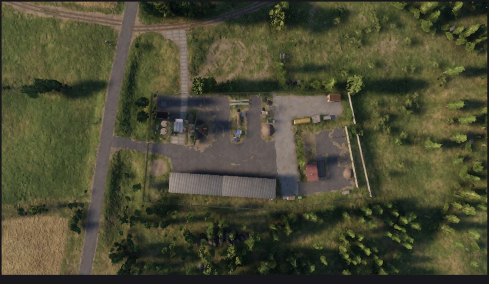
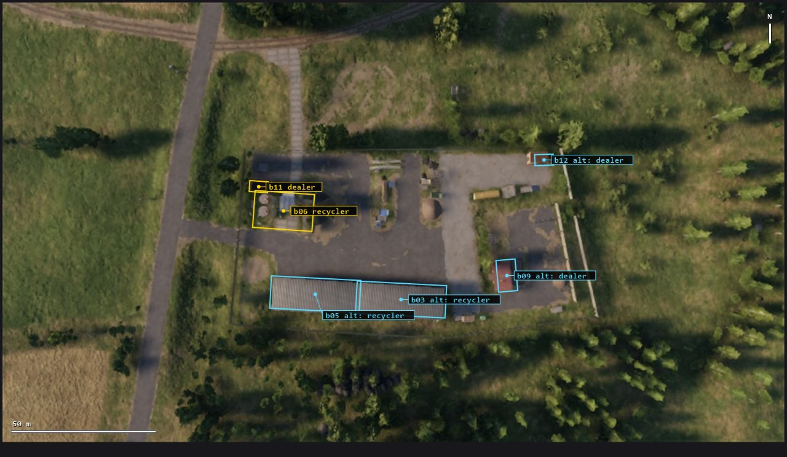
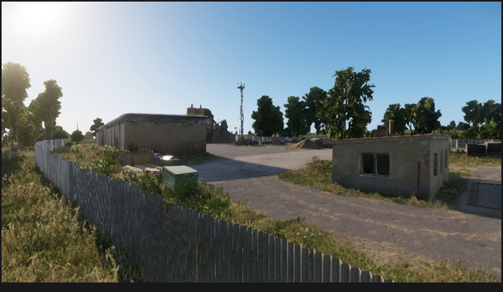
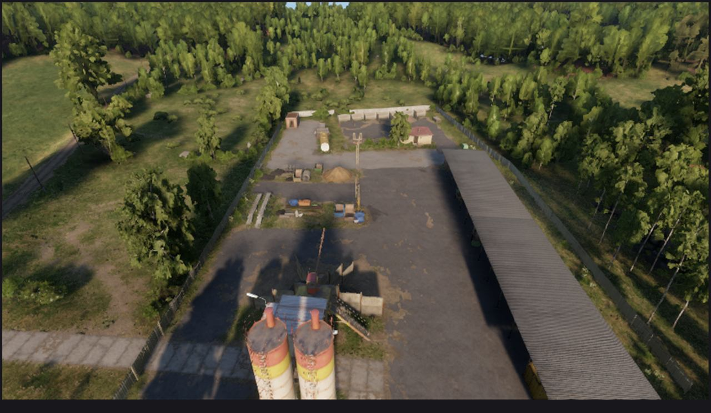
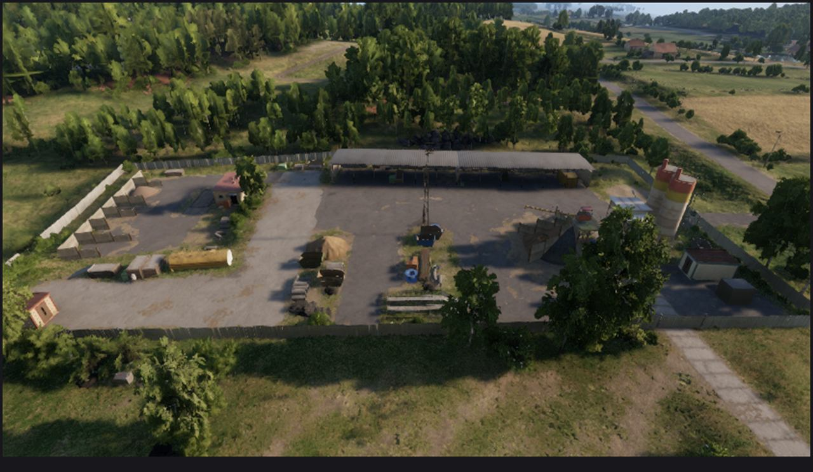
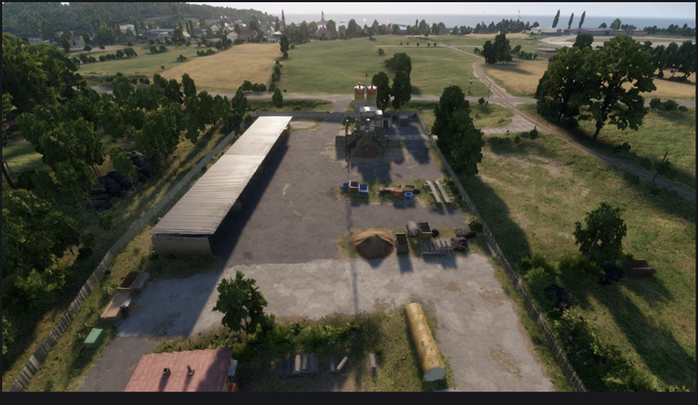
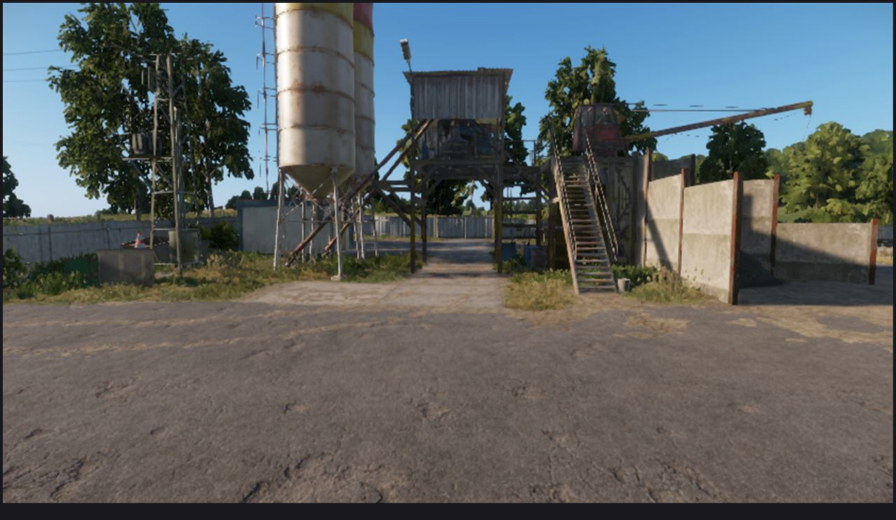
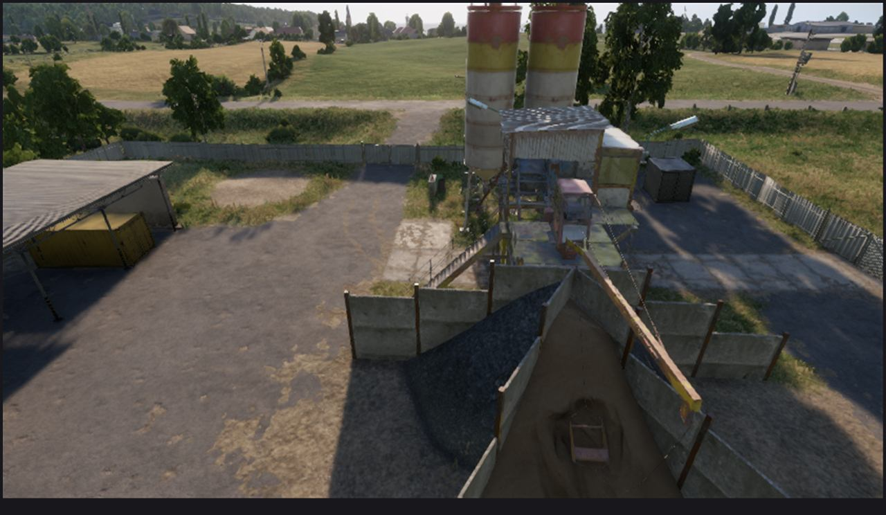

# xz-5054-10855: location dossier

Generated 2026-11-19 by `tools\cli scout`. Do not edit by hand; run `tools\cli scout 5054,10855` to refresh. The machine-readable twin is `dossier.json`.

- **Place:** xz-5054-10855, from coordinates
- **Centre:** x 5054, z 10855, ground 27.8 m; **radius** 120 m
- **World:** Worlds/CoreOnEveron/CoreOnEveron.ent, Arma Reforger build 26266485 (installed 2026-11-08)
- **Other labels nearby:** landfill (urban, 306 m E); GALLOW'S HILL (natural, 462 m S); Old Man's Pond (aquatic, 492 m N); Spring Pond (aquatic, 520 m SW); Saint-Philippe (urban, 557 m W); Les Creux (urban, 589 m NE); factory (urban, 595 m SW); Saint-Philippe (other, 641 m W)

## At a glance

12 buildings (0 homes, 0 civic, 0 ruins), 4 enterable (a door entity below them), 4 entrances from outside among 6 door entities; 11 road(s), 5 junction(s); 0 notable props; 72 trees, bushes and other generated vegetation; 8 free plot(s).

| Type | Count |
| --- | --- |
| industrial | 5 |
| industrial-tank | 3 |
| farm | 2 |
| industrial-tower | 1 |
| garage | 1 |

## Overview

## Terrain

- ground 25 to 33.8 m (8.8 m of relief) within 120 m; mean 28.7 m
- 41% of the ground is under 3 degrees, 51% 3 to 8, 1% over 15
- overall the ground falls 0.8 degrees toward the SE
- steepest ground 21.3 degrees at 5039, 10800

## Roads and junctions

**Main street:** N-S road r06, 5 buildings within 25 m of it; its busiest stretch is at x 5017.2, z 10855.3.

| Id | Road | Length in radius (m) | Points |
| --- | --- | --- | --- |
| r01 | N-S road r01 | 249.2 | 4 |
| r03 | NE-SW road r03 | 52.4 | 13 |
| r04 | E-W road r04 | 186.9 | 4 |
| r05 | NW-SE road r05 | 58.9 | 22 |
| r06 | N-S road r06 | 62.8 | 4 |
| r07 | N-S road r07 | 4.9 | 2 |
| r08 | N-S road r08 | 6.9 | 2 |
| r09 | N-S road r09 | 5 | 2 |
| r10 | NE-SW road r10 | 39.5 | 8 |
| r11 | E-W road r11 | 40.9 | 2 |
| r12 | E-W road r12 | 93.5 | 5 |

| x | z | Kind | Arms | Roads |
| --- | --- | --- | --- | --- |
| 4987.2 | 10914.2 | crossroads | 4 | r04, r01, r11 |
| 5085.4 | 10829.6 | crossroads | 4 | r03, r05 |
| 5017.4 | 10857.4 | crossroads | 4 | r06, r10, r07 |
| 5075.7 | 10838.4 | t-junction | 3 | r03, r05 |
| 5019 | 10877.9 | t-junction | 3 | r10, r06 |

## Civic candidates

Public-facing buildings a town plan would use (church, chapel, government, police, fire, pub, shop, fuel station, hotel, recreation), nearest first. Each links its pictures.

_none_

## All buildings

| Id | Type | Vanilla prefab | x | z | Yaw | Facing | Footprint (m) | Floors | Interior | Entrances | Furniture |
| --- | --- | --- | --- | --- | --- | --- | --- | --- | --- | --- | --- |
| b01 | industrial-tower | LightTower_01 | 5050.4 | 10854.6 | 89 | E | 2.3 x 1.9 (4.4 m2) | - | no | - | - |
| b02 | garage | RampVehicle_01_concrete | 5052.7 | 10874.8 | -91 | W | 5.4 x 12.7 (68.6 m2) | 1 | no | - | - |
| b03 | industrial | ShedMetal_02_long_nowalls | 5056.5 | 10828.4 | 3 | N | 31 x 11.2 (347.2 m2) | 1 | no | ? | - |
| b04 | industrial-tank | FuelTank_02_Base | 5089.3 | 10864.5 | 173 | S | 9.1 x 2.8 (25.5 m2) | 2 | no | - | - |
| b05 | industrial | ShedMetal_02_long_nowalls | 5026.8 | 10830.2 | 3 | N | 31 x 11.2 (347.2 m2) | 1 | no | ? | - |
| b06 | industrial | ConcretePlant_E_01 | 5015.8 | 10859.1 | 94 | E | 12.8 x 20.6 (263.7 m2) | 2 | yes | - | - |
| b07 | industrial-tank | Silo_02_red_yellow | 5011.5 | 10858.4 | -86 | W | 3.5 x 4.4 (15.4 m2) | 1 | no | - | - |
| b08 | industrial-tank | Silo_02_red_yellow | 5011.7 | 10862.2 | -86 | W | 3.5 x 4.4 (15.4 m2) | 1 | no | - | - |
| b09 | farm | WeightStation_01 | 5093 | 10835.9 | -5 | N | 6.6 x 11 (72.6 m2) | 2 | yes | 2 | - |
| b10 | farm | WeightStation_01_scale | 5095.4 | 10839.5 | -5 | N | 0.3 x 1.7 (0.5 m2) | - | no | ? | - |
| b11 | industrial | PortableCabin_E_01_white | 5007.2 | 10867.5 | 94 | E | 3.8 x 6.4 (24.3 m2) | 2 | yes | 1 | - |
| b12 | industrial | PortableCabin_E_01_beige | 5106 | 10876.8 | -92 | W | 3.8 x 6.4 (24.3 m2) | 2 | yes | 1 | - |

Footprint: `catalog` and `measure` are the model's own extents turned by the yaw; `world-bounds` is the engine's axis-aligned box. Yaw is Enfusion's (0 faces +z north, 90 faces +x east). Interior `yes` means door entities and a walkable floor (a heuristic, not walked); `unknown` means door entities but no walkable floor. Entrances are the doors on the outline; `?` means the building was not found in the engine dump. Furniture is the count of furnishing props inside the footprint where the place file has it.

## Notable props

_none_

## Free plots

| Id | x | z | Size (m) | Area (m2) | Ground (m) | Nearest road | Nearest building | From centre |
| --- | --- | --- | --- | --- | --- | --- | --- | --- |
| p1 | 5133 | 10855 | 42 x 136 | 5712 | 25 to 29 | NE-SW road r03 33.3 m | b12 industrial 31 m | 79 m |
| p2 | 5083 | 10784 | 54 x 70 | 3780 | 26.7 to 33.5 | NW-SE road r05 39.2 m | b03 industrial 39.6 m | 76.7 m |
| p3 | 5067 | 10897 | 86 x 32 | 2752 | 26.8 to 31.2 | E-W road r04 31.3 m | b02 garage 22 m | 44 m |
| p4 | 4999 | 10795 | 54 x 44 | 2376 | 26.1 to 28.1 | N-S road r01 35.4 m | b05 industrial 32.7 m | 81.4 m |
| p5 | 5044 | 10953 | 72 x 28 | 2016 | 29.1 to 32.6 | E-W road r04 29.2 m | b02 garage 75.6 m | 98.5 m |
| p6 | 4952 | 10855 | 20 x 92 | 1840 | 27.5 to 30.7 | N-S road r01 21.6 m | b11 industrial 53 m | 102 m |
| p7 | 5162 | 10855 | 12 x 80 | 960 | 25.2 to 27.3 | NE-SW road r03 62.3 m | b12 industrial 56.4 m | 108 m |
| p8 | 4993 | 10846 | 14 x 54 | 756 | 26.4 to 29.2 | NE-SW road r10 10.9 m | b06 industrial 14.2 m | 61.7 m |

plots are open rectangles at least 10 m on the short side, kept 2.5 m off buildings, 4.5 m off a road's centre line, 2 m off a tree, on ground under 12 degrees; axis aligned, not the best use of the land

## Limits of this dossier

- buildings (types, footprints, floors, interiors) are read from the Everon catalog, docs/everon/catalog-buildings.json; 9 of 12 matched an entity of the engine dump, which adds the door positions, and the other 3 have no entrances listed

## Prefab references

Every distinct building prefab, as the world file refers to it.

| Prefab | Type | Count |
| --- | --- | --- |
| `{80DF3BD810D032AF}Prefabs/Structures/Industrial/Towers/LightTower_01/LightTower_01.et` | industrial-tower | 1 |
| `{FFDC9C8026E15E29}Prefabs/Structures/Industrial/Repair/RampVehicle_01/RampVehicle_01_concrete.et` | garage | 1 |
| `{137E98DD5A116B68}Prefabs/Structures/Industrial/Sheds/ShedMetal_02/ShedMetal_02_long_nowalls.et` | industrial | 2 |
| `{C7A59DCCFF7BF19F}Prefabs/Structures/Industrial/Containers/FuelTanks/FuelTank_02/FuelTank_02_Base.et` | industrial-tank | 1 |
| `{A92A5F3B79FF56BE}Prefabs/Structures/Industrial/Houses/ConcretePlant_E_01.et` | industrial | 1 |
| `{0DB364ED28333396}Prefabs/Structures/Industrial/Containers/Silos/Silo_02/Silo_02_red_yellow.et` | industrial-tank | 2 |
| `{B461AC17AE9B29EF}Prefabs/Structures/Agriculture/WeightStation/WeightStation_01/WeightStation_01.et` | farm | 1 |
| `{82992F7B47B6191F}Prefabs/Structures/Agriculture/WeightStation/WeightStation_01/BuildingAddons/WeightStation_01_scale.et` | farm | 1 |
| `{D445D04331B6809E}Prefabs/Structures/Industrial/Houses/PortableCabin_E_01/PortableCabin_E_01_white.et` | industrial | 1 |
| `{E30E1250FD927736}Prefabs/Structures/Industrial/Houses/PortableCabin_E_01/PortableCabin_E_01_beige.et` | industrial | 1 |
