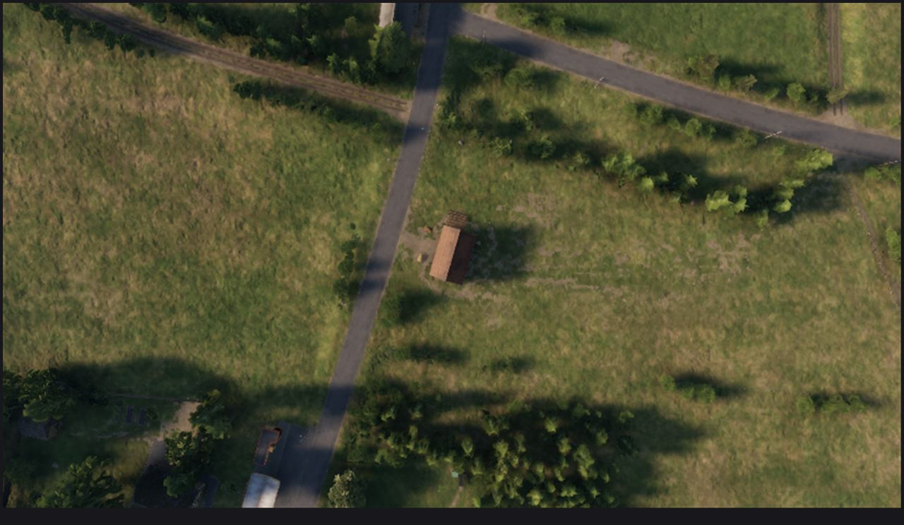
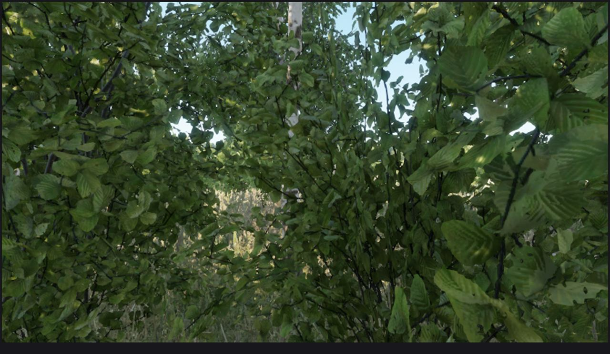
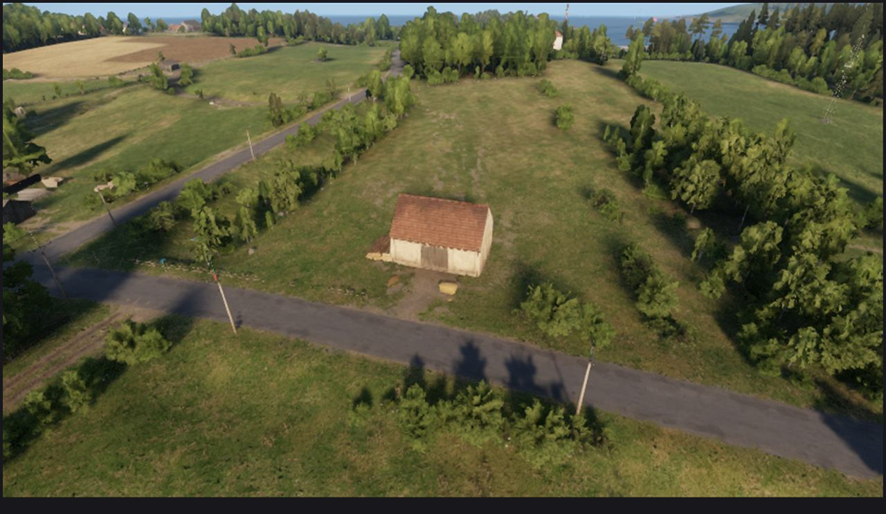
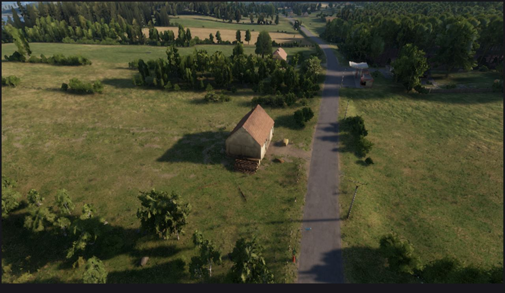
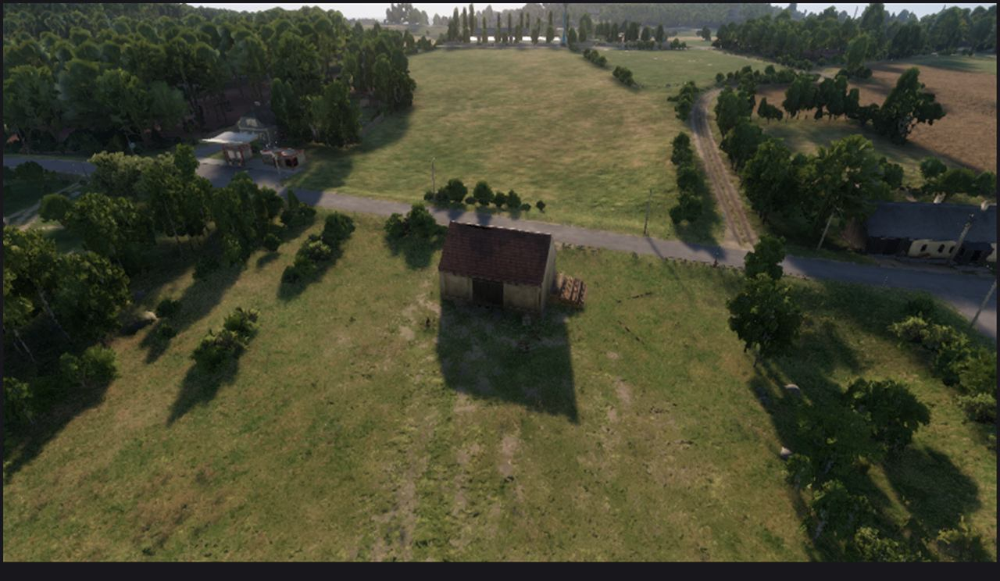
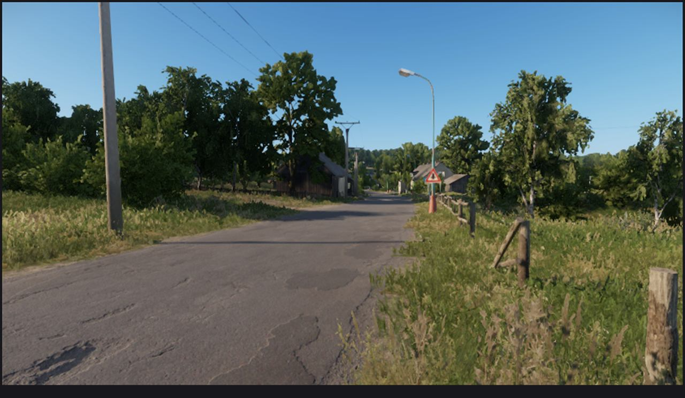
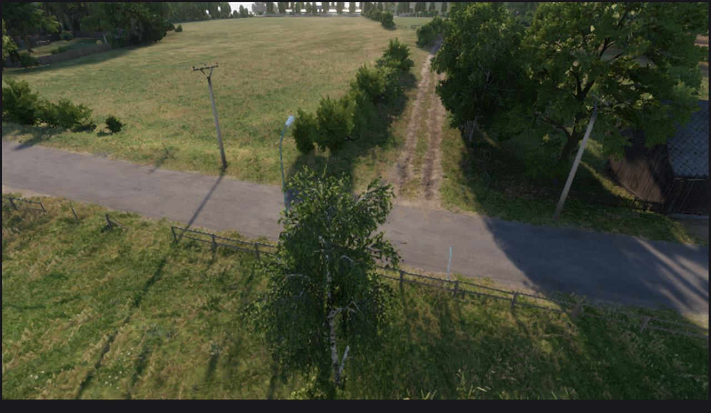

# xz-5361-9900: location dossier

Generated 2026-11-19 by `tools\cli scout`. Do not edit by hand; run `tools\cli scout 5361,9900 --radius 80` to refresh. The machine-readable twin is `dossier.json`.

- **Place:** xz-5361-9900, from coordinates
- **Centre:** x 5361, z 9900, ground 20.4 m; **radius** 80 m
- **World:** Worlds/CoreOnEveron/CoreOnEveron.ent, Arma Reforger build 26266485 (installed 2026-11-08)
- **Other labels nearby:** Étoupe (urban, 72 m N); farm (other, 362 m W); power plant (urban, 460 m E); GALLOW'S HILL (natural, 674 m NW)

## At a glance

3 buildings (1 homes, 0 civic, 0 ruins), 2 enterable (a door entity below them), 5 entrances from outside among 19 door entities; 4 road(s), 3 junction(s); 3 notable props; 563 trees, bushes and other generated vegetation; 4 free plot(s).

| Type | Count |
| --- | --- |
| farm | 1 |
| shed | 1 |
| house | 1 |

## Overview

## Terrain

- ground 16.4 to 23.1 m (6.7 m of relief) within 80 m; mean 20.6 m
- 59% of the ground is under 3 degrees, 30% 3 to 8, 2% over 15
- overall the ground falls 0.8 degrees toward the NW
- steepest ground 17.5 degrees at 5416, 9940

## Roads and junctions

**Main street:** N-S road r01, 2 buildings within 25 m of it; its busiest stretch is at x 5348.9, z 9939.7.

| Id | Road | Length in radius (m) | Points |
| --- | --- | --- | --- |
| r01 | N-S road r01 | 315.8 | 3 |
| r02 | E-W road r02 | 169.8 | 2 |
| r03 | NE-SW road r03 | 8.8 | 2 |
| r04 | E-W road r04 | 92.5 | 2 |

| x | z | Kind | Arms | Roads |
| --- | --- | --- | --- | --- |
| 5356.6 | 9967.6 | t-junction | 3 | r03, r01 |
| 5347.6 | 9944.6 | t-junction | 3 | r04, r01 |
| 5364.7 | 9971.1 | bend-or-join | 2 | r03, r02 |

## Civic candidates

Public-facing buildings a town plan would use (church, chapel, government, police, fire, pub, shop, fuel station, hotel, recreation), nearest first. Each links its pictures.

_none_

## All buildings

| Id | Type | Vanilla prefab | x | z | Yaw | Facing | Footprint (m) | Floors | Interior | Entrances | Furniture |
| --- | --- | --- | --- | --- | --- | --- | --- | --- | --- | --- | --- |
| b01 | farm | Barn_E_01 | 5361.3 | 9900 | 107 | E | 15.1 x 10.8 (163.1 m2) | 0 | unknown | 4 | - |
| b02 | shed | Shed_02_small | 5364.2 | 9833.9 | -88 | W | 3.5 x 2.6 (9.1 m2) | 1 | yes | 1 | - |
| b03 | house | House_Mountain_E_1I01 | 5344.5 | 9977.1 | 98 | E | 24.7 x 13.5 (333.5 m2) | 2 | yes | ? | - |

Footprint: `catalog` and `measure` are the model's own extents turned by the yaw; `world-bounds` is the engine's axis-aligned box. Yaw is Enfusion's (0 faces +z north, 90 faces +x east). Interior `yes` means door entities and a walkable floor (a heuristic, not walked); `unknown` means door entities but no walkable floor. Entrances are the doors on the outline; `?` means the building was not found in the engine dump. Furniture is the count of furnishing props inside the footprint where the place file has it.

## Notable props

| Kind | Vanilla prefab | x | z | Distance |
| --- | --- | --- | --- | --- |
| bench | BenchStreet_01_yellow_red | 5349.2 | 9974.6 | 75.5 m |
| phone-booth | PhoneBooth_E_01 | 5305.2 | 9843 | 79.7 m |

Counted, not listed: 1 street-lamp.

## Free plots

| Id | x | z | Size (m) | Area (m2) | Ground (m) | Nearest road | Nearest building | From centre |
| --- | --- | --- | --- | --- | --- | --- | --- | --- |
| p1 | 5403 | 9892 | 64 x 44 | 2816 | 20.3 to 23 | N-S road r01 65.3 m | b01 farm 36.8 m | 42.8 m |
| p2 | 5305 | 9900 | 28 x 80 | 2240 | 19.1 to 21.9 | N-S road r01 31 m | b01 farm 49.3 m | 56 m |
| p3 | 5370 | 9922 | 42 x 12 | 504 | 19.9 to 20.5 | N-S road r01 25.2 m | b01 farm 16 m | 23.8 m |
| p4 | 5328 | 9924 | 14 x 24 | 336 | 19.4 to 20.9 | N-S road r01 15.7 m | b01 farm 33.9 m | 40.8 m |

plots are open rectangles at least 10 m on the short side, kept 2.5 m off buildings, 4.5 m off a road's centre line, 2 m off a tree, on ground under 12 degrees; axis aligned, not the best use of the land

## Limits of this dossier

- buildings (types, footprints, floors, interiors) are read from the Everon catalog, docs/everon/catalog-buildings.json; 2 of 3 matched an entity of the engine dump, which adds the door positions, and the other 1 have no entrances listed

## Prefab references

Every distinct building prefab, as the world file refers to it.

| Prefab | Type | Count |
| --- | --- | --- |
| `{99F6E8E52B71B137}Prefabs/Structures/Agriculture/Barn/Barn_E_01/Barn_E_01.et` | farm | 1 |
| `{8590602F727399F4}Prefabs/Structures/Houses/Shed/Shed_02/Shed_02_small.et` | shed | 1 |
| `{BEF9077AF9F93AE7}Prefabs/Structures/Houses/Village/House_Mountain_E_1I01/House_Mountain_E_1I01.et` | house | 1 |
