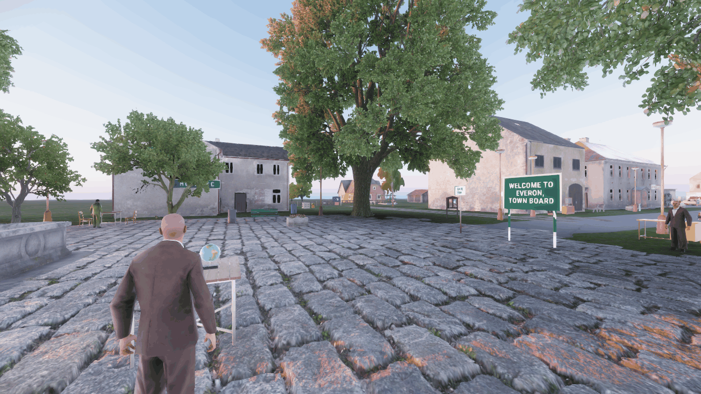

# Workshop page: Life Framework: Everon 1989

Copy and pictures for the flagship pack's Workshop page and its server-browser listing (slice
#1296, issue #318). Nothing here is published. The Workbench publish fields (Project Name, mod ID,
tags, preview) live in [`workshop/everon-1989/README.md`](workshop/everon-1989/README.md); this page
holds the text a player reads and the pictures that go beside it.

The scenario is `{C638C03B775C31BB}Missions/LF_Everon1989.conf`, the same one the example server
([`server/example/`](../../server/example/README.md)) and the host guide use. The old
`LF_PlaytestTown.conf` name is not used in any text below.

## Limits

| Field | Limit | This text |
|---|---|---|
| Project Name | 30 characters | `Life Framework: Everon 1989` (27) |
| Summary | 1024 characters | 331 |
| Description | 5000 characters | about 2900 |
| Gallery pictures | 1280 px wide, each under 500 KB | one kept, two to take (see Pictures) |

## Summary

```
Everon, 1989. A village where everyone knows everyone and nobody has told you the rules. Fill in form R-89, get your ID card, take a job, bank your pay and buy a car. Or take a darker road and meet the police. Needs Life Framework (Core), which comes with it. Alpha: report what breaks on Discord or GitHub.
```

## Description (BBCode)

```
[h1]Life Framework: Everon 1989[/h1]

Everon, 1989. You have just arrived in a village where everyone knows everyone and nobody has told you the rules. You fill in form R-89, collect an ID card from the clerk on the square and find your feet. Honest work pays: parcels, fuel, fares. The bank keeps your money and the police keep order. At the edge of the village a few people make more on a good night than on a good week, and the police would like a word.

This is the flagship content pack for [b]Life Framework (Core)[/b], an open-source roleplay framework for Arma Reforger. It is an alpha. You will find rough edges, and things change between versions.

[h2]What it needs[/h2]
[b]Life Framework (Core)[/b], version 0.1.0 or later. Subscribing to this item pulls it in, so you install nothing else.

[h2]How to play[/h2]
[list]
[*]Subscribe to this item.
[*]Alone: open [b]Scenarios[/b], pick [b]Life Framework: Everon 1989[/b] and press Play.
[*]With friends: one of you hosts it from the Scenarios list, or you join a server that runs it. Look for [b]Life Framework | Everon 1989 (Alpha)[/b] in the server browser.
[/list]

[h2]What to try[/h2]
[list]
[*]Fill in form R-89 when you arrive, then ask the clerk on the square for your ID card.
[*]Take the parcel job at the depot. Fuel delivery and the taxi open as you level up.
[*]Bank your pay at the ATM and buy food at the general store.
[*]Collect your car from the garage, get the other one out of the impound, or buy one at the car lot.
[*]Rob a till, drill the bank vault or the cash van, and see the police get the call.
[*]Clock in at the police desk, work the wanted board, fine and jail.
[*]Get hurt and wait for the medic, or give up and respawn.
[*]Found an organization, use the hideout stash, sell to the fence, and run the moonshine still.
[/list]

[h2]Rules[/h2]
How the jobs, money, police and crime systems work, and what is allowed on a server, is written down in one place:
[url=https://life-framework.org/rules]life-framework.org/rules[/url]

[h2]Run your own server[/h2]
Mod IDs [b]79636E668EA37AC9[/b] (the core) and [b]B1E84D5687E11724[/b] (this pack), scenario [b]{C638C03B775C31BB}Missions/LF_Everon1989.conf[/b]. The example server folder has a ready config and a start script, and the host guide walks through it:
[url=https://github.com/Life-Framework/Life-Framework/blob/main/docs/playtest/workshop-host.md]Host guide[/url]
[url=https://github.com/Life-Framework/Life-Framework/blob/main/docs/owner/install.md]Install guide: run your own server from zero[/url]
[url=https://github.com/Life-Framework/Life-Framework/tree/main/server/example]Example server[/url]

[h2]Feedback[/h2]
Tell us what broke, what confused you and what you liked. One report per problem, with what you did, what you expected and what happened. Screenshots help.
[list]
[*]Discord: [url=https://discord.gg/MjMexJteqz]discord.gg/MjMexJteqz[/url]
[*]Issues: [url=https://github.com/Life-Framework/Life-Framework/issues]github.com/Life-Framework/Life-Framework/issues[/url]
[*]Website: [url=https://life-framework.org]life-framework.org[/url]
[/list]

[h2]Licence[/h2]
This Workshop build is licensed under the Arma Public License (APL). The source on GitHub is MIT. Base-game assets belong to Bohemia Interactive. Full credits are in the repository.
```

Before publishing:

- The rules link `life-framework.org/rules` does not exist yet. Slice S2 (#1281) exports the rules to the
  site, and the wording waits for Q1. Confirm the final URL, or drop the Rules section, before upload.
- The Workshop dialog may not render BBCode `[h2]`; the existing core page uses the same tags, so check
  the preview once on upload.

## Server browser

| Field | Text |
|---|---|
| Server name (`game.name`) | `Life Framework | Everon 1989 (Alpha)` |
| Scenario ID (`game.scenarioId`) | `{C638C03B775C31BB}Missions/LF_Everon1989.conf` |
| Mods (`game.mods`) | `79636E668EA37AC9` Life Framework (Core), then `B1E84D5687E11724` Life Framework: Everon 1989 |

The scenario's own line in the browser is `m_sDescription` in
`addons/LF_Everon1989/Missions/LF_Everon1989.conf`:

```
Everon, 1989: a village where everyone knows everyone. Needs Life Framework (Core). Take a job, bank your pay, buy a car, rob a till, or clock in as police.
```

It is 154 characters and already says what the page says. The example server's `game.name` stays
a placeholder (`My Life Framework server`) so a host picks their own; the name above is the one
the project's own server uses.

## Pictures

Taken in the real game with `tools\cli shots area` on a `--profile full` session, not mocked.

| # | Picture | File | State |
|---|---|---|---|
| 1 | The village square at spawn, late afternoon |  `website/public/docs-images/318/square-after.png` | kept |
| 2 | The bank, where your pay goes | `website/public/docs-images/318/bank-after.png` | not taken yet |
| 3 | The police station, where the call arrives | `website/public/docs-images/318/police-after.png` | not taken yet |

Pictures 2 and 3 wait for a clean frame. The two session runs on 2026-11-14 had the orientation
clerk's dialogue box, a letterbox and the HUD in every frame, which a Workshop picture cannot carry.
Take them with `tools\cli look bank` and `look police-station` (no session, no UI) when the PC has
2.2 GB of RAM free, keep them with `tools\cli evidence 318 after <area> --name bank` and
`--name police`, then set the State column to kept.

The preview image is separate and stays the maintainer's call (spec in
[`workshop/everon-1989/README.md`](workshop/everon-1989/README.md)).
