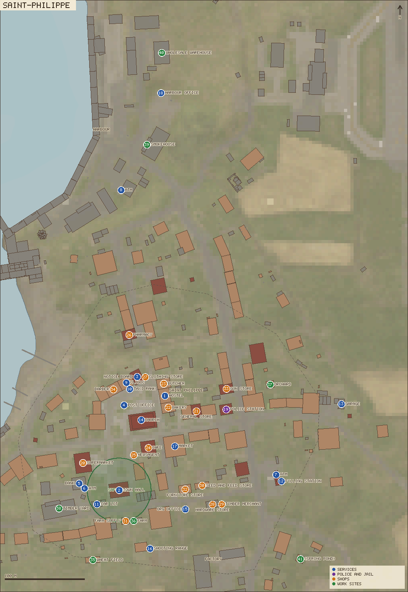
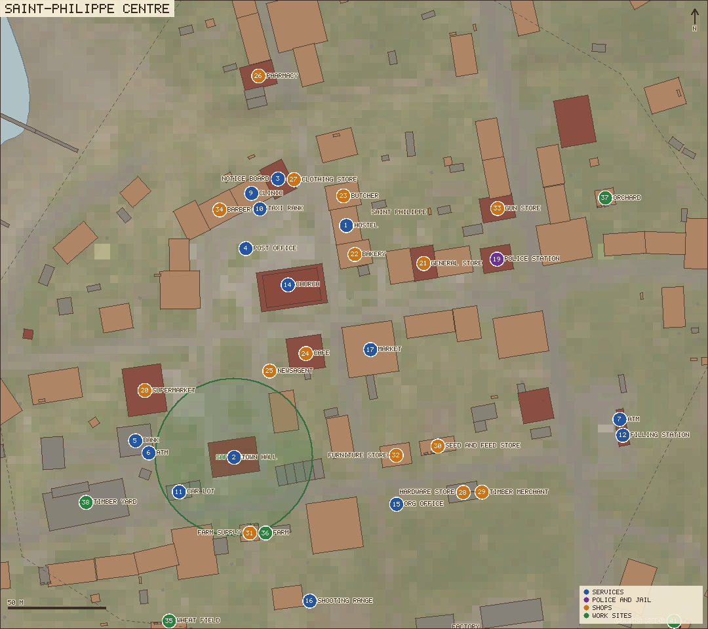

# 1. Getting started

## Waking up

A new character wakes on a bunk in the **hostel** (a town house just north of the main street; number 1 on the
[Saint-Philippe map](maps.md)). Step off the bed and go downstairs. The hostel and the square outside are **safe zones**:
nobody can shoot you there.

You start with **$2,000 in the bank** and no cash, a work jacket, boots, and a **folded paper map** in your pack.
After you die or rejoin you do not wake in the hostel again; see [Money](02-money.md) and [Medic](08-medic.md).

## The welcome guide

A few seconds after you get out of bed a short **welcome guide** opens: five paper pages on what to do first (the town clerk, your starter car, then apples, juice and the market), money and
the F2 "What to do next" page, the map, police and medic duty, and where to read more. Turn the pages with **Next** and **Previous**.

* **Set waypoint to the clerk** (page 1) puts a waypoint on the town clerk, the first errand. If you are further
  along, it points at your current errand instead.
* **Close** puts it away; it opens again the next time you join, until the clerk has given you your papers.
* **Don't show again** stops it opening by itself.
* Press **F3** (gamepad: **right bumper + Y**) to open it again at any time. You can change the key in
  **Settings, Controls, Life Framework**.

* **The handbook** is under **Handbook** in the pause menu. It has ten short pages: your first wages, work in town,
  **Trades and tools** (levels, tool finishes, perks, the truck check), the police, **Law and order** (the charge sheet,
  fines, the cell), the hospital, if you turn to crime, **The underworld** (standing, the fence, the bars, the north
  outpost), **Crews** (the registry, flags, recruiting, the radio) and the law and the permit.

## Your personal file

Press **F2** (gamepad: hold **right bumper + Y**) to open your personal file. It has three tabs, and a fourth when you are in a gang:

* **Person**: your name and role (civilian, police or medic, on or off duty), cash in hand and in the bank,
  houses owned, garage slots used, time on the island, whether you are wanted, the licenses and permits you hold, and
  your level in each job. **Read** on a job shows its title with your tier word (Apprentice, Hand, Journeyman, Foreman or Master), how far you are to the next level, what that level opens, the perks you picked and, once the shift boards are up, your rank in that trade this week. At level 10 and again at level 20 of a work trade, walk up to the labor office counter and take a perk for that trade: Double yield or Swift hands at 10; at 20 Light touch, the one you did not take, or Good word (traders pay you 10% more for that trade's goods; mining, logging, fishing and farming). Police officers pick at the dispatch board in the police station (Fast cuff or Long radar), medics at the dispatch board in the clinic (Quick revive or Quick aid at 10, Steady carry at 20). The first pick is free; changing it later costs $500 in cash at the same place, once a week per trade and level, and each trade has its own change row.
* **Progress**: your first errands in order, each marked **DONE**, **CURRENT** or **LATER**, then any other errand you
  took. **Read** shows the errand and its progress; **Set waypoint to the current errand** puts it on your map.
* **Next**: what you could do now to earn a living, with a line on each, roughly what it pays an hour and how far away
  it is. Only what you can already do is listed (police and medic duty show once you wear the badge), and nothing until
  the clerk has registered you. The run you are on is listed first and reads **in progress**; finished ones sink to the
  end and read **Done**. Pick one and press **Start**: a few short steps follow, each with a waypoint on your screen, a
  mark on your map and a one-line note. A step you have already done is skipped (you hold the job, you carry the tool).
  **Resume** on a started one puts the waypoint and the note back on its step.
  Four more rows point you at a place on the island and show up when they apply: **Found a crew** (the registry cabin in
  Saint-Philippe; done once you are in a crew), **Truck check** (the examiner at the truck yard in the north-east, $300;
  listed at Hauling level 5 or when you own a van, done once you pass), **Pick a perk** (the counter at the labor office in
  the town hall; listed once any trade reaches level 10, done once you pick a perk) and **A rumor of easy money** (the
  fence's yard; listed once you have a criminal record). **Start** puts the waypoint on the place.
* **Gang** (only if you are in a gang): your crew at a glance, read only. The gang's name and flag, your rank, which
  members are online, whether a radio you carry is on the gang channel, and the sites the gang holds. It shows only your
  own gang. Nothing on it is a standing number; gang standing is never shown as a figure.

## Your current objective

The step you are on stays written under your money at the top right ("Next: Mine 15 iron nuggets"). It flashes gold when it
changes and stays until the step is done, even after the note fades. After a rejoin the waypoint, the line and the
step's note come back by themselves. Type `/hud objective off` in chat to hide the line.

## Your welcome pack and car

The clerk gives you your **ID card**, some cash and a meal; a note lists everything you got. A small car waits in the
garage at the car lot next to the town hall. When you take it out, a note gives its plate, its hazard lights blink and a
marker sits over it for 30 seconds, so you can tell it from the other cars on the lot.

### The mining run, step by step

| Step | What you do |
|---|---|
| Take the miner job | The desk by the mine on Coalman's Brow, south-west of the square |
| Buy a pickaxe | The miner's supply counter beside the mine desk ($150); the hardware store and general store sell one too. Skipped if you carry one |
| Take your car out | Your garage; any car will do (the buyer is down at the dock). Skipped if a car is already out or you own none |
| Go to the mine | Back up to Coalman's Brow |
| Mine 15 iron nuggets | Swing at the rust-veined rocks and pick up the pieces, one full furnace load. Every piece levels **Mining**; level 2 opens the coal license |
| Smelt your bars | The mine furnace: 3 nuggets make a bar, so 15 make 5 bars in one 4-minute run |
| Sell your bars | The iron counter in the dock wholesale warehouse, $20 a bar. The mine adds $180 for your first run, so you finish about $130 ahead after the pickaxe |

The other starters are shorter: the postal van run (a driving license, the post stand at the parcel kiosk, one run to Meaux and back), lumber (the lumberjack job, an
axe, a felled tree), fishing (a rod, the nearest water, a fish), the apple harvest (the orchard, 5 apples, a bottle of
juice; the arrival route below uses six apples and makes two), and police or medic duty (the duty desk, clock in).

The file only shows what the records office holds; nothing in it can be changed from there. **Esc** or **Close** puts
it away.

## The arrival quest

A quest panel on screen tells you what to do next. Each step puts a **waypoint with a distance** on your screen and a
**mark on the open map**. The marks move on by themselves when you finish a step. If you log out half way, the mark comes
back when you rejoin. Other players do not see yours.

| Step | What you do | Where |
|---|---|---|
| **New in town** | Walk south from the hostel to the town hall. Talk to the **town clerk** ("Town clerk: ID cards"). He writes your name in the register and hands you your **ID card** and a **welcome pack**: bread, a sausage, a bottle of water and **$100 in cash**. | Town hall on the square |
| **Your first car** | The clerk also puts a small **Sputnik T601** in your garage. It is yours, and it takes one of your garage slots. Walk to the **garage counter** at the car lot and pick *Retrieve vehicle*; the car stands on the garage pad and your key is already in your pocket. | Car lot, west of the town hall |
| **Apple picking** | Drive to the **orchard** east of town and pick **six apples** from the apple trees. | Orchard |
| **Fresh juice** | Use the **juice press** on the orchard stall: three apples make one bottle of apple juice, so your six make two. | Orchard stall |
| **Sell your juice at the market stall** | Sell your apple juice to the **market trader** in town: look at the stall, scroll down to the juice row (the last one, **Sell 1 Apple Juice**; the row shows the price, $18 a bottle) and press F, or pick **Sell all goods**. A note then reads *You are on your way*: take a job from the town board, ask the clerk for more errands, and find your errands and jobs in your player menu. | Market |

You get the welcome pack and the car once per character, never again after a respawn, a rejoin or a server restart.
A character who already owns a car gets no starter car: take your own car out of the garage for that step. A character
who registered before this route existed is guided through the steps they have not done yet.

After the market sale the clerk has seven more errands. They show under **F2, Progress**, in this order: **Five parcel runs**
(five paid runs at the post office open fuel delivery), **Your first fuel run**, **Your own wheels** (get the driving license
at the town hall, then buy a car at the car lot), **A firearm permit** (the gun store counter), **Sell a catch** (land a fish and
sell it at the dock), **A plot of your own** (read the sign on a plot for sale) and **Lay your foundation** (gravel and cement
come from the hardware store).

Your bank account also starts with money in it: use an **ATM** to take some out or put your cash away. Cash in your
pocket is lost if you die; money in the bank is not.

## The town hall also sells licenses

The same clerk's desk issues the **driving license** ($100, taken from your bank account first, then from your pockets). You need it to buy a car. The **firearm permit** ($250) is
bought at the gun store counter, and in the alpha it is instant. A **truck license** ($300) comes from the examiner at the
truck yard in the north-east: you drive a lent truck through four gates in order. Miss a gate and the fee is lost, with a short
wait before you can try again.

## The map and waypoints

* **Open the map:** press **M**. If nothing opens, take the **folded paper map** out of your pack and hold it; every new character carries one.
  The map opens centered on you at town zoom, and closing it puts the paper map back in your pack.
* **Every kind of place has its own icon**, a round badge coloured by group (green shops, orange food, blue travel, brown
  work, dark blue police, red health). No two kinds share an icon. Point at an icon to read its name.
* **The key** on the right edge of the map lists every icon on your map, grouped, with its name. Point at a row and those
  places grow and pulse on the map while the rest fade. Click a row to show only that kind (click again for all); click a
  group's heading to open or shut its rows (every group starts shut). The **Key** tab under your cash folds it away, and the map remembers that.
* Icons that share one spot show the most important one and a count; click it to zoom in. Zoomed far out, a slate badge
  with three dots stands for a group of places. Places you have not seen yet may show as "heard of" until you walk past.
* **Set your own waypoint:** **Shift + Left click** on the map (gamepad: hold **Y**, press **A**), or just click a place.
  It shows on the map as a bold red ring with its name and distance, and in the world as a marker with the distance.
  There is one waypoint at a time; a new click moves it. The same click on the waypoint, or **Backspace** (gamepad:
  double-tap **Y**), clears it.
* **How to use the map:** the card in the bottom-left corner lists these controls for your mouse or gamepad, and the
  waypoint set now. **F1** (gamepad: click the left stick) folds it to one line; the map remembers that too.
* **Safe zones** are a soft green tint with a small label under their edge. **Find a place** on the left searches by name.
* **The notice board** and the **Taxi** and **courier** jobs set waypoints for you.
* **Scale:** Saint-Philippe is about 450 m across. The whole island is about 12 km. See the [maps](maps.md).

<!-- map:town -->

Closer in, the center of town:

| # | Place (in-game name) | Kind | What you do here |
|---|---|---|---|
| 1 | Hostel | Services | Where a new character wakes. Safe zone around it. |
| 2 | Town clerk: ID cards | Services | Town hall: ID card, driving licence, the arrival quest. |
| 3 | Notice board | Services | The town board: every place in town, with a waypoint button. |
| 4 | Parcel depot (post office) | Services | Sign up for courier work, take parcels. |
| 5 | Bank | Services | Teller for deposits and withdrawals. |
| 6 | ATM (by the bank) | Services | Cash machine on the bank wall. |
| 7 | ATM (east side) | Services | Cash machine near the filling station. |
| 8 | ATM (harbour) | Services | Cash machine on the dock. |
| 9 | Clinic (hospital) | Services | Medic duty desk, hospital till, where you wake after dying. |
| 10 | Taxi stand | Services | Start a taxi run. |
| 11 | Car lot | Services | Buy a car. Impound desk beside it. |
| 12 | Gas station | Services | Pumps and the fuel kiosk. |
| 13 | Garage | Services | Mechanic: car parts and repair kits. |
| 14 | Church | Services | The village church. |
| 15 | Organization office | Services | Register or join an organization. |
| 16 | Shooting range | Services | Three target lanes. |
| 17 | Market | Services | Market stall trader. |
| 18 | Harbor Office | Services | The harbour master. |
| 19 | Police station | Police and jail | Duty desk, armoury, wanted board, jail cell. |
| 20 | Supermarket | Shops | Food and drink. |
| 21 | General store | Shops | Tinned food, seeds, drinks, miner's till. |
| 22 | Bakery | Shops | Bread, baguettes, croissants. |
| 23 | Butcher | Shops | Ham, saucisson, canned and dried meat. |
| 24 | Cafe | Shops | Drinks and snacks. Chess table next door. |
| 25 | Newsstand | Shops | Tourist map, newspaper, postcards. |
| 26 | Pharmacy | Shops | Aspirin, gauze, tourniquets. |
| 27 | Clothing store | Shops | Clothes, hats, jackets. |
| 28 | Hardware store | Shops | Axe, shovel, planks, cement, radio, repair kit. |
| 29 | Timber merchant | Shops | Sells your planks and hardwood boards. |
| 30 | Seed and feed store | Shops | Fishing rod, bait, seeds. |
| 31 | Farm supply | Shops | The reaper and beehive kit. |
| 32 | Furniture store | Shops | Furniture for your home. |
| 33 | Gun store | Shops | Firearm permit, pistols, rifles, ammo. |
| 34 | Barber | Shops | Haircut. |
| 35 | Wheat field | Work sites | Harvest contracts and the weighbridge. |
| 36 | Farm | Work sites | Vegetable plots, beehives, honey kitchen. |
| 37 | Orchard | Work sites | Farmer job desk and apple trees. |
| 38 | Timber yard | Work sites | Lumberjack job desk and sawmill. |
| 39 | Smokehouse | Work sites | Smoke your fish. |
| 40 | Wholesale warehouse | Work sites | Buys bulk goods at a falling price. |
| 41 | Fishing spot (Spring Pond) | Work sites | Fish from the jetty. |
<!-- /map -->

## What the screen shows

The screen stays almost empty. A few small figures sit at the edges and fade when nothing changes:

* **Top right: money.** The cash you carry in large figures, your **bank** balance under it. When cash changes the
  difference slides in beside it (**+$100** in green, **-$18** in red) and fades. After a few seconds the block dims;
  it comes back to full brightness on any change and while the inventory or the map is open.
* **Under the money: wanted badges.** Up to five small badges fill with your wanted level. They flash red and read
  **Wanted** for a moment when the level goes up, and disappear when you are clear.
* **Bottom center: food and drink.** Hidden while both are above half. They appear when one drops below half, for a
  few seconds after you eat or drink, and the number turns red below 25.
* **Bottom right: health and stamina**, shown while they change.
* **Top left:** a small Life Framework mark.

The HUD hides behind full-screen menus and during a conversation. Type **/hud** in chat to switch a part off or on:
`/hud money off`, `/hud wanted on`, `/hud needs off`, `/hud brand off`, or `/hud all on`. The choice is kept on
your PC.

## Eating and drinking

You get **hungry and thirsty** over real time: from full, hunger runs out in about **2 hours 45 minutes** and thirst in
about **2 hours 15 minutes**. Below 20 your health starts to drop slowly. Needs never kill you outright, but you will
be weak and the screen tells you.

* Open your inventory, pick a food or drink and press **Use**. You raise the item to your mouth and about 5 seconds later
  the gauge goes up (a loaf of bread is about +25 hunger). The item is used up.
* Or put the food in a **quick slot**, hold it and press the use input. A stack loses one unit per use.
* You cannot eat or drink while **cuffed, downed, driving or swimming**. A toast says so and nothing is used.
* Hold a tin and press **G** to **throw** it. It flies ahead and lands; pick it up again.

Where to buy food: the supermarket, the general store, the bakery, the butcher, the cafe, the
newsagent and the fuel kiosk at the filling station. Prices are in the [shop list](05-shops.md).

## Staying safe in the first minutes

* **Grace:** for your first 5 minutes of play, robberies and vault breaks refuse you with a message. After that you are fair game.
* **Safe zones:** the square (52 m round the town hall) and the hostel (25 m). The bank and the gun store are just outside.
* **Restarts:** at 06:00 and 18:00 server time. A toast warns you at 15, 5 and 1 minutes. Finish what you are doing and stand somewhere safe.
