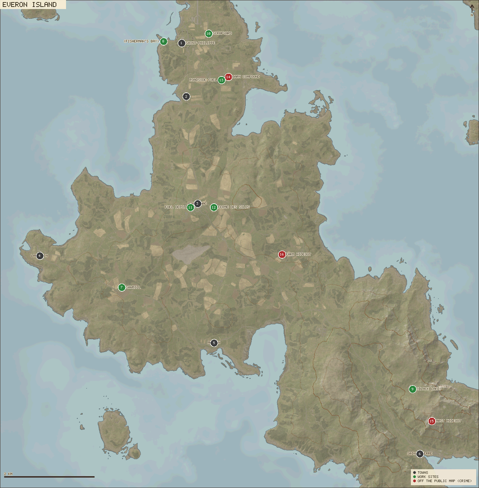
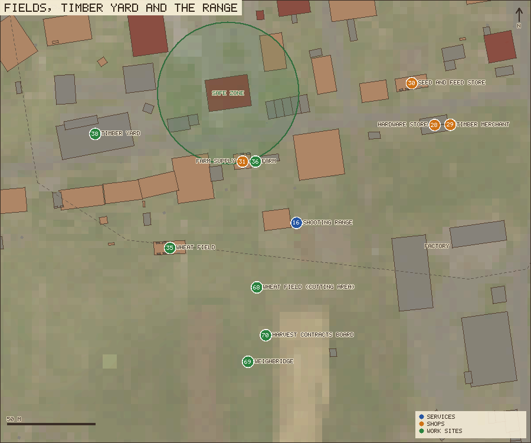
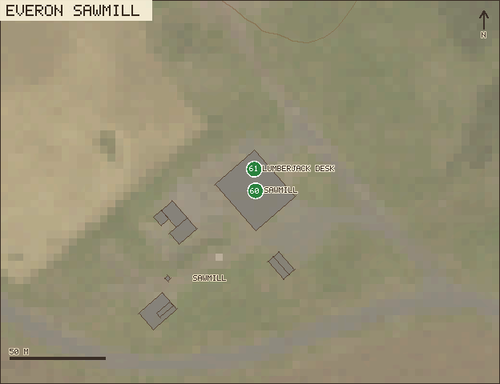
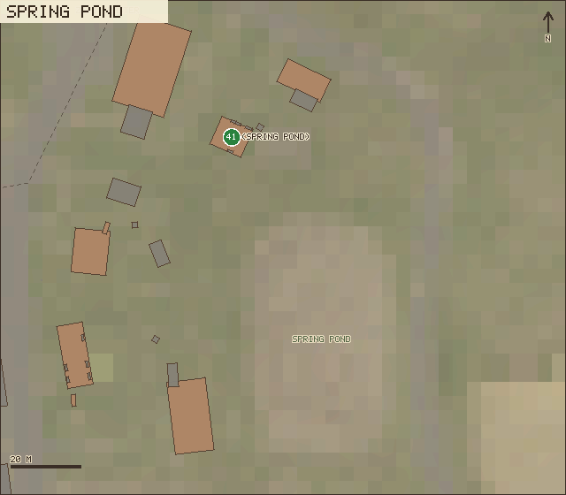
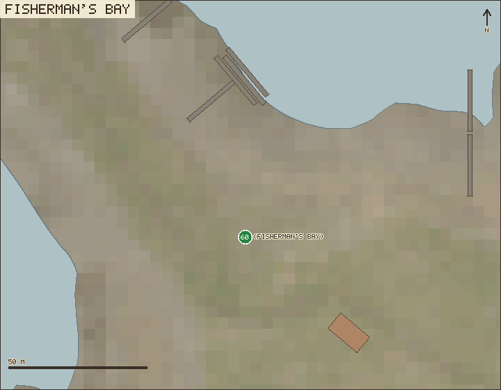
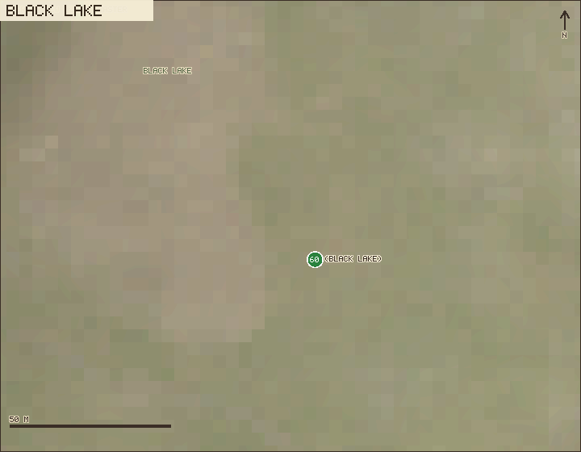
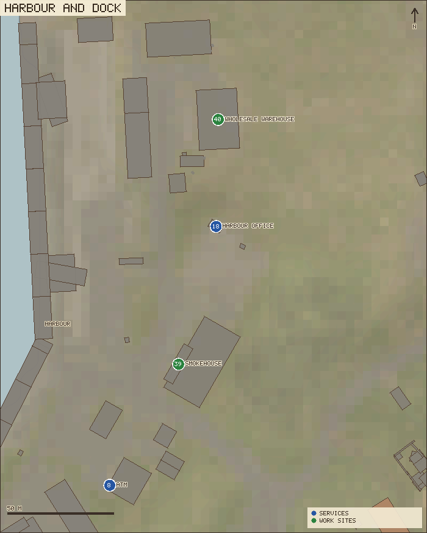
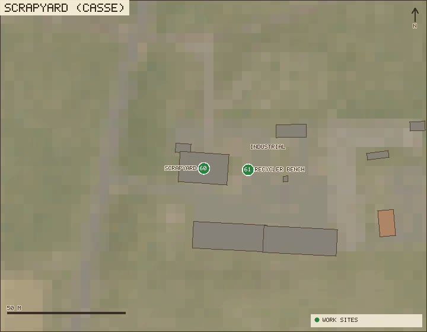

# 3. Jobs

Every card says **where**, **how to start**, **what you do**, **pay per hour** and **what you need**. Pay per hour is
a paper figure worked out from the server's own prices, assuming you do not waste time. Real
hours vary with how far you walk, drive and wait.

| Job | On the island now? | Pay per hour | Needs |
|---|---|---|---|
| [Parcel runs (courier)](#parcel-runs-courier) | ✅ yes | about **$400** (+25 percent at night) | nothing |
| [Postal van run](#postal-van-run) | ✅ yes | about **$480** (+25 percent at night) | a driving license |
| [Fuel delivery](#fuel-delivery) | ✅ yes | about **$560** (+25 percent at night) | work level 4 |
| [Taxi](#taxi) | ✅ yes | about **$600**, with a passenger | work level 6, a second player |
| [Harvest and farm](#harvest-and-farm) | ✅ wheat, garden, orchard | about **$420 to $480** for wheat | reaper and a tow vehicle |
| [Lumber](#lumber) | ✅ yes | about **$450** by hand, about **$740** with a truck | an axe |
| [Fishing](#fishing) | ✅ yes, sold at the dock wholesale | about **$430 to $470** at the three spots | rod and bait |
| [Scrap and recycling](#scrap-and-recycling) | ✅ yes, sold at the garage | about **$100 to $200** (a side income) | nothing |
| [Garbage round](#garbage-round) | ❌ not on the island | about $400 planned | |
| [Fuel haul](#fuel-haul) | ❌ no depot on the island | about $450 planned | |
| [Mining](#mining) | ✅ iron at Coalman's Brow and Highstone, coal at East Rise | about **$450** on the brow, **$460 to $520** with the east smelter or the coal | a pickaxe ($150) |
| [Export orders](#export-orders) | ✅ yes, at the dock | about **$700** | Delivery level 10 |
| [Police](06-police.md) | ✅ yes | **$350 to $450**, at most **$520** with the bonus | sign up at the station |
| [Medic](08-medic.md) | ✅ yes | **$480 to $560**, at most **$600** with the bonus | none |

## Where the job sites are

Saint-Philippe holds most of them; the sawmill, the fishing coves, the lake and the barn compound are out on the island.

<!-- map:island -->

| # | Place (in-game name) | Distance from Saint-Philippe | What is there |
|---|---|---|---|
| 1 | Saint-Philippe | - | Spawn, shops, police, clinic, bank, homes. Everything starts here. |
| 2 | Meaux | 1.2 km | Village on the road south. Nothing built for players yet. |
| 3 | Montignac | 3.6 km | Town with a notice board at the fuel depot. No shops yet. |
| 4 | Lamentin | 5.7 km | Western town. Scenery only. |
| 5 | Morton | 6.7 km | Southern town on the bay. Scenery only. |
| 6 | Saint Pierre | 10.5 km | Far south-east town. Scenery only. |
| 7 | Sawmill | 5.6 km | The island sawmill: lumberjack desk, two saws, boards. |
| 8 | Fishing spot (Fisherman's Bay) | 0.4 km | Sheltered cove with a bench and lantern. Gaspard tells you about it. |
| 9 | Fishing spot (Black Lake) | 9.2 km | A lake shore far to the south-east. |
| 10 | Scrapyard | 0.6 km | Scrap piles and the recycler bench. |
| 11 | Fuel depot | 3.7 km | Collective-farm fuel depot. Closed to players for now. |
| 12 | Silo Farm | 3.8 km | Roadside farm with a payphone. |
| 13 | Fuel station (roadside) | 1.2 km | Roadside fuel stop with a payphone. |
| 14 | Barn compound | 1.2 km | Chop yard and the moonshine still barn. |
| 15 | Contested ground | 10.1 km | Hilltop mast: a hideout organizations fight over. |
| 16 | Contested ground (farm) | 5.2 km | Farm compound: a second hideout. |
<!-- /map -->

**Levels.** Every paid run, felled tree, fish and revive earns job experience. Higher levels unlock the next job
(fuel delivery at Delivery level 4, about 3 paid parcel runs on this server; taxi at level 6, about 6) and licenses (felling, sawing, tools). A refusal message says what is
missing and where to get it.

<!-- unlocks -->
**What each level opens.** The level-up card and the F2 skill card name what a level really gives you. A level that opens nothing says so: it reads "Mining 13: steady and sure" and promises no perk. The levels that open something (a license, a machine step, a perk pick, a fish, a delivery job) are these; every other level from 2 to 30 is a milestone.

| Trade | Level | Opens |
|---|---|---|
| Farming | 2 | Orchard hand license: pick apples |
| Farming | 3 | Water collection permit: draw clean water |
| Farming | 4 | Plum picker license: pick plums |
| Farming | 5 | Seasoned field hand license: pick fruit and draw water twice as fast |
| Farming | 10 | First perk: pick Double yield or Swift hands at the labor office |
| Farming | 20 | Second perk: Light touch and Good word join the choices at the labor office |
| Mining | 2 | Coal face permit: the East Rise coal seam opens at Mining 4 |
| Mining | 3 | Mining 3: a steady swing |
| Mining | 4 | Iron seam permit: mine iron |
| Mining | 5 | Seasoned miner license: cut any ore twice as fast |
| Mining | 6 | Mining 6: you read the rock |
| Mining | 10 | First perk: pick Double yield or Swift hands at the labor office |
| Mining | 20 | Second perk: Light touch and Good word join the choices at the labor office |
| Lumber | 2 | Felling permit: fell trees with an axe |
| Lumber | 3 | Sawmill hand license: saw logs into planks |
| Lumber | 4 | Seasoned logger license: fell trees twice as fast |
| Lumber | 10 | First perk: pick Double yield or Swift hands at the labor office |
| Lumber | 20 | Second perk: Light touch and Good word join the choices at the labor office |
| Fishing | 2 | Bass: you can now land them |
| Fishing | 3 | Tuna: you can now land them |
| Fishing | 10 | First perk: pick Double yield or Swift hands at the labor office |
| Fishing | 20 | Second perk: Light touch and Good word join the choices at the labor office |
| Smelting | 2 | Smelter runs: up to 6 bars |
| Smelting | 5 | Bar molds: up to 7 bars a run |
| Smelting | 6 | The Morton cement works |
| Smelting | 7 | Faster smelting: 45-second runs |
| Smelting | 8 | Larger run: up to 8 bars |
| Smelting | 9 | Hotter fire: 35-second runs |
| Smelting | 10 | First perk: pick Double yield or Swift hands at the labor office |
| Smelting | 16 | Bigger batches: up to 10 bars a run |
| Smelting | 20 | Second perk: Light touch joins the choices at the labor office |
| Salvage | 10 | First perk: pick Double yield or Swift hands at the labor office |
| Salvage | 20 | Second perk: Light touch joins the choices at the labor office |
| Delivery | 4 | Fuel delivery: sign up at the depot counter |
| Delivery | 5 | Truck check: pass it at the truck yard for freight work |
| Delivery | 6 | Taxi fares: sign up at the depot counter |
| Delivery | 10 | Export orders: take one at the export board |
| Police | 10 | First perk: pick Fast cuff or Long radar at the police station |
| Police | 20 | Second perk: take the one of Fast cuff and Long radar you passed over |
| Medic | 2 | First aid certificate: treat the injured |
| Medic | 3 | Advanced first aid certificate: advanced treatment |
| Medic | 4 | Resuscitation certificate: revive the unconscious |
| Medic | 10 | First perk: pick Quick revive or Quick aid at the clinic |
| Medic | 20 | Second perk: Steady carry joins the choices at the clinic |
<!-- /unlocks -->

**First shift of the day.** The first 30 minutes you earn experience in a trade each day pay **double**. The clock starts
at your first paid outcome, not when you clock in. After the 30 minutes the rest of that day pays the normal rate. Each
trade has its own first shift, and a new day opens it again. A server restart opens it again too.

**Working beside a learner.** If you are level 10 or more in a trade and earn experience within 15 meters of someone under
level 10 in the same trade, you both get a small bonus (a tenth of the award). It works the other way round too, when the
learner earns. A pair can earn it once a minute, and your own other characters do not count.

**Night pay.** Parcel, postal van, fuel and taxi runs finished between **21:00 and 05:00 game time** pay **25 percent more**.
A game day is 2 real hours and the night passes twice as fast, so the window lasts about 20 real minutes in every 2 hours.

---

**Runs on the map.** Hover a job's badge on the map (**M**) and the whole run is drawn: dashed lines join its stops in order with numbers 1, 2, 3... and the card says where you are, e.g. *Mining run: step 2 of 5, next: ore rocks*. Runs: mining, apples, postal van, lumber and fishing. A stop you have not found yet stays off the map.

## Parcel runs (courier)

**Status:** ✅ live.

* **Where:** the **post office counter** (map name *Parcel depot*) on the main street, west of the hostel. The drops are
  **mailboxes on house walls** in the east districts and along the dock.
* **How to start:** press **F** at the counter, pick **Take courier work** (once), then **Pick up parcel**. The pickup asks for a small
  **refundable cash deposit** for the cargo. The note that follows names the amount and says it comes back on delivery.
* **What you do:** carry the parcel to a mailbox **at least 300 m** from the counter. The pickup note sends you to "the delivery stop marked on your map" and a waypoint marks it. At the box pick
  **Complete the run**. You cannot deliver instantly: a drop that is too close, or reached too fast, pays nothing and keeps your run.
  **Abandon the run** at the counter if you give up; you get no pay and lose the deposit.
* **Pay:** **$40 a run** ($50 at night). About 6 minutes a run is **$400 an hour**. A harbor contract run pays more
  once you have standing with the harbor master.
* **Needs:** nothing, and no license. Every paid run counts toward the next job.

The drops are on the east side (a house near the district road) and four along the dock; the post office is on the [Saint-Philippe map](maps.md).

## Postal van run

**Status:** ✅ live. A beginner job: no work level needed.

* **Where:** the **post stand** on the side wall of the post office kiosk in Saint-Philippe (map badge *Post office (van run)*).
  The far office is the stand beside the newspaper kiosk on the **Meaux** square, about 1.3 km south down the coast road.
* **How to start:** press **F** at the stand and pick **Take the postal van run**. A yellow post van is parked beside the office,
  locked, and its **key is in your pocket**: only you can drive it. One van at a time.
* **What you do:** pick **Load or unload a mail sack** four times at the home stand with the van beside it. Drive to Meaux (the
  waypoint shows the way), park by the stand there and unload the four sacks the same way. Drive back, park by the home stand
  and pick **Hand in the postal run**.
* **Pay:** **$80 a run** ($100 at night), plus delivery work experience. About 10 minutes a run is **$480 an hour**. A run handed
  in faster than 7 minutes pays nothing: the start toast and the hand-in say so, and the run stays open so you can hand it in later.
* **Lose the run:** wreck the van, or leave it and stay more than 350 m away for 3 minutes, and the run ends with no pay (after 2 minutes away a toast warns you how many seconds are left); the van
  goes back to the office. **Give up the postal run** at a stand does the same at once. A new van is ready a minute later.
* **Needs:** a **driving license** ($100 at the license desk). The van is lent, never yours: it is not saved and cannot be garaged.

## Fuel delivery

**Status:** ✅ live. Needs **Delivery level 4** (about 3 paid parcel runs).

* **Where:** sign up at the **post office counter**. You take a **fuel can** at the **filling station** and carry it to a **fuel drop**,
  a drum in a farm yard on the edge of the village or under the sheds above the quay.
* **What you do:** pick the fuel work at the post office counter, take the can at the station, carry it to a drop and use the
  drop-off action. A drop that is too close to where you started is refused: take it to a farther one.
* **Pay:** **$75 a run** ($94 at night). About 8 minutes a run is about **$560 an hour**, and every run counts toward your Delivery level.
* **Needs:** Delivery level 4. No license.

## Taxi

**Status:** ✅ live. Needs **work level 6** (about 6 paid parcel runs) and **another player in your car**.

* **Where:** the **taxi rank** at the clinic corner. A beige cab waits at the curb. Sign up at the post office counter
  (**Take taxi work**), then press **F** at the rank for **Start fare**.
* **What you do:** pick the passenger up, drive to the stop on your waypoint, and complete the run with the passenger still seated.
* **Pay:** between **$90 and $150** a fare by distance; a 2 km trip pays about $100. About **$600 an hour** with a steady stream of fares.
* **Needs:** work level 6 and a real passenger seated in the cab when you drop them off.

## Getting around by bus

**Status:** ✅ live. Not a job: the cheap way to reach work before you own a car.

* **Where:** the **bus stop** signs (a round blue bus plate on a yellow pole) at the curb, shown on the map as **Bus stop**.
  Every stop has a printed **timetable board** on its pole: the line's name, this stop marked **You are here**, then every
  other stop, nearest first, with its fare. Walk up to it and read it.
* **How:** look at the sign and scroll the action list: one line per stop, nearest first, such as
  **Bus to Harbor: $18, 20 s**. Press **F** on the one you want: the fare comes out of your **cash** (not the bank).
  There is no window. A grayed line tells you why: **Not enough cash**, **Police nearby** (when you are wanted),
  **Next bus not due yet** or **Ticket already bought**.
* **The wait:** **20 to 30 seconds** at the stop; a hint counts it down. The screen fades, and you stand beside the sign at
  the stop you picked. Changed your mind? **Cancel trip (refund)** is on the same sign while you wait.
* **Fare:** **$15** plus about **$6 a kilometre**, never more than **$45**.
* **Cancelled and refunded:** walk more than a few meters from the sign, get hurt or start a fight, go down, get cuffed or
  climb into a vehicle while you wait. You get the fare back.
* **Refused:** no ticket while dead, downed, cuffed or jailed, in a vehicle, in a fight, or wanted with the police close by.
  After a ride, the next bus is a minute away.

## Harvest and farm

**Status:** ✅ wheat harvest, vegetable plots, beehives and orchard are live. There is **no mill or bakery flour** yet.

* **Where:** the **wheat field** at the south-west edge of town: a contract board at the gate and a weighbridge south of it.
  The **farm supply** counter and the implement rack are in town beside the farm.
* **How to start (wheat):** buy the **reaper** at the farm supply counter (**$1,200**, you keep it for good), or take a **rental kit**
  from the contract board (a **$300 deposit** that comes back when you return it; it comes with a vehicle). At the rack, use **Take out reaper**
  to hitch it behind a **UAZ469** or **Z7211**.
* **What you do:** at the board pick **Post contract** (once per ripe field), then **Take with own reaper** or **Take with rental kit**.
  Drive slowly over the wheat (the reaper cuts a 3 m bar between **2 and 20 km/h**; faster or slower cuts nothing). The hopper fills at 10 kg a
  3 m square and holds **600 kg**. Drive to the **weighbridge**, stay on the scale and pick **Sell grain** (the market price, falling a little per lot and recovering through the hour)
  or **Bag grain**. **Return kit** at the board when you are done.
* **Pay:** about **$416 an hour** selling grain, rising a little with a good price. The field grows back, so you can go round again.
* **Needs:** the reaper and a vehicle to tow it. Buying a car needs the driving license.
* **Smaller jobs:** a **vegetable plot** at the farm (plant cabbage seeds, water, harvest; sell cabbage at the market stall for about $4), the **beehives** (honey sells at the market stall from about $8 falling to $4; a hive kit is $120),
  and the **orchard** (take the farmer job at the desk and gather apples and plums; wholesale pays about $5 and $4 and falls as you sell). These are pocket money next to the wheat.

<!-- map:inset:farm-timber -->

| # | Place | What |
|---|---|---|
| 16 | Shooting range | Three target lanes. |
| 28 | Hardware store | Axe, shovel, planks, cement, radio, repair kit. |
| 29 | Timber merchant | Sells your planks and hardwood boards. |
| 30 | Seed and feed store | Fishing rod, bait, seeds. |
| 31 | Farm supply | The reaper and beehive kit. |
| 35 | Wheat field | Harvest contracts and the weighbridge. |
| 36 | Farm | Vegetable plots, beehives, honey kitchen. |
| 38 | Timber yard | Lumberjack job desk and sawmill. |
| 68 | Wheat field (cutting area) | The ripe wheat you cut with the reaper. |
| 69 | Weighbridge | Unload the reaper hopper here: Sell grain or Bag grain. |
| 70 | Harvest contracts board | Post, take and return harvest contracts. |
<!-- /map -->

## Lumber

**Status:** ✅ live. The timber yard at the village edge and the island sawmill both work.

* **Where:** the **timber yard** (sign *Sawmill*) on the western edge of town, with a **lumberjack desk** and a saw. The **timber counter**
  (*We buy timber*) is on the curb of the **hardware store** on the south-east road. The **island sawmill** is far to the south
  (about 5.6 km); see the island map.
* **How to start:** take the **lumberjack job** at the desk. Buy an **axe** ($120) at the hardware store.
* **What you do:**
  1. **Fell a tree** with the axe in your hands (not in a safe zone, not within 4 m of a road or 12 m of a building). The tree falls **away from you**, so stand on the side you want it to miss. When it lands, the trunk turns into the logs (one per log the tree gives) lying along the line it fell, with a few branches round the crown. A softwood tree (pine, spruce, larch) gives softwood logs; a hardwood tree (hornbeam, linden, alder, birch, poplar) gives the heavier hardwood logs. Collect them soon: logs nobody picks up are gone after about 30 minutes, and the branches clear in a few.
  2. Carry the logs to the **saw** and pick a cut: a **softwood** log makes **4 planks and kindling**, or **2 posts**, or **4 firewood**; a **hardwood** log makes **2 boards** or **5 firewood**.
     With a van or truck, back it up to the saw (rear within about 3 m): when you carry no logs, the action reads
     **Feed from the truck** and the saw takes the logs straight from the vehicle and puts the cut back in it. A locked
     vehicle feeds nothing. Every processing station works this way.
  3. Sell **planks ($8)** and **hardwood boards ($15)** at the **timber counter**. If its purse is full it tells you to
     "try the wholesale warehouse at the dock". The dock pays a lower, falling price for planks, boards, posts and firewood.
* **Pay:** about **$400 an hour** carrying softwood by hand. With a truck and hardwood boards, about **$700 to $800 an hour**:
  the timber counter takes about 28 boards an hour at $15, and the rest sell at the wholesale counter beside it for less.
* **Needs:** an axe. Job levels unlock sawing and faster felling (a refusal says what is missing).
* **Shift board:** at the **island sawmill** a cork **shift board** stands under the roof at the front of the hall, a few steps from the lumberjack desk. **Read the shift board** lists the week's top five workers at the sawmill by the trade XP they earned there, with their trade level. The list empties every Monday at 06:00 UTC.

<!-- map:inset:sawmill -->

| # | Place | What |
|---|---|---|
| 60 | Sawmill | Lumberjack desk and two saws inside the hall. |
| 61 | Lumberjack desk | Sign on as a lumberjack. |
<!-- /map -->

## Fishing

**Status:** ✅ live. You can catch, smoke and **sell** fish: the **wholesale warehouse** on the dock buys every fish and every smoked fish at a fixed price.

* **Where:** three spots. **Spring Pond** has a jetty in town, south-east of the square. **Fisherman's Bay** is a sheltered cove on the west coast
  (Gaspard, the old man on the bench in town, tells you about it once you land three fish). **Black Lake** is far to the south-east.
  The **smokehouse** is on the dock.
* **How to start:** buy a **fishing rod ($60)** and a **bait tin ($30)** at the **seed and feed** store.
* **What you do:** hold the rod, aim at the water within casting range and **fire** to cast. Wait **15 to 60 seconds** for a bite: the float is pulled under.
  **Fire again within 2 seconds** to land it. You can cast about 6 times a minute. Bait makes bites faster. A spot holds about 14 fish and refills one fish every 90 seconds.
  The pond gives **perch, carp and trout**; the bay and open sea give **mackerel, bass and tuna**; the fish depend on the time of day.
* **Smokehouse:** put a fresh medium fish and **one firewood bundle** in the smoker; 30 seconds later you have a **smoked fish**.
* **Selling:** walk into the **wholesale warehouse** on the dock (the same counter that buys planks, iron bars and cement), press **F** on the clerk's counter and sell the fish. It pays a fixed price, the same every time (no falling price), and takes a whole stack in one go:

  | Fish | Small | Medium | Large | Smoked |
  |---|---|---|---|---|
  | Trout | $4 | $12 | $22 | $18 |
  | Perch | $3 | $11 | $19 | $16 |
  | Mackerel | $3 | $7 | $13 | $16 |
  | Carp | $5 | $13 | $24 | $21 |
  | Bass | $5 | $10 | $21 | $23 |
  | Tuna | $10 | $20 | $39 | $43 |

* **Pay:** a spot refills one fish every 90 seconds, about **40 fish an hour** once its first stock is fished out; between those, the same water keeps giving small fish (a little slower). That is about **$430 an hour** at Spring Pond or Black Lake and about **$470** at the cove at Fisherman's Bay, and more in the first hour while the stock lasts. Bass bite only in the evening (17:00 to 21:00); the rest of the day the cove gives mackerel. Smoking a medium fish (plus a firewood bundle) turns $7 to $13 into $16 to $23, so the smokehouse is worth the walk when you have fish to spare.
* **Needs:** rod and bait.

<!-- map:inset:pond -->

| # | Place | What |
|---|---|---|
| 41 | Fishing spot (Spring Pond) | Fish from the jetty. |
<!-- /map -->
<!-- map:inset:bay -->

| # | Place | What |
|---|---|---|
| 60 | Fishing spot (Fisherman's Bay) | Sheltered cove: mackerel, bass and more. |
<!-- /map -->
<!-- map:inset:lake -->

| # | Place | What |
|---|---|---|
| 60 | Fishing spot (Black Lake) | Quiet lake shore with a bench and a lantern. |
<!-- /map -->
<!-- map:inset:harbour -->

| # | Place | What |
|---|---|---|
| 8 | ATM (harbour) | Cash machine on the dock. |
| 18 | Harbor Office | The harbour master. |
| 39 | Smokehouse | Smoke your fish. |
| 40 | Wholesale warehouse | Buys bulk goods at a falling price. |
<!-- /map -->

## Scrap and recycling

**Status:** ✅ live. The yard works and the **garage mechanic in Saint-Philippe buys scrap metal, copper wire and rubber scrap**. Iron bars sell at the dock wholesale yard.

* **Where:** the **scrapyard** (sign *Scrapyard*) east of town, about 450 m east-north-east of the filling station.
* **How to start:** walk in. No sign-up.
* **What you do:** **search the scrap piles** for scrap metal, rubber, copper wire coils, worn hand tools and old radios. At the **recycler bench**
  pick **Load** with an item, **hold Work** (each worker adds one unit, so two people finish twice as fast) and **Collect** the parts.
  A worn tool gives scrap metal, an old radio gives metal and wire, **car parts give 3 iron bars**.
* **Selling scrap:** take it to the **garage** (map name *Garage*, the mechanic's counter in the districts; see the [Saint-Philippe map](maps.md)), press **F** at the till and sell. The mechanic pays **half the catalog price**, a fixed price with no stock limit and no questions about where it came from: **scrap metal $4, copper wire coil $12, rubber scrap $5**. He does not buy stolen goods or the worn tools and old radios (break those down at the bench first).
* **Pay:** a bench load (a worn tool is $12 of metal, an old radio is $20 of metal and wire) and the loose finds come to about **$100 to $200 an hour** at one search every four minutes, a side income and not a main job. Iron bars sell for about $20 each at the dock wholesale yard and fall as you sell. Car parts cost $200 at the garage, so buying them to recycle loses money; the yard is for parts you find or chop.
* **Needs:** nothing.

<!-- map:inset:scrapyard -->

| # | Place | What |
|---|---|---|
| 60 | Scrapyard | Search the scrap piles; the recycler bench is in the yard. |
| 61 | Recycler bench | Break car parts and scrap into metal. |
<!-- /map -->

## Garbage round

**Status:** ❌ **not on the island yet.** The route job is built and tested in the test grid only. No depot desk, truck or dump is placed.

The plan: take the garbage round at a depot desk, drive the company truck to the 5 nearest bins in order, **Empty bin** at each, and **Tip the load** at the dump. The truck opens only for you.
It pays **$15 a bin plus a $25 bonus, $100 a round** (about $400 an hour, no buy-in).

## Fuel haul

**Status:** ❌ **not on the island yet.** The code and a fuel depot yard at Montignac exist, but no fuel pickup or depot desk is placed, so the run cannot start.

The plan: buy a **1,000-litre load** at the Montignac depot at $0.90 a liter (the locked depot tanker then opens for you alone), pump it into a station tank and earn **$1.35 a liter**
(a $450 margin per haul, about $450 an hour). The **filling station** pumps in town sell from a 3,000-litre tank (**$2 a liter**). If the tank runs dry
the pump says "The tanks are dry. The depot truck is due."

## Mining

**Status:** ✅ live. Iron is mined at **Coalman's Brow**, the hill just south of the village, and at **Highstone**; coal is cut at the **East Rise** seam.
Copper, gold and stone are not on the island yet.

* **Where:** the **iron mine** (sign *Coalman's Brow mine*, map label **Iron mine**) on the wooded north side of the brow, about 350 m south of the square past the farms; the track off the road to the west leads up to it.
  It has the **miner's desk**, a **miner's supply** counter, six rust-veined **iron rocks** at the foot of a granite rock face, and a **furnace**. The **pickaxe** is sold at the
  supply counter beside the desk, at the **hardware store** on the south-east road and in the general store.
* **How to start:** take the **miner job** at the desk by the mine (**Take the job: Miner** on its clock). A desk job such as miner, lumberjack or farmer now stays with you after a restart and after a respawn. Then buy a **pickaxe** ($150) at the supply counter. Any new miner can buy it.
* **What you do:**
  1. Hold the pickaxe and **swing at an iron rock**. Every few swings an **iron nugget** breaks off and drops at your feet; pick it up.
     A rock gives 5 pieces, shrinks as you work it, then crumbles and grows back after about 5 minutes. Each piece is miner XP.
  2. Take the nuggets to the **furnace** and choose **Smelt iron nuggets**: **3 nuggets make 1 iron bar**. One run smelts up to 5 bars in 4 minutes;
     keep mining while it works, the bars drop at the furnace when it is done. Every finished batch is **Smelting** XP, a trade of its own with its own level; it is not Miner XP.
  3. Sell the bars at the **iron counter** in the **wholesale warehouse** at the dock, east of the main counter (**$20 a bar**; it buys 40, then about 24 more an hour). If it says
     it is full, the main wholesale counter buys more (from $20 a bar, falling as you sell).
* **Pay:** about **$450 an hour** at the brow, with nothing to drive. Two players share the six rocks and the furnace comfortably.
* **The second rung (Smelting and Mining levels):**
  * **Highstone iron mine**, about 2.3 km south of the square: four iron rocks that give 5 nuggets each, and two richer rocks (6 nuggets) that need **Mining 12**. There is no desk or furnace there.
  * **East Rise coal seam**, about 3.6 km south-east: four coal rocks that give 6 lumps each and open at **Mining 4**. The **power plant coal yard** (about 1.7 km south-east) buys coal at **$8 a lump** until its purse runs out for the hour (60 lumps, 26 more each hour); the rest goes to the dock wholesale at a falling price.
  * **Iron smelter** at the east works compound, about 4.7 km south-east: **2 nuggets and 1 coal make 1 iron bar**. One run takes 60 seconds and gives up to 5 bars; it is open from Smelting level 1. Bars sell at the dock wholesale (the hardware store counter also buys them at $22 each for a small purse an hour). The same run pays about **$515 an hour** with a pickup or truck for the haul.
* **Shift board:** a cork **shift board** stands in the mine yard near the miner's desk. **Read the shift board** lists the week's top five workers at the mine by the trade XP they earned there, with their trade level. The list empties every Monday at 06:00 UTC.
* **Wear:** every swing at a rock wears the pickaxe you swing a little (an axe wears with each tree felled, a fishing rod with each fish landed). Each tool keeps its own condition: a new pickaxe starts in top shape whatever your old one looked like, and a worn one stays worn in your pack, on the ground, in someone else's hands and after a restart. A notice names the tool when it is getting worn, when it is badly worn, and after every use once it is worn out. A worn-out tool still works. At the hardware bench, hold the tool you want fixed: $12 and a scrap of metal bring that one tool back to top shape.
* **Better tools:** the miners' supply till in the hardware store also sells the pickaxe, axe and fishing rod in three finishes: worn ($150), standard ($600) and fine ($1,800). A better finish wears slower: a worn tool loses twice as much per use as a standard one, a fine one half as much. The standard pickaxe or axe needs trade level 3 and the fine one level 6; below that the till refuses in words.
* **Needs:** the miner job and a pickaxe. Mining 4 opens the coal seam and Mining 12 the rich Highstone rocks; the level-up card at Mining 2 names the coal permit and says so (the seam still needs Mining 4). The island has no copper or gold rock, so no card names a copper or gold permit. The smelter, the refinery and the cement works are Smelting work: batches there earn Smelting experience, and the iron smelter takes anyone from Smelting level 1 (you earn the trade by smelting), while the copper refinery (Smelting level 15) and the cement works (level 6) are not on the island yet. At the iron smelter the level grows the run: up to 6 bars at level 2, 7 at level 5, 8 at level 8 and 10 at level 16, and the run itself drops from 60 to 45 seconds at level 7 and to 35 at level 9 (the level-up card names each one). Where a trade has a level gate, the refusal says it in words: "Needs Smelting 15".

## Export orders

**Status:** ✅ live. The board stands on the warehouse wall at the dock and the crane spot is on the quay.

* **Where:** the **EXPORT ORDERS** board on the warehouse wall by the quay, and the **crane spot** (a pallet box on the quay apron by the harbor crane).
* **How it works:** the board lists up to three orders, such as *40 x iron bars to the steamer | $1040 by 23:00*; a new order opens every 30 game minutes while a slot is free. Scroll to **Take the order** on a line to take it (haulers at Delivery level 10 or higher; one order at a time). Bring every unit to the crane spot, in your pockets or in a vehicle backed up to the pallet box (a truck holds every order's full count), and choose **Hand in the export order**.
* **Pay:** the order's price in cash (the market's wholesale price plus 15 percent, plus an order bonus) and Delivery experience. Every kind of order pays about $700 an hour of mining or sawing: 40 iron bars $1,040, 100 coal $985, 120 planks $1,018. A short count takes nothing: bring the rest and hand in again. Miss the deadline (20 game hours for iron, 24 for coal, 30 for planks) and the order closes and your standing in town drops; it never costs money.
* **Copper:** the board offers no copper order, because no copper seam is placed on the island yet. It comes back with the copper chain.

* **Paper:** a paid shift hands you a payslip, a parcel run a delivery note, and a sale at the granary or a buyer a weigh slip. Each shows what was sold or paid and the date; choose **Read receipt** on it to read it.
