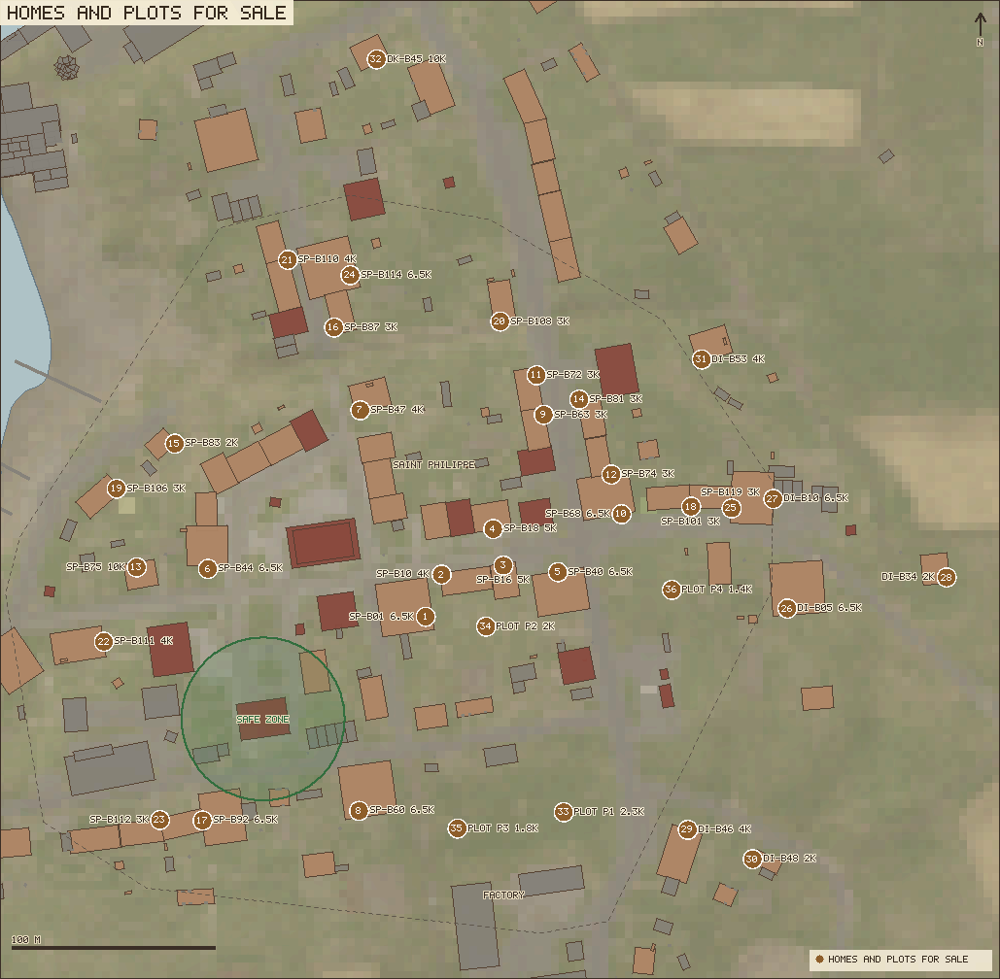

# 4. Homes

Saint-Philippe has **32 homes for sale** and **4 building plots**. Every other building is a shop, a civic building,
a resident's own house (locked, with a brass name plate) or a barn and lock-up (locked).

## Buying a home

1. Walk to a house with a **For sale** sign on its wall. The sign shows the tier ("Cottage", "Village house",
   "Family house", "Town house", "Farmhouse" or "Villa") and the price.
2. Carry the price in **cash**. Withdraw it at an ATM first; homes are not paid from the bank.
3. Stand within 5 m of the sign and press **F**. Pick **Buy house**. The money leaves your hands and the sign shows **sold**.
4. A **house key** goes into your inventory. The key is bound to that house.

There is **no sell-back**.

| Tier | Listed price | Alpha price (half) | Homes |
|---|---|---|---|
| Cottage | $4,000 | **$2,000** | 3 |
| Village house | $6,000 | **$3,000** | 10 |
| Family house | $8,000 | **$4,000** | 6 |
| Town house | $10,000 | **$5,000** | 2 |
| Farmhouse | $13,000 | **$6,500** | 9 |
| Villa | $20,000 | **$10,000** | 2 |

## Keys and locks

* Every home door is **locked for everyone but its owner and key holders**. An owner (or key holder) presses **F** at the door to lock or unlock it.
* Your key opens your door. A stranger needs a key or a lockpick (see [Crime](07-crime.md)).
* Your home stays yours after a **server restart**.

## Spawning at home

Stand at your door and pick **Make this my spawn**. One home at a time: choosing a second one clears the first. If you sell or lose the house
the spawn goes back to the default. A rejoin still puts you where you logged out (within 12 hours).

## Plots

A **plot** is an empty building site with a *For sale* sign. Buying one is the same as a house. Then you **deposit materials** stage by stage
and pick **Build** (a 2 second hold per work unit) to raise the shell. Only the owner and invited key holders can build there.
The four plots cost **$1,400, $1,750, $2,000 and $2,250** at the alpha price.

## Map

<!-- map:homes -->

The label on the map is the home's code and its alpha price in thousands. Prices are the alpha price (50 percent of the list).

| # | Home | Tier | List price | Alpha price |
|---|---|---|---|---|
| 1 | SP-B01 | Farmhouse | $13,000 | **$6,500** |
| 2 | SP-B10 | Family house | $8,000 | **$4,000** |
| 3 | SP-B16 | Town house | $10,000 | **$5,000** |
| 4 | SP-B18 | Town house | $10,000 | **$5,000** |
| 5 | SP-B40 | Farmhouse | $13,000 | **$6,500** |
| 6 | SP-B44 | Farmhouse | $13,000 | **$6,500** |
| 7 | SP-B47 | Family house | $8,000 | **$4,000** |
| 8 | SP-B60 | Farmhouse | $13,000 | **$6,500** |
| 9 | SP-B63 | Village house | $6,000 | **$3,000** |
| 10 | SP-B68 | Farmhouse | $13,000 | **$6,500** |
| 11 | SP-B72 | Village house | $6,000 | **$3,000** |
| 12 | SP-B74 | Village house | $6,000 | **$3,000** |
| 13 | SP-B75 | Villa | $20,000 | **$10,000** |
| 14 | SP-B81 | Village house | $6,000 | **$3,000** |
| 15 | SP-B83 | Cottage | $4,000 | **$2,000** |
| 16 | SP-B87 | Village house | $6,000 | **$3,000** |
| 17 | SP-B92 | Farmhouse | $13,000 | **$6,500** |
| 18 | SP-B101 | Village house | $6,000 | **$3,000** |
| 19 | SP-B106 | Village house | $6,000 | **$3,000** |
| 20 | SP-B108 | Village house | $6,000 | **$3,000** |
| 21 | SP-B110 | Family house | $8,000 | **$4,000** |
| 22 | SP-B111 | Family house | $8,000 | **$4,000** |
| 23 | SP-B112 | Village house | $6,000 | **$3,000** |
| 24 | SP-B114 | Farmhouse | $13,000 | **$6,500** |
| 25 | SP-B119 | Village house | $6,000 | **$3,000** |
| 26 | DI-B05 | Farmhouse | $13,000 | **$6,500** |
| 27 | DI-B10 | Farmhouse | $13,000 | **$6,500** |
| 28 | DI-B34 | Cottage | $4,000 | **$2,000** |
| 29 | DI-B46 | Family house | $8,000 | **$4,000** |
| 30 | DI-B48 | Cottage | $4,000 | **$2,000** |
| 31 | DI-B53 | Family house | $8,000 | **$4,000** |
| 32 | DK-B45 | Villa | $20,000 | **$10,000** |

| # | Plot | List price | Alpha price |
|---|---|---|---|
| 33 | Plot P1 | $4,500 | **$2,250** |
| 34 | Plot P2 | $4,000 | **$2,000** |
| 35 | Plot P3 | $3,500 | **$1,750** |
| 36 | Plot P4 | $2,800 | **$1,400** |
<!-- /map -->
