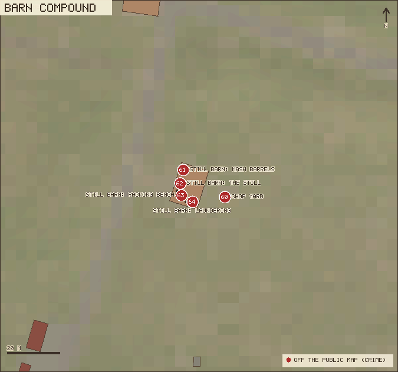
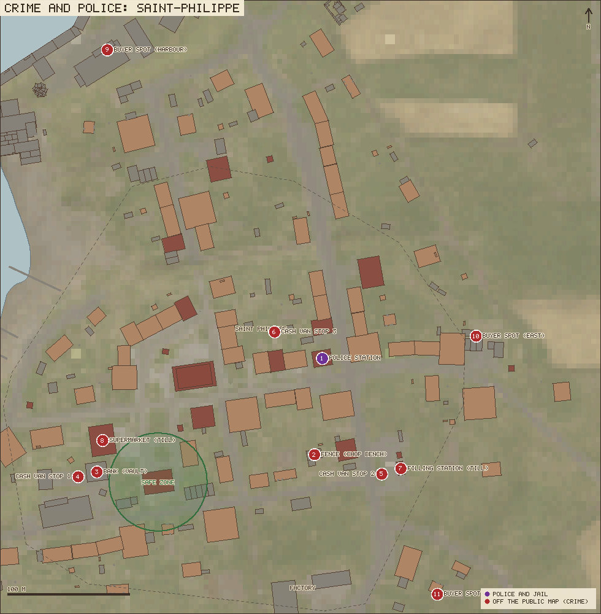

# 7. Crime

Crime pays more than a day job and costs more when it goes wrong. Everything here raises your **wanted level** (1 to 5), which the police
see on the **wanted board**. A wanted player can be **arrested**; the cell time is 60 seconds per level, 5 minutes at most.
**New characters are refused for their first 5 minutes of play**, so you cannot rush in before you have found your feet.

## Wanted level

| Offence | Adds |
|---|---|
| Robbing a till | +1 |
| Shoplifting | +1 |
| Breaking into a building | +1 |
| Stealing a car (not by force) | +1 |
| Cash van or armoury or bank heist | +1 each |
| Robbing a hospital | +1 |
| Stealing a weapon | +2 |
| Carrying an unlicensed item | +1 |
| Carrying a restricted item | +2 |
| Carrying an illegal item (a search finds it) | +2 |
| Carjacking (taking a car by force) | +3 |
| Murder | +3 |
| An unpaid fine that has run late | +1 |
| Chop shop, lockpick, moonshine | 0, but on your record |

The level is capped at 5. An arrest sentence ends with one level **removed**.

## Robbery

* **Fuel station till.** Draw a weapon and talk to the attendant; a robbery reply appears only while a weapon is out. A hold timer with a bar starts and
  warns you if you leave its radius. If it pays you get **$150** in cash. A downed attendant ends the hold unpaid.
* **Supermarket till.** Pays **$120 to $180**, same rules. Both tills have a **cooldown** after a robbery and refuse if you have no room to carry the cash.
* **Weapons and cars.** Stealing a weapon adds +2; taking a car by force adds +3. Only civilians can do either; the police see it at once.
* **Crew tills.** Where a till needs a crew, **Start the job** gathers every armed civilian within 15 m.
* **Hospital till.** Robbing it adds +1 and rings the hospital alarm.

**Everyone sees the alarm on the map.** While a till, the bank vault, the clinic cabinet or the armoury is being robbed, its badge on the map (**M**) has a **pulsing red ring with a "!"** for about three minutes after the alarm; then it turns **grey** for fifteen minutes ("Robbed recently"). Hover the badge to see when the alarm went off. Police still get their own radio call.

## Lockpicks, drills and the fence

The **fence** (map name *Fence*, off the public map, in a yard just east of the square) sells crime tools **only to people with a record**:

| Tool | Price | Crimes needed |
|---|---|---|
| Lockpick | $250 | 0 |
| Police scanner | $900 | 2 |
| Drill | $2,500 | 3 |
| Keycard | $1,500 | 8 |
| Breaching charge | $4,000 | 5 |

A **lockpick** opens a house or shop door (+1 break-in, and a witness can call it in). The fence also **buys stolen car parts** at half price.

## Chop shop

Steal a car, drive it to a **chop bench**, and take it apart: hold **Work** for 6 units. You get **30 percent of its value, up to $3,000**, plus car parts (2). A chop bench has a
**5 minute cooldown**. A stolen **UAZ469** is worth $750; the **M923A1** truck $2,400; a **T601** $210.

There are two benches: in the **fence yard** in town, and at the **barn compound** (see the map) on the country road south-east of town. The fence yard is closer to the police station.

<!-- map:inset:barn -->

| # | Place | What |
|---|---|---|
| 60 | Chop yard | Chop stolen cars (a back-country bench). |
| 61 | Still barn: mash barrels | Mash plums and cabbage. |
| 62 | Still barn: the still | Distill the mash into moonshine. |
| 63 | Still barn: packing bench | Pack bottles into crates. |
| 64 | Still barn: laundering | Wash marked cash, keep 65 percent. |
<!-- /map -->

## Moonshine

Everything is at the **still barn** in the barn compound. Three **mash barrels**, one **still** and one **packing bench**.

1. **Mash:** load plums or cabbage into a barrel and **hold Work** (12 units; more hands finish sooner).
2. **Distill:** put the mash in the still and **hold Work** (16 units). Collect a **bottle of moonshine**.
3. **Pack:** at the bench hold Work (10 units) to make a **contraband crate**.
4. **Sell** at a **buyer spot** (three in town, off the public map). A bottle is worth about **$60**.

The work can **go wrong**: a 6 percent chance on each work tick. Three strikes **ruin the batch** and the barrel **explodes**, hurting anyone close.
The barn also gives off **smoke and heat** that police can follow. Some chains need a licence or equipment; the refusal says which.

## Laundering

Crime cash on this server is **marked**. Wash it at the **laundry station** in the still barn: you keep **65 percent** (the washer takes a 35 percent cut),
**up to $1,500 a batch**, a batch takes 90 seconds, and there is a daily cap of **$6,000**.

## Bank heist

Needs **at least 2 police on duty**. You have **12 minutes**.

1. **Staff door.** Breach the bank's staff door (lockpick or charge). The alarm rings, dispatch hears, and the clerk may put their hands up.
2. **Vault.** Open the vault with a **drill** or a **breaching charge**. Money bags spill on the floor. **Carry** them: dropping a bag leaves the cash in the world.
3. **Getaway.** Every crew member must get **more than 120 m** from the bank before the clock runs out.

The **cash van** is easier and smaller. It parks at three stops in town for 5 minutes at a time (it moves if nobody is within 40 m). Open its **cash box** with a drill or a charge; money bags spill beside it. It counts as +1 wanted and sets off the van alarm.

## Jailbreak

Breaking someone out takes **two breaching charges**.

1. **Outer door.** Charge the jail's outer door. The fuse is **20 seconds**. The alarm rings and dispatch hears where.
2. **Cells.** With the outer door open, charge the cell door (**15 seconds**). The cells cannot be charged while the outer door is still shut.

When the cells blow, **every prisoner in the cell is free**: their sentence ends, and they are wanted for escaping custody. Whoever set the cell charge gets **+4 wanted** for the jailbreak. A prisoner cannot set a charge from inside. The doors seal themselves again after **10 minutes** (police can repair them sooner), and the jail cannot be charged again for **an hour** after a break.

## Hideouts

Two **contested sites** (a hideout on the hilltop mast and the farm compound) are fought over by organizations. Organizations are run from the **organization office** in town; the **war board** there lists the fights.

<!-- map:crime -->

| # | Place | Why you care |
|---|---|---|
| 1 | Police station | Robbers want it far away. Officers want it close. |
| 2 | Fence (chop bench) | Fence, lockpicks, drills. Chop stolen cars. |
| 3 | Bank (vault) | Bank heist: staff door, vault, getaway. |
| 4 | Cash van stop 1 | The cash van parks here for 5 minutes at a time. |
| 5 | Cash van stop 2 | Next stop on the van's schedule. |
| 6 | Cash van stop 3 | Next stop on the van's schedule. |
| 7 | Filling station (till) | Hold up the attendant for 150. |
| 8 | Supermarket (till) | Till robbery, 120 to 180. |
| 9 | Buyer spot (harbour) | Where a buyer takes goods that cannot be sold in a shop. |
| 10 | Buyer spot (east) | Same, east side. |
| 11 | Buyer spot (north-west) | Same, west side. |
<!-- /map -->
